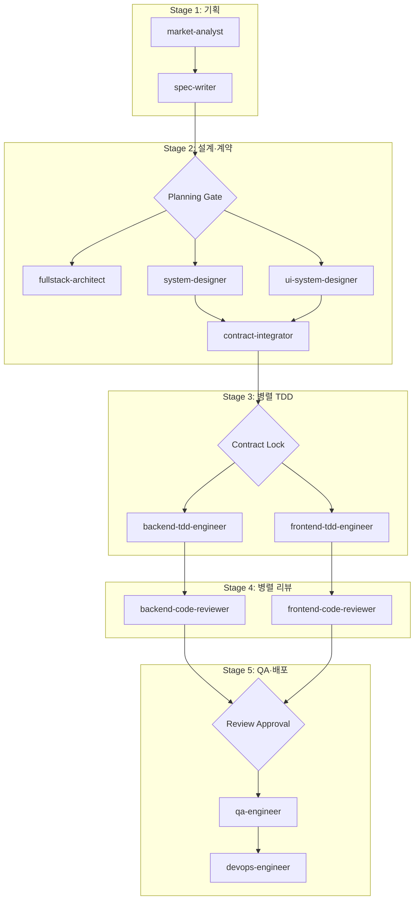

# AgentLens

AI 에이전트·하네스·MCP 기술 소식을 모아 요약하고, AI 챗 질의응답·일일 브리핑·외부 채널 공유·MCP 서버를 제공한다. `backend/`(FastAPI, Python 3.11)와 `frontend/`(Next.js 16, pnpm) 두 앱이고, 인터페이스는 REST `/api/*`(SSE 포함)다.

## 명령
- 검사: `make check` (실패 시 0 이 아닌 값으로 끝난다. 작업 완료 보고에 출력을 붙인다). backend pytest + frontend vitest·eslint·`tsc --noEmit`
- `make test` 는 `make check` 와 같다.
- 환경 준비: `make setup` (다시 돌려도 된다. `.venv` 가 Python 3.11 이면 건너뛴다) · 프론트 빌드: `make build` · 정리: `make clean` (설치물·빌드 산출물·캐시만 지우고 DB·설정은 남긴다)
- 로컬 실행: `make dev` (backend :8000 `--reload` + frontend :3000 을 함께 띄운다. Ctrl-C 로 둘 다 내린다. 포트가 쓰이고 있으면 띄우지 않고 실패한다)
- Docker 실행: `make docker-up` (healthy 까지 기다린다) / `make docker-down` / `make docker-logs` (따라가기, Ctrl-C 로 끝낸다) · 이미지: `make docker-build`
- 수집: `make collect` (backend 가 떠 있으면 그 backend 에 수집시키고, 없으면 `backend/agentlens.db` 에 직접 수집한다. 외부 소스·LLM 을 실제로 호출한다)
- 초기화: `make reset` (수집 데이터를 모두 지우고 재수집한다. 대상 `AGENTLENS_API_URL`, 기본 `http://localhost:8000`)
- `make check` 의 pytest 는 LLM 호출을 흉내 내고 `config.json`·`sources.json` 은 임시 사본에 쓴다. 스크래퍼·Notion·SMTP 호출은 실제로 나간다 (`docs/qa-engineer/01_QA_TEST_PLAN.md`). 돌린 뒤 `git status` 로 추적 파일이 바뀌지 않았는지 확인한다.

## 최우선 규칙
1. **사용자의 직접 지시가 최우선이다.** 사용자가 지시한 작업은 원본·사본, 위험 여부와 상관없이 그대로 실행한다. 파이프라인·단계·게이트를 이유로 미루거나 사용자에게 떠넘기지 않는다. Claude Code 권한처럼 Claude 가 풀 수 없는 것에 막히면 사용자가 붙여 넣을 `!` 명령 한 줄과 그 명령이 하는 일 한 줄만 준다.
2. **그다음은 파이프라인이다.** 기능 작업은 아래 5단계 파이프라인을 따른다. 오케스트레이터(메인 세션)는 근거를 적고 단계를 건너뛸 수 있다 (예: 문서만 고치는 작업은 Stage 1·2 생략).
3. **임의 해석 금지.** 요구사항이 모호하면 산출물에 '열린 질문' 으로 남기고, 사용자 결정이 필요한 것만 묻는다.
4. **간결하게 (KISS/YAGNI).** 과한 추상화·계층 분리·오버엔지니어링을 하지 않고 요구사항에 충실한 가장 단순한 코드로 구현한다.
5. **테스트를 고쳐 통과시키지 않는다.** 코드를 고친다. 버그 수정은 실패하는 테스트를 먼저 쓴다.
6. **검사 범위 밖 (수용된 위험)**: 인증 없음과 CORS 전체 허용, SSRF, 비밀값 평문 저장, 설정 조회로 비밀값 노출, 설정 재적용 누락은 리뷰·QA 에서 검사하지 않고 판정 근거로 쓰지 않는다. 산출물에는 사실로만 남긴다.
7. **인증 정보는 원격에 올리지 않는다.** API key, secret key, 토큰, 비밀번호, 웹훅 URL 같은 인증 정보는 커밋·push 하지 않는다. `.env`·`backend/.env`·`frontend/.env.local` 은 git 밖이고, git 이 추적하는 `config.json` 은 UI 에서 저장하면 비밀값이 들어갈 수 있다. 커밋 전에 `git diff --cached` 에 인증 정보가 없는지, `config.json` 의 `llm.*_api_key`·`briefing.notion.api_key`·`briefing.email.smtp_user`/`smtp_password`·`webhooks.*_url` 이 비어 있는지 확인하고, 들어 있으면 그 변경을 커밋에서 뺀다. 문서·예시에는 `sk-ant-...` 처럼 자리표시만 쓴다.

## 하네스: 풀스택 개발팀
메인 세션은 오케스트레이터다. 단계마다 `.claude/agents/` 의 서브에이전트를 Agent 도구로 부르고(`subagent_type: <이름>`), 서브에이전트는 `.claude/skills/` 의 스킬 절차와 `docs/templates/` 의 템플릿으로 산출물을 쓴다. 공통 규칙은 `.claude/rules/` 에 있다.

| 트랙 | 서브에이전트 | 역할 | 산출물 폴더 |
|---|---|---|---|
| 기획 | `market-analyst` | 경쟁·유사 서비스 조사, 킬러 기능·페인포인트·기회 영역 | `docs/market-analyst/` |
| | `spec-writer` | PRD, 기능 인덱스, 도메인별 모듈러 FSD, 정책·엣지 케이스 | `docs/spec-writer/` |
| 설계·계약 | `fullstack-architect` | 기술 스택·아키텍처 결정 기록(ADR) | `docs/fullstack-architect/` |
| | `system-designer` | backend 계층, ERD, REST API, OpenAPI | `docs/system-designer/` |
| | `ui-system-designer` | 컴포넌트 트리, RSC/RCC 경계, 반응형, UI 5대 상태, 접근성 | `docs/ui-system-designer/` |
| | `contract-integrator` | Pydantic ↔ TS/zod ↔ MSW 계약 동기화 (병렬화 허브) | `docs/contract-integrator/` |
| 병렬 구현 | `backend-tdd-engineer` | FastAPI + pytest TDD | `docs/backend-tdd-engineer/` |
| | `frontend-tdd-engineer` | Next.js + Vitest/RTL/MSW TDD | `docs/frontend-tdd-engineer/` |
| 리뷰 | `backend-code-reviewer` | backend 5-Pillar 감사 | `docs/backend-code-reviewer/` |
| | `frontend-code-reviewer` | frontend 5-Pillar 감사 | `docs/frontend-code-reviewer/` |
| QA·배포 | `qa-engineer` | API·UI E2E, 회귀, 출시 판정 | `docs/qa-engineer/` |
| | `devops-engineer` | Docker·compose·환경변수·헬스체크 검증, 배포 명세 | `docs/devops-engineer/` |

### 파이프라인

| 게이트 | 통과 조건 |
|---|---|
| Planning Gate | PRD 의 MoSCoW 우선순위 확정, 도메인 FSD 의 단위 기능마다 7대 명세와 UI 8대 컬럼 표 완비 |
| Contract Lock | `docs/contract-integrator/01_CONTRACT_AND_MSW_SPEC.md` 발행. 이후 backend·frontend TDD 를 동시에 띄운다 (서로 다른 파일만 고치므로 병렬 가능) |
| Review Approval | 두 리뷰어 판정이 모두 `APPROVED`. `REQUEST_CHANGES` 면 해당 TDD 엔지니어에게 되돌린다 |
| 출시 | `qa-engineer` 가 `RELEASE_APPROVED` (Blocker·Critical 0), `devops-engineer` 배포 명세 완료, `make check` 통과 |

### 산출물과 템플릿
| 단계 | 서브에이전트 | 템플릿 (`docs/templates/`) | 산출물 |
|---|---|---|---|
| 1a | `market-analyst` | `01_MARKET_BENCHMARK_TEMPLATE.md` | `docs/market-analyst/01_MARKET_BENCHMARK.md` |
| 1b | `spec-writer` | `02_PRD_TEMPLATE.md` | `docs/spec-writer/01_PRD.md` |
| | | `03_FUNCTIONAL_SPECIFICATION_INDEX_TEMPLATE.md` | `docs/spec-writer/02_FUNCTIONAL_SPECIFICATION.md` |
| | | `fsd/DOMAIN_FSD_TEMPLATE.md` | `docs/spec-writer/fsd/{DOMAIN}_SPECIFICATION.md` |
| | | `04_POLICY_AND_EDGES_TEMPLATE.md` | `docs/spec-writer/03_POLICIES_AND_EDGES.md` |
| 2a | `fullstack-architect` | `05_FULLSTACK_ADR_TEMPLATE.md` | `docs/fullstack-architect/01_ARCHITECTURE_ADR.md` |
| 2b | `system-designer` | `06_SYSTEM_DESIGN_TEMPLATE.md` | `docs/system-designer/01_SYSTEM_DESIGN.md`, `02_OPENAPI_SPEC.yaml` |
| 2c | `ui-system-designer` | `07_COMPONENT_SPEC_TEMPLATE.md` | `docs/ui-system-designer/01_COMPONENT_SPEC.md` |
| 2d | `contract-integrator` | `08_CONTRACT_AND_MSW_TEMPLATE.md` | `docs/contract-integrator/01_CONTRACT_AND_MSW_SPEC.md` |
| 3a | `backend-tdd-engineer` | `09_BACKEND_TDD_LOG_TEMPLATE.md` | `docs/backend-tdd-engineer/01_TDD_CYCLE_LOG.md` |
| 3b | `frontend-tdd-engineer` | `10_FRONTEND_TDD_LOG_TEMPLATE.md` | `docs/frontend-tdd-engineer/01_TDD_CYCLE_LOG.md` |
| 4a | `backend-code-reviewer` | `11_CODE_REVIEW_REPORT_TEMPLATE.md` | `docs/backend-code-reviewer/01_CODE_REVIEW_REPORT.md` |
| 4b | `frontend-code-reviewer` | `11_CODE_REVIEW_REPORT_TEMPLATE.md` | `docs/frontend-code-reviewer/01_CODE_REVIEW_REPORT.md` |
| 5a | `qa-engineer` | `12_QA_TEST_PLAN_TEMPLATE.md`, `13_QA_TEST_REPORT_TEMPLATE.md` | `docs/qa-engineer/01_QA_TEST_PLAN.md`, `02_QA_TEST_REPORT.md` |
| 5b | `devops-engineer` | `14_DEPLOYMENT_SPEC_TEMPLATE.md` | `docs/devops-engineer/01_DEPLOYMENT_SPEC.md` |

산출물은 기능 작업마다 같은 파일을 고쳐 쓴다. 이전 내용은 git 이력에 남는다.

### FSD 단위 기능 규격 (`spec-writer`)
단위 기능(`FUNC-<도메인>-001`)마다 7대 명세를 채운다.
1. 기본 정보: 기능 ID, 기능명, 화면 코드(`SCR-xxx`), 우선순위(Must/Should), 액터
2. 사전 조건
3. 인터랙션 흐름과 Mermaid `flowchart TD`
4. UI 데이터 항목 표 (8대 컬럼): `항목명 | 화면 표시/입력 | UI 컴포넌트 | 필수 여부 | 데이터 타입/제약 | 기본값 | 유효성 검증 규칙 | 노출/수정 조건`
5. 비즈니스 규칙
6. 예외 처리·엣지 케이스 (네트워크 장애, 연타, 빈 화면)
7. 비즈니스 에러 코드 매핑

## 지금 시스템 문서
하네스 산출물이 곧 지금 시스템의 설명이다. 새 기능을 기획·설계할 때 먼저 읽고, 구현이 바뀌면 해당 산출물을 같은 작업에서 고친다.

| 문서 | 내용 |
|---|---|
| `docs/market-analyst/01_MARKET_BENCHMARK.md` | 경쟁·유사 서비스, 기회 영역 |
| `docs/spec-writer/01_PRD.md` | 제품 범위, 사용자, 원칙, 요구사항(REQ), KPI |
| `docs/spec-writer/02_FUNCTIONAL_SPECIFICATION.md`, `fsd/*.md` | 기능 인덱스, 도메인별 기능 동작 (NEWS, CHAT, COLL, BRF, SRC, MCP, UI) |
| `docs/spec-writer/03_POLICIES_AND_EDGES.md` | 전역 정책, 상태 전이, 엣지 케이스 |
| `docs/fullstack-architect/01_ARCHITECTURE_ADR.md` | 시스템 구성, 기술 결정과 근거, 변경 이력 |
| `docs/system-designer/01_SYSTEM_DESIGN.md`, `02_OPENAPI_SPEC.yaml` | backend 계층, ERD·설정 파일 구조, REST·SSE API |
| `docs/ui-system-designer/01_COMPONENT_SPEC.md`, `02_DESIGN_SYSTEM.md` | 화면·컴포넌트, 디자인 토큰·공통 부품, ui-audit |
| `docs/contract-integrator/01_CONTRACT_AND_MSW_SPEC.md` | backend ↔ TS/zod ↔ MSW 계약과 불일치 |
| `docs/backend-tdd-engineer/`, `docs/frontend-tdd-engineer/` `01_TDD_CYCLE_LOG.md` | 테스트 목록, 격리, TDD 이력 |
| `docs/backend-code-reviewer/`, `docs/frontend-code-reviewer/` `01_CODE_REVIEW_REPORT.md` | 코드 감사 결과 |
| `docs/qa-engineer/01_QA_TEST_PLAN.md`, `02_QA_TEST_REPORT.md` | 검사 전략·명령, QA 결과, 알려진 결함 |
| `docs/devops-engineer/01_DEPLOYMENT_SPEC.md` | 실행, 설정·환경 변수, 스케줄, 외부 의존, 문제 해결 |
| `docs/releases.md` | 버전 문자열 위치, 릴리스 이력 |

## 릴리스
버전 bump (`docs/releases.md` '버전 문자열 위치' 의 파일 모두와 로컬 `.env`·`backend/.env` 의 `VERSION`) → `make check` → 커밋 → `git tag -a v<버전>` → `git push origin main v<버전>` → `gh release create v<버전>` → `docs/releases.md` 이력 행 추가.
