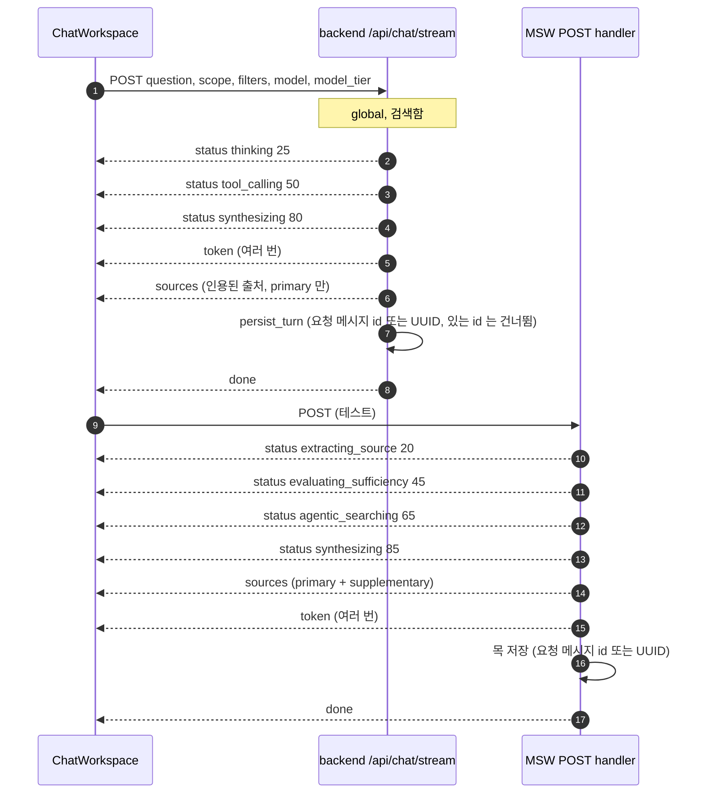

# AgentLens 데이터 계약 및 MSW 모의 명세서 (Contract & Mock Spec)

- **Updated**: 2026-11-09
- **기준**: v0.4.1 (main)
- **작성자**: 계약 통합 엔지니어 (`contract-integrator`)
- **문서 버전**: v1.2 (v1.0 as-built → v1.1 계약 변경 1건 → v1.2 backend·frontend 구현 반영)
- **상태**: Review — v1.0 은 v0.4.0 코드의 계약을 그대로 적었다. v1.1 은 `POST /api/chat/stream` 요청에 메시지 id 선택 필드 2개를 더했다(BUG-02R, 8.1절). v1.2 는 이 계약과 코드 리뷰 수정(BUG-02·06·07·08)이 backend·frontend 에 반영된 v0.4.1 작업 트리에 맞춰 줄 번호와 동작을 고쳤다. 계약 파일은 v1.1 에서 더 바뀌지 않았다.
- **목적**: backend Pydantic 스키마·라우터 응답 ↔ frontend TS 타입·zod·API 호출 ↔ MSW 핸들러·fixture ↔ 계약 테스트의 지금 대응 관계와 불일치를 한곳에 고정해, backend·frontend TDD 를 병렬로 시작할 수 있게 한다.
- **함께 읽는 산출물** (동시에 작성 중, 경로로만 참조): `docs/system-designer/01_SYSTEM_DESIGN.md`, `docs/system-designer/02_OPENAPI_SPEC.yaml` (엔드포인트 동작·부수 효과·보안), `docs/ui-system-designer/01_COMPONENT_SPEC.md` (화면·컴포넌트 Props·상태), `docs/fullstack-architect/01_ARCHITECTURE_ADR.md`, FSD `docs/spec-writer/fsd/02_AI_CHAT_SPECIFICATION.md` 등.

근거 표기: 코드 사실은 `path:line`. "실행 확인" 은 2026-11-09 에 이 문서를 쓰며 실제로 돌린 결과다. 그 밖은 코드 읽기로 확인한 사실이고, 실행하지 않은 추정은 그렇게 적는다.

---

## 0. 계약 범위와 파일 위치 (앱 사이 인터페이스)

### 0.1 인터페이스 개요
- REST: backend 업무 API 는 모두 `/api` 접두사 아래에 있다. `api_router = APIRouter(prefix="/api")` 가 라우터 10개(news, schedule, stats, mcp, briefing, trends, webhook, sources, research, chat)를 묶는다 (`backend/app/api/router.py:13-23`). 접두사 밖은 `GET /`, `GET /health` 둘이다 (`backend/app/main.py:71`, `:75`).
- OpenAPI: 정적 파일이 없다. 런타임 `/docs`, `/redoc`, `/openapi.json` 을 FastAPI 가 만든다 (`backend/app/main.py:49`, 끄지 않음). chat 의 `POST /query`, `POST /stream`, `POST /sessions` 는 본문을 `await request.json()` 으로 직접 읽어서 자동 생성 OpenAPI 에 요청 본문 스키마가 나타나지 않는다 (`backend/app/api/chat.py:129`, `:281`, `:472`).
- 프록시: 브라우저는 상대 경로 `/api/...` 를 부르고, Next rewrite 가 `/api/:path*` 를 `${INTERNAL_API_URL}/api/:path*`(기본 `http://127.0.0.1:8000`)로 넘긴다 (`frontend/next.config.ts`). 서버 측 렌더링의 베이스는 `INTERNAL_API_URL` → `NEXT_PUBLIC_API_URL` → `http://127.0.0.1:8000` 순 (`frontend/src/lib/api.ts:3-10`).
- SSE 2개: `POST /api/chat/stream`, `POST /api/news/{news_id}/ask/stream` (3절).
  - 챗 스트림은 상대 경로 `/api/chat/stream` 으로 불러 rewrite 프록시를 거친다 (`frontend/src/components/chat/ChatWorkspace.tsx:338`).
  - 기사 Ask AI 스트림만 `getDirectApiBase()` 로 backend 에 직접 붙는다: `NEXT_PUBLIC_API_URL` 이 있으면 그것, 없으면 브라우저 호스트의 `:8000`. 직접 연결이 AbortError 가 아닌 이유로 실패하면 상대 경로로 한 번 더 시도한다 (`frontend/src/lib/api.ts:12-23`, `:97-118`).
- 인증: 없다. 어떤 엔드포인트에도 인증 의존성·API 키·세션 검사가 없다. CORS 는 `allow_origins=["*"]`, `allow_credentials=True` (`backend/app/main.py:50`). `settings.CORS_ORIGINS`(`backend/app/config.py:45`)는 읽지 않는다.
- Content-Type: 요청 JSON 본문은 `application/json`. 응답은 대부분 `application/json`, 예외는 `GET /api/news/feed/rss.xml`(`application/xml`), `POST /api/news/{id}/ask/stream`(`text/event-stream`), `POST /api/chat/stream`(`text/event-stream; charset=utf-8`).
- MCP 도구(HTTP 계약 아님, stdio): `get_latest_harness_methods`, `get_mcp_and_skills_ecosystem`, `search_agent_news`, `trigger_agentlens_crawl` (`backend/app/mcp/server.py`). `GET /api/mcp/info` 가 같은 이름을 하드코딩해 돌려준다 (`backend/app/api/mcp.py:12-17`).

### 0.2 계약 파일 위치 (자동 생성 없음, 손으로 맞춘다)
| 쪽 | 파일 | 비고 |
|---|---|---|
| backend 스키마 (Pydantic) | `backend/app/schemas/chat.py`, `backend/app/schemas/news.py` | `schemas/__init__.py` 는 news 의 5개 모델만 다시 내보낸다 |
| backend 라우터 안 요청 모델·dict 응답 | `backend/app/api/webhook.py:11-17`, `sources.py:8-20`, `research.py:8-22`, 그리고 `response_model` 없이 dict 를 돌려주는 핸들러들 (2.4절) | 규칙 파일 `.claude/rules/contract-sync.md` 표에는 없지만 계약이다 |
| frontend 타입 (TS + zod) | `frontend/src/types/chat.ts`, `news.ts`, `trends.ts` | `trends.ts` 는 zod 없이 TS interface 만 |
| frontend 호출 함수 | `frontend/src/lib/api.ts` | 챗 엔드포인트는 여기 없고 컴포넌트·훅이 직접 `fetch` 한다 (2.1절) |
| 목 (MSW) | `frontend/src/mocks/handlers.ts`, `frontend/src/mocks/handlers/chat.ts`, `frontend/src/mocks/fixtures/chat.ts`, `frontend/src/mocks/server.ts` | 테스트 전용 (4.1절) |
| 계약 테스트 | `frontend/src/tests/chat/ContractAndMsw.test.ts` | 80개 (6절) |

### 0.3 변경 규칙
- 한쪽을 고치면 같은 작업에서 반대쪽 타입, MSW 핸들러·fixture, 계약 테스트를 함께 고친다. 필드 이름, 필수 여부, enum(`Literal`) 값, null 허용, SSE 이벤트 payload 를 대조한다 (`.claude/rules/contract-sync.md`).
- 계약 변경은 이 문서에 변경 전/후로 적는다 (8절). 하위 호환·버전 규칙은 아직 정하지 않았다.
- 확인은 `make check`. 계약 테스트를 약하게 만들어 통과시키지 않는다.

---

## 1. 공통 응답 엔벨로프 및 에러 계약 (Response Envelope)

### 1.1 엔벨로프: 없다
- backend 는 성공 응답을 감싸지 않는다. 엔드포인트마다 모델(또는 dict)을 그대로 돌려준다. 목록도 배열 그대로(`GET /api/chat/sessions`) 또는 엔드포인트별 객체(`GET /api/news` 의 `items/total/...`)다.
- frontend `types/chat.ts` 에 템플릿식 엔벨로프 `ApiResponse<T>`(`success`, `data?`, `error?`, `timestamp`)와 `createApiResponseSchema` 가 정의돼 있지만 (`frontend/src/types/chat.ts:8-13`, `:39-45`) `src/` 어디서도 쓰지 않는다. backend 와 맞는 계약이 아니다.

### 1.2 오류 응답 형식 (4가지가 섞여 있다)
| 형식 | 모양 | 쓰는 곳 | frontend 타입 |
|---|---|---|---|
| HTTPException | `{"detail": "<문자열>"}` | news, briefing, webhook, sources, research | `api.ts` 가 `data.detail` 을 읽어 `Error` 메시지로 쓴다 (`api.ts:81`, `:124`, `:227` 등). zod 없음 |
| 요청 검증 실패 (FastAPI 기본) | 422, `{"detail": [{"type","loc","msg","input",...}]}` | 쿼리·경로·본문 모델 바인딩을 쓰는 모든 엔드포인트. 기본 핸들러를 덮어쓰지 않는다 | 없음. MSW 에도 422 핸들러가 없다 |
| chat `ErrorResponse` | `{"error_code": "ERR_...", "message": "...", "details": null 또는 {"error": "..."}}` | chat 라우터 전부. `JSONResponse` 로 dict 를 직접 만든다 (`backend/app/schemas/chat.py:184-187` 의 모델은 import 만 한다) | `ErrorResponseSchema`/`ApiErrorDetailSchema` (`chat.ts:27-37`, `details` nullable·optional), `LlmErrorResponseSchema` (`chat.ts:95-103`) |
| 전역 예외 처리 | 500, `{"detail": "Internal server error occurred. Please check server logs.", "error": "<str(exc)>"}` | 처리하지 않은 모든 예외 (`backend/app/main.py:58`) | 없음 |

- MSW 는 모든 오류를 `{error_code, message}` 로 흉내 낸다. news 경로처럼 backend 가 `{"detail"}` 을 쓰는 곳도 MSW 는 `error_code` 를 쓴다. MSW 오류 본문에는 `details` 키가 없다 (backend chat 은 항상 `details` 를 넣는다).
- 실패를 200 으로 돌려주는 엔드포인트: `POST /api/research/inspect-url`(접속 실패도 200 + `"status": "error"`), `POST /api/schedule/trigger`·`POST /api/schedule/reset-and-collect`·`POST /api/research/run-deep`(이미 실행 중이면 200 + `"status": "already_running"`).
- 검증 실패가 400 이 아니라 500 으로 나가는 곳: `POST /api/chat/query`(500 `ERR_SERVER_INTERNAL`, `chat.py:267-275`), `GET /api/chat/search`(필터 리터럴 오류가 500 `ERR_RETRIEVER_INDEX_ERROR`, `chat.py:91-96`, `:115-123`). `POST /api/chat/stream` 은 v0.4.1 에서 400 으로 바뀌었다: `ChatStreamRequest(**body)` 를 try 안에서 스트림을 열기 전에 검증하고, `model_tier` 위반은 400 `ERR_INVALID_MODEL_TIER`, 그 밖 필드 위반은 400 `ERR_INVALID_PAYLOAD` (`chat.py:334-344`).
- 예외 문자열 노출: 전역 처리의 `error`, chat 의 `details.error`(`chat.py:121`, `:273`), 세션 엔드포인트의 `message`(`chat.py:460`, `:490`, `:513`, `:542`, `:580`)에 `str(e)` 가 들어간다.

### 1.3 오류 코드 카탈로그 (backend ↔ zod `LlmErrorCodeSchema` ↔ MSW)
`LlmErrorCodeSchema` 는 `frontend/src/types/chat.ts:51-79`. "zod 주석" 은 그 줄의 주석에 적힌 HTTP 상태다.

| error_code | backend 상태 (발생 위치) | zod enum | zod 주석 | MSW 사용 |
|---|---|---|---|---|
| `ERR_INVALID_PAYLOAD` | 400 본문이 JSON 아님 (`chat.py:134`, `:286`). `/stream` 은 본문이 JSON 객체가 아닐 때 (`:292-300`)와 `ChatStreamRequest` 필드 위반(`model_tier` 밖, 메시지 id 포함) (`:340-344`)에도 | **없음** | — | `POST /api/chat/stream`·`/query` JSON 파싱 실패 (`handlers/chat.ts:257`, `:692`) |
| `ERR_CHAT_PAYLOAD_EMPTY` | 400 (`chat.py:145`, `:190`, `:307`) | 있음 | 400 | stream·query, news ask (`handlers.ts:337`, `:344`), GET stream |
| `ERR_CHAT_PAYLOAD_TOO_LARGE` | 400 2000자 초과 (`chat.py:155`, `:199`, `:317`) | 있음 | 400 | stream |
| `ERR_INVALID_SCOPE_PARAM` | 400 (`chat.py:166`, `:208`, `:328`) | 있음 | 400 | stream `[TRIGGER_400]` |
| `ERR_HANDOVER_SOURCE_NOT_FOUND` | 404 (`chat.py:60`, `:181`, `:353`, `:365`) | 있음 | 404 | stream scoped, sources/:id |
| `ERR_SEARCH_QUERY_TOO_SHORT` | 400 (`chat.py:83`, `:110`) | 있음 | 400 | search |
| `ERR_RETRIEVER_INDEX_ERROR` | 500 (`chat.py:119`) | **없음** | — | 없음 |
| `ERR_CLAUDE_API_KEY_MISSING` | **401** (`chat.py:217`, `:377`) | 있음 | **503** (주석이 코드와 다름) | stream·query 401 트리거 |
| `ERR_CLAUDE_QUOTA_EXCEEDED` | 429 (`chat.py:226`, `:386`). 다만 `generate_live_answer` 가 Anthropic 429 를 `LLMQuotaExceededException` 으로 바꿔 던지므로(`backend/app/services/llm_processor.py:373-374`) `/query` 에서는 `ERR_LLM_QUOTA_EXCEEDED` 가 나갈 것으로 보인다 | 있음 | 429 | 429 트리거 |
| `ERR_CLAUDE_OVERLOADED` | 529 (`chat.py:235`, `:395`) | 있음 | 503/529 | 529 트리거 |
| `ERR_LLM_PROVIDER_UNAVAILABLE` | 503 (`chat.py:244`, `:404`) | 있음 | 503 | stream·query 503 트리거, news 503 트리거 |
| `ERR_LLM_UPSTREAM_FAILED` | 502 (`chat.py:253`, `:413`) | 있음 | 502 | 502 트리거 |
| `ERR_LLM_QUOTA_EXCEEDED` | 429 (`chat.py:262`, `:422`) | 있음 | 429 | 없음 |
| `ERR_LLM_STREAM_FAILED` | SSE `event: error` (`backend/app/services/chat_service.py:762`) | 있음 | SSE | `[TRIGGER_STREAM_ERROR]` |
| `ERR_SERVER_INTERNAL` | 500 (`chat.py:271`, `:459`, `:541`) | 있음 | 500 | stream 500 트리거, sessions 목록·상세 500 |
| `ERR_SESSION_INVALID_UUID` | 400 — JSON 오류·모델 검증 실패·UUID 오류 셋 다 (`chat.py:477`, `:489`, `:503`) | 있음 | 400 | POST sessions |
| `ERR_SESSION_CREATE_FAILED` | 500 (`chat.py:512`) | 있음 | 500 | POST sessions `[TRIGGER_500]` |
| `ERR_SESSION_NOT_FOUND` | 404 (`chat.py:532`, `:561`) | 있음 | 404 | GET·DELETE sessions/:id |
| `ERR_SESSION_DELETE_FAILED` | 500 (`chat.py:570`, `:579`) | 있음 | 500 | DELETE `[TRIGGER_500]` |
| `ERR_INVALID_MODEL_TIER` | 400 `/stream` 의 `model_tier` 가 `haiku`·`sonnet`·`opus` 아님 (`chat.py:337-338`, v0.4.1). `/query` 는 여전히 500 `ERR_SERVER_INTERNAL`. `model` 값은 검증하지 않는다 | 있음 | 400 | stream·query 의 잘못된 `model`·`model_tier` (`handlers/chat.ts:281`, `:295`, `:706`, `:720`) |
| `ERR_ANTHROPIC_KEY_MISSING`, `ERR_ANTHROPIC_RATE_LIMIT`, `ERR_ANTHROPIC_OVERLOADED` (별칭) | 내는 곳 없음 | 있음 | 503, 429, 503/529 | 없음 |
| `ERR_SONNET_SCHEMA_VALIDATION`, `ERR_STREAM_ABORTED_BY_USER`, `ERR_ARTICLE_EXTRACTION_FAIL`, `ERR_CHAT_STREAM_TIMEOUT`, `ERR_SESSION_LIMIT_EXCEEDED`, `ERR_INVALID_FILTER_PARAM` | 내는 곳 없음 | 있음 | 500, 499, 502, 504, 400, 400 | 없음 |
| `ERR_INVALID_PAGE_PARAM`, `ERR_FEED_FETCH_FAILED`, `ERR_FEED_CARD_NOT_FOUND` | 없음 (news 는 `{"detail"}`·422 를 쓴다) | 없음 | — | news 핸들러만 (`handlers.ts:232`, `:240`, `:319`, `:359`, `:385`) |

- `LlmErrorResponseSchema.error_code` 는 이 enum 이라 backend 가 실제로 내는 `ERR_INVALID_PAYLOAD` 응답을 파싱하면 실패한다 (실행 확인: `invalid_value`). `ErrorResponseSchema.error_code` 는 `string` 이라 통과한다.

### 1.4 날짜·시각 형식
- DB `DateTime` 열(`published_at`, `created_at`, `started_at` 등)은 SQLite 에 시간대 없이 저장돼 오프셋 없는 ISO 8601(예: `2026-11-06T01:02:03.123456`)로 나간다. 코드는 UTC 로 기록·해석한다 (`backend/app/services/trend_service.py:73` 의 `tzinfo is None` 보정 참고).
- 서버가 그 자리에서 만드는 시각(`datetime.now(timezone.utc).isoformat()`)은 `+00:00` 이 붙는다: `stats.last_updated`, `schedule.current_time`, `briefing.generated_at`, SSE `status.timestamp` 등.
- `NewsItemResponse.published_at`/`created_at` 은 Pydantic `datetime` 이라 FastAPI 가 ISO 문자열로 직렬화한다. chat 모델들은 `str` 필드에 `isoformat()` 결과를 넣는다 (`backend/app/services/chat_service.py:102-104`, `chat_session_service.py:82-83`).
- 일일 브리핑 `date` 는 `"%Y년 %m월 %d일"` 한국어 문자열 (`backend/app/services/briefing_service.py:114`). RSS `pubDate` 는 `"%a, %d %b %Y %H:%M:%S GMT"` (`backend/app/api/news.py:184`).
- zod 는 날짜를 모두 `z.string()` 으로만 받는다 (형식 검사 없음). MSW fixture 는 `Z` 접미사 ISO(`2026-09-15T08:00:00Z`, `frontend/src/mocks/fixtures/chat.ts:31`)와 `new Date().toISOString()` 을 쓴다. `mockDailyBriefing.date` 는 `YYYY-MM-DD` 다 (`handlers.ts:73`).

### 1.5 페이지네이션 (엔드포인트마다 다르다)
| 엔드포인트 | 파라미터 | 규칙 | MSW |
|---|---|---|---|
| `GET /api/news` | `page`(≥1, 기본 1), `size`(1~100, 기본 20) | offset `(page-1)*size`. 응답 `total`, `page`, `size`, `total_pages`(`ceil(total/size)`, total 0 이면 1) (`news.py:89-94`) | 같은 계산 (`handlers.ts:293-305`). `page<1`·`size<1` 은 400 `ERR_INVALID_PAGE_PARAM`(backend 는 422), 상한 100 검사 없음 |
| `GET /api/chat/sessions` | `limit`(1~50, 기본 30), `offset`(≥0, 기본 0) | `updated_at` 내림차순, 배열만 (전체 개수 없음) | 범위를 잘라서(clamp) 처리, 422 없음 (`handlers/chat.ts:949-950`) |
| `GET /api/research/audit-logs` | `limit`(기본 30, 범위 제약 없음) | `created_at` 내림차순. `total` 은 이번에 돌려준 개수 | 없음 |
| `GET /api/chat/search` | `top_k`(1~20, 기본 5) | 상위 k 개 | `total_matches` 를 자르기 전 개수로 준다 (backend 는 자른 뒤 개수) |
| `GET /api/news/feed/rss.xml` | 없음 | `published_at` 내림차순 최대 50 고정 | 없음 |

---

## 2. 도메인 계약: Pydantic ↔ TS·zod ↔ 호출부 ↔ MSW

공통 관찰:
- 프론트 런타임은 응답을 zod 로 검증하지 않는다. `res.json()` 결과를 TS 타입으로 단언만 한다. `src/` 에서 테스트 밖의 zod `.parse` 는 `parseChatSseEvent`(`chat.ts:575-595`)와 `src/lib/env.ts:23` 둘인데, `parseChatSseEvent` 는 테스트에서만 부르고 `env.ts` 는 import 하는 파일이 없다. 그래서 zod 와 backend 의 차이는 런타임 오류가 아니라 타입·계약 테스트의 어긋남으로만 드러난다.
- 정의만 있고 쓰이지 않는 zod: `LlmErrorDetailSchema`, `ChatSearchQueryParamsSchema`, `createApiResponseSchema`, `ChatSessionSchema`, `ChatMessageSchema`(타입은 UI 상태로 쓰임), `AskQuestionRequestSchema`, `DailyBriefingSchema`, `StatsResponseSchema` (테스트 포함 `src/` 전체 검색).

### 2.1 엔드포인트 대응표 (44개)
"MSW" 칸의 상태는 그 핸들러가 낼 수 있는 응답 상태다. "계약 테스트" 는 `ContractAndMsw.test.ts` 가 그 경로를 부르는지다.

| 메서드 경로 | backend 요청 / 응답 (`path:line`) | frontend 타입·zod | 호출부 | MSW (`path:line`) | 계약 테스트 |
|---|---|---|---|---|---|
| GET `/` | — / dict `{service, version, docs}` (`main.py:71`) | 없음 | 없음 | 없음 | 없음 |
| GET `/health` | — / dict `{status:"healthy", version, running}` (`main.py:75`) | 없음 | docker-compose healthcheck | 없음 | 없음 |
| GET `/api/news` | 쿼리 7개 / `NewsListResponse` (`news.py:47`) | `NewsListResponse`(zod `NewsListResponseSchema`, `news.ts:48`) | `fetchNewsFeed` (`api.ts:39`) | 200, 400, 500, 503, delay 30 (`handlers.ts:218`) | 있음 (5개) |
| DELETE `/api/news/all` | — / dict `{status, deleted_count}` (`news.py:96`) | 반환 TS `{status, deleted_count}` | `deleteAllNews` (`api.ts:258`, 호출처 없음) | 200 `{status, message, deleted_count}`, delay 30 (`handlers.ts:468`) | 없음 |
| GET `/api/news/{news_id}` | 경로 int / `NewsItemResponse` (`news.py:104`) | `NewsItem` | 없음 | 200, 404 (`handlers.ts:313`) | 있음 (404) |
| POST `/api/news/{news_id}/ask` | `AskQuestionRequest` / `AskQuestionResponse` (`news.py:111`) | `AskQuestionResponse`(zod `news.ts:222`) | `askQuestionAboutNews` (`api.ts:70`, 호출처 없음, 30초 제한) | 200, 400, 404, 503, delay 100 (`handlers.ts:330`) | 있음 (503) |
| POST `/api/news/{news_id}/ask/stream` | `AskQuestionRequest` / SSE (`news.py:137`) | 없음 (`api.ts` 안에서 직접 파싱) | `askQuestionAboutNewsStream` (`api.ts:88`) | 200 SSE, 404 (`handlers.ts:379`) | 없음 (다른 테스트 파일이 씀) |
| GET `/api/news/feed/rss.xml` | `category` / XML (`news.py:169`) | 없음 | `Header.tsx` 링크 href | 없음 | 없음 |
| GET `/api/chat/sources/{source_id}` | 경로 int / `ChatSourceDetailResponse` (`chat.py:49`) | `ChatSourceDetailResponse` (`chat.ts:455`) | `ChatWorkspace.tsx:492` 직접 fetch | 200, 404 (`handlers/chat.ts:866`) | 없음 |
| GET `/api/chat/search` | 쿼리 8개 / `ChatSearchResponse` (`chat.py:66`) | `ChatSearchResponse` (`chat.ts:506`) | 없음 | 200, 400, delay 50 (`handlers/chat.ts:886`) | 있음 |
| POST `/api/chat/query` | `ChatQueryRequest`(직접 파싱) / `ChatQueryResponse` (`chat.py:125`) | `ChatQueryRequest`·`ChatQueryResponse` (`chat.ts:419`, `:435`) | 없음 | 200, 400, 401, 429, 502, 503, 529, delay 120 (`handlers/chat.ts:686`) | 있음 (2개, 1개는 zod parse) |
| POST `/api/chat/stream` | `ChatStreamRequest`(직접 파싱) / SSE (`chat.py:277`). 선택 필드 `user_message_id`·`assistant_message_id` (v1.1, 8.1절) | `ChatStreamRequest` (`chat.ts:388`, 메시지 id 필드 포함), SSE payload 스키마 (3.1절) | `ChatWorkspace.tsx:338` 직접 fetch (메시지 id 를 보낸다, `:352-353`) | 200 SSE, 400(메시지 id 오류 포함), 401, 404, 429, 500, 502, 503, 529 (`handlers/chat.ts:251`) | 있음 (21개) |
| GET `/api/chat/sessions` | `limit`, `offset` / `List[ChatSessionSummary]` (`chat.py:444`) | `ChatSessionSummary` (`chat.ts:694`) | `useChatSessions.ts:67` 직접 fetch | 200, 500, delay 20 (`handlers/chat.ts:947`) | 있음 |
| POST `/api/chat/sessions` | `ChatSessionCreateRequest`(직접 파싱) / 201 `ChatSessionDetail` (`chat.py:465`) | `ChatSessionCreateRequest`·`ChatSessionDetail` (`chat.ts:722`, `:708`) | `useChatSessions.ts:234` 직접 fetch (응답 상태를 보지 않는다) | 201, 400, 500, delay 30 (`handlers/chat.ts:989`) | 있음 |
| GET `/api/chat/sessions/{session_id}` | 경로 str / `ChatSessionDetail` (`chat.py:518`) | `ChatSessionDetail` | `useChatSessions.ts:136` 직접 fetch (404 면 localStorage 캐시) | 200, 404, 500, delay 20 (`handlers/chat.ts:1078`) | 있음 |
| DELETE `/api/chat/sessions/{session_id}` | 경로 str / `GenericSuccessResponse` (`chat.py:547`) | `GenericSuccessResponse` (`chat.ts:658`) | `useChatSessions.ts:265` 직접 fetch | 200, 404, 500, delay 30 (`handlers/chat.ts:1133`) | 있음 |
| GET `/api/chat/stream` | **없음** (POST 만. GET 은 405) | — | 없음 | 200 SSE, 400 (`handlers.ts:480`) | 있음 (2개) |
| GET `/api/briefing/today` | — / `DailyBriefingResponse` (`briefing.py:25`) | `DailyBriefing` (zod `news.ts:160`) | `fetchDailyBriefing` (`api.ts:63`) | 200, delay 20 (`handlers.ts:433`) | 없음 |
| POST `/api/briefing/generate` | — / `DailyBriefingResponse` (`briefing.py:40`, today 와 같은 함수) | `DailyBriefing` | 없음 | 200, delay 60 (`handlers.ts:441`) | 없음 |
| POST `/api/briefing/export/notion` | `NotionExportRequest`(본문 생략 가능) / `NotionExportResponse` (`briefing.py:55`) | 반환 TS `{success, message, url?}`, `news.ts:173` interface | `exportBriefingToNotion` (`api.ts:502`, 20초) | 없음 | 없음 |
| POST `/api/briefing/send/email` | `EmailSendRequest`(생략 가능) / `EmailSendResponse` (`briefing.py:75`) | `{success, message}` | `sendBriefingByEmail` (`api.ts:519`, 20초) | 없음 | 없음 |
| POST `/api/briefing/test/notion` | `TestNotionRequest` / dict `{success, message}` (`briefing.py:95`) | `{success, message}` | `testNotionConnection` (`api.ts:536`, 12초) | 없음 | 없음 |
| POST `/api/briefing/test/email` | `TestEmailRequest` / dict `{success, message}` (`briefing.py:102`) | 요청 `{smtp_host?, smtp_port?, smtp_user?, smtp_password?, use_tls?, to_email?}` | `testEmailConnection` (`api.ts:553`, 15초) | 없음 | 없음 |
| GET `/api/briefing/settings` | — / dict (`briefing.py:116`) | `BriefingSettings` (`news.ts:184`) | `fetchBriefingSettings` (`api.ts:573`) | 없음 (테스트가 `server.use` 로 직접 정한다) | 없음 |
| POST `/api/briefing/settings` | `BriefingSettingsUpdate` / dict `{success, message}` (`briefing.py:161`) | `BriefingSettingsUpdate` (`api.ts:581`) | `updateBriefingSettings` (`api.ts:597`, 10초) | 없음 | 없음 |
| GET `/api/schedule/status` | — / `ScheduleStatusResponse` (`schedule.py:14`) | `ScheduleStatus` (`news.ts:244`) | `fetchScheduleStatus` (`api.ts:171`) | 없음 | 없음 |
| GET `/api/schedule/progress` | — / dict (`schedule.py:43`, `collectors/manager.py:59`) | `CrawlProgress` (`api.ts:178`) | `fetchCrawlProgress` (`api.ts:190`) | 없음 | 없음 |
| POST `/api/schedule/trigger` | — / dict (`schedule.py:48`) | `{status, message, total_collected, total_saved}` | `triggerManualCollect` (`api.ts:197`) | 없음 | 없음 |
| POST `/api/schedule/reset-and-collect` | — / dict (`schedule.py:69`) | `{status, message, deleted_count}` | `resetAndRecollect` (`api.ts:246`) | 없음 | 없음 |
| GET `/api/sources` | — / dict (`sources.py:22`) | `SourcesResponse` 이중 정의 (`api.ts:290` interface, `news.ts:124` zod) | `fetchSources` (`api.ts:360`) | 200, delay 20 (`handlers.ts:452`) | 있음 (zod 만) |
| POST `/api/sources/rss` | `AddRssRequest` / dict (`sources.py:49`) | 요청·응답 TS (`api.ts:376-383`) | `addRssSource` (`api.ts:376`) | 없음 | 없음 |
| POST `/api/sources/github` | `AddGitHubRepoRequest` / dict (`sources.py:64`) | 없음 | 없음 | 없음 | 없음 |
| PATCH `/api/sources/{source_type}/{item_id}/toggle` | 경로 2개 / dict (`sources.py:77`) | `{status, message}` | `toggleSource` (`api.ts:367`) | 없음 | 없음 |
| DELETE `/api/sources/{source_type}/{item_id}` | 경로 2개 / dict (`sources.py:85`) | `{status, message}` | `deleteSource` (`api.ts:397`) | 없음 | 없음 |
| POST `/api/research/inspect-url` | `InspectUrlRequest` / dict (`research.py:24`) | `InspectUrlResponse` (`api.ts:345`) | `inspectUrl` (`api.ts:406`, 12초) | 없음 | 없음 |
| POST `/api/research/discover` | `DiscoverRequest` / dict (`research.py:35`) | `DiscoveredCandidate` (`api.ts:331`) | `discoverSources` (`api.ts:417`, 호출처 없음) | 없음 | 없음 |
| POST `/api/research/register-candidate` | `RegisterCandidateRequest` / dict (`research.py:48`) | `{status, message, source}` | `registerCandidate` (`api.ts:433`, 호출처 없음) | 없음 | 없음 |
| GET `/api/research/status` | — / dict (`research.py:62`, `deep_researcher.py:147`) | `ResearchStatus` (`api.ts:454`) | `fetchDeepResearchStatus` (`api.ts:475`) | 없음 | 없음 |
| GET `/api/research/audit-logs` | `limit` / dict (`research.py:67`) | `ResearchAuditLog` (`api.ts:462`) | `fetchResearchAuditLogs` (`api.ts:482`) | 없음 | 없음 |
| POST `/api/research/run-deep` | 쿼리 `max_candidates` / dict (`research.py:77`) | `{status, message}` | `triggerDeepResearch` (`api.ts:489`) | 없음 | 없음 |
| GET `/api/trends/radar` | — / dict (`trends.py:6`, `trend_service.py:40`) | `TechRadarData` (`trends.ts:16`) | `fetchTechRadar` (`api.ts:211`) | 없음 | 없음 |
| POST `/api/webhook/test` | `WebhookTestRequest` / dict (`webhook.py:19`) | `{success, message}` | `testWebhook` (`api.ts:218`, 본문 `webhook_url` 만) | 없음 | 없음 |
| POST `/api/webhook/send-briefing` | `WebhookBriefingRequest` / dict (`webhook.py:28`) | `{success, message}` | `sendBriefingToWebhook` (`api.ts:232`) | 없음 | 없음 |
| GET `/api/stats` | — / `StatsResponse` (`stats.py:11`) | `StatsResponse` (zod `news.ts:256`) | `fetchStats` (`api.ts:204`) | 200, delay 15 (`handlers.ts:460`) | 없음 |
| GET `/api/mcp/info` | — / dict (`mcp.py:6`) | 없음 | 없음 | 없음 | 없음 |

- `api.ts` 의 기본 제한 시간은 8초 (`fetchWithTimeout`, `api.ts:25-37`). 위 표의 초는 함수별로 덮어쓴 값이다. GET 은 모두 `cache: 'no-store'`.
- 정의만 있고 호출처가 없는 함수: `askQuestionAboutNews`, `deleteAllNews`, `discoverSources`, `registerCandidate`.
- 프론트가 쓰지 않는 backend 경로: `POST /api/sources/github`, `POST /api/briefing/generate`, `GET /api/news/{id}`, `GET /api/chat/search`, `POST /api/chat/query`, `GET /api/mcp/info`, `GET /`, `GET /health`.

### 2.2 쿼리·경로 파라미터
| 엔드포인트 | 이름 | 타입 | 기본값 | 제약·변환 | frontend 가 보내는 값 |
|---|---|---|---|---|---|
| GET `/api/news` | `category` | str | 없음 | 소문자로 바꿔 일치 비교, `all` 이면 필터 없음 (`news.py:59-60`) | `all` 이면 보내지 않음 (`api.ts:49`) |
| | `source` | str | 없음 | 소문자로 바꿔 일치, `all` 무시 | `all` 이면 보내지 않음 |
| | `search` | str | 없음 | 앞뒤 공백 제거 후 `title`·`summary`·`tags`·`tech_stack`·`why_it_matters` 에 `ILIKE %s%` OR | 있으면 보냄 |
| | `high_signal_only` | bool | false | `is_high_signal = true` 만 | true 일 때만 `'true'` |
| | `sort` | str | `hot` | `latest`(published_at desc), `top`(raw_score desc), `quality`(quality_score desc, hotness desc), 그 밖은 `hot`(hotness desc, published_at desc) (`news.py:80-87`) | 있으면 보냄 |
| | `page` / `size` | int | 1 / 20 | ≥1 / 1~100 | 있으면 보냄 |
| GET `/api/news/feed/rss.xml` | `category` | str | 없음 | `all` 이 아니면 일치 비교. 소문자로 바꾸지 않는다 (`news.py:172-173`) | — |
| GET `/api/chat/search` | `q` | str | 없음 | 공백 제거 후 2자 미만이면 400 | — |
| | `top_k` | int | 5 | 1~20 (422) | — |
| | `min_quality` | float | 5.0 | 1.0~10.0 (422) | — |
| | `category` | str | `all` | `ChatFocusFilter.category` 리터럴. 밖의 값이면 500 `ERR_RETRIEVER_INDEX_ERROR` | — |
| | `time_range` | str | `all` | `all`·`24h`·`7d`·`30d`. 밖이면 500 | — |
| | `sort` | str | `hot` | `hot`·`latest`·`quality`. 밖이면 500 | — |
| | `high_signal_only` | bool | false | — | — |
| | `source` | str | 없음 | — | — |
| GET `/api/chat/sessions` | `limit` / `offset` | int | 30 / 0 | 1~50 / ≥0 (422) | `limit=30` (`useChatSessions.ts:67`, `MAX_SESSIONS = 30`) |
| GET `/api/research/audit-logs` | `limit` | int | 30 | 범위 제약 없음 | 30 |
| POST `/api/research/run-deep` | `max_candidates` | int (쿼리) | 6 | 범위 제약 없음 | 6 |
| PATCH·DELETE `/api/sources/{source_type}/{item_id}` | `source_type` | str | — | toggle: `rss`(item_id = 피드 `id` 또는 `url`), `github_repo`(item_id = `repo`), `github`·`reddit`·`hackernews`·`arxiv`·`huggingface`(유형 전체, item_id 무시). delete: `rss`, `github_repo` 만 | `'rss'`, `'github_repo'` |
| | `item_id` | str | — | 경로 한 마디. `/` 를 담을 수 없다 | `encodeURIComponent(itemId)` (`api.ts:369`, `:399`) — 7절 CT-001 |
| GET·DELETE `/api/chat/sessions/{session_id}` | `session_id` | str | — | 형식 검증 없음 | 세션 UUID |
| `/api/news/{news_id}`, `/api/chat/sources/{source_id}` | int | — | — | 정수 아니면 422. `GET /api/news/all` 도 여기에 걸려 422 | — |

### 2.3 Chat 스키마 대조 (`backend/app/schemas/chat.py` ↔ `frontend/src/types/chat.ts`)
표기: "필수" 는 Pydantic 기준(기본값 없음). zod 칸의 `opt` 는 `.optional()`, `null` 은 `.nullable()`, `def(x)` 는 `.default(x)`.

**공통 타입**
| 이름 | Pydantic | zod | 차이 |
|---|---|---|---|
| `ModelTier` | `Literal["haiku","sonnet","opus"]` (`chat.py:9`) | `ModelTierSchema` 같은 3값 (`chat.ts:111`) | 없음 |
| `ChatModel` | `str` (`chat.py:10`) | `ChatModelSchema = z.string().min(1)` (`chat.ts:114`) | zod 빈 문자열 거부 |
| 기본 모델 | `get_default_chat_model()` = `settings.ANTHROPIC_DEFAULT_CHAT_MODEL`, 없으면 `claude-sonnet-5-5` (`chat.py:5-7`) | `DEFAULT_CHAT_MODEL = 'claude-sonnet-5-5'` 고정 (`chat.ts:117`), `TIER_TO_MODEL` haiku/sonnet/opus → `claude-{tier}-5-5` (`chat.ts:126`) | backend 는 설정값을 따른다 |
| `ChatStatusStep` | 7값 `thinking`, `tool_calling`, `observing`, `extracting_source`, `evaluating_sufficiency`, `agentic_searching`, `synthesizing` (`chat.py:63-71`) | 같은 7값 (`chat.ts:302-310`) | enum 은 같다. backend 스트림이 실제로 보내는 값은 4개뿐 (3.1절) |
| `ChatSourceType` | `primary`·`supplementary` (`chat.py:82`) | 같음 (`chat.ts:329`) | backend 는 `primary` 만 만든다 |

**TokenUsageMeta** (`chat.py:12-16` ↔ `chat.ts:234-239`)
| 필드 | Pydantic | zod |
|---|---|---|
| `input_tokens` | int, 기본 0 | int ≥0, **필수** |
| `output_tokens` | int, 기본 0 | int ≥0, **필수** |
| `cache_read_input_tokens` | int\|null, 기본 null | int ≥0, null, opt |
| `cache_creation_input_tokens` | int\|null, 기본 null | int ≥0, null, opt |

**ChatMessageHistory** (`chat.py:18-20` ↔ `chat.ts:373-376`): `role` `user|assistant|system` 필수 (같음). `content` str 필수, 길이 제약 없음 ↔ zod `min(1)`.

**ChatFocusFilter** (`chat.py:22-26` ↔ `chat.ts:261-266`): `category`(`all`·`harness`·`mcp_plugins_skills`·`agent_tech`·`ai_news`, 기본 `all`), `time_range`(`all`·`24h`·`7d`·`30d`, 기본 `all`), `sort`(`hot`·`latest`·`quality`, 기본 `hot`), `high_signal_only`(bool, 기본 false). 값·기본값 모두 같다. UI 는 camelCase `FocusFilters` 를 쓰고 `toChatFocusFilter`/`fromChatFocusFilter` 로 바꾼다 (`chat.ts:270-296`).

**ChatStreamRequest / ChatQueryRequest** (`chat.py:28-57` ↔ `chat.ts:388-432`. 두 모델 필드가 같았는데 v1.1 에서 `ChatStreamRequest` 에만 메시지 id 2개가 붙는다)
| 필드 | Pydantic | zod | 차이 |
|---|---|---|---|
| `question` | str 필수, 1~2000자 | `min(1)`, `max(2000)` | 같음. backend 라우터는 모델 전에 `strip()` 이 빈지, 2000자 초과인지 먼저 본다 |
| `model` | str\|null, 기본 설정 모델 | opt, `def('claude-sonnet-5-5')` | 기본값 출처가 다름. backend 는 값 검증 없음(`gemini` 포함이면 Gemini, `gpt`/`openai` 포함이면 OpenAI 로 보낸다). MSW 는 세 Claude 모델만 허용 |
| `model_tier` | `ModelTier`\|null, 기본 null | opt (null 불가) | zod 는 null 거부 |
| `scope` | `scoped`\|`global`, 기본 `global` | 같음 | 같음 |
| `source_id` | int\|null | int **양수**, null, opt | zod 가 더 엄격. scoped 일 때 사실상 필수(라우터가 404) |
| `session_id` | str\|null | **UUID**, null, opt | backend 형식 검증 없음. 없으면 새 UUID 를 만든다 |
| `history` | `ChatMessageHistory[]`\|null | opt (null 불가) | — |
| `top_k` | int 1~10, 기본 5 | 같음 | 같음 |
| `filters` | `ChatFocusFilter`\|null | null, opt | 같음 |
| `user_message_id` (stream 만, v1.1) | str\|null, 기본 null, 1~36자 (`chat.py:39`) | `ChatClientMessageIdSchema` = `string().min(1).max(36)`, null, opt (`chat.ts:386`, `:403`) | 서버가 이 턴의 질문을 저장할 id. 없으면 서버가 UUID |
| `assistant_message_id` (stream 만, v1.1) | str\|null, 기본 null, 1~36자 (`chat.py:40`), 서로 다름 `model_validator` (`:42-46`) | 같음 (`chat.ts:405`, 서로 다름 검사 `:407-417`) | 서버가 이 턴의 답을 저장할 id. 둘 다 있으면 서로 달라야 한다 (zod `.refine`, Pydantic `model_validator`) |

실제 요청 본문 (`ChatWorkspace.tsx:341-354`): `{question, scope, source_id, session_id, history, filters, model: TIER_TO_MODEL[selectedTier], model_tier: selectedTier, user_message_id: userMsgId, assistant_message_id: assistantMsgId}`. `filters` 는 항상 객체, `history` 는 `applySlidingWindow` 결과 (5절). 메시지 id 는 `handleSendMessage` 호출마다 새로 만든 `msg-user-`·`msg-asst-` + 7자(16자)다 (`:264-265`). 재시도도 새 id 다.

**ChatSourceItem** (별칭 `ChatSourceMeta`. `chat.py:84-102` ↔ `chat.ts:332-353`)
| 필드 | Pydantic | zod | 차이 |
|---|---|---|---|
| `index` | int\|str 필수 | number\|string | 같음 |
| `type` | 기본 `primary` | `def('primary')` | 같음 |
| `id` | int\|null | int 양수, null, opt | — |
| `title` | str 필수 | 1~500자 | zod 길이 제약 |
| `url` | str 필수 | `.url()` | zod 형식 제약 |
| `source` | str 필수 | `min(1)` | — |
| `category`, `snippet`, `full_content`, `domain`, `published_at` | str\|null | string, null, opt | 같음 |
| `quality_score` | float\|null | 1.0~10.0, null, opt | zod 범위 |
| `score`, `relevance_score` | float\|null | number, null, opt | 같음 |
| `publisher` | str\|null, 기본 null | string, **opt (null 불가)** | **CT-002**: backend 는 `model_dump()` 로 `publisher: null` 을 항상 보낸다 (`chat_service.py:662`, `:779`). zod 파싱 실패 (실행 확인) |

**ChatSourcesPayload** (`chat.py:104-109` ↔ `chat.ts:356-362`): `sources` 필수, `applied_filters` Pydantic `Any`\|null ↔ zod `ChatFocusFilter`\|null opt, `is_relaxed` 기본 false, `primary_count`·`supplementary_count` int\|null. Pydantic 모델은 정의만 있고 스트림은 dict 를 직접 `json.dumps` 한다.

**ChatStatusPayload** (`chat.py:73-80` ↔ `chat.ts:313-321`): `step` 필수, `label` str 필수 ↔ `min(1)`, `timestamp` str 필수, `progress` int\|null ↔ int 0~100 opt(null 불가), `query`·`queries`·`sources_found` nullable. Pydantic 모델은 정의만 있다.

**StreamErrorPayload** (`chat.py:111-116` ↔ `ChatStreamErrorPayloadSchema` `chat.ts:542-549`): `error_code`·`message` 필수, `status_code` 기본 502 ↔ opt, `step` null 가능, `retryable` 기본 true ↔ opt. zod 에만 `provider` (opt). 정의만 있고 스트림은 dict.

**DonePayload** (`chat.py:118-127` ↔ `ChatDonePayloadSchema` `chat.ts:525-535`)
| 필드 | Pydantic | zod |
|---|---|---|
| `done` | bool 기본 true | `literal(true)` |
| `session_id` | str 필수 | **UUID** |
| `model` | str\|null, 기본 설정 모델 | string **필수** |
| `model_tier` | ModelTier\|null, 기본 `sonnet` | opt, `def('sonnet')` |
| `sources_count` | int 필수 | int ≥0 |
| `primary_count`, `supplementary_count` | int\|null | int, null, opt |
| `latency_ms` | int 필수 | int ≥0 |
| `usage` | TokenUsageMeta\|null | null, opt |

**ChatQueryResponse** (`chat.py:129-141` ↔ `chat.ts:435-448`)
| 필드 | Pydantic | zod | 차이 |
|---|---|---|---|
| `answer` | str 필수 | `min(1)` | zod 빈 답 거부 |
| `sources` | ChatSourceItem[] 필수 | 같음 | `publisher: null` 문제(CT-002)를 그대로 물려받는다 |
| `session_id` | str 필수 | **UUID** | — |
| `model` | str\|null, 기본 설정 모델 | `min(1)` **필수, null 불가** | null 이면 실패 (실행 확인) |
| `model_tier` | ModelTier\|null, 기본 `sonnet` | opt, `def('sonnet')` (null 불가) | — |
| `scope` | `scoped`\|`global` 필수 | 같음 | — |
| `applied_filters` | ChatFocusFilter\|null | null, opt | — |
| `is_relaxed` | bool 기본 false | 같음 | — |
| `primary_count`, `supplementary_count` | int\|null | 같음 | — |
| `latency_ms` | int 필수 | int ≥0 | — |
| `usage` | TokenUsageMeta\|null | 같음 | — |

**ChatSourceDetailResponse** (`chat.py:143-163` ↔ `chat.ts:455-472`)
| 필드 | Pydantic | zod | 차이 |
|---|---|---|---|
| `id` | int 필수 | int 양수 | — |
| `title` | str 필수 | 1~500자 | — |
| `url` | str 필수 | `.url()` | — |
| `source`, `category` | str 필수 | `min(1)` | — |
| `author` | str\|null | null, opt | 같음 |
| `summary`, `why_it_matters` | str, 기본 `""` | `def('')` | 같음 |
| `tldr_bullets`, `tech_stack`, `tags` | str[], 기본 `[]` | `def([])` | 같음 |
| `quality_score` | float 필수 | 1.0~10.0 | zod 범위. backend 는 `quality_score or 6.0` (`chat_service.py:118`) |
| `is_high_signal` | bool 기본 false | 같음 | — |
| `hotness_score` | float 기본 0.0 | 같음 | — |
| `published_at` | str 필수 | string | — |
| `created_at` | str\|null | string, **opt (null 불가)** | backend 는 항상 문자열을 넣는다 (`chat_service.py:103`) |
| `full_content` | str\|null | **없음** | **CT-003**: zod 객체가 이 키를 버린다 (strict 면 `unrecognized_keys`, 실행 확인) |
| `scraped_at` | str\|null | **없음** | CT-003 |

**ChatSearchChunk / ChatSearchResponse** (`chat.py:165-182` ↔ `chat.ts:491-511`): 모든 필드 Pydantic 필수. zod 차이는 `index`·`id` 양수, `title` 1~500자, `url` `.url()`, `source`·`category` `min(1)`, `quality_score` 1.0~10.0, `rag_score` 0~1. backend `rag_score` 는 0~1 로 자른다 (`backend/app/services/retriever.py:501`), `index` 는 1부터 다시 매긴다 (`retriever.py:589-590`). `total_matches` 는 `len(chunks)` (`chat_service.py:154`).

**ErrorResponse** (`chat.py:184-187`): `error_code`, `message` 필수, `details` dict\|null ↔ `ErrorResponseSchema` 둘 다 `min(1)`, `details` record null opt.

**GenericSuccessResponse** (`chat.py:189-192` ↔ `chat.ts:658-662`): `status` 기본 `success`, `message` str\|null ↔ opt(null 불가), `deleted_count` int\|null ↔ opt(null 불가). DELETE 응답은 세 값을 모두 채운다.

**ChatMessageItem** (`chat.py:194-207` ↔ `chat.ts:678-690`)
| 필드 | Pydantic | zod | 차이 |
|---|---|---|---|
| `id` | str 필수 | string\|number → string 변환 | zod 가 숫자도 받는다 |
| `session_id` | str 필수 | **UUID** | — |
| `role` | `user`\|`assistant`\|`system` | 같음 | — |
| `content` | str 필수 | string | 같음 |
| `created_at` | str 필수 | string | 같음 |
| `sources` | ChatSourceItem[]\|null | null, opt | CT-002 를 물려받는다 |
| `status` | `pending`\|`streaming`\|`completed`\|`error`\|`aborted`, 기본 `completed` | 같은 5값, `def('completed')` | 같음 |
| `model` | str\|null | null, opt | 같음 |
| `model_tier` | ModelTier\|null | null, opt | 같음 |
| `latency_ms` | int\|null | null, opt | 같음 |
| `usage` | TokenUsageMeta\|null | null, opt | 같음 |

**ChatSessionSummary** (`chat.py:209-220` ↔ `chat.ts:694-704`): `id`(str ↔ **UUID**), `title`(str ↔ **1~100자**), `created_at`, `updated_at`, `scope_mode` 필수, `active_source_id` int\|null, `message_count` int 기본 0 ↔ int ≥0 **필수**, `last_message_preview` str\|null(마지막 메시지 앞 100자, `chat_session_service.py:80`), `active_filters` ChatFocusFilter\|null.

**ChatSessionDetail** (`chat.py:222-233` ↔ `chat.ts:708-718`): Summary 의 `id`·`title`·`created_at`·`updated_at`·`scope_mode` + `active_source_id`, `active_source: ChatSourceDetailResponse|null`, `active_filters`, `messages: ChatMessageItem[]`(기본 `[]` ↔ zod **필수**). 메시지는 `created_at` 오름차순. 저장된 `sources_json`·`usage_json`·`active_filters_json` 은 파싱하고 실패하면 null.

**ChatSessionCreateRequest** (`chat.py:235-241` ↔ `chat.ts:722-729`)
| 필드 | Pydantic | zod | backend 처리 |
|---|---|---|---|
| `id` | str\|null | UUID, null, opt | 주어지면 `uuid.UUID()` 로 파싱, 실패면 400 (`chat_session_service.py:215-219`). 없으면 새 UUID |
| `title` | str\|null, 기본 `새 대화` | `max(100)`, def, opt | 길이 검증 없음 (DB `String(100)`) |
| `scope_mode` | `scoped`\|`global`\|null, 기본 `global` | def, opt | — |
| `active_source_id` | int\|null | null, opt | 존재 검사 없음 |
| `active_filters` | ChatFocusFilter\|null | null, opt | — |
| `messages` | ChatMessageItem[]\|null | opt (null 불가) | **CT-004**: 받아서 `id`·`role`·`content`·`sources`·`status`·`model`·`latency_ms` 만 저장한다. `model_tier`·`usage`·`created_at`·`session_id` 는 버린다(`created_at` 은 서버 시각) (`chat_session_service.py:256-268`, `:362-373`). 기존 메시지와 id 중복 검사 없이 INSERT |

프론트가 보내는 본문 (`useChatSessions.ts:234-246`): `{id, title, scope_mode, active_source_id, active_filters, messages: messages.map(uiMessageToChatMessageItem)}`.

### 2.4 News·Briefing·Schedule·Stats 스키마 대조 (`backend/app/schemas/news.py` ↔ `frontend/src/types/news.ts`)

**NewsItemBase / NewsItemResponse** (`news.py:5-30` ↔ `NewsItemSchema` `news.ts:20-45`). `NewsItemResponse` = Base + `id`, `created_at`, `dedup_hash`.
| 필드 | Pydantic | zod | 차이 |
|---|---|---|---|
| `id` | int 필수 | int 양수 | — |
| `title`, `source`, `category` | str 필수 | `min(1)` | — |
| `url` | str 필수 | `.url()` | zod 형식 제약 |
| `summary` | str\|null, 기본 `""` | `def('')` (null 불가) | 라우터가 `summary or ""` 로 채운다 (`news.py:31`) |
| `author` | str\|null | null, `def(null)` | 같음 |
| `tags`, `tldr_bullets`, `tech_stack` | str[], 기본 `[]` | `def([])` | 같음. DB 쉼표 문자열·JSON 문자열을 라우터가 배열로 바꾼다 (`news.py:17-23`) |
| `why_it_matters` | str\|null, 기본 `""` | `def('')` | 라우터가 `or ""` |
| `quality_score` | float, 기본 6.0 | 0~10, `def(6.0)` | zod 범위. 0 이나 NULL 은 라우터가 6.0 으로 (`news.py:37`) |
| `is_high_signal` | bool 기본 false | 같음 | — |
| `raw_score`, `comments_count` | int 기본 0 | int, def 0 | — |
| `hotness_score` | float 기본 0.0 | 같음 | — |
| `published_at`, `created_at` | **datetime** 필수 | string | 직렬화 결과는 오프셋 없는 ISO 문자열 |
| `dedup_hash` | str 필수 | string | — |
| `full_content`, `scraped_at` | **없음** | string, null, opt | **CT-005**: zod·MSW 에만 있다. backend `NewsItemResponse` 는 내보내지 않는다 |

**NewsListResponse** (`news.py:32-37` ↔ `news.ts:48-54`): `items`, `total`, `page`, `size`, `total_pages` 모두 필수 ↔ zod 정수 제약(`total`·`total_pages` ≥0, `page`·`size` 양수).

**AskQuestionRequest** (`news.py:39-40` ↔ `news.ts:217-219`): `question` str 필수, 길이 제약 없음(빈 문자열도 통과) ↔ zod `min(1)`. zod 는 쓰지 않는다.

**AskQuestionResponse** (`news.py:42-46` ↔ `news.ts:222-227`): `news_id` int, `question`, `answer` 필수, `model_used` str\|null ↔ zod string opt (null 불가. null 이면 파싱 실패, 실행 확인). backend 가 실제로 null 을 내는 경로는 확인하지 못했다 (LLM 이 모두 실패하면 `"AgentLens Heuristic Engine"`, `backend/app/services/llm_processor.py:756`, `:853`).

**BriefingCategoryItem** (`news.py:48-67` ↔ `news.ts:137-148`)
| 필드 | Pydantic | zod |
|---|---|---|
| `id` | int\|null, 기본 null | int opt (null 불가. null 이면 실패, 실행 확인) |
| `title` | str 필수 | `min(1)` |
| `url` | str 필수 | `.url()` |
| `source`, `why_it_matters`, `summary`, `category`, `category_name` | str\|null, 기본 `""` | string opt |
| `tags` | str[]\|null, 기본 `[]`. 문자열이면 쉼표로 쪼개고 그 밖은 `[]` (`news.py:60-67`) | string[] opt |
| `hotness_score` | float\|null, 기본 0.0 | number opt |

**BriefingCategorySection** (`news.py:69-74` ↔ `news.ts:151-157`): `id`, `name`, `icon`, `summary` str 필수, `items` 기본 `[]`. 같음.

**DailyBriefingResponse** (`news.py:76-85` ↔ `DailyBriefingSchema` `news.ts:160-170`)
| 필드 | Pydantic | zod |
|---|---|---|
| `title` | str\|null, 기본 `오늘의 AI 브리핑` | opt |
| `date` | str 필수 (`"%Y년 %m월 %d일"`) | string |
| `headline` | str 필수 | string |
| `overview` | str\|null, 기본 `""` | opt |
| `categories` | Section[]\|null, 기본 `[]` | opt |
| `action_items` | str[]\|null, 기본 `[]` | opt |
| `markdown_report` | str 필수 | string |
| `featured_items_count` | int 필수 | int ≥0 |
| `generated_at` | str 필수 | string |

**NotionExportRequest / TestNotionRequest** (`news.py:87-89`, `:104-106`): `api_key`, `page_id` 모두 str\|null 기본 null. 프론트는 값이 있을 때만 키를 넣는다 (`api.ts:504-506`, `:538-540`).
**NotionExportResponse** (`news.py:91-94` ↔ `news.ts:173-177`): `success` bool, `message` str 필수, `url` str\|null ↔ TS `url?: string` (null 미표기).
**EmailSendRequest** (`news.py:96-98`): `to_email`, `subject` str\|null. **EmailSendResponse** (`news.py:100-102` ↔ `news.ts:179-182`): `success`, `message` 필수. 같음.
**TestEmailRequest** (`news.py:108-114`): `smtp_host`(null), `smtp_port` int\|null(587), `smtp_user`(null), `smtp_password`(null), `use_tls` bool\|null(true), `to_email`(null). 프론트 요청 TS 와 이름이 같다 (`api.ts:553-560`).
**BriefingSettingsUpdate** (`news.py:116-129` ↔ `api.ts:581-595`): `notion_api_key`, `notion_page_id`, `smtp_host`, `smtp_user`, `smtp_password`, `smtp_from`, `smtp_to`, `slack_webhook_url`, `discord_webhook_url` (str\|null), `notion_auto_export`, `smtp_use_tls`, `email_auto_send` (bool\|null), `smtp_port` (int\|null). 모두 기본 null, null 이면 건드리지 않는다. `notion_api_key`·`smtp_password` 가 `***` 면 무시 (`briefing.py:174`, `:189`). 이름·타입이 TS 와 1:1 로 같다 (TS 는 `?:` 로 null 대신 생략).

**ScheduleStatusResponse** (`news.py:131-140` ↔ `ScheduleStatus` `news.ts:244-254`)
| 필드 | Pydantic | TS |
|---|---|---|
| `current_time`, `timezone`, `next_run` | str 필수 | string |
| `schedule_hours` | int[] 필수 | number[] |
| `minutes_until_next_run` | float 필수 (소수 1자리로 반올림, `schedule.py:36`) | number |
| `is_running` | bool 필수 | boolean |
| `last_crawl_time` | str\|null | string\|null |
| `last_crawl_status` | str\|null, 기본 `idle`. 실제로는 `collector_manager.is_running` 으로 `running`/`idle` (`schedule.py:39`) | string |
| `recent_logs` | dict[] 기본 `[]`. 각 항목 `{id, source, items_crawled, items_saved, status, started_at, completed_at}` (날짜 null 가능, `schedule.py:21-29`) | `CrawlLog[]` (`news.ts:234-242`, 날짜 `string|null`) |

**StatsResponse** (`news.py:142-146` ↔ `news.ts:256-261`): `total_news` int, `category_counts`·`source_counts` dict[str,int] 필수, `last_updated` str\|null (응답 시각, 데이터 갱신 시각 아님) ↔ zod 같음 (`total_news` ≥0).

**ManualCollectResponse** (`news.py:148-152`): `message`, `total_collected`, `total_saved`, `source_results` 필수. 정의만 있고 어느 엔드포인트도 `response_model` 로 쓰지 않는다 (`schedule.py:8` 은 import 만).

### 2.5 `response_model` 없는 dict 응답 ↔ `api.ts` 타입
| 엔드포인트 | backend dict (`path:line`) | frontend 타입 | 차이 |
|---|---|---|---|
| DELETE `/api/news/all` | `{status:"success", deleted_count:int}` (`news.py:102`) | `{status, deleted_count}` | MSW 는 `message` 를 더 보낸다 |
| POST `/api/briefing/test/notion`·`test/email`·`settings` | `{success:true, message}` (`briefing.py:100`, `:114`, `:211`) | `{success, message}` | 없음 |
| GET `/api/briefing/settings` | `{title, auto_dispatch_hour, notion:{enabled, has_api_key, masked_api_key, page_id, auto_export}, email:{enabled, smtp_host, smtp_port, smtp_user, has_password, smtp_from, smtp_to, use_tls, auto_send}, webhooks:{slack_webhook_url, discord_webhook_url, auto_dispatch_daily_briefing, auto_alert_high_signal}}` (`briefing.py:132-159`). Notion 키는 9자 이상이면 앞4+`...`+뒤4, 아니면 `***`. SMTP 비밀번호는 내보내지 않고 `has_password` 만. 웹훅 URL 은 마스킹 없음 | `BriefingSettings` (`news.ts:184-211`) | 필드 이름·중첩이 같다 |
| GET `/api/schedule/progress` | `{is_running, current_source, step_message, items_collected, items_saved, items_filtered, total_sources, completed_sources, last_crawl_time: str|null}` (`collectors/manager.py:59-70`) | `CrawlProgress` (`api.ts:178-188`) | `last_crawl_time?: string` — null 미표기 |
| POST `/api/schedule/trigger` | 시작 `{status:"started", message, total_collected:0, total_saved:0, source_results:{}}`, 실행 중 `{status:"already_running", message:"이미 수집이 진행 중입니다.", total_collected, total_saved, source_results:{}}` (`schedule.py:51-67`) | `{status, message, total_collected, total_saved}` | `source_results` 미표기 |
| POST `/api/schedule/reset-and-collect` | 시작 `{status:"started", message, deleted_count}`, 실행 중 `{status:"already_running", message, deleted_count:0}` (`schedule.py:72-99`) | `{status, message, deleted_count}` | 없음 |
| GET `/api/sources` | `{status:"success", sources_file:<절대 경로>, updated_at, stats:{total_rss, active_rss, total_github_repos, active_github_repos, github_search_enabled, reddit_enabled, hackernews_enabled, arxiv_enabled, huggingface_enabled}, data:<sources.json 전체>}` (`sources.py:31-47`) | `api.ts:290` interface (`sources_file`·`updated_at`·`stats` 필수, `data` 의 reddit·hackernews·arxiv·huggingface 필수) 와 `news.ts:124` zod (`sources_file`·`updated_at`·`stats` opt, `data.version`·`updated_at` opt, reddit 등 opt) | **CT-006**: 같은 이름 `SourcesResponse`·`SourceItem`·`MonitoredRepo` 가 두 곳에 다르게 정의돼 있다. 화면(`SourcesListTab.tsx:5`)은 `api.ts` 판을, MSW fixture 는 `news.ts` 판을 쓴다 |
| POST `/api/sources/rss` | `{status:"success", message:"'<name>' 등록 완료", source:{id, name, url, site_url, category_hint, country, enabled, description, added_at}}` (`sources.py:62`) | `{status, message?, source: SourceItem}` | 없음 |
| POST `/api/sources/github` | `{status:"success", message, repo:{repo, category, enabled, description, stars_hint, added_at}}` (`sources.py:75`) | 없음 | — |
| PATCH·DELETE `/api/sources/...` | `{status:"success", message}` (`sources.py:83`, `:91`) | `{status, message}` | 없음 |
| POST `/api/research/inspect-url` | `status` 에 따라: `found` → `name, feed_url, site_url, description, category_hint, relevance_score, is_high_signal, recent_posts[{title, link, published, snippet}], already_registered, why_recommended` (`source_researcher.py:317-329`), GitHub 저장소면 `type:"atom"`, `source_kind:"github_releases"` 추가 (`:199-201`). `error` → `message` + `input_url` 또는 `feed_url`. `not_found` → `message, input_url`. `empty` → `message, feed_url` | `InspectUrlResponse` (`api.ts:345-358`) | `type`, `source_kind`, `input_url` 이 TS 에 없다 |
| POST `/api/research/discover` | `{query, category, total_found, candidates:[{id, name, site_url, feed_url, category_hint, country, description, relevance_score, tags, already_registered, why_recommended}]}` | `DiscoveredCandidate` (`api.ts:331-343`) | 없음 |
| POST `/api/research/register-candidate` | `{status:"success", message, source}`. 빈 `name`·`feed_url` 이면 400 `{"detail":"name과 feed_url은 필수입니다."}` (`research.py:55-56`, `source_researcher.py:394-395`) | `{status, message, source}` | 없음 |
| GET `/api/research/status` | `{is_running, last_run_time: str|null, auto_adopted_count, last_run_summary: {evaluated_total, auto_adopted, completed_at, results[]} 또는 {}, cadence:"Every 12 hours (03:00, 15:00 UTC) + On-demand"}` (`deep_researcher.py:147-154`) | `ResearchStatus` (`api.ts:454-460`) | `last_run_time?: string` — null 미표기 |
| GET `/api/research/audit-logs` | `{status:"success", total, logs:[{id, source_name, site_url, feed_url, category, relevance_score, verdict, verdict_reason, analyzed_articles_count, created_at}]}`. `verdict` 는 `AUTO_ADOPTED`·`WATCHLIST`·`REJECTED`·`ALREADY_MONITORED` | `ResearchAuditLog` (`api.ts:462-473`, `verdict` 같은 4값) | 없음 |
| POST `/api/research/run-deep` | 시작 `{status:"started", message, max_candidates}`, 실행 중 `{status:"already_running", message:"Deep Research is already executing"}` (`research.py:83-92`) | `{status, message}` | `max_candidates` 미표기 |
| GET `/api/trends/radar` | `{updated_at, total_analyzed, surging_tags:[TrendingTag], categories:[{name, count, percentage}], tags:[TrendingTag 최대 25]}`, TrendingTag = `{name, count, category, recent_count, velocity, sample_news_id}` (`trend_service.py:40`, `:106`) | `TechRadarData`, `TrendingTag`, `CategoryShare` (`trends.ts:1-22`) | `sample_news_id?: number` — backend 는 `dict.get` 이라 null 이 될 수 있다 (`trend_service.py:106`) |
| POST `/api/webhook/test`·`send-briefing` | `{success:true, message}` (`webhook.py:26`, `:43`) | `{success, message}` | 프론트는 `provider` 를 보내지 않는다 (기본 `auto`) |
| GET `/api/mcp/info` | `{name, description, tools:[{name, description}]×4, claude_desktop_config:{mcpServers:{agentlens:{command:<sys.executable>, args:["-m","app.mcp.server"], cwd:<backend 절대 경로>}}}}` (`mcp.py:9-27`) | 없음 | — |
| GET `/` | `{service:"AgentLens API", version, docs:"/docs"}` | 없음 | — |
| GET `/health` | `{status:"healthy", version, running}` (DB 확인 안 함) | 없음 | — |

**라우터 파일 안의 요청 모델**
| 모델 (`path:line`) | 필드 |
|---|---|
| `WebhookTestRequest`, `WebhookBriefingRequest` (`webhook.py:11-17`) | `webhook_url: str` 필수, `provider: str|null` 기본 `auto`. `http` 로 시작하지 않으면 400. `send-briefing` 은 `provider` 를 쓰지 않는다 |
| `AddRssRequest` (`sources.py:8-14`) | `name`, `url` 필수(빈 문자열이면 400 `Name and URL are required`), `site_url`(`""` → `url`), `category_hint`(`ai_news`), `country`(`GLOBAL`), `description`(`""`) — 모두 `str|null`, 값 검증 없음 |
| `AddGitHubRepoRequest` (`sources.py:16-20`) | `repo` 필수(빈 값 400 `Repository is required`), `category`(`agent_tech`), `description`(`""`), `stars_hint: int|null`(0) |
| `InspectUrlRequest` (`research.py:8-9`) | `url: str` 필수 (빈 값 400 `URL is required`) |
| `DiscoverRequest` (`research.py:11-14`) | `query`(`""`), `category`(`""`), `limit: int|null`(8, 0 이면 8, 상한 없음) |
| `RegisterCandidateRequest` (`research.py:16-22`) | `name`, `feed_url` 필수, `site_url`(`""`), `category_hint`(`ai_news`), `country`(`GLOBAL`), `description`(`""`) |

### 2.6 frontend 전용 UI 계약 (backend 에 대응 모델 없음)
화면 상태 상세는 `docs/ui-system-designer/01_COMPONENT_SPEC.md` 가 맡는다. 여기서는 API 모델과 바꾸는 지점만 적는다.
- `ChatMessage`(`chat.ts:611-631`): UI 메시지. `status` 는 `sending`·`sent`·`streaming`·`completed`·`error`·`aborted`. `chatMessageItemToUiMessage`/`uiMessageToChatMessageItem`(`chat.ts:817-875`)이 API `ChatMessageItem` 과 바꾼다 (`pending`↔`sending`, `sent`→`completed`, `model`↔`model_used`, `created_at`↔`timestamp`).
- `ChatSessionMeta`, `ChatSessionFullData`, `summaryToSessionMeta` (`chat.ts:733-773`).
- localStorage 키: 목록 `agentlens_chat_sessions_index`, 상세 `agentlens_chat_session_<id>`, 최대 30 (`useChatSessions.ts:19-21`). 저장 값은 `ChatSessionDetail` 모양이다 (`useChatSessions.ts:213-225`).
- 모델 표시 유틸 `sanitizeModelTier`, `formatModelDisplayName`(`getModelLabel`) (`chat.ts:143-232`), UI Props 타입 `ChatModelSelectorProps`, `ModelTierBadgeProps`, `ModelChangeDividerProps`, `ChatHeaderProps` 등 (`chat.ts:881-970`). 계약 테스트 한 개가 이 Props 타입으로 객체를 만들어 본다.

---

## 3. SSE 이벤트 계약

### 3.1 POST `/api/chat/stream`
- 응답: `text/event-stream; charset=utf-8`, 헤더 `Cache-Control: no-cache, no-transform`, `Connection: keep-alive`, `X-Accel-Buffering: no` (`chat.py:430-438`).
- 프레임: `event: <종류>\ndata: <JSON>\n\n` (`chat_service.py:576-804`). 프론트는 블록을 `\n\n` 으로 나누고 `event: `·`data: ` 줄을 읽어 `JSON.parse` 한다. zod 검증은 하지 않는다 (`ChatWorkspace.tsx:367-442`).

**스트림을 열기 전 검사 (JSON 응답)**
| 상태 | error_code | 조건 |
|---|---|---|
| 400 | `ERR_INVALID_PAYLOAD` | 본문이 JSON 아님 (`chat.py:280-290`), JSON 객체 아님 (`:292-300`) |
| 400 | `ERR_CHAT_PAYLOAD_EMPTY` | `question` 이 문자열이 아니거나 공백뿐 |
| 400 | `ERR_CHAT_PAYLOAD_TOO_LARGE` | 2000자 초과 |
| 400 | `ERR_INVALID_SCOPE_PARAM` | `scope` 가 `scoped`/`global` 아님 |
| 400 | `ERR_INVALID_MODEL_TIER` | `ChatStreamRequest(**body)` 의 `ValidationError` 중 `model_tier` 위반 (`chat.py:334-344`) |
| 400 | `ERR_INVALID_PAYLOAD` | 그 밖 필드 위반: `filters`·`top_k`·`history`·`source_id` 형식, `user_message_id`·`assistant_message_id` 가 문자열 아님·빈 문자열·36자 초과·둘이 같음 (`chat.py:334-344`). 이 검증은 scoped 기사 확인·LLM 가용성 확인보다 먼저다 |
| 404 | `ERR_HANDOVER_SOURCE_NOT_FOUND` | scoped 인데 `source_id` 가 없거나 기사가 없음 (`chat.py:348-368`) |
| 503 | `ERR_LLM_PROVIDER_UNAVAILABLE` | `llm_processor.check_provider_available()` 실패. Anthropic·OpenAI 키가 없고 Ollama 는 주소가 없거나 `/api/tags` 가 1초 안에 200 이 아니거나 설정 모델이 설치되지 않음. 본문은 같고 원인은 서버 로그에만 남는다 |
| 401/429/529/502 | `ERR_CLAUDE_API_KEY_MISSING` 등 | 핸들러에 분기는 있으나(`chat.py:373-426`) `check_provider_available()`(`:372`) 은 `LLMProviderUnavailableException` 만 던진다. 나머지 분기가 실행되는 경로는 확인하지 못했다 |

**이벤트 payload (backend ↔ zod ↔ MSW)**
| 이벤트 | backend data (`chat_service.py`) | zod (`chat.ts`) | MSW (`handlers/chat.ts`) |
|---|---|---|---|
| `status` | `{step, label, progress, timestamp}` (+ `tool_calling` 은 `query`). `label` 에 그림 이모지가 들어 있다 (`:614`, `:635`, `:678`, `:693`, `:715`, `:734`) | `ChatStatusPayloadSchema` (`:313`) | `{step, label, timestamp, progress}` (+ `agentic_searching` 은 `query`, `sources_found`) |
| `sources` | `{sources: ChatSourceItem.model_dump()[], applied_filters, is_relaxed, primary_count, supplementary_count}`. `supplementary_count` 항상 0, 모든 `type` 은 `primary`, `publisher: null` 포함 (`:661-668`, `:778-785`) | `ChatSourcesPayloadSchema` (`:356`) — `publisher: null` 에서 실패 (CT-002) | primary + 보충 출처(`type:'supplementary'`, `index:'S1'`) 함께. scoped 는 `applied_filters` 키 없음(undefined) |
| `token` | `{token: str}` (`:757-758`) | `SseTokenPayloadSchema` (`:518`) | 같음 |
| `done` | `{done:true, session_id, model, model_tier, sources_count, primary_count, supplementary_count, latency_ms, usage}` (`:793-803`, 보내는 곳 `:825`). `model` 은 스트림이 알려준 모델 이름(기본 `"LLM Stream"`), `model_tier` 는 `resolve_model_and_tier(req.model or req.model_tier or model_name)` 의 티어(알 수 없으면 `sonnet`, `anthropic_provider.py:95-127`), `usage` 는 싱글턴 `llm_processor.last_usage` dict 그대로 | `ChatDonePayloadSchema` (`:525`) | `model`·`model_tier`·`latency_ms`·`usage` 는 `resolveModelAndUsage` 값 (4.4절) |
| `error` | `{error_code:"ERR_LLM_STREAM_FAILED", message, status_code:502, step:"synthesizing", retryable:true}` — 토큰 생성 중 예외일 때만, 그 뒤 스트림을 끝내고 `done`·저장은 없다 (`:759-769`). v0.4.1: Anthropic 스트림의 `error` 이벤트와 `stop_reason == "max_tokens"`(잘린 답)도 이 경로로 온다 (`anthropic_provider.py`, BUG-08) | `ChatStreamErrorPayloadSchema` (`:542`) | 같은 키 + `provider:"anthropic"` (`[TRIGGER_STREAM_ERROR]`) |

**이벤트 순서**
- backend scoped: `status(extracting_source, 30)` → `status(synthesizing, 85)` → `sources`(단일 출처, `full_content` 포함, `applied_filters: null`) → `token`* → `done`.
- backend global, 검색함: `status(thinking, 25)` → `status(tool_calling, 50, query)` → `status(synthesizing, 80)` → `token`* → `sources`(답변에 인용된 출처만, **토큰 뒤**) → `done`.
- backend global, 검색 안 함: `status(thinking, 25)` → `status(synthesizing, 75)` → `token`* → `done` (`sources` 없음).
- MSW (scope 와 상관없이): `status(extracting_source, 20)` → `status(evaluating_sufficiency, 45)` → `status(agentic_searching, 65)` → `status(synthesizing, 85)` → `sources`(primary + supplementary) → `token`* → `done` (`handlers/chat.ts:494-667`).
- backend 가 보내는 `step` 은 `extracting_source`, `synthesizing`, `thinking`, `tool_calling` 넷뿐이다. `observing`, `evaluating_sufficiency`, `agentic_searching` 은 enum·MSW 에만 있다.
- 계획·검색·스크래핑 단계 예외는 `error` 이벤트 없이 스트림이 끊긴다 (try 범위는 토큰 생성만, `chat_service.py:746-769`).
- backend 는 `done` 을 보내기 **전에** `persist_turn` 으로 질문·답 두 메시지를 저장한다 (v0.4.1). id 는 요청의 `user_message_id`·`assistant_message_id`, 없으면 `uuid4()`. 이미 있는 id 는 건너뛴다(그 자리는 `None` 반환). 세션이 없으면 만들고, 제목이 `새 대화` 면 질문 앞 30자로 자동 제목, 세션 30개 FIFO 정리. 저장 실패는 로그만 남기고 `done` 을 보낸다 (`chat_service.py:804-825`, `chat_session_service.py:384-425`, `:457`). `error` 로 끝난 스트림은 저장하지 않는다. MSW 도 `done` 을 보내기 **전에** 같은 규칙으로 목 저장소에 넣고, `error` 로 끝나면 저장하지 않는다 (`handlers/chat.ts:588-652`).



### 3.2 POST `/api/news/{news_id}/ask/stream`
- 응답: `text/event-stream`, 헤더 `Cache-Control: no-cache`, `Connection: keep-alive`, `X-Accel-Buffering: no` (`news.py:159-167`). 404 `{"detail":"News item not found"}` 는 스트림을 열기 전에 판정한다.
- 프레임: `event:` 줄 없이 `data: <JSON>\n\n` 만. 종류는 JSON 의 `event` 필드다 (`news.py:157`).

| `event` | 필드 | 설명 |
|---|---|---|
| `meta` | `model: str` | 쓰는 모델. 캐시 적중이면 `"<model> (캐시됨)"` (`llm_processor.py:867`). 프로바이더를 바꿔 다시 시도하면 두 번 이상 온다 (`:908`, `:939`, `:963`) |
| `token` | `text: str` | 답변 조각 |
| `done` | `total_text: str` | 전체 답변. `full_text` 가 비어 있지 않을 때만 보낸다 (`:975-977`). 토큰을 보낸 뒤 엔진이 실패하면 보내지 않는다 |

- 순서: `meta` → `token`* → `done`. v0.4.1: Anthropic·OpenAI 스트림이 토큰을 하나라도 보낸 뒤 실패하면 다른 엔진 답을 이어 붙이지 않고 `done` 없이 끝내며 캐시하지 않는다 (`llm_processor.py:915-919`, `:948-951`). 토큰을 보내기 전 실패일 때만 다음 엔진(OpenAI → 휴리스틱)으로 넘어간다.
- 오류 이벤트는 없다 (리뷰 N-01, 알려진 문제). 토큰 뒤 실패도 `done` 없이 끊길 뿐이라, 프론트 파서는 받은 토큰을 이어 붙인 글을 답으로 돌려준다 (`api.ts:129-168`, `done.total_text` 가 없으면 바꾸지 않는다). 모든 프로바이더가 토큰 전에 실패하면 휴리스틱 답으로 대신하고, 휴리스틱 단계 예외면 오류 이벤트 없이 끊긴다.
- frontend 파서 (`api.ts:129-168`): `data: ` 줄만 읽고 `event` 로 분기, `done.total_text` 가 있으면 그것으로 답을 바꾼다. `meta` 가 오지 않으면 `model_used` 기본값은 `'Gemini 3.5 Flash'` 다 (`api.ts:132`, CT-012). zod 스키마는 없다.
- MSW (`handlers.ts:379-428`): `meta(model:'claude-sonnet-5-5')` → `token`×3 → `done`, 헤더 `text/event-stream; charset=utf-8`, `Cache-Control: no-cache`. 없는 id 는 404 `{error_code:'ERR_FEED_CARD_NOT_FOUND'}`.

### 3.3 MSW 전용 GET `/api/chat/stream`
- `sseGetChatStreamHandler` (`handlers.ts:480-561`)가 쿼리 `question`/`q`, `scope`, `source_id`, `model`, `model_tier` 로 `status(extracting_source, 25)` → `sources`(보충 출처 1개) → `token` → `done` 을 낸다. 빈 질문은 400 `ERR_CHAT_PAYLOAD_EMPTY`.
- backend 에는 이 경로가 없고(POST 만), 프론트 코드도 부르지 않는다 (`EventSource` 사용처 없음). 계약 테스트 2개만 이 핸들러를 검증한다.

---

## 4. MSW (Mock Service Worker) 핸들러 명세

### 4.1 구성
- 서버: `setupServer(...handlers)` (`frontend/src/mocks/server.ts:1-4`, `msw/node`). 브라우저 워커는 없고 실행 중인 앱은 목을 쓰지 않는다.
- 테스트 설정: `beforeAll` 에서 `server.listen({ onUnhandledRequest: 'bypass' })`, `afterEach` 에서 `resetHandlers`, `afterAll` 에서 `close` (`frontend/src/tests/setup.ts:70-72`). 핸들러가 없는 요청은 실제 네트워크로 나간다.
- 핸들러 배열 순서: `sseGetChatStreamHandler`, `...chatHandlers`, `...newsHandlers` (`handlers.ts:564-568`). 경로 패턴은 모두 `*/api/...` 다.
- 세션 목 저장소: 모듈 변수 `mockSessionStore`(초기값 `initialMockSessions` 깊은 복사). `resetMockSessionStore()`, `getMockSessionStore()` 로 초기화·조회한다 (`handlers/chat.ts:73-81`). 계약 테스트는 `beforeEach` 에서 초기화한다.

### 4.2 핸들러별 응답 시나리오
| 핸들러 (`path:line`) | 200/201 | 오류 시나리오 | 지연 (`delay` ms) | fixture |
|---|---|---|---|---|
| GET `*/api/news` (`handlers.ts:218`) | 필터·검색·정렬·페이지 | 400 `page<1`·`size<1`, 500 `trigger_error=500` 또는 검색어 `[TRIGGER_500]`, 503 검색어 `[TRIGGER_503]` | 30 | `mockNewsItems` |
| GET `*/api/news/:news_id` (`:313`) | 항목 | 404 없음 | 없음 | `mockNewsItems` |
| POST `*/api/news/:news_id/ask` (`:330`) | `{news_id, question, answer, model_used:'claude-sonnet-5-5'}` | 400 JSON 오류·빈 질문, 503 질문 `[TRIGGER_503]`, 404 없음 | 100 | — |
| POST `*/api/news/:news_id/ask/stream` (`:379`) | SSE | 404 없음 | 30, 토큰마다 25, 30 | — |
| GET `*/api/briefing/today` (`:433`) | `mockDailyBriefing` | 없음 | 20 | `mockDailyBriefing` |
| POST `*/api/briefing/generate` (`:441`) | `generated_at` 만 새로 | 없음 | 60 | 같음 |
| GET `*/api/sources` (`:452`) | `mockSourcesResponse` | 없음 | 20 | 같음 |
| GET `*/api/stats` (`:460`) | `mockStatsResponse` | 없음 | 15 | 같음 |
| DELETE `*/api/news/all` (`:468`) | `{status, message, deleted_count}` | 없음 | 30 | — |
| GET `*/api/chat/stream` (`:480`) | SSE | 400 빈 질문 | 20, 30, 25, 30 | `mockSupplementarySources[0]` |
| POST `*/api/chat/stream` (`handlers/chat.ts:251`) | SSE. `done` 을 보내기 전에 목 세션에 질문·답을 저장한다 (`error` 로 끝나면 저장 안 함): 요청의 `user_message_id`·`assistant_message_id` 가 있으면 그 id, 없으면 UUID. 이미 저장된 id 는 건너뛴다 (`:588-652`) | 400 JSON 오류·빈 질문·2000자 초과·잘못된 `model_tier`·세 Claude 모델 밖의 `model`·메시지 id 오류(`ERR_INVALID_PAYLOAD`, `:300-318`)·`[TRIGGER_400]`(scope 오류), 401·429·529·502·503·500 트리거, 404 scoped 기사 없음, 스트림 중 `error` `[TRIGGER_STREAM_ERROR]` | 30, 40, 50, 40, 30, 토큰마다 25, 40 | `mockArticles`, `mockSearchChunks`, `mockSupplementarySources` |
| POST `*/api/chat/query` (`:686`) | `ChatQueryResponse` (primary + 보충 1개) | 400 JSON 오류·빈 질문·잘못된 tier/model, 401·429·529·502·503 트리거 | 120 | 같음 |
| GET `*/api/chat/sources/:source_id` (`:866`) | `mockArticles[id]` | 404 없음 | 없음 | `mockArticles` |
| GET `*/api/chat/search` (`:886`) | 제목·스니펫 부분 일치, `min_quality`, `category`, `high_signal_only`, `sort` | 400 `q` 2자 미만 | 50 | `mockSearchChunks` |
| GET `*/api/chat/sessions` (`:947`) | 요약 배열 (`updated_at` 내림차순) | 500 `trigger_error=500` 또는 `q=[TRIGGER_500]` | 20 | `mockSessionStore` |
| POST `*/api/chat/sessions` (`:989`) | 201 생성 또는 업서트 | 400 JSON 오류·제목 `[TRIGGER_400]`, 500 제목 `[TRIGGER_500]` | 30 | 같음 |
| GET `*/api/chat/sessions/:session_id` (`:1078`) | 상세 (메시지 `created_at` 오름차순) | 500 id 에 `[TRIGGER_500]`, 404 id 에 `[TRIGGER_404]`·`00000000-0000-0000-0000-000000000000`·없음 | 20 | 같음 |
| DELETE `*/api/chat/sessions/:session_id` (`:1133`) | `GenericSuccessResponse` | 500·404 같은 트리거 | 30 | 같음 |

- 무한 지연·타임아웃 시나리오 핸들러는 없다. 지연은 위 고정값뿐이다.
- 422 를 내는 핸들러는 없다 (backend 는 쿼리·경로 검증 실패에 422 를 낸다).

### 4.3 트리거 규약
| 트리거 | 넣는 곳 | 결과 |
|---|---|---|
| `[TRIGGER_400]` | chat stream `question` / sessions POST `title` | 400 `ERR_INVALID_SCOPE_PARAM` / 400 `ERR_SESSION_INVALID_UUID` |
| `[TRIGGER_401]`, `[TRIGGER_CLAUDE_KEY_MISSING]` | chat stream·query `question` | 401 `ERR_CLAUDE_API_KEY_MISSING` (`status_code`, `provider:'anthropic'`, `retryable:false` 포함) |
| `[TRIGGER_429]`, `[TRIGGER_CLAUDE_QUOTA]` | 같음 | 429 `ERR_CLAUDE_QUOTA_EXCEEDED` |
| `[TRIGGER_529]`, `[TRIGGER_CLAUDE_OVERLOADED]` | 같음 | 529 `ERR_CLAUDE_OVERLOADED` |
| `[TRIGGER_502]` | 같음 | 502 `ERR_LLM_UPSTREAM_FAILED` |
| `[TRIGGER_503]` | 같음 / news `search`·ask `question` | 503 `ERR_LLM_PROVIDER_UNAVAILABLE` |
| `[TRIGGER_500]` | chat stream `question` / news `search` / sessions POST `title` / sessions GET·DELETE id / sessions 목록 `q` | 500 `ERR_SERVER_INTERNAL` / `ERR_FEED_FETCH_FAILED` / `ERR_SESSION_CREATE_FAILED` / `ERR_SERVER_INTERNAL`·`ERR_SESSION_DELETE_FAILED` / `ERR_SERVER_INTERNAL` |
| `[TRIGGER_404]` | sessions GET·DELETE id | 404 `ERR_SESSION_NOT_FOUND` |
| `[TRIGGER_STREAM_ERROR]` | chat stream `question` | `sources` → `token` 1개 → `event: error` 후 종료 |
| `trigger_error=500` | news·sessions 목록 쿼리 | 500 |

### 4.4 `resolveModelAndUsage` (`handlers/chat.ts:46-68`)
- `model_tier` 가 유효하면 그 티어와 `TIER_TO_MODEL[tier]`. 아니고 `model` 이 있으면 `sanitizeModelTier(model)` 로 티어를 정하고(티어가 아니면 `sonnet`) 모델을 다시 `TIER_TO_MODEL` 로 정한다. 둘 다 없으면 `sonnet`·`claude-sonnet-5-5`.

| 티어 | `latency_ms` | `input_tokens` | `output_tokens` | `cache_read_input_tokens` | `cache_creation_input_tokens` |
|---|---|---|---|---|---|
| haiku | 180 | 650 | 420 | 2500 | 0 |
| sonnet | 642 | 1250 | 840 | 2500 | 0 |
| opus | 1780 | 2100 | 1650 | 2500 | 0 |

- 이 숫자는 목의 고정값이다. 실제 모델 지연·토큰을 측정한 값이 아니다.

### 4.5 fixture 와 zod 통과 여부 (실행 확인)
2026-11-09, 스크래치 vitest 스크립트(저장소 밖, 커밋하지 않음)로 각 fixture 를 해당 zod 스키마에 `safeParse` 했다.
| fixture (`path:line`) | 내용 | 스키마 | 결과 |
|---|---|---|---|
| `mockArticles` (`fixtures/chat.ts:11`) | 기사 101~105 | `ChatSourceDetailResponseSchema.strict()` | 5건 통과 (`full_content`·`scraped_at` 없음) |
| `mockSearchChunks` (`:125`) | 청크 5개 (`rag_score` 0.812~0.985) | `ChatSearchChunkSchema` | 통과 |
| `mockSupplementarySources` (`:194`) | `S1`, `S2` (`type:'supplementary'`, `source:'web_search'`) | `ChatSourceItemSchema` | 통과 |
| `initialMockSessions` (`:218`) | 세션 3개 (scoped 1, global 2) | `ChatSessionDetailSchema` | **2건 통과, 1건 실패**: `9d8c60f4-4195-67b8-0e68-1784947da43c` 의 variant 자리가 `0` 이라 zod `uuid()` 가 거부 (`id`, `messages[*].session_id`) — CT-013 |
| `mockNewsItems` (`handlers.ts:44`) | `mockArticles` 변환, `raw_score:120`, `comments_count:15`, `dedup_hash:hash_<id>` | `NewsItemSchema` | 통과 |
| `mockDailyBriefing` (`handlers.ts:71`) | 분야 2개 | `DailyBriefingSchema` | 통과 (`date` 형식은 backend 와 다르다) |
| `mockSourcesResponse` (`handlers.ts:130`) | RSS 2개, 저장소 2개, reddit 등 섹션 없음 | `SourcesResponseSchema` (news.ts) | 통과 (`api.ts` interface 로는 필수 섹션이 빠져 있다) |
| `mockStatsResponse` (`handlers.ts:194`) | 216건 | `StatsResponseSchema` | 통과 |

backend 모양으로 만든 표본을 같은 방법으로 넣은 결과(실행 확인): `NewsItemSchema`(오프셋 없는 날짜) 통과, `ChatStatusPayloadSchema`·`ChatStreamErrorPayloadSchema`·`ErrorResponseSchema`(`details:null`)·`ChatMessageItemSchema`(null 들)·`StatsResponseSchema`·uuid4 세션 요약 통과. 실패: `ChatSourcesPayloadSchema`(`publisher:null`), `ChatDonePayloadSchema`(UUID 아닌 `session_id`), `ChatQueryResponseSchema`(`model:null`), `AskQuestionResponseSchema`(`model_used:null`), `BriefingCategoryItemSchema`(`id:null`), `ChatSourceDetailResponseSchema`(`created_at:null`), `ChatSessionSummarySchema`(제목 150자), `LlmErrorResponseSchema`(`ERR_INVALID_PAYLOAD`).

### 4.6 MSW 가 없는 경로
schedule 4개, trends, webhook 2개, research 6개, sources 쓰기 4개(rss, github, toggle, delete), briefing 의 export·send·test×2·settings×2 6개, mcp, `/api/news/feed/rss.xml`, `/`, `/health`. 이 경로를 쓰는 테스트는 `server.use` 로 테스트 안에서 직접 핸들러를 정하거나 `vi.mock('@/lib/api')` 로 막는다. 막지 않은 경우(`HandoverIntegration.test.tsx` 의 Header 가 부르는 `/api/schedule/status`)는 `bypass` 로 실제 요청이 나가고 실패를 무시한다.

### 4.7 MSW 동작 vs backend
| 경로 | MSW | backend |
|---|---|---|
| `GET /api/news` 잘못된 page/size | 400 `{error_code:'ERR_INVALID_PAGE_PARAM'}` | 422 FastAPI 형식 |
| `GET /api/news` `high_signal_only` | `quality_score >= 7.8 || is_high_signal` (`handlers.ts:264-266`) | `is_high_signal = true` 만 |
| `GET /api/news` `category`·`source` | 대소문자 그대로 비교, `source=bookmarks` 는 무시 (`:260`) | 소문자로 바꿔 비교 |
| `GET /api/news/{id}` 없음 | 404 `{error_code:'ERR_FEED_CARD_NOT_FOUND'}` | 404 `{"detail":"News item not found"}` |
| `POST /api/news/{id}/ask` 빈 질문 | 400 `ERR_CHAT_PAYLOAD_EMPTY` | 200 (빈 질문도 처리) |
| `POST /api/news/{id}/ask` LLM 없음 | 503 `ERR_LLM_PROVIDER_UNAVAILABLE` | 200 휴리스틱 답 (`model_used: "AgentLens Heuristic Engine"`) |
| `POST /api/news/{id}/ask/stream` 없음 | 404 `{error_code}` | 404 `{"detail"}` |
| `DELETE /api/news/all` | `{status, message, deleted_count}` | `{status, deleted_count}` |
| `GET /api/briefing/today` `date` | `YYYY-MM-DD` | `YYYY년 MM월 DD일` |
| `POST /api/chat/stream`·`/query` 잘못된 `model`·`model_tier` | 400 `ERR_INVALID_MODEL_TIER` (`model` 은 세 Claude 모델만) | `model` 검증 없음. `model_tier` 오류는 `/stream` 400 `ERR_INVALID_MODEL_TIER` (v0.4.1, `chat.py:337-338`), `/query` 500 `ERR_SERVER_INTERNAL` |
| `POST /api/chat/stream` `scope` 값 오류 | 검사하지 않는다 (`[TRIGGER_400]` 만) | 400 `ERR_INVALID_SCOPE_PARAM` |
| `POST /api/chat/stream` 이벤트 순서·단계 | 3.1절 MSW 순서. `sources` 가 항상 토큰 앞, 보충 출처 포함 | 3.1절 backend 순서. global 은 `sources` 가 토큰 뒤, 보충 출처 없음 |
| `POST /api/chat/stream` 오류 이벤트 | `provider:'anthropic'` 포함 | `provider` 없음 |
| `POST /api/chat/stream` 401·429·529 | 트리거로 낸다 | 스트림 전 검사에서는 실행 경로를 확인하지 못했다 (3.1절) |
| `POST /api/chat/query` 출처 | primary + 보충 1개, `supplementary_count ≥ 1` | primary 만, `supplementary_count` 0 |
| `GET /api/chat/search` `total_matches` | `top_k` 로 자르기 전 개수 | 자른 뒤 개수 |
| `GET /api/chat/search` `high_signal_only` | `quality_score >= 7.8` | retriever 필터 (`is_high_signal`) |
| `POST /api/chat/stream` 턴 저장 | 요청 메시지 id 또는 UUID, 이미 있는 id 는 건너뜀 (어느 세션이든). `done` 을 보내기 **전** 저장, `error` 로 끝나면 저장 안 함 (`handlers/chat.ts:588-652`) | 같음 (`chat_session_service.py:384-425`, `chat_service.py:804-825`). 차이 없음 (v1.2 에서 MSW 를 맞췄다) |
| `POST /api/chat/sessions` 업서트의 `messages` | 기존 메시지를 **바꿔치기** (`body.messages || existing.messages`, `handlers/chat.ts:1045`) | 기존 메시지 뒤에 이어 붙이되 이미 있는 id(같은 요청 안 포함)는 건너뛴다 (v0.4.1, `chat_session_service.py:327-337`, `:376`). 응답은 DB 의 지금 상태 (`populate_existing`, `:107`) |
| `POST /api/chat/sessions` 의 메시지 필드 | 받은 그대로 저장 (`model_tier`, `usage`, `created_at` 포함) | `model_tier`·`usage`·`created_at` 을 버린다 (CT-004) |
| 오류 본문 | `{error_code, message}` (`details` 없음) | chat 은 `{error_code, message, details}` |
| `GET /api/chat/stream` | 있음 | 없음 (405) |

---

## 5. 캐싱, Revalidation 및 낙관적 업데이트 계약 (as-built)
- **Next.js 캐시 태그·재검증**: 쓰지 않는다. `revalidateTag`, `revalidatePath`, `unstable_cache`, `fetch` 의 `next` 옵션이 `src/` 에 없다. `api.ts` 의 GET 은 모두 `cache: 'no-store'`.
- **제한 시간**: `fetchWithTimeout` 기본 8초 (`api.ts:25`). 함수별 값은 2.1절. 챗 스트림·세션 fetch 는 제한 시간이 없고 `AbortController` 로 사용자가 멈춘다 (`ChatWorkspace.tsx:305-306`).
- **챗 낙관적 갱신**: 보내는 즉시 사용자 메시지와 빈 assistant 메시지(`streaming`)를 목록에 넣는다 (`ChatWorkspace.tsx:295-298`). `status` 이벤트는 `current_status`·`step_history` 에, `sources` 는 메시지의 출처·필터·개수에, `token` 은 본문에 붙이고, `done` 에서 `completed` 와 `model_used`(없으면 `TIER_TO_MODEL[selectedTier]`)·`model_tier`·`latency_ms`·`usage` 를 넣는다. `error` 이벤트는 `message` 로 예외를 던진다. v0.4.1: `done` 없이 끝난 스트림은 잘린 답으로 보고 `error` 상태로 두며(받은 본문은 그대로 보이고 아래에 오류 문구·다시 시도), 저장하지 않는다. 사용자가 중단하면 `aborted` 로 두고 저장한다 (`ChatWorkspace.tsx:367-468`).
- **이중 저장 (localStorage + 서버)**: 턴마다 한 번, 완료 또는 중단일 때만 `saveTurn` 이 `createOrUpdateSession` 을 불러 localStorage(2.6절 키)에 쓰고 `POST /api/chat/sessions` 로 '앞의 대화 + 질문 + 답' 전체를 보낸다 (`ChatWorkspace.tsx:308-318`, `:454`, `:458`). 응답 상태는 확인하지 않는다 (`useChatSessions.ts:232-247`).
- **세션 FIFO 30**: backend `enforce_fifo_retention(max_limit=30)` (`chat_session_service.py:279`, `:381`, `:457`), frontend `MAX_SESSIONS = 30` 목록 자르기 (`useChatSessions.ts:21`, `:206-207`), MSW 도 30 (`handlers/chat.ts:1052-1057`).
- **자동 제목 30자**: backend `generate_auto_title` (`chat_session_service.py:38-49`), frontend `generateAutoTitle` (`chat.ts:784-792`, 마크다운·HTML 제거 후 30자 + `...`).
- **멀티턴 슬라이딩 윈도우**: `applySlidingWindow(history, maxTurns=10, maxTokens=3000)` — 최근 20개 메시지, 글자 수/2.5 를 토큰 추정치로 3000 을 넘으면 오래된 턴 쌍부터 뺀다 (`chat.ts:799-812`). 토큰 추정 비율은 코드의 가정이다.
- **대화 메시지 중복·충돌** (CT-008·BUG-02R, v0.4.1 에서 해결): 프론트는 클라이언트 id 를 스트림 요청(`user_message_id`·`assistant_message_id`)과 세션 POST 메시지에 같이 쓰고, backend 는 스트림 저장(`persist_turn`)과 세션 업서트(`append_messages_batch`) 모두 그 id 로 저장하며 이미 있는 id 는 건너뛴다. 그래서 한 턴은 메시지 2개이고 재동기화해도 기본 키 충돌이 없다. 남은 위험: 클라이언트 id 가 다른 세션에 이미 있으면 건너뛰어 이 세션에 저장되지 않는다 (기본 키가 전역, 8.1절).
- **`usage` 공유 상태** (CT-009): `done` 이벤트와 `/query` 응답의 `usage` 는 싱글턴 `llm_processor.last_usage` 를 읽는다. 동시 요청이면 다른 요청 값이 섞일 수 있고, OpenAI·Ollama 경로는 이 값을 갱신하지 않아 이전 값이 남는다 (`llm_processor.py:371`, `:433`).

---

## 6. 계약 테스트 (`frontend/src/tests/chat/ContractAndMsw.test.ts`)

### 6.1 실행 결과 (2026-11-09)
```
$ cd frontend && pnpm exec vitest run src/tests/chat/ContractAndMsw.test.ts
 RUN  v5.0.0 /Users/wonyoung/workspace/ozplayground/agentlens/frontend
 Test Files  1 passed (1)
      Tests  80 passed (80)
```
v1.2 (v0.4.1 작업 트리, MSW 저장 시점을 `done` 앞으로 옮긴 뒤) 결과다. 같은 시점 `pnpm test` 전체는 54 파일 666개 통과, `pnpm exec tsc --noEmit` 오류 0.
(앞에 Vite `configLoader: 'native'` 경고가 나오지만 결과와 상관없다.)

### 6.2 구성 (describe 13개, it 80개)
| describe | 개수 | 검증 대상 |
|---|---|---|
| ChatFocusFilterSchema & Helpers | 3 | 기본값, 값 검증, camelCase ↔ snake_case 변환 |
| Agentic Research Steps & Status Contracts | 2 | 단계 enum 7값, `ChatStatusPayloadSchema` |
| Dual Source Items & Sources Payload Contracts | 3 | 숫자·`S1` index, `ChatSourcesPayloadSchema` |
| SSE Multi-Event Parser Utility | 3 | `parseChatSseEvent` 의 status·sources·잘못된 입력 |
| Real LLM Failure Error Contracts | 2 | 오류 코드 enum, `LlmErrorResponseSchema` |
| MSW Network Interception Endpoints | 4 | stream 502·503 트리거, query 필터·이중 출처, search 필터 |
| Chat Session Persistence Schemas & Governance Helpers | 9 | 세션 요약·메시지·상세·생성 요청·GenericSuccess 스키마, 자동 제목, 슬라이딩 윈도우, 메시지 변환 |
| MSW Session Persistence Interception Endpoints | 12 | 세션 목록·생성·상세·삭제 200/201/400/404/500, 스트림 완료 후 목 저장 |
| Chat Stream Client Message Ids Contract (BUG-02R, v1.1·v1.2) | 8 | 메시지 id 없는 요청·null 통과, 16자 클라이언트 id·36자 UUID·한쪽만 통과, 빈 문자열·37자·숫자·같은 id 거부, MSW 가 요청 id 로 저장하고 같은 id 재요청은 건너뜀, `done` 을 읽은 시점에 이미 저장돼 있음, `error` 로 끝나면 저장 안 함, id 없으면 UUID 로 저장, MSW 400 `ERR_INVALID_PAYLOAD` |
| News Domain Contracts & SourceConfig Schemas | 4 | `NewsItemSchema`, `NewsListResponseSchema`, `SourceConfigSchema`·`SourcesResponseSchema`, `MessageSchema`·`SendMessageRequestSchema` |
| MSW News & Fallback Interceptions | 8 | news 목록 페이지·필터·400·500·503, 상세 404, ask 503, GET chat stream |
| Stage 2d Claude 3-Tier Multi-Model Routing & Token Usage Contracts | 11 | 티어·모델 스키마, 모델 상수·매핑, `sanitizeModelTier`, `formatModelDisplayName`, `TokenUsageMetaSchema`, 스트림 요청 기본값, `ChatDonePayloadSchema`, 오류 코드, 메시지 왕복, UI Props 타입 |
| MSW Claude 3-Tier Model Routing & Fallback Interceptions | 11 | stream haiku·opus·sonnet 지연·usage, 잘못된 티어 400, 401·429·529, query haiku(유일한 응답 zod parse, `ChatQueryResponseSchema`), GET stream opus, scoped 102, global 키워드 출처 |

### 6.3 검증하지 않는 것
- backend 응답과의 일치. 테스트는 zod 스키마 자체와 MSW 핸들러의 동작만 본다. backend 응답 형식과 zod 를 함께 대조하는 테스트는 backend·frontend 어디에도 없다.
- MSW 응답의 zod 통과는 `POST /api/chat/query` 한 건만 단언한다. SSE 이벤트는 문자열을 파싱해 몇 필드만 본다.
- fixture 전체를 zod 로 통과시키는 테스트가 없다 (4.5절의 `initialMockSessions[2]` 실패가 드러나지 않는다).
- MSW 가 없는 경로(4.6절)의 계약.
- 테스트의 describe 이름(v2.4, v2.6, v3.0, v4.0 등)은 옛 하네스 버전 표기다. 지금 제품 버전(v0.4.1)과 관계없다.

---

## 7. 불일치 목록

영향 기준: "런타임" = 실제 앱 동작에 드러남, "테스트·목" = 프론트 런타임이 zod 로 검증하지 않아 계약 테스트·목·타입에서만 어긋남.

| ID | 구분 | 대상 | 내용 | 근거 | 영향 |
|---|---|---|---|---|---|
| CT-001 | 경로 | `PATCH /api/sources/github_repo/{owner/repo}/toggle` (및 RSS 피드 `id` 가 없어 `url` 을 쓰는 경우) | 프론트가 `encodeURIComponent` 로 `%2F` 를 보내지만 `{item_id}` 는 경로 한 마디라 매칭되지 않는다. 같은 경로 패턴을 FastAPI `TestClient` 로 재현하니 `jlowin%2Ffastmcp` 와 인코딩된 URL 은 404 `{"detail":"Not Found"}`, `geeknews` 는 200 (실행 확인, `.venv` 의 FastAPI). uvicorn + Next rewrite 전체 경로로는 실행하지 않았다 | `api.ts:369`, `:399`, `SourcesListTab.tsx:208`, `:278`, `sources.py:77`, `:85` | 런타임 |
| CT-002 | null | `ChatSourceItem.publisher` | backend 는 `model_dump()` 로 `publisher: null` 을 항상 보내는데 zod 는 `optional()` 만이라 null 을 거부한다. `sources` SSE·`ChatQueryResponse.sources`·세션 메시지 `sources` 모두 해당 | `chat.py:99`, `chat_service.py:662`, `:779`, `chat.ts:347` | 테스트·목 (`parseChatSseEvent` 를 런타임에 쓰면 `sources` 이벤트가 모두 null 이 된다) |
| CT-003 | 필드 | `ChatSourceDetailResponse.full_content`, `scraped_at` | backend 에만 있다. zod 가 키를 버린다 | `chat.py:160-161`, `chat.ts:455-472` | 테스트·목 (TS 타입에 없어 코드에서 쓸 수 없다) |
| CT-004 | 필드 | `POST /api/chat/sessions` `messages[]` | 요청의 `model_tier`, `usage`, `created_at`, `session_id` 를 backend 가 저장하지 않는다 | `chat_session_service.py:256-268`, `:362-373` | 런타임 (복원한 세션 메시지에 티어·사용량이 비고 시각이 저장 시각으로 바뀐다) |
| CT-005 | 필드 | `NewsItem.full_content`, `scraped_at` | zod·MSW 에만 있다. backend `NewsItemResponse` 는 보내지 않는다 | `news.py:5-30`, `news.ts:40-41`, `handlers.ts:65-66` | 테스트·목 |
| CT-006 | 타입 중복 | `SourcesResponse`, `SourceItem`, `MonitoredRepo` | `api.ts`(interface)와 `news.ts`(zod)에 같은 이름이 다르게 있다. 필수 여부와 `MonitoredRepo.category` 기본값(zod `mcp_plugins_skills`, backend `agent_tech`)이 다르다 | `api.ts:270-329`, `news.ts:61-131`, `sources.py:18` | 테스트·목 |
| CT-007 | enum | `LlmErrorCodeSchema` | backend 가 내는 `ERR_INVALID_PAYLOAD`, `ERR_RETRIEVER_INDEX_ERROR` 가 없다. 반대로 `ERR_CHAT_STREAM_TIMEOUT`, `ERR_SESSION_LIMIT_EXCEEDED`, `ERR_INVALID_FILTER_PARAM`, `ERR_ARTICLE_EXTRACTION_FAIL`, `ERR_STREAM_ABORTED_BY_USER`, `ERR_SONNET_SCHEMA_VALIDATION`, `ERR_ANTHROPIC_*` 별칭 3개는 backend 가 내지 않는다. `ERR_CLAUDE_API_KEY_MISSING` 주석은 503, backend 는 401 | 1.3절 | 테스트·목 |
| CT-008 | 동작 | 대화 메시지 저장 | **해결 (v0.4.1)**. `persist_turn`(새 UUID) + 프론트 전체 메시지 POST(클라이언트 id)의 중복 저장·기본 키 충돌. 기본 키 충돌은 `append_messages_batch` 의 id 건너뛰기로, 다른 id 이중 저장(BUG-02R)은 v1.1 계약(요청 메시지 id)으로 해결 | 5절, 8.1절 | — |
| CT-009 | 동작 | `done.usage`, `ChatQueryResponse.usage` | 싱글턴 `last_usage` 공유 | 5절 | 런타임 |
| CT-010 | 경로 | `GET /api/chat/stream` | MSW 에만 있다 | `handlers.ts:480` | 테스트·목 |
| CT-011 | 이벤트 | chat SSE 단계·순서·보충 출처 | MSW 는 `evaluating_sufficiency`·`agentic_searching` 단계와 보충 출처 `S1` 을 보내고 `sources` 를 항상 토큰 앞에 둔다. backend global 은 `sources` 를 토큰 뒤에 보내고 보충 출처가 없다. MSW 오류 이벤트에만 `provider` | 3.1절 | 테스트·목 |
| CT-012 | 기본값 | `askQuestionAboutNewsStream` 의 `model_used` | `meta` 가 오지 않으면 `'Gemini 3.5 Flash'` 로 표시된다. backend 는 항상 `meta` 를 먼저 보내지만, 캐시·재시도 경로 밖에서 `meta` 없이 끝나는 경우의 표시값이다 | `api.ts:132` | 런타임 (조건부) |
| CT-013 | fixture | `initialMockSessions[2]` | UUID variant 가 `0` 이라 `ChatSessionDetailSchema` 를 통과하지 못한다 (실행 확인) | `fixtures/chat.ts:321` 부근 | 테스트·목 |
| CT-014 | 오류 형식 | 4가지 형식 혼재 | `detail`, 422, `error_code`, 전역 500 이 섞여 있고 MSW 는 모두 `error_code` 로 흉내 낸다. news ask 404 를 프론트는 `detail` 로 읽는다 | 1.2절 | 런타임 (오류 문구) |
| CT-015 | 상태 코드 | 검증 실패 → 500 | **일부 해결**. `/chat/stream` 은 v0.4.1 에서 400(`ERR_INVALID_MODEL_TIER`·`ERR_INVALID_PAYLOAD`). 남은 곳: `/chat/query`(`ERR_SERVER_INTERNAL`), `/chat/search`(`ERR_RETRIEVER_INDEX_ERROR`) (리뷰 N-03). MSW 는 400 | 1.2절 | 런타임 |
| CT-016 | 상태 코드 | `POST /api/chat/sessions` | JSON 오류·필드 오류·UUID 오류를 모두 `ERR_SESSION_INVALID_UUID` 로 돌려준다 | `chat.py:477`, `:489`, `:503` | 런타임 |
| CT-017 | 제약 | `ChatStreamRequest`·`ChatQueryRequest` | zod 는 `source_id` 양수, `session_id` UUID, `model_tier`·`history` null 불가, `model` 기본값 고정. backend 는 `int`, 아무 문자열, null 허용, 설정값 | 2.3절 | 테스트·목 |
| CT-018 | 제약 | `ChatSessionSummary`·`Detail` `id`·`title` | zod UUID·1~100자. backend 는 POST 로 받은 제목 길이를 검증하지 않는다(DB `String(100)`) | 2.3절 | 테스트·목 |
| CT-019 | null·필수 | `ChatQueryResponse.answer`·`model`, `ChatDonePayload.session_id`·`model` | zod 는 `answer` 1자 이상, `model` 필수·null 불가, `session_id` UUID. backend `model` 은 nullable | 2.3절 | 테스트·목 |
| CT-020 | 형식 제약 | `url`, `quality_score`, `title`, `rag_score` | zod 는 URL 형식, `1.0~10.0`(뉴스는 0~10), 최대 500자, `0~1` 을 요구한다. backend 는 `rag_score` 만 0~1 로 자른다 | 2.3·2.4절 | 테스트·목 |
| CT-021 | null | `AskQuestionResponse.model_used`, `BriefingCategoryItem.id`, `ChatSourceDetailResponse.created_at`, `GenericSuccessResponse.message`·`deleted_count`, `NotionExportResponse.url`, `CrawlProgress.last_crawl_time`, `ResearchStatus.last_run_time`, `TrendingTag.sample_news_id` | Pydantic·backend 는 null 을 허용하거나 보내는데 zod·TS 는 `optional`(undefined)만 표기한다 | 2.3~2.5절 | 테스트·목 (TS 타입 정확도) |
| CT-022 | 필드 | `InspectUrlResponse`, `triggerDeepResearch`, `triggerManualCollect` 반환 | backend 가 보내는 `type`·`source_kind`·`input_url`, `max_candidates`, `source_results` 가 TS 에 없다 | 2.5절 | 테스트·목 |
| CT-023 | 형식 | 브리핑 `date` | MSW `YYYY-MM-DD`, backend `YYYY년 MM월 DD일` | 1.4절 | 테스트·목 |
| CT-024 | 동작 | MSW news `high_signal_only`·대소문자, search `total_matches`·`high_signal_only`, 세션 업서트 메시지 바꿔치기(backend 는 이어 붙이고 있는 id 건너뜀). 스트림 턴 저장 시점 차이는 v1.2 에서 해결(MSW 도 `done` 앞) | 4.7절 | 4.7절 | 테스트·목 |
| CT-025 | 미사용 | `ApiResponse<T>` 엔벨로프 등 미사용 zod | backend 와 맞지 않는 엔벨로프가 정의만 있다 | 1.1절, 2절 머리 | 없음 (혼동) |
| CT-026 | 검증 공백 | 런타임 zod 미적용 | 위 "테스트·목" 항목이 런타임에 드러나지 않는 이유. 계약 테스트도 backend 와 대조하지 않는다 | 2절 머리, 6.3절 | — |

---

## 8. 계약 잠금(Contract Lock)과 변경 기록
- v1.0 은 지금 계약을 문서로 옮긴 것이고 계약 파일은 바꾸지 않았다. v1.1 에서 계약 1건을 바꿨다 (8.1절). v1.2 는 그 계약이 backend·frontend 에 구현된 v0.4.1 작업 트리에 문서를 맞추고, MSW 스트림의 턴 저장 시점을 backend 와 같게 `done` 앞으로 옮긴 것이다. 요청·응답 모양은 바뀌지 않았다.
- 이 문서를 발행하면 오케스트레이터가 `backend-tdd-engineer`, `frontend-tdd-engineer` 를 함께 띄울 수 있다. 그 뒤 계약을 바꿔야 하면 두 엔지니어에게 모두 알린다. 8.1절 변경은 두 엔지니어에게 알렸고 둘 다 반영했다.
- 7절의 다른 불일치를 고치는 일은 이 문서의 범위가 아니다. 고칠 때는 해당 기능의 plan.md 에 변경 파일을 올리고, 이 절에 아래 형식으로 변경 전/후를 적는다.

| 날짜 | 기능 id | 대상 (ID) | 변경 전 | 변경 후 | 바꾼 파일 |
|---|---|---|---|---|---|
| 2026-11-09 | (문서화) | — | — | — | 이 문서 새로 작성 |
| 2026-11-09 | (코드 리뷰 BUG-02R) | `POST /api/chat/stream` 요청 `ChatStreamRequest` (CT-008, BUG-02R) | 메시지 id 필드 없음. 서버는 턴의 질문·답을 항상 새 `uuid4()` 로 저장하고, 프론트는 같은 턴을 클라이언트 id(`msg-user-…`·`msg-asst-…`)로 `POST /api/chat/sessions` 에 보내 한 턴이 메시지 4개로 저장된다 | 선택 필드 `user_message_id`, `assistant_message_id` (문자열 1~36자, null 허용, 둘 다 있으면 달라야 함). 서버는 있으면 그 id 로 저장하고, 이미 있는 id 는 건너뛴다. 없으면 지금처럼 `uuid4()`. 응답(SSE 이벤트·payload)은 바뀌지 않는다. 하위 호환 (필드를 안 보내는 클라이언트는 그대로 동작) | 계약: `frontend/src/types/chat.ts`, `frontend/src/mocks/handlers/chat.ts`, `frontend/src/tests/chat/ContractAndMsw.test.ts`, 이 문서. 구현(v0.4.1): `backend/app/schemas/chat.py`, `backend/app/services/chat_service.py`, `backend/app/services/chat_session_service.py` (`backend-tdd-engineer`), `frontend/src/components/chat/ChatWorkspace.tsx` (`frontend-tdd-engineer`) |
| 2026-11-09 | (v0.4.1 동기화) | `POST /api/chat/stream` 검증·저장 시점, 기사 Ask AI 스트림 (CT-008, CT-015, 3.2절) | 문서: `/stream` 검증 실패 500, `ERR_INVALID_MODEL_TIER` 를 backend 가 내지 않음, 턴 저장은 `done` 뒤, Ask AI 스트림 중간 실패 시 다른 엔진 답을 이어 붙임 | 문서: `/stream` 검증 실패 400(`ERR_INVALID_MODEL_TIER`·`ERR_INVALID_PAYLOAD`), 턴 저장은 `done` 앞, Ask AI 스트림은 토큰 뒤 실패 시 `done` 없이 끝(오류 이벤트 없음). 요청·응답 모양은 그대로 | 이 문서 (줄 번호를 v0.4.1 작업 트리로). MSW 저장 시점을 backend 와 같게 `done` 앞으로: `frontend/src/mocks/handlers/chat.ts:588-652`, 계약 테스트 2개 추가 `frontend/src/tests/chat/ContractAndMsw.test.ts` |

### 8.1 v1.1 변경: 챗 스트림 요청에 클라이언트 메시지 id (BUG-02R) — v0.4.1 에서 구현됨

배경: `docs/backend-code-reviewer/01_CODE_REVIEW_REPORT.md` 10.2절. 서버 `persist_turn`(서버 UUID)과 프론트 `saveTurn` → `POST /api/chat/sessions`(클라이언트 id)가 같은 턴을 다른 id 로 저장해 턴마다 메시지가 두 벌 쌓인다 (재현 R10: 두 턴에 메시지 8개).

**길이 결정 근거**: 클라이언트 id 는 `'msg-user-' + Math.random().toString(36).substring(2, 9)` 와 `'msg-asst-' + …` 로 접두 9자 + 최대 7자 = 최대 16자다 (`frontend/src/components/chat/ChatWorkspace.tsx:264-265`). DB `chat_messages.id` 는 `String(36)` 이고 (`backend/app/models/chat_session.py:38`) 서버 UUID 도 36자다. 그래서 최대 36자로 정했다. 16자보다 짧지 않으므로 늘릴 필요가 없다. 최소 1자 (빈 문자열 거부).

**변경 전 / 후 (요청 필드)**
| 필드 | 변경 전 | 변경 후 |
|---|---|---|
| `user_message_id` | 없음 (보내도 Pydantic 이 무시) | 선택. 문자열 1~36자 또는 null. 서버가 이 턴의 user 메시지를 이 id 로 저장 |
| `assistant_message_id` | 없음 (보내도 Pydantic 이 무시) | 선택. 문자열 1~36자 또는 null. 서버가 이 턴의 assistant 메시지를 이 id 로 저장 |
| 두 필드 관계 | — | 둘 다 있으면 서로 달라야 한다. 같으면 400 |

**backend Pydantic 정의 (`backend/app/schemas/chat.py:39-46`, `ChatStreamRequest` 에만. `ChatQueryRequest` 는 바꾸지 않았다)**
```python
class ChatStreamRequest(BaseModel):
    # ... 기존 필드 그대로 ...
    user_message_id: Optional[str] = Field(default=None, min_length=1, max_length=36)
    assistant_message_id: Optional[str] = Field(default=None, min_length=1, max_length=36)

    @model_validator(mode="after")
    def _message_ids_must_differ(self):
        if self.user_message_id and self.assistant_message_id and self.user_message_id == self.assistant_message_id:
            raise ValueError("user_message_id 와 assistant_message_id 는 서로 달라야 합니다.")
        return self
```
| 이름 | 타입 | 길이 | 필수 | 기본값 | 검증 실패 응답 |
|---|---|---|---|---|---|
| `user_message_id` | `Optional[str]` | 1~36 | 선택 | `None` | 400 `{"error_code":"ERR_INVALID_PAYLOAD","message":…,"details":null}` (스트림을 열기 전, scoped 기사·LLM 가용성 확인보다 먼저. `backend/app/api/chat.py:334-344`) |
| `assistant_message_id` | `Optional[str]` | 1~36 | 선택 | `None` | 같음 |
| (두 필드 같음) | — | — | — | — | 같음 (`model_validator` 의 `ValueError` 는 `loc` 가 `model_tier` 가 아니라 `ERR_INVALID_PAYLOAD` 로 간다) |

문자 집합은 제한하지 않는다 (클라이언트 id 와 UUID 모두 받는다). UUID 형식을 요구하지 않는다.

**backend 저장 동작 (구현됨)**
- `chat_service.stream_chat` 이 `persist_turn` 에 `req.user_message_id`, `req.assistant_message_id` 를 넘기고 (`chat_service.py:807-823`), `persist_turn` 은 메시지 dict 의 `"id"` 로 넣는다 (`chat_session_service.py:384-425`). 값이 없거나 null 이면 `append_messages_batch` 가 `uuid4()` 를 쓴다 (`:362`).
- 이미 있는 id 는 `append_messages_batch` 가 건너뛴다. DB 에 있는 id 와 같은 요청 안에서 앞서 넣은 id 모두다 (`chat_session_service.py:327-337`, `:376`). 그래서 프론트 `saveTurn` 과 서버 중 누가 먼저 저장해도 한 턴은 메시지 2개다.
- `persist_turn` 은 `(user, assistant)` 를 돌려주고, 건너뛴 자리는 `None` 이다 (`chat_session_service.py:424-425`). 두 id 가 이미 저장돼 있어도 `IndexError` 가 나지 않는다.
- 저장은 `event: done` 을 보내기 **전**이다 (`chat_service.py:804-825`). 그래서 프론트가 `done` 직후 세션 POST 를 보내거나 상세를 다시 읽어도 서버 저장이 이미 끝나 있다. 저장이 실패하면 로그만 남기고 `done` 을 보낸다. 스트림이 `error` 이벤트로 끝나면(`ERR_LLM_STREAM_FAILED`, 토큰 생성 중 예외·Anthropic `error` 이벤트·`max_tokens` 잘림) `done` 도 저장도 없다.
- 남은 위험 (알려진 문제): id 가 다른 세션에 이미 있으면 건너뛰어 이 세션에는 저장되지 않는다 (기본 키가 전역). 클라이언트 id 의 무작위 부분이 36진 7자라 충돌 가능성은 낮지만 0 은 아니다. 지금 계약은 이를 오류로 다루지 않는다.
- 응답은 바뀌지 않았다. `done` payload 에 메시지 id 를 싣지 않는다.

**frontend 동작 (구현됨)**
- `ChatWorkspace.tsx` 의 스트림 요청 본문이 `user_message_id: userMsgId`, `assistant_message_id: assistantMsgId` 를 보낸다 (`:352-353`). `saveTurn` 이 `POST /api/chat/sessions` 로 보내는 메시지도 같은 id 다 (`:308-318`).
- `handleSendMessage` 는 호출마다 새 id 를 만든다 (`ChatWorkspace.tsx:247`, `:264-265`). 재시도도 새 id 라 재시도한 답이 건너뛰어지지 않는다.

**zod·MSW (반영함)**
- zod: `CHAT_MESSAGE_ID_MAX_LENGTH = 36`, `ChatClientMessageIdSchema = z.string().min(1).max(36)`, `ChatStreamRequestSchema` 에 두 필드 `.nullable().optional()` 과 서로 다름 `.refine` (`frontend/src/types/chat.ts:383-417`). zod 4 라 `.refine` 뒤에도 `ZodObject` 다.
- MSW `POST */api/chat/stream`: 두 필드가 문자열 1~36자·null·없음이 아니거나 같으면 400 `ERR_INVALID_PAYLOAD` (`handlers/chat.ts:300-318`). 정상이면 목 세션에 그 id 로 저장하고, 목 저장소(모든 세션)에 이미 있는 id 는 건너뛴다 (`:588-652`). id 가 없으면 `crypto.randomUUID()`. 저장 시점은 backend 와 같이 `done` 을 보내기 **전**이고, `error` 로 끝나면 저장하지 않는다 (v1.2 에서 옮김).
- 계약 테스트: describe `Chat Stream Client Message Ids Contract (BUG-02R)` 8개 (6.2절).

---

## 9. 옛 문서 이관 대응
| 옛 문서·절 | 이 문서 |
|---|---|
| `docs/tech-spec.md` '앱 사이 인터페이스' (REST·라우터, OpenAPI, 프록시, SSE 2개와 직접 연결, 계약 위치, 변경 규칙, MCP 도구) | 0절 |
| `docs/tech-spec.md` '공통 규칙' 의 인증·오류 형식 | 0.1절, 1.2절 |
| `docs/api.md` '공통' (베이스 URL·프록시·직접 연결, 인증, CORS, Content-Type, 오류 형식, 페이지네이션, 날짜 형식) | 0.1절, 1.2절, 1.4절, 1.5절 |
| `docs/api.md` '엔드포인트 요약' (44개, 프론트 사용처) | 2.1절 |
| `docs/api.md` 엔드포인트별 요청·응답·오류 코드 표 | 2.1·2.2·2.3·2.4·2.5절, 1.3절, 3.1절 |
| `docs/api.md` 'SSE 스트림' | 3절 |
| `docs/api.md` '스키마 사전', '라우터 파일 안의 요청 모델' | 2.3·2.4·2.5절 |
| `docs/api.md` '계약 대조' (경로, News·Briefing·Sources, Chat, MSW 동작 vs backend) | 7절, 4.6·4.7절 |
| `docs/api.md` '알려진 불일치·위험' 중 계약 관련 (오류 형식, 검증 실패 500, 세션 오류 코드, 메시지 중복, usage 공유, 스트림 중 예외) | 1.2절, 5절, 7절 |
| `docs/known-issues.md` '계약 (backend ↔ zod ↔ MSW)' 7행 | 7절 CT-002~CT-026 |
| `docs/test-strategy.md` 계약 테스트 행, `docs/test-cases.md` MSW·계약 관련 | 4.1절, 6절 |

- 이 문서가 맡지 않고 다른 산출물이 맡는 `docs/api.md` 내용: 엔드포인트별 동작 설명과 부수 효과(외부 호출, DB 쓰기, 파일 쓰기), 파괴적 엔드포인트·SSRF·정보 노출 같은 보안 위험, 시작 시 동작 → `docs/system-designer/01_SYSTEM_DESIGN.md`. 단, 응답 모양에 드러나는 값(마스킹 규칙, 노출되는 경로 필드)은 2.5절에 남겼다.
