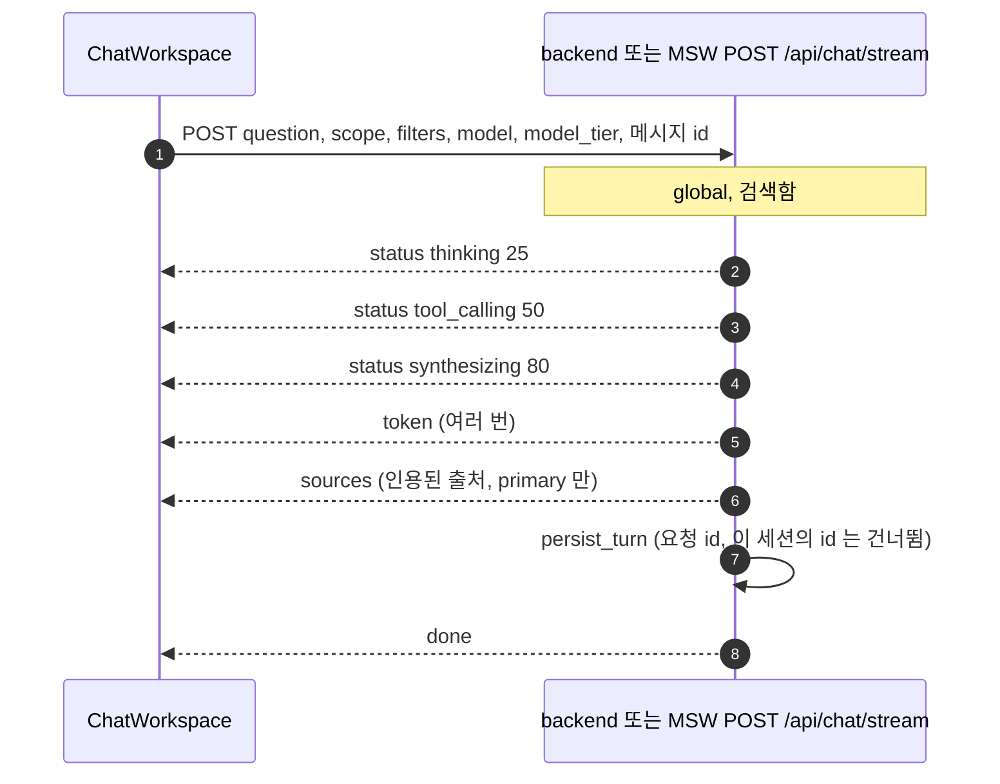

# AgentLens 데이터 계약 및 MSW 모의 명세서 (Contract & Mock Spec)

- **Updated**: 2026-11-10
- **기준**: v0.4.2 작업 트리
- **작성자**: 계약 통합 엔지니어 (`contract-integrator`)
- **문서 버전**: v1.4 (v1.0 as-built → v1.1 메시지 id 계약 → v1.2 v0.4.1 반영 → v1.3 v0.4.2: 오류 형식 통일, 런타임 검증, 불일치 CT-001~CT-026 정리 → v1.4 v0.4.2 2차: 응답 시각 UTC 오프셋, 스트림 session_id UUID, UI 메시지 id, 단계 4값, Ask AI SSE 검증, 수집 other_process, CT-027~CT-034)
- **상태**: Approved (Contract Lock). 7절 불일치 목록의 열린 항목 0건.
- **목적**: backend Pydantic 스키마·라우터 응답 ↔ frontend zod·호출 함수 ↔ MSW 핸들러·fixture ↔ 계약 테스트의 대응을 고정해 backend·frontend TDD 를 병렬로 돌린다.
- **함께 읽는 산출물**: `docs/system-designer/01_SYSTEM_DESIGN.md`, `docs/system-designer/02_OPENAPI_SPEC.yaml`(생성 스크립트 `.claude/skills/contract-specification/scripts/gen_openapi.py`), `docs/ui-system-designer/01_COMPONENT_SPEC.md`, `docs/spec-writer/fsd/02_AI_CHAT_SPECIFICATION.md`.

근거 표기: 코드 사실은 `path:line` (v0.4.2 작업 트리, 2026-11-10). "실행 확인" 은 이 문서를 쓰며 실제로 돌린 결과다.

---

## 0. 계약 범위와 파일 위치

### 0.1 인터페이스 개요
- REST: 업무 API 는 모두 `/api` 아래, 라우터 9개(news, schedule, stats, briefing, trends, webhook, sources, research, chat)를 `api_router` 가 묶는다 (`backend/app/api/router.py`). 접두사 밖은 `GET /`, `GET /health`. 경로 30개, operation 33개 (`gen_openapi.py` 실행 결과 `ok 30 33 55`, 실행 확인).
- v0.4.2 에서 지운 경로 (호출처가 없어 backend 조가 제거): `GET /api/news/{id}`, `POST /api/news/{id}/ask`, `DELETE /api/news/all`, `POST /api/research/discover`, `POST /api/research/register-candidate`, `POST /api/sources/github`, `GET /api/mcp/info`, `POST /api/briefing/generate`, `POST /api/webhook/send-briefing`, `GET /api/chat/search`, `POST /api/chat/query` (11개). MSW 핸들러·zod·계약 테스트·`gen_openapi.py` 에서도 지웠다.
- 프록시: 브라우저는 상대 경로 `/api/...` 를 부르고 Next rewrite 가 `INTERNAL_API_URL` 로 넘긴다. 기사 Ask AI 스트림만 `NEXT_PUBLIC_API_URL` 이 있으면 backend 에 직접 붙는다 (`getApiBase` `frontend/src/lib/api.ts:52-59`, `getDirectApiBase` `:66-68`, 스트림 `askQuestionAboutNewsStream` `:130-`).
- SSE 2개: `POST /api/chat/stream` (3.1절), `POST /api/news/{news_id}/ask/stream` (3.2절).
- 인증 없음, CORS 전체 허용 (수용된 위험, 판정 근거 아님).

### 0.2 계약 파일 위치 (자동 생성 없음, 손으로 맞춘다)
| 쪽 | 파일 |
|---|---|
| backend 스키마 | `backend/app/schemas/chat.py`, `backend/app/schemas/news.py`, 라우터 안 요청 모델(`backend/app/api/webhook.py`, `sources.py`, `research.py`), dict 응답 라우터, 오류 처리 `backend/app/api/errors.py` |
| frontend zod·타입 | `frontend/src/types/chat.ts`, `news.ts`, `trends.ts` (모든 응답 타입은 `z.infer`) |
| frontend 호출·검증 | `frontend/src/lib/api.ts`(피드·설정·소스·리서치·브리핑), `frontend/src/lib/chatApi.ts`(챗 REST·스트림 열기), `frontend/src/lib/contract.ts`(런타임 검증·오류 문구) |
| MSW | `frontend/src/mocks/handlers.ts`(news·briefing·sources·stats), `frontend/src/mocks/handlers/chat.ts`, `frontend/src/mocks/fixtures/chat.ts`, `frontend/src/mocks/api-error.ts`, `frontend/src/mocks/server.ts` |
| 계약 테스트 | `frontend/src/tests/chat/ContractAndMsw.test.ts` (115개, 6절) |

### 0.3 변경 규칙
- 한쪽을 고치면 같은 작업에서 반대쪽 zod, MSW 핸들러·fixture, 계약 테스트를 함께 고친다 (`.claude/rules/contract-sync.md`).
- **zod 작성 규칙 (v1.3)**: Pydantic·backend dict 와 1:1. 필수 → 필수, `Optional[X] = None` → `.nullable().optional()`, 기본값 있는 필드 → `.default(...)`. backend 가 검사하지 않는 형식·범위 제약(URL, UUID, 길이, 수 범위)은 zod 에 두지 않는다. 예외는 2.3절 표 '의도한 차이' 열에만 있다.
- 계약 변경은 8절에 변경 전/후로 적는다. 확인은 `make check`. 계약 테스트를 약하게 만들어 통과시키지 않는다.

---

## 1. 공통 응답 엔벨로프 및 에러 계약 (Response Envelope)

### 1.1 엔벨로프: 없다
backend 는 성공 응답을 감싸지 않는다. 엔드포인트마다 모델·dict 를 그대로 준다. v1.2 까지 `types/chat.ts` 에 있던 쓰이지 않는 `ApiResponse<T>`·`createApiResponseSchema`·`ApiErrorDetail(Schema)`·`LlmErrorDetailSchema`·`LlmErrorResponseSchema` 는 지웠다 (CT-025).

### 1.2 오류 응답 형식 (모든 API 공통, v0.4.2)
```json
{"error_code": "ERR_...", "message": "<한국어 문장>", "details": <객체|배열|null>}
```
- `details` 키는 늘 있다. 요청 검증 실패는 `[{"loc": [...], "msg": "..."}]`, 세션 메시지 id 충돌은 `{"message_ids": [...]}`, 그 밖은 대개 `null`.
- backend: `backend/app/api/errors.py` 가 전역 처리기 3개를 단다 (`install_error_handlers`, `backend/app/main.py`).
  - FastAPI 요청 검증 실패(`RequestValidationError`) → **400** `ERR_INVALID_PAYLOAD`, details `[{loc, msg}]`. 422 는 쓰지 않는다.
  - `HTTPException` → 같은 상태 코드, 코드는 `ApiError` 면 그 코드, 아니면 상태별 기본 코드(1.3절). `detail` 문자열이 `message` 가 된다.
  - 처리하지 못한 예외 → 500 `ERR_SERVER_INTERNAL`, 고정 문장. 예외 문자열은 로그에만 남긴다.
  - chat 라우터는 `error_response(status, code, message, details)` 로 같은 모양을 직접 만든다 (`backend/app/api/chat.py`).
- frontend zod: `ErrorResponseSchema` (`frontend/src/types/chat.ts:17-21`) — `error_code` 는 `^ERR_[A-Z0-9_]+$` 문자열, `message` 1자 이상, `details` 는 record·array·null 이고 **필수 키**. `ValidationErrorItemSchema` (`:10-14`) 는 `{loc, msg}`.
- frontend 화면 문구: 실패 응답이면 `readErrorMessage(res, fallback)` (`frontend/src/lib/contract.ts:35-44`) 가 `ErrorResponseSchema` 를 통과한 본문의 `message` 를 쓰고, 그 모양이 아니면(JSON 아님, 프록시 HTML, 옛 `{"detail"}`) 함수별 대체 문구를 쓴다. `api.ts` 의 실패 처리 13곳과 `chatApi.ts` 의 `request()` 가 이 함수를 쓴다. 옛 `data.detail` 읽기는 없다 (D-27).
- MSW: 모든 오류를 `apiError(status, code, message, details = null)` (`frontend/src/mocks/api-error.ts`) 로 만든다. 계약 테스트 'MSW error responses all match ErrorResponseSchema and use catalog codes' 가 14개 오류 요청의 본문을 `ErrorResponseSchema`·`ApiErrorCodeSchema` 로 확인한다.

**변경 전/후 (D-27·CT-014)**
| 경우 | 변경 전 (v0.4.1) | 변경 후 (v0.4.2) |
|---|---|---|
| news·briefing·sources·research·webhook 의 HTTPException | `{"detail": "<문자열>"}` | `{"error_code": 상태별 기본 코드, "message": <detail>, "details": null}` |
| 요청 검증 실패 | 422 `{"detail": [{type, loc, msg, input}]}` | 400 `ERR_INVALID_PAYLOAD`, details `[{loc, msg}]` |
| 처리 못 한 예외 | 500 `{"detail": "Internal server error...", "error": "<예외 문자열>"}` | 500 `ERR_SERVER_INTERNAL`, 고정 문장, details null |
| chat | `{error_code, message, details}` (일부 `details.error` 에 예외 문자열) | 같은 모양, 예외 문자열 없음 |
| MSW | `{error_code, message}` (details 없음), news 는 backend 에 없는 코드 | backend 와 같은 코드·모양 |
| frontend | `data.detail` 을 문구로 | `message` 를 문구로 (`readErrorMessage`) |

### 1.3 오류 코드 카탈로그 (backend ↔ zod `ApiErrorCodeSchema` ↔ MSW)
`ApiErrorCodeSchema` 는 `frontend/src/types/chat.ts:28-58`. 런타임 검증은 1.2절의 문자열 규칙만 보고, 이 enum 은 MSW·계약 테스트용 카탈로그다. backend 가 내는 코드 집합과 같다 (`grep -o "ERR_[A-Z_]*" backend/app` 결과와 대조, 실행 확인).

| error_code | 상태 | 발생 | MSW |
|---|---|---|---|
| `ERR_INVALID_PAYLOAD` | 400 | 요청 검증 실패 전부(쿼리·경로·본문, details `[{loc,msg}]`), chat stream 본문 JSON 아님·객체 아님·필드 오류(details null), 세션 POST JSON·필드 오류, 세션 메시지 id 가 다른 세션 것(details `{message_ids}`), HTTPException 400 기본 코드(Notion·SMTP·웹훅·RSS 입력 오류) | news page/size, ask/stream question·news_id, chat stream·sessions |
| `ERR_NOT_FOUND` | 404 | HTTPException 404 기본 코드(기사 없음, 소스 없음) | ask/stream 없는 기사 |
| `ERR_METHOD_NOT_ALLOWED` | 405 | 상태별 기본 코드 (예: `GET /api/chat/stream`) | 없음 |
| `ERR_CONFLICT` | 409 | 상태별 기본 코드 (지금 409 를 던지는 라우터 없음. 수집·초기화·딥 리서치를 실행 중에 다시 요청하면 409 가 아니라 200 `status: "already_running"`. `ERR_COLLECTION_RUNNING` 은 쓰지 않는다) | 없음 |
| `ERR_SERVER_INTERNAL` | 500 | 처리 못 한 예외, 세션 목록·상세 실패, 설정 저장 실패 | news `trigger_error=500`, stream `[TRIGGER_500]`, sessions 목록·상세 트리거 |
| `ERR_UPSTREAM_FAILED` | 502 | 상태별 기본 코드 | 없음 |
| `ERR_SERVICE_UNAVAILABLE` | 503 | 상태별 기본 코드 | 없음 |
| `ERR_CHAT_PAYLOAD_EMPTY` | 400 | chat stream 질문이 문자열이 아니거나 공백 | 있음 |
| `ERR_CHAT_PAYLOAD_TOO_LARGE` | 400 | chat stream 질문 2000자 초과 | 있음 |
| `ERR_INVALID_SCOPE_PARAM` | 400 | chat stream `scope` 가 scoped·global 아님 | 실제 값 검사 (v1.2 의 `[TRIGGER_400]` 은 지움) |
| `ERR_INVALID_MODEL_TIER` | 400 | chat stream `model_tier` 가 haiku·sonnet·opus 아님 | 있음 (`model` 문자열은 검사하지 않는다, backend 와 같음) |
| `ERR_HANDOVER_SOURCE_NOT_FOUND` | 404 | `GET /api/chat/sources/{id}` 없음, scoped stream 기사 없음 | 있음 |
| `ERR_CLAUDE_API_KEY_MISSING` | **401** | stream 전 LLM 가용성 검사 분기 (v1.2 zod 주석의 503 은 틀렸다, D-31) | `[TRIGGER_401]` |
| `ERR_CLAUDE_QUOTA_EXCEEDED` | 429 | 같은 분기 | `[TRIGGER_429]` |
| `ERR_CLAUDE_OVERLOADED` | 529 | 같은 분기 | `[TRIGGER_529]` |
| `ERR_LLM_PROVIDER_UNAVAILABLE` | 503 | stream 전 `check_provider_available()` 실패 | `[TRIGGER_503]` |
| `ERR_LLM_UPSTREAM_FAILED` | 502 / SSE | stream 전 분기, SSE error 의 thinking 단계(질문 분석) 실패 | `[TRIGGER_502]`, `[TRIGGER_THINKING_ERROR]` |
| `ERR_LLM_QUOTA_EXCEEDED` | 429 | stream 전 분기 | 없음 |
| `ERR_LLM_STREAM_FAILED` | SSE | chat SSE 토큰 생성 중 실패, 기사 Ask AI 스트림 토큰 뒤 실패·잘림 | `[TRIGGER_STREAM_ERROR]` (두 스트림 모두) |
| `ERR_RETRIEVER_INDEX_ERROR` | SSE (status_code 500) | chat SSE global 검색(tool_calling) 실패 | `[TRIGGER_SEARCH_ERROR]` |
| `ERR_SESSION_INVALID_UUID` | 400 | 세션 POST `id` 가 UUID 아님 (JSON·필드 오류는 `ERR_INVALID_PAYLOAD`, CT-016) | 있음 |
| `ERR_SESSION_NOT_FOUND` | 404 | 세션 상세·삭제 | 있음 |
| `ERR_SESSION_CREATE_FAILED` | 500 | 세션 저장 예외 | 제목 `[TRIGGER_500]` |
| `ERR_SESSION_DELETE_FAILED` | 500 | 세션 삭제 예외 | id 에 `[TRIGGER_500]` |

v1.2 enum 에서 지운 코드 (backend 가 내지 않는다, CT-007): `ERR_ANTHROPIC_KEY_MISSING`·`ERR_ANTHROPIC_RATE_LIMIT`·`ERR_ANTHROPIC_OVERLOADED`(별칭), `ERR_SONNET_SCHEMA_VALIDATION`, `ERR_STREAM_ABORTED_BY_USER`, `ERR_ARTICLE_EXTRACTION_FAIL`, `ERR_CHAT_STREAM_TIMEOUT`, `ERR_SESSION_LIMIT_EXCEEDED`, `ERR_INVALID_FILTER_PARAM`, `ERR_SEARCH_QUERY_TOO_SHORT`(엔드포인트 삭제). MSW 전용이던 `ERR_INVALID_PAGE_PARAM`, `ERR_FEED_FETCH_FAILED`, `ERR_FEED_CARD_NOT_FOUND` 도 MSW 에서 지웠다. 계약 테스트 'ApiErrorCodeSchema drops codes backend never emits' 가 확인한다.

### 1.4 날짜·시각 형식
- **모든 응답 시각에 UTC 오프셋이 붙는다** (v0.4.2, News 는 `backend/app/schemas/news.py:32-36` `as_utc`, 나머지는 backend A 조 N-09). 형식은 `YYYY-MM-DDTHH:MM:SS[.ffffff]+00:00` (News 는 `Z` 도 가능). DB 의 오프셋 없는 값과 global SSE 출처의 공백 구분 형식(`YYYY-MM-DD HH:MM:SS`)은 없어졌다.
- zod 는 `z.iso.datetime({ offset: true })` (`IsoDateTimeSchema`, `frontend/src/types/chat.ts:4`) — `Z`·`+00:00` 통과, 오프셋 없는 문자열은 계약 위반(경고만, 2.0절 정책). 대상 필드:
  - News `published_at`·`created_at`
  - 챗 세션 요약·상세 `created_at`·`updated_at`, `messages[].created_at`, `active_source` 의 `published_at`·`created_at`·`scraped_at`
  - `GET /api/chat/sources/{id}` 의 `published_at`·`created_at`·`scraped_at`
  - SSE `sources[].published_at`
  - `GET /api/schedule/status` 의 `last_crawl_time`, `recent_logs[].started_at`·`completed_at`, `GET /api/schedule/progress` 의 `last_crawl_time`
  - `GET /api/research/audit-logs` 의 `logs[].created_at`
- 그 밖에 서버가 그 자리에서 만드는 시각(SSE `status.timestamp`, `current_time`, `next_run`, `generated_at`, `stats.last_updated`)은 원래 `+00:00` 이 붙고 zod 는 `z.string()` 이다.
- MSW fixture 의 시각은 모두 `Z` 접미사이고, MSW 가 그 자리에서 만드는 시각은 `toISOString()`(`Z`)이다. 계약 테스트 'MSW chat responses carry offset timestamps' 가 확인한다.
- 일일 브리핑 `date` 는 `"%Y년 %m월 %d일"`. MSW `mockDailyBriefing.date` 도 같은 형식이다 (CT-023, `frontend/src/mocks/handlers.ts` `koreanDate`).

### 1.5 페이지네이션
| 엔드포인트 | 파라미터 | 규칙 | MSW |
|---|---|---|---|
| `GET /api/news` | `page`(≥1), `size`(1~100) | offset `(page-1)*size`, `total_pages = ceil(total/size)`(0 이면 1) | 같음. 범위 밖은 400 `ERR_INVALID_PAYLOAD` details `[{loc:['query','page'|'size'],msg}]` |
| `GET /api/chat/sessions` | `limit`(1~50, 기본 30), `offset`(≥0) | `updated_at` 내림차순 배열 | 같음. 범위 밖은 400 `ERR_INVALID_PAYLOAD` (v1.2 는 잘라서 처리) |
| `GET /api/research/audit-logs` | `limit`(1~200, 기본 30, 밖이면 400 `ERR_INVALID_PAYLOAD`) | `created_at` 내림차순 | 없음 |
| `POST /api/research/run-deep` | 쿼리 `max_candidates`(1~20, 기본 6, 밖이면 400 `ERR_INVALID_PAYLOAD`) | — | 없음 |

---

## 2. 도메인 계약: Pydantic ↔ zod ↔ 호출부 ↔ MSW

### 2.0 런타임 응답 검증 정책 (D-33·FE-19·CT-026, v1.3 신설)
`frontend/src/lib/contract.ts`:
- `parseResponse(schema, data, label)` (`:17-24`): `safeParse` 해서 **통과하면 zod 결과**(기본값 적용, 모르는 키 제거)를 돌려준다. **실패하면 던지지 않는다.** production 이 아니면 `console.warn('[계약 위반] <label>', issues)` 를 남기고 **받은 데이터를 그대로** 돌려준다.
- `readJson(res, schema, label)` (`:27-29`): `res.json()` 후 `parseResponse`.
- `parseChatSsePayload(event, data)` (`frontend/src/lib/contract.ts:69-74`): 챗 SSE 이벤트별 스키마(status·sources·token·done·error)로 같은 정책. 모르는 이벤트는 그대로. 이벤트별 반환 타입 `ChatSsePayloads` (챗 조 FE-38).
- `parseNewsAskSsePayload(data)` (`:87-91`, v1.4): 기사 Ask AI 스트림 `data:` JSON 을 `event` 필드(meta·token·done·error)로 골라 `types/news.ts` 의 `NewsAsk*EventSchema` 로 같은 정책. 모르는 이벤트는 그대로.
- 그래서 응답에 필드가 더 있으면 조용히 버리고, 필수 필드가 빠지거나 타입이 다르면 경고만 남기고 화면은 받은 데이터로 계속 그린다. 계약 위반으로 화면이 열리지 않는 일은 없다. 이 정책을 고른 이유: 위반을 오류로 처리하면 backend 의 작은 변경(예: 설정 필드 하나 삭제)으로 화면 전체가 막힌다. 개발·테스트에서 경고로 드러나면 충분하다.
- 적용 위치: `api.ts` 의 응답 함수 22곳 전부(`readJson`), `chatApi.ts` 의 세션 목록·상세·기사 상세(`readJson`, `frontend/src/lib/chatApi.ts:53-79`), `ChatWorkspace.tsx` 의 SSE payload(`parseChatSsePayload`), `askQuestionAboutNewsStream` 의 줄마다(`parseNewsAskSsePayload`, `api.ts:192`). 테스트 밖에서 zod 를 쓰지 않던 문제(D-33)가 없어졌다.
- 계약 테스트 describe 'Runtime response validation policy (D-33, FE-19)' 8개가 정책을 고정한다: 통과 시 기본값 적용·경고 없음, 실패 시 경고·원본 반환, 실제 `fetchNewsFeed`·`fetchSources` 가 MSW 응답에서 경고 없음, 위반 응답에서 화면용 데이터 유지, backend `message` 표시·대체 문구, 옛 `{"detail"}` 무시, 필드가 더 있거나 빠진 브리핑 설정에서도 `fetchBriefingSettings` 가 던지지 않음.

### 2.1 엔드포인트 대응표 (30 경로, 33 operation)
| 메서드 경로 | backend (`path:line`) | zod 응답 스키마 | 호출부 | MSW |
|---|---|---|---|---|
| GET `/`, GET `/health` | `backend/app/main.py` | 없음 | 없음 (healthcheck) | 없음 |
| GET `/api/news` | `backend/app/api/news.py:17` `NewsListResponse` | `NewsListResponseSchema` | `fetchNewsFeed` (`api.ts:91`) | 200, 400, 500, delay 30 (`handlers.ts:194`) |
| POST `/api/news/{news_id}/ask/stream` | `news.py:33` `AskQuestionRequest` / SSE | 요청 `AskQuestionRequestSchema`(1~2000자), 이벤트는 3.2절 | `askQuestionAboutNewsStream` (`api.ts:130`) | 200 SSE, error 이벤트, 400, 404 (`handlers.ts:253`) |
| GET `/api/news/feed/rss.xml` | `news.py:66` XML | 없음 | Header 링크 | 없음 |
| GET `/api/schedule/status` | `schedule.py:14` `ScheduleStatusResponse` | `ScheduleStatusSchema` | `fetchScheduleStatus` (`api.ts:224`) | 없음 |
| GET `/api/schedule/progress` | `schedule.py:34` dict | `CrawlProgressSchema` | `fetchCrawlProgress` (`:231`) | 없음 |
| POST `/api/schedule/trigger` | `schedule.py:39` dict | `ManualCollectResponseSchema` | `triggerManualCollect` (`:238`) | 없음 |
| POST `/api/schedule/reset-and-collect` | `schedule.py:60` dict | `ResetAndCollectResponseSchema` | `resetAndRecollect` (`:270`) | 없음 |
| GET `/api/stats` | `stats.py:9` `StatsResponse` | `StatsResponseSchema` | `fetchStats` (`:245`) | 200, delay 15 |
| GET `/api/briefing/today` | `briefing.py:26` `DailyBriefingResponse` | `DailyBriefingSchema` | `fetchDailyBriefing` (`:115`) | 200, delay 20 |
| POST `/api/briefing/export/notion` | `briefing.py:31` `NotionExportResponse` | `NotionExportResponseSchema` | `exportBriefingToNotion` (`:363`) | 없음 |
| POST `/api/briefing/send/email` | `briefing.py:51` `EmailSendResponse` | `SuccessMessageResponseSchema` | `sendBriefingByEmail` (`:379`) | 없음 |
| POST `/api/briefing/test/notion`·`test/email` | `briefing.py:71`, `:78` dict | `SuccessMessageResponseSchema` | `testNotionConnection` (`:395`), `testEmailConnection` (`:411`) | 없음 |
| GET `/api/briefing/settings` | `briefing.py:92` dict | `BriefingSettingsSchema` | `fetchBriefingSettings` (`:430`) | 없음 (테스트가 `server.use`) |
| POST `/api/briefing/settings` | `briefing.py:136` `BriefingSettingsUpdate` / dict | `SuccessMessageResponseSchema` | `updateBriefingSettings` (`:454`) | 없음 |
| GET `/api/trends/radar` | `trends.py:6` dict | `TechRadarDataSchema` (`types/trends.ts`) | `fetchTechRadar` (`:252`) | 없음 |
| POST `/api/webhook/test` | `webhook.py:19` | `SuccessMessageResponseSchema` | `testWebhook` (`:259`) | 없음 |
| GET `/api/sources` | `sources.py:26` dict | `SourcesResponseSchema` | `fetchSources` (`:280`) | 200, delay 20 |
| POST `/api/sources/rss` | `sources.py:53` `AddRssRequest` / dict | `AddRssSourceResponseSchema` | `addRssSource` (`:296`) | 없음 |
| PATCH `/api/sources/{source_type}/{item_id:path}/toggle` | `sources.py:69` | `StatusMessageResponseSchema` | `toggleSource` (`:287`) | 없음 |
| DELETE `/api/sources/{source_type}/{item_id:path}` | `sources.py:77` | `StatusMessageResponseSchema` | `deleteSource` (`:314`) | 없음 |
| POST `/api/research/inspect-url` | `research.py:10` | `InspectUrlResponseSchema` | `inspectUrl` (`:323`) | 없음 |
| GET `/api/research/status` | `research.py:26` | `ResearchStatusSchema` | `fetchDeepResearchStatus` (`:336`) | 없음 |
| GET `/api/research/audit-logs` | `research.py:31` | `ResearchAuditLogsResponseSchema` | `fetchResearchAuditLogs` (`:343`) | 없음 |
| POST `/api/research/run-deep` | `research.py:41` | `RunDeepResearchResponseSchema` | `triggerDeepResearch` (`:350`) | 없음 |
| GET `/api/chat/sources/{source_id}` | `chat.py:59` `ChatSourceDetailResponse` | `ChatSourceDetailResponseSchema` | `fetchChatSourceDetail` (`chatApi.ts:76`) | 200, 400, 404 (`handlers/chat.ts:596`) |
| POST `/api/chat/stream` | `chat.py:69` `ChatStreamRequest` / SSE | 요청 `ChatStreamRequestSchema`, 이벤트 3.1절 | `openChatStream` (`chatApi.ts:85`) → `ChatWorkspace.tsx` 파서 | 200 SSE, 400, 401, 404, 429, 500, 502, 503, 529 (`handlers/chat.ts:441`) |
| GET `/api/chat/sessions` | `chat.py:133` `List[ChatSessionSummary]` | `z.array(ChatSessionSummarySchema)` | `fetchChatSessions` (`chatApi.ts:53`) | 200, 400, 500 (`:613`) |
| POST `/api/chat/sessions` | `chat.py:148` `ChatSessionCreateRequest` / 201 `ChatSessionDetail` | `ChatSessionDetailSchema` | `saveChatSession` (`chatApi.ts:64`) | 201, 400, 500 (`:653`) |
| GET `/api/chat/sessions/{session_id}` | `chat.py:179` | `ChatSessionDetailSchema` | `fetchChatSessionDetail` (`chatApi.ts:59`, 404 → null) | 200, 404, 500 (`:730`) |
| DELETE `/api/chat/sessions/{session_id}` | `chat.py:195` `GenericSuccessResponse` | `GenericSuccessResponseSchema` | `deleteChatSession` (`chatApi.ts:72`) | 200, 404, 500 (`:751`) |

- `api.ts` 기본 제한 시간 8초 (`fetchWithTimeout`, `api.ts:74`, `options.signal` 도 따른다). 챗 REST 8초, 스트림 첫 응답 30초 (`chatApi.ts:21-23`).
- MSW 가 계약 테스트에 남겨 둔 경로가 실제 앱에 없는지는 계약 테스트 'has no mock for routes backend does not serve' 가 핸들러 목록으로 확인한다 (GET `/api/chat/stream`, 지운 news·chat·briefing 경로).

### 2.2 쿼리·경로 파라미터
| 엔드포인트 | 이름 | 규칙 | frontend 가 보내는 값 |
|---|---|---|---|
| GET `/api/news` | `category`, `source` | 소문자로 바꿔 일치 비교, `all` 이면 필터 없음 | `all` 이면 보내지 않음 |
| | `search` | 앞뒤 공백 제거, title·summary·tags·tech_stack·why_it_matters `ILIKE` OR | 있으면 |
| | `high_signal_only` | `is_high_signal = true` 만 | true 일 때만 |
| | `sort` | `latest`, `top`, `quality`, 그 밖 `hot` | 있으면 |
| PATCH·DELETE `/api/sources/{source_type}/{item_id}` | `item_id` | 경로 선언이 `{item_id:path}` 라 `/` 를 담을 수 있다. 프론트의 `encodeURIComponent` (`api.ts:289`, `:316`) 결과 `%2F` 는 디코드돼 매칭된다 (FastAPI `TestClient` 로 `jlowin%2Ffastmcp`, 인코딩된 URL, `geeknews` 모두 그 값 그대로 매칭, 실행 확인 — CT-001) | 피드 `id || url`, 저장소 `repo` |
| GET·DELETE `/api/chat/sessions/{session_id}` | `session_id` | 형식 검증 없음 | `encodeURIComponent` (`chatApi.ts`), UUID 일 때만 URL 로 연다 |

### 2.3 Chat 스키마 대조 (`backend/app/schemas/chat.py` ↔ `frontend/src/types/chat.ts`)
0.3절 규칙으로 1:1 이다. 아래는 모델별 대응과 **의도한 차이** 만 적는다.

| Pydantic (`chat.py:line`) | zod (`chat.ts:line`) | 의도한 차이 |
|---|---|---|
| `TokenUsageMeta` (`:12`) | `TokenUsageMetaSchema` (`:187`) | 없음 (토큰 수 기본 0, 음수 제약 없음) |
| `ChatMessageHistory` (`:18`) | `ChatMessageHistorySchema` (`:326`) | 없음 (`content` 길이 제약 없음) |
| `ChatFocusFilter` (`:22`) | `ChatFocusFilterSchema` (`:214`) | 없음. UI 는 camelCase `FocusFilters` 를 쓰고 `toChatFocusFilter`/`fromChatFocusFilter` 로 바꾼다 |
| `ChatStreamRequest` (`:28`) | `ChatStreamRequestSchema` (`:341`) | 없음. `model` 기본값 없음(null) — backend 는 명시 model > model_tier > 기본 챗 모델 순으로 고른다(BUG-14). `source_id` int, `model_tier`·`history` null 허용(CT-017). `session_id` 는 Pydantic 이 문자열로만 보지만 라우터가 UUID 인지 따로 검사해 아니면 400 `ERR_SESSION_INVALID_UUID` (`backend/app/api/chat.py:101-106`), 생략·null 이면 서버가 UUID 를 만든다. zod 는 `SESSION_UUID_PATTERN`(`uuid.UUID()` 가 받는 32자리 16진, 하이픈 생략 허용)으로 같은 규칙을 둔다 (CT-028). 메시지 id 1~36자·서로 다름 (8.1절) |
| `ChatStatusStep` Literal 7값 (`:53`) | `ChatStatusStepSchema` (`chat.ts:261`) | v1.4: zod 는 backend 스트림이 실제로 보내는 4값(thinking·tool_calling·extracting_source·synthesizing)만 받는다. Pydantic Literal 의 observing·evaluating_sufficiency·agentic_searching 은 어느 코드도 보내지 않는다. 트래커 아이콘(`WorkflowStepTracker.tsx`)과 그 테스트도 4값으로 줄였다 (CT-030). Pydantic Literal 축소는 backend 후속 (8절) |
| `ChatStatusPayload` (`:63`) | `ChatStatusPayloadSchema` (`:266`) | 없음 (`progress` null 허용) |
| `ChatSourceItem` (`:74`) | `ChatSourceItemSchema` (`:285`) | 없음. `publisher` null 허용(CT-002), `title`·`url`·`quality_score` 형식·범위 제약 없음(CT-020). `type` 은 Literal 2값이지만 backend 는 `primary` 만 만든다 |
| `ChatSourcesPayload` (`:94`) | `ChatSourcesPayloadSchema` (`:309`) | `applied_filters` 는 Pydantic `Any`, zod 는 `ChatFocusFilter`\|null — backend 가 실제로 `ChatFocusFilter.model_dump()` 또는 null 만 넣는다 |
| `StreamErrorPayload` (`:101`) | `ChatStreamErrorPayloadSchema` (`:450`) | 없음 (`status_code` 기본 502, `retryable` 기본 true, v1.2 의 zod 전용 `provider` 제거) |
| `DonePayload` (`:108`) | `ChatDonePayloadSchema` (`:433`) | 없음 (`session_id` 아무 문자열, `model` null 허용, CT-019) |
| `ChatSourceDetailResponse` (`:119`) | `ChatSourceDetailResponseSchema` (`:378`) | 없음. `full_content`·`scraped_at` 추가(CT-003), `created_at` null 허용 |
| `ChatSearchChunk` (`:141`) | `ChatSearchChunkSchema` (`:407`) | 이 모양을 돌려주는 엔드포인트는 없다(`/chat/search` 삭제). MSW 코퍼스 fixture 타입으로만 쓴다 |
| `ErrorResponse` (`:154`) | `ErrorResponseSchema` (`:17`) | Pydantic `details: Optional[Dict]` 인데 backend 는 배열도 보낸다. zod·OpenAPI 는 실제 응답대로 객체\|배열\|null. Pydantic 모델 타입은 backend 후속(응답 동작과 무관, 8절) |
| `GenericSuccessResponse` (`:159`) | `GenericSuccessResponseSchema` (`:553`) | 없음 (`message`·`deleted_count` null 허용, CT-021) |
| `ChatMessageItem` (`:164`) | `ChatMessageItemSchema` | 없음. `id` 문자열(v1.2 의 숫자→문자 변환 제거), `session_id` 아무 문자열, `created_at` 오프셋 ISO |
| `ChatSessionSummary` (`:179`) | `ChatSessionSummarySchema` | 없음. `id`·`title` 형식·길이 제약 없음(CT-018. v1.4 부터 세션 POST·스트림 모두 UUID 만 받지만, 그 전에 만들어진 세션 id 가 DB 에 남아 있을 수 있어 응답은 제약하지 않는다), `message_count` 기본 0, `created_at`·`updated_at` 오프셋 ISO |
| `ChatSessionDetail` (`:192`) | `ChatSessionDetailSchema` (`:603`) | 없음 (`messages` 기본 `[]`) |
| `ChatSessionCreateRequest` (`:205`) | `ChatSessionCreateRequestSchema` (`:617`) | 없음 (`title` 기본 `새 대화`, `scope_mode` 기본 `global`, 둘 다 null 허용) |

v0.4.2 에서 backend·zod 모두에서 지운 모델: `ChatQueryRequest`, `ChatQueryResponse`, `ChatSearchResponse` (엔드포인트 삭제). zod 에서만 지운 것: `ChatSearchQueryParamsSchema`, `ChatSessionSchema`(쓰는 곳 없음, CT-025).

**세션 POST 동작 (CT-004·CT-016·CT-024, v0.4.2)**: 메시지는 기존 뒤에 이어 붙이고, 이 세션에 이미 있는 id 와 같은 요청 안 중복 id 는 건너뛴다. 다른 세션에 있는 id 가 섞이면 아무것도 바꾸지 않고 400 `ERR_INVALID_PAYLOAD`, details `{"message_ids": [...]}` (`backend/app/services/chat_session_service.py:35`, `:246`, `:412-422`, `backend/app/api/chat.py:173-174`). 메시지의 `model_tier`·`usage`·`created_at` 을 받은 그대로 저장하고 상세 조회에서 돌려준다(`created_at` 이 없으면 서버 시각에 1µs 씩 더해 순서를 지킨다). 업서트에서 `title`·`scope_mode` 는 null 이 아니면 덮어쓴다 — 두 필드는 Pydantic 기본값이 있어 본문에서 빼면 기본값(`새 대화`, `global`)으로 덮인다. 프론트는 늘 두 값을 보낸다 (`ChatWorkspace` saveTurn).

### 2.4 News·Briefing·Schedule·Stats·Sources·Research 대조 (`backend/app/schemas/news.py`, dict 라우터 ↔ `frontend/src/types/news.ts`, `trends.ts`)
| backend | zod (`news.ts`) | 의도한 차이 |
|---|---|---|
| `NewsItemResponse` (`news.py:26`) | `NewsItemSchema` | `summary`·`why_it_matters` 는 Pydantic `Optional[str]` 이지만 라우터가 `or ""` 로 채워 null 이 나가지 않는다. zod 는 `string` 기본 `''` (null 을 허용하면 화면 코드 전체가 null 검사를 해야 한다). 날짜는 오프셋 있는 ISO (1.4절). `full_content`·`scraped_at` 은 backend 가 보내지 않아 지웠다 (CT-005) |
| `NewsListResponse` (`:38`) | `NewsListResponseSchema` | 없음 |
| `AskQuestionRequest` (`:45`, 1~2000자) | `AskQuestionRequestSchema` | 없음. `AskQuestionResponse` 는 엔드포인트와 함께 지웠다 |
| `BriefingCategoryItem` (`:49`) | `BriefingCategoryItemSchema` | 없음 (`id`·문자열 필드·`tags`·`hotness_score` null 허용, CT-021) |
| `BriefingCategorySection` (`:70`) | `BriefingCategorySectionSchema` | 없음 |
| `DailyBriefingResponse` (`:77`) | `DailyBriefingSchema` | 없음 (`date` 한국어 형식, D-42 정리에서 이 스키마는 지우지 않는다 — 런타임 검증이 쓴다). v0.4.2: 분야는 4개 고정 순서 harness·mcp_plugins_skills·agent_tech·ai_news, `name` 은 frontend 긴 라벨과 같고(`하네스 & 벤치마크`, `MCP & 생태계`, `에이전트 아키텍처`, `최신 AI 동향`), `icon` 은 이모지가 아니라 분야 id, `markdown_report`·`overview` 에 이모지 없음 (`backend/app/services/briefing_service.py:15-41`) |
| `NotionExportResponse` (`:92`) | `NotionExportResponseSchema` | 없음 (`url` null 허용) |
| `EmailSendResponse` (`:101`), test·settings dict | `SuccessMessageResponseSchema` | 없음 |
| GET settings dict (`briefing.py:92`) | `BriefingSettingsSchema` | 없음. v0.4.2 에서 `webhooks.auto_alert_high_signal` 을 뺐다. `auto_dispatch_daily_briefing` 은 웹훅 자동 발송을 실제로 켜고 끈다 |
| `ScheduleStatusResponse` (`:132`) | `ScheduleStatusSchema` | 없음. `schedule_hours`·`timezone` 필수(스케줄 대화상자가 쓴다, backend 가 늘 보낸다). `recent_logs` 는 `CrawlLogSchema[]` — `status` 는 `success`·`partial_failure`·`failed` enum(v0.4.2, `backend/app/collectors/manager.py:299-303`), `started_at`·`completed_at`·`last_crawl_time` 은 오프셋 ISO 또는 null (CT-032) |
| progress dict (`collectors/manager.py`) | `CrawlProgressSchema` | 없음 (`last_crawl_time` null 허용) |
| trigger dict (`schedule.py:39`) | `ManualCollectResponseSchema` | 없음 (`source_results` 추가, CT-022). v1.4: `already_running` 일 때만 `other_process: bool` — 다른 프로세스(MCP 서버·make collect)가 수집 잠금을 쥐고 있으면 true, 문구는 '다른 프로세스(MCP 서버·make collect)가 같은 DB 에 수집 중입니다.' (`schedule.py:42-53`, CT-033). backend Pydantic `ManualCollectResponse`(`news.py:149`)는 어느 라우터도 쓰지 않는다(CT-034, 8절) |
| reset dict (`schedule.py:60`) | `ResetAndCollectResponseSchema` | 없음 |
| `StatsResponse` (`:143`) | `StatsResponseSchema` | 없음 |
| sources dict (`sources.py:26`) | `SourcesResponseSchema`, `SourceConfigSchema`, `SourceItemSchema`, `MonitoredRepoSchema`, `SourcesStatsSchema` | `data` 는 `sources.json` 그대로라 아는 섹션만 타입을 단다. `sources_file`(v0.4.2 부터 서버 절대 경로가 아니라 파일 이름, 예: `sources.json`, `backend/app/api/sources.py:37`)·`updated_at`·`stats` 필수(CT-006). `MonitoredRepo.category` 기본 `agent_tech`. 옛 피드는 `id` 가 없을 수 있어 optional |
| rss POST dict (`sources.py:53`) | `AddRssSourceResponseSchema` | 없음 |
| toggle·delete dict | `StatusMessageResponseSchema` | 없음 |
| inspect dict (`research.py:10`, `source_researcher.py`) | `InspectUrlResponseSchema` | 없음 (`type`·`source_kind`·`input_url` 추가, CT-022) |
| status dict (`deep_researcher.py`) | `ResearchStatusSchema`, `ResearchRunSummarySchema`, `ResearchRunResultSchema` | 없음. `last_run_time` 오프셋 ISO 또는 null. `last_run_summary` 는 실행 전 `{}`, 성공 `{evaluated_total, auto_adopted, adopt_failed, completed_at, results[]}`, 사이클 예외 `{status:'error', error, completed_at}` 라 필드가 모두 optional. v1.4: `adopt_failed`(정수) — 자동 채택 기준을 넘었지만 sources.json 저장에 실패한 후보 수. 그 후보는 `WATCHLIST` 로 두고 감사 기록 `verdict_reason` 에 사유를 남긴다 (`backend/app/services/deep_researcher.py:478-483`, `:512-518`, CT-035) |
| audit-logs dict | `ResearchAuditLogsResponseSchema` | 없음 (`logs[].created_at` 오프셋 ISO) |
| run-deep dict | `RunDeepResearchResponseSchema` | 없음 (`max_candidates` optional, CT-022) |
| radar dict (`trend_service.py`) | `TechRadarDataSchema` (`trends.ts`) | 없음 (`sample_news_id` null 허용) |

`api.ts` 의 응답 타입은 모두 이 zod 의 `z.infer` 다. v1.2 에서 `api.ts` 에 따로 있던 interface `SourceItem`·`MonitoredRepo`·`SourcesResponse`·`CrawlProgress`·`InspectUrlResponse`·`ResearchStatus`·`ResearchAuditLog` 는 지우고 `@/types/news` 에서 다시 내보낸다 (`api.ts:41-49`, CT-006).

### 2.5 frontend 전용 UI 계약
`ChatMessage`(UI 메시지), `ChatSessionMeta`, `ChatSessionFullData`, 변환 함수 `chatMessageItemToUiMessage`/`uiMessageToChatMessageItem`, 모델 표시 유틸, Props 타입은 `types/chat.ts` 11·13·14절에 있고 backend 대응이 없다. 화면 상태는 `docs/ui-system-designer/01_COMPONENT_SPEC.md` 가 맡는다.

---

## 3. SSE 이벤트 계약

### 3.1 POST `/api/chat/stream`
- 응답 `text/event-stream; charset=utf-8`, 프레임 `event: <종류>\ndata: <JSON>\n\n` (`backend/app/services/chat_service.py:440-680`).
- 스트림을 열기 전 JSON 오류 (`backend/app/api/chat.py:69-131`): 400 `ERR_INVALID_PAYLOAD`(JSON 아님·객체 아님·필드 오류, details null) → 400 `ERR_CHAT_PAYLOAD_EMPTY` → 400 `ERR_CHAT_PAYLOAD_TOO_LARGE` → 400 `ERR_INVALID_SCOPE_PARAM` → 400 `ERR_INVALID_MODEL_TIER`·`ERR_INVALID_PAYLOAD`(Pydantic 필드) → 400 `ERR_SESSION_INVALID_UUID`(session_id 가 UUID 아님, v1.4) → 404 `ERR_HANDOVER_SOURCE_NOT_FOUND` → 401/429/529/503/502 LLM 가용성 분기. MSW 도 같은 순서다 (`handlers/chat.ts` `readChatRequest`, `providerErrorFor`).
- frontend: `ChatWorkspace.tsx` 가 블록을 `\n\n` 으로 나누고 `event:`·`data:` 를 읽어 `parseChatSsePayload` 로 검증한 뒤(`:411`) 처리한다.

| 이벤트 | data | zod |
|---|---|---|
| `status` | `{step, label, progress, timestamp}` (+ tool_calling 은 `query`). **label 에 이모지 없음** (v0.4.2) | `ChatStatusPayloadSchema` |
| `sources` | `{sources: ChatSourceItem.model_dump()[], applied_filters, is_relaxed, primary_count, supplementary_count: 0}`, 모든 `type` primary, `publisher: null` | `ChatSourcesPayloadSchema` |
| `token` | `{token}` | `SseTokenPayloadSchema` |
| `done` | `{done: true, session_id, model, model_tier, sources_count, primary_count, supplementary_count, latency_ms, usage}`. `usage` 는 이 스트림에서 잰 값(없으면 null), 요청끼리 공유하지 않는다 (CT-009 해결) | `ChatDonePayloadSchema` |
| `error` | `{error_code, message, status_code, step, retryable: true}` (`chat_service.py:429-438` `_sse_error`) | `ChatStreamErrorPayloadSchema` |

`error` 이벤트 종류 (뒤에 `done` 없이 끝나고 턴을 저장하지 않는다):
| step | error_code | status_code | message | MSW 트리거 |
|---|---|---|---|---|
| `thinking` | `ERR_LLM_UPSTREAM_FAILED` | 502 | 질문 분석 중 오류가 발생했습니다. 다시 시도해 주세요. | `[TRIGGER_THINKING_ERROR]` |
| `tool_calling` | `ERR_RETRIEVER_INDEX_ERROR` | 500 | 기사 검색 중 오류가 발생했습니다. 다시 시도해 주세요. | `[TRIGGER_SEARCH_ERROR]` |
| `synthesizing` | `ERR_LLM_STREAM_FAILED` | 502 | LLM 스트리밍 도중 외부 프로바이더 오류가 발생했습니다. | `[TRIGGER_STREAM_ERROR]` |

**이벤트 순서 (backend = MSW, D-28·D-29·CT-011)**
- scoped: `status(extracting_source,30)` → `status(synthesizing,85)` → `sources`(단일 출처, `full_content` 포함, `applied_filters: null`) → `token`* → `done`.
- global, 검색함: `status(thinking,25)` → `status(tool_calling,50,query)` → `status(synthesizing,80)` → `token`* → **`sources`(답에 인용된 출처만, 토큰 뒤)** → `done`.
- global, 검색 안 함: `status(thinking,25)` → `status(synthesizing,75)` → `token`* → `done` (`sources` 없음). MSW 는 질문에 `[TRIGGER_NO_TOOL]` 이 있을 때 이 경로다(backend 는 ReAct 계획이 정한다).
- `done` 을 보내기 직전에 `persist_turn` 이 질문·답을 저장한다 (`chat_service.py:671`). 요청 메시지 id 가 있으면 그 id, 이 세션에 이미 있는 id 는 건너뛰고, 다른 세션의 id 가 섞이면 저장하지 않고 로그만 남긴 뒤 `done` 을 보낸다. MSW `persistTurn` 도 같다.
- v1.2 MSW 와의 차이(고친 것): MSW 전용 단계 `evaluating_sufficiency`·`agentic_searching`, 보충 출처 `type: 'supplementary'`·`index: 'S1'`, 답 본문의 `[S1]` 인용, MSW 전용 GET `/api/chat/stream`, 오류 이벤트의 `provider` 키, global 에서 `sources` 를 토큰 앞에 보내던 순서를 모두 지웠다.



**D-29 확인 (global 의 `sources` 가 토큰 뒤)**: 화면은 이 순서로 정상 동작한다. 토큰 동안 본문의 `[1]` 은 출처가 없어 일반 글자로 보이고, `sources` 가 오면 인용 버튼(`출처 1번: <제목>`)이 된다. 테스트: `ChatWorkspace.test.tsx` 'receives SSE status events, renders WorkflowStepTracker and citations when sources arrive after tokens (backend global order, D-29)'(MSW 가 backend 순서로 흘려 인용 버튼과 보충 버튼 0개를 확인), 계약 테스트 'global with search: thinking → tool_calling → synthesizing → token* → sources → done'. UX 관찰(결함 아님, 판단은 기획 몫): 스트리밍 동안 인용을 누를 수 없고 출처 수가 끝에야 보인다. backend 가 답에 실제로 인용된 출처만 보내려고 토큰 뒤에 고르는 설계라 순서를 바꾸면 안 쓴 후보가 화면에 먼저 보인다.

### 3.2 POST `/api/news/{news_id}/ask/stream`
- 응답 `text/event-stream`, 프레임은 `event:` 줄 없이 `data: <JSON>\n\n`, 종류는 JSON 의 `event` 필드 (`backend/app/api/news.py:33-64`).
- 스트림을 열기 전: 400 `ERR_INVALID_PAYLOAD`(question 이 없거나 1~2000자 밖, news_id 정수 아님, details `[{loc,msg}]`), 404 `ERR_NOT_FOUND`(기사 없음).

| `event` | 필드 | 설명 |
|---|---|---|
| `meta` | `model` | 쓰는 모델. 캐시 적중이면 `<model> (캐시됨)` |
| `token` | `text` | 답 조각 |
| `done` | `total_text` | 전체 답 |
| `error` (v0.4.2) | `error_code: "ERR_LLM_STREAM_FAILED"`, `message: "답변 생성이 중간에 끊겼습니다. 다시 시도해 주세요."`, `retryable: true` | 토큰을 보낸 뒤 실패하거나 `max_tokens` 로 잘리면 이것으로 끝나고 `done` 은 없다. 캐시하지 않는다 (`backend/app/services/llm_processor.py:136-141`, `:945`, `:978`) |

- 순서: `meta` → `token`* → `done`, 또는 `meta` → `token`* → `error`. 토큰 전 실패는 다음 엔진(OpenAI → 휴리스틱)으로 넘어간다.
- frontend 파서 `askQuestionAboutNewsStream` (`api.ts:130`): `meta` 가 오지 않으면 `model_used` 는 빈 문자열이다 (v1.2 의 `'Gemini 3.5 Flash'` 기본값 제거, CT-012). `error` 이벤트를 받거나 `done` 없이 끝나면 실패로 던진다(피드 조 FE-23). 줄마다 `parseNewsAskSsePayload` 로 검증한다(v1.4, 던지지 않음, CT-031). zod: `NewsAskMetaEventSchema`·`NewsAskTokenEventSchema`·`NewsAskDoneEventSchema`·`NewsAskErrorEventSchema`, 합친 `NewsAskSseEventSchema` (`types/news.ts`).
- MSW (`handlers.ts:253`): 같은 400·404, `meta(claude-sonnet-5-5)` → `token`×3 → `done`. 질문에 `[TRIGGER_STREAM_ERROR]` 가 있으면 `meta` → `token` → `error`.

---

## 4. MSW (Mock Service Worker) 핸들러 명세

### 4.1 구성
- `setupServer(...handlers)` (`frontend/src/mocks/server.ts`). 브라우저 워커는 없다.
- 테스트 격리 (v1.4): `onUnhandledRequest` 는 `recordUnhandledRequest`(`frontend/src/mocks/server.ts`)다. 목 없는 요청은 실제 네트워크(사용자의 dev 서버 등)로 나가지 않고 MSW 가 500 'Unhandled Exception' 으로 막으며, `afterEach` 가 그 테스트를 'MSW 목이 없는 요청: …' 으로 실패시킨다 (`frontend/src/tests/setup.ts`). 화면이 부르는 엔드포인트는 모두 기본 핸들러가 있고, 운영 엔드포인트(스케줄·트렌드·웹훅·소스 쓰기·리서치·브리핑 내보내기·설정)는 `frontend/src/mocks/handlers/ops.ts` 에 있다. 확인: `tests/lib/MswIsolation.test.ts`, 계약 테스트 'Default MSW covers every endpoint the UI calls'. v1.3 까지는 `bypass` 라 `GET /api/trends/radar`·`GET /api/schedule/status` 가 실제 서버로 나갔다.
- 핸들러 배열: `[...chatHandlers, ...newsHandlers]` (`handlers.ts` 끝). 경로 패턴은 `*/api/...`.
- 세션 목 저장소: `mockSessionStore`, `resetMockSessionStore()`·`getMockSessionStore()` (`handlers/chat.ts`). 계약 테스트는 `beforeEach` 에서 초기화한다.
- 원칙 (v1.3): MSW 는 backend 동작을 흉내 낸다. 모양·순서·오류 코드·문구가 backend 와 다르면 결함이다(FE-31). backend 에서 직접 재현하기 어려운 분기(LLM 401·429·529·502·503, 스트림 단계 실패, DB 500)만 질문·제목·id 의 트리거 문자열로 낸다.

### 4.2 핸들러별 응답 시나리오
| 핸들러 | 성공 | 오류 | 지연 (ms) |
|---|---|---|---|
| GET `*/api/news` | 필터(소문자 비교)·검색·정렬·페이지 | 400 page<1·size 1~100 밖, 500 `trigger_error=500`·검색어 `[TRIGGER_500]` | 30 |
| POST `*/api/news/:news_id/ask/stream` | SSE meta·token·done | 400 question·news_id, 404, SSE error `[TRIGGER_STREAM_ERROR]` | 30, 토큰마다 25 |
| GET `*/api/briefing/today` | `mockDailyBriefing` | 없음 | 20 |
| GET `*/api/sources` | `mockSourcesResponse` | 없음 | 20 |
| GET `*/api/stats` | `mockStatsResponse` | 없음 | 15 |
| POST `*/api/schedule/trigger` (v1.4) | `mockTriggerResponses.started` | 수집 중 응답은 테스트가 `server.use` 로 `mockTriggerResponses.alreadyRunning`(other_process false)·`otherProcess`(true) 를 고른다 | 15 |
| POST `*/api/chat/stream` | 3.1절 순서 SSE, `done` 전 목 저장 | 400(JSON·객체·빈 질문·2000자·scope·model_tier·필드·`session_id` UUID 아님 `ERR_SESSION_INVALID_UUID`), 404 scoped, 401·429·529·502·503·500 트리거, SSE error 3종 트리거 | 단계마다 30, 토큰마다 25 |
| GET `*/api/chat/sources/:source_id` | `mockArticles[id]` + `full_content: null`·`scraped_at: null` | 400 정수 아님, 404 | 없음 |
| GET `*/api/chat/sessions` | 요약 배열 | 400 limit·offset 범위, 500 `trigger_error=500` | 20 |
| POST `*/api/chat/sessions` | 201 생성·업서트 (2.3절 규칙) | 400 JSON·객체·필드(`ERR_INVALID_PAYLOAD`), 400 UUID(`ERR_SESSION_INVALID_UUID`), 400 다른 세션의 메시지 id(details `message_ids`), 500 제목 `[TRIGGER_500]` | 30 |
| GET `*/api/chat/sessions/:id` | 상세(메시지 `created_at` 오름차순) | 404, 500 id 에 `[TRIGGER_500]` | 20 |
| DELETE `*/api/chat/sessions/:id` | `GenericSuccessResponse` | 404, 500 id 에 `[TRIGGER_500]` | 30 |

422 를 내는 핸들러는 없다 (backend 도 422 를 쓰지 않는다).

### 4.3 트리거 규약
| 트리거 | 넣는 곳 | 결과 |
|---|---|---|
| `[TRIGGER_401]`·`[TRIGGER_CLAUDE_KEY_MISSING]` | chat stream `question` | 401 `ERR_CLAUDE_API_KEY_MISSING` |
| `[TRIGGER_429]`·`[TRIGGER_CLAUDE_QUOTA]` | 같음 | 429 `ERR_CLAUDE_QUOTA_EXCEEDED` |
| `[TRIGGER_529]`·`[TRIGGER_CLAUDE_OVERLOADED]` | 같음 | 529 `ERR_CLAUDE_OVERLOADED` |
| `[TRIGGER_502]` | 같음 | 502 `ERR_LLM_UPSTREAM_FAILED` |
| `[TRIGGER_503]` | 같음 | 503 `ERR_LLM_PROVIDER_UNAVAILABLE` |
| `[TRIGGER_500]` | chat stream `question` / news `search` / sessions POST `title` / sessions GET·DELETE id | 500 `ERR_SERVER_INTERNAL` / `ERR_SERVER_INTERNAL` / `ERR_SESSION_CREATE_FAILED` / `ERR_SERVER_INTERNAL`·`ERR_SESSION_DELETE_FAILED` |
| `[TRIGGER_NO_TOOL]` | chat stream global `question` | 검색 안 함 경로 (sources 없음) |
| `[TRIGGER_THINKING_ERROR]` | 같음 | SSE error step thinking |
| `[TRIGGER_SEARCH_ERROR]` | 같음 | SSE error step tool_calling |
| `[TRIGGER_STREAM_ERROR]` | chat stream `question`, 기사 ask/stream `question` | 토큰 1개 뒤 SSE error (done 없음) |
| `trigger_error=500` | news·sessions 목록 쿼리 | 500 `ERR_SERVER_INTERNAL` |

v1.2 에서 지운 트리거: news 검색어 `[TRIGGER_503]`(backend news 는 503 을 내지 않는다), chat stream·sessions POST 의 `[TRIGGER_400]`(실제 값 검사로 바꿈), sessions GET·DELETE 의 `[TRIGGER_404]`(없는 id 로 404).

### 4.4 `resolveModelAndUsage` (`handlers/chat.ts`)
- 우선순위는 backend 와 같다: 명시 `model` → `sanitizeModelTier` 로 티어(티어가 아니면 sonnet) > `model_tier` > 기본(`sonnet`, `claude-sonnet-5-5`).
- 고정값 (측정값이 아니다): haiku 180ms·650/420 토큰, sonnet 642ms·1250/840, opus 1780ms·2100/1650, `cache_read_input_tokens` 2500, `cache_creation_input_tokens` 0.

### 4.5 fixture 와 zod 통과 여부 (계약 테스트가 매번 확인)
| fixture | 스키마 | 결과 |
|---|---|---|
| `mockArticles` (`fixtures/chat.ts`) | `ChatSourceDetailResponseSchema.strict()` | 5건 통과 |
| `mockSearchChunks` | `ChatSearchChunkSchema` | 통과 |
| `initialMockSessions` | `ChatSessionDetailSchema`, id 는 RFC UUID 형식 | 3건 통과 (`9d8c60f4-4195-67b8-0e68-…` → `9d8c60f4-4195-47b8-8e68-…`, CT-013). 보충 출처·`[S1]` 없음 |
| `mockNewsItems` (`handlers.ts`) | `NewsItemSchema.strict()` | 통과 (`full_content`·`scraped_at` 없음) |
| `mockDailyBriefing` | `DailyBriefingSchema` + `YYYY년 MM월 DD일`, 분야 4개(id·이름·icon=id), 이모지 없음 | 통과 |
| `mockSourcesResponse` | `SourcesResponseSchema` | 통과 (stats·updated_at·sources_file·섹션 6종) |
| `mockStatsResponse` | `StatsResponseSchema` | 통과 |

`mockSupplementarySources` fixture 는 지웠다 (backend 가 보충 출처를 만들지 않는다).

### 4.6 MSW 가 없는 경로
RSS XML(화면은 링크만 건다), `/`, `/health`. 화면이 fetch 하는 경로는 모두 기본 핸들러가 있다(4.1절). 테스트는 실패 경우를 `server.use` 로 고르거나 `vi.mock('@/lib/api')` 로 막는다.

---

## 5. 캐싱, Revalidation 및 낙관적 업데이트 계약
- Next 캐시 태그·재검증은 쓰지 않는다. `api.ts` 의 GET 은 모두 `cache: 'no-store'`.
- 제한 시간: `api.ts` 기본 8초, 함수별 값은 `api.ts` 각 호출. 챗 REST 8초, 스트림 첫 응답 30초 (`chatApi.ts:21-23`).
- 챗 낙관적 갱신: 보내는 즉시 사용자 메시지와 빈 assistant 메시지(`streaming`)를 목록에 넣는다. `status` 는 `current_status`·`step_history`, `sources` 는 출처·필터·개수, `token` 은 본문, `done` 은 `completed`·모델·티어·지연·사용량, `error` 는 `message` 로 오류 상태. `done` 없이 끝나면 잘린 답으로 오류 상태, 사용자 중단은 `aborted` 로 저장한다. global 은 `sources` 가 토큰 뒤에 와도 같은 메시지에 붙는다 (3.1절 D-29).
- 이중 저장 (localStorage + 서버): 완료·중단 턴마다 `saveTurn` 이 localStorage 와 `POST /api/chat/sessions` 에 '앞의 대화 + 질문 + 답' 을 보낸다. 서버 `persist_turn` 과 같은 클라이언트 메시지 id 라 한 턴은 메시지 2개다 (8.1절). 다른 세션의 id 를 보내면 400 이 나고 아무것도 바뀌지 않는다.
- 세션 FIFO 30 (backend `settings.CHAT_SESSION_MAX_LIMIT`, frontend `MAX_SESSIONS`, MSW 30). 자동 제목 30자 (backend `generate_auto_title`, frontend `generateAutoTitle`).
- 멀티턴 슬라이딩 윈도우 `applySlidingWindow(history, 10, 3000)` (`types/chat.ts` 13절). 토큰 추정 비율(글자/2.5)은 코드의 가정이다.
- `usage`: 스트림마다 따로 잰다 (backend `usage_out`, CT-009 해결).

---

## 6. 계약 테스트 (`frontend/src/tests/chat/ContractAndMsw.test.ts`)

### 6.1 실행 결과 (2026-11-10)
```
$ cd frontend && pnpm exec vitest run src/tests/chat/ContractAndMsw.test.ts
 Test Files  1 passed (1)
      Tests  136 passed (136)

$ cd frontend && pnpm test
 Test Files  70 passed (70)
      Tests  829 passed (829)

$ cd frontend && pnpm lint          # eslint 오류 0, 경고 0
$ cd frontend && pnpm exec tsc --noEmit   # 출력 없음
```
(앞에 Vite `configLoader: 'native'` 경고가 나오지만 결과와 상관없다.)

### 6.2 구성 (describe 30개, it 136개)
| describe | 개수 | 검증 대상 |
|---|---|---|
| ChatFocusFilterSchema & Helpers | 3 | 기본값, 값, camelCase 변환 |
| Agentic Research Steps & Status Contracts | 2 | 단계 enum 4값(backend 가 보내는 값만), `ChatStatusPayloadSchema` |
| Dual Source Items & Sources Payload Contracts | 3 | 출처 index·type, `ChatSourcesPayloadSchema` |
| SSE Multi-Event Parser Utility | 3 | `parseChatSseEvent` |
| Common Error Response Contract (v1.3, D-27·D-31) | 7 | 코드 카탈로그(있는 코드·지운 코드), `ErrorResponseSchema` 새 모양 통과·옛 모양 거부, MSW 오류 14종 모양, 검증 실패 400 `[{loc,msg}]`, 401 키 3개만 |
| MSW Network Interception Endpoints | 2 | stream 502·503 |
| Chat Session Persistence Schemas & Governance Helpers | 9 | 세션 스키마(UUID 아닌 id·긴 제목 통과, 문자열 메시지 id), 자동 제목, 슬라이딩 윈도우, 변환 |
| MSW Session Persistence Interception Endpoints | 12 | 세션 목록·생성·상세·삭제, 400 세 갈래(CT-016), 스트림 뒤 저장 |
| Chat Stream Client Message Ids Contract (BUG-02R) | 8 | 메시지 id 계약 (8.1절) |
| News Domain Contracts & SourceConfig Schemas | 4 | `NewsItemSchema`, 목록, 소스(stats 필수, 저장소 기본 카테고리) |
| MSW News & Fallback Interceptions | 6 | 목록 페이지·필터(`is_high_signal` 만)·400·500, ask/stream 404, 지운 경로(챗 GET stream·query·search, news 3개, briefing generate, webhook send-briefing, mcp info)의 MSW 없음 |
| Stage 2d Claude 3-Tier … Contracts | 10 | 티어·모델 상수, 표시명, `TokenUsageMeta` 기본 0, 스트림 요청(기본 모델 없음, null 허용, 범위), done, 오류 코드, 왕복 |
| MSW Claude 3-Tier … Interceptions | 9 | 티어별 지연·usage, 400 티어, 401·429·529, scoped 102, global 키워드 출처 |
| Fixtures match the zod contract | 4 | fixture 전부 zod 통과, 보충 출처 없음, 브리핑 날짜 형식, 브리핑 분야·icon·이모지 없음 |
| Backend-shaped samples pass zod | 7 | `publisher: null`, `full_content`·`scraped_at`, News 오프셋 날짜, News 에 `full_content` 없음, done 의 비 UUID·null, null 필드 9종, 추가 필드 4종 |
| MSW chat SSE follows backend event order | 7 | global·no-tool·scoped 순서, MSW 전용 단계·보충 출처 없음, 모든 payload zod 통과, error 모양, 모델 문자열 무검사 |
| MSW SSE errors and labels follow backend v0.4.2 | 5 | thinking·tool_calling error, 라벨 이모지 없음, 모델 우선순위, 다른 세션 id 면 저장 안 함 |
| MSW article Ask AI stream follows backend v0.4.2 | 3 | 성공 순서, error 이벤트, 400 question |
| MSW session upsert follows backend | 2 | 이어 붙이기·model_tier·usage·created_at 저장, 다른 세션 id 400 |
| Runtime response validation policy | 8 | 2.0절 정책 |
| (v1.4) Every backend timestamp carries a UTC offset (N-09) | 10 | 7개 필드군의 오프셋 통과·오프셋 없음 거부, null 유지, schedule 필수 필드·status enum, MSW 챗 응답 시각 |
| (v1.4) POST /api/schedule/trigger already_running carries other_process | 2 | fixture 3종, 기본 핸들러·`triggerManualCollect` |
| (v1.4) POST /api/chat/stream session_id must be a UUID | 2 | 400 `ERR_SESSION_INVALID_UUID`, 생략·null 은 서버 UUID |
| (v1.4) UI ChatMessage id follows the real contract | 1 | 클라이언트 id·UUID 통과, 빈 값·37자 거부 |
| (v1.4) Article Ask AI SSE lines are validated without throwing | 2 | `parseNewsAskSsePayload`, `askQuestionAboutNewsStream` 경고 |
| (v1.4) Default MSW covers every endpoint the UI calls | 2 | `lib/api.ts` 함수 24개가 기본 목으로 경고·미처리 요청 없이 끝남, 쿼리 범위 400 |
| (v1.4) GET /api/research/status last_run_summary carries adopt_failed | 2 | 요약 세 모양 통과·`adopt_failed` 정수만, MSW 상태·감사 기록의 저장 실패 WATCHLIST |

### 6.3 검증하지 않는 것
- backend 응답 자체와의 대조는 backend pytest 와 QA 가 맡는다. 이 파일은 backend 모양을 옮긴 표본(2.3·2.4절)과 MSW 가 그 모양을 지키는지를 본다.
- MSW 가 없는 경로(4.6절)는 zod 표본 테스트와 각 화면 테스트의 `server.use` 로만 확인한다.
- describe 이름의 옛 버전 표기(v2.4, v3.0, v4.0)는 옛 하네스 표기로 제품 버전과 관계없다.

---

## 7. 불일치 목록 (v1.3: 열린 항목 0건)

| ID | 구분 | 대상 | 해결 | 근거·테스트 |
|---|---|---|---|---|
| CT-001 | 경로 | sources toggle·delete 의 `item_id` 에 `/` | 해결: backend 경로가 `{item_id:path}` (`backend/app/api/sources.py:69`, `:77`), `%2F` 매칭 실행 확인 | 2.2절 |
| CT-002 | null | `ChatSourceItem.publisher` | 해결: zod `.nullable().optional()` | 'ChatSourceItem with publisher: null (model_dump) passes…' |
| CT-003 | 필드 | `ChatSourceDetailResponse.full_content`·`scraped_at` | 해결: zod 에 추가, `created_at` null 허용 | 'ChatSourceDetailResponse keeps full_content and scraped_at…' |
| CT-004 | 동작 | 세션 POST 메시지의 `model_tier`·`usage`·`created_at` | 해결 (backend A 조): 저장·조회. MSW 도 저장 | 'appends messages, skips existing ids, keeps model_tier·usage·created_at' |
| CT-005 | 필드 | `NewsItem.full_content`·`scraped_at` | 해결: zod·MSW 에서 제거 | 'NewsItemSchema has no full_content / scraped_at…', fixture `.strict()` |
| CT-006 | 타입 중복 | `SourcesResponse` 등 | 해결: `api.ts` interface 제거, `news.ts` zod 한 곳, 필수 여부·기본 카테고리 backend 와 같게 | 'validates SourceConfigSchema and SourcesResponseSchema' |
| CT-007 | enum | 오류 코드 | 해결: `ApiErrorCodeSchema` 를 backend 코드 집합으로, `ERR_CLAUDE_API_KEY_MISSING` 401 | 1.3절, 'ApiErrorCodeSchema …' 2개 |
| CT-008 | 동작 | 대화 메시지 중복 저장 | 해결 (v0.4.1) | 8.1절 |
| CT-009 | 동작 | `usage` 공유 싱글턴 | 해결 (backend A 조, BUG-09): 스트림마다 따로 잰다 | 3.1절 |
| CT-010 | 경로 | MSW 전용 GET `/api/chat/stream` | 해결: 핸들러·테스트 제거 | 'has no mock for routes backend does not serve…' |
| CT-011 | 이벤트 | chat SSE 단계·순서·보충 출처·provider | 해결: MSW 를 backend 순서로 | 'MSW chat SSE follows backend event order' 7개 |
| CT-012 | 기본값 | Ask AI `model_used` 기본 `'Gemini 3.5 Flash'` | 해결 (피드 조 FE-23): 빈 문자열 | `api.ts:130` 이하 |
| CT-013 | fixture | `initialMockSessions[2]` UUID | 해결: RFC UUID 로 | 'every fixture parses with its schema' |
| CT-014 | 오류 형식 | 4가지 혼재 | 해결 (backend C 조 + 이 문서 1.2절) | 'Common Error Response Contract' 7개 |
| CT-015 | 상태 코드 | `/chat/query`·`/chat/search` 검증 실패 500 | 해결: 두 엔드포인트 삭제 (backend A 조) | 2.1절 |
| CT-016 | 상태 코드 | 세션 POST 오류 코드 | 해결: JSON·필드 `ERR_INVALID_PAYLOAD`, UUID 만 `ERR_SESSION_INVALID_UUID` | 'handles POST /api/chat/sessions 400: …' |
| CT-017 | 제약 | 스트림 요청 zod 가 더 엄격 | 해결: Pydantic 과 같게 | 'validates ChatStreamRequestSchema with optional model…' |
| CT-018 | 제약 | 세션 `id`·`title` | 해결: zod 형식·길이 제약 제거 | 'accepts a non-UUID session id and a long title…' |
| CT-019 | null·필수 | done·query 응답 `model`·`session_id` | 해결: zod null 허용·아무 문자열. query 는 삭제 | 'done payload accepts non-UUID session ids…' |
| CT-020 | 형식 | `url`·`quality_score`·`title`·`rag_score` | 해결: zod 형식·범위 제약 제거 | 0.3절 규칙 |
| CT-021 | null | 9개 필드 | 해결: `.nullable()` | 'nullable fields backend sends as null pass (CT-021)' |
| CT-022 | 필드 | inspect·run-deep·trigger 응답 | 해결: zod 에 추가 | 'fields backend sends that TS used to miss…' |
| CT-023 | 형식 | 브리핑 `date` | 해결: MSW 를 한국어 형식으로 | 'briefing date uses backend format…' |
| CT-024 | 동작 | MSW news 고신호·대소문자, search, 세션 업서트 | 해결: MSW 를 backend 와 같게 (search 는 삭제) | 'handles GET /api/news with category and high_signal_only filters', 세션 upsert 2개 |
| CT-025 | 미사용 | 엔벨로프 등 미사용 zod | 해결: 제거 | 1.1절 |
| CT-026 | 검증 공백 | 런타임 zod 미적용 | 해결: 2.0절 정책 | 'Runtime response validation policy' 8개 |
| CT-027 | 형식 | 응답 시각 (챗·스케줄·리서치) | 해결 (v1.4): backend 가 UTC 오프셋을 붙이고(N-09) zod 는 `IsoDateTimeSchema` | 'Every backend timestamp carries a UTC offset (N-09)' 10개 |
| CT-028 | 검증 | 스트림 `session_id` | 해결 (v1.4): UUID 가 아니면 400 `ERR_SESSION_INVALID_UUID`, zod `SESSION_UUID_PATTERN`, MSW 같음 | 'POST /api/chat/stream session_id must be a UUID' 2개 |
| CT-029 | 제약 | UI `ChatMessageSchema.id` 가 `uuid()` | 해결 (v1.4): `ChatClientMessageIdSchema`(1~36자) | 'UI ChatMessage id follows the real contract…' |
| CT-030 | enum | `ChatStatusStep` 7값 | 해결 (v1.4, frontend): zod·트래커 4값. Pydantic Literal 축소는 backend 후속 | 'validates the 4 step values backend streams…', `WorkflowStepTracker.test.tsx` |
| CT-031 | 검증 공백 | 기사 Ask AI SSE 줄 | 해결 (v1.4): `parseNewsAskSsePayload` | 'Article Ask AI SSE lines are validated without throwing' 2개 |
| CT-032 | enum | `recent_logs[].status` | 해결 (v1.4): `success`·`partial_failure`·`failed`, `schedule_hours`·`timezone` 필수 | 'schedule_hours and timezone are required; recent_logs status…' |
| CT-033 | 필드 | 수집 trigger `other_process` | 해결 (v1.4): zod optional bool, MSW fixture 3종·기본 핸들러 | 'POST /api/schedule/trigger already_running carries other_process (N-12)' 2개 |
| CT-035 | 필드 | 딥 리서치 `last_run_summary.adopt_failed` | 해결 (v1.4): `ResearchRunSummarySchema` 로 요약을 타입화(이전 `record`), MSW 상태·감사 기록 fixture 에 저장 실패 1건 | 'GET /api/research/status last_run_summary carries adopt_failed (v1.4)' 2개 |
| CT-034 | 미사용 | backend `ManualCollectResponse` | frontend 는 해당 없음(trigger dict 를 `ManualCollectResponseSchema` 로 검증). `gen_openapi.py` 에서 이 모델을 뺐다. 모델 삭제(또는 `other_process` 를 더해 response_model 로 쓰기)는 backend 후속 | 8절 |

QA·리뷰 항목 대응: D-27 → CT-014, D-28 → CT-010·CT-011, D-29 → 3.1절, D-30 → CT-003·CT-005, D-31 → CT-007, D-33 → CT-026, FE-19 → CT-026, FE-31 → CT-002·CT-005·CT-010·CT-011·CT-013·CT-014·CT-023·CT-024, FE-32(`src/mocks/**`) → `pnpm lint` 경고 0.

---

## 8. 계약 잠금(Contract Lock)과 변경 기록
- 이 문서 발행으로 Contract Lock. 그 뒤 계약을 바꿔야 하면 backend·frontend 엔지니어 모두에게 알린다. v1.3 변경은 오케스트레이터를 거쳐 backend A·B·C 조와 frontend 챗 조·피드·공통 조에 알렸다.
- backend 후속 (모두 응답 동작 영향 없음, 모델·문서만):
  - 해결됨: `ErrorResponse.details` 는 `Optional[Union[Dict[str, Any], List[Any]]]` (`backend/app/schemas/chat.py:158`).
  - `ChatStatusStep` Literal(`backend/app/schemas/chat.py:53-61`)을 보내는 4값으로 줄인다 (CT-030).
  - `ManualCollectResponse`(`backend/app/schemas/news.py:149`, `schedule.py:6` import 만)를 지우거나 `status`·`other_process` 를 더해 trigger 의 response_model 로 쓴다 (CT-034).

| 날짜 | 기능 id | 대상 | 변경 전 | 변경 후 | 바꾼 파일 |
|---|---|---|---|---|---|
| 2026-11-09 | (문서화) | — | — | — | 이 문서 새로 작성 (v1.0) |
| 2026-11-09 | BUG-02R | `POST /api/chat/stream` 요청 메시지 id (8.1절) | 메시지 id 없음 | `user_message_id`·`assistant_message_id` 1~36자, 서로 다름 | v1.1·v1.2 기록 참고 |
| 2026-11-10 | v0.4.2 D-27·CT-014 | 오류 응답 형식 | 1.2절 '변경 전' | `{error_code, message, details}` 단일 형식, 422 없음 | backend C 조 `app/api/errors.py`·라우터, `types/chat.ts`(`ErrorResponseSchema`, `ApiErrorCodeSchema`, `ValidationErrorItemSchema`), `lib/contract.ts`, `lib/api.ts`, `mocks/api-error.ts`, MSW 전부 |
| 2026-11-10 | v0.4.2 D-33·FE-19 | 런타임 검증 | 테스트 밖 zod 미사용 | 2.0절 정책 | `lib/contract.ts`(새 파일), `lib/api.ts`, `ChatWorkspace.tsx:411`, (챗 조) `lib/chatApi.ts` |
| 2026-11-10 | v0.4.2 D-28·D-29·CT-010·CT-011 | 챗 SSE MSW | 3.1절 '고친 것' | backend 순서·단계·payload | `mocks/handlers/chat.ts`, `mocks/handlers.ts`, `mocks/fixtures/chat.ts`, `ChatWorkspace.test.tsx` 두 단언 |
| 2026-11-10 | v0.4.2 D-30·CT-002·003·005·017~022 | zod 필드·null·제약 | 2.3·2.4절 '변경 전' (v1.2 문서) | 0.3절 규칙으로 1:1 | `types/chat.ts`, `types/news.ts`, `types/trends.ts`(zod 로 전환) |
| 2026-11-10 | v0.4.2 엔드포인트 삭제 | 11개 경로 (0.1절) | 있음 | 없음. zod `ChatQuery*`·`ChatSearchResponse`·`AskQuestionResponse` 제거, MSW 핸들러 제거 | backend A·B 조, `types/*`, `mocks/*`, 계약 테스트, `gen_openapi.py` |
| 2026-11-10 | v0.4.2 B 조 | 브리핑 설정 `webhooks.auto_alert_high_signal` | 있음 | 없음 | `types/news.ts` |
| 2026-11-10 | v0.4.2 C 조 | 브리핑 분야 이름·icon·이모지, `sources_file`, `audit-logs limit`·`run-deep max_candidates` 범위 | 짧은 분야 이름·icon 이모지·마크다운 이모지, 절대 경로, 범위 없음 | 2.4절·1.5절 | `mocks/handlers.ts`(브리핑·소스 fixture), `types/news.ts` 주석, 계약 테스트 1개, `DailyBriefingModal.test.tsx` override, `gen_openapi.py` |
| 2026-11-10 | v0.4.2 2차 (v1.4) | 응답 시각 오프셋(N-09), 스트림 session_id UUID, UI 메시지 id, 단계 4값, Ask AI SSE 검증, recent_logs status, trigger other_process (CT-027~CT-034) | 오프셋 없는 시각·공백 구분, session_id 아무 문자열, UI id `uuid()`, 단계 7값, Ask AI 줄 무검증, status 자유 문자열, other_process 없음 | 1.4·2.0·2.3·2.4·3절 v1.4 | `types/chat.ts`, `types/news.ts`, `lib/contract.ts`(`parseNewsAskSsePayload`), `lib/api.ts`(Ask AI 줄 검증 한 줄), `mocks/handlers.ts`(trigger), `mocks/handlers/chat.ts`(session UUID 400), `components/chat/WorkflowStepTracker.tsx`·`tests/chat/WorkflowStepTracker.test.tsx`(4값), 계약 테스트, `gen_openapi.py` |
| 2026-11-10 | v0.4.2 딥 리서치 (v1.4) | `GET /api/research/status` `last_run_summary` | `Record<string, unknown>`, `adopt_failed` 없음 | 타입화한 요약, `adopt_failed` 정수 (CT-035) | `types/news.ts`, `mocks/handlers/ops.ts`, 계약 테스트 2개 |
| 2026-11-10 | v0.4.2 테스트 격리 (v1.4) | MSW 미처리 요청 | `bypass` 로 실제 서버에 나감, 운영 엔드포인트 목 없음 | 목 없는 요청은 막고 테스트 실패, `handlers/ops.ts` 기본 핸들러 | `tests/setup.ts`, `mocks/server.ts`, `mocks/handlers/ops.ts`(새), `mocks/handlers.ts`, `tests/lib/MswIsolation.test.ts`(새), 계약 테스트 2개 |
| 2026-11-10 | v0.4.2 B 조 | News 날짜 | 오프셋 없는 ISO | UTC 오프셋 ISO | `types/news.ts` (`z.iso.datetime({offset:true})`) |
| 2026-11-10 | v0.4.2 A 조 | 챗 스트림 `model` 기본값, SSE error 단계, 라벨 이모지, 세션 POST 메시지 id 충돌·저장 필드, 기사 Ask AI 스트림 error 이벤트, `AskQuestionRequest` 1~2000자 | 3절·2.3절 (v1.2) | 3절·2.3절 (v1.3) | `types/chat.ts`, `types/news.ts`, MSW 두 파일, 계약 테스트 |

### 8.1 v1.1 변경: 챗 스트림 요청에 클라이언트 메시지 id (BUG-02R) — v0.4.1 에서 구현됨
- 요청 필드 `user_message_id`, `assistant_message_id`: 선택, 문자열 1~36자 또는 null, 둘 다 있으면 달라야 한다 (`backend/app/schemas/chat.py:28-46`, zod `ChatClientMessageIdSchema`·`.refine`, `types/chat.ts:339-370`). 위반은 400 `ERR_INVALID_PAYLOAD`(details null).
- 길이 근거: 클라이언트 id 는 `msg-user-`·`msg-asst-` + 무작위 7자(최대 16자), DB `chat_messages.id` 는 `String(36)`.
- 저장: 서버 `persist_turn` 과 프론트 `saveTurn` 이 같은 id 를 쓴다. 이 세션에 이미 있는 id 는 건너뛴다. v0.4.2 부터 다른 세션에 있는 id 는 건너뛰지 않고 거절한다 (스트림은 저장 안 함 + 로그, 세션 POST 는 400 `details.message_ids`). 그래서 v1.2 의 '남은 위험(다른 세션 id 를 조용히 건너뜀)' 은 오류로 드러난다.
- 계약 테스트: 'Chat Stream Client Message Ids Contract (BUG-02R)' 8개, 'a stream turn whose message ids live in another session is not stored…', 'rejects message ids owned by another session…'.

---

## 9. 옛 문서 이관 대응
| 옛 문서·절 | 이 문서 |
|---|---|
| `docs/tech-spec.md` '앱 사이 인터페이스' | 0절 |
| `docs/api.md` '공통'(프록시, 인증, 오류 형식, 페이지네이션, 날짜) | 0.1, 1.2~1.5절 |
| `docs/api.md` '엔드포인트 요약'·스키마 사전 | 2절 |
| `docs/api.md` 'SSE 스트림' | 3절 |
| `docs/api.md` '계약 대조', `docs/known-issues.md` 계약 7행 | 7절 |
| `docs/test-strategy.md`·`docs/test-cases.md` 계약·MSW | 4·6절 |

엔드포인트별 부수 효과·보안 위험·시작 동작은 `docs/system-designer/01_SYSTEM_DESIGN.md` 가 맡는다.
