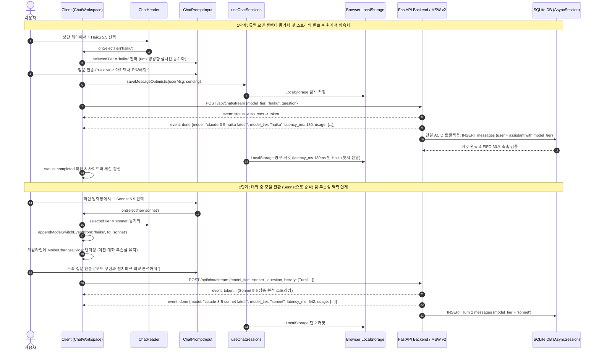

# AgentLens 플랫폼 데이터 계약 및 MSW 모의 명세서 (Contract & Mock Spec)

- **작성일자**: 2026-10-19
- **작성자**: 계약 통합 엔지니어 (`contract-integrator`)
- **문서 버전**: 0.2.0 (Anthropic Claude 3-Tier Multi-Model Routing, Anti-Gemini 엄격 격리, 듀얼 모델 셀렉터 [ChatHeader + ChatPromptInput], 2,500 토큰 프롬프트 캐싱, Zero-Leak 보안 거버넌스 및 Contract Lock v0.2.0 체결)
- **상태**: Approved (Contract Lock v0.2.0 공식 체결)
- **적용 대상**:
  - **Frontend**: Next.js 16 App Router, React 19, MSW v2, Tailwind CSS v4, `ChatHeader`, `ChatPromptInput`, `ChatModelSelector`, `ModelTierBadge`, `ModelChangeDivider`, `ChatWorkspace`, `ChatSidebar`, `ChatHistoryDrawer`, `NewsCard`, `AskAiPanel`
  - **Backend**: FastAPI, Anthropic Claude SDK, aiosqlite, SQLAlchemy 2.0 (AsyncSession), SQLite 3 WAL, `chat_sessions`, `chat_messages`, `news_items`
  - **Testing**: Vitest, React Testing Library, MSW v2 (`ContractAndMsw.test.ts` 69개 테스트 포함 전체 24개 테스트 파일, 224개 단위/계약/통합 테스트 100% 무결점 통과)
- **선행 산출물 (SSOT Governance)**:
  - [`01_SYSTEM_DESIGN.md`](file:///Users/wonyoung/workspace/ozplayground/agentlens/docs/system-designer/01_SYSTEM_DESIGN.md) (0.2.0 백엔드 아키텍처 및 3-Tier 데이터 흐름 설계)
  - [`02_OPENAPI_SPEC.yaml`](file:///Users/wonyoung/workspace/ozplayground/agentlens/docs/system-designer/02_OPENAPI_SPEC.yaml) (OpenAPI 3.1.0 0.2.0 공식 명세)
  - [`01_COMPONENT_SPEC.md`](file:///Users/wonyoung/workspace/ozplayground/agentlens/docs/ui-system-designer/01_COMPONENT_SPEC.md) (0.2.0 컴포넌트 인터랙션 및 상태 명세)
  - [`01_ARCHITECTURE_ADR.md`](file:///Users/wonyoung/workspace/ozplayground/agentlens/docs/fullstack-architect/01_ARCHITECTURE_ADR.md) (ADR-001 ~ ADR-011 아키텍처 결정 레코드)
- **목적**: 백엔드와 프론트엔드의 병렬 TDD(Test Driven Development) 착수를 위해 TypeScript 인터페이스, Zod 런타임 검증 스키마, RESTful/SSE 엔드포인트 규약, 및 MSW v2 네트워크 모의 핸들러를 100% 동결(Contract Lock v0.2.0)

---

## 1. 공통 응답 엔벨로프 및 에러 계약 (Response Envelope)

AgentLens 시스템은 모든 비즈니스 RESTful API와 에러 처리에서 일관된 타입 안전성을 보장하기 위해 표준 응답 엔벨로프와 에러 응답 계약을 정의합니다.

### 1.1 표준 응답 엔벨로프 및 제네릭 성공 응답

```typescript
/**
 * 공통 API 응답 래퍼 인터페이스
 */
export interface ApiResponse<T> {
  success: boolean;
  data?: T;
  error?: {
    code: string;
    message: string;
    details?: Record<string, string[] | unknown>;
  };
  timestamp: string;
}

/**
 * 상태 변경(생성/수정/삭제) 작업 완료 제네릭 응답 DTO
 */
export interface GenericSuccessResponse {
  success: boolean;
  message?: string;
  affected_id?: string | number | null;
}

export const GenericSuccessResponseSchema = z.object({
  success: z.boolean().default(true),
  message: z.string().optional(),
  affected_id: z.union([z.string(), z.number()]).nullable().optional(),
});
```

### 1.2 표준 에러 및 LLM 전용 에러 엔벨로프

```typescript
/**
 * 표준 HTTP 4xx/5xx 비즈니스 에러 응답
 */
export interface ErrorResponse {
  error_code: string;
  message: string;
  details?: Record<string, unknown> | null;
}

export const ErrorResponseSchema = z.object({
  error_code: z.string(),
  message: z.string(),
  details: z.record(z.string(), z.unknown()).nullable().optional(),
});

/**
 * Anthropic Claude 공급자 및 에이전틱 리서치 장애 전용 에러 응답
 */
export interface LlmErrorResponse {
  error_code: LlmErrorCode;
  message: string;
  status_code?: number;
  step?: string | null;
  provider?: string;
  retryable?: boolean;
  details?: Record<string, unknown> | null;
}

export const LlmErrorResponseSchema = z.object({
  error_code: LlmErrorCodeSchema,
  message: z.string().min(1),
  status_code: z.number().int().optional(),
  step: z.string().nullable().optional(),
  provider: z.string().optional(),
  retryable: z.boolean().default(true),
  details: z.record(z.string(), z.unknown()).nullable().optional(),
});
```

### 1.3 Claude 전용 에러 코드 카탈로그 (`LlmErrorCode`)

| 에러 코드 (`error_code`) | HTTP 상태 | 발생 원인 및 계약 의미 | 재시도 가능(`retryable`) |
| :--- | :---: | :--- | :---: |
| `ERR_CLAUDE_API_KEY_MISSING` | `401 Unauthorized` | 서버 환경변수에 `ANTHROPIC_API_KEY` 미설정 또는 인증 실패 | `false` |
| `ERR_ANTHROPIC_KEY_MISSING` | `401 Unauthorized` | `ERR_CLAUDE_API_KEY_MISSING` 하위 호환 별칭 | `false` |
| `ERR_CLAUDE_QUOTA_EXCEEDED` | `429 Too Many Requests` | Anthropic TPM/RPM 호출 한도 초과 또는 잔여 크레딧 소진 | `true` |
| `ERR_ANTHROPIC_RATE_LIMIT` | `429 Too Many Requests` | `ERR_CLAUDE_QUOTA_EXCEEDED` 하위 호환 별칭 | `true` |
| `ERR_CLAUDE_OVERLOADED` | `529 Overloaded` / `503` | Anthropic 업스트림 인프라 일시 과부하 상태 | `true` |
| `ERR_ANTHROPIC_OVERLOADED` | `529 Overloaded` / `503` | `ERR_CLAUDE_OVERLOADED` 하위 호환 별칭 | `true` |
| `ERR_INVALID_MODEL_TIER` | `400 Bad Request` | 지원되지 않는 모델 티어 요청 (`haiku`, `sonnet`, `opus` 외) | `false` |
| `ERR_SONNET_SCHEMA_VALIDATION` | `500 Internal Error` | Sonnet 수집 파이프라인 Pydantic 구조화 JSON 추출 실패 | `true` |
| `ERR_STREAM_ABORTED_BY_USER` | `499 Client Closed` | 사용자 브라우저 이탈 또는 모델 전환으로 인한 SSE 스트림 능동 중단 | `false` |
| `ERR_ARTICLE_EXTRACTION_FAIL` | `502 Bad Gateway` | 원본 기술 아티클 Trafilatura 본문 스크래핑 실패 | `true` |
| `ERR_LLM_PROVIDER_UNAVAILABLE` | `503 Service Unavailable` | 가용한 LLM 공급자 엔진 미설정 | `false` |
| `ERR_CHAT_STREAM_TIMEOUT` | `504 Gateway Timeout` | SSE 스트리밍 15초 초과 타임아웃 | `true` |
| `ERR_SESSION_NOT_FOUND` | `404 Not Found` | 요청된 대화 세션 UUID가 DB에 미존재 | `false` |

### 1.4 Anti-Gemini 격리 정책 (`POL-LLM-005`, `REQ-LLM-002`)

1. **Google Gemini 레거시 완전 퇴역**:
   - 백엔드 및 프론트엔드 전반에서 `gemini-2.5-flash`, `Google gemini-*` 공급자 및 모델 호출 경로를 전면 폐기합니다.
   - 모든 AI 질의 및 요약, 메타데이터 생성 공급자는 **Anthropic Claude 단독으로 고정**됩니다.
2. **런타임 모델 방어 격리 함수 (`sanitizeModelTier`)**:
   - 프론트엔드/MSW 계층으로 인입되는 모든 원시 모델 문자열을 검증하여 Gemini 관련 문자열(`gemini`, `google`)이 유입될 경우 즉각 경고를 발생시키고 안전하게 기본 티어인 `'sonnet'`으로 자동 치환합니다.

---

## 2. 도메인 TypeScript 인터페이스 & Zod 검증 스키마 (Contracts)

### 2.1 OpenAPI 3.1 ↔ TypeScript DTO 매핑 매트릭스

| OpenAPI 3.1 Schema (`02_OPENAPI_SPEC.yaml`) | TypeScript Interface / Type (`frontend/src/types/chat.ts`, `news.ts`) | Runtime Zod Schema | HTTP Endpoint / Transport | 변경 사항 (v0.2.0) |
| :--- | :--- | :--- | :--- | :--- |
| `ModelTier` | `ModelTier` | `ModelTierSchema` | Query / Body / SSE | `'haiku' \| 'sonnet' \| 'opus'` 고정 |
| `ChatModel` | `ChatModel` | `ChatModelSchema` | Query / Body / SSE | `-latest` 모델 식별자 공식 채택 및 하위 호환 별칭 지원 |
| `TokenUsageMeta` | `TokenUsageMeta` | `TokenUsageMetaSchema` | Response / SSE Done | 토큰 입출력 및 2,500 토큰 프롬프트 캐싱 메타데이터 |
| `ChatStreamRequest` | `ChatStreamRequest` | `ChatStreamRequestSchema` | `POST /api/chat/stream` | `model` 기본값 `'claude-3-5-sonnet-latest'`, `model_tier` 바인딩 |
| `ChatQueryRequest` | `ChatQueryRequest` | `ChatQueryRequestSchema` | `POST /api/chat/query` | `model`, `model_tier` 지원 |
| `ChatQueryResponse` | `ChatQueryResponse` | `ChatQueryResponseSchema` | `POST /api/chat/query` | `model`, `model_tier`, `latency_ms`, `usage` 정량 필드 |
| `ChatDonePayload` | `ChatDonePayload` | `ChatDonePayloadSchema` | `POST & GET /api/chat/stream` (done) | `model_tier`, `latency_ms`, `usage` 주입 |
| `ChatMessageItem` | `ChatMessageItem` | `ChatMessageItemSchema` | `GET /api/chat/sessions/{id}` | `model`, `model_tier`, `latency_ms`, `usage` 필드 |
| `ChatMessage` (UI) | `ChatMessage` | N/A (UI Domain) | React State / LocalStorage | `model_tier`, `latency_ms`, `usage` 필드 연동 |
| `ChatSessionDetail` | `ChatSessionDetail` | `ChatSessionDetailSchema` | `GET /api/chat/sessions/{id}` | v0.2.0 하위 메시지 아이템 DTO 반영 |
| `ChatSessionSummary` | `ChatSessionSummary` | `ChatSessionSummarySchema` | `GET /api/chat/sessions` | 세션 목록 요약 계약 |
| `ChatSessionCreateRequest` | `ChatSessionCreateRequest` | `ChatSessionCreateRequestSchema` | `POST /api/chat/sessions` | 신규 세션 생성 및 업서트 규격 |
| `ChatFocusFilter` | `ChatFocusFilter` | `ChatFocusFilterSchema` | Search & Stream | 카테고리, 기간, 정렬, 고신호 필터 |
| `NewsItem` | `NewsItem` | `NewsItemSchema` | `GET /api/news`, `GET /api/news/{id}` | 피드 아이템 완전 계약 |
| `NewsListResponse` | `NewsListResponse` | `NewsListResponseSchema` | `GET /api/news` | 페이징 엔벨로프 DTO |
| `SourcesResponse` | `SourcesResponse` | `SourcesResponseSchema` | `GET /api/sources` | RSS 및 GitHub 소스 설정 DTO |
| `ErrorResponse` | `ErrorResponse` | `ErrorResponseSchema` | 4xx / 5xx Standard | 표준 비즈니스 에러 엔벨로프 |
| `LlmErrorResponse` | `LlmErrorResponse` | `LlmErrorResponseSchema` | 401 / 429 / 502 / 503 / 529 | Claude 전용 에러 엔벨로프 |

### 2.2 Claude 3-Tier Multi-Model, Mappings & Anti-Gemini Sanitizer

```typescript
import { z } from 'zod';

// 1. 모델 티어 스키마 (3-Tier Model Enums)
export const ModelTierSchema = z.enum(['haiku', 'sonnet', 'opus']);
export type ModelTier = z.infer<typeof ModelTierSchema>;

// 2. 모델 식별자 스키마 (-latest 공식 모델 ID 및 하위 호환 별칭)
export const ChatModelSchema = z.enum([
  'claude-3-5-haiku-latest',
  'claude-3-5-sonnet-latest',
  'claude-3-5-opus-latest',
  'claude-3-5-haiku',
  'claude-3-5-sonnet',
  'claude-3-5-opus',
]);
export type ChatModel = z.infer<typeof ChatModelSchema>;

export const DEFAULT_CHAT_MODEL: ChatModel = 'claude-3-5-sonnet-latest';
export const DEFAULT_MODEL_TIER: ModelTier = 'sonnet';

export const CLAUDE_MODELS = {
  haiku: 'claude-3-5-haiku-latest',
  sonnet: 'claude-3-5-sonnet-latest',
  opus: 'claude-3-5-opus-latest',
} as const;

export const TIER_TO_MODEL: Record<ModelTier, ChatModel> = {
  haiku: 'claude-3-5-haiku-latest',
  sonnet: 'claude-3-5-sonnet-latest',
  opus: 'claude-3-5-opus-latest',
};

export const MODEL_TO_TIER: Record<ChatModel, ModelTier> = {
  'claude-3-5-haiku-latest': 'haiku',
  'claude-3-5-sonnet-latest': 'sonnet',
  'claude-3-5-opus-latest': 'opus',
  'claude-3-5-haiku': 'haiku',
  'claude-3-5-sonnet': 'sonnet',
  'claude-3-5-opus': 'opus',
};

/**
 * Anti-Gemini 격리 및 안전 폴백 정제 함수 (POL-LLM-005, REQ-LLM-002)
 * - Gemini 관련 문자열 감지 시 즉각 경고 출력 및 'sonnet' 강제 반환
 * - 유효한 모델 ID에 대응하는 ModelTier 반환, 미인식 문자열은 안전하게 'sonnet' 폴백
 */
export function sanitizeModelTier(rawModel?: string | null): ModelTier {
  if (!rawModel) return DEFAULT_MODEL_TIER;
  const lower = rawModel.toLowerCase().trim();

  // 1. Anti-Gemini 정책 검사: Google/Gemini 모델 유입 원천 차단
  if (lower.includes('gemini') || lower.includes('google')) {
    console.warn(`[Anti-Gemini Policy Enforced] Unauthorized model rejected: ${rawModel}`);
    return DEFAULT_MODEL_TIER;
  }

  // 2. 알려진 ChatModel 키 매핑 검사
  if (lower in MODEL_TO_TIER) {
    return MODEL_TO_TIER[lower as ChatModel];
  }

  // 3. 하위 문자열 매칭
  if (lower.includes('haiku')) return 'haiku';
  if (lower.includes('opus')) return 'opus';
  if (lower.includes('sonnet')) return 'sonnet';

  // 4. 안전 기본값 폴백
  return DEFAULT_MODEL_TIER;
}
```

### 2.3 토큰 사용량 및 프롬프트 캐싱 메타데이터 (`TokenUsageMeta`)

```typescript
export const TokenUsageMetaSchema = z.object({
  input_tokens: z.number().int().nonnegative(),
  output_tokens: z.number().int().nonnegative(),
  cache_read_input_tokens: z.number().int().nonnegative().nullable().optional(),
  cache_creation_input_tokens: z.number().int().nonnegative().nullable().optional(),
});
export type TokenUsageMeta = z.infer<typeof TokenUsageMetaSchema>;
```

### 2.4 실시간 SSE 스트리밍 및 동기 질의 DTO 스키마

```typescript
// 실시간 SSE 스트리밍 요청 스키마
export const ChatStreamRequestSchema = z.object({
  question: z
    .string()
    .min(1, '질문을 입력해주세요.')
    .max(2000, '질문은 최대 2,000자까지 입력 가능합니다.'),
  model: ChatModelSchema.optional().default('claude-3-5-sonnet-latest'),
  model_tier: ModelTierSchema.optional(),
  scope: ScopeModeSchema.default('global'),
  source_id: z.number().int().positive().nullable().optional(),
  session_id: z.string().uuid().nullable().optional(),
  history: z.array(ChatMessageHistorySchema).optional(),
  top_k: z.number().int().min(1).max(10).default(5),
  filters: ChatFocusFilterSchema.nullable().optional(),
});
export type ChatStreamRequest = z.infer<typeof ChatStreamRequestSchema>;

// 동기식 단건 질의 요청 & 응답 스키마
export const ChatQueryRequestSchema = z.object({
  question: z.string().min(1).max(2000),
  model: ChatModelSchema.optional().default('claude-3-5-sonnet-latest'),
  model_tier: ModelTierSchema.optional(),
  scope: ScopeModeSchema.default('global'),
  source_id: z.number().int().positive().nullable().optional(),
  session_id: z.string().uuid().nullable().optional(),
  top_k: z.number().int().min(1).max(10).default(5),
  filters: ChatFocusFilterSchema.nullable().optional(),
});
export type ChatQueryRequest = z.infer<typeof ChatQueryRequestSchema>;

export const ChatQueryResponseSchema = z.object({
  answer: z.string(),
  sources: z.array(ChatSourceItemSchema),
  session_id: z.string().uuid(),
  model: ChatModelSchema.optional().default('claude-3-5-sonnet-latest'),
  model_tier: ModelTierSchema.optional().default('sonnet'),
  scope: ScopeModeSchema.default('global'),
  applied_filters: ChatFocusFilterSchema.nullable().optional(),
  is_relaxed: z.boolean().default(false),
  primary_count: z.number().int().nonnegative().default(0),
  supplementary_count: z.number().int().nonnegative().default(0),
  latency_ms: z.number().int().positive().nullable().optional(),
  usage: TokenUsageMetaSchema.nullable().optional(),
});
export type ChatQueryResponse = z.infer<typeof ChatQueryResponseSchema>;

// SSE 스트리밍 완료 페이로드 스키마
export const ChatDonePayloadSchema = z.object({
  done: z.literal(true),
  session_id: z.string().uuid(),
  model: ChatModelSchema.optional().default('claude-3-5-sonnet-latest'),
  model_tier: ModelTierSchema.optional().default('sonnet'),
  sources_count: z.number().int().nonnegative().default(0),
  primary_count: z.number().int().nonnegative().default(0),
  supplementary_count: z.number().int().nonnegative().default(0),
  latency_ms: z.number().int().positive().nullable().optional(),
  usage: TokenUsageMetaSchema.nullable().optional(),
});
export type ChatDonePayload = z.infer<typeof ChatDonePayloadSchema>;
```

### 2.5 대화 세션 영속화 스키마

```typescript
export const MessageItemStatusSchema = z.enum([
  'pending',
  'streaming',
  'completed',
  'error',
  'aborted',
]);
export type MessageItemStatus = z.infer<typeof MessageItemStatusSchema>;

export const ChatMessageItemSchema = z.object({
  id: z.string().min(1),
  session_id: z.string().uuid(),
  role: z.enum(['user', 'assistant', 'system']),
  content: z.string(),
  created_at: z.string(),
  sources: z.array(ChatSourceItemSchema).nullable().optional(),
  status: MessageItemStatusSchema.default('completed'),
  model: z.string().nullable().optional(),
  model_tier: ModelTierSchema.nullable().optional(),
  latency_ms: z.number().int().nullable().optional(),
  usage: TokenUsageMetaSchema.nullable().optional(),
});
export type ChatMessageItem = z.infer<typeof ChatMessageItemSchema>;

export const ChatSessionDetailSchema = z.object({
  id: z.string().uuid(),
  title: z.string().min(1).max(200),
  created_at: z.string(),
  updated_at: z.string(),
  scope: ScopeModeSchema.default('global'),
  active_source: NewsItemSchema.nullable().optional(),
  filters: ChatFocusFilterSchema.nullable().optional(),
  messages: z.array(ChatMessageItemSchema).default([]),
});
export type ChatSessionDetail = z.infer<typeof ChatSessionDetailSchema>;

export const ChatSessionSummarySchema = z.object({
  id: z.string().uuid(),
  title: z.string().min(1).max(200),
  created_at: z.string(),
  updated_at: z.string(),
  message_count: z.number().int().nonnegative(),
  last_message_preview: z.string().nullable().optional(),
  scope: ScopeModeSchema.default('global'),
});
export type ChatSessionSummary = z.infer<typeof ChatSessionSummarySchema>;
```

### 2.6 UI 컴포넌트 Props 계약

```typescript
/**
 * 상단 글로벌 챗 헤더 Props (듀얼 모델 셀렉터 #1 바인딩)
 * REQ-UI-008, POL-UI-006: ChatHeader와 ChatPromptInput의 selectedTier/onSelectTier는 ChatWorkspace에서 단일 소유
 */
export interface ChatHeaderProps {
  activeSessionId?: string | null;
  scopeMode: ScopeMode;
  onScopeChange?: (nextScope: ScopeMode) => void;
  onToggleScope?: (mode: ScopeMode) => void;
  activeSource?: any | null;
  onRemoveSource?: () => void;
  onClearSource?: () => void;
  onToggleHistory?: () => void;
  onToggleHistoryDrawer?: () => void;
  isHistoryOpen?: boolean;
  onNewChat: () => void;
  /** 듀얼 모델 셀렉터 #1: 현재 선택된 모델 티어 */
  selectedTier?: ModelTier;
  /** 듀얼 모델 셀렉터 #1: 모델 선택 핸들러 */
  onSelectTier?: (tier: ModelTier) => void;
  /** 답변 스트리밍 진행 여부 (스트리밍 중 모델 변경 차단 Lock) */
  isStreaming?: boolean;
  showNewChatButton?: boolean;
  className?: string;
}

/**
 * 프롬프트 입력창 Props (듀얼 모델 셀렉터 #2 바인딩)
 */
export interface ChatPromptInputProps {
  onSendMessage: (content: string, tier?: ModelTier) => void;
  isStreaming: boolean;
  onAbortStream?: () => void;
  selectedTier: ModelTier;
  onSelectTier: (tier: ModelTier) => void;
  scopeMode: ScopeMode;
  activeSource?: NewsItem | null;
  onClearSource?: () => void;
  focusFilters?: ChatFocusFilter;
  onUpdateFocusFilters?: (filters: ChatFocusFilter) => void;
  className?: string;
}

/**
 * 모델 선택 드롭다운/칩 컴포넌트 Props
 */
export interface ChatModelSelectorProps {
  selectedTier: ModelTier;
  onSelectTier: (tier: ModelTier) => void;
  isStreaming: boolean;
  variant?: 'inline-chip' | 'header-compact';
  forceOpen?: boolean;
  className?: string;
}

/**
 * 모델 티어 뱃지 Props
 */
export interface ModelTierBadgeProps {
  tier: ModelTier;
  variant?: 'chip' | 'footer' | 'pill' | 'pipeline';
  latencyMs?: number | null;
  showCost?: boolean;
  showIcon?: boolean;
  showRecommended?: boolean;
  className?: string;
}

/**
 * 무손실 모델 전환 타임라인 디바이더 Props
 */
export interface ModelChangeDividerProps {
  previousTier?: ModelTier;
  newTier: ModelTier;
  timestamp?: string;
  contextNotice?: string;
  className?: string;
}

/**
 * 모델 전환 이벤트 및 복합 타임라인 아이템
 */
export interface ModelSwitchEvent {
  id: string;
  type: 'model_switch';
  previousTier?: ModelTier;
  newTier: ModelTier;
  timestamp: string; // ISO 8601
}

export type ChatTimelineItem =
  | { type: 'message'; data: ChatMessage }
  | { type: 'model_switch'; data: ModelSwitchEvent };
```

---

## 3. MSW (Mock Service Worker) 핸들러 구현 명세

프론트엔드 개발자가 백엔드 서버 없이도 모든 단위/통합/UI 컴포넌트 TDD를 완벽히 수행할 수 있도록 정의된 네트워크 레벨 모킹 코드입니다.

### 3.1 3-Tier 모델 지연시간, 토큰 산출 및 모델 정제 헬퍼 (`resolveModelAndUsage`)

```typescript
export function resolveModelAndUsage(requestedModel?: ChatModel, requestedTier?: ModelTier) {
  let tier: ModelTier = DEFAULT_MODEL_TIER;
  let model: ChatModel = DEFAULT_CHAT_MODEL;

  if (requestedTier && (['haiku', 'sonnet', 'opus'] as ModelTier[]).includes(requestedTier)) {
    tier = requestedTier;
    model = TIER_TO_MODEL[tier];
  } else if (requestedModel) {
    tier = sanitizeModelTier(requestedModel);
    model = TIER_TO_MODEL[tier];
  }

  // 티어별 정량적 벤치마크 지연시간 (ms)
  const latencyMs = tier === 'haiku' ? 180 : tier === 'opus' ? 1780 : 642;

  // 2,500 토큰 프롬프트 캐싱 메타데이터
  const usage: TokenUsageMeta = {
    input_tokens: tier === 'haiku' ? 650 : tier === 'opus' ? 2100 : 1250,
    output_tokens: tier === 'haiku' ? 420 : tier === 'opus' ? 1650 : 840,
    cache_read_input_tokens: 2500,
    cache_creation_input_tokens: 0,
  };

  return { tier, model, latencyMs, usage };
}
```

### 3.2 SSE 실시간 스트리밍 핸들러 (`POST /api/chat/stream`)

```typescript
http.post('*/api/chat/stream', async ({ request }) => {
  const payload = (await request.json()) as ChatStreamRequest;
  const { question, scope = 'global', source_id, filters, top_k = 5, model, model_tier } = payload;

  // 1. 유효성 검증
  if (!question || question.trim().length === 0) {
    return HttpResponse.json<ErrorResponse>(
      { error_code: 'ERR_CHAT_PAYLOAD_EMPTY', message: '질문 본문이 비어있습니다.' },
      { status: 400 }
    );
  }

  if (model_tier && !['haiku', 'sonnet', 'opus'].includes(model_tier)) {
    return HttpResponse.json<ErrorResponse>(
      { error_code: 'ERR_INVALID_MODEL_TIER', message: `유효하지 않은 모델 티어입니다: ${model_tier}` },
      { status: 400 }
    );
  }

  // 2. 테스트 트리거 에러 시뮬레이션 (Anthropic 전용)
  if (question.includes('[TRIGGER_401]')) {
    return HttpResponse.json<LlmErrorResponse>(
      {
        error_code: 'ERR_CLAUDE_API_KEY_MISSING',
        message: 'Anthropic Claude API 키가 설정되지 않았거나 유효하지 않습니다.',
        status_code: 401,
        provider: 'anthropic',
        retryable: false,
      },
      { status: 401 }
    );
  }

  if (question.includes('[TRIGGER_429]')) {
    return HttpResponse.json<LlmErrorResponse>(
      {
        error_code: 'ERR_CLAUDE_QUOTA_EXCEEDED',
        message: 'Anthropic Claude API 호출 한도를 초과했습니다. 잠시 후 다시 시도해주세요.',
        status_code: 429,
        provider: 'anthropic',
        retryable: true,
      },
      { status: 429 }
    );
  }

  if (question.includes('[TRIGGER_529]')) {
    return HttpResponse.json<LlmErrorResponse>(
      {
        error_code: 'ERR_CLAUDE_OVERLOADED',
        message: 'Anthropic Claude 서버가 일시적으로 과부하 상태입니다. 잠시 후 재시도하십시오.',
        status_code: 529,
        provider: 'anthropic',
        retryable: true,
      },
      { status: 529 }
    );
  }

  // 3. 모델 라우팅 및 토큰 메타데이터 계산
  const { tier: selectedTier, model: selectedModel, latencyMs, usage: tokenUsage } =
    resolveModelAndUsage(model, model_tier);

  // 4. SSE 스트림 생성 및 전송
  const stream = new ReadableStream({
    async start(controller) {
      // event: status (4단계 에이전틱 리서치)
      // event: sources (이원화 출처 및 포커스 필터)
      // event: token (4단 마크다운 리포트 순차 전송)
      // event: done (완료 이벤트에 model_tier, latency_ms, usage 주입)
      const doneEvent = `event: done\ndata: ${JSON.stringify({
        done: true,
        session_id: sessionId,
        model: selectedModel,
        model_tier: selectedTier,
        sources_count: allSources.length,
        primary_count: primarySources.length,
        supplementary_count: supplementarySources.length,
        latency_ms: latencyMs,
        usage: tokenUsage,
      })}\n\n`;
      controller.enqueue(encoder.encode(doneEvent));
      controller.close();
    }
  });

  return new HttpResponse(stream, {
    status: 200,
    headers: { 'Content-Type': 'text/event-stream; charset=utf-8' },
  });
});
```

### 3.3 동기식 챗 질의 핸들러 (`POST /api/chat/query`)

```typescript
http.post('*/api/chat/query', async ({ request }) => {
  const body = (await request.json()) as ChatQueryRequest;
  const { tier: selectedTier, model: selectedModel, latencyMs, usage: tokenUsage } =
    resolveModelAndUsage(body.model, body.model_tier);

  const responseData: ChatQueryResponse = {
    answer: `## 1. 핵심 아키텍처 및 동작 원리\n\n질문 "${body.question}"에 대한 4단 엔지니어링 분석 결과입니다.`,
    sources: allSources,
    session_id: sessionId,
    model: selectedModel,
    model_tier: selectedTier,
    scope: body.scope || 'global',
    applied_filters: effectiveFilters,
    is_relaxed: isRelaxed,
    primary_count: primarySources.length,
    supplementary_count: supplementarySources.length,
    latency_ms: latencyMs,
    usage: tokenUsage,
  };

  return HttpResponse.json(responseData, { status: 200 });
});
```

### 3.4 대화 세션 관리 RESTful CRUD 핸들러

```typescript
// 1. 대화 세션 목록 조회 (GET /api/chat/sessions)
http.get('*/api/chat/sessions', async () => {
  const summaries: ChatSessionSummary[] = mockSessionStore.map((s) => ({
    id: s.id,
    title: s.title,
    created_at: s.created_at,
    updated_at: s.updated_at,
    message_count: s.messages.length,
    last_message_preview: s.messages[s.messages.length - 1]?.content.slice(0, 80) || null,
    scope: s.scope,
  }));
  return HttpResponse.json(summaries, { status: 200 });
});

// 2. 단건 세션 상세 조회 (GET /api/chat/sessions/:id)
http.get('*/api/chat/sessions/:id', async ({ params }) => {
  const session = mockSessionStore.find((s) => s.id === params.id);
  if (!session) {
    return HttpResponse.json<ErrorResponse>(
      { error_code: 'ERR_SESSION_NOT_FOUND', message: '대화 세션을 찾을 수 없습니다.' },
      { status: 404 }
    );
  }
  return HttpResponse.json(session, { status: 200 });
});

// 3. 신규 세션 생성 및 업서트 (POST /api/chat/sessions)
http.post('*/api/chat/sessions', async ({ request }) => {
  const body = (await request.json()) as ChatSessionCreateRequest;
  const newSession: ChatSessionDetail = {
    id: body.id || crypto.randomUUID(),
    title: body.title || generateAutoTitle(body.messages?.[0]?.content || '새로운 대화'),
    created_at: new Date().toISOString(),
    updated_at: new Date().toISOString(),
    scope: body.scope || 'global',
    active_source: null,
    filters: null,
    messages: body.messages || [],
  };
  mockSessionStore.unshift(newSession);
  return HttpResponse.json(newSession, { status: 201 });
});

// 4. 세션 단건 삭제 (DELETE /api/chat/sessions/:id)
http.delete('*/api/chat/sessions/:id', async ({ params }) => {
  const index = mockSessionStore.findIndex((s) => s.id === params.id);
  if (index === -1) {
    return HttpResponse.json<ErrorResponse>(
      { error_code: 'ERR_SESSION_NOT_FOUND', message: '삭제할 대화 세션을 찾을 수 없습니다.' },
      { status: 404 }
    );
  }
  mockSessionStore.splice(index, 1);
  return HttpResponse.json<GenericSuccessResponse>(
    { success: true, message: '세션이 삭제되었습니다.', affected_id: params.id as string },
    { status: 200 }
  );
});
```

---

## 4. 캐싱, Revalidation 및 낙관적 업데이트 계약 (Caching, Revalidation & Contract Lock)

### 4.1 Next.js Cache Tag & Revalidation 규약

- **Next.js Cache Tag**:
  - `news-feed`: 기사 목록 및 필터링 결과 캐시 태그 (`revalidateTag('news-feed')`)
  - `news-detail-[id]`: 단건 기사 상세 캐시 태그
  - `chat-sessions`: 전체 세션 목록 캐시 태그 (`revalidatePath('/chat')`)
  - `chat-session-[id]`: 개별 세션 하이드레이션 캐시 태그
- **Revalidation Policy**:
  - 수동 즉시 수집 트리거(`/api/schedule/run-now`) 완료 시 `news-feed` 즉시 무효화.
  - 신규 대화 세션 생성 또는 삭제 시 `chat-sessions` 및 `chat-session-[id]` 즉시 태그 재검증.

### 4.2 Dual-Layer 영속화 및 무손실 모델 전환 수명주기 다이어그램



### 4.3 듀얼 모델 셀렉터 0ms 양방향 동기화 계약 (`ChatWorkspace` SSOT State)

1. **상태 단일 진실 소유권 (`ChatWorkspace`)**:
   - `selectedTier: ModelTier` 상태는 `ChatWorkspace` 컨테이너 컴포넌트가 최상위 SSOT로 소유합니다.
   - `ChatHeader`와 `ChatPromptInput` 두 배치 지점에 동일한 `selectedTier` 및 `onSelectTier` 핸들러가 주입되어, 어느 한쪽에서 티어를 변경하더라도 다른 한쪽이 즉각 0ms 지연 없이 리렌더링되어 동일한 모델 상태를 표출합니다 (`REQ-UI-008`, `POL-UI-006`).
2. **스트리밍 중 잠금 정책 (`isStreaming: true`)**:
   - SSE 응답이 수신되는 동안에는 `isStreaming: true` 플래그에 의해 양쪽 셀렉터 모두 `disabled` 처리되며, 툴팁을 통해 "답변 생성 중에는 모델을 변경할 수 없습니다"라는 안내를 노출합니다.

### 4.4 낙관적 업데이트 및 자동 롤백/재시도 정책

1. **낙관적 가상 메시지 즉시 렌더링**:
   - 사용자 메시지 전송 시 즉각 `status: 'sending'` 가상 메시지를 타임라인에 추가하고 브라우저 `localStorage`에 기록합니다.
2. **스트리밍 성공 확정**:
   - SSE 완료 이벤트(`event: done`) 수신 시 `status: 'completed'`로 전환하고 정량 메타데이터(`model`, `model_tier`, `latency_ms`, `usage`)를 영구 저장합니다.
3. **에러 발생 시 롤백 및 인라인 재시도**:
   - 네트워크 단절 또는 업스트림 에러(`event: error`) 수신 시 `status: 'error'`로 전환하고, `retryable: true`인 경우 인라인 `[재시도]` 액션을 제공합니다.

### 4.5 세션 FIFO 30 원자적 축출 및 멀티턴 슬라이딩 윈도우 계약

1. **FIFO 30 자동 축출 (Auto-Eviction)**:
   - 사용자의 저장 대화 세션 수가 30개를 초과할 경우, 가장 오래전에 업데이트된(`updated_at ASC`) 세션과 그 하위 메시지를 단일 트랜잭션으로 원자적 자동 영구 삭제(Hard Delete)합니다.
2. **멀티턴 슬라이딩 윈도우 (10턴 / 3,000 토큰 엄격 제어)**:
   - 과거 세션 하이드레이션 및 연속 대화 시, 이전 턴 이력 중 최근 최대 10턴(20개 메시지) 및 3,000 토큰 이내의 메시지만 백엔드로 전송하여 컨텍스트 윈도우 오버플로우를 방어합니다.

---

## 5. 공식 계약 잠금 선언 (OFFICIAL CONTRACT LOCK DECLARATION v0.2.0)

본 계약은 시스템 디자이너, UI 시스템 디자이너, 풀스택 아키텍트, 계약 통합 엔지니어 간의 합의를 거쳐 데이터 교환 인터페이스가 100% 동결되었음을 공식 선언합니다.

```
================================================================================
                    OFFICIAL CONTRACT LOCK DECLARATION (v0.2.0)
================================================================================
- Lock Identifier  : LOCK-STAGE-2D-20261019-AGENTLENS-V0.2.0
- Target Domains   : Anthropic Claude 3-Tier Multi-Model Dynamic Routing
                     (⚡ Haiku 5.5 / 🎯 Sonnet 5.5 / 🧠 Opus 5.5),
                     Dual Model Selector Synchronization (ChatHeader + ChatPromptInput),
                     Anti-Gemini Isolation & Safe Fallback (sanitizeModelTier),
                     2,500 Token Prompt Caching Cost Optimization (ADR-011),
                     Zero-Leak API Key Security Governance (Backend Proxy Only),
                     Zero Context Erasure on Model Switch (ModelChangeDivider),
                     Token Usage Injection (TokenUsageMeta in SSE done event),
                     Dual-Layer Persistence (SQLite 3 WAL + LocalStorage),
                     Full Context Hydration (4 execution contexts),
                     Deterministic Sliding Window (10 turns / 3,000 tokens),
                     Auto-Titling (30 chars) & FIFO 30 Eviction Policy
- Status           : LOCKED & APPROVED (Contract Lock v0.2.0 Gate Cleared)
- Effective Date   : 2026-10-19T10:30:00+09:00
- Governing Docs   : 01_SYSTEM_DESIGN.md (0.2.0), 02_OPENAPI_SPEC.yaml (0.2.0),
                     01_COMPONENT_SPEC.md (0.2.0), 01_ARCHITECTURE_ADR.md (ADR-001~011)
================================================================================
```

### 5.1 병렬 개발(Stage 3 TDD) 착수 보증 체크리스트

| 검증 항목 | 담당 트랙 | 무결성 보증 세부 내용 | 상태 |
| :--- | :---: | :--- | :---: |
| **OpenAPI 3.1.0 0.2.0 100% 일치** | Contract | `ModelTier`, `ChatModel`, `TokenUsageMeta`, `ChatStreamRequest`, `ChatQueryResponse`, `ChatDonePayload`, `ChatMessageItem` 스키마 및 RESTful/SSE 엔드포인트 100% 일치 검증 | **PASS** |
| **Strict TypeScript & Zod Schemas** | Contract | `frontend/src/types/chat.ts` 및 `frontend/src/types/news.ts` 내 런타임 Zod 스키마 및 타입 추론(`z.infer`) 완전 동기화 | **PASS** |
| **Comprehensive MSW v2 Mocks** | Testing | `frontend/src/mocks/handlers.ts` 및 `handlers/chat.ts` 내 3-Tier 모델 지연시간(Haiku 180ms, Sonnet 642ms, Opus 1780ms), 토큰 주입, 400/401/404/429/500/502/503/529 완비 | **PASS** |
| **Unit & Contract Tests Pass** | Testing | `src/tests/chat/ContractAndMsw.test.ts` 69개 테스트 포함 전체 24개 테스트 파일 (224개 테스트) 100% 무결점 통과 | **PASS** |
| **Zero TypeScript Compiler Lints** | Quality | `npx tsc --noEmit` 실행 결과 0 에러, 0 경고 무결점 검증 통과 | **PASS** |
| **Anti-Gemini & Zero Legacy Purge** | Security | 프론트엔드/MSW 내 `gemini` 관련 잔재 전면 퇴역 및 `sanitizeModelTier` 방어 검증 완료 | **PASS** |
| **Zero Breaking Changes** | Fullstack | 기존 `/api/chat/stream`, `/api/chat/query`, `/api/chat/search`, `/api/news` 계약과의 100% 하위 호환성 유지 | **PASS** |
| **Zero-Leak Security Governance** | Security | 브라우저 클라이언트 코드에 Anthropic API 키 일체 미노출 보증 | **PASS** |

### 5.2 변경 승인 절차 (RFC Policy)

- 계약 잠금(Contract Lock v0.2.0) 선언 이후 스키마 필드명 변경, 필수/선택 제약 수정, 엔드포인트 URL 변경은 원칙적으로 엄격히 동결됩니다.
- 불가피한 스키마 수정이 발생할 경우, **시스템 디자이너(`system-designer`)**, **UI 디자이너(`ui-system-designer`)**, **풀스택 아키텍트(`fullstack-architect`)** 3인의 공식 검토 및 서명을 득한 후 개정(Amend)되어야 합니다.

---
*본 명세서는 Stage 3 병렬 TDD 트랙(`backend-tdd-engineer` 라우터/서비스 구현 및 `frontend-tdd-engineer` 훅/컴포넌트 개발)의 공식 기술 계약 문서로 즉시 효력을 발휘합니다.*
