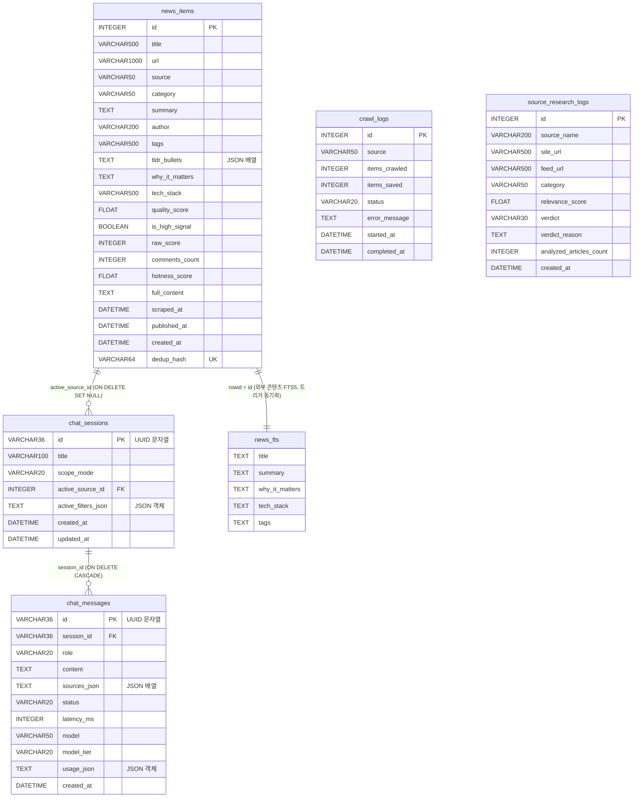

# 데이터 모델: AgentLens
Updated: 2026-11-09

코드에서 역으로 정리한 데이터 모델이다. 근거는 `path:line` 으로 단다. 실행 중인 DB 파일을 열어 보지 않았으므로, 인덱스 이름처럼 SQLAlchemy 가 만드는 값은 명명 규칙(`ix_<테이블>_<열>`)에 따른 이름이다.

## 개요
| 저장소 | 종류 | 정의 위치 | 소유 |
|---|---|---|---|
| SQLite DB (`agentlens.db`) | 테이블 5개 + FTS5 가상 테이블 1개 + 트리거 3개 | `backend/app/models/news.py`, `backend/app/models/chat_session.py`, `backend/app/database.py:45-115` | backend |
| `config.json` (저장소 루트) | 앱 설정 JSON | `backend/app/config.py:14-37` | backend (읽기, `/api/briefing/settings` 로 쓰기) |
| `sources.json` (루트, `backend/app/config/sources.json`) | 수집 소스 목록 JSON | `backend/app/services/sources_service.py` | backend (읽기·쓰기) |
| 브라우저 localStorage | 키 5종 | `frontend/src/...` | frontend |
| 프로세스 메모리 | 수집 진행 상태, LLM 응답 캐시, 스크래핑 L1 캐시, 스케줄러 job | `collectors/manager.py:45-57`, `llm_processor.py:119-120`, `scraper.py` | backend (재시작하면 사라진다) |

## ERD

`crawl_logs`, `source_research_logs` 는 다른 테이블과 관계가 없다.

## 공통 규칙
- 기본값은 모두 Python 쪽 `default=` 이다. `server_default` 는 없으므로 DDL 에는 DEFAULT 절이 생기지 않고, ORM 을 거치지 않은 INSERT(예: 원시 SQL)에는 기본값이 들어가지 않는다.
- `nullable` 을 쓰지 않은 열은 SQLAlchemy 기본값대로 NULL 을 허용한다(PK 제외). 아래 표의 "NULL" 열은 이 규칙을 반영한다.
- `DateTime` 열은 모두 `timezone=True` 없이 선언되어 있다. 코드는 `datetime.now(timezone.utc)` 를 넣는다. 읽은 값이 naive 일 때 UTC 로 간주하는 코드가 있다 (`backend/app/collectors/categorizer.py:141-142`).
- 문자열 길이(`String(n)`)는 SQLite 가 강제하지 않는다.

## 테이블

### news_items — 수집·선별된 소식
모델: `backend/app/models/news.py:5-39`

| 열 | 타입 | NULL | 기본값 | 인덱스/제약 | 의미 |
|---|---|---|---|---|---|
| id | INTEGER | 아니오 | 자동 증가 | PK, `ix_news_items_id` | 소식 ID |
| title | VARCHAR(500) | 아니오 | — | — | 제목. RSS 는 `[피드명] 제목` 형식 (`collectors/sources/rss.py:68`) |
| url | VARCHAR(1000) | 아니오 | — | — | 원문 URL |
| source | VARCHAR(50) | 아니오 | — | `ix_news_items_source` | 수집처 값 (아래 '열거형' 참고) |
| category | VARCHAR(50) | 아니오 | — | `ix_news_items_category` | 카테고리 4종 |
| summary | TEXT | 예 | `""` | — | 요약. RSS 는 320자에서 자른다 (`rss.py:70`) |
| author | VARCHAR(200) | 예 | NULL | — | 작성자 |
| tags | VARCHAR(500) | 예 | `""` | — | 쉼표 구분 키워드 (`manager.py:153`) |
| tldr_bullets | TEXT | 예 | `"[]"` | — | JSON 문자열 배열, 최대 3개 (`llm_processor.py:751`) |
| why_it_matters | TEXT | 예 | `""` | — | 개발자 관점 의미. LLM 평가값 또는 카테고리 기본 문구 (`llm_processor.py:742-748`) |
| tech_stack | VARCHAR(500) | 예 | `""` | — | 쉼표 구분 기술·모델 이름 (`manager.py:156`) |
| quality_score | FLOAT | 예 | 6.0 | `ix_news_items_quality_score` | 품질 점수 1.0~10.0 |
| is_high_signal | BOOLEAN | 예 | False | `ix_news_items_is_high_signal` | 고신호 여부 (`HIGH_SIGNAL_THRESHOLD` 이상) |
| raw_score | INTEGER | 예 | 0 | — | 출처 점수(별, 업보트 등). RSS 는 고정값 KR 180, GLOBAL 150 (`rss.py:74`) |
| comments_count | INTEGER | 예 | 0 | — | 댓글 수 |
| hotness_score | FLOAT | 예 | 0.0 | `ix_news_items_hotness_score` | 화제성 0~100 (`categorizer.py:139-146`) |
| full_content | TEXT | 예 | NULL | — | 스크래핑한 본문 (`services/scraper.py:158-164`) |
| scraped_at | DATETIME | 예 | NULL | `ix_news_items_scraped_at` | 스크래핑 시각 |
| published_at | DATETIME | 예 | 현재 UTC | `ix_news_items_published_at` | 원문 발행 시각 |
| created_at | DATETIME | 예 | 현재 UTC | — | 행 생성 시각 |
| dedup_hash | VARCHAR(64) | 아니오 | — | UNIQUE 인덱스 `ix_news_items_dedup_hash` | 중복 제거 키. `sha256(정규화 제목 + "::" + utm 제거 URL)` (`categorizer.py:83-87`) |

복합 인덱스: `idx_category_published(category, published_at)`, `idx_category_hotness(category, hotness_score)`, `idx_high_signal(is_high_signal, hotness_score)` (`models/news.py:35-39`).

쓰는 코드:
| 동작 | 위치 |
|---|---|
| INSERT (신규), UPDATE (같은 `dedup_hash` 면 raw_score·comments_count 는 큰 값, hotness·quality·is_high_signal 은 덮어쓰기, why_it_matters 가 비어 있으면 요약 필드 채움) | `backend/app/collectors/manager.py:130-166` |
| UPDATE full_content, scraped_at | `backend/app/services/scraper.py:158-164` |
| DELETE 전체 | `backend/app/api/news.py:96-102`, `backend/app/api/schedule.py:80` |
| 테스트 시드 (id=1) | `backend/tests/conftest.py:17-43` |

읽는 코드: `api/news.py` (목록·상세·질문·RSS), `api/stats.py:13-15`, `api/chat.py:336`, `services/chat_service.py`, `services/chat_session_service.py:153`, `services/retriever.py:326-342`, `services/briefing_service.py:45-60`, `services/trend_service.py:42`, `services/deep_researcher.py:189`, `mcp/server.py`, `main.py:29` (시작 시 건수 확인).

### news_fts — 전문 검색 인덱스 (FTS5 가상 테이블)
- ORM 모델이 없다. `ensure_db_schema()` 가 원시 SQL 로 만든다 (`backend/app/database.py:73-114`). 같은 생성 코드가 `backend/app/services/retriever.py:65-115` 에도 있다.
- 정의: `fts5(title, summary, why_it_matters, tech_stack, tags, content='news_items', content_rowid='id')` (외부 콘텐츠 테이블).
- 동기화 트리거: `news_items_ai`(AFTER INSERT), `news_items_ad`(AFTER DELETE), `news_items_au`(AFTER UPDATE) (`database.py:87-106`).
- 재구축: 테이블을 새로 만들 때, 그리고 `news_fts` 행 수가 `news_items` 보다 적을 때 `INSERT INTO news_fts(news_fts) VALUES('rebuild')` (`database.py:107-112`).
- SQLite 가 FTS5 를 지원하지 않거나 오류가 나면 예외를 삼키고 넘어간다 (`database.py:113-114`).

### crawl_logs — 수집 실행 기록
모델: `backend/app/models/news.py:41-51`

| 열 | 타입 | NULL | 기본값 | 인덱스 | 의미 |
|---|---|---|---|---|---|
| id | INTEGER | 아니오 | 자동 증가 | PK, `ix_crawl_logs_id` | |
| source | VARCHAR(50) | 아니오 | — | — | 코드가 쓰는 값은 `all_sources_stream_ingestion` 하나 (`manager.py:226`) |
| items_crawled | INTEGER | 예 | 0 | — | 평가한 항목 수 |
| items_saved | INTEGER | 예 | 0 | — | 신규 저장 수 |
| status | VARCHAR(20) | 예 | `"success"` | — | 코드가 쓰는 값은 `success` 하나 |
| error_message | TEXT | 예 | NULL | — | 쓰는 코드가 없다 |
| started_at | DATETIME | 예 | 현재 UTC | — | |
| completed_at | DATETIME | 예 | 현재 UTC | — | |

- 쓰기: `collect_all()` 이 끝날 때 한 행 (`backend/app/collectors/manager.py:224-234`). 수집 중 전역 예외가 나면 행을 남기지 않는다 (`manager.py:252-255`).
- 읽기: `GET /api/schedule/status` 가 최근 5행 (`backend/app/api/schedule.py:20`).
- 삭제: `POST /api/schedule/reset-and-collect` (`schedule.py:81`).

### source_research_logs — 딥 리서치 소스 판정 기록
모델: `backend/app/models/news.py:53-65`

| 열 | 타입 | NULL | 기본값 | 인덱스 | 의미 |
|---|---|---|---|---|---|
| id | INTEGER | 아니오 | 자동 증가 | PK, `ix_source_research_logs_id` | |
| source_name | VARCHAR(200) | 아니오 | — | — | 후보 소스 이름 |
| site_url | VARCHAR(500) | 아니오 | — | — | 탐색 대상 URL |
| feed_url | VARCHAR(500) | 아니오 | — | — | 발견한 피드 URL (실패 시 대상 URL) |
| category | VARCHAR(50) | 아니오 | `"ai_news"` | — | 추정 카테고리 |
| relevance_score | FLOAT | 아니오 | 0.0 | — | 종합 점수 1.0~9.9 (탐지 실패 시 2.0) |
| verdict | VARCHAR(30) | 아니오 | — | — | 판정 (아래 '열거형') |
| verdict_reason | TEXT | 아니오 | — | — | 한국어 판정 이유 |
| analyzed_articles_count | INTEGER | 예 | 0 | — | 분석한 피드 항목 수 |
| created_at | DATETIME | 예 | 현재 UTC | `ix_source_research_logs_created_at` | |

- 쓰기: `run_deep_research()` 가 후보마다 한 행 (`backend/app/services/deep_researcher.py:454-465`).
- 읽기: `GET /api/research/audit-logs` → `get_audit_logs()` (`deep_researcher.py:156-181`).
- 삭제하는 코드가 없다. 리셋 계열 작업도 지우지 않는다.

### chat_sessions — AI 챗 세션
모델: `backend/app/models/chat_session.py:7-33`

| 열 | 타입 | NULL | 기본값 | 인덱스/제약 | 의미 |
|---|---|---|---|---|---|
| id | VARCHAR(36) | 아니오 | `uuid4()` 문자열 | PK | 세션 UUID. 클라이언트가 보낸 값이면 UUID 형식을 검사한다 (`chat_session_service.py:213-217`) |
| title | VARCHAR(100) | 아니오 | `"새 대화"` | — | 제목. 첫 사용자 질문으로 자동 생성(30자 + `...`) (`chat_session_service.py:38-49, 329-331`) |
| scope_mode | VARCHAR(20) | 아니오 | `"global"` | — | `global` 또는 `scoped` |
| active_source_id | INTEGER | 예 | NULL | FK → `news_items.id` ON DELETE SET NULL | scoped 챗의 대상 소식 |
| active_filters_json | TEXT | 예 | NULL | — | 포커스 필터 JSON (아래 'JSON 열') |
| created_at | DATETIME | 아니오 | 현재 UTC | — | |
| updated_at | DATETIME | 아니오 | 현재 UTC, 갱신 시 현재 UTC | `ix_chat_sessions_updated_at`, `idx_chat_sessions_updated_at` (같은 열에 두 개) | 정렬·FIFO 기준 |

- 관계: `messages` (cascade `all, delete-orphan`, `created_at` 오름차순) (`chat_session.py:24-29`).
- 쓰기: `POST /api/chat/sessions` (생성·upsert, `chat_session_service.py:211-278`), `POST /api/chat/stream` 완료 후 자동 저장 (`services/chat_service.py:806-822` → `persist_turn`). `POST /api/chat/query` 는 저장하지 않는다 (`chat_service.py:478-575` 에 저장 호출 없음).
- 삭제: `DELETE /api/chat/sessions/{id}` (`chat_session_service.py:280-297`), FIFO 보존 (아래 '생명주기').
- 읽기: `GET /api/chat/sessions`(limit 1~50, 기본 30, `api/chat.py:422-431`), `GET /api/chat/sessions/{id}`.

### chat_messages — 챗 메시지
모델: `backend/app/models/chat_session.py:35-59`

| 열 | 타입 | NULL | 기본값 | 인덱스/제약 | 의미 |
|---|---|---|---|---|---|
| id | VARCHAR(36) | 아니오 | `uuid4()` 문자열 | PK | |
| session_id | VARCHAR(36) | 아니오 | — | FK → `chat_sessions.id` ON DELETE CASCADE, `ix_chat_messages_session_id` | |
| role | VARCHAR(20) | 아니오 | — | — | `user`, `assistant`, `system` |
| content | TEXT | 아니오 | — | — | 본문 |
| sources_json | TEXT | 예 | NULL | — | 인용 출처 JSON 배열 |
| status | VARCHAR(20) | 아니오 | `"completed"` | — | 메시지 상태 |
| latency_ms | INTEGER | 예 | NULL | — | 응답 지연 |
| model | VARCHAR(50) | 예 | NULL | — | 응답 모델 식별자 (예: `Google gemini-...`, `OpenAI gpt-4o-mini`, Anthropic 모델 ID) |
| model_tier | VARCHAR(20) | 예 | NULL | — | `haiku`, `sonnet`, `opus` |
| usage_json | TEXT | 예 | NULL | — | 토큰 사용량 JSON 객체 |
| created_at | DATETIME | 아니오 | 현재 UTC | — | |

복합 인덱스: `idx_chat_messages_session_created(session_id, created_at)` (`chat_session.py:57-59`).

- 쓰기: `append_messages_batch()` (`chat_session_service.py:299-369`). 한 배치의 메시지는 같은 `created_at` 을 받는다 (`chat_session_service.py:308, 360`).
- `POST /api/chat/sessions` 의 `messages` 로 들어온 메시지는 `model_tier`, `usage` 를 넘기지 않으므로 이 두 열이 NULL 로 저장된다 (`chat_session_service.py:256-266`).

## 열거형·고정 값
| 값 | 정의 위치 | 비고 |
|---|---|---|
| 카테고리: `harness`, `mcp_plugins_skills`, `agent_tech`, `ai_news` | `backend/app/collectors/categorizer.py:6-11`, 주석 `models/news.py:12`, `manager.py:108`, 프론트 `frontend/src/types/news.ts:7-13`(+`all`), 챗 필터 `backend/app/schemas/chat.py:23`(+`all`) | 분류 결과 `unrelated` 는 저장하지 않는다 (`manager.py:112-115`). LLM 평가 응답의 `irrelevant` 도 저장 대상이 아니다 (`llm_processor.py:638, 663`) |
| `news_items.source`: `rss`, `rss_kr`, `hackernews`, `github`, `arxiv`, `huggingface`, `reddit` (기본 `web`) | `collectors/sources/rss.py:64`, `hackernews.py:35`, `github.py:40,65`, `arxiv.py:44`, `huggingface.py:29`, `reddit.py:32`, 기본값 `manager.py:84` | `rss_kr` 은 피드의 `country == "KR"` |
| `chat_messages.role`: `user`, `assistant`, `system` | 주석 `models/chat_session.py:45`, `schemas/chat.py:19,188` | |
| `chat_messages.status`: `pending`, `streaming`, `completed`, `error`, `aborted` | 주석 `models/chat_session.py:48`, `schemas/chat.py:192` | 서버가 직접 저장하는 값은 `completed` 뿐이다 (`chat_session_service.py:389-394`) |
| `chat_messages.model_tier`: `haiku`, `sonnet`, `opus` | `schemas/chat.py:9` | |
| `chat_sessions.scope_mode`: `global`, `scoped` | `schemas/chat.py:205,218,229` | |
| 챗 필터 `time_range`: `all`, `24h`, `7d`, `30d` / `sort`: `hot`, `latest`, `quality` | `schemas/chat.py:24-25` | |
| `source_research_logs.verdict`: `AUTO_ADOPTED`, `WATCHLIST`, `REJECTED`, `ALREADY_MONITORED` | `services/deep_researcher.py:319, 348, 355, 362, 425` | 모델 주석(`models/news.py:62`)에는 `ALREADY_MONITORED` 가 없다. 임계값: 8.2 이상 채택, 6.5 이상 워치리스트 (`deep_researcher.py:347-362`) |
| `crawl_logs.status`: `success` | `models/news.py:48`, `manager.py:229` | |
| 피드 `country`: `KR`, `GLOBAL` | `api/sources.py:13`, `sources_service.py:60` | |
| 품질 임계: `QUALITY_CUTOFF_SCORE`(기본 5.0), `HIGH_SIGNAL_THRESHOLD`(기본 7.8, 루트 config.json 값 7.0) | `backend/app/config.py:64-65`, `config.json:25-26` | 사용 `llm_processor.py:567-574, 660-664` |

## JSON 으로 저장되는 열
| 열 | 구조 | 쓰기 / 읽기 |
|---|---|---|
| `news_items.tldr_bullets` | `string[]` (최대 3개, 예: `"핵심 주제: …"`, `"관련 기술/모델: …"`, `"주요 내용: …"`) | 쓰기 `manager.py:143,154` / 읽기 `api/news.py:21`, `chat_session_service.py:157` |
| `news_items.tags`, `tech_stack` | JSON 아님. 쉼표로 이은 문자열 | 읽을 때 `split(",")` (`api/news.py:18-19`) |
| `chat_sessions.active_filters_json` | `ChatFocusFilter`: `{category: "all"\|카테고리, time_range: "all"\|"24h"\|"7d"\|"30d", sort: "hot"\|"latest"\|"quality", high_signal_only: bool}` (`schemas/chat.py:22-26`) | 쓰기 `model_dump_json()` (`chat_session_service.py:220, 312`) / 읽기 실패 시 None (`chat_session_service.py:73-77`) |
| `chat_messages.sources_json` | `ChatSourceItem[]`: `{index: int\|str, type: "primary"\|"supplementary", id?, title, url, source, category?, quality_score?, score?, snippet?, full_content?, domain?, relevance_score?, published_at?, publisher?}` (`schemas/chat.py:75-90`) | 쓰기 `chat_session_service.py:333-339` / 읽기 `chat_session_service.py:116-122` |
| `chat_messages.usage_json` | `TokenUsageMeta`: `{input_tokens: int, output_tokens: int, cache_read_input_tokens: int\|null, cache_creation_input_tokens: int\|null}` (`schemas/chat.py:12-16`) | 쓰기 `chat_session_service.py:341-347` / 읽기 `chat_session_service.py:124-131` |

## 스키마 생성·변경
마이그레이션 도구(Alembic 등)는 없다. `requirements.txt` 에도 없다 (`backend/requirements.txt`).

`ensure_db_schema()` (`backend/app/database.py:45-115`) 가 앱 시작(`main.py:25`)과 테스트 fixture(`tests/conftest.py:15`)에서 다음을 순서대로 한다.

| 순서 | 동작 | 위치 |
|---|---|---|
| 1 | `Base.metadata.create_all` — 없는 테이블·인덱스만 만든다. 있는 테이블의 열은 바꾸지 않는다 | `database.py:48` |
| 2 | `news_items` 에 `full_content TEXT` 가 없으면 ALTER ADD | `database.py:54-55` |
| 3 | `news_items` 에 `scraped_at DATETIME` 이 없으면 ALTER ADD | `database.py:56-57` |
| 4 | `CREATE INDEX IF NOT EXISTS ix_news_items_scraped_at` | `database.py:58` |
| 5 | `chat_messages` 에 `model_tier VARCHAR(20)` 이 없으면 ALTER ADD | `database.py:66-67` |
| 6 | `chat_messages` 에 `usage_json TEXT` 가 없으면 ALTER ADD | `database.py:68-69` |
| 7 | `news_fts` 와 트리거 3개 생성 또는 재구축 | `database.py:73-112` |

- 각 단계는 `try/except: pass` 로 감싸여 있어 실패해도 로그 없이 넘어간다 (`database.py:59-60, 70-71, 113-114`).
- 위 목록 밖의 열 추가·타입 변경·이름 변경·삭제는 기존 DB 에 반영되지 않는다.

연결 설정 (`backend/app/database.py:6-26`):
| 항목 | 값 |
|---|---|
| 드라이버 | `sqlite+aiosqlite` (async), `create_async_engine` |
| connect_args | `timeout=30.0`, `check_same_thread=False` |
| PRAGMA (연결마다) | `journal_mode=WAL`, `synchronous=NORMAL`, `cache_size=-64000`(약 64MB), `busy_timeout=30000`, `foreign_keys=ON` |
| 세션 | `async_sessionmaker(expire_on_commit=False)`. `get_db()` 는 요청 끝에 commit, 예외 시 rollback (`database.py:31-40`) |

## DB 파일 위치
`DATABASE_URL` 기본값은 `sqlite+aiosqlite:///./agentlens.db` 로, **프로세스 cwd 기준 상대 경로**다 (`config.py:42`, `config.json:8`).

| 실행 방식 | cwd | DB 파일 |
|---|---|---|
| backend 로컬 실행 (`cd backend && uvicorn app.main:app`) | `backend/` | `backend/agentlens.db` |
| `make collect` 직접 모드 (backend 가 없을 때, `COLLECT_MODE=direct`) | `backend/` (`Makefile:54-55`) | `backend/agentlens.db` (`DATABASE_URL` 로 바꿀 수 있다. 첫 줄에 절대 경로를 낸다) |
| `make collect` API 모드 (backend 가 떠 있을 때) | — | 그 backend 의 DB (Docker 면 volume DB, `make dev` 면 `backend/agentlens.db`). 수집은 backend 프로세스가 한다 |
| `make dev` | `backend/` (`scripts/dev.sh`) | `backend/agentlens.db` |
| 저장소 루트에서 실행한 프로세스 | 루트 | `./agentlens.db` |
| MCP 서버 (`python -m app.mcp.server`, cwd 는 `backend/`, `api/mcp.py:22-23`) | `backend/` | `backend/agentlens.db` |
| Docker backend | `/app` | `DATABASE_URL=sqlite+aiosqlite:///./data/agentlens.db` → `/app/data/agentlens.db`, named volume `agentlens-data` (`docker-compose.yml:21, 37, 76-79`) |
| 테스트 | — | `backend/tests/test_agentlens.db` (절대 경로, `tests/conftest.py:6-7`) |

- WAL 모드라 DB 파일 옆에 `-wal`, `-shm` 파일이 생긴다. `.gitignore` 가 `*.db`, `*.db-wal`, `*.db-shm`, `test_agentlens.db` 를 제외한다 (`.gitignore:11-20`).
- 테스트 DB 는 세션마다 지우지 않는다. fixture 는 `ensure_db_schema()` 후 id=1 행이 없을 때만 시드한다 (`tests/conftest.py:13-44`). 설정 파일은 테스트용 사본을 쓴다: 세션 fixture 가 루트 `config.json`(LLM 키 세 개와 `ollama_base_url` 을 비움)과 `sources.json` 을 세션 임시 폴더에 복사하고(`tests/conftest.py:162-180`), autouse fixture `llm_isolation` 이 `find_config_json`·`_json_data`·`sources_service._file_path`·`_mirror_path` 를 그 사본으로 돌린다(`tests/conftest.py:200-209`). 원본은 읽기만 한다 (아래 '파일 저장소').

## 파일 저장소

### config.json (저장소 루트)
찾는 순서 (첫 번째로 존재하는 파일, `backend/app/config.py:14-25`): `cwd/config.json` → `cwd/../config.json` → `<저장소 루트>/config.json` → `backend/app/config/config.json`. 없으면 `{}` 로 보고 코드 기본값을 쓴다. 파싱 오류도 `{}` 로 처리한다 (`config.py:27-35`). 쓸 때는 찾은 파일, 없으면 `cwd/config.json` 에 쓴다 (`config.py:161-173`).

config.json 은 git 에 커밋되어 있다 (`.gitignore` 에 없음). 값은 `Settings` 필드의 **기본값**이 되고, 같은 이름의 환경 변수가 있으면 환경 변수가 이긴다 (운영 가이드 '설정 우선순위').

| 키 | 타입 | 코드 기본값 | 매핑 Settings 필드 | 읽는 코드 |
|---|---|---|---|---|
| `app.project_name` | string | `"AgentLens"` | PROJECT_NAME | `main.py:49` (FastAPI title) |
| `app.version` | string | `"0.3.1"` | VERSION | `main.py:49,73,77` |
| `app.host` | string | — | 없음 | 읽는 코드 없음 |
| `app.port` | int | — | 없음 | 읽는 코드 없음 |
| `app.frontend_port` | int | — | 없음 | 읽는 코드 없음 |
| `app.database_url` | string | `"sqlite+aiosqlite:///./agentlens.db"` | DATABASE_URL | `database.py:7-17` |
| `llm.provider` | string | `"auto"` | LLM_PROVIDER | 읽는 코드 없음 |
| `llm.anthropic_api_key` | string | `""` | ANTHROPIC_API_KEY | `anthropic_provider.py:152-159` |
| `llm.anthropic_model` | string | `"claude-sonnet-5-5"` | ANTHROPIC_MODEL | 모델 해석 폴백 (`anthropic_provider.py:40,46`) |
| `llm.anthropic_collection_model` | string | `"claude-sonnet-5-5"` | ANTHROPIC_COLLECTION_MODEL | `anthropic_provider.py:345` |
| `llm.anthropic_default_chat_model` | string | `"claude-sonnet-5-5"` | ANTHROPIC_DEFAULT_CHAT_MODEL | `anthropic_provider.py:44,86`, `schemas/chat.py:7`, `llm_processor.py:99` |
| `llm.anthropic_haiku_model` | string | `"claude-haiku-5-5"` | ANTHROPIC_HAIKU_MODEL | `anthropic_provider.py:32`, `chat_service.py:397` |
| `llm.anthropic_sonnet_model` | string | `"claude-sonnet-5-5"` | ANTHROPIC_SONNET_MODEL | `anthropic_provider.py:37` |
| `llm.anthropic_opus_model` | string | `"claude-opus-5-5"` | ANTHROPIC_OPUS_MODEL | `anthropic_provider.py:34` |
| `llm.gemini_api_key` | string | `""` | GEMINI_API_KEY | `llm_processor.py:200-208, 303-311` (Settings 와 별도로 config.json 을 다시 읽음) |
| `llm.gemini_model` | string | `"gemini-3.5-flash-lite"` | GEMINI_MODEL | `llm_processor.py:210-215` |
| `llm.openai_api_key` | string | `""` | OPENAI_API_KEY | `llm_processor.py:129-139` (`_resolve_openai_key`, Settings 와 별도로 config.json 을 다시 읽음) |
| `llm.openai_model` | string | `"gpt-4o-mini"` | OPENAI_MODEL | `llm_processor.py:141-148` (`_resolve_openai_chat_model`) |
| `llm.ollama_base_url` | string | `"http://localhost:11434"` | OLLAMA_BASE_URL | `llm_processor.py:150-160` (`_resolve_ollama_url`, Settings 가 비면 config.json 을 다시 읽음) |
| `llm.ollama_model` | string | `"llama3.2:latest"` | OLLAMA_MODEL | `llm_processor.py:162-169` (`_resolve_ollama_generate_model`. 일괄·스트리밍 생성과 Ollama 가용 판정이 같은 값을 쓴다) |
| `llm.quality_cutoff_score` | float | 5.0 | QUALITY_CUTOFF_SCORE | `llm_processor.py:567, 660` |
| `llm.high_signal_threshold` | float | 7.8 | HIGH_SIGNAL_THRESHOLD | `llm_processor.py:568, 661` |
| `scheduler.enabled` | bool | — | 없음 | 읽는 코드 없음 (스케줄러는 항상 시작) |
| `scheduler.crawl_hours` | int[] | `[0,6,12,18]` | CRAWL_SCHEDULE_HOURS (쉼표 문자열) | `scheduler.py:9` (다음 실행 시각 계산·상태 표시만. 실제 cron 은 하드코딩) |
| `scheduler.timezone` | string | `"UTC"` | CRAWL_TIMEZONE | `api/schedule.py:34` (표시만) |
| `scheduler.auto_briefing_hour` | int | — | 없음 | 읽는 코드 없음 |
| `briefing.title` | string | `"오늘의 AI 브리핑"` | BRIEFING_TITLE | Settings 필드는 쓰는 곳 없음. `GET /api/briefing/settings` 가 원시 값 반환 (`api/briefing.py:135`) |
| `briefing.auto_dispatch_hour` | int | 0 | BRIEFING_AUTO_DISPATCH_HOUR | Settings 필드는 쓰는 곳 없음. 설정 API 반환만 (`api/briefing.py:136`) |
| `briefing.notion.enabled` | bool | — | 없음 | 설정 API 읽기·쓰기만 (`api/briefing.py:138, 180`) |
| `briefing.notion.api_key` | string | `""` | NOTION_API_KEY | `notion_service.py:35, 218`, `briefing_service.py:216` |
| `briefing.notion.page_id` | string | `""` | NOTION_PAGE_ID | `notion_service.py:51, 219` |
| `briefing.notion.auto_export` | bool | False | NOTION_AUTO_EXPORT | `briefing_service.py:216` |
| `briefing.email.enabled` | bool | — | 없음 | 설정 API 읽기·쓰기만 (`api/briefing.py:145, 199`) |
| `briefing.email.smtp_host` | string | `""` | SMTP_HOST | `email_service.py:190, 233` |
| `briefing.email.smtp_port` | int | 587 | SMTP_PORT | `email_service.py:191, 234` |
| `briefing.email.smtp_user` | string | `""` | SMTP_USER | `email_service.py:192, 235` |
| `briefing.email.smtp_password` | string | `""` | SMTP_PASSWORD | `email_service.py:193, 236` |
| `briefing.email.smtp_from` | string | `""` | SMTP_FROM | `email_service.py:204, 238` |
| `briefing.email.smtp_to` | string | `""` | SMTP_TO | `email_service.py:195, 240` |
| `briefing.email.use_tls` | bool | True | SMTP_USE_TLS | `email_service.py:194, 237` |
| `briefing.email.auto_send` | bool | False | EMAIL_AUTO_SEND | `briefing_service.py:228` |
| `webhooks.slack_webhook_url` | string | `""` | SLACK_WEBHOOK_URL | `briefing_service.py:252-253` |
| `webhooks.discord_webhook_url` | string | `""` | DISCORD_WEBHOOK_URL | `briefing_service.py:254-255` |
| `webhooks.auto_dispatch_daily_briefing` | bool | — | 없음 | 설정 API 반환만 (`api/briefing.py:156`). 발송 판단에 쓰지 않는다 |
| `webhooks.auto_alert_high_signal` | bool | — | 없음 | 설정 API 반환만 (`api/briefing.py:157`) |
| `crawler.user_agent` | string | `"AgentLens-Collector/1.0"` | USER_AGENT | Settings 필드는 쓰는 곳 없음. 수집기는 User-Agent 를 하드코딩한다 (`github.py:19`, `reddit.py:16`, `rss.py:28`) |
| `crawler.request_timeout_seconds` | int | — | 없음 | 읽는 코드 없음 |
| `crawler.max_concurrent_requests` | int | — | 없음 | 읽는 코드 없음 |
| `crawler.items_per_source_limit` | int | — | 없음 | 읽는 코드 없음 |
| `security.secret_key` | string | 기본 문자열(32자 이상) | SECRET_KEY | 루트 config.json 에는 이 키가 없다. production 에서 길이만 검사 (`config.py:140-141`) |
| `chat.max_session_limit` / `max_history_turns` / `max_history_tokens` | int | 30 / 10 / 3000 | CHAT_SESSION_MAX_LIMIT 등 | 루트 config.json 에 없다. Settings 필드를 쓰는 코드도 없다 (FIFO 30 은 하드코딩, `chat_session_service.py:277, 368`) |
| `scraper.timeout_seconds` | float | 5.0 | SCRAPER_TIMEOUT_SECONDS | 루트 config.json 에 없다. 쓰는 코드 없음 |
| `search.max_queries` | int | 2 | AGENTIC_SEARCH_MAX_QUERIES | 루트 config.json 에 없다. 쓰는 코드 없음 |

`POST /api/briefing/settings` 가 쓰는 키 (`backend/app/api/briefing.py:161-211`): `briefing.notion.{api_key, page_id, auto_export, enabled}`, `briefing.email.{smtp_host, smtp_port, smtp_user, smtp_password, smtp_from, smtp_to, use_tls, auto_send, enabled}`, `webhooks.{slack_webhook_url, discord_webhook_url}`. 값 `"***"` 은 비밀번호·API 키를 바꾸지 않는다는 뜻이다. 파일 전체를 다시 쓰고(`indent=2`) `settings.reload()` 를 부른다.

### sources.json
찾는 순서 (`backend/app/services/sources_service.py:11-24`): `cwd/sources.json` → `cwd/../sources.json` → `<저장소 루트>/sources.json` → `backend/app/config/sources.json`. 모두 없으면 `backend/app/config/sources.json` 경로를 쓰고, 파일이 없으면 내장 기본값(`_default_sources`, `sources_service.py:79-100`)을 돌려준다. 파일은 읽을 때마다 다시 연다 (캐시 없음).

구조:
| 키 | 타입 | 내용 |
|---|---|---|
| `version` | string | `"1.0.0"` |
| `updated_at` | ISO 8601 string | 저장할 때마다 갱신 (`sources_service.py:103`) |
| `rss_feeds[]` | object[] | `{id, name, url, site_url, category_hint, country: "KR"\|"GLOBAL", enabled: bool, description, added_at?}`. `id` 는 이름을 소문자·`[^a-zA-Z0-9_]→_` 로 바꾼 값 (`sources_service.py:206`) |
| `github_sources` | object | `{enabled, search_queries: string[], monitored_repos: [{repo: "owner/name", category, enabled, description, stars_hint, added_at?}]}` |
| `reddit_sources` | object | `{enabled, subreddits: string[], keywords: string[]}` |
| `hackernews_sources` | object | `{enabled, queries: string[]}` |
| `arxiv_sources` | object | `{enabled, queries: string[]}` (arXiv 검색식) |
| `huggingface_sources` | object | `{enabled}` |

- 하위 호환: `rss_feeds` 가 없으면 옛 키 `korean_sources`, `harness_and_mcp_releases`, `global_research_and_blogs` 를 `rss_feeds` 로 바꾸고, 빠진 섹션은 기본값으로 채운다 (`sources_service.py:47-77`).
- 저장: 찾은 파일에 `.tmp` 로 쓴 뒤 교체한다. 교체(`replace`)가 `OSError` 를 내면(Docker 의 단일 파일 bind mount 위 rename 은 `EBUSY`) 경고 로그를 남기고 대상 파일에 제자리로 쓴 뒤 `.tmp` 를 지운다. 그 경로가 거울 경로(`SourcesService._mirror_path`, 기본 `backend/app/config/sources.json`)가 아니면 그 파일에도 같은 내용을 쓴다 (`sources_service.py:29, 102-132`).
- 쓰는 곳: `/api/sources` 의 RSS 추가·GitHub 레포 추가·토글·삭제 (`api/sources.py:49-90`), 후보 등록 (`source_researcher.py:385-397`), 딥 리서치 자동 채택 (`deep_researcher.py:440-450`).

두 벌 비교 (2026-11-06 작업 트리 기준):
| 항목 | 루트 `sources.json` | `backend/app/config/sources.json` |
|---|---|---|
| 내용 | 바이트 단위로 같다 (`diff` 결과 차이 없음) | 같다 |
| 규모 | `rss_feeds` 17개(2개에 `added_at`), `monitored_repos` 8개, GitHub 검색식 5개, subreddit 4개, HN 질의 6개, arXiv 질의 3개 | 같다 |
| 로컬 실행 시 역할 | cwd 가 `backend/` 이면 `cwd/../sources.json` 으로 먼저 찾혀 정본이 된다 | 저장 시 동기화 사본 |
| Docker 에서 | `./sources.json:/app/sources.json:rw` 로 마운트되어 `/app/sources.json` 이 정본 (`docker-compose.yml:39`) | 이미지에 `app/` 과 함께 복사된다(`backend/Dockerfile:24`). 저장 시 컨테이너 레이어의 `/app/app/config/sources.json` 에 동기화되며 컨테이너를 다시 만들면 사라진다 |
| git | 커밋됨 | 커밋됨 |

같은 내용이 유지되는 이유는 저장 코드가 두 곳에 쓰기 때문이다. 한쪽 파일을 손으로 고치면 어긋날 수 있다.

### 프론트 localStorage
| 키 | 값 | 정의 위치 |
|---|---|---|
| `agentlens_theme` | `"light"` \| `"dark"` \| `"system"` | `frontend/src/context/ThemeContext.tsx:5, 46` |
| `agentlens_bookmarks` | `NewsItem[]` JSON (북마크한 소식 전체 객체) | `frontend/src/hooks/useBookmarks.ts:6, 14-38` |
| `agentlens_chat_sessions_index` | `ChatSessionMeta[]` JSON (세션 목록 캐시, 서버 실패 시 폴백) | `frontend/src/components/chat/useChatSessions.ts:19, 48-88` |
| `agentlens_chat_session_<세션 UUID>` | `ChatSessionDetail` JSON (세션 상세 캐시) | `useChatSessions.ts:20, 120-135, 249` |
| `agentlens_webhook_url` | 웹훅 URL 문자열 | `frontend/src/components/WebhookSettingsModal.tsx:23, 33` |

북마크는 서버에 저장하지 않는다. 서버에서 소식이 지워져도 브라우저의 북마크 사본은 남는다.

## 데이터 생명주기
| 데이터 | 생성 | 갱신 | 삭제 | 보존 |
|---|---|---|---|---|
| news_items | 수집(`collect_all`) — 스케줄, `POST /api/schedule/trigger`, `make collect`, MCP `trigger_agentlens_crawl`, 시작 시 DB 가 비었을 때 백그라운드로 (`main.py:28-36`). 수집 결과가 0건이면 시드 2건 저장 시도 (`manager.py:22-43, 220-221`) | 같은 `dedup_hash` 재수집 시 점수 갱신, 스크래핑 시 본문 저장 | `DELETE /api/news/all`, `POST /api/schedule/reset-and-collect` | 기간 제한 없음 |
| news_fts | 트리거로 자동 | 트리거로 자동 | 트리거로 자동 | news_items 와 같다 |
| crawl_logs | `collect_all` 종료 시 1행 | 없음 | `reset-and-collect` 만 | 기간 제한 없음 |
| source_research_logs | 딥 리서치(스케줄 3·15시 UTC, `POST /api/research/run-deep`) | 없음 | 없음 | 무기한 누적 |
| chat_sessions | `POST /api/chat/sessions`, `POST /api/chat/stream` 완료 | upsert, 메시지 추가 시 `updated_at` | `DELETE /api/chat/sessions/{id}`, FIFO | 최대 30개. 초과분은 `updated_at` 이 오래된 것부터 삭제 (`chat_session_service.py:437-460`) |
| chat_messages | 세션과 함께 | 없음 | 세션 삭제 시 CASCADE | 세션을 따른다 |
| config.json | 저장소에 포함 | `POST /api/briefing/settings` | 없음 | — |
| sources.json | 저장소에 포함 | `/api/sources/*`, 딥 리서치 자동 채택 | `DELETE /api/sources/{type}/{id}` 로 항목 삭제 | — |
| 프로세스 메모리 상태 | 프로세스 시작 | 수집·질의 중 | 재시작 시 소멸 | — |

리셋 범위:
| 작업 | news_items | crawl_logs | source_research_logs | chat_* | 파일 |
|---|---|---|---|---|---|
| `DELETE /api/news/all` (`api/news.py:96-102`) | 전부 삭제 | 유지 | 유지 | 유지 (`active_source_id` 는 FK 로 NULL) | 유지 |
| `POST /api/schedule/reset-and-collect` (`api/schedule.py:69-99`) | 전부 삭제 | 전부 삭제 | 유지 | 유지 (`active_source_id` NULL) | 유지. 이어서 백그라운드 재수집 |
| `make reset` (`Makefile:57-73`) | `reset-and-collect` 를 `AGENTLENS_API_URL`(기본 `http://localhost:8000`) 의 backend 에 호출. 그 backend 의 DB 에서 위 행과 같다 (Docker 면 volume DB). backend 가 없거나 응답이 `started` 가 아니면 실패로 끝난다 | | | | |

`reset-and-collect` 는 수집이 진행 중이면(`collector_manager.is_running`) 아무것도 지우지 않고 `already_running` 을 돌려준다 (`api/schedule.py:72-77`). `DELETE /api/news/all` 에는 이 검사가 없다.

## 알려진 불일치·위험
- **마이그레이션 부재**: `create_all` 은 기존 테이블을 바꾸지 않고, 수동 ALTER 는 열 4개뿐이다 (`database.py:54-69`). 모델에 열을 추가하면 기존 DB 에서 쿼리가 실패할 수 있다. ALTER·FTS 단계의 예외는 로그 없이 삼켜진다 (`database.py:59-60, 70-71, 113-114`).
- **FTS 생성 코드 중복**: `news_fts` 와 트리거 생성 SQL 이 `database.py:73-112` 와 `services/retriever.py:65-115` 두 곳에 있다.
- **중복 인덱스**: `chat_sessions.updated_at` 에 `index=True`(`ix_chat_sessions_updated_at`)와 명시 `idx_chat_sessions_updated_at` 이 함께 있다 (`chat_session.py:21, 32`). `news_items.id` 는 PK 인데 `index=True` 도 있다 (`models/news.py:8`).
- **모델 주석과 코드 값 불일치**: `verdict` 주석에 `ALREADY_MONITORED` 가 빠져 있다 (`models/news.py:62` vs `deep_researcher.py:319`). `crawl_logs.error_message` 와 `status` 의 실패 값은 쓰는 코드가 없다.
- **`HIGH_SIGNAL_THRESHOLD` 기본값 3곳 불일치**: config.py 기본 7.8 (`config.py:65`), 루트 config.json 7.0 (`config.json:26`), `getattr` 폴백 7.0 (`llm_processor.py:568`).
- **upsert 시 메시지 메타 손실**: `POST /api/chat/sessions` 의 메시지는 `model_tier`, `usage` 가 저장되지 않는다 (`chat_session_service.py:256-266`).
- **`/api/chat/query` 비저장**: 동기 질의는 세션 DB 에 기록되지 않고 스트리밍만 기록된다 (`chat_service.py:478-575`, `806-822`).
- **보존 정책 없음**: `news_items`, `crawl_logs`, `source_research_logs` 는 자동 삭제가 없다. `source_research_logs` 는 어떤 경로로도 지워지지 않는다.
- **비밀값 평문 저장**: LLM 키, Notion 토큰, SMTP 비밀번호, 웹훅 URL 을 config.json 에 평문으로 저장할 수 있고 (`config.py:50-100`, `api/briefing.py:176-205`), config.json 은 git 추적 대상이다 (`.gitignore` 에 없음). `GET /api/briefing/settings` 는 웹훅 URL 을 가리지 않고 돌려준다 (`api/briefing.py:153-155`). 프론트는 웹훅 URL 을 localStorage 에 평문으로 둔다.
- **sources.json 두 벌**: 정본이 cwd 에 따라 달라진다. Docker 에서는 동기화 사본이 컨테이너 레이어에만 남는다 (`sources_service.py:120-128`, `Dockerfile:24`).
- **DB 경로가 cwd 상대**: 실행 위치에 따라 다른 DB 파일을 쓴다. 현재 작업 트리에 `agentlens.db` 와 `backend/agentlens.db` 가 둘 다 있다(둘 다 git 제외).
- **테스트 DB 비격리**: `test_agentlens.db` 는 실행 사이에 지우지 않는다 (`tests/conftest.py:13-44`). 설정은 격리된다: `llm_isolation` 이 LLM 환경 변수를 지우고 `settings` 의 LLM 필드를 고정하며(`tests/conftest.py:196-198`), `settings.reload()` 가 `.env` 를 다시 읽지 않게 `env_file` 을 끄고(`:204-205`), `config.json`·`sources.json` 은 세션 임시 사본을 쓴다(`:200-209`). `.env` 는 `config.py:8-10` 이 import 때 읽지만 테스트의 LLM 설정에는 반영되지 않는다.
- **테스트의 설정 저장은 세션 사본에 간다**: `test_briefing_settings_get_and_post` 가 `POST /api/briefing/settings` 를 실제로 호출하고 (`tests/test_briefing_notion_email.py:145-150`), `save_json_config` 는 `find_config_json()` 이 돌려주는 경로에 쓴다 (`config.py:161-169`). 테스트에서는 그 경로가 세션 사본이라 루트 `config.json` 은 바뀌지 않는다 (`tests/conftest.py:201`). 커밋된 루트 `config.json` 의 `briefing.notion.page_id`, `briefing.email.smtp_host`, `smtp_to` 값은 예전 실행이 남긴 이 테스트 입력값과 같은 형태다.
- **설정 저장 후 반영 범위**: `settings.reload()` 는 `__init__()` 을 다시 부르지만(`config.py:153-157`), 필드 기본값은 클래스 정의 시점에 읽은 config.json 값으로 정해진다(`config.py:39-100`). `merge_json_and_env` 가 다시 채우는 필드(LLM 키, 웹훅 URL 이 비어 있을 때 등, `config.py:108-142`) 밖의 Notion·SMTP 필드는 프로세스를 재시작해야 바뀐다고 코드상 판단한다. 실행해 확인하지 않았다.
