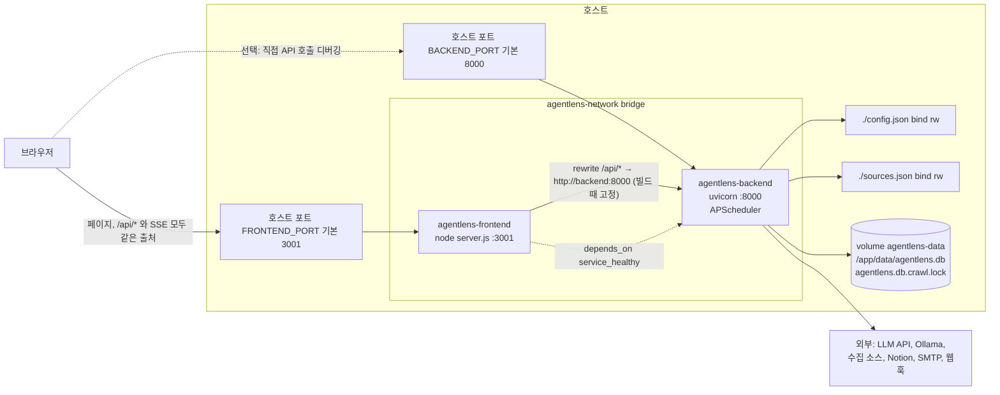
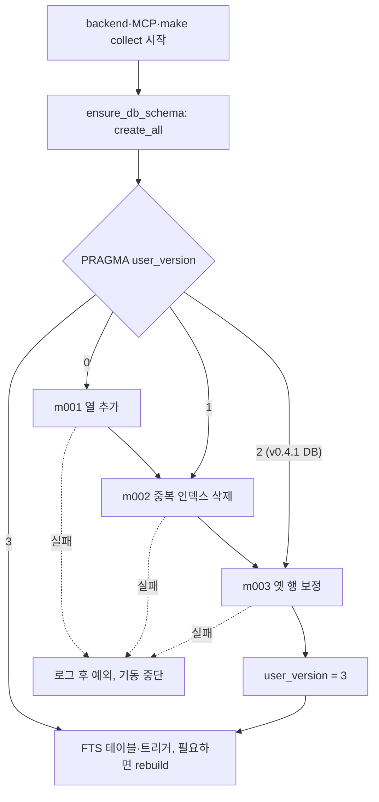

# AgentLens 배포 명세 및 환경 검증서 (Deployment Specification)

Updated: 2026-11-10
기준: v0.4.2 (main)

- **작성일자**: 2026-11-10
- **작성자**: 데브옵스 엔지니어 (`devops-engineer`)
- **문서 버전**: v1.2 (as-built, v0.4.2 작업 트리를 그대로 설명한다. 배포 파일 수정 뒤 재검증 반영)
- **상태**: Review
- **연계 문서**: 데이터 구조 `docs/system-designer/01_SYSTEM_DESIGN.md`, 결정 근거 `docs/fullstack-architect/01_ARCHITECTURE_ADR.md`, 테스트 전략 `docs/qa-engineer/01_QA_TEST_PLAN.md`, 버전 문자열 위치 `docs/releases.md` '버전 문자열 위치'

코드와 설정 파일에서 정리한 배포·운영 명세다. 근거는 `path:line` 으로 단다. '실측' 은 2026-11-10 06:00~06:17 UTC 에 v0.4.2 작업 트리(커밋 `4944a5e` 위, 커밋 전)로 이미지를 빌드해 실제로 띄워 확인한 것이고(3절. 3.1~3.11 은 배포 파일 수정 전 1차, 3.12 는 수정 뒤 재검증), '코드상 판단' 은 실행하지 않고 코드로만 판단한 것이다. 프로덕션 배포는 없다. 배포 형태는 단일 호스트의 `docker compose` 와 로컬 실행(`make dev`) 두 가지다.

검사 범위 밖(`CLAUDE.md` 최우선 규칙 6: 인증 없음과 CORS 전체 허용, SSRF, 비밀값 평문 저장, 설정 조회로 비밀값 노출, 설정 재적용 누락)은 판정 근거로 쓰지 않고 11절에 사실로만 적는다.

---

## 1. 컨테이너 빌드 및 런타임 토폴로지 (Container Architecture)

### 1.1 구성 한눈에 보기

| 구성 요소 | 포트 | 실행 | 상태 확인 |
|---|---|---|---|
| backend (FastAPI + APScheduler + SQLite) | 컨테이너 8000, 호스트 `${BACKEND_PORT:-8000}` | `uvicorn app.main:app --host 0.0.0.0 --port 8000` (`backend/Dockerfile:35`) | `GET /health` (`backend/app/main.py:70-72`). backend 에 `/api/health` 는 없다 (404) |
| frontend (Next.js 16 standalone) | Docker 3001, `make dev` 3000 | `node server.js` (`frontend/Dockerfile:60`), 개발은 `next dev` | `GET /api/health` (`frontend/src/app/api/health/route.ts:6-14`) |
| MCP 서버 (stdio) | 없음 | `python -m app.mcp.server` (cwd `backend/`, `backend/app/mcp/server.py:68-69`). `mcp` 2.x 면 `MCPServer`, 1.x 면 `FastMCP` (`server.py:7-12`) | 없음 |

### 1.2 서비스별 컨테이너 사양

| 서비스명 | 베이스 이미지 | 노출 포트 (호스트:컨테이너) | 헬스체크 엔드포인트 (compose) | 재시작 정책 | 실행 사용자 | 근거 |
| :--- | :--- | :---: | :--- | :--- | :--- | :--- |
| **frontend** (`agentlens-frontend`) | `node:20-alpine` (3단계) | `${FRONTEND_PORT:-3001}:3001` | `wget -qO- http://127.0.0.1:3001/api/health`, 10s/5s/retries 3/start 10s | `unless-stopped` | `nextjs` (uid 1001, 실측 gid 65533 `nogroup`) | `docker-compose.yml:52-75`, `frontend/Dockerfile:44-52` |
| **backend** (`agentlens-backend`) | `python:3.11-slim` (단일 단계 `runner`) | `${BACKEND_PORT:-8000}:8000` | `curl -f http://127.0.0.1:8000/health`, 10s/5s/retries 5/start 10s | `unless-stopped` | bind mount 된 `config.json` 의 소유 uid·gid (root 면 1000:1000 `app`). 진입점이 root 로 시작해 `/app/data` 소유자를 그 uid 로 맞춘 뒤 `setpriv` 로 바꾼다 (macOS 실측 PID 1 uid 1000, 3.12) | `docker-compose.yml:8-52`, `backend/Dockerfile`, `backend/docker-entrypoint.sh` |
| **database** | 별도 컨테이너 없음. backend 안의 SQLite 파일 `/app/data/agentlens.db` (volume `agentlens-data`) | — | backend `/health` 로 간접 확인 | — | — | `docker-compose.yml:21, 38`, 5절 |



v0.4.2 부터 브라우저는 backend 포트로 직접 붙지 않는다. `NEXT_PUBLIC_API_URL` 이 비어 있으면(기본) 기사 질문 SSE 도 같은 출처 `/api/...` → Next rewrite → backend 로 간다 (`frontend/src/lib/api.ts:60-68, 165-173`, 3.5·3.6 실측).

### 1.3 docker-compose.yml

| 항목 | backend | frontend |
|---|---|---|
| 빌드 | `./backend`, `Dockerfile` | `./frontend`, `Dockerfile` |
| 컨테이너 | `agentlens-backend` | `agentlens-frontend` |
| 재시작 | `unless-stopped` | `unless-stopped` |
| 포트 | `${BACKEND_PORT:-8000}:8000` | `${FRONTEND_PORT:-3001}:3001` |
| 볼륨 | `agentlens-data:/app/data`, `./config.json:/app/config.json:rw`, `./sources.json:/app/sources.json:rw` (단일 파일 bind mount. Docker 에서 설정·소스를 저장하면 git 이 추적하는 루트 파일이 바뀐다) | 없음 |
| healthcheck | `curl -f http://127.0.0.1:8000/health`, interval 10s, timeout 5s, retries 5, start_period 10s | `wget -qO- http://127.0.0.1:3001/api/health`, interval 10s, timeout 5s, retries 3, start_period 10s |
| 의존 | — | `backend: condition: service_healthy` |
| 기타 | `extra_hosts: host.docker.internal:host-gateway` | — |
| 네트워크 | `agentlens-network` (bridge) | 같음 |

근거: `docker-compose.yml:7-87`. volume `agentlens-data` 는 `name: agentlens-data`, `driver: local` (`docker-compose.yml:79-82`).

compose 가 컨테이너에 넣는 환경 변수 (`${VAR:-기본}` 은 루트 `.env` 또는 셸 환경에서 치환된다. 셸 환경이 `.env` 를 이긴다. 값 없이 이름만 적은 `- VAR` 는 루트 `.env`·셸에 있을 때만 넘어가고 없으면 컨테이너에 없다(실측), `docker-compose.yml:16-38, 62-66`):

| 서비스 | 변수 | 값 |
|---|---|---|
| backend | `PROJECT_NAME` | `AgentLens` |
| backend | `VERSION` | `${VERSION:-0.4.2}` |
| backend | `HOST`, `PORT` | `0.0.0.0`, `8000` (backend 코드는 읽지 않는다. 포트는 Dockerfile CMD 고정) |
| backend | `DATABASE_URL` | `sqlite+aiosqlite:///./data/agentlens.db` (고정. 상대 경로는 `backend/` 기준이라 컨테이너에서는 `/app/data/agentlens.db`, 실측) |
| backend | `PUBLIC_WEB_URL` | `${PUBLIC_WEB_URL:-http://localhost:${FRONTEND_PORT:-3001}}` (v0.4.2 새 변수) |
| backend | `SECRET_KEY` | `${SECRET_KEY:-agentlens-default-secret-key-32chars-minimum-safe-value}` |
| backend | `CRAWL_SCHEDULE_HOURS`, `CRAWL_TIMEZONE`, `SCHEDULER_ENABLED` | 이름만 (`docker-compose.yml:24-28`). 루트 `.env`·셸에 정했을 때만 넘기고, 없으면 마운트된 `config.json` `scheduler.*` 를 쓴다 |
| backend | `ANTHROPIC_API_KEY`, `ANTHROPIC_MODEL`, `ANTHROPIC_DEFAULT_CHAT_MODEL` | 키는 빈 값 기본, 모델은 `claude-sonnet-5-5`. `ANTHROPIC_COLLECTION_MODEL` 은 v0.4.2 에서 지웠다 |
| backend | `GEMINI_API_KEY`, `GEMINI_MODEL` | 빈 값, `gemini-3.5-flash-lite` |
| backend | `OPENAI_API_KEY`, `OPENAI_MODEL` | 빈 값, `gpt-4o-mini` |
| backend | `OLLAMA_BASE_URL` | `${OLLAMA_BASE_URL:-http://host.docker.internal:11434}` (루트 `.env` 에 값이 있으면 그 값이 이긴다. 10절) |
| backend | `SLACK_WEBHOOK_URL`, `DISCORD_WEBHOOK_URL` | 빈 값 |
| frontend | `NODE_ENV`, `PORT` | `production`, `3001` |
| frontend | `INTERNAL_API_URL` | `http://backend:8000` (런타임 값. rewrite 대상은 빌드 때 이미 `http://backend:8000` 으로 고정된다, 3.5 실측) |
| frontend | `NEXT_PUBLIC_API_URL` | `${NEXT_PUBLIC_API_URL:-}` (런타임 값. 브라우저 번들에는 반영되지 않는다, 3.5 실측) |

compose 가 넘기지 않는 Settings 필드(`ENVIRONMENT`, `ANTHROPIC_HAIKU/SONNET/OPUS_MODEL`, `OLLAMA_MODEL`, `QUALITY_CUTOFF_SCORE`, `HIGH_SIGNAL_THRESHOLD`, `CHAT_SESSION_MAX_LIMIT`, `SCRAPER_TIMEOUT_SECONDS`, `BRIEFING_*`, `NOTION_*`, `SMTP_*`, `EMAIL_AUTO_SEND`)는 마운트된 `/app/config.json` 값 또는 코드 기본값을 쓴다. backend 이미지에는 `.env` 가 없다 (`backend/.dockerignore:8-9`). 그래서 루트 `.env` 의 `ENVIRONMENT` 는 컨테이너에 닿지 않는다 (실측 `settings.ENVIRONMENT` = `development`).

스케줄 변수는 기본값 주입을 뺐다. 그래서 Docker 도 `config.json` `scheduler.crawl_hours`·`timezone`·`enabled` 를 따르고, 루트 `.env`·셸에 정한 값만 그보다 이긴다 (2.2). 빈 값(`SCHEDULER_ENABLED=`)은 그대로 넘어가 기동이 멈추므로 쓰지 않는다 (실측: 빈 `SCHEDULER_ENABLED` 는 `bool_parsing` 오류, 빈 `CRAWL_SCHEDULE_HOURS` 는 `scheduler.py:9` 의 `int('')` 오류). `VERSION` 은 여전히 `${VERSION:-0.4.2}` 라 `config.json` `app.version` 을 이긴다.

### 1.4 backend/Dockerfile

| 단계 | 내용 | 근거 |
|---|---|---|
| 베이스 | `python:3.11-slim` (단일 단계 `runner`) | `backend/Dockerfile:6` |
| 환경 | `PYTHONUNBUFFERED=1`, `PYTHONDONTWRITEBYTECODE=1`, `PYTHONPATH=/app`, `WORKDIR /app` | `:8-12` |
| 시스템 패키지 | `curl` (healthcheck 용), apt 목록 삭제 | `:15-17` |
| 의존성 | `COPY requirements.txt .`, `pip install --no-cache-dir -r requirements.txt` (운영 의존성만. 테스트 도구는 `requirements-dev.txt`) | `:20-21` |
| 사용자 | `groupadd/useradd --system` uid·gid 1000 `app` (기본 실행 uid) | `:23-25` |
| 소스 | `COPY --chown=app:app app/ ./app/` (`tests`, `*.db`, `.env`, `.env.*`, `__pycache__`, `.venv` 는 `backend/.dockerignore` 로 제외), `docker-entrypoint.sh` 복사 | `:28-29`, `backend/.dockerignore` |
| 데이터 | `mkdir -p /app/data && chown app:app /app /app/data` (`/app` 도 app 소유라 설정 저장의 `config.json.tmp`·`sources.tmp` 를 쓸 수 있다) | `:32` |
| 노출·헬스 | `EXPOSE 8000`, `HEALTHCHECK` 15s/5s/start 10s/retries 3 (compose 설정이 덮어씀) | `:34-38` |
| 실행 | `ENTRYPOINT ["docker-entrypoint.sh"]`, `CMD uvicorn app.main:app --host 0.0.0.0 --port 8000` (단일 프로세스) | `:41-42` |
| 진입점 | root 로 시작하면 `stat -c '%u:%g' /app/config.json` 으로 bind mount 소유자를 읽는다. uid 가 0 이거나 파일이 없으면 `1000:1000`. 그 uid·gid 로 `/app`, `/app/app/config` 를 `chown`, `/app/data` 를 `chown -R` 한 뒤 `exec setpriv --reuid=<uid> --regid=<gid> --clear-groups "$@"`. root 가 아니면 그대로 실행. bind mount 파일 자체의 소유자는 바꾸지 않는다. 그래서 Linux 호스트 사용자 소유의 `config.json`·`sources.json` 을 그 사용자로 쓸 수 있고, v0.4.1 이하(root 실행) 볼륨도 첫 기동 때 보정된다 (3.12 실측) | `backend/docker-entrypoint.sh` |

의존성 파일 (v0.4.2):
- `backend/requirements.txt` — 운영 의존성 16개. 하한 + **주 버전 상한**(`<다음 주 버전`, 0.x 는 `<1`). 다음 주 버전은 깨지는 변경이 들어올 수 있어서다(예: APScheduler 4 에는 `AsyncIOScheduler` 가 없다). 같은 주 버전 안의 갱신은 받는다. `mcp` 는 코드가 1.x·2.x 를 모두 받으므로 `>=1.0.0,<3`. `google-genai` 는 지웠다(Gemini 는 httpx REST).
- `backend/requirements-dev.txt` — `-r requirements.txt` + `pytest`, `pytest-asyncio`, `pytest-cov`(각 주 버전 상한). `make setup` 이 이것을 설치하므로 운영·테스트 의존성이 함께 들어간다. Docker 이미지는 `requirements.txt` 만 설치한다.
- 실측 이미지 설치 버전(빌드 로그): `fastapi-0.162.2`, `uvicorn-0.54.0`, `sqlalchemy-2.1.8`, `apscheduler-3.11.3`, `mcp-2.3.0`, `openai-3.48.0`, `python-dateutil-4.0.0`. `pytest`·`coverage` 없음 (3.12).

### 1.5 frontend/Dockerfile

| 단계 | 내용 | 근거 |
|---|---|---|
| 1. `deps` (`node:20-alpine`) | `libc6-compat`, `corepack enable && corepack prepare pnpm@12.3.4 --activate`, `package.json pnpm-lock.yaml pnpm-workspace.yaml*` 복사, `pnpm install --frozen-lockfile` | `frontend/Dockerfile:7-14` |
| 2. `builder` | `libc6-compat`, corepack, node_modules 복사, 소스 복사, `NEXT_TELEMETRY_DISABLED=1`, `NODE_ENV=production`, `INTERNAL_API_URL=http://backend:8000`, `pnpm build` | `:17-31` |
| 3. `runner` | `NODE_ENV=production`, `NEXT_TELEMETRY_DISABLED=1`, `PORT=3001`, `HOSTNAME=0.0.0.0`, `INTERNAL_API_URL=http://backend:8000`, gid 1001 `nodejs`·uid 1001 `nextjs`, `public`·`.next/standalone`·`.next/static` 복사, `USER nextjs`, `EXPOSE 3001`, `HEALTHCHECK` 15s/5s/start 10s/retries 3 (compose 가 덮어씀), `node server.js` | `:34-60` |

- builder 단계에 `NEXT_PUBLIC_API_URL` 을 넘기는 `ARG`/`ENV` 가 없다. 그래서 Docker 번들의 `NEXT_PUBLIC_API_URL` 은 늘 비어 있고 브라우저는 같은 출처로 간다 (v0.4.2 의도, 3.5 실측).
- rewrite 대상은 빌드 때 `INTERNAL_API_URL` 로 정해져 `.next/routes-manifest.json`·`server.js` 에 `http://backend:8000/api/:path*` 로 들어간다 (3.5 실측). 런타임 `INTERNAL_API_URL` 을 바꿔도 rewrite 는 바뀌지 않는다. 서버 쪽 fetch(`getApiBase`, `frontend/src/lib/api.ts:52-58`)만 런타임 값을 읽는다.
- `frontend/.dockerignore` 는 `node_modules`, `.next`, `.git`, 로그, `.env`, `.env.*` 를 빼고 `.env.example` 만 남긴다. 로컬 `frontend/.env.local` 은 이미지에 들어가지 않는다.
- 앱 버전: `next.config.ts` 가 `package.json` 의 `version` 을 `NEXT_PUBLIC_APP_VERSION` 으로 빌드 때 넣는다 (`frontend/next.config.ts:6, 13-15`). v0.4.2 부터 `/api/health` 의 `version` 도 이 값이다 (`frontend/src/app/api/health/route.ts:10-11`, 손으로 맞추지 않는다).
- `allowedDevOrigins` 는 `localhost`, `127.0.0.1` + `ALLOWED_DEV_ORIGINS`(쉼표 구분)다 (`next.config.ts:18-22`). 하드코딩된 Tailscale·사설 IP 는 v0.4.2 에서 지웠다. `next dev` 에만 적용된다.
- `productionBrowserSourceMaps: false` (`next.config.ts:10`).
- pnpm 은 `corepack prepare pnpm@12.3.4 --activate` 로 고정했다 (`frontend/Dockerfile:12, 22`). `package.json` 의 `packageManager: pnpm@12.3.4` (`frontend/package.json:40`)와 로컬 `pnpm --version` 12.3.4 와 같다. 바꿀 때 두 곳을 함께 고친다. 실측 빌드 로그: `Preparing pnpm@12.3.4 for immediate activation...`.

---

## 2. 언어별 환경변수 모범사례 검증 체크리스트 (Environment Verification)

### 2.1 체크리스트 결과

#### 백엔드 (Python FastAPI / `pydantic-settings`)
- [x] `.env.example` 에 모든 키 명시 — Settings 필드 40개가 두 예시 파일에 모두 있다 (2.5, 실측 스크립트 대조). config.json·설정 화면이 관리하는 16개(스케줄 3, 브리핑 제목·발송 시각, Notion 3, SMTP 7, 자동 메일)는 `# KEY=값` 주석으로 두었다. 주석을 풀면 config.json 을 이기고, 빈 값으로 풀면 숫자·불리언은 기동이 멈추고 문자열은 config.json 값을 지우기 때문이다. compose 변수 `BACKEND_PORT`·`FRONTEND_PORT` 는 루트 예시에 있다. 지운 변수(`CORS_ORIGINS`, `USER_AGENT`, `LLM_PROVIDER`, `ANTHROPIC_COLLECTION_MODEL`, `CHAT_HISTORY_*`, `AGENTIC_SEARCH_MAX_QUERIES`, `TESTING`)는 두 예시·compose·`config.json`·`backend/app` 어디에도 없다.
- [ ] 필수 환경변수 누락 시 기동 즉시 Fail-fast — **해당 없음/부분**. 모든 필드에 기본값이 있어 누락으로 멈추는 필드는 없다. 유일한 기동 차단은 `ENVIRONMENT=production` 이면서 `SECRET_KEY` 가 32자 미만일 때 import 시 `ValueError` (`backend/app/config.py:157-158`). 선택 기능(LLM 키, Notion, SMTP, 웹훅)은 없으면 기능만 꺼진다 (7절).
- [x] 운영 SECRET_KEY 32자 이상 — 기본값 `agentlens-default-secret-key-32chars-minimum-safe-value` 55자 (`config.py:115`, `docker-compose.yml:23`), 예시 값도 32자 이상. `SECRET_KEY` 를 읽는 코드는 production 길이 검사뿐이다.
- [x] 실제 `.env` 파일이 git 밖 — 실측 `git check-ignore -v`: `.env`·`backend/.env` → `.gitignore:8:*.env`, `frontend/.env.local` → `frontend/.gitignore:34:.env*`. `git ls-files` 의 env 파일은 `.env.example`, `backend/.env.example` 둘뿐. 수집 잠금 파일도 `.gitignore:16` (`*.crawl.lock`, v0.4.2 추가)로 무시된다.
- [x] 커밋될 파일에 비밀값 없음 — 실측(2.7): `config.json` 의 `llm.*_api_key`, `briefing.notion.api_key`, `briefing.email.smtp_user`/`smtp_password`, `webhooks.*_url` 모두 빈 값. 추적·미추적(무시 제외) 파일에서 키 형식(`sk-ant-api…`, `sk-proj-…`, `AIza…`, Slack·Discord 웹훅, Notion 토큰) 검색 결과는 테스트의 자리표시 웹훅(`T000/B000/XXX`) 2건뿐. 비밀값을 UI 로 저장하면 `config.json` 에 평문으로 들어가는 구조는 범위 밖(규칙 6)이라 11절에 사실로만 둔다.

#### 프론트엔드 (Next.js / TypeScript)
- [x] 브라우저 노출 환경변수는 `NEXT_PUBLIC_` 접두사로 분리 — 브라우저가 읽는 값은 `NEXT_PUBLIC_API_URL`(backend 주소, 비밀 아님)과 `NEXT_PUBLIC_APP_VERSION` 둘뿐이고 `getClientEnv()` 한 곳에서 읽는다 (`frontend/src/lib/env.ts:33-38`).
- [x] zod 스키마로 환경변수 검증 — **v0.4.2 에서 연결됨**. `clientEnvSchema`(`env.ts:8-11`)를 `getClientEnv()` 가 parse 하고(값이 URL 도 빈 문자열도 아니면 던진다), `api.ts:67`(`getDirectApiBase`)와 `/api/health`(`route.ts:11`)가 쓴다. `serverEnvSchema`(`env.ts:17-24`: `NODE_ENV`, `PORT`, `INTERNAL_API_URL`, `ALLOWED_DEV_ORIGINS`)는 목록으로만 있고 값은 `next.config.ts`·Next 런타임이 직접 읽는다 (`getServerEnv` 는 v0.4.2 에서 지웠다).
- [x] 프로덕션 소스맵·콘솔 로그 방어 — `productionBrowserSourceMaps: false`. 실측 Docker 번들(`.next/static`)에 `:8000` 직결 문자열 없음 (3.5).

### 2.2 설정 우선순위 (backend)

`backend/app/config.py` 의 `Settings`(pydantic-settings)가 다음 순서로 값을 정한다. 위가 이긴다.

1. 프로세스 환경 변수 (Docker 는 compose `environment`. 스케줄 3개는 루트 `.env`·셸에 정했을 때만 넘어간다, 1.3).
2. `.env` 파일 — import 시 `load_dotenv(override=False)` 로 `cwd/.env` → `cwd/backend/.env` → `cwd/../.env` → `backend/.env`(파일 위치 기준) 순서에서 **먼저 찾은 파일의 값이 이긴다** (`config.py:8-11`). 이어서 `env_file=(".env", "backend/.env", "../.env")`(cwd 기준)도 지정되어 있다 (`config.py:122-126`).
3. 루트 `config.json` 값 — 필드 기본값으로 들어간다 (`config.py:62-120`). `config.json` 은 `cwd/config.json` → `cwd/../config.json` → 저장소 루트 → `backend/app/config/config.json` 순으로 처음 있는 파일을 쓴다 (`config.py:15-26`). Docker 는 `/app/config.json`(bind mount, 실측). 파일 (mtime, size)이 그대로면 다시 읽지 않는다 (`config.py:28-47`).
4. 코드에 적힌 기본값.

예외와 보정 (`merge_json_and_env`, `config.py:128-159`):
- LLM 키·모델 필드가 빈 문자열이면 config.json → `os.environ` → 하드코딩 순으로 다시 채운다 (`config.py:131-148`).
- `GEMINI_MODEL` 이 빈 값이거나 `gemini-2.0-flash`, `gemini-flash-latest` 면 config.json 값 또는 `gemini-3.5-flash-lite` (`config.py:145-146`).
- 웹훅 URL 은 비어 있고 config.json 에 값이 있을 때만 다시 채운다 (`config.py:149-153`). `SECRET_KEY` 가 비면 config.json → 환경 변수 → 기본값 (`config.py:154-155`).
- `DATABASE_URL` 의 SQLite 상대 경로를 `backend/` 기준 절대 경로로 바꾼다 (`resolve_database_url`, `config.py:49-58, 156`). 5절.
- `ENVIRONMENT=production` 인데 `SECRET_KEY` 가 32자 미만이면 `ValueError` (`config.py:157-158`).
- `settings.reload()` 는 설정 API 저장 뒤 불린다 (`config.py:170-174, 193`). 반영 범위 문제는 범위 밖(설정 재적용 누락)이라 판정하지 않는다.

### 2.3 Settings 필드 전체 (v0.4.2, 40개)

env 이름은 필드 이름과 같다. 필드 정의는 `backend/app/config.py:62-120`.

| 필드 | 코드 기본값 | config.json 키 | 쓰는 곳 |
|---|---|---|---|
| PROJECT_NAME | `AgentLens` | `app.project_name` | `main.py:52` |
| VERSION | `0.4.2` | `app.version` | `main.py:52, 68, 72` |
| DATABASE_URL | `sqlite+aiosqlite:///<backend>/agentlens.db` | `app.database_url` | `database.py:6-15`, `collectors/manager.py:54-60` (잠금 파일 위치) |
| PUBLIC_WEB_URL (새) | `http://localhost:3000` | `app.public_web_url` | RSS channel link `api/news.py:88`, 메일 대시보드 링크 `email_service.py:144` |
| SCHEDULER_ENABLED (연결) | `True` | `scheduler.enabled` | `scheduler.py:73-75` (false 면 스케줄러를 띄우지 않음) |
| CRAWL_SCHEDULE_HOURS (연결) | `0,6,12,18` | `scheduler.crawl_hours` (배열 → 쉼표 문자열) | 수집 cron `scheduler.py:52`, 상태 표시 `scheduler.py:9`·`api/schedule.py:24` |
| CRAWL_TIMEZONE (연결) | `UTC` | `scheduler.timezone` | 수집·브리핑 cron 시간대 `scheduler.py:49-66` |
| ANTHROPIC_API_KEY | `""` | `llm.anthropic_api_key` | `llm_providers/anthropic_provider.py:153` |
| ANTHROPIC_MODEL | `claude-sonnet-5-5` | `llm.anthropic_model` | `anthropic_provider.py` |
| ANTHROPIC_DEFAULT_CHAT_MODEL | `claude-sonnet-5-5` | `llm.anthropic_default_chat_model` | `anthropic_provider.py:49` |
| ANTHROPIC_HAIKU_MODEL | `claude-haiku-5-5` | `llm.anthropic_haiku_model` | `anthropic_provider.py:36` |
| ANTHROPIC_SONNET_MODEL | `claude-sonnet-5-5` | `llm.anthropic_sonnet_model` | `anthropic_provider.py:42` |
| ANTHROPIC_OPUS_MODEL | `claude-opus-5-5` | `llm.anthropic_opus_model` | `anthropic_provider.py:38` |
| GEMINI_API_KEY | `""` | `llm.gemini_api_key` | `llm_processor.py:259-311` (`_call_gemini`, httpx REST) |
| GEMINI_MODEL | `gemini-3.5-flash-lite` | `llm.gemini_model` | `llm_processor.py` `_call_gemini` |
| OPENAI_API_KEY | `""` | `llm.openai_api_key` | `llm_processor.py:183-193` (`_resolve_openai_key`) |
| OPENAI_MODEL | `gpt-4o-mini` | `llm.openai_model` | `llm_processor.py:195-202` |
| OLLAMA_BASE_URL | `http://localhost:11434` | `llm.ollama_base_url` | `llm_processor.py:204-214` |
| OLLAMA_MODEL | `llama3.2:latest` | `llm.ollama_model` | `llm_processor.py:216-223` |
| QUALITY_CUTOFF_SCORE | `5.0` | `llm.quality_cutoff_score` | `llm_processor.py:633, 725` |
| HIGH_SIGNAL_THRESHOLD | `7.0` (v0.4.2 에서 7.8 → 7.0 으로 하나로) | `llm.high_signal_threshold` | `llm_processor.py:634, 726` |
| CHAT_SESSION_MAX_LIMIT (연결) | `30` | `chat.max_session_limit` | `chat_session_service.py:303, 410` |
| SCRAPER_TIMEOUT_SECONDS (연결) | `5.0` | `scraper.timeout_seconds` | `scraper.py:116, 120` |
| BRIEFING_TITLE | `오늘의 AI 브리핑` | `briefing.title` | 브리핑 제목: 마크다운 머리 `briefing_service.py:177`, 응답 `title` `:208`, 웹훅 제목 `:257`, 메일 머리·제목 `email_service.py:28, 257`, Notion 페이지 제목 `notion_service.py:231` (backend B 조가 연결) |
| BRIEFING_AUTO_DISPATCH_HOUR (연결) | `0` | `briefing.auto_dispatch_hour` | 브리핑 자동 발송 cron `scheduler.py:66` |
| NOTION_API_KEY | `""` | `briefing.notion.api_key` | `notion_service.py` |
| NOTION_PAGE_ID | `""` | `briefing.notion.page_id` | `notion_service.py` |
| NOTION_AUTO_EXPORT | `False` | `briefing.notion.auto_export` | `briefing_service.py` `auto_dispatch_all` |
| SMTP_HOST, SMTP_PORT, SMTP_USER, SMTP_PASSWORD, SMTP_FROM, SMTP_TO, SMTP_USE_TLS | `""`, `587`, `""`, `""`, `""`, `""`, `True` | `briefing.email.*` | `email_service.py` |
| EMAIL_AUTO_SEND | `False` | `briefing.email.auto_send` | `briefing_service.py:241` |
| SECRET_KEY | `agentlens-default-secret-key-32chars-minimum-safe-value` | `security.secret_key` | production 길이 검사만 (`config.py:157-158`) |
| ENVIRONMENT | `development` | — | `config.py:157` |
| SLACK_WEBHOOK_URL, DISCORD_WEBHOOK_URL | `""` | `webhooks.slack_webhook_url`, `webhooks.discord_webhook_url` | `briefing_service.py:268-271` |

경로 약어: `main.py`·`config.py`·`database.py`·`scheduler.py` 는 `backend/app/`, `llm_processor.py`·`chat_session_service.py`·`scraper.py`·`notion_service.py`·`email_service.py`·`briefing_service.py` 는 `backend/app/services/`, `anthropic_provider.py` 는 `backend/app/services/llm_providers/`, `api/*` 는 `backend/app/api/`.

`model_config` 가 `extra="allow"` 라 `.env` 의 다른 키(`HOST`, `PORT`, 지운 `CORS_ORIGINS` 등)는 오류 없이 무시된다 (`config.py:122-126`).

config.json 에만 있는 키 (Settings 필드 아님):
| 키 | 읽는 곳 |
|---|---|
| `webhooks.auto_dispatch_daily_briefing` (연결) | `briefing_service.py:266-271` — false 면 자동 웹훅 발송을 끈다. 기본 `True` |
| `briefing.notion.enabled`, `briefing.email.enabled` | 설정 화면 표시·저장만 (`api/briefing.py:112, 119, 156, 175`). 자동 발송 판단은 `NOTION_AUTO_EXPORT`·`EMAIL_AUTO_SEND` |
| `app.host`, `app.port`, `app.frontend_port` | 읽는 코드 없음 |
| `github_sources`, `arxiv`, `hackernews`, `reddit` 의 `enabled` 등 | `sources.json` 쪽 (`collectors/sources/*.py`) |

### 2.4 v0.4.2 설정 변경

| 구분 | 변수 / config.json 키 | 내용 |
|---|---|---|
| 삭제 | `CORS_ORIGINS` | CORS 동작은 그대로 전체 허용 (`main.py:53-59`) |
| 삭제 | `USER_AGENT`, `crawler.*` | 읽는 코드가 없었다 |
| 삭제 | `LLM_PROVIDER` (`llm.provider`) | 프로바이더 순서는 코드가 정한다 (7절) |
| 삭제 | `ANTHROPIC_COLLECTION_MODEL` | 수집 평가는 `ANTHROPIC_MODEL` |
| 삭제 | `CHAT_HISTORY_MAX_TURNS`, `CHAT_HISTORY_MAX_TOKENS`, `AGENTIC_SEARCH_MAX_QUERIES`, `TESTING` | 읽는 코드가 없었거나 테스트 분기 제거 |
| 삭제 | `scheduler.auto_briefing_hour`, `webhooks.auto_alert_high_signal` | `GET /api/briefing/settings` 응답에서도 빠졌다 (실측) |
| 연결 | `SCHEDULER_ENABLED`, `CRAWL_SCHEDULE_HOURS`, `CRAWL_TIMEZONE`, `BRIEFING_AUTO_DISPATCH_HOUR` | 실제 cron 에 쓴다 (6절). 바꾼 값은 backend 재시작 뒤 반영 |
| 연결 | `SCRAPER_TIMEOUT_SECONDS`, `CHAT_SESSION_MAX_LIMIT`, `webhooks.auto_dispatch_daily_briefing` | 2.3 표 |
| 새로 | `PUBLIC_WEB_URL` | 코드 기본 `http://localhost:3000`, compose `http://localhost:${FRONTEND_PORT:-3001}`, 예시 `http://localhost:3001` |
| 새로 (frontend) | `ALLOWED_DEV_ORIGINS` | `next dev` 허용 출처(쉼표 구분). `next dev` 는 루트 `.env` 를 읽지 않으므로 `frontend/.env.local` 이나 셸 환경으로 |
| 기본값 변경 (frontend) | `NEXT_PUBLIC_API_URL` | 예시 기본 빈 값. 비우면 같은 출처 → Next rewrite → `INTERNAL_API_URL`. 브라우저가 `:8000` 을 짐작하지 않는다 |
| 의존성 | `google-genai` 삭제, `pytest-cov` 추가, `mcp` 2.x 호환 | 1.4 |

### 2.5 env 예시 파일과 대조 결과

| 파일 | git | 내용 |
|---|---|---|
| `.env.example` (루트) | 추적 | 머리 주석에 우선순위. backend 변수 전부(관리형 16개는 주석), `PUBLIC_WEB_URL`, compose 포트 `BACKEND_PORT=8000`·`FRONTEND_PORT=3001`, frontend `NEXT_PUBLIC_API_URL=""`, `INTERNAL_API_URL`, `ALLOWED_DEV_ORIGINS=""` |
| `backend/.env.example` | 추적 | 같은 머리 주석, backend 변수 전부(관리형 16개는 주석, SMTP 절 포함) |
| `frontend/.env.example` | 미추적 (`frontend/.gitignore:34` 의 `.env*`) | — |
| `.env`, `backend/.env`, `frontend/.env.local` | 미추적 | 로컬 값 |

실측 대조 (2026-11-10 수정 뒤, `config.py` 필드 목록과 각 파일 키를 스크립트로 비교. `# KEY=` 주석 줄도 적힌 것으로 센다):

| 비교 | 결과 |
|---|---|
| Settings 에 있고 루트 `.env.example` 에 없음 | 없음 (40/40) |
| Settings 에 있고 `backend/.env.example` 에 없음 | 없음 (40/40) |
| 주석으로만 둔 것 (두 파일 같음, 16) | `CRAWL_SCHEDULE_HOURS`, `CRAWL_TIMEZONE`, `SCHEDULER_ENABLED`, `BRIEFING_TITLE`, `BRIEFING_AUTO_DISPATCH_HOUR`, `NOTION_API_KEY`(`secret_...` 자리표시), `NOTION_PAGE_ID`, `NOTION_AUTO_EXPORT`, `SMTP_HOST`, `SMTP_PORT`, `SMTP_USER`, `SMTP_PASSWORD`, `SMTP_FROM`, `SMTP_TO`, `SMTP_USE_TLS`, `EMAIL_AUTO_SEND` |
| 예시에 있고 Settings 에 없음 | 루트: `HOST`, `PORT`(backend 가 읽지 않음), `BACKEND_PORT`, `FRONTEND_PORT`, `INTERNAL_API_URL`, `NEXT_PUBLIC_API_URL`, `ALLOWED_DEV_ORIGINS`(compose·frontend 용). backend: `HOST`, `PORT` |
| 예시를 그대로 불러 Settings 생성 | 두 파일 모두 오류 없이 뜬다 (실측: `dotenv_values` 로 넣고 `app.config`·`app.scheduler` import) |
| compose 가 넘기지 않는 Settings 필드 | 1.3 끝 문단. config.json 이나 코드 기본값을 쓴다 |
| 지운 변수의 잔재 | 없음 (`LLM_PROVIDER`·`TESTING` grep 결과는 `ERR_LLM_PROVIDER_UNAVAILABLE` 등 다른 이름의 부분 문자열뿐) |
| `config.json` 의 지운 키 | `crawler`, `auto_briefing_hour`, `auto_alert_high_signal`, `llm.provider` 없음 |

예시 값과 실제 사용의 차이:
- 두 예시 모두 `ENVIRONMENT="production"`, `DATABASE_URL="sqlite+aiosqlite:///./data/agentlens.db"` 다. 상대 경로는 `backend/` 기준이라 예시를 로컬 `.env` 로 그대로 복사하면 DB 는 `backend/data/agentlens.db` 가 된다 (예시 주석에 적었다). Docker 는 compose 가 같은 값을 넘겨 `/app/data/agentlens.db` 다.
- `PUBLIC_WEB_URL="http://localhost:3001"` 은 Docker frontend 기준이다. `make dev`(frontend 3000)에 예시를 복사하면 RSS·메일 링크가 3001 을 가리킨다.
- `OLLAMA_BASE_URL="http://localhost:11434"` 를 루트 `.env` 로 옮기면 compose 기본값 `http://host.docker.internal:11434` 를 덮어써 컨테이너 안에서 호스트 Ollama 에 닿지 않는다 (예시 주석에 적었다).

### 2.6 frontend 환경 변수

| 변수 | 읽는 곳 | 의미 |
|---|---|---|
| `INTERNAL_API_URL` | `frontend/next.config.ts:24` (rewrite 대상, **빌드 때 고정**), `src/lib/api.ts:58` (서버 쪽 fetch, 런타임) | backend 주소. 기본 `http://127.0.0.1:8000`. Docker 빌드·런타임 모두 `http://backend:8000` |
| `NEXT_PUBLIC_API_URL` | `src/lib/env.ts:35` → `api.ts:67` (`getDirectApiBase`) | 기사 질문 SSE 를 backend 에 직접 붙일 주소. **기본 빈 값 = 같은 출처**. 값이 있으면 직접 연결이 실패할 때 같은 출처로 한 번 더 시도한다 (`api.ts:165-173`). 빌드 때 번들에 들어간다 |
| `NEXT_PUBLIC_APP_VERSION` | `next.config.ts:13-15` 가 `package.json` `version` 으로 주입, `env.ts:36`, `Header`, `/api/health` | 앱 버전 |
| `ALLOWED_DEV_ORIGINS` | `next.config.ts:21` | `next dev` 허용 출처 추가 (쉼표 구분) |
| `NODE_ENV`, `PORT` | Next 런타임, Docker runner (`frontend/Dockerfile:37-39`) | |

### 2.7 비밀값 점검 (2026-11-10 실측)

| 대상 | 결과 |
|---|---|
| `config.json` (추적, 작업 트리) | `llm.anthropic_api_key`·`gemini_api_key`·`openai_api_key`, `briefing.notion.api_key`, `briefing.email.smtp_user`·`smtp_password`, `webhooks.slack_webhook_url`·`discord_webhook_url` 모두 길이 0. `security` 절 없음. `briefing.notion.page_id` 는 값이 있다(23자, 인증 정보 아님). `smtp_to` 는 `team@example.com` 자리표시 |
| `.env.example`, `backend/.env.example` | 키·웹훅·SMTP 값 모두 빈 값. `SECRET_KEY` 는 `…change-me-32chars` 자리표시 |
| 추적·미추적(무시 제외) 파일 전체 | 키 형식 정규식 검색: `backend/tests/test_error_format.py:150`, `frontend/src/tests/modals/BriefingSettingsModal.test.tsx:30` 의 `https://hooks.slack.com/services/T000/B000/XXX` 자리표시 2건뿐 |
| 로컬 `.env`, `backend/.env` (git 밖) | `ANTHROPIC_API_KEY`, `GEMINI_API_KEY` 에 값이 있다. 그래서 검증 때 셸 환경으로 빈 값을 넘겨 덮었다 (3.3) |

---

## 3. 헬스체크 및 무중단 배포 검증 결과 (2026-11-10 실측)

### 요약
- **백엔드 헬스체크 응답 (`GET /health`)**: `{"status":"healthy","version":"0.4.2","running":false}` HTTP 200 (0.0016s)
- **프론트엔드 헬스 (`GET /api/health`)**: `{"status":"healthy","service":"agentlens-frontend","version":"0.4.2",…}` HTTP 200. SSR 페이지 `/`, `/chat` HTTP 200
- **컨테이너 기동 소요 시간**: `make docker-up` 시작부터 두 컨테이너 healthy 까지 **12초** (backend 시작 `06:00:08.13Z`, frontend 시작 `06:00:13.71Z`)
- **번들**: 브라우저 정적 번들에 `:8000` 직결 없음. `NEXT_PUBLIC_API_URL` 은 비어 있고 앱 버전 `0.4.2` 가 들어 있다
- **SSE**: 같은 출처(`:3001` → rewrite → backend) 기사 질문 스트림이 `Cache-Control: no-cache, no-transform`, 압축 없이 30개 조각으로 약 0.53초에 나뉘어 왔다
- **DB**: volume DB `user_version` 2 → 3 (m003 적용), `integrity_check` ok, 잠금 파일 `/app/data/agentlens.db.crawl.lock`
- **스케줄러**: `[Scheduler] Started for Crawl (0,6,12,18 UTC), Briefing (0:15 UTC) and Deep Research (3,15 UTC)`, 다음 수집 `2026-11-10T12:00:00+00:00`
- 수집·외부 발송·LLM 호출은 하지 않았다
- **배포 파일 수정 뒤 재검증 (3.12)**: `make check` 종료 0 (backend 423 passed, frontend 70 files / 833 tests, eslint·tsc 0), `make docker-build` 종료 0 (backend 506MB, pytest 없음), `make docker-up` 11초 healthy, 안내 주소가 실제 포트(`18000`)를 낸다, backend 프로세스 uid 1000, 볼륨·`/app`·bind mount 쓰기 확인, 버전 0.4.2

### 3.1 실행 환경과 사전 상태
- Docker Engine 29.7.2, Docker Compose v5.5.0, macOS (Darwin 25.6.0, arm64).
- 호스트 8000·3000 은 사용자의 `make dev`(backend `uvicorn --reload`, frontend `next dev`)가 쓰고 있었다. 건드리지 않고 **`BACKEND_PORT=18000`** 으로 backend 호스트 포트만 바꿔 띄웠다. 3001 은 비어 있었다. 다른 프로젝트 컨테이너(`pipe-on-zeb-*`, 8100·3100 등)와는 겹치지 않았다.
- 시작 전 `config.json`, `sources.json`, `backend/app/config/sources.json` md5 와 `git status --porcelain`(207줄, v0.4.2 작업 트리 변경)을 기록했다. 세 파일은 작업 트리에서 이미 바뀐 상태였고 되돌리지 않았다.
- 로컬 루트 `.env` 에 `ANTHROPIC_API_KEY`·`GEMINI_API_KEY` 값이 있어(길이만 확인) 셸 환경으로 빈 값을 넘겨 덮었다. `OPENAI_API_KEY`, 웹훅 URL 은 이미 빈 값이었다. `config.json` 의 키도 빈 값이었다.
- volume `agentlens-data` 는 2026-11-08 에 만들어진 것이 있었다. 기동 전 확인: `news_items` 5건(시드 수집이 돌지 않는 조건), `PRAGMA user_version` = 2, 미래 시각 행 0, 인덱스 14개.

### 3.2 빌드: `make docker-build`
```
$ make docker-build
==> Building Docker images for Backend and Frontend...
docker compose build
#19 [frontend deps 6/6] RUN pnpm install --frozen-lockfile
#19 0.120 ! Corepack is about to download https://registry.npmjs.org/pnpm/-/pnpm-12.3.4.tgz
#20 [backend 5/7] RUN pip install --no-cache-dir -r requirements.txt
#20 13.68 Successfully installed aiosqlite-0.22.1 … apscheduler-3.11.3 … fastapi-0.162.2 … mcp-2.3.0 … openai-3.48.0 … pytest-9.2.0 pytest-asyncio-1.4.1.post1 pytest-cov-7.1.0 … uvicorn-0.54.0 …
#20 DONE 15.1s
#23 [frontend builder 7/7] RUN pnpm build
#23 1.427 ▲ Next.js 16.3.4 (Turbopack)
#23 4.934 ✓ Compiled successfully in 3.3s
#23 10.52 ├ ƒ /api/health
#23 DONE 10.8s
 Image agentlens-backend Built
 Image agentlens-frontend Built
exit=0 elapsed=26s
```
- `requirements.txt` 가 바뀌어 backend 는 `pip install` 부터, frontend 는 `pnpm install` 부터 다시 돌았다 (apt·베이스 단계는 캐시). 26초는 베이스 이미지 캐시가 있는 상태의 값이다.
- 이미지 크기 (`docker images`): `agentlens-backend:latest` 527MB (v0.4.1 측정 552MB, `google-genai` 삭제), `agentlens-frontend:latest` 252MB.
- 설치 목록에 `google-genai` 없음 (컨테이너 안 `find_spec('google.genai')` = None).

### 3.3 기동: `make docker-up`
```
$ BACKEND_PORT=18000 ANTHROPIC_API_KEY= GEMINI_API_KEY= OPENAI_API_KEY= make docker-up
==> Docker Compose 로 서비스를 띄우고 healthy 가 될 때까지 기다린다 (최대 180초)
docker compose up -d --wait --wait-timeout 180
 Network agentlens-network Created
 Container agentlens-backend Created
 Container agentlens-frontend Created
 Container agentlens-backend Started
 Container agentlens-backend Healthy
 Container agentlens-frontend Started
 Container agentlens-backend Healthy
 Container agentlens-frontend Healthy
==> backend:  http://localhost:8000
==> frontend: http://localhost:3001
==> .env 의 BACKEND_PORT·FRONTEND_PORT 로 포트를 바꿨으면 그 포트로 접속한다
exit=0 elapsed=12s

$ docker compose ps
NAME                 IMAGE                COMMAND                   SERVICE    STATUS                    PORTS
agentlens-backend    agentlens-backend    "uvicorn app.main:ap…"   backend    Up 11 seconds (healthy)   0.0.0.0:18000->8000/tcp, [::]:18000->8000/tcp
agentlens-frontend   agentlens-frontend   "docker-entrypoint.s…"   frontend   Up 5 seconds (healthy)    0.0.0.0:3001->3001/tcp, [::]:3001->3001/tcp
```
- `docker inspect`: 두 컨테이너 `health=healthy`, `restart=unless-stopped`, backend `User` 빈 값(1차 이미지는 root 실행. 수정 뒤 이미지는 진입점이 config.json 소유 uid, root 면 1000 으로 바꾼다, 3.12), frontend `User=nextjs`.
- 안내 줄은 `BACKEND_PORT=18000` 인데도 `http://localhost:8000` 을 냈다 (1차 측정 때 `Makefile` 고정 문자열. 3.12 에서 실제 포트를 내도록 고쳤다).
- 컨테이너 환경 (`docker exec … printenv`, 키·웹훅은 길이만): `VERSION=0.4.2`, `DATABASE_URL=sqlite+aiosqlite:///./data/agentlens.db`, `PUBLIC_WEB_URL=http://localhost:3001`, `SCHEDULER_ENABLED=true`, `CRAWL_SCHEDULE_HOURS=0,6,12,18`, `CRAWL_TIMEZONE=UTC`, `OLLAMA_BASE_URL=http://localhost:11434`(루트 `.env` 값), `ANTHROPIC_API_KEY`·`GEMINI_API_KEY`·`OPENAI_API_KEY`·`SLACK_WEBHOOK_URL`·`DISCORD_WEBHOOK_URL` 길이 0.
- 컨테이너 안 Settings: `find_config_json()` = `/app/config.json`, `settings.DATABASE_URL` = `sqlite+aiosqlite:////app/data/agentlens.db`, `crawl_lock_path()` = `/app/data/agentlens.db.crawl.lock`, `ENVIRONMENT=development`, `HIGH_SIGNAL_THRESHOLD=7.0`, `CHAT_SESSION_MAX_LIMIT=30`, `SCRAPER_TIMEOUT_SECONDS=5.0`, `BRIEFING_AUTO_DISPATCH_HOUR=0`, Notion 키·SMTP 비밀번호 길이 0, `mcp` 2.3.0, `app.mcp.server` import 시 서버 클래스 `mcp.server.mcpserver.server.MCPServer`.
- LLM 가용성: 컨테이너 안 `llm_processor.has_live_provider()` = `False` (키 없음, `localhost:11434` 는 컨테이너 자신이라 Ollama 판정 실패). 그래서 아래 스트림은 휴리스틱 답이다.

### 3.4 헬스체크와 버전
```
$ curl -fsS http://127.0.0.1:18000/health
{"status":"healthy","version":"0.4.2","running":false}
HTTP 200 0.001634s

$ curl -fsS http://127.0.0.1:18000/
{"service":"AgentLens API","version":"0.4.2","docs":"/docs"}

$ curl -fsS http://127.0.0.1:18000/api/health
curl: (22) The requested URL returned error: 404      ← backend 에는 /api/health 가 없다 (예전부터 없음)
   본문 {"error_code":"ERR_NOT_FOUND","message":"요청한 대상을 찾을 수 없습니다.","details":null}

$ curl -fsS http://127.0.0.1:3001/api/health
{"status":"healthy","service":"agentlens-frontend","version":"0.4.2","timestamp":"2026-11-10T06:00:23.862Z"}
HTTP 200 0.004542s

frontend /      HTTP 200
frontend /chat  HTTP 200
frontend /api/schedule/progress (rewrite → http://backend:8000) HTTP 200
{"is_running":false,"current_source":"","step_message":"대기 중",…,"total_sources":6,…,"last_crawl_time":null}
```
- 세 버전이 모두 `0.4.2` 다: backend 는 compose `VERSION` (루트 `.env` 의 `VERSION="0.4.2"`), frontend `/api/health` 는 빌드 때 `package.json` (`"version": "0.4.2"`)에서 들어간 값.
- backend 로그에 `172.25.0.3 - "GET /api/schedule/progress"` 가 남아 frontend 컨테이너 → `backend:8000` 연결을 확인했다.
- RSS `GET /api/news/feed/rss.xml` 의 `<link>` 가 `http://localhost:3001` (= `PUBLIC_WEB_URL`). `GET /api/sources` 의 `sources_file` 은 파일 이름 `sources.json` 만. `GET /api/briefing/settings` 의 `webhooks` 키는 `auto_dispatch_daily_briefing`, `discord_webhook_url`, `slack_webhook_url` (지운 `auto_alert_high_signal` 없음).

### 3.5 frontend 번들 (`:8000` 직결 여부)
```
$ docker run --rm --entrypoint sh agentlens-frontend -c 'cd /app; grep -rl ":8000" .next/static; grep -rl "127.0.0.1:8000" .next/server server.js; …'
static js files: 25
grep :8000 in static:                    (없음)
grep 127.0.0.1:8000 in server:           .next/server/chunks/ssr/_1ckpkwh._.js, .next/server/chunks/ssr/_0gh0dgc._.js
.next/routes-manifest.json: backend:8000/api/:path*
id: uid=1001(nextjs) gid=65533(nogroup)
```
- 브라우저 정적 번들(`.next/static`)에 `:8000` 이 없다. `localhost` 는 URL 파서 라이브러리 문자열 2건뿐이다.
- 번들 안 `getClientEnv` 는 `NEXT_PUBLIC_API_URL:r.default.env.NEXT_PUBLIC_API_URL, NEXT_PUBLIC_APP_VERSION:"0.4.2"` 로 컴파일됐다. 빌드 때 `NEXT_PUBLIC_API_URL` 이 없어 값이 박히지 않았고 브라우저에서는 `undefined` → `""` → 같은 출처다. 기사 질문 호출은 `` `${n}/api/news/${t}/ask/stream` `` 이고 `n = getClientEnv().NEXT_PUBLIC_API_URL || ""` 다.
- 서버 청크의 `127.0.0.1:8000` 은 `getApiBase()` 의 서버 쪽 마지막 폴백이다 (`api.ts:58`). 컨테이너에서는 `INTERNAL_API_URL=http://backend:8000` 이 먼저라 쓰이지 않는다.
- 로컬 루트 `.env` 의 `NEXT_PUBLIC_API_URL=http://localhost:8000` 은 compose 를 거쳐 frontend 컨테이너 런타임 환경에 들어갔지만(실측 길이 21) 번들에는 영향이 없다.

### 3.6 같은 출처 SSE 스트림 (`no-transform`)
```
$ curl -sN -D - -H 'Accept-Encoding: gzip, br' -H 'Content-Type: application/json' \
    -X POST --data '{"question":"이 기사의 핵심은?"}' http://127.0.0.1:3001/api/news/1/ask/stream
HTTP/1.1 200 OK
server: uvicorn
cache-control: no-cache, no-transform
connection: keep-alive
x-accel-buffering: no
content-type: text/event-stream; charset=utf-8
vary: Origin
transfer-encoding: chunked
(Content-Encoding 없음)
data: {"event": "meta", "model": "AgentLens Heuristic Engine"}
data: {"event": "token", "text": "### 기술 맥락 및 "}
…  (data 줄 26개)
data: {"event": "done", "total_text": "### 기술 맥락 및 실무 분석 …"}
```
- 조각 도착 시각 (Python `http.client`, `/api/news/2/ask/stream`, `Accept-Encoding: gzip, br`): 30번 읽기에 이벤트 30개, 첫 조각 8ms, 마지막 533ms. 각 읽기에 `data:` 이벤트가 하나씩 들어 있어 프록시가 모아 보내지 않았다.
- 대조: 같은 rewrite 로 받은 JSON `GET /api/news?limit=20` 은 `Content-Encoding: gzip` 으로 압축됐다. Next 서버 압축(`compress: true`)이 SSE 에는 `no-transform` 때문에 걸리지 않는다 (`backend/app/api/news.py:55-64`).
- LLM 키·Ollama 가 없어 `meta.model` 이 `AgentLens Heuristic Engine` 이고 답은 휴리스틱이다. 실제 LLM 호출은 없었다.

### 3.7 DB·마이그레이션·잠금·스케줄러
```
$ docker exec agentlens-backend python -c "…PRAGMA user_version; integrity_check…"
user_version 3
integrity ok
news_items 5
future 0
indexes 14

$ docker exec agentlens-backend ls -la /app/data
-rw-r--r-- 1 root root 155648 agentlens.db
-rw-r--r-- 1 root root  32768 agentlens.db-shm
-rw-r--r-- 1 root root      0 agentlens.db-wal
-rw-r--r-- 1 root root      0 agentlens.db.crawl.lock

$ make docker-logs DOCKER_LOGS_ARGS="--tail=200 --no-color"   (헬스체크 줄 제외 발췌, exit=0)
agentlens-frontend  | ▲ Next.js 16.3.4
agentlens-frontend  | ✓ Ready in 0ms
agentlens-backend   | INFO:     Waiting for application startup.
agentlens-backend   | [Scheduler] Started for Crawl (0,6,12,18 UTC), Briefing (0:15 UTC) and Deep Research (3,15 UTC)
agentlens-backend   | INFO:     Application startup complete.

$ curl -s http://127.0.0.1:18000/api/schedule/status
{"current_time":"2026-11-10T06:00:43.923411+00:00","schedule_hours":[0,6,12,18],"timezone":"UTC",
 "next_run":"2026-11-10T12:00:00+00:00","minutes_until_next_run":359.3,"is_running":false,
 "last_crawl_time":null,"last_crawl_status":"idle","recent_logs":[]}
```
- 기동 때 `ensure_db_schema()` 가 m003 을 적용해 `user_version` 이 2 → 3 이 됐다. 이 volume 의 5건은 미래 시각 행이 없어 시각 보정 대상이 없었고, 실데이터 보정 결과(429행 9시간 당김, 미래 시각 395 → 0)는 backend TDD 기록 N-11 의 사용자 `make dev` DB 실측이다.
- 잠금 파일은 처음 잠금을 시도할 때 생긴다. 이번에는 3.8 의 잠금 시험이 만들었다. DB 파일 옆(volume)이라 컨테이너를 다시 만들어도 남는다(0바이트, 무해).
- 스케줄러 시작 줄의 시각·시간대는 compose `CRAWL_SCHEDULE_HOURS`·`CRAWL_TIMEZONE`, config.json `briefing.auto_dispatch_hour`(0) 그대로다. 06:00 UTC 수집은 기동(06:00:08) 전이라 건너뛰고 다음 실행이 12:00 이다.

### 3.8 다른 프로세스가 수집 잠금을 쥔 경우 (수집 없이 확인)
컨테이너 안 별도 Python 프로세스가 `acquire_crawl_lock()` 으로 잠금을 30초 쥐게 하고, 잠금이 실제로 잡힌 것(두 번째 시도가 `busy`)을 확인한 뒤에만 아래를 보냈다. 잠금이 잡혀 있으면 수집이 시작되지 않는다 (`api/schedule.py:39-53`).
```
holder acquired=1
probe=busy
$ curl -X POST http://127.0.0.1:18000/api/schedule/trigger
{"status":"already_running","message":"다른 프로세스(MCP 서버·make collect)가 같은 DB 에 수집 중입니다.","other_process":true,"total_collected":0,"total_saved":0,"source_results":{}}
HTTP 200

$ make collect AGENTLENS_API_URL=http://127.0.0.1:18000 COLLECT_MODE=api
cd backend && PYTHONPATH=. ../.venv/bin/python ../scripts/collect.py
API 모드: http://127.0.0.1:18000
다른 프로세스(MCP 서버·make collect)가 같은 DB 에 수집 중입니다. 그 수집이 끝난 뒤 다시 실행한다
make: *** [collect] Error 1
make collect exit=2
```
- `scripts/collect.py` 는 1 로 끝나고(`collect.py:73-76`), make 는 레시피 실패라 `Error 1` 을 내고 종료 2 로 끝난다. 이후 `GET /api/schedule/progress` 는 `is_running:false`, `last_crawl_time:null` 로 수집이 돌지 않았다.

### 3.9 끝 슬래시
```
$ curl -s http://127.0.0.1:18000/api/news/            → {"error_code":"ERR_NOT_FOUND",…} HTTP 404
$ curl -s http://127.0.0.1:18000/api/sources/         → HTTP 404
$ curl -s http://127.0.0.1:18000/api/schedule/status/ → HTTP 404
$ curl -s http://127.0.0.1:3001/api/news/             → HTTP 308 (Location /api/news, Next 가 끝 슬래시를 떼고 리다이렉트)
```
- backend 는 `redirect_slashes=False` (`main.py:50-52`)라 307 없이 바로 404 다. frontend 같은 출처 경로는 Next 가 먼저 308 로 끝 슬래시를 떼므로 브라우저 호출은 영향이 없다.

### 3.10 종료와 부작용 확인: `make docker-down`
```
$ make docker-down
==> Stopping Docker Compose services...
docker compose down
 Container agentlens-frontend Removed
 Container agentlens-backend Removed
 Network agentlens-network Removed
exit=0
$ docker ps -a | grep agentlens        → 없음
$ docker network ls | grep agentlens   → 없음
$ docker volume ls | grep agentlens    → agentlens-data (named volume 은 남는다, 의도된 동작)
```
- `config.json`, `sources.json`, `backend/app/config/sources.json` md5 가 시작 전과 같고, `git status --porcelain` 출력도 시작 전과 같다. 설정·소스 저장 API 를 부르지 않아 bind mount 쓰기는 없었다.
- 사용자 `make dev` 의 8000(uvicorn)·3000(node) LISTEN 은 그대로였다.

### 3.11 경위와 실행하지 않은 것 (1차)
- **첫 기동을 05:59:32 UTC 에 해서 06:00 UTC 수집 직전에 내렸다.** 첫 `make docker-up` 이 정각 수집 28초 전에 떠서, 05:59:50 에 로그를 저장하고 `make docker-down` 으로 내렸다. 로그는 스케줄러 시작과 헬스체크 두 줄뿐이고 수집은 돌지 않았다. 이 첫 기동 때 m003 이 volume DB 에 적용됐다. 06:00:07 에 다시 띄운 것이 3.3 이다. 검증 기동은 수집 정각(기본 0·6·12·18 UTC)과 브리핑 정각(`auto_dispatch_hour`:15)·딥 리서치(3·15 UTC)를 피하거나 `SCHEDULER_ENABLED=false` 로 띄운다 (10절).
- 수집(`POST /api/schedule/trigger` 로 실제 시작, `make collect` 실제 수집, `make reset`), 브리핑 발송, 웹훅 테스트, 챗 스트림(세션이 DB 에 남는다)은 실행하지 않았다.
- `make dev`: 사용자가 쓰고 있어 돌리지 않았다. 동작은 4.3절에 코드로 적는다.

### 3.12 배포 파일 수정 뒤 재검증 (06:13~06:17 UTC)
고친 배포 파일: `docker-compose.yml`(스케줄 변수 기본값 주입 제거), `scripts/dev.sh`(직접 연결 자동 설정 제거), `.env.example`·`backend/.env.example`(필드 채움, 우선순위 주석), `backend/requirements.txt`(운영만, 주 버전 상한), `backend/requirements-dev.txt`(새), `Makefile`(`setup` 이 dev 의존성 설치, `docker-up` 안내가 실제 포트), `backend/Dockerfile`·`backend/docker-entrypoint.sh`(새, 비 root 실행), `frontend/Dockerfile`(pnpm 12.3.4 고정).

```
$ make setup                       (이미 있는 .venv, 두 번 실행)
==> .venv 이미 있음 (Python 3.11.9)
==> backend 의존성 설치 (uv, requirements-dev.txt = 운영 requirements.txt + 테스트 도구)
Checked 19 packages in 47ms
cd frontend && pnpm install --frozen-lockfile
Lockfile is up to date, resolution step is skipped
Done in 23ms using pnpm v12.3.4
setup exit=0   (두 번째 실행도 0)

$ make check
============================= 423 passed in 11.41s =============================
 Test Files  70 passed (70)
      Tests  833 passed (833)
$ eslint          (출력 없음)
check exit=0      (tsc --noEmit 포함)

$ make docker-build
#17 [frontend deps 4/6] RUN corepack enable && corepack prepare pnpm@12.3.4 --activate
#17 0.144 Preparing pnpm@12.3.4 for immediate activation...
#18 11.46 Successfully installed … apscheduler-3.11.3 … fastapi-0.162.2 … mcp-2.3.0 … openai-3.48.0 … uvicorn-0.54.0 …   (pytest·coverage 없음)
exit=0 elapsed=23s
agentlens-backend:latest 506MB, agentlens-frontend:latest 252MB

$ BACKEND_PORT=18000 ANTHROPIC_API_KEY= GEMINI_API_KEY= OPENAI_API_KEY= make docker-up
 Container agentlens-backend Healthy
 Container agentlens-frontend Healthy
==> backend:  http://localhost:18000
==> frontend: http://localhost:3001
elapsed=11s

$ curl -fsS http://127.0.0.1:18000/health
{"status":"healthy","version":"0.4.2","running":false} HTTP 200
$ curl -fsS http://127.0.0.1:3001/api/health
{"status":"healthy","service":"agentlens-frontend","version":"0.4.2",…} HTTP 200
```
- **실행 사용자**: PID 1 `uvicorn` 의 `Uid`·`Gid` = 1000 (`/proc/1/status`). `docker compose ps` 의 COMMAND 는 `docker-entrypoint.s…`.
- **볼륨 소유자 보정**: 1차(root 실행)에서 root 소유였던 `/app/data/agentlens.db`·`-shm`·`-wal`·`agentlens.db.crawl.lock` 이 모두 `1000:1000` 이 됐다. `/app`, `/app/data`, `/app/app/config` 는 `1000:1000 755`. bind mount `config.json`·`sources.json` 은 `0:0 644` 로 보이지만(Docker Desktop 파일 공유) app 사용자가 쓸 수 있다.
- **진입점 uid 선택 (2차 수정 뒤)**: 진입점이 `config.json` 소유자를 따르도록 고친 뒤 다시 빌드·기동했다(06:21 UTC, 11초 healthy, 버전 0.4.2, 안내 `http://localhost:18000`). macOS Docker Desktop 의 bind mount 는 `/app/config.json 0:0` 으로 보여 PID 1 `Uid`·`Gid` = 1000, `/app`·`/app/data`·`agentlens.db` = `1000:1000`. 같은 쓰기 확인과 API `POST /api/chat/sessions` 201 → `DELETE` 200 이 통과했다. 소유자별 시험(컨테이너 안 파일, 실제 config.json 아님): `1234:2345` → 실행 `1234:2345`, `501:20` → `501:20`, `1000:1000` → `1000:1000`, `0:0` → `1000:1000`, 파일 없음 → `1000:1000`. 모두 `/app/data`·`/app`·`/app/app/config` 쓰기 성공. 실제 Linux 호스트에서는 검증하지 못했다.
- **쓰기 확인** (`docker exec -u app`, 내용은 바꾸지 않음): DB `BEGIN IMMEDIATE` + `CREATE TABLE` 뒤 `ROLLBACK` ok, `/app`·`/app/data`·`/app/app/config` 에 파일 생성·삭제 ok, `config.json`·`sources.json` 쓰기 모드 열기 ok, 수집 잠금 획득·해제 ok. API 로도: `POST /api/chat/sessions` 201 → `DELETE` 200 (`deleted_count: 1`) → 조회 404.
- **스케줄 변수**: 컨테이너에 `CRAWL_SCHEDULE_HOURS=0,6,12,18`, `CRAWL_TIMEZONE=UTC` 는 있고(이 기기 루트 `.env` 에 정해져 있음) `SCHEDULER_ENABLED` 는 없다(→ `config.json` `scheduler.enabled: true`). 스케줄러 시작 줄 `[Scheduler] Started for Crawl (0,6,12,18 UTC), Briefing (0:15 UTC) and Deep Research (3,15 UTC)`, `next_run` `12:00+00:00`. `SCHEDULER_ENABLED=false docker compose config` 는 `SCHEDULER_ENABLED: "false"` 를 넘긴다. `.env`·셸 모두 없으면 세 변수 모두 `null`(컨테이너에 없음).
- **SSE·번들**: 같은 출처 `ask/stream` 200, `cache-control: no-cache, no-transform`, `Content-Encoding` 없음. `.next/static` 의 `:8000` 0건.
- LLM 키 길이 0, `make docker-down` 종료 0, 컨테이너 0개, `config.json`·`sources.json`·`backend/app/config/sources.json` md5 와 `git status` 가 기동 전과 같다. 사용자 `make dev`(8000·3000) LISTEN 그대로.

---

## 4. 로컬 실행

### 4.1 Makefile 대상
레시피 셸은 `/bin/bash` (`Makefile:1`), 대상 12개가 모두 `.PHONY` (`Makefile:3`). 레시피가 실패하면 make 는 `make: *** [<대상>] Error N` 을 내고 종료 2 로 끝난다 (3.8 실측). 스크립트(`scripts/dev.sh`, `scripts/collect.py`)의 실패 종료 코드는 1 이다.

| 대상 | 하는 일 | 근거 |
|---|---|---|
| `make setup` | `.venv/bin/python` 이 3.11 이면 건너뛴다. 아니면 `uv venv --clear --python 3.11 .venv`, 없으면 `python3.11 -m venv --clear .venv`, 둘 다 없으면 종료 1. 의존성은 uv 또는 pip 로 `backend/requirements-dev.txt`(= `requirements.txt` + 테스트 도구). pnpm 이 없으면 종료 1, 있으면 `cd frontend && pnpm install --frozen-lockfile`. 다시 돌려도 된다 (3.12 실측) | `Makefile:15-39` |
| `make dev` | `./scripts/dev.sh` (4.3) | `Makefile:41-42` |
| `make test` | `make check` 와 같다 | `Makefile:44` |
| `make build` | `cd frontend && pnpm build` | `Makefile:46-47` |
| `make clean` | `.venv`, `frontend/node_modules`, `frontend/.next`, `frontend/tsconfig.tsbuildinfo`, pytest 캐시, 테스트 DB, `__pycache__` 삭제. DB·`.env*`·설정·Docker 는 남긴다 | `Makefile:49-52` |
| `make collect` | `cd backend && PYTHONPATH=. ../.venv/bin/python ../scripts/collect.py` (4.6) | `Makefile:54-55` |
| `make reset` | `AGENTLENS_API_URL` 의 `/health` 확인 뒤 `POST /api/schedule/reset-and-collect` — **데이터 삭제**. backend 가 없거나, 응답이 JSON 이 아니거나, `status` 가 `started` 가 아니면(예: `already_running`) 실패 | `Makefile:57-73` |
| `make docker-build` | `docker compose build` (3.2 실측) | `Makefile:75-77` |
| `make docker-up` | `docker compose up -d --wait --wait-timeout $(DOCKER_WAIT_TIMEOUT)`, 뒤에 `docker compose port` 로 읽은 실제 호스트 포트로 주소 안내 (3.12 실측 `http://localhost:18000`) | `Makefile:79-83` |
| `make docker-down` | `docker compose down` (named volume 은 남김) (3.10 실측) | `Makefile:85-87` |
| `make docker-logs` | `docker compose logs $(DOCKER_LOGS_ARGS)`, 기본 `-f --tail=200`. Ctrl-C(130)는 정상 종료로 본다 (3.7 실측) | `Makefile:89-95` |
| `make check` | `cd backend && ../.venv/bin/pytest -v tests/` 후 `cd frontend && pnpm test && pnpm lint && pnpm exec tsc --noEmit` | `Makefile:97-100` |

### 4.2 Makefile 변수
`?=` 라 명령 줄이나 환경 변수로 바꾼다 (`Makefile:6-10`). `Makefile:13` 이 `collect.py`·`dev.sh` 가 읽을 변수를 export 한다.

| 변수 | 기본값 | 쓰는 대상 |
|---|---|---|
| `AGENTLENS_API_URL` | `http://localhost:8000` | `collect`, `reset` |
| `COLLECT_MODE` | `auto` (`auto`, `api`, `direct`) | `collect` |
| `COLLECT_TIMEOUT` | `1800` (초) | `collect` (API 모드 대기 한도) |
| `DOCKER_WAIT_TIMEOUT` | `180` (초) | `docker-up` |
| `DOCKER_LOGS_ARGS` | `-f --tail=200` | `docker-logs` |
| `DEV_BACKEND_PORT`, `DEV_FRONTEND_PORT`, `DEV_HOST`, `DEV_READY_TIMEOUT` | `8000`, `3000`, `0.0.0.0`, `120` (`scripts/dev.sh:9-12`) | `dev` |

compose 의 `BACKEND_PORT`·`FRONTEND_PORT` 는 Makefile 변수가 아니다. 루트 `.env` 나 셸 환경으로 넘긴다 (`BACKEND_PORT=18000 make docker-up`). Docker backend 를 옮겼으면 `make collect`·`make reset` 의 `AGENTLENS_API_URL` 도 맞춘다.

`make check` 의 pytest 는 `.env`·환경 변수·루트 `config.json` 의 LLM 설정을 쓰지 않는다. DB 는 실행마다 임시 폴더(`tempfile.mkdtemp`, 세션 끝에 삭제), `config.json`·`sources.json` 은 임시 사본이다. v0.4.2 부터 루프백 밖 외부 요청은 테스트 실패로 막는다(`register_web` 으로 흉내). 자세한 것은 `docs/qa-engineer/01_QA_TEST_PLAN.md`.

### 4.3 로컬 동시 실행 (`make dev`)
```bash
make setup
make dev                                          # backend :8000, frontend :3000
make dev DEV_BACKEND_PORT=18000 DEV_FRONTEND_PORT=13000
```
`scripts/dev.sh` 가 하는 일:
1. `.venv/bin/uvicorn` 과 `frontend/node_modules` 가 없으면 "make setup 을 먼저 실행한다" 와 종료 1.
2. 두 포트가 이미 쓰이면 아무것도 띄우지 않고 "포트 N 사용 중 (Docker 가 떠 있으면 make docker-down)" 과 종료 1.
3. 두 프로세스를 각자 프로세스 그룹으로 띄운다. backend: `backend/` 에서 `../.venv/bin/uvicorn app.main:app --reload --reload-dir app --host $DEV_HOST --port $DEV_BACKEND_PORT`. frontend: `frontend/` 에서 `INTERNAL_API_URL=http://127.0.0.1:$DEV_BACKEND_PORT pnpm dev --port $DEV_FRONTEND_PORT` (`scripts/dev.sh:101-117`). 포트를 바꿔도 `NEXT_PUBLIC_API_URL` 은 넣지 않는다. 브라우저는 같은 출처로 부르고 rewrite 대상만 그 backend 포트로 간다 (v0.4.2 에서 직접 연결 자동 설정을 지움).
4. `DEV_READY_TIMEOUT` 안에 backend `/health` 와 frontend `/api/health` 가 응답하면 주소를 낸다. 넘기거나 하나가 죽으면 정리하고 종료 1.
5. 하나가 끝나면 나머지를 내리고 종료 1. Ctrl-C·SIGTERM 은 TERM → 10초 뒤 KILL, "중지했다" 와 종료 0.

- DB 는 `backend/` 기준 `DATABASE_URL`(기본 `backend/agentlens.db`). 잠금 파일은 `backend/agentlens.db.crawl.lock`.
- `next dev` 는 `frontend/.env.local` 을 읽는다. 여기에 `NEXT_PUBLIC_API_URL` 이 있으면 기사 질문 SSE 가 그 주소로 직접 간다 (v0.4.2 기본은 비움). LAN·Tailscale 에서 `next dev` 에 붙으려면 `ALLOWED_DEV_ORIGINS` 를 `frontend/.env.local` 에 둔다.
- backend 는 `0.0.0.0` 에 뜬다. 좁히려면 `DEV_HOST=127.0.0.1`.
- `make dev` 가 떠 있는 동안 기본 포트로 `make docker-up` 을 하면 8000 이 겹친다. `BACKEND_PORT` 로 Docker 쪽 호스트 포트를 바꾸면 함께 띄울 수 있다 (3.1 실측).

### 4.4 backend 단독 실행
```bash
make setup
cd backend
../.venv/bin/uvicorn app.main:app --host 0.0.0.0 --port 8000
```
- DB 는 cwd 와 상관없이 `backend/` 기준 (`config.py:49-58`). config 는 `../config.json`(루트), `.env` 는 `backend/.env` 가 먼저 (2.2).
- 시작 순서 (`main.py:24-48`): `ensure_db_schema()`(테이블·마이그레이션·FTS, 실패하면 로그 후 예외로 기동 중단) → `start_scheduler()`(`SCHEDULER_ENABLED=false` 면 건너뜀) → `news_items` 가 0건이면 `collect_all()` 을 **백그라운드 태스크로** 띄우고 바로 요청을 받는다. 종료 때 끝나지 않은 첫 수집을 취소하고 스케줄러를 멈추고 엔진을 dispose 한다.
- API 문서: `http://localhost:8000/docs`. v0.4.2 부터 요청 검증 오류는 422 가 아니라 400 `ErrorResponse` 로 문서화된다.

### 4.5 frontend 단독 실행
```bash
cd frontend
pnpm install
pnpm dev          # next dev (포트 지정 없으면 Next 기본)
# 프로덕션 번들: pnpm build 후 .next/standalone/server.js
```
- `/api/:path*` 는 `INTERNAL_API_URL`(없으면 `http://127.0.0.1:8000`)로 rewrite 된다 (`next.config.ts:23-31`). `pnpm build` 때 값이 고정된다.
- `pnpm build` 는 `frontend/.env.local`·`.env.production` 의 `NEXT_PUBLIC_API_URL` 을 번들에 넣는다. Docker 빌드는 `.env*` 를 빼므로 해당 없다.

### 4.6 수집 실행 (`make collect`)
`scripts/collect.py` 가 `AGENTLENS_API_URL`, `COLLECT_MODE`, `COLLECT_TIMEOUT` 을 환경에서 읽는다.
- 입력 검사: `COLLECT_MODE` 가 `auto|api|direct` 가 아니거나 `COLLECT_TIMEOUT` 이 양의 정수가 아니면 종료 1 (`collect.py:186-200`).
- 모드 선택: `GET {URL}/health` (2초)가 200·`healthy` 면 backend 가 있다고 본다. `auto` 는 있으면 API 모드, 없으면 직접 모드. `api` 는 없으면 종료 1. `direct` 는 있어도 직접 모드 (`collect.py:202-210`).
- API 모드 (`collect.py:61-115`): `POST /api/schedule/trigger`.
  - `started`: 2초마다 progress 를 보며 `step_message` 를 내고, 끝나 `last_crawl_time` 이 바뀌면 `수집 완료: 수집 N건, 저장 M건` 과 종료 0. 그대로면 오류로 보고 종료 1.
  - `already_running` + `other_process: true` (다른 프로세스가 같은 DB 잠금을 쥠): **기다리지 않고** stderr 에 안내를 내고 종료 1 (v0.4.2, `collect.py:73-76`, 3.8 실측).
  - `already_running` (이 backend 가 수집 중): 그 수집이 끝날 때까지 기다린다.
  - `COLLECT_TIMEOUT` 초과·요청 실패는 종료 1.
- 직접 모드 (`collect.py:128-179`): 첫 줄 `직접 모드: <DB 절대 경로>`. `ensure_db_schema()` 뒤 `collect_all()`. 다른 프로세스가 잠금을 쥐면 `collect_all` 이 `already_running` 을 돌려 `수집 실패: status=already_running …` 과 종료 1. 소스별 결과를 내고, 모든 소스가 실패하면 종료 1.
- make 를 거치면 스크립트의 종료 1 은 make 의 종료 2 로 보인다.
- 외부 소스·LLM 호출이 실제로 일어난다. 이 문서 작성 때는 실제 수집을 하지 않았다.

---

## 5. DB·잠금·마이그레이션

| 항목 | 내용 | 근거 |
|---|---|---|
| DB 경로 | `DATABASE_URL` 의 SQLite 상대 경로는 **실행 위치가 아니라 `backend/` 기준**. 기본 `<backend>/agentlens.db`. Docker 는 `./data/agentlens.db` → `/app/data/agentlens.db` (실측). 루트 `agentlens.db` 는 쓰지 않는다 | `config.py:49-58, 65, 156` |
| 연결 | WAL, `synchronous=NORMAL`, `busy_timeout=30000`, `foreign_keys=ON`, 연결 timeout 30초 | `database.py:6-26` |
| 수집 잠금 파일 | `<db 파일>.crawl.lock` (Docker `/app/data/agentlens.db.crawl.lock`, 로컬 `backend/agentlens.db.crawl.lock`). 비차단 배타 `flock`. backend·MCP 서버·`make collect` 가 같은 DB 면 같은 파일을 본다. 프로세스가 죽으면 OS 가 푼다. 처음 잠금을 시도할 때 만들어진다. `.gitignore:16` | `collectors/manager.py:54-92` |
| 잠금을 쓰는 곳 | `collect_all()` 시작(못 쥐면 `already_running`), `POST /api/schedule/trigger` 의 `is_busy()`(다른 프로세스면 `other_process: true`), `POST /api/schedule/reset-and-collect`(못 쥐면 지우지 않고 `already_running`, `deleted_count: 0`) | `manager.py:115-124, 245-252`, `api/schedule.py:39-104` |
| Windows | `fcntl` 이 없으면 `threading.Lock` 비차단 잠금으로 대체. **같은 프로세스 안에서만 막는다** (ADR Q12) | `manager.py:23-26, 67-73` |
| 마이그레이션 | `MIGRATIONS = [m001 v2.4 열 추가, m002 중복 인덱스 5개 삭제, m003 옛 행 보정]`. `PRAGMA user_version` 에 적용한 개수를 남기고 그보다 큰 단계만 돈다. 실패는 로그 후 예외(기동 중단). v0.4.2 의 최종 `user_version` = 3 (3.7 실측) | `database.py:56-153, 188-199` |
| m003 (`_m003_fix_legacy_news_rows`) | v0.4.1 이하 수집기가 남긴 행을 보정: (1) 국내 RSS 중 `published_at > created_at` 행이 있는 피드는 그 피드 행을 모두 9시간 당김 (2) 옛 합성 지표(RSS 150·180, arXiv 120, HF `댓글+40`, GitHub 감시 저장소 폴백, 시드 2건)를 0 (3) 모든 행 `hotness_score` 재계산. 날짜 없는 피드, 9시간보다 오래된 글만 있는 KST 피드는 가려낼 수 없어 그대로 둔다. `sources.json` 의 감시 저장소 목록을 읽는다 | `database.py:94-151` |
| FTS | `news_fts` 와 트리거는 `database.py` 한 곳에서 만든다. 색인 수(`news_fts_docsize`)가 `news_items` 와 다르면 rebuild | `database.py:155-186` |
| 호출 | backend 시작, MCP 서버 첫 도구 호출, `make collect` 직접 모드 | `main.py:26`, `mcp/server.py:19-23`, `scripts/collect.py:143` |



---

## 6. 스케줄 작업
`AsyncIOScheduler`(메모리 job store, `scheduler.py:8`). v0.4.2 부터 수집·브리핑 시각은 설정을 따른다 (`scheduler.py:47-70`). 바꾼 값은 backend 재시작 뒤 반영된다 (job 은 시작 때 한 번 건다).

| job id | 시각 | 시간대 | 함수 | 하는 일 |
|---|---|---|---|---|
| `daily_crawl` | `CRAWL_SCHEDULE_HOURS` 시 0분 (기본 0·6·12·18) | `CRAWL_TIMEZONE` (기본 UTC) | `scheduled_crawl_job` | `collector_manager.collect_all()` (잠금을 못 쥐면 건너뜀) |
| `daily_briefing_dispatch` | `BRIEFING_AUTO_DISPATCH_HOUR` 시 15분 (기본 0) | `CRAWL_TIMEZONE` | `scheduled_briefing_dispatch_job` | `briefing_service.auto_dispatch_all()` — `NOTION_AUTO_EXPORT`·`EMAIL_AUTO_SEND`·웹훅 URL + `webhooks.auto_dispatch_daily_briefing` 조건이 맞는 채널로 발송 |
| `deep_research` | 3·15시 0분 (고정) | UTC (고정) | `scheduled_deep_research_job` | `deep_researcher.run_deep_research()` — 후보 탐색, 점수 8.2 이상이면 `sources.json` 에 자동 추가 (`deep_researcher.py:351`) |

- 시작 로그: `[Scheduler] Started for Crawl (<hours> <tz>), Briefing (<hour>:15 <tz>) and Deep Research (3,15 UTC)` (`scheduler.py:80-83`, 3.7 실측). `SCHEDULER_ENABLED=false`(또는 config.json `scheduler.enabled: false`, 환경 변수가 없을 때)면 `[Scheduler] scheduler.enabled=false, 스케줄러를 띄우지 않는다` 를 내고 job 을 걸지 않는다.
- `GET /api/schedule/status` 의 `next_run` 은 `daily_crawl` job 의 다음 실행 시각, job 이 없으면(스케줄러 꺼짐) 설정 시각으로 계산한 값이다 (`scheduler.py:32-45`). 응답 시각은 모두 UTC 오프셋이 붙는다.
- 빈 DB 면 lifespan 이 수집을 백그라운드로 한 번 띄운다 (스케줄러와 별개).

수동 실행:

| 작업 | 방법 |
|---|---|
| 수집 | `POST /api/schedule/trigger` (`started`, 또는 `already_running` + 선택 `other_process`), `make collect`, MCP 도구 `trigger_agentlens_crawl` |
| 진행 상황 | `GET /api/schedule/progress`, `GET /api/schedule/status` (`is_running` 은 이 프로세스 수집만) |
| 딥 리서치 | `POST /api/research/run-deep?max_candidates=1~20`, 상태 `GET /api/research/status` |
| 브리핑 | `GET /api/briefing/today`, `POST /api/briefing/export/notion`, `POST /api/briefing/send/email`. 웹훅 연결 확인 `POST /api/webhook/test`. v0.4.2 에서 `POST /api/briefing/generate`, `POST /api/webhook/send-briefing` 은 지웠다 |

---

## 7. 외부 의존

| 대상 | 필요한 설정 | 쓰는 곳 | 설정이 없을 때 |
|---|---|---|---|
| Anthropic API | `ANTHROPIC_API_KEY` (또는 `llm.anthropic_api_key`) | 챗·질문 답변 1순위, 수집 평가 (`anthropic_provider.py`) | 다음 프로바이더 |
| OpenAI API | `OPENAI_API_KEY` | 2순위 (`llm_processor.py:311-332`) | 다음 |
| Ollama | `OLLAMA_BASE_URL`(로컬 기본 `http://localhost:11434`, Docker 기본 `http://host.docker.internal:11434`), `OLLAMA_MODEL`(기본 `llama3.2:latest`) | 3순위. 가용 판정은 async `GET {주소}/api/tags`, 결과를 30초 캐시 (`llm_processor.py:174, 225-257`) | 가용 프로바이더 없음 |
| Google Gemini | `GEMINI_API_KEY` | 요청 모델 이름에 `gemini` 가 있을 때만, httpx REST (`llm_processor.py:259-309`). SDK `google-genai` 는 v0.4.2 에서 삭제 | 그 요청은 503 |
| Notion API | `NOTION_API_KEY`, `NOTION_PAGE_ID`, 자동은 `NOTION_AUTO_EXPORT` | `https://api.notion.com/v1` (`notion_service.py:12`) | 자동 발송 건너뜀, 수동은 오류 메시지 |
| SMTP | `SMTP_HOST`, `SMTP_TO` (+ `SMTP_USER`, `SMTP_PASSWORD`, `SMTP_PORT`, `SMTP_USE_TLS`, `SMTP_FROM`), 자동은 `EMAIL_AUTO_SEND` | `email_service.py:167-169` (timeout 12초). 메일 대시보드 링크는 `PUBLIC_WEB_URL` | 자동 건너뜀, 수동은 "SMTP 설정이 완료되지 않았습니다" |
| Slack / Discord 웹훅 | `SLACK_WEBHOOK_URL`, `DISCORD_WEBHOOK_URL`, `webhooks.auto_dispatch_daily_briefing` | 자동 발송 (`briefing_service.py:266-271`), 수동 `POST /api/webhook/test` | 자동 건너뜀 |
| HackerNews (Algolia) | 없음 | `hn.algolia.com/api/v1/search_by_date` (`collectors/sources/hackernews.py:7`) | — |
| GitHub | 없음 (토큰 없음) | `api.github.com/search/repositories`, 감시 저장소 `api.github.com/repos/<repo>` (`github.py:7, 59`). 실패하면 그 저장소는 건너뜀 (지표를 지어내지 않음) | — |
| Reddit | 없음 | `www.reddit.com/r/<sub>/hot.json` (`reddit.py:20`) | — |
| arXiv | 없음 | `http://export.arxiv.org/api/query` (`arxiv.py:8`) | — |
| Hugging Face | 없음 | `huggingface.co/api/daily_papers` (`huggingface.py:7`) | — |
| RSS/Atom 피드 | `sources.json` 의 `rss_feeds` | `collectors/sources/rss.py` (동시 6개 `:46`, 피드당 6초 `:52`) | 비면 내장 피드 |
| 기사 본문 추출 | `SCRAPER_TIMEOUT_SECONDS` (기본 5초) | `services/scraper.py:116` | — |

LLM 이 하나도 없을 때:

| 기능 | 동작 |
|---|---|
| 수집 평가·분류 | 휴리스틱 점수와 키워드 분류 (`evaluated_by: heuristic_fallback`), 휴리스틱 결과는 캐시하지 않는다 |
| 기사 질문 (`POST /api/news/{id}/ask/stream`) | 휴리스틱 답 스트림 (3.6 실측, `meta.model` = `AgentLens Heuristic Engine`), 캐시하지 않는다 |
| AI 챗 (`POST /api/chat/stream`) | 503 `ERR_LLM_PROVIDER_UNAVAILABLE`, 로그 WARNING `가용한 LLM 프로바이더 없음: …` (`llm_processor.py:377-387`) |

---

## 8. 파괴적 작업

| 작업 | 지우는 것 | 안전장치 | 근거 |
|---|---|---|---|
| `POST /api/schedule/reset-and-collect` | LLM 캐시, `news_items`·`crawl_logs` 전체, 이어서 백그라운드 재수집 | 이 프로세스가 수집 중이거나 다른 프로세스가 잠금을 쥐면 지우지 않고 `already_running`, `deleted_count: 0`. 삭제 동안 잠금을 쥔다 | `api/schedule.py:65-104` |
| `make reset` | 위 엔드포인트를 `AGENTLENS_API_URL` 에 호출 | backend 가 없거나 `started` 가 아니면 실패. 대상 URL 확인 후 실행 | `Makefile:57-73` |
| `DELETE /api/chat/sessions/{id}` | 세션과 메시지 | — | `chat_session_service.py` |
| `DELETE /api/sources/{type}/{id}` | `sources.json` 항목 | — | `api/sources.py`, `sources_service.py` |
| `POST /api/briefing/settings` | `config.json` 전체를 다시 씀 (깊은 사본 + 임시 파일 후 교체, bind mount 면 제자리 쓰기) | `"***"` 값은 비밀번호·키 유지 | `config.py:178-199` |
| `make clean` | 설치물·빌드 산출물·캐시 (데이터·설정 아님) | — | `Makefile:49-52` |
| `docker compose down -v` | named volume `agentlens-data` (DB·잠금 파일) | Makefile 에는 `-v` 가 없다 | `Makefile:88` |

v0.4.2 에서 `DELETE /api/news/all` 은 지웠다. 리셋은 `chat_sessions.active_source_id` 를 NULL 로 만들고(FK `ON DELETE SET NULL`), `source_research_logs`, 챗 기록, 브라우저 북마크는 남긴다. 리셋 뒤 DB 가 비어도 재시작 때 자동 시드 수집이 돈다.

---

## 9. 헬스체크·로그·버전

| 확인 | 방법 | 응답 |
|---|---|---|
| backend 헬스 | `curl http://localhost:8000/health` | `{"status":"healthy","version":<VERSION>,"running":<이 프로세스 수집 중>}` (`main.py:70-72`, 3.4 실측) |
| backend 정보 | `curl http://localhost:8000/` | `{"service":"AgentLens API","version",…,"docs":"/docs"}` (`main.py:66-68`) |
| frontend 헬스 | `curl http://localhost:3001/api/health` | `{"status":"healthy","service":"agentlens-frontend","version":<package.json version>,"timestamp"}` (`route.ts:6-14`, 3.4 실측) |
| 수집 상태 | `GET /api/schedule/status`, `GET /api/schedule/progress` | 다음 실행, 최근 `crawl_logs` 5개(`status` success/partial_failure/failed), 진행 단계 |
| 소스 파일 | `GET /api/sources` 의 `sources_file` | 파일 이름만 (`sources.json`, v0.4.2 부터 경로를 내지 않음) |
| MCP 연결 | 화면 MCP 모달의 설정 예 (`frontend/src/components/McpModal.tsx:18-20, 58-59`) | `cwd`·`command` 를 바꾸라는 안내. `GET /api/mcp/info` 는 v0.4.2 에서 지웠다 |
| 버전 | 위 헬스 응답, `git describe --tags`, `frontend/package.json` | 버전 문자열 파일 목록은 `docs/releases.md` '버전 문자열 위치' |
| 컨테이너 상태 | `docker compose ps` | 3.3 실측 |
| 오류 응답 | 모든 API 오류 | `{"error_code","message","details"}` (`backend/app/api/errors.py`). 예외 문자열·경로는 응답에 내지 않고 로그에만 남긴다 |

로그:
- Docker: `make docker-logs` (Ctrl-C 로 멈춤), 끝나는 실행은 `make docker-logs DOCKER_LOGS_ARGS=--tail=50`.
- 주요 `print`: `[Scheduler] Started for Crawl …`, `[Scheduler] scheduler.enabled=false, …`, `[Scheduler] crawl (<hours> <tz>) triggered at …`, `[AgentLens] Initial database seed collection (백그라운드로)...`, `[AgentLens] 첫 수집 백그라운드 태스크 오류: …`, `[Config] Error saving config.json`.
- 로깅 설정 코드(`basicConfig` 등)가 없어 `agentlens.*` 로거의 INFO 는 보이지 않고 WARNING 이상만 보인다. uvicorn 접근 로그는 보이며 compose healthcheck 가 10초마다 `/health` 를 불러 대부분을 차지한다.

---

## 10. 자주 생길 문제

| 증상 | 원인 (코드 근거) | 확인·조치 |
|---|---|---|
| **끝 슬래시 API 호출이 404** (`/api/news/`, `/api/sources/` 등) | v0.4.2 부터 `redirect_slashes=False` 라 307 리다이렉트 없이 바로 404·405 (`main.py:50-52`, 3.9 실측). frontend·scripts 는 끝 슬래시로 부르지 않는다 | 끝 슬래시를 뺀다. 브라우저의 같은 출처 호출은 Next 가 308 로 먼저 떼어 준다 |
| backend `/api/health` 가 404 | backend 헬스는 `/health` 뿐이다. `/api/health` 는 frontend 경로 | backend 는 `/health`, frontend 는 `/api/health` |
| **`make collect` 가 바로 실패한다 (make 종료 2, 스크립트 종료 1)** | 다른 프로세스(MCP 서버, 직접 모드 `make collect`)가 같은 DB 잠금을 쥐고 있으면 trigger 가 `already_running` + `other_process: true` 를 주고, `collect.py` 는 기다리지 않고 종료 1 (`collect.py:73-76`, 3.8 실측). 직접 모드는 `수집 실패: status=already_running` | 그 수집이 끝난 뒤 다시 실행. 잠금 파일(`<db>.crawl.lock`)을 쥔 프로세스는 `lsof <잠금 파일>` 로 찾는다 |
| `make collect` 가 이 backend 의 수집을 기다린다 | 같은 backend 가 수집 중이면 `already_running`(other_process 없음)이라 끝날 때까지 기다린다 (`COLLECT_TIMEOUT` 1800초) | `GET /api/schedule/progress` |
| **Windows 에서 수집이 겹친다** | `fcntl` 이 없으면 프로세스 안 잠금만 쓴다. backend 와 `make collect`·MCP 서버가 동시에 수집할 수 있다 (`manager.py:23-26, 67-73`, ADR Q12) | Windows 에서는 수집을 한 프로세스에서만 돌린다 (backend 가 떠 있으면 `make collect` 는 API 모드로) |
| **v0.4.1 이하 DB 를 처음 띄우면 시각·인기 점수가 바뀐다** | 기동 때 m003 이 한 번 돈다: KST 피드 9시간 당김, 옛 합성 지표 0, hotness 재계산 (`database.py:94-151`). `user_version` 3 이 되면 다시 돌지 않는다 | `sqlite3 <db> 'PRAGMA user_version'`. 미리 사본을 떠 둔다. 보정 대상이 아닌 행(날짜 없는 피드, 9시간보다 오래된 글만 있는 KST 피드)은 `make reset` 재수집으로만 바뀐다 |
| 마이그레이션 실패로 backend 가 뜨지 않는다 | `_apply_schema` 가 실패를 로그(`DB 마이그레이션 N (...) 실패`) 후 예외로 올린다 (`database.py:188-199`) | 로그의 traceback, DB 사본으로 재현 |
| 검증·점검으로 띄웠는데 수집이 돈다 | 스케줄러가 켜져 있으면 정각(기본 0·6·12·18 UTC)에 수집, `auto_dispatch_hour`:15 에 자동 발송, 3·15 UTC 에 딥 리서치가 돈다. 빈 DB 면 기동 직후 시드 수집 (3.11 경위) | `SCHEDULER_ENABLED=false make docker-up` 또는 정각을 피해 띄운다. 빈 volume 이면 시드 수집을 막을 설정은 없다 |
| config.json 의 `scheduler.*` 를 바꿨는데 스케줄이 그대로 | (1) job 은 시작 때 한 번 건다: backend 재시작이 필요하다. (2) 루트 `.env`(Docker·로컬)나 `backend/.env`(로컬)에 `CRAWL_SCHEDULE_HOURS`·`CRAWL_TIMEZONE`·`SCHEDULER_ENABLED` 가 있으면 그 값이 config.json 을 이긴다 (2.2, compose 는 정했을 때만 넘긴다 `docker-compose.yml:24-28`) | `.env` 에서 그 줄을 지우거나 주석으로. `docker exec agentlens-backend printenv | grep -E 'CRAWL_|SCHEDULER_'`, `GET /api/schedule/status` 의 `schedule_hours`·`next_run` |
| `.env` 를 고친 뒤 backend 가 뜨지 않는다 (`bool_parsing`, `invalid literal for int()`) | 숫자·불리언 설정을 빈 값(`SCHEDULER_ENABLED=`, `CRAWL_SCHEDULE_HOURS=`)으로 두면 Settings·스케줄러가 읽지 못한다 (3.12 실측). compose 도 빈 값을 그대로 넘긴다 | 줄을 지우거나 주석으로 (예시 파일처럼) |
| Linux 호스트에서 설정·소스 저장이 500 | 진입점이 `config.json` 소유 uid 로 내려가므로 보통은 쓸 수 있다. 남는 경우: `config.json` 과 `sources.json` 의 소유자가 서로 다르거나, `config.json` 이 root 소유(→ uid 1000 으로 실행)인데 다른 사용자 쓰기 권한이 없을 때 (코드상 판단. 실제 Linux 호스트에서는 검증하지 못했다, 3.12) | `ls -ln config.json sources.json`, 로그 `[Config] Error saving config.json` / `Failed to write sources`. 두 파일을 같은 사용자 소유로 맞춘다 |
| 볼륨 DB 를 쓰지 못한다 (`attempt to write a readonly database`) | 진입점이 root 로 시작해야 `/app/data` 소유자를 실행 uid 로 맞춘다. compose·`docker run` 에 `user:` 를 주면 보정을 건너뛴다 (`backend/docker-entrypoint.sh`) | `user:` 를 빼거나 `docker run --rm -u 0 -v agentlens-data:/app/data --entrypoint chown agentlens-backend -R <uid>:<gid> /app/data` |
| 빈 DB 로 띄웠는데 소식이 한동안 비어 있다 | 첫 수집이 백그라운드로 돈다 (`main.py:33-37`) | `/health` 의 `running`, `GET /api/schedule/progress` |
| `make docker-up` 이 실패한다 | `--wait` 가 `DOCKER_WAIT_TIMEOUT`(180초) 안에 healthy 가 안 되거나 포트 바인딩 실패 | `docker compose ps`, `make docker-logs DOCKER_LOGS_ARGS=--tail=50` |
| `make dev` 가 "포트 N 사용 중" | 8000·3000 을 누가 쓴다. Docker backend 도 기본 8000 | `make docker-down` 또는 `make dev DEV_BACKEND_PORT=18000 DEV_FRONTEND_PORT=13000` |
| 기사 질문 스트림이 엉뚱한 backend 로 가거나 끊긴다 | `NEXT_PUBLIC_API_URL` 이 빌드·`next dev` 환경(셸, `frontend/.env.local`)에 남아 있으면 브라우저가 그 주소로 직접 붙는다 (`api.ts:67, 165-173`). 직접 연결이 실패할 때만 같은 출처로 다시 시도한다. `make dev` 는 이 값을 넣지 않는다 | `frontend/.env.local`·셸에서 `NEXT_PUBLIC_API_URL` 을 비운다. 개발자 도구 네트워크 탭에서 `ask/stream` 요청 주소 확인 |
| 스트림 토큰이 한꺼번에 온다 | 중간 프록시가 SSE 를 압축·버퍼링한다. backend 는 `Cache-Control: no-cache, no-transform`, `X-Accel-Buffering: no` 를 준다 (`news.py:55-64`) | `curl -sN -H 'Accept-Encoding: gzip'` 로 `Content-Encoding` 이 없는지 (3.6) |
| AI 챗이 503 `ERR_LLM_PROVIDER_UNAVAILABLE` | Anthropic·OpenAI 키가 없고 Ollama 도 쓸 수 없다 | 키 확인. Ollama 는 `curl $OLLAMA_BASE_URL/api/tags` 와 모델 이름 |
| Docker 에서만 Ollama 를 못 쓴다 | 루트 `.env` 의 `OLLAMA_BASE_URL=http://localhost:11434` 가 compose 기본값을 덮는다 (`docker-compose.yml:34`, 3.3 실측) | `docker exec agentlens-backend printenv OLLAMA_BASE_URL` |
| 챗 401/429/529/502 | 키 누락 `ERR_CLAUDE_API_KEY_MISSING`, 한도 `ERR_CLAUDE_QUOTA_EXCEEDED`·`ERR_LLM_QUOTA_EXCEEDED`, 과부하 `ERR_CLAUDE_OVERLOADED`, 업스트림 `ERR_LLM_UPSTREAM_FAILED` | backend 로그 |
| `database is locked` 류 오류 | 여러 프로세스가 같은 SQLite 를 쓴다. `busy_timeout` 30초 (`database.py:8, 24`). 수집은 파일 잠금으로 하나만 돈다 | `ps`, 같은 `DATABASE_URL` 인지 |
| 다른 DB 를 보고 있다 | 예시 `.env` 의 `./data/agentlens.db` 를 복사했으면 `backend/data/agentlens.db` 다 (2.5) | `make collect` 직접 모드 첫 줄의 DB 절대 경로 |
| 브리핑 설정 저장이 500 | `config.json` 쓰기 실패 → 500 | 로그 `[Config] Error saving config.json`, 호스트 파일 권한 |
| Docker 로그에 `sources.json 원자적 교체 실패, 제자리 쓰기로 저장한다 … [Errno 16]` | 단일 파일 bind mount 위로 rename 이 안 된다. 제자리 쓰기로 대체하므로 정상 | 로그에 `Failed to write sources to …` 가 없으면 정상 |
| 프로덕션 모드에서 시작 실패 | `ENVIRONMENT=production` + 32자 미만 `SECRET_KEY` (`config.py:157-158`) | 시작 로그 |

---

## 11. 알려진 불일치·위험

검사 범위 밖(사실로만):
- **인증 없음 + CORS 전체 허용 + `allow_credentials=True`** (`main.py:53-59`). 파괴적 엔드포인트도 열려 있다. `make dev` backend 도 기본 `0.0.0.0`.
- **비밀값 평문 저장**: LLM 키, Notion 토큰, SMTP 비밀번호, 웹훅 URL 을 git 추적 대상 `config.json` 에 평문으로 저장할 수 있고, Docker 는 이 파일을 `:rw` 로 마운트한다. Gemini 키는 요청 URL 쿼리 문자열로 보낸다.
- **설정 조회 비밀값 노출**: `GET /api/briefing/settings` 는 웹훅 URL 을 가리지 않는다.
- **설정 재적용 누락**: `settings.reload()` 반영 범위, 스케줄 설정은 재시작 뒤 반영.
- **SSRF**: 소스 등록·URL 점검·본문 추출이 사용자 입력 URL 로 요청한다.

배포·운영 사실:
- **`BRIEFING_TITLE`(`briefing.title`)**: v0.4.2 에서 backend B 조가 브리핑 제목(마크다운·응답·웹훅·메일·Notion)에 연결했다 (2.3). 설정 화면에서는 고칠 수 없고 config.json 이나 env 로 바꾼다. 예시 파일에는 config.json 관리 값이라 주석으로 둔다.
- **실행 uid 는 bind mount 소유자를 따른다**: 진입점이 `config.json` 소유 uid·gid(root 면 1000)로 내려간다. 실제 Linux 호스트에서는 검증하지 못했다. 검증은 macOS Docker Desktop(bind mount 가 0:0 으로 보여 1000 사용)과, 컨테이너 안에서 `config.json` 소유자를 1234:2345·501:20·1000:1000·0:0 으로 바꿔 진입점을 돌린 시험(각각 그 uid, 0 은 1000 으로 실행하고 `/app/data`·`/app`·`/app/app/config` 쓰기 성공)으로 했다 (3.12). `config.json`·`sources.json` 소유자가 다르면 `sources.json` 저장이 실패할 수 있다.
- **진입점은 root 로 시작한다**: `USER` 지시 대신 `docker-entrypoint.sh` 가 root 로 볼륨 소유자를 맞춘 뒤 `setpriv` 로 `config.json` 소유 uid(root 면 1000)가 된다. 그래서 `docker inspect` 의 `Config.User` 는 비어 있고, `docker exec` 기본 사용자와 healthcheck 는 root 다. 앱 프로세스는 그 uid 다 (3.12 실측).
- **로컬 env 파일에 옛 값이 남아 있다 (git 밖, 이 기기 사실)**: 루트 `.env`·`frontend/.env.local` 의 `NEXT_PUBLIC_API_URL=http://localhost:8000`, 루트 `.env` 의 `CRAWL_SCHEDULE_HOURS`·`CRAWL_TIMEZONE`(config.json 을 이긴다)·`OLLAMA_BASE_URL=http://localhost:11434`(Docker 에서 Ollama 를 막는다), 지운 `CORS_ORIGINS`·`ANTHROPIC_COLLECTION_MODEL`·`USER_AGENT`(무시됨). 오케스트레이터가 정리한다.
- **rewrite 대상은 빌드 시점 값**: 런타임 `INTERNAL_API_URL` 로 rewrite 를 바꿀 수 없다 (3.5 실측). 다른 backend 주소로 배포하려면 이미지를 다시 빌드한다.
- **`VERSION` 은 compose 기본값이 있다**: `${VERSION:-0.4.2}` 라 Docker 에서는 `config.json` `app.version` 보다 이긴다. 버전을 올릴 때 `docs/releases.md` '버전 문자열 위치' 대로 compose 도 고친다.
- **sources.json 이중 관리**: 저장할 때 대상과 다르면 미러 경로(`backend/app/config/sources.json`)에도 쓴다. Docker 의 미러 사본은 컨테이너 레이어에 남아 재생성 때 사라진다.
- **프로세스 로컬 상태**: 수집·딥 리서치 진행 플래그, LLM 캐시, 스케줄러 job 이 메모리에만 있다. 수집 중복은 파일 잠금이 막지만 `is_running`·진행 상태는 이 프로세스 것만 보인다. uvicorn 을 여러 worker 로 띄우면 스케줄 job 이 worker 수만큼 걸린다 (코드상 판단, 지금 CMD 는 단일 worker).
- **첫 수집 취소**: 빈 DB 의 첫 수집 도중 서버를 내리면 태스크가 취소된다 (`main.py:41-46`).

이번 작업에서 고쳐 없어진 항목 (1차 측정 때 있던 것): compose 가 config.json `scheduler.*` 를 늘 이기던 것, `scripts/dev.sh` 의 직접 연결 자동 설정, 예시 env 파일 누락(루트 12·backend 15·`BACKEND_PORT`), `make docker-up` 고정 안내 주소, backend root 실행, 운영 이미지의 테스트 의존성, `requirements.txt` 상한 없음, `pnpm@latest`.

---

## 12. v0.4.1 → v0.4.2 배포 변경 요약

| 항목 | v0.4.1 | v0.4.2 |
|---|---|---|
| 앱 버전 | 0.4.1 (frontend `/api/health` 하드코딩) | 0.4.2 (frontend 는 `package.json` 에서 자동, 3.4 실측) |
| 브라우저 SSE 경로 | `NEXT_PUBLIC_API_URL` 또는 `<호스트>:8000` 직접 | 기본 같은 출처 → rewrite. 번들에 `:8000` 없음 (3.5) |
| SSE 헤더 | `no-cache` | `no-cache, no-transform` + `X-Accel-Buffering: no` (3.6) |
| DB 경로 | cwd 상대 | `backend/` 기준 고정 |
| 수집 중복 방지 | 프로세스 안 플래그 | `<db>.crawl.lock` 파일 잠금 (Windows 는 프로세스 안) |
| 마이그레이션 | 매번 검사 | `PRAGMA user_version`, 3단계, 실패 시 기동 중단 |
| 스케줄 | UTC 하드코딩 | 설정 시각·시간대, `SCHEDULER_ENABLED` |
| 환경 변수 | 2.4 의 삭제분 포함 | 2.4 표 |
| 끝 슬래시 | 307 리다이렉트 | 404 |
| `make collect` | 다른 프로세스 수집을 몰랐다 | `other_process` 면 종료 1 |
| 오류 응답 | `{"detail"}`·`{"error": str(exc)}` 혼재, 422 | `{"error_code","message","details"}`, 400 |
| 의존성 | 한 파일, 하한만, `google-genai`·테스트 도구 포함, `mcp` 2.x 에서 MCP 서버 import 실패 | 운영 `requirements.txt`(주 버전 상한) + `requirements-dev.txt`(테스트 도구, `make setup` 이 설치). `google-genai` 삭제, `pytest-cov` 추가, `mcp` 2.3.0 에서 `MCPServer` |
| 이미지 크기 | backend 552MB, frontend 251MB | backend 506MB(테스트 도구 제외), frontend 252MB (3.12) |
| backend 실행 사용자 | root | `config.json` 소유 uid (root 면 1000 `app`). 진입점이 볼륨 소유자 보정 후 `setpriv` |
| compose 스케줄 변수 | 기본값과 함께 늘 넘김 → config.json `scheduler.*` 무시 | `.env`·셸에 정했을 때만 넘김 → 기본은 config.json |
| `make docker-up` 안내 | `localhost:8000`·`3001` 고정 | `docker compose port` 의 실제 포트 |
| `make dev` 포트 변경 | `NEXT_PUBLIC_API_URL=http://localhost:<포트>` 자동 → 브라우저 직접 연결 | 같은 출처 rewrite 만 그 포트로 |
| frontend pnpm | `pnpm@latest` 준비 | `pnpm@12.3.4` 고정 (`packageManager` 와 같음) |
| env 예시 | Settings 필드 일부 누락, `BACKEND_PORT` 없음 | 40개 모두(관리형 16개는 주석), `BACKEND_PORT`, 우선순위 주석 |
| 지운 엔드포인트 | — | `GET /api/mcp/info`, `DELETE /api/news/all`, `POST /api/briefing/generate`, `POST /api/webhook/send-briefing` 등 11개 (계약 문서) |
