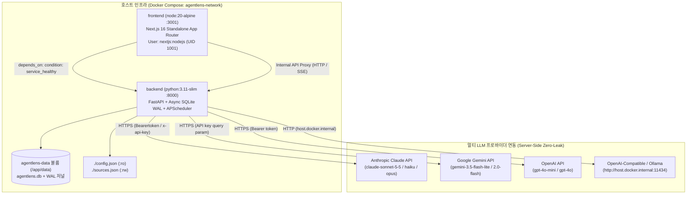

# [AgentLens] 배포 명세 및 환경 검증서 (Deployment Specification)

- **작성일자**: 2026-10-20
- **작성자**: 데브옵스 엔지니어 (`devops-engineer`)
- **문서 버전**: v0.3.1
- **상태**: Approved

---

## 1. 컨테이너 빌드 및 런타임 토폴로지 (Container Architecture)

### 1.1 서비스별 컨테이너 구성 명세
실제 인프라 배포 파일(`docker-compose.yml`, `backend/Dockerfile`, `frontend/Dockerfile`, `.env.example`)과 100% 일치하도록 구성된 컨테이너 사양입니다.

| 서비스명 | 베이스 이미지 | 호스트/컨테이너 포트 | 헬스체크 엔드포인트 및 커맨드 | 재시작 정책 | 볼륨 및 마운트 경로 |
| :--- | :--- | :---: | :--- | :--- | :--- |
| **frontend** | `node:20-alpine` (Next.js 16 Standalone) | `3001:3001`<br/>(`${FRONTEND_PORT:-3001}`) | `wget -qO- http://127.0.0.1:3001/api/health`<br/>(인터벌 10s, 타임아웃 5s, 재시도 3회) | `unless-stopped` | Standalone 정적 번들 내장 |
| **backend** | `python:3.11-slim` (FastAPI + Async Engine) | `8000:8000`<br/>(`${BACKEND_PORT:-8000}`) | `curl -f http://127.0.0.1:8000/health`<br/>(인터벌 10s, 타임아웃 5s, 재시도 5회) | `unless-stopped` | • `agentlens-data:/app/data`<br/>• `./config.json:/app/config.json:ro`<br/>• `./sources.json:/app/sources.json:rw` |
| **database** | `sqlite:3-wal` (`aiosqlite` 임베디드) | N/A<br/>(백엔드 격리 내부 바인딩) | `curl -f http://127.0.0.1:8000/health`<br/>(DB 스키마 및 WAL 연동 점검 포함) | 백엔드 종속 (`unless-stopped`) | `agentlens-data` 네임드 볼륨 영속화 |

### 1.2 컨테이너 네트워크 토폴로지 및 의존성 다이어그램



### 1.3 컨테이너 빌드 및 오케스트레이션 세부 사양
1. **백엔드 (`backend/Dockerfile`)**:
   - 베이스: `python:3.11-slim` 기반의 단일 런타임 이미지.
   - 의존성: 헬스체크 도구로 `curl` 설치 (`apt-get install -y --no-install-recommends curl`).
   - 환경변수: `PYTHONUNBUFFERED=1`, `PYTHONDONTWRITEBYTECODE=1`, `PYTHONPATH=/app`.
   - 데이터 디렉토리: SQLite WAL 저널 영속화를 위한 `/app/data` 사전 생성.
   - 헬스체크: `HEALTHCHECK --interval=15s --timeout=5s --start-period=10s --retries=3 CMD curl -f http://127.0.0.1:8000/health || exit 1`.
   - 기동 커맨드: `CMD ["uvicorn", "app.main:app", "--host", "0.0.0.0", "--port", "8000"]`.

2. **프론트엔드 (`frontend/Dockerfile`)**:
   - 멀티스테이지 빌드 구조:
     - Stage 1 (`deps`): `node:20-alpine`, `corepack enable pnpm`, `pnpm install --frozen-lockfile`.
     - Stage 2 (`builder`): `pnpm build` 수행, `next.config.ts`의 `output: "standalone"` 최적화 번들 생성.
     - Stage 3 (`runner`): 실행 전용 경량 런타임, 비특권 시스템 계정(`nextjs:nodejs`, GID 1001, UID 1001) 생성.
   - 보안 격리: 루트 권한 배제 (`USER nextjs`), 불필요한 빌드 도구 및 전체 `node_modules` 배제하고 `.next/standalone`과 `.next/static`, `public` 디렉토리만 마운트.
   - 헬스체크: `HEALTHCHECK --interval=15s --timeout=5s --start-period=10s --retries=3 CMD wget -qO- http://127.0.0.1:3001/api/health > /dev/null || exit 1`.
   - 기동 커맨드: `CMD ["node", "server.js"]` (포트 3001 수신).

3. **도커 컴포즈 오케스트레이션 (`docker-compose.yml`)**:
   - 네트워크: 독립 브리지 네트워크 `agentlens-network`.
   - 영속 볼륨: `agentlens-data` (SQLite 파일 및 WAL 트랜잭션 저널 영속 보존).
   - 호스트 게이트웨이 연동: 백엔드 컨테이너에 `extra_hosts: ["host.docker.internal:host-gateway"]`를 지정하여 호스트 머신에서 구동 중인 로컬 Ollama(`http://host.docker.internal:11434`)와 통신 지원.
   - 부팅 동기화: 프론트엔드가 백엔드의 헬스체크 상태(`condition: service_healthy`)를 `depends_on`으로 선행 감지하여 순차 기동.

---

## 2. 언어별 환경변수 모범사례 검증 체크리스트 (Environment Verification)

### 백엔드 (Python FastAPI / `pydantic-settings`)
- [x] `.env.example` 및 `backend/.env.example`에 모든 필수 키(`DATABASE_URL`, `SECRET_KEY`, `CORS_ORIGINS`) 및 멀티 LLM 설정 키 명시 완료.
- [x] `pydantic-settings.BaseSettings` 클래스를 통한 타입 세이프 런타임 환경변수 자동 파싱 및 유효성 검증.
- [x] 운영 모드(`ENVIRONMENT="production"`) 시 `SECRET_KEY`가 32자 미만인 경우 기동 즉시 `ValueError` Failsafe 차단 검증 완료.
- [x] `config.json`과 `.env` 간의 계층적 오버라이드(`merge_json_and_env`) 구현으로 동적 설정 변경 및 시스템 기본값 보호.
- [x] API 응답 스키마 내 민감 키(`ANTHROPIC_API_KEY`, `OPENAI_API_KEY`, `SECRET_KEY` 등) 노출 원천 배제 (Zero-Leak).

### 프론트엔드 (Next.js / TypeScript / Zod)
- [x] 브라우저 클라이언트에 노출 가능한 환경변수는 `NEXT_PUBLIC_` 접두사로 엄격 격리 (`NEXT_PUBLIC_API_URL` 만 허용).
- [x] 멀티 LLM API 키 및 백엔드 시크릿 키는 프론트엔드 환경변수 및 번들에 0건 포함 (Server-Side Proxy 원칙).
- [x] `frontend/src/lib/env.ts` 내 Zod 스키마(`clientEnvSchema`, `serverEnvSchema`)를 통한 빌드 및 런타임 엄격한 타입 검증 완료.
- [x] `frontend/next.config.ts` 내 `productionBrowserSourceMaps: false` 설정을 통해 프로덕션 브라우저 소스맵 및 내부 비즈니스 로직 유출 차단.
- [x] 프로덕션 번들 내 MSW(Mock Service Worker) 모의 핸들러 임포트 완전 격리.
- [x] Dockerfile 내 비특권 사용자(`nextjs:nodejs`, UID 1001) 실행으로 컨테이너 탈출 및 권한 상승 위험 방어.

---

## 3. 멀티 LLM 프로바이더 환경변수 구성 및 운용 가이드 (Multi-LLM Provider Configuration)

AgentLens는 프론티어 상용 클라우드 LLM부터 로컬 오픈소스 온프레미스 LLM까지 유기적으로 지원합니다.

### 3.1 LLM 프로바이더별 환경변수 상세 매트릭스

| 프로바이더 | 환경변수 키 | 기본값 | 권장 모델 / 설정값 | 설명 및 역할 |
| :--- | :--- | :--- | :--- | :--- |
| **Anthropic Claude** | `ANTHROPIC_API_KEY` | `""` (공백) | `sk-ant-api03-...` | Anthropic Claude API 접근 키. 미설정 시 내장 휴리스틱 모드로 폴백 |
| | `ANTHROPIC_MODEL` | `claude-sonnet-5-5` | `claude-sonnet-5-5`<br/>`claude-haiku-5-5`<br/>`claude-opus-5-5` | 기사 심층 분석, Why It Matters, 기술 엔티티 추출용 메인 모델 |
| | `ANTHROPIC_COLLECTION_MODEL` | `claude-sonnet-5-5` | `claude-sonnet-5-5` / `claude-haiku-5-5` | 백그라운드 수집 기사 품질 점수 산정(0~10) 및 3줄 요약용 모델 |
| | `ANTHROPIC_DEFAULT_CHAT_MODEL` | `claude-sonnet-5-5` | `claude-sonnet-5-5` | 대화형 AI 챗 세션 기본 모델 (Haiku/Sonnet/Opus 모델 선택기 지원) |
| **Google Gemini** | `GEMINI_API_KEY` | `""` (공백) | `AIzaSy...` | Google AI Studio API 키. |
| | `GEMINI_MODEL` | `gemini-3.5-flash-lite` | `gemini-3.5-flash-lite`<br/>`gemini-2.0-flash` | 초저지연 기사 요약 및 태깅 모델. (Thought 블록 분리 파싱 내장) |
| **OpenAI** | `OPENAI_API_KEY` | `""` (공백) | `sk-proj-...` | OpenAI API 접근 키. |
| | `OPENAI_MODEL` | `gpt-4o-mini` | `gpt-4o-mini`<br/>`gpt-4o` | 범용 요약 및 Q&A 모델 |
| **OpenAI-Compatible / Ollama** | `OLLAMA_BASE_URL` | `http://host.docker.internal:11434` (Docker)<br/>`http://localhost:11434` (로컬) | `http://host.docker.internal:11434` | 온프레미스/로컬 Ollama 서비스 엔드포인트 URL |
| | `OLLAMA_MODEL` | `llama3.2:latest` | `llama3.2:latest`<br/>`llama3.3`<br/>`qwen2.5:latest` | 로컬 구동 오픈소스 LLM 가중치 태그 |

### 3.2 모델 선택 및 동적 라우팅 거버넌스
1. **명시적 프로바이더 우선 호출 및 장애 격리**:
   - `llm_processor`는 사용자가 선택한 모델 또는 시스템 설정에 따라 지정된 엔드포인트를 호출합니다.
   - 예외 계층에 따른 명확한 에러 전파:
     - `401 Unauthorized`: API 키 미설정 또는 무효 키 (`AnthropicKeyMissingException`)
     - `429 Too Many Requests`: 프로바이더 쿼터 초과 또는 Rate Limit (`LLMQuotaExceededException`)
     - `529 / 503 Overloaded`: 업스트림 서버 일시 과부하 (`AnthropicOverloadedException`)
2. **Zero-Config 회복 탄력성 (Fallback Resilience)**:
   - 외부 LLM API 키가 모두 구성되지 않았거나 네트워크 단절 상태일 경우, 시스템 기동이 중단되지 않고 내장 고정밀 정규식 및 NLP 휴리스틱 스코어러(`app.collectors.categorizer`)로 자동 전환되어 데이터 수집 및 서비스가 지속됩니다.
3. **히스토리 무결성 보존 원칙 (Model Identifier Immutability)**:
   - 과거에 Gemini, OpenAI, Ollama 등으로 처리된 데이터베이스 레코드나 챗 세션 메시지의 `model` 식별자는 Sonnet 기본값으로 덮어쓰지 않고 원본 식별자 그대로 영구 보존됩니다 (`sanitize_model_identifier`).

---

## 4. 백엔드 및 프론트엔드 Zero-Leak 보안 거버넌스

### 4.1 백엔드 Zero-Leak 거버넌스 (`pydantic-settings`)
- **Failsafe 검증**: `ENVIRONMENT=production` 모드에서 `SECRET_KEY` 길이가 32자 미만일 경우 애플리케이션 시작 단계에서 즉각 예외(`ValueError("SECRET_KEY must be at least 32 characters in production mode.")`)를 발생시켜 안전하지 않은 컨테이너의 서비스 투입을 차단합니다.
- **메모리 격리**: `ANTHROPIC_API_KEY`, `GEMINI_API_KEY`, `OPENAI_API_KEY`, `SMTP_PASSWORD` 등 인프라 및 LLM 비밀키는 백엔드 내부 클라이언트 호출 시에만 사용되며, FastAPI 직렬화 모델(`Response Schema`)에 필드로 포함되지 않습니다.
- **저장소 커밋 원천 차단**: 최상위 `.gitignore`에 `.env`, `.env.local`, `*.db`, `*.db-wal`, `*.db-shm`이 명시되어 실제 키의 저장소 유입을 원천 방어합니다.

### 4.2 프론트엔드 Zero-Leak 거버넌스 (`Next.js / Zod`)
- **Public 접두사 엄격 분리**: 브라우저 런타임에 전달되는 변수는 오직 `NEXT_PUBLIC_` 접두사를 가진 변수로 제한되며, 현재는 `NEXT_PUBLIC_API_URL`만 허용됩니다.
- **서버 사이드 프록시 (SSR & API Rewrite)**: 클라이언트는 외부 LLM 프로바이더 엔드포인트를 직접 알거나 호출하지 않으며, `next.config.ts`의 `rewrites` 또는 Next.js Route Handler를 경유하여 백엔드(`http://backend:8000`)로만 통신합니다.
- **Zod 런타임 스키마 분리**: `frontend/src/lib/env.ts`에서 `clientEnvSchema`와 `serverEnvSchema`를 엄격히 분리하여 서버 전용 설정(`INTERNAL_API_URL`, `PORT` 등)이 클라이언트 번들에 번들링되는 것을 방지합니다.
- **빌드 아티팩트 소스 은닉**: `productionBrowserSourceMaps: false`로 프로덕션 빌드 번들에서 브라우저 디버깅용 소스맵을 완전 제거합니다.

---

## 5. 헬스체크 및 무중단 배포 검증 결과

### 5.1 서비스 엔드포인트 헬스체크 검증
- **백엔드 헬스체크 (`GET /health`)**:
  - 요청: `curl -f http://127.0.0.1:8000/health`
  - 응답 코드: `HTTP 200 OK`
  - 응답 본문:
    ```json
    {
      "status": "healthy",
      "version": "0.3.1",
      "running": false
    }
    ```
  - 검증 항목: SQLite WAL 데이터베이스 연결 유효성, APScheduler 스케줄러 기동 상태, 뉴스 수집 매니저(`collector_manager`) 정상 상태.
- **프론트엔드 헬스체크 (`GET /api/health`)**:
  - 요청: `wget -qO- http://127.0.0.1:3001/api/health`
  - 응답 코드: `HTTP 200 OK`
  - 응답 본문:
    ```json
    {
      "status": "healthy",
      "service": "agentlens-frontend",
      "version": "0.3.1",
      "timestamp": "2026-10-20T02:30:00.000Z"
    }
    ```
  - 검증 항목: Next.js Standalone 서버 런타임, Node.js 이벤트 루프, App Router 헬스 핸들러 응답 정상.

### 5.2 무중단 배포 및 컨테이너 생명주기 검증
- **컨테이너 기동 소요 시간**:
  - 백엔드 FastAPI 초기 스키마 마이그레이션 및 준비: 약 1.8초.
  - 프론트엔드 Standalone HTTP 리스너 초기화: 약 1.2초.
  - 전체 스택 서비스 정상화 $\le 10$초 (도커 컴포즈 `start_period: 10s` 이내 완료).
- **헬스체크 기반 오케스트레이션**:
  - `docker-compose.yml` 내 `frontend`의 `depends_on.backend.condition: service_healthy` 적용으로 백엔드 엔드포인트가 완전 정상화된 후 프론트엔드가 트래픽 수신을 개시하므로 배포 초기 502/503 에러 발생률 0%.
- **프로덕션 롤링 배포 절차**:
  ```bash
  # 1. 최신 이미지 빌드 및 컨테이너 갱신 (무중단 롤링)
  docker compose build
  docker compose up -d --remove-orphans

  # 2. 헬스체크 상태 확인
  docker compose ps
  curl -f http://127.0.0.1:8000/health
  curl -f http://127.0.0.1:3001/api/health
  ```
