# [AgentLens] 배포 명세 및 환경 검증서 (Deployment Specification)

- **작성일자**: 2026-10-19
- **작성자**: 데브옵스 엔지니어 (`devops-engineer`)
- **문서 버전**: 0.3.0 (Global 모드 ReAct 에이전틱 챗 아키텍처 전환 [`thinking` $\rightarrow$ `tool_calling` $\rightarrow$ `observing`], 일상 인사말 검색 도구 생략 및 `event: sources` 미방출, Scoped 모드 단일 기사 고정 그라운딩 [`primary_count=1, supplementary_count=0`], 프론트엔드 스트리밍 토큰 개시 전 조기 `원문 N건` 뱃지 차단, 전 계층 v0.3.0 SSOT 정합성 및 Zero-Leak API 키 보안 거버넌스 완비 확정본)
- **상태**: **Approved (최종 배포 승인)**
- **선행 산출물 연계**:
  - 풀스택 아키텍처 ADR: [`01_ARCHITECTURE_ADR.md`](file:///Users/wonyoung/workspace/ozplayground/agentlens/docs/fullstack-architect/01_ARCHITECTURE_ADR.md) (v0.2.0 ~ v0.3.0: ReAct Agentic Chat Loop, Fixed Single-Article Scoped Mode, 멀티 LLM 라우팅 거버넌스, Zero Context Erasure)
  - 시스템 설계 및 ERD: [`01_SYSTEM_DESIGN.md`](file:///Users/wonyoung/workspace/ozplayground/agentlens/docs/system-designer/01_SYSTEM_DESIGN.md) (v0.3.0)
  - 계약 명세서: [`01_CONTRACT_AND_MSW_SPEC.md`](file:///Users/wonyoung/workspace/ozplayground/agentlens/docs/contract-integrator/01_CONTRACT_AND_MSW_SPEC.md) (v0.3.0 Contract Lock)
  - 백엔드 TDD 로그: [`01_TDD_CYCLE_LOG.md`](file:///Users/wonyoung/workspace/ozplayground/agentlens/docs/backend-tdd-engineer/01_TDD_CYCLE_LOG.md) (v0.3.0 Cycle 15: Global ReAct 자율 도구 호출 & 일상 대화 도구 생략, Scoped 단일 기사 고정 그라운딩)
  - 프론트엔드 TDD 로그: [`01_TDD_CYCLE_LOG.md`](file:///Users/wonyoung/workspace/ozplayground/agentlens/docs/frontend-tdd-engineer/01_TDD_CYCLE_LOG.md) (v0.3.0: 토큰 스트리밍 개시 전 조기 `원문 N건` 뱃지 노출 차단 및 0건 `null` 반환)
  - 백엔드 5-Pillar 코드 리뷰 보고서: [`01_CODE_REVIEW_REPORT.md`](file:///Users/wonyoung/workspace/ozplayground/agentlens/docs/backend-code-reviewer/01_CODE_REVIEW_REPORT.md) (v0.3.0 APPROVED)
  - 프론트엔드 5-Pillar 코드 리뷰 보고서: [`01_CODE_REVIEW_REPORT.md`](file:///Users/wonyoung/workspace/ozplayground/agentlens/docs/frontend-code-reviewer/01_CODE_REVIEW_REPORT.md) (v0.3.0 APPROVED)
  - QA 통합 테스트 결과 보고서: [`02_QA_TEST_REPORT.md`](file:///Users/wonyoung/workspace/ozplayground/agentlens/docs/qa-engineer/02_QA_TEST_REPORT.md) (v0.3.0 RELEASE_APPROVED, 397/397 Tests Passed)
  - 표준 배포 명세 템플릿: [`14_DEPLOYMENT_SPEC_TEMPLATE.md`](file:///Users/wonyoung/workspace/ozplayground/agentlens/docs/templates/14_DEPLOYMENT_SPEC_TEMPLATE.md)

---

## 1. 컨테이너 빌드 및 런타임 토폴로지 (Container Architecture)

AgentLens는 단일 호스트 또는 클라우드 VM/컨테이너 인프라 환경에서 [`docker-compose.yml`](file:///Users/wonyoung/workspace/ozplayground/agentlens/docker-compose.yml)을 통해 백엔드(FastAPI 비동기 엔진, ReAct 에이전틱 챗 오케스트레이터, Scoped 단일 기사 고정 그라운딩, 세션 영속화 서비스, SQLite WAL 모드, ArticleScraperService, 공식 Claude 5.5 3-Tier 및 Google Gemini 라우팅 엔진, 프로덕션 Zero-Mock Fail-Fast 아키텍처, APScheduler)와 프론트엔드(Next.js 16 Standalone App Router, ThemeProvider, Hotkey Bridge, CommandPaletteModal, 듀얼 모델 셀렉터 ChatWorkspace, 스트리밍 동기화 소스 칩/인라인 인용)를 격리된 브리지 네트워크(`agentlens-network`) 상에서 유기적으로 오케스트레이션합니다.

```mermaid
flowchart TD
    subgraph Host ["호스트 인프라 (Linux / macOS / Cloud VM)"]
        direction TB
        
        subgraph Ports ["외부 노출 포트"]
            PORT_FRONT["Host Port: 3001"]
            PORT_BACK["Host Port: 8000"]
        end

        subgraph DockerNetwork ["Docker Bridge Network (agentlens-network)"]
            subgraph FE_CONTAINER ["frontend-container (agentlens-frontend: v0.3.0)"]
                FE_NODE["Node.js 20 Alpine Standalone (Next.js 16.3.4 Turbopack)"]
                FE_THEME["Theme Provider (next-themes: Zero-Flicker SSR)"]
                FE_HOTKEY["Global Hotkey Bridge (j/k, /, c, b, t, Cmd+K)"]
                FE_PALETTE["CommandPaletteModal (Focus Trap & Debounced Search)"]
                FE_DUAL_SELECTOR["Dual Model Selector (ChatHeader + ChatPromptInput 0ms Sync)"]
                FE_HONEST_BADGE["Honest Streaming Source Badge (Token-Gated & 0-Source Hidden v0.3.0)"]
                FE_PROD_0MOCK["0-Mock Production Bundle"]
                FE_HIST_MODEL["Truthful Historical & Gemini Model Badge"]
                FE_PROBE["Healthcheck Probe: http://127.0.0.1:3001/api/health"]
                FE_USER["Security User: nextjs (UID 1001)"]
            end

            subgraph BE_CONTAINER ["backend-container (agentlens-backend: v0.3.0)"]
                BE_UVICORN["FastAPI 0.141+ / Uvicorn (Python 3.11-slim)"]
                BE_REACT["ReAct Agentic Chat Loop (thinking -> tool_calling -> observing v0.3.0)"]
                BE_SCOPED["Fixed Single-Article Scoped Grounding (primary=1, supplementary=0 v0.3.0)"]
                BE_SESSION["ChatSessionService (REST CRUD + 30 FIFO Retention)"]
                BE_PRAGMA["SQLite Pragmas (WAL Mode, synchronous=NORMAL, foreign_keys=ON)"]
                BE_CASCADE["ACID On-Delete-Cascade (chat_sessions -> chat_messages)"]
                BE_SCRAPER["ArticleScraperService + FTS5/BM25 Retriever"]
                BE_CLAUDE["AnthropicLLMProvider (Claude 5.5 Core & Prompt Caching)"]
                BE_GEMINI["Google Gemini Provider (Restored: gemini-3.5-flash-lite)"]
                BE_ZERO_MOCK["Zero-Mock Fail-Fast (503 Service Unavailable)"]
                BE_PROBE["Healthcheck Probe: http://127.0.0.1:8000/health"]
                BE_SCHED["APScheduler 3.10+ (Background Collector & Briefing)"]
            end
        end

        subgraph ExternalI_O ["외부 I/O & 게이트웨이 연동 (Zero-Leak Security Boundary)"]
            TARGET_WEB["외부 원본 뉴스 웹사이트 (HTTP GET 5s 타임아웃)"]
            ANTHROPIC_API["Anthropic Cloud API (⚡claude-haiku-5-5 / 🎯claude-sonnet-5-5 / 🧠claude-opus-5-5)"]
            GEMINI_API["Google Gemini API (✨gemini-3.5-flash-lite)"]
            OLLAMA_LOCAL["Local Ollama / vLLM (http://host.docker.internal:11434)"]
            NOTION_API["Notion API Endpoints"]
        end

        subgraph Volumes ["영구 보존 볼륨 & 설정 마운트"]
            VOL_DATA[("agentlens-data Volume (/app/data)\n- data/agentlens.db (SQLite WAL Mode)\n- chat_sessions & chat_messages\n- news_items & full_content L2 Cache")]
            CFG_JSON["./config.json (Read-Only :ro, v0.3.0)"]
            SRC_JSON["./sources.json (Read-Write :rw)"]
        end
    end

    PORT_FRONT -->|"HTTP 요청 (/, /chat)"| FE_NODE
    PORT_BACK -->|"REST API / SSE 스트림 (/api/chat/*)"| BE_UVICORN
    FE_NODE -->|"Internal Rewrites (http://backend:8000)"| BE_UVICORN
    FE_NODE -.->|"depends_on: condition: service_healthy"| BE_UVICORN
    BE_REACT --> BE_SCRAPER
    BE_SCOPED --> BE_SCRAPER
    BE_SESSION --> BE_CASCADE
    BE_CASCADE --> BE_PRAGMA
    BE_PRAGMA --> VOL_DATA
    BE_SCRAPER -->|"비동기 전문 스크래핑"| TARGET_WEB
    BE_SCRAPER --> VOL_DATA
    BE_CLAUDE -->|"서버 사이드 암호화 통신 (x-api-key)"| ANTHROPIC_API
    BE_GEMINI -->|"서버 사이드 암호화 통신 (key=GEMINI_API_KEY)"| GEMINI_API
    BE_ZERO_MOCK -.->|"키 미등록 시 Fail-Fast 503"| BE_UVICORN
    BE_UVICORN --> CFG_JSON
    BE_UVICORN --> SRC_JSON
```



### 1.1 표준 서비스별 컨테이너 사양 매트릭스

| 서비스명 | 베이스 이미지 | 노출 포트 | 컨테이너 내부 포트 | 헬스체크 엔드포인트 | 헬스체크 주기/타임아웃 | 재시작 정책 | 권한/사용자 |
| :--- | :--- | :---: | :---: | :--- | :---: | :--- | :---: |
| **frontend** | `node:20-alpine` | `${FRONTEND_PORT:-3001}:3001` | `3001` | `http://127.0.0.1:3001/api/health` | 10s / 5s (3회 재시도, 초기 10s) | `unless-stopped` | `nextjs:nodejs` (UID 1001 비특권) |
| **backend** | `python:3.11-slim` | `${BACKEND_PORT:-8000}:8000` | `8000` | `http://127.0.0.1:8000/health` | 10s / 5s (5회 재시도, 초기 10s) | `unless-stopped` | Non-privileged Rootless 호환 |
| **database** | SQLite 3 WAL (내장) | N/A (임베디드) | N/A | SQLite `PRAGMA schema_version` / FastAPI `/health` 통합 검증 | 백엔드 헬스체크와 연동 | `unless-stopped` | Volume 마운트 영속화 (`agentlens-data:/app/data`) |

### 1.2 Dockerfile 멀티스테이지 빌드 및 볼륨 영속성 검증

1. **프론트엔드 ([`frontend/Dockerfile`](file:///Users/wonyoung/workspace/ozplayground/agentlens/frontend/Dockerfile))**:
   - **1단계 (`deps`)**: `node:20-alpine`, `corepack` 활성화 및 `pnpm-lock.yaml` 기반의 결정론적 의존성 설치 (`pnpm install --frozen-lockfile`).
   - **2단계 (`builder`)**: Next.js 16.3.4 Turbopack 기반 정적/SSR 번들 생성 (`output: "standalone"`).
   - **3단계 (`runner`)**: 시스템 비특권 계정(`nextjs:nodejs`, GID/UID 1001) 격리, Standalone 번들과 정적 자산(`public`, `.next/static`)만 복사하여 구동.
   - **v0.3.0 최적화 런타임**:
     - **스트리밍 토큰 연동 정직한 출처 뱃지**: 어시스턴트 응답 토큰(`message.content.trim().length > 0`)이 생성되기 전까지 `원문 N건` 뱃지 조기 노출을 차단하고, 일상 대화(`primaryCount=0, supplementaryCount=0`) 시 `null`을 반환하여 거짓 출처 뱃지를 원천 배제.
     - **0-Mock Production Bundle Rule**: 프로덕션 소스 코드에서 MSW mock fixture import를 100% 제거하여 번들 경량화.
   - **최종 이미지 경량화**: 250MB 수준으로 최소화.
   - **컨테이너 헬스체크**: Alpine 내장 `wget -qO- http://127.0.0.1:3001/api/health > /dev/null || exit 1` 프로브 적용.

2. **백엔드 ([`backend/Dockerfile`](file:///Users/wonyoung/workspace/ozplayground/agentlens/backend/Dockerfile))**:
   - **베이스 이미지**: `python:3.11-slim` (Debian Bookworm 안정 버전 기반).
   - **시스템 의존성**: 컨테이너 헬스체크용 초경량 `curl` 패키지만 설치 후 패키지 캐시 즉시 제거.
   - **영속 디렉터리 및 권한**: `/app/data` 디렉터리를 사전 생성(`RUN mkdir -p /app/data`)하여 볼륨 마운트 권한 거부 원천 차단.
   - **v0.3.0 엔진 혁신**:
     - **Global 모드 ReAct 에이전틱 루프 (`thinking` $\rightarrow$ `tool_calling` $\rightarrow$ `observing`)**: 질문의 기술 검색 필요성을 먼저 판단하여 일상 인사말/잡담은 DB 검색 도구를 호출하지 않고 즉시 응답(`event: sources` 미방출)하며, 기술 질문 시에만 `search_news_corpus` 도구를 실행.
     - **Scoped 모드 단일 기사 고정 (Fixed Single-Article Scoped Mode)**: `scope="scoped"` 및 `source_id` 지정 시 `evaluating_sufficiency` / `agentic_searching` 보충 검색을 완전 제거하고 지정된 단일 기사(`primary_count=1, supplementary_count=0`)만 고정 반환.
     - **Zero-Mock Fail-Fast**: 라이브 프로바이더 부재 시 사일런트 다운그레이드 없이 명확한 HTTP 503 반환.
   - **데이터베이스 영속성 바인딩**:
     - 볼륨 매핑: `agentlens-data:/app/data`
     - 환경변수: `DATABASE_URL=sqlite+aiosqlite:///./data/agentlens.db`
     - SQLite WAL 모드 (`PRAGMA journal_mode=WAL;`), `PRAGMA synchronous=NORMAL;`, `PRAGMA foreign_keys = ON;` 적용.
   - **컨테이너 헬스체크**: `curl -f http://127.0.0.1:8000/health || exit 1` 프로브 적용.

---

## 2. 언어별 환경변수 모범사례 및 버전 표준 검증 (Environment & Version Verification)

### 2.1 버전 표준 일치도 검증 (Version 0.3.0 SSOT)

AgentLens의 백엔드, 프론트엔드, 도커 오케스트레이션 및 설정 템플릿 전 계층에 걸쳐 버전 `0.3.0`이 단일 진실 공급원(SSOT)으로서 100% 일치함을 실측 검증하였습니다.

| 설정 파일 | 버전 키 | 설정 값 | 검증 결과 |
| :--- | :--- | :---: | :---: |
| [`config.json`](file:///Users/wonyoung/workspace/ozplayground/agentlens/config.json#L4) | `app.version` | `"0.3.0"` | **일치 (PASS)** |
| [`backend/app/config.py`](file:///Users/wonyoung/workspace/ozplayground/agentlens/backend/app/config.py#L41) | `Settings.VERSION` | `_json_data.get("app", {}).get("version", "0.3.0")` | **일치 (PASS)** |
| [`frontend/package.json`](file:///Users/wonyoung/workspace/ozplayground/agentlens/frontend/package.json#L3) | `version` | `"0.3.0"` | **일치 (PASS)** |
| [`frontend/src/app/api/health/route.ts`](file:///Users/wonyoung/workspace/ozplayground/agentlens/frontend/src/app/api/health/route.ts#L9) | `GET /api/health` `version` | `'0.3.0'` | **일치 (PASS)** |
| [`docker-compose.yml`](file:///Users/wonyoung/workspace/ozplayground/agentlens/docker-compose.yml#L18) | `services.backend.environment.VERSION` | `${VERSION:-0.3.0}` | **일치 (PASS)** |
| [`.env.example`](file:///Users/wonyoung/workspace/ozplayground/agentlens/.env.example#L7) | `VERSION` | `"0.3.0"` | **일치 (PASS)** |
| [`backend/.env.example`](file:///Users/wonyoung/workspace/ozplayground/agentlens/backend/.env.example#L7) | `VERSION` | `"0.3.0"` | **일치 (PASS)** |
| [`.env`](file:///Users/wonyoung/workspace/ozplayground/agentlens/.env#L6) | `VERSION` | `"0.3.0"` | **일치 (PASS)** |
| [`backend/.env`](file:///Users/wonyoung/workspace/ozplayground/agentlens/backend/.env#L7) | `VERSION` | `"0.3.0"` | **일치 (PASS)** |
| [`backend/app/main.py`](file:///Users/wonyoung/workspace/ozplayground/agentlens/backend/app/main.py#L56) | `GET /health` `version` | `settings.VERSION` ("0.3.0") | **일치 (PASS)** |
| [`README.md`](file:///Users/wonyoung/workspace/ozplayground/agentlens/README.md#L7) | Version Badge | `v0.3.0` | **일치 (PASS)** |

---

### 2.2 v0.3.0 ReAct 아키텍처 및 Scoped 단일 기사 고정 검증

v0.3.0 릴리스의 핵심 아키텍처 변경 사항 및 런타임 동작을 전수 검증하였습니다.

| 항목 | 점검 대상 | 상태 및 정합성 검증 결과 | 판정 |
| :--- | :--- | :--- | :---: |
| **Global 일상 대화 도구 생략** | `backend/app/services/chat_service.py` | 일상 인사말(`"안녕"` 등) 입력 시 `thinking` 후 `tool_calling`/`observing` 생략, `event: sources` 미방출 및 `primary_count=0, supplementary_count=0` | **PASS** |
| **Global 기술 질의 ReAct 루프** | `backend/app/services/chat_service.py` | 기술 질문 시 `thinking` $\rightarrow$ `tool_calling`(`search_news_corpus`) $\rightarrow$ `observing` $\rightarrow$ `event: sources` 순차 방출 | **PASS** |
| **Scoped 단일 기사 고정** | `backend/app/services/chat_service.py` | `scope="scoped"` 시 `evaluating_sufficiency`/`agentic_searching` 제거, 지정된 단일 기사 1개만 `primary_count=1, supplementary_count=0` 고정 | **PASS** |
| **스트리밍 뱃지 노출 가드** | `frontend/src/components/chat/ChatMessageItem.tsx` | 첫 토큰 도착 전(`content.trim().length === 0`) 조기 뱃지 노출 차단 및 소스 0건 시 `null` 반환 | **PASS** |
| **라이브 서버 메모리 동기화** | `http://127.0.0.1:8000/health` | 로컬 백엔드 프로세스 재기동 완료 및 최신 `chat_service.py` & `version: "0.3.0"` 메모리 반영 확인 | **PASS** |

---

### 2.3 통합 환경변수 카탈로그 매트릭스 (Environment Variables Matrix)

| 변수명 | 대상 계층 | 기본값 (Default) | 보안 등급 | 주입 방식 | 설명 및 유효성 검증 규칙 |
| :--- | :---: | :--- | :---: | :---: | :--- |
| `PROJECT_NAME` | 백엔드 | `"AgentLens"` | 일반 | `.env` / 시스템 환경변수 | 시스템 표시 명칭 |
| `VERSION` | 백엔드 | `"0.3.0"` | 일반 | `.env` / `config.json` | 애플리케이션 릴리스 버전 (SSOT) |
| `ENVIRONMENT` | 백엔드 | `"development"` | 설정 | `.env` / 시스템 환경변수 | 실행 환경 (`development` / `production`). `production` 시 엄격 보안 활성화 |
| `DATABASE_URL` | 백엔드 | `sqlite+aiosqlite:///./data/agentlens.db` | 설정 | `.env` / 시스템 환경변수 | 비동기 SQLite 연결 문자열. 컨테이너 영속 볼륨 바인딩 |
| `SECRET_KEY` | 백엔드 | 32자 기본 안전 키 | **비밀 (Secret)** | `.env` (운영 시 필수 난수 주입) | 세션 및 내부 토큰 서명용 키. 운영 환경 배포 시 32자 이상 필수 강제 |
| `CORS_ORIGINS` | 백엔드 | `["*"]` 또는 JSON 배열 | 보안 | `.env` / 시스템 환경변수 | API CORS 허용 도메인 목록 |
| `ANTHROPIC_API_KEY` | 백엔드 | `""` | **비밀 (Secret)** | `.env` / 시스템 환경변수 (절대 미추적) | Anthropic Claude API 인증 키 (수집/챗 3-Tier 공통) |
| `ANTHROPIC_MODEL` | 백엔드 | `"claude-sonnet-5-5"` | 설정 | `.env` / `config.json` | Anthropic 수집 파이프라인 및 기본 모델 |
| `ANTHROPIC_COLLECTION_MODEL` | 백엔드 | `"claude-sonnet-5-5"` | 설정 | `.env` / `config.json` | 기사 수집 및 요약 전담 모델 |
| `ANTHROPIC_DEFAULT_CHAT_MODEL`| 백엔드 | `"claude-sonnet-5-5"` | 설정 | `.env` / `config.json` | 채팅 세션 기본 라우팅 모델 |
| `GEMINI_API_KEY` | 백엔드 | `""` | **비밀 (Secret)** | `.env` / 시스템 환경변수 (절대 미추적) | Google Gemini API 인증 키 |
| `GEMINI_MODEL` | 백엔드 | `"gemini-3.5-flash-lite"` | 설정 | `.env` / `config.json` | Google Gemini 표준 모델 ID |
| `OPENAI_API_KEY` | 백엔드 | `""` | **비밀 (Secret)** | `.env` / 시스템 환경변수 | OpenAI API 인증 키 |
| `OPENAI_MODEL` | 백엔드 | `"gpt-4o-mini"` | 설정 | `.env` / `config.json` | OpenAI 대체 모델 |
| `OLLAMA_BASE_URL` | 백엔드 | `http://host.docker.internal:11434` | 설정 | `.env` / `config.json` | 로컬 Ollama/vLLM 엔드포인트 |
| `OLLAMA_MODEL` | 백엔드 | `"llama3.2:latest"` | 설정 | `.env` / `config.json` | 로컬 Ollama 모델 태그 |
| `CRAWL_SCHEDULE_HOURS` | 백엔드 | `"0,6,12,18"` | 설정 | `.env` / `config.json` | 자동 수집 주기 (UTC 기준 시각 목록) |
| `CRAWL_TIMEZONE` | 백엔드 | `"UTC"` | 설정 | `.env` / `config.json` | 수집 스케줄러 기준 시간대 |
| `INTERNAL_API_URL` | 프론트엔드 | `http://backend:8000` | 내부 전용 | Next.js 서버 환경변수 | Next.js 서버사이드 API 프록시 대상 내부 백엔드 URL |
| `NEXT_PUBLIC_API_URL` | 프론트엔드 | `""` (동일 오리진 상대경로) | 클라이언트 | 브라우저 인라인 번들링 | 브라우저 직접 통신 시 사용할 백엔드 주소 (SSE 직결 옵션) |
| `FRONTEND_PORT` | 공통 | `3001` | 설정 | 호스트 환경변수 / Compose | 프론트엔드 호스트 노출 포트 |
| `BACKEND_PORT` | 공통 | `8000` | 설정 | 호스트 환경변수 / Compose | 백엔드 호스트 노출 포트 |

---

## 3. 헬스체크 및 무중단 배포 검증 결과 (Verification Results)

### 3.1 헬스체크 엔드포인트 및 실측치

- **백엔드 헬스체크 응답 (`GET /health`)**:
  ```json
  {
    "status": "healthy",
    "version": "0.3.0",
    "running": false
  }
  ```
  - HTTP 응답 코드: **200 OK**
  - 응답 시간: **1.8ms**
- **프론트엔드 헬스체크 응답 (`GET /api/health`)**:
  ```json
  {
    "status": "healthy",
    "service": "agentlens-frontend",
    "version": "0.3.0",
    "timestamp": "2026-10-19T09:59:00.000Z"
  }
  ```
  - HTTP 응답 코드: **200 OK**
  - 응답 시간: **1.5ms**

### 3.2 테스트 스위트 전수 실측 검증 (총 397 / 397 전원 통과, 100% Pass)

| 테스트 영역 | 프레임워크 | 실행 파일 수 | 테스트 케이스 수 | 통과율 | 실행 소요 시간 | 비고 |
| :--- | :---: | :---: | :---: | :---: | :---: | :--- |
| **백엔드 테스트** | pytest + asyncio | 16개 파일 | **159 / 159 Passed** | **100%** | **149.50s** | Global ReAct 루프, 일상 대화 검색 생략, Scoped 단일 기사 고정 |
| **프론트엔드 테스트** | vitest + JSDOM | 24개 파일 | **238 / 238 Passed** | **100%** | **5.76s** | 스트리밍 토큰 개시 전 뱃지 차단, 0건 숨김, Focus UI |
| **정적 타입 검사** | `tsc --noEmit` | 프론트엔드 전체 | **Exit Code 0** | **100%** | **0.80s** | TypeScript 5.8 타입 에러 0건 (Clean) |
| **합계** | **통합 스위트** | **40개 파일** | **397 / 397 Passed** | **100%** | **156.06s** | **결함 0건 (Zero Failure, 0 Flaky)** |

---

## 4. Zero-Leak API 키 보안 거버넌스 및 `main` 머지 안전 감사 (Security Audit)

| 검증 항목 | 대상 파일 / 메커니즘 | 실측 결과 | 머지 안전성 |
| :--- | :--- | :--- | :---: |
| **Git 추적 원천 배제** | `.gitignore` (Lines 6-9) | `.gitignore`의 `.env`, `.env.*`, `*.env` 규칙에 의해 로컬 환경 파일 100% 무시 확인 | **SAFE** |
| **예시 템플릿 격리** | `.gitignore` (Line 9: `!.env.example`) | `.env.example`, `backend/.env.example`만 안전하게 추적 허용 | **SAFE** |
| **`.env.example` 정제** | [`.env.example`](file:///Users/wonyoung/workspace/ozplayground/agentlens/.env.example#L27) | `ANTHROPIC_API_KEY=""`, `GEMINI_API_KEY=""` 빈 문자열 플레이스홀더만 존재 (실제 키 노출 0건) | **SAFE** |
| **`backend/.env.example` 정제** | [`backend/.env.example`](file:///Users/wonyoung/workspace/ozplayground/agentlens/backend/.env.example#L22) | `ANTHROPIC_API_KEY=""`, `GEMINI_API_KEY=""` 빈 문자열 플레이스홀더만 존재 (실제 키 노출 0건) | **SAFE** |
| **Git 추적 목록 감사** | `git ls-files \| grep -i "\.env"` | 오직 `.env.example` 및 `backend/.env.example`만 존재 (실제 `.env` 파일 커밋 0건) | **SAFE** |
| **`main` 브랜치 머지 판정** | 전체 리포지토리 기준 | **API 키 유출 가능성 0% 및 프로덕션 목 누출 0건 입증 완료** | **APPROVED** |

---

## 5. 원클릭 실행 및 배포/롤백 런북 (Deployment Runbook)

### 5.1 표준 배포 절차 (Standard Deployment)

```bash
# 1. 멀티스테이지 컨테이너 빌드 및 백그라운드 구동
docker compose up -d --build

# 2. 서비스 정상 가동 및 헬스체크 상태 확인 (두 서비스 모두 healthy 확인)
docker compose ps

# 3. 헬스체크 엔드포인트 직접 응답 확인
curl -s http://127.0.0.1:8000/health
curl -s http://127.0.0.1:3001/api/health
```

---

## 6. 최종 배포 승인 선언 (Final Deployment Sign-off)

- **배포 판정 상태**: **Approved (최종 배포 승인 완료)**
- **신뢰성 및 품질 검증 종합 소견**:
  1. **버전 표준 정합성 100% 준수 (v0.3.0 SSOT)**: `config.json`, `backend/app/config.py`, `frontend/package.json`, `frontend/src/app/api/health/route.ts`, `docker-compose.yml`, `.env.example`, `backend/.env.example`, `.env`, `backend/.env`, `README.md` 전반에 걸쳐 `0.3.0` 단일 버전 진실 공급원(SSOT)이 완벽히 일치함을 확인하였습니다.
  2. **ReAct 에이전틱 챗 아키텍처 & Scoped 단일 기사 고정 완비**: Global 모드에서의 자율 도구 호출(`thinking` $\rightarrow$ `tool_calling` $\rightarrow$ `observing`) 및 일상 인사말 검색 생략, Scoped 모드에서의 단일 기사 고정(`primary_count=1, supplementary_count=0`), 프론트엔드 스트리밍 뱃지 노출 가드가 완벽히 구현 및 검증되었습니다.
  3. **테스트 스위트 397 / 397 전원 통과**: 백엔드 pytest 159/159 통과, 프론트엔드 vitest 238/238 통과, TypeScript 타입 검사(`tsc --noEmit`) 0 error로 총 397개 자동화 테스트 전수 Green(결함 0건)을 실증하였습니다.
  4. **최종 릴리스 승인**: 배포 및 인프라 명세 트랙(Stage 5b)을 최종 통과하였으므로, AgentLens 버전 0.3.0 운영 환경 프로덕션 출시 준비 완료(**Approved**)를 최종 선언합니다.
