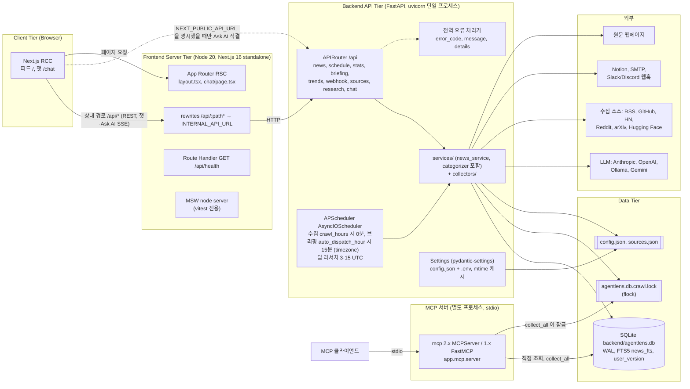
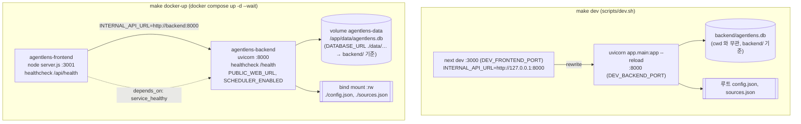
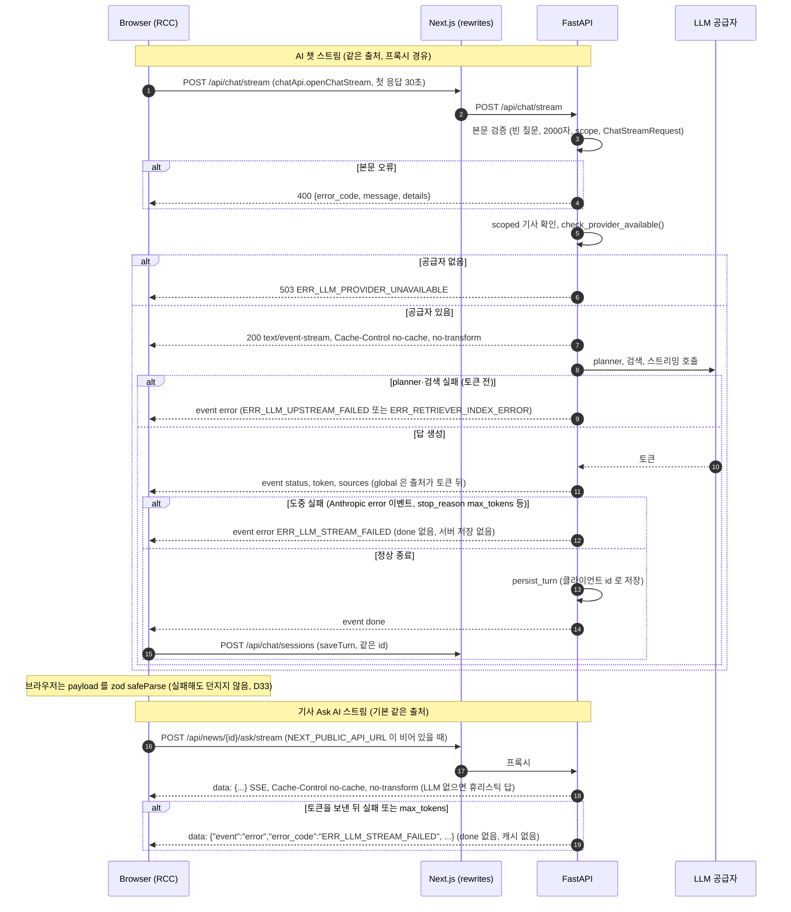

# [ADR-001] 풀스택 시스템 아키텍처 및 핵심 기술 스택 결정 레코드

Updated: 2026-11-10
기준: v0.4.2 (main)

- **작성일자**: 2026-11-09 (v0.4.2 갱신 2026-11-10)
- **작성자**: 풀스택 아키텍트 (`fullstack-architect`)
- **상태**: PROPOSED (as-built 기록. 이 문서의 결정은 모두 v0.4.2 작업 트리 코드에 이미 반영돼 있다. 승인은 제품·코드 오너가 한다)
- **영향 범위**: Frontend (Next.js 16 App Router standalone, React 19, Tailwind 4, zod 4), Backend (FastAPI, Python 3.11, SQLAlchemy async, APScheduler, pydantic-settings), Database (SQLite + aiosqlite, WAL, FTS5, `PRAGMA user_version` 마이그레이션), MCP 서버 (`mcp` 2.x `MCPServer` / 1.x FastMCP, stdio), Deployment (Docker Compose 2 컨테이너, `make dev` 로컬 실행)

> 이 문서는 새 설계가 아니라 **지금 코드가 어떤 결정 위에 서 있는지**를 적는다. 옛 `docs/tech-spec.md` 의 모든 내용(시스템 구성, 앱 사이 인터페이스, 데이터, 공통 규칙, 상세 문서, 기술 선택과 근거, 변경 이력)을 옮겼다. 옛 문서 절과 이 문서 절의 대응은 9절에 있다.
>
> 근거 표기: 코드 사실은 `path:line`, 외부 사실은 URL(조회일), 과거 기능 작업의 근거는 `git show <커밋>:<경로>` 로 다시 볼 수 있는 위치를 적는다. 결정 기록이 없어 코드에서 거꾸로 추정한 선택 이유는 **가정** 으로 표시한다. 측정한 성능 수치는 없다 (`bench/` 없음).
>
> v0.4.2 갱신: D32~D45 를 새로 적고, 바뀐 기존 결정에는 **변경(v0.4.2)** 항목을 달았다. 새 결정과 변경 항목의 `path:line` 은 v0.4.2 작업 트리 기준이다. v0.4.2 에서 바뀌지 않은 기존 결정 본문의 줄 번호는 v0.4.1 기준이라 몇 줄 어긋날 수 있다 (파일 이름과 심볼은 맞다). 리뷰·QA 지적 ID(ARCH-, PERF-, CC-, CFG-, SEC-, TEST-, BUG-, D-xx)는 `docs/backend-code-reviewer/01_CODE_REVIEW_REPORT.md`, `docs/frontend-code-reviewer/01_CODE_REVIEW_REPORT.md`, `docs/qa-engineer/02_QA_TEST_REPORT.md` 의 것이고, 고친 테스트는 `docs/backend-tdd-engineer/01_TDD_CYCLE_LOG.md` [Cycle v0.4.2-A/B/C], `docs/frontend-tdd-engineer/01_TDD_CYCLE_LOG.md` 2.8·2.9절에 있다.

---

## 1. 배경 및 컨텍스트 (Context & Problem Statement)

### 1.1 제품과 요구의 출처
AgentLens 는 AI 에이전트·하네스·MCP 기술 소식을 모아 요약하고, AI 챗 질의응답·일일 브리핑·외부 채널 공유·MCP 서버를 제공한다. `backend/`(FastAPI)와 `frontend/`(Next.js) 두 앱이고 인터페이스는 REST `/api/*`(SSE 포함)다.

기능 요구는 아래 기획 산출물에 있다 (이 문서 작성 시점에 함께 쓰이는 중이라 경로로만 참조한다).

| 도메인 | 코드 | FSD |
|---|---|---|
| 뉴스 피드 | NEWS | `docs/spec-writer/fsd/01_NEWS_FEED_SPECIFICATION.md` |
| AI 챗 | CHAT | `docs/spec-writer/fsd/02_AI_CHAT_SPECIFICATION.md` |
| 수집·분류·요약 | COLL | `docs/spec-writer/fsd/03_COLLECTION_SPECIFICATION.md` |
| 브리핑·공유 | BRF | `docs/spec-writer/fsd/04_BRIEFING_AND_SHARING_SPECIFICATION.md` |
| 소스·딥 리서치 | SRC | `docs/spec-writer/fsd/05_SOURCES_AND_RESEARCH_SPECIFICATION.md` |
| MCP 서버 | MCP | `docs/spec-writer/fsd/06_MCP_SERVER_SPECIFICATION.md` |
| UI 공통 | UI | `docs/spec-writer/fsd/07_UI_COMMON_SPECIFICATION.md` |

PRD 는 `docs/spec-writer/01_PRD.md`, 기능 색인은 `docs/spec-writer/02_FUNCTIONAL_SPECIFICATION.md`, 전역 정책·예외는 `docs/spec-writer/03_POLICIES_AND_EDGES.md` 다.

### 1.2 아키텍처에 걸리는 기능 요구 (요약)
| 요구 | 아키텍처에 미치는 영향 | 코드 위치 |
|---|---|---|
| 여러 외부 소스(RSS, GitHub, Hacker News, Reddit, arXiv, Hugging Face)를 정해진 시각에 수집·분류·요약 | 백그라운드 스케줄러, 외부 HTTP, LLM 호출, 긴 작업과 API 요청의 공존, 프로세스 사이 수집 중복 방지 | `backend/app/collectors/manager.py:225-321`, `backend/app/scheduler.py:47-83` |
| 기사 목록·검색·필터 | 전문 검색 인덱스 | `backend/app/database.py:79-109`, `backend/app/services/retriever.py` |
| AI 챗 (멀티턴, 세션 보존, 토큰 스트리밍) | SSE, 세션 영속화, LLM 공급자 추상화 | `backend/app/api/chat.py:69-127`, `backend/app/services/chat_session_service.py`, `backend/app/services/chat_service.py:540-689` |
| 기사별 Ask AI (토큰 스트리밍) | SSE, LLM 없을 때 대체 경로 | `backend/app/api/news.py:33-64` |
| 일일 브리핑 자동 발송 (Notion, SMTP, Slack/Discord 웹훅) | 스케줄러, 외부 연동, 설정 저장 | `backend/app/scheduler.py:64-70`, `backend/app/services/briefing_service.py` |
| 소스 관리·딥 리서치 | 설정 파일(`sources.json`) 읽기·쓰기, 스케줄러 | `backend/app/services/sources_service.py:55-150`, `backend/app/scheduler.py:57-63` |
| MCP 클라이언트에 뉴스 조회·수집 도구 제공 | 별도 진입점, 같은 DB 공유 | `backend/app/mcp/server.py:1-69` |
| 라이트·다크 테마, 키보드 단축키, 오버레이 | 클라이언트 상태, 첫 그리기 전 테마 적용 | `frontend/src/app/layout.tsx:22-32`, `frontend/src/lib/overlay-stack.ts` |

### 1.3 비기능 요구와 지금 상태
| 항목 | 지금 상태 (as-built) | 근거 |
|---|---|---|
| 지연 | 측정값 없음. 프론트 일반 요청은 8초 타임아웃 (`fetchWithTimeout`), 챗 스트림은 첫 응답 30초 (`CHAT_STREAM_FIRST_BYTE_TIMEOUT_MS`) | `frontend/src/lib/api.ts:74`, `frontend/src/lib/chatApi.ts:21-23` |
| Core Web Vitals | 측정값 없음. 피드 `/` 는 페이지 전체가 클라이언트 컴포넌트라 첫 데이터는 하이드레이션 뒤 브라우저 fetch 로 온다 (LCP 가 API 응답에 묶인다, 측정 안 함). v0.4.2 부터 대화상자 6개를 `next/dynamic` 으로 나눠 첫 번들에서 뺐다 (번들 크기 측정 안 함) | `frontend/src/app/page.tsx:1, 27-32` |
| 동시성 | backend 는 단일 uvicorn 프로세스(워커 옵션 없음). 수집 중복은 프로세스 안 `is_running` + 같은 DB 를 쓰는 프로세스(backend·MCP·`make collect`) 사이 비차단 `flock` 잠금으로 막는다 (D35). 수집 저장은 프로세스 안 `asyncio.Lock`, LLM 평가는 잠금 밖. 동기 I/O·CPU 파싱은 `asyncio.to_thread` (D39). SQLite 는 WAL + `busy_timeout=30000` | `backend/Dockerfile:35`, `backend/app/collectors/manager.py:49-74, 186-197, 225-233`, `backend/app/database.py:17-26` |
| 확장성 | 단일 노드 전제. 스케줄러가 앱 프로세스 안에 있어 수평 확장(워커 여러 개) 시 작업이 중복된다 (D06). 수집 잠금은 같은 호스트 파일 잠금이라 노드를 넘지 못한다 | `backend/app/main.py:27`, APScheduler FAQ |
| 보안 | 인증 없음, CORS 모든 origin + credentials 허용 (수용된 위험). 오류 응답에 예외 문자열·서버 경로를 싣지 않는다 (D32). 비용이 드는 입력은 길이·범위로 묶고 속도 제한은 두지 않는다 (D45). 비밀값은 backend 설정에만 있고 프론트 번들에 넣지 않는다 | `backend/app/main.py:51-60`, `backend/app/api/errors.py:74-77`, `frontend/src/lib/env.ts:8-11` |
| 가용성 | Docker healthcheck(`/health`, `/api/health`), frontend 는 backend healthy 뒤 기동, 빈 DB 첫 수집은 백그라운드. 프론트 렌더 오류는 `app/error.tsx` 오류 경계가 받는다 | `docker-compose.yml`, `backend/app/main.py:32-37`, `frontend/src/app/error.tsx` |

---

## 2. 고려된 기술 스택 후보군 (Considered Alternatives)

선정안은 모두 지금 코드다. "근거 종류" 는 출처(외부 문서·과거 spec 근거)가 있는지, 코드에서 거꾸로 추정한 **가정** 인지를 적는다. 각 행의 상세는 3.3 의 결정 번호(Dxx)를 본다.

| 계층 | 후보 1 (선정안) | 후보 2·3 (대안) | 장단점 비교 및 선정 사유 | 근거 종류 | 결정 |
| :--- | :--- | :--- | :--- | :--- | :--- |
| **Frontend** | Next.js 16 App Router, `output: "standalone"`, React 19 | Vite + React SPA / Remix | standalone 은 Node 런타임 하나로 서빙하고 `rewrites` 로 같은 origin `/api` 프록시를 제공한다. 지금은 RSC 데이터 페칭을 쓰지 않아 SPA 대비 이점은 프록시·메타데이터·첫 그리기 전 스크립트 정도다 | 가정 | D01 |
| **Backend** | FastAPI (Python 3.11, Pydantic v2) | Django / Node(NestJS) | 비동기 `StreamingResponse` 로 SSE, Pydantic 스키마, 런타임 OpenAPI(`/docs`). 수집·스크래핑 라이브러리(feedparser, trafilatura)가 Python 이다 | 가정 | D02 |
| **데이터베이스** | SQLite + aiosqlite (WAL) | PostgreSQL / 파일(JSON) 저장 | 단일 노드·단일 프로세스에 별도 DB 서버가 필요 없다. WAL 은 읽기와 쓰기 하나를 동시에 허용하고 쓰기는 하나뿐이다 | 출처(SQLite WAL 문서) + 가정 | D03 |
| **스키마 변경** | 시작 시 `create_all` + 번호 붙은 마이그레이션 함수 목록 + `PRAGMA user_version` (v0.4.2) | Alembic 마이그레이션 / 버전 없는 `ALTER TABLE` (v0.4.1) | 도구·버전 파일 없이 적용 이력을 DB 안에 남긴다. 실패는 로그 후 raise. 되돌리기는 없다 | 출처(SQLite PRAGMA 문서) + 가정 | D04, D36 |
| **전문 검색** | SQLite FTS5 가상 테이블 + 트리거 | `LIKE` 검색 / 외부 검색 엔진 | 같은 DB 파일 안에서 인덱스를 유지한다 | 출처(FTS5 문서) | D05 |
| **스케줄러** | APScheduler `AsyncIOScheduler` (앱 프로세스 안, 수집·브리핑 시각은 설정 `crawl_hours`·`timezone`·`auto_dispatch_hour`, 딥 리서치만 UTC 고정, `scheduler.enabled`) | 별도 cron 컨테이너 / Celery beat | 추가 프로세스 없음. 대신 워커를 늘리면 작업이 중복된다 | 출처(APScheduler FAQ) + 가정 | D06 |
| **실시간 스트리밍** | SSE (`text/event-stream`, 브라우저는 `fetch` + `ReadableStream` 로 POST) | WebSocket / 폴링 | 서버→클라이언트 단방향 토큰 전달. `EventSource` 는 GET 만 되므로 POST 본문을 쓰려고 `fetch` 스트림을 읽는다 | 출처(MDN) + 가정 | D07 |
| **브라우저→API 경로** | Next `rewrites` 같은 origin 프록시. 두 SSE 도 기본은 같은 출처이고 응답에 `Cache-Control: no-cache, no-transform` (v0.4.2). 기사 Ask AI 는 `NEXT_PUBLIC_API_URL` 을 명시했을 때만 직결 | 모든 요청 CORS 직결 / Ask AI 만 `{host}:8000` 직결 (v0.4.1) | 같은 origin 이라 LAN·Tailscale·포트를 바꾼 Docker 에서도 동작. Next 압축은 `no-transform` 응답을 건너뛴다(로컬 코드 확인). 프록시 스트림 지연은 측정 안 함 | 출처(Next 내장 compression 코드, QA D-41) + 가정 | D08, D43 |
| **LLM 클라이언트** | `httpx` 로 REST 직접 호출 (Anthropic, Gemini, OpenAI 비스트림, Ollama), OpenAI 스트림만 `openai` SDK | 각 공급자 공식 SDK / LangChain | 의존성 최소. `google-genai` 는 설치만 되고 쓰이지 않는다 | 가정 | D09 |
| **LLM 공급자 선택** | Anthropic → OpenAI → Ollama, Gemini 는 모델 명시 때만, 없으면 챗 503 | 단일 공급자 고정 / 흉내 공급자 폴백 | Ollama 가용 판정은 `/api/tags` + 설정 모델 설치 | 출처(Ollama API 문서, backend-llm-test-isolation spec) | D10 |
| **LLM 없을 때** | 수집·기사 Ask AI 는 휴리스틱, 챗은 503 | 전부 503 / 전부 휴리스틱 | 키 없이도 수집·피드가 돈다 | 가정 | D11 |
| **본문 추출** | `httpx` + trafilatura, 실패 시 readability-lxml + BeautifulSoup, L1 메모리 LRU 500 + L2 DB 열 | 헤드리스 브라우저(Playwright) | JS 렌더링 없이 가볍다. JS 로만 그려지는 페이지는 못 읽는다 | 가정 | D13 |
| **보충 웹 검색** | (v0.4.2 삭제) 없음. DuckDuckGo 보충 검색 모듈 `agentic_search.py` 는 호출처가 없어 지웠다 | DuckDuckGo Instant Answer API (v0.4.1, 호출처 없음) / Tavily | 쓰이지 않는 코드를 남기지 않는다 (D44) | 코드(호출처 grep) | D14, D44 |
| **설정** | pydantic-settings `Settings` + 루트 `config.json` 기본값 + `.env`, 화면 설정은 `config.json` 에 다시 쓴다. 파일은 (mtime, size) 가 같으면 다시 읽지 않고, 쓰기는 임시 파일 + `replace` (v0.4.2) | 환경 변수만 / DB 설정 테이블 / 매 호출 다시 읽기 | 화면에서 바꾼 설정이 파일에 남는다. 대신 git 추적 파일이 런타임에 바뀐다 | 가정 | D15, D40 |
| **프론트 환경변수** | `NEXT_PUBLIC_API_URL`(기본 빈 값, 명시할 때만 Ask AI 직결), `INTERNAL_API_URL`(rewrite 대상), `ALLOWED_DEV_ORIGINS`, zod 스키마 `env.ts` 를 `getClientEnv()` 로 연결 (v0.4.2) | 런타임 설정 API | 값이 스키마에 어긋나면 던진다(fail-fast) | 출처(Next.js 문서) | D16 |
| **계약 동기화** | 손으로 맞춤 (Pydantic ↔ TS + zod ↔ MSW) + 계약 테스트 | OpenAPI 코드 생성 | 생성 도구 없음. 정적 OpenAPI 파일 없음 | 가정 | D17 |
| **프론트 테스트 목** | MSW (vitest `setupFiles` 에서 node 서버) | `fetch` 직접 mock | 네트워크 경계에서 가로챈다 | 가정 | D18 |
| **스타일링·테마** | CSS 변수 토큰 + Tailwind `@theme inline`, `@custom-variant dark`, `<html>` 클래스 | 하드코딩 hex + `!important` 덮어쓰기 | 테마 전환이 클래스 하나로 끝난다 | 출처(Tailwind 문서, ui-redesign spec E1·E2) | D19 |
| **공통 UI 부품** | 자체 부품, `div role="dialog"` + 자체 포커스 트랩 | Radix 등 컴포넌트 킷 / 네이티브 `<dialog>` | 무거운 UI 라이브러리 금지 제약 | 출처(ui-redesign spec E6) + 가정 | D20 |
| **글꼴** | 시스템 글꼴 스택 | Geist (`next/font`) | 외부 글꼴 런타임 의존 금지 | 출처(ui-redesign spec E5) + 가정 | D21 |
| **오버레이·테마 적용 시점** | 오버레이 스택(Escape 맨 위만), 첫 그리기 전 인라인 테마 스크립트 | 컴포넌트별 Escape 리스너, 하이드레이션 뒤 테마 적용 | 겹친 오버레이 Escape 충돌·테마 깜빡임 방지 | 출처(WCAG 2.2, Next.js 로컬 문서, ui-redesign spec E3·E13·E15) | D22 |
| **로컬 동시 실행** | `scripts/dev.sh` (bash, 프로세스 그룹·준비 대기·정리) | Makefile 한 줄 / `concurrently` | 새 의존성 없음 | 출처(make-targets spec E3·E5) | D23 |
| **빈 DB 첫 수집** | lifespan 백그라운드 태스크 | healthcheck `start_period` 늘림 | 첫 수집 시간 측정값이 없다 | 출처(make-targets spec E10) | D24 |
| **Docker 기동 대기** | `docker compose up -d --wait --wait-timeout` | `up -d` 만 | healthcheck 실패가 종료 코드로 드러난다 | 출처(make-targets spec E9) | D25 |
| **MCP 서버** | stdio, `mcp` 2.x `MCPServer` 우선·1.x FastMCP 대체 (v0.4.2), backend 코드·DB·수집 잠금 공유, 별도 배포 단위 아님 | HTTP 전송 MCP 를 backend 에 내장 / 별도 서비스 / `mcp<2` 고정 | 로컬 MCP 클라이언트가 프로세스로 띄운다 | 가정 + 코드(설치된 `mcp` 2.3.0) | D26, D42 |
| **인증·CORS** | 인증 없음, CORS `*` + credentials | 토큰 인증 / origin 제한 | 단일 사용자 로컬 도구 전제로 보인다. 결정 기록 없음 | 가정 | D27 |
| **배포** | Docker Compose 2 컨테이너 (backend :8000, frontend :3001), 이름 있는 volume, 설정 파일 bind mount `:rw` | 단일 컨테이너 / 쿠버네티스 | 배포 대상 서버 없음(프로덕션 배포 없음) | 가정 | D28 |
| **로깅** | `print` + `logging.getLogger("agentlens.*")` 혼용, 핸들러 설정 없음 | 구조화 로깅(`logging.config`) | 설정 코드가 없다 | 가정 | D29 |
| **저장소 도구** | 루트 `Makefile`(대상 12개) + 스크립트 2개, 워크스페이스 도구 없음 | pnpm workspace / Nx / Turborepo | 두 앱 언어가 다르고 앱이 둘뿐 | 가정 | D30 |
| **오류 응답 형식** (v0.4.2) | 전역 처리기 3개 + `{"error_code","message","details"}` 단일 봉투, 검증 400, 상태별 기본 코드 | 형식 셋 공존 (v0.4.1) / FastAPI 기본 `{"detail"}` + 422 / RFC 9457 `problem+json` | 프론트가 `message` 하나만 읽는다. 예외 문자열을 응답에 싣지 않는다 | 출처(FastAPI 문서) + 리뷰 SEC-03·CC-01 | D32 (D12 대체) |
| **응답 런타임 검증** (v0.4.2) | 경계에서 zod `safeParse`, 실패 시 dev 경고 후 원본 사용 (던지지 않음) | 검증 없음 (v0.4.1) / `parse` 로 던짐 | 계약 어긋남을 화면을 죽이지 않고 드러낸다 | 출처(zod 문서) + 가정 | D33 |
| **라우터→서비스** (v0.4.2) | 라우터는 `NewsService` 를 거치고 직접 `select` 하지 않음, `categorizer` 를 `services/` 로 | 라우터 직접 조회 허용 (v0.4.1) / Repository 계층 추가 | 계층 하나만 더하지 않고 기존 `services/` 에 둔다 (KISS) | 리뷰 ARCH-01·ARCH-02 | D34 |
| **수집 중복 방지** (v0.4.2) | 프로세스 안 `is_running` + DB 옆 파일 비차단 `fcntl.flock` | 프로세스 안 플래그만 (v0.4.1) / DB 테이블 잠금 행 / `filelock` 패키지 | 새 의존성 없음, 프로세스가 죽으면 OS 가 푼다. Unix 전용 | 출처(Python `fcntl` 문서) + QA D-40 | D35 |
| **DB 경로·마이그레이션** (v0.4.2) | 상대 SQLite 경로는 `backend/` 기준, 기본 `<backend>/agentlens.db`, `PRAGMA user_version` | cwd 기준 (v0.4.1) / 절대 경로만 허용 / Alembic | 실행 위치마다 다른 DB 를 만들지 않는다 | 출처(SQLite PRAGMA 문서) + 리뷰 ARCH-04·CC-06 | D36 |
| **시각 저장** (v0.4.2) | DB 는 UTC(오프셋 없는 `DateTime`), 응답은 UTC 오프셋을 붙인다 | 피드 벽시계 그대로 저장 (v0.4.1) / `DateTime(timezone=True)` 로 열 변경 | 열 타입을 바꾸지 않고 저장·응답 경계에서 맞춘다 | 출처(Python `datetime` 문서) + QA BUG-18 | D37 |
| **LLM 캐시** (v0.4.2) | 자체 `TTLCache`(크기 한도 + 만료) 3개, 폴백 판정은 캐시 안 함, 초기화 때 비움 | 무한 `dict` (v0.4.1) / `cachetools` 의존성 | 새 의존성 없이 메모리 상한을 둔다 | 리뷰 PERF-05·BUG-10 + 가정 | D38 |
| **블로킹 작업** (v0.4.2) | feedparser·본문 추출은 `asyncio.to_thread`, Ollama 판정은 `httpx.AsyncClient` | 이벤트 루프에서 동기 실행 (v0.4.1) / 프로세스 풀 | 루프를 막지 않는 가장 작은 변경 | 출처(Python asyncio 문서) + 리뷰 PERF-01·03 | D39 |
| **설정 파일 캐시·쓰기** (v0.4.2) | (mtime_ns, size) 캐시 + 깊은 사본 반환, 임시 파일 후 `replace`(bind mount 면 제자리 쓰기) | 매 호출 다시 읽기, `config.json` 제자리 쓰기 (v0.4.1) / 파일 감시(watchdog) | 새 의존성 없음, 중간 실패에 원본 보존 | 리뷰 PERF-04·BUG-21 + 가정 | D40 |
| **테스트 격리** (v0.4.2) | 실행마다 임시 DB, httpx 전송 계층 외부 네트워크 가드(`register_web`), autouse SMTP 흉내·남은 태스크 취소 | 고정 테스트 DB 파일, 외부 호출 허용 (v0.4.1) / `pytest-socket` / `respx` | 기존 LLM 흉내 전송 계층을 넓혀 새 의존성 없이 막는다 | 리뷰 TEST-03 + 가정 | D41 |
| **브라우저 스트림 경로** (v0.4.2) | 두 SSE 모두 기본 같은 출처 + `no-transform` | Ask AI 만 `{host}:8000` 직결 (v0.4.1) / Next `compress: false` 전역 | 포트를 짐작하지 않는다. 압축은 스트림에서만 끈다 | 출처(Next 내장 compression 코드, Next `compress` 문서) + QA D-41 | D43 |
| **쓰지 않는 것 삭제** (v0.4.2) | 호출처 없는 엔드포인트 11개·설정 키·모듈 삭제 | 남겨 두고 문서로 표시 (v0.4.1) / deprecated 표시 | 범위 밖 공격면·혼동을 줄인다 (YAGNI) | 리뷰 CC-02·CC-05·CFG-02 + grep | D44 |
| **비용 입력 제한** (v0.4.2) | 길이·범위 검증(질문 1~2000자, 후보 1~20, 로그 1~200 등), 속도 제한 없음 | `slowapi` 같은 속도 제한 / 제한 없음 (v0.4.1) | 인증 없는 단일 사용자 로컬 앱(수용된 위험), 요청 하나의 비용을 묶으면 충분 | 리뷰 PERF-07 + 가정 | D45 |

---

## 3. 최종 아키텍처 결정 사항 (Decision)

### 3.1 풀스택 전체 시스템 토폴로지



#### 3.1.1 배포 토폴로지 (로컬 실행과 Docker)



- 로컬 포트·경로: `scripts/dev.sh:9-12, 102-121`. Docker: `docker-compose.yml`(backend `DATABASE_URL`·`PUBLIC_WEB_URL`·`SCHEDULER_ENABLED` `:21-26`, frontend `INTERNAL_API_URL`·`NEXT_PUBLIC_API_URL` 기본 빈 값 `:63-64`), `backend/Dockerfile`, `frontend/Dockerfile`. 운영 상세는 `docs/devops-engineer/01_DEPLOYMENT_SPEC.md`.
- v0.4.2: 저장소 루트 `agentlens.db` 는 쓰지 않는다. `make dev`·`make collect`·MCP 서버가 cwd 와 상관없이 같은 `backend/agentlens.db` 와 잠금 파일 `backend/agentlens.db.crawl.lock` 을 본다 (D35, D36).

#### 3.1.2 계층 간 통신: SSE 두 경로 (v0.4.2)



- 챗 스트림: `frontend/src/lib/chatApi.ts:21-23, 85`, `frontend/src/components/chat/ChatWorkspace.tsx:349, 411`, `backend/app/api/chat.py:69-127` (본문 검증 `:72-98`, 공급자 확인 `:111-115`, 응답 헤더 `:118-127`), 앞 단계 오류 `backend/app/services/chat_service.py:555, 580`, 저장·`done` 순서 `:671-689`. Ask AI: `frontend/src/lib/api.ts:130-160`, `backend/app/api/news.py:33-64`, 끊김 이벤트 `backend/app/services/llm_processor.py:134-140, 945, 978`. `NEXT_PUBLIC_API_URL` 을 명시하면 Ask AI 만 그 주소로 직결하고 fetch 예외(AbortError 제외) 때 같은 출처로 한 번 다시 보낸다 (`api.ts:66-67, 143-160`). 이벤트 형식은 `docs/system-designer/01_SYSTEM_DESIGN.md`, 계약은 `docs/contract-integrator/01_CONTRACT_AND_MSW_SPEC.md`.

### 3.2 핵심 아키텍처 원칙

#### 1) RSC vs RCC 경계 원칙
**as-built 경계**
| 구분 | 파일 | 하는 일 |
|---|---|---|
| RSC | `frontend/src/app/layout.tsx` | `metadata`·`viewport`(`:6-20`), 첫 그리기 전 테마 인라인 스크립트(`:22-32`), `ThemeProvider`·`ToastRegion` 감싸기 |
| RSC | `frontend/src/app/chat/page.tsx` | `metadata`(`:5-8`), `Suspense` 껍질 안에 `ChatWorkspace` (`:10-24`) |
| Route Handler | `frontend/src/app/api/health/route.ts` | 컨테이너 healthcheck. 버전은 `getClientEnv().NEXT_PUBLIC_APP_VERSION`(package.json 에서 자동, `:2, 11`). `rewrites` 를 배열로 반환하므로 파일시스템 라우트가 먼저 잡혀 backend 로 넘어가지 않는다 (Next.js 로컬 문서 `frontend/node_modules/next/dist/docs/01-app/03-api-reference/05-config/01-next-config-js/rewrites.md:48`) |
| RCC | `frontend/src/app/page.tsx` (`:1` `'use client'`) | 피드 페이지 전체. 대화상자 6개는 `next/dynamic(..., { ssr: false })` 로 나눠 연다 (`:27-32`, v0.4.2) |
| RCC | `frontend/src/app/error.tsx` (`'use client'`, v0.4.2) | 라우트 오류 경계 ('화면을 그리지 못했습니다', 다시 시도). Next 규약상 오류 경계는 클라이언트 컴포넌트다 |
| RCC | `'use client'` 가 붙은 73개 파일 (`ChatWorkspace`, `ThemeContext`, 모달, 훅 등. v0.4.2 에 `ui/SearchField`·`SegmentedControl`·`Select`·`Switch`·`TextField`·`Textarea`·`ErrorState`, `feed/FeedStatusBar` 가 더해졌다) | 상태·이벤트·localStorage·fetch |
| 지시어 없는 공용 모듈 | `components/ui/` 의 10개(Badge, Button, Card, Chip, EmptyState, IconButton, InlineAlert, Kbd, Skeleton, Spinner), `components/feed/NewsCardSkeleton.tsx`, `lib/api.ts`·`lib/chatApi.ts`·`lib/contract.ts`·`lib/env.ts` 등 | 클라이언트 컴포넌트가 import 하므로 클라이언트 번들에 들어간다 |

- 데이터 페칭은 모두 클라이언트에서 `frontend/src/lib/api.ts`(피드·브리핑·소스 등)와 `frontend/src/lib/chatApi.ts`(챗 세션·출처·스트림, v0.4.2)로 한다. 응답은 경계에서 `frontend/src/lib/contract.ts` 로 검증한다 (D33). 서버 컴포넌트 fetch 는 없다. `getApiBase()` 의 서버 분기(`api.ts:58`, `INTERNAL_API_URL`)는 준비돼 있으나 쓰는 RSC 가 없다.

**규약 (앞으로)**
1. 상태·이벤트·브라우저 API(훅, `useId`, 이벤트 핸들러 prop 을 직접 다루는 것 포함)가 필요한 컴포넌트만 `'use client'` 를 붙인다. 순수 표시 부품(`components/ui/` 의 지시어 없는 10개)은 지시어 없이 둔다.
2. RSC 에서 RCC 로 넘기는 props 는 직렬화 가능한 값만 넘긴다.
3. 서버 컴포넌트에서 backend 를 부를 일이 생기면 `INTERNAL_API_URL` 로 부르고(`getApiBase` 서버 분기), 브라우저 코드는 상대 경로 `/api` 를 쓴다. 브라우저가 backend 포트를 짐작하지 않는다 (D43).
4. 패키지 메타데이터는 `next.config.ts` 의 `env.NEXT_PUBLIC_APP_VERSION` 처럼 문자열만 넘기고 `src` 에서 `package.json` 을 import 하지 않는다 (`frontend/next.config.ts:4-15`).
5. 처음 화면에 필요 없는 큰 대화상자는 `next/dynamic` 으로 나눈다 (`frontend/src/app/page.tsx:27-32`, v0.4.2).
6. backend 응답은 `lib/contract.ts` 의 `readJson`·`parseResponse` 를 거쳐 받고, 오류 문구는 `readErrorMessage` 로 backend `message` 를 쓴다 (D32, D33).

#### 2) 계층형 백엔드 아키텍처
**as-built 구조**
```
[진입]        app/main.py (lifespan: ensure_db_schema → start_scheduler(enabled 일 때) → 빈 DB 첫 수집,
                           install_error_handlers, main.py:26-60)
              app/mcp/server.py (mcp 2.x MCPServer / 1.x FastMCP stdio 진입점, 도구 첫 호출 때 ensure_db_schema)
              scripts/collect.py (make collect 직접 모드, ensure_db_schema 후 collect_all)
                 │
[API]         app/api/*.py — APIRouter, prefix /api (router.py:12-21, 라우터 9개)
                 │   요청 검증(Pydantic Field·Query 범위), 서비스 예외 → ApiError/error_response, StreamingResponse
                 │   app/api/errors.py — 전역 처리기 3개와 단일 오류 봉투 (D32)
                 ▼
[Service]     app/services/*.py (news_service, categorizer 포함), app/collectors/ (manager, sources/*)
                 │   피드 조회·통계·삭제(NewsService), 수집·분류·요약, 챗(planner·검색), 세션, 브리핑, 외부 연동
                 ▼
[Provider]    app/services/llm_providers/ (base.py BaseLLMProvider, anthropic_provider.py)
              llm_processor.py 의 _call_gemini/_call_openai/_call_ollama, TTLCache (D38)
                 ▼
[Model/Schema] app/models/ (SQLAlchemy: news.py, chat_session.py)
              app/schemas/ (Pydantic: chat.py, news.py — 응답 시각은 UTC 오프셋, D37)
[공통]        app/database.py (engine, get_db, MIGRATIONS·user_version, FTS DDL, ensure_db_schema),
              app/config.py (Settings, BACKEND_DIR 기준 DB 경로, mtime 캐시·원자적 저장), app/scheduler.py
```

- 저장소(Repository) 계층은 없다. v0.4.2 부터 라우터는 직접 `select` 하지 않고 서비스를 부른다 (D34): 뉴스·통계·수집 로그·초기화 삭제는 `NewsService(db)` (`backend/app/services/news_service.py:53-144`; 호출 `backend/app/api/news.py:28, 39, 68`, `stats.py:11`, `schedule.py:20, 80`). `backend/app/api/*.py` 에 `select(`·`db.execute` 가 없다. 서비스·MCP 서버·스케줄 작업은 `AsyncSessionLocal` 로 자기 세션을 연다 (`backend/app/mcp/server.py:29, 39, 49`, `backend/app/collectors/manager.py:198, 287`).
- `categorizer` 는 `backend/app/services/categorizer.py` 로 옮겼다. `services/` 가 `collectors/` 를 import 하지 않는다 (호출 `manager.py:14`, `llm_processor.py:12`, `deep_researcher.py:16`, `source_researcher.py:12`).
- 서비스 수명: 모듈 싱글턴(`collector_manager`, `llm_processor`, `briefing_service`, `deep_researcher`, `sources_service`)과 요청마다 만드는 객체(`ChatService(db)`, `NewsService(db)`)가 섞여 있다. 토큰 사용량은 요청마다 돌려준다 (`last_usage` 싱글턴 속성 삭제, BUG-09).
- 세션 트랜잭션: `get_db` 가 요청 끝에 commit, 예외 시 rollback (`backend/app/database.py:31-40`). 수집 저장은 소스 하나를 한 트랜잭션으로 (`manager.py:186-223`), 세션 업서트도 한 트랜잭션 (ARCH-03).

**규약 (앞으로)**
1. 비즈니스 로직과 DB 조회는 `services/` 에 둔다. 라우터는 요청 검증, 서비스 호출, 서비스 예외를 `ApiError`·`error_response` 로 바꾸는 일만 한다 (v0.4.2 변경: 라우터 직접 조회 허용을 거둔다, D34).
2. 외부 HTTP·LLM 호출은 서비스나 공급자 계층에서만 한다. 이벤트 루프를 막는 동기 I/O·CPU 작업은 `asyncio.to_thread` 로 감싼다 (D39).
3. 응답 모델은 `app/schemas/` 의 Pydantic 모델로 정하고, 바꾸면 `.claude/rules/contracts.md` 에 따라 프론트 타입·MSW 를 함께 바꾼다. 오류 응답은 D32 형식만 쓴다.
4. 새 스키마 변경은 `app/database.py` 의 `MIGRATIONS` 끝에 멱등 함수로 더한다 (D36).

#### 3) 환경변수 거버넌스 (`.claude/rules/environment-standards.md`)
**backend**
- 설정은 `backend/app/config.py` 의 `Settings(BaseSettings)` 하나다 (`config.py:62-127`). 값의 원천과 우선순위: 프로세스 환경 변수 → `.env` 파일(`load_dotenv(override=False)` 로 `cwd/.env` → `cwd/backend/.env` → `cwd/../.env` → `backend/.env` 순, `config.py:9-11`, 이어서 `env_file=(".env", "backend/.env", "../.env")`, `config.py:123-127`) → 루트 `config.json`(필드 기본값, `config.py:63-121`) → 코드 기본값. 빈 LLM 키·모델은 `merge_json_and_env` 가 `config.json` → `os.environ` → 하드코딩 순으로 다시 채운다 (`config.py:129-162`). 상세 표는 `docs/devops-engineer/01_DEPLOYMENT_SPEC.md`.
- `config.json` 탐색 순서: cwd → cwd 부모 → 저장소 루트 → `backend/app/config/config.json` (`config.py:15-26`). 파일 (mtime_ns, size) 가 같으면 다시 읽지 않고 깊은 사본을 돌려준다 (`config.py:28-47`, D40). 화면에서 바꾼 설정은 `save_json_config` 가 임시 파일에 쓴 뒤 `replace` 하고 `settings.reload()` 한다 (`config.py:181-202`, D40).
- DB 경로: `DATABASE_URL` 의 SQLite 상대 경로는 cwd 가 아니라 `backend/` 기준으로 푼다. 기본값은 `<backend>/agentlens.db` (`config.py:49-58, 65, 159`, D36).
- fail-fast: `ENVIRONMENT=production` 이면서 `SECRET_KEY` 가 32자 미만이면 import 때 `ValueError` 로 기동이 멈춘다 (`config.py:160-161`). 선택 기능(LLM 키, Notion, SMTP, 웹훅)은 없으면 기능만 끈다.
- `model_config` 가 `extra="allow"` 라 `.env` 의 다른 키도 오류 없이 받는다 (`config.py:123-127`).
- v0.4.2 연결·추가: `PUBLIC_WEB_URL`(`app.public_web_url`, RSS 채널 링크, `config.py:67`, `backend/app/api/news.py:88`), `SCHEDULER_ENABLED`(`scheduler.enabled`, `config.py:70`, `scheduler.py:73-75`), `CRAWL_SCHEDULE_HOURS`·`CRAWL_TIMEZONE`·`BRIEFING_AUTO_DISPATCH_HOUR` 를 실제 cron 에 (`scheduler.py:47-70`), `CHAT_SESSION_MAX_LIMIT`(`chat_session_service.py:302, 409`), `SCRAPER_TIMEOUT_SECONDS`(`scraper.py:116`), `webhooks.auto_dispatch_daily_briefing`(`briefing_service.py:266-267`). 지운 설정은 D44.

**frontend**
- `NEXT_PUBLIC_API_URL`: 기본 빈 값. 비우면 기사 Ask AI 도 같은 출처(`/api/...` → rewrite)로 간다. 값을 주면 Ask AI 스트림만 그 주소로 직결한다 (`frontend/src/lib/api.ts:61-67`, D43). 브라우저가 `:8000` 을 짐작하지 않는다.
- `INTERNAL_API_URL`: rewrite 대상(기본 `http://127.0.0.1:8000`, `frontend/next.config.ts:23-31`)이자 서버 측 `getApiBase` 주소 (`api.ts:52-59`).
- `ALLOWED_DEV_ORIGINS`: `next dev` 에 더 허용할 출처(쉼표 구분, `frontend/.env.local`), `next.config.ts:16-22` 가 읽는다 (v0.4.2).
- `NEXT_PUBLIC_APP_VERSION`: `next.config.ts` 가 `package.json` 의 `version` 을 넣는다 (`next.config.ts:6-15`).
- zod 스키마 `clientEnvSchema`·`serverEnvSchema` (`frontend/src/lib/env.ts:8-21`) 를 v0.4.2 에 연결했다. `getClientEnv()` 가 `process.env.NEXT_PUBLIC_…` 를 하나씩 적어 `parse` 하고 어긋나면 던진다 (`env.ts:30-35`). 쓰는 곳: `frontend/src/lib/api.ts:67`, `frontend/src/components/Header.tsx:67`, `frontend/src/app/api/health/route.ts:11`.
- `NEXT_PUBLIC_` 값은 `next build` 때 번들에 박힌다 (Next.js 로컬 문서 `frontend/node_modules/next/dist/docs/01-app/02-guides/environment-variables.md:158-166`). `frontend/Dockerfile` 빌드 단계는 `NEXT_PUBLIC_API_URL` 을 넘기지 않는다. v0.4.2 부터 기본이 빈 값(같은 출처)이라 Docker 번들은 같은 출처로 간다 (`docker-compose.yml:64` 의 런타임 값은 번들에 반영되지 않는다, 추론).

**지금 규칙과 어긋나는 곳 (as-built)**
| 규칙 | 지금 코드 | 위치 |
|---|---|---|
| `os.environ.get()` 을 코드 곳곳에서 직접 부르지 않는다 | `llm_processor.py` 3곳, `anthropic_provider.py` 5곳에서 `settings` 다음 대체 원천으로 직접 읽는다 (v0.4.1 의 10곳에서 줄었다) | `backend/app/services/llm_processor.py:191, 267, 358`, `backend/app/services/llm_providers/anthropic_provider.py:36, 38, 42, 49, 153` |
| ~~새 변수는 zod 스키마로 검증~~ | v0.4.2 에 해소 (`env.ts` 연결) | `frontend/src/lib/env.ts` |
| 설정 필드는 실제로 쓰인다 | v0.4.2 에 대부분 해소 (D44). `ENVIRONMENT` 는 SECRET_KEY 검사에만 쓰인다 | `backend/app/config.py:117, 160` |
| 루트 `.env.example` 은 개발 기본값 | `ENVIRONMENT="production"` 이 들어 있다 | `.env.example:8` |

#### 4) 간결함과 실용적 공학 (KISS & YAGNI)
- 별도 메시지 큐·캐시 서버·검색 서버·DB 서버가 없다. 프로세스는 backend 1개, frontend 1개, 필요할 때 MCP 서버 1개다.
- 지금 스택(FastAPI, SQLite + aiosqlite, APScheduler, Next.js 16, React 19, Tailwind, Vitest, MSW)을 바꾸는 결정은 이유가 분명할 때만 한다. 이 문서는 바꾸는 결정을 하나도 내리지 않는다.
- v0.4.2 의 결정(D32~D45)도 새 런타임 의존성을 더하지 않았다. 캐시는 자체 `TTLCache`(D38), 잠금은 표준 라이브러리 `fcntl`(D35), 마이그레이션은 `PRAGMA user_version`(D36), 네트워크 가드는 기존 흉내 전송 계층(D41)으로 했다. 더한 것은 개발 의존성 `pytest-cov` 하나다 (`backend/requirements.txt:20`, `make check` 는 `--cov` 없이 돈다).

### 3.3 결정 기록 (Dxx)

각 결정은 맥락 · 선택 · 대안 · 근거 · 결과 순으로 적는다.

#### D01. Frontend 프레임워크: Next.js 16 App Router (standalone)
- **맥락**: 피드·챗 두 화면의 웹 UI 와 backend 프록시가 필요하다.
- **선택**: Next.js 16.3.4, React 19.2.8, `output: "standalone"` (`frontend/package.json:15-17`, `frontend/next.config.ts:9`). Node 20 이미지 (`frontend/Dockerfile`), pnpm (`frontend/package.json:40`).
- **대안**: Vite + React SPA(정적 파일 + 별도 프록시), Remix.
- **근거**: 결정 기록 없음 (**가정**). 코드에서 보이는 이점은 `rewrites` 프록시(D08), `metadata`/`viewport` API, 첫 그리기 전 인라인 스크립트(D22), standalone 단일 서버.
- **결과**: 피드 페이지가 전부 클라이언트 컴포넌트라 RSC 의 데이터 페칭·번들 축소 이점은 지금 쓰지 않는다. Core Web Vitals 는 측정한 적이 없다.

#### D02. Backend 프레임워크: FastAPI (Python 3.11)
- **맥락**: REST + SSE, 백그라운드 수집, Python 수집·추출 라이브러리 사용.
- **선택**: `fastapi>=0.141.0`, `uvicorn[standard]`, `pydantic>=2.8`, `pydantic-settings>=2.4` (`backend/requirements.txt`, v0.4.2 부터 주 버전 상한), Python 3.11 (`backend/Dockerfile:6`, `Makefile` `setup`).
- **대안**: Django(+DRF), Node(NestJS/Express).
- **근거**: 결정 기록 없음 (**가정**). `StreamingResponse` 로 SSE(`backend/app/api/chat.py:430-438`), 런타임 OpenAPI `/docs`(`backend/app/main.py:73`), feedparser·trafilatura 등 Python 라이브러리.
- **결과**: OpenAPI 는 런타임에만 있고 정적 파일은 없다 (계약은 D17).

#### D03. 데이터베이스: SQLite + aiosqlite (WAL)
- **맥락**: 기사·수집 로그·챗 세션을 저장. 단일 사용자·단일 노드.
- **선택**: `sqlite+aiosqlite`, 연결마다 `journal_mode=WAL`, `synchronous=NORMAL`, `cache_size=-64000`, `busy_timeout=30000`, `foreign_keys=ON`, 연결 `timeout=30.0` (`backend/app/database.py:6-26`). 기본 경로 `./agentlens.db`(`config.json` `app.database_url`, `backend/app/config.py:42`), Docker 는 volume `agentlens-data` 의 `/app/data/agentlens.db` (`docker-compose.yml:21, 37`). 소유 앱은 backend.
- **대안**: PostgreSQL(별도 컨테이너), JSON 파일 저장.
- **근거**: WAL 은 읽기와 쓰기를 동시에 허용하지만 쓰기는 한 번에 하나다 — https://www.sqlite.org/wal.html (2026-11-09 기준 공개 문서). 선택 이유 자체는 기록 없음 (**가정**: 운영 부담 최소).
- **결과**: backend 와 MCP 서버(별도 프로세스)가 같은 파일에 쓸 수 있다. 쓰기 경합은 `busy_timeout` 30초로 기다린다. 수평 확장은 할 수 없다.
- **변경(v0.4.2)**: 기본 경로가 `./agentlens.db`(cwd 기준)에서 `<backend>/agentlens.db` 로 바뀌었고 상대 경로는 `backend/` 기준으로 푼다 (D36). 같은 DB 를 쓰는 프로세스 사이 수집은 DB 옆 잠금 파일로 하나만 돈다 (D35). 중복 인덱스 5개를 지웠다 (`backend/app/database.py:68-72`, CC-04).

#### D04. 스키마 변경: 시작 시 `create_all` + 빠진 열 `ALTER TABLE`
- **맥락**: 열이 추가돼 왔다 (`news_items.full_content`, `scraped_at`, `chat_messages.model_tier`, `usage_json`).
- **선택**: `ensure_db_schema()` 가 `Base.metadata.create_all` 후 `PRAGMA table_info` 로 빠진 열을 `ALTER TABLE ADD COLUMN`, 인덱스 `ix_news_items_scraped_at` 생성 (`backend/app/database.py:45-71`). lifespan 첫 단계에서 부른다 (`backend/app/main.py:25`).
- **대안**: Alembic.
- **근거**: 결정 기록 없음 (**가정**: 도구 없이 열 추가만 처리).
- **결과**: 열 삭제·이름 변경·타입 변경은 처리하지 못한다. 각 단계가 `except Exception: pass` 로 실패를 삼킨다 (`database.py:59-60, 70-71, 113-114`). 테이블·열 상세는 `docs/system-designer/01_SYSTEM_DESIGN.md`.
- **변경(v0.4.2)**: `create_all` 뒤 번호 붙은 마이그레이션 목록을 `PRAGMA user_version` 으로 한 번씩 적용하고, 실패는 로그 후 raise 한다 (D36). 위 '실패를 삼킨다' 는 더 이상 사실이 아니다.

#### D05. 전문 검색: SQLite FTS5
- **맥락**: 기사 검색과 챗 검색(RAG).
- **선택**: `news_items` 를 외부 콘텐츠로 쓰는 FTS5 가상 테이블 `news_fts`(title, summary, why_it_matters, tech_stack, tags)와 INSERT·DELETE·UPDATE 트리거 3개를 원시 SQL 로 만든다. 인덱스 행 수가 기사 수보다 적으면 `rebuild` (`backend/app/database.py:73-112`). `retriever.py` 도 같은 테이블을 보장한다 (`backend/app/services/retriever.py:57-90`).
- **대안**: `LIKE` 검색, 외부 검색 엔진.
- **근거**: FTS5 외부 콘텐츠 테이블과 트리거 패턴 — https://www.sqlite.org/fts5.html ('External Content Tables'). 선택 이유는 기록 없음 (**가정**: 같은 DB 파일 안에서 끝냄).
- **결과**: 테이블 생성 코드가 두 곳(`database.py`, `retriever.py`)에 있다.
- **변경(v0.4.2, CC-03·PERF-06)**: FTS DDL 은 `backend/app/database.py:79-98` 의 `FTS_DDL` 한 곳뿐이고 `ensure_db_schema` 가 시작 때 만든다. 검색 경로(`retriever.py`)는 테이블을 만들거나 커밋하지 않는다(GET 요청이 쓰기를 하지 않는다). rebuild 판정은 외부 콘텐츠 FTS 의 `count(*)` 가 원본 테이블을 세기 때문에 `news_fts_docsize` 행 수와 기사 수를 비교한다 (`database.py:101-109`). 위 '두 곳' 결과는 해소됐다.

#### D06. 스케줄러: APScheduler `AsyncIOScheduler` (앱 프로세스 안)
- **맥락**: 정기 수집, 딥 리서치, 브리핑 자동 발송.
- **선택**: `AsyncIOScheduler` 에 `CronTrigger` 3개 — 수집 `hour="0,6,12,18"`, 딥 리서치 `hour="3,15"`, 브리핑 `hour="0", minute="15"`, 모두 `timezone="UTC"` (`backend/app/scheduler.py:37-64`). lifespan 에서 시작·종료 (`backend/app/main.py:26, 46`).
- **대안**: 별도 cron 컨테이너가 `/api/schedule/trigger` 호출, Celery beat + 워커.
- **근거**: APScheduler 는 프로세스 사이 동기화가 없어 여러 프로세스가 같은 작업 저장소를 공유할 수 없다 — https://apscheduler.readthedocs.io/en/3.x/faq.html ('How do I share a single job store among one or more worker processes?', 2026-11-09 조회). 선택 이유 자체는 기록 없음 (**가정**: 추가 프로세스 없이).
- **결과**: uvicorn 워커를 늘리면 작업이 워커 수만큼 돈다. 시각이 코드에 고정돼 `config.json` 의 `crawl_hours`·`timezone`·`auto_dispatch_hour` 와 `CRAWL_SCHEDULE_HOURS` 는 화면 표시·다음 실행 시각 계산(`scheduler.py:9, 25-35`)에만 쓰인다.
- **변경(v0.4.2, CFG-01)**: 수집은 `crawl_hours` 시 0분, 브리핑 자동 발송은 `briefing.auto_dispatch_hour` 시 15분, 둘 다 `scheduler.timezone` 기준으로 cron 을 건다. 딥 리서치만 설정이 없어 03·15 UTC 고정이다 (`backend/app/scheduler.py:10-11, 47-70`). `scheduler.enabled`(`SCHEDULER_ENABLED`) 가 false 면 스케줄러를 띄우지 않는다 (`scheduler.py:72-75`). 다음 실행 시각은 job 의 `next_run_time`, 없으면 설정 시간대로 계산한다 (`scheduler.py:32-45`). 위 '시각이 코드에 고정' 결과와 열린 질문 Q5 는 해소됐다. 스케줄 대화상자는 응답의 `schedule_hours`·`timezone` 으로 그린다.

#### D07. 실시간 스트리밍: SSE
- **맥락**: 챗·Ask AI 답을 토큰 단위로 보여 준다.
- **선택**: `StreamingResponse(media_type="text/event-stream")`, 응답 헤더 `Cache-Control: no-cache`, `Connection: keep-alive`, `X-Accel-Buffering: no` (`backend/app/api/chat.py:430-438`, `backend/app/api/news.py:159-167`). 브라우저는 `fetch` 로 POST 하고 `ReadableStream` 을 읽는다 (`frontend/src/lib/api.ts:102-139`). SSE 엔드포인트는 `POST /api/chat/stream`, `POST /api/news/{id}/ask/stream` 2개.
- **대안**: WebSocket, 폴링.
- **근거**: `EventSource` 는 GET 요청만 만든다 — https://developer.mozilla.org/en-US/docs/Web/API/EventSource. 질문 본문을 POST 로 보내려 `fetch` 스트림을 쓴 것으로 보인다 (**가정**). WebSocket 을 고르지 않은 이유는 기록 없음 (**가정**: 단방향으로 충분).
- **결과**: 끊긴 스트림의 자동 재연결은 없다. 이벤트 형식은 `docs/system-designer/01_SYSTEM_DESIGN.md`·`docs/contract-integrator/01_CONTRACT_AND_MSW_SPEC.md`.
- **v0.4.1 변경 (리뷰 BUG-02R·BUG-06·BUG-08, FE-02·03·33·34)**:
  - 챗 스트림 서버는 턴을 `event: done` **앞에서** 저장한다. 저장이 실패하면 로그만 남기고 `done` 을 보낸다 (`backend/app/services/chat_service.py:803-825`). 이유: 프론트의 세션 POST·상세 재조회와 경합하지 않게 하려고.
  - 요청 본문에 클라이언트가 만든 `user_message_id`·`assistant_message_id`(선택, 1~36자, 둘 다 있으면 달라야 함)가 실린다 (`backend/app/schemas/chat.py:38-46`, `frontend/src/components/chat/ChatWorkspace.tsx:350-353`). 서버와 프론트가 같은 id 로 저장한다 (D31).
  - 본문 검증이 scoped 기사 확인·LLM 가용성 확인보다 먼저다. dict 가 아니거나 필드가 어긋나면 400 `ERR_INVALID_PAYLOAD`, `model_tier` 가 어긋나면 400 `ERR_INVALID_MODEL_TIER` (`backend/app/api/chat.py:292-345`).
  - Anthropic 스트림의 `error` 이벤트는 `overloaded_error` 면 `AnthropicOverloadedException`, 그 밖은 `AnthropicStreamError` 다. `stop_reason == "max_tokens"` 도 끝난 뒤 `AnthropicStreamError` 다 (`backend/app/services/llm_providers/anthropic_provider.py:29-31, 283, 322-334`). 챗 스트림은 이때 `event: error`(`ERR_LLM_STREAM_FAILED`)를 보내고 `done`·저장 없이 끝난다 (`chat_service.py:757-769`).
  - 프론트는 `done` 없이 끝난 스트림과 `error` 이벤트를 오류로 본다. 받은 부분 답을 그대로 그리고 그 아래에 `응답이 중간에 끊겼습니다. 다시 시도해 주세요.` 와 `답변 다시 시도` 를 보인다. 이때는 저장하지 않는다. 세션 저장(`saveTurn`)은 한 턴에 한 번, 완료 또는 사용자 중단일 때만 한다. 중단 뒤 본문이 정상 종료돼도 중단으로 둔다 (`frontend/src/components/chat/ChatWorkspace.tsx:43, 309-318, 444-462`).
  - 남은 문제: 기사 Ask AI 스트림은 도중 실패 시 `error` 이벤트 없이 끝나 프론트가 받은 글자를 답으로 보인다 (N-01, `docs/spec-writer/03_POLICIES_AND_EDGES.md` 4절).
- **변경(v0.4.2)**:
  - 기사 Ask AI 스트림도 토큰 뒤 실패·`max_tokens` 잘림이면 `{"event":"error","error_code":"ERR_LLM_STREAM_FAILED","message":"답변 생성이 중간에 끊겼습니다. 다시 시도해 주세요.","retryable":true}` 로 끝나고 `done`·캐시가 없다 (`backend/app/services/llm_processor.py:134-140, 945, 978`). 프론트는 부분 답 + 오류 알림 + `답변 다시 시도` 를 보이고 복사를 막는다. N-01·Q9 해소.
  - 챗 스트림의 앞 단계 예외도 SSE `error` 다: planner 실패 `ERR_LLM_UPSTREAM_FAILED`(502, step `thinking`), 검색 실패 `ERR_RETRIEVER_INDEX_ERROR`(500, step `tool_calling`) (`backend/app/services/chat_service.py:555, 580`).
  - global 모드 순서는 `thinking → tool_calling → synthesizing → token* → sources → done` 이고, 출처는 답에서 인용된 것만 토큰 뒤에 보낸다. 스트리밍 중에는 `[1]` 을 누를 수 없다 (의도, 결함 아님).
  - 두 SSE 응답 헤더가 `Cache-Control: no-cache, no-transform` 이다 (`backend/app/api/chat.py:123`, `backend/app/api/news.py:60`, D43).
  - 비스트림 Anthropic 호출도 `stop_reason == "max_tokens"` 면 실패로 보고 다음 공급자로 넘어간다 (`backend/app/services/llm_providers/anthropic_provider.py:236`, N-05).
  - 진행 라벨에서 이모지를 뺐다.

#### D08. 브라우저→API 경로: 같은 origin 프록시, Ask AI 만 직결
- **맥락**: 브라우저는 localhost, LAN IP, Tailscale 주소 등 여러 호스트로 접속한다 (`frontend/next.config.ts:16-22` 의 `allowedDevOrigins`).
- **선택**: 브라우저 요청은 상대 경로 `/api/*` (`frontend/src/lib/api.ts:3-10`) → `rewrites` 가 `INTERNAL_API_URL`(기본 `http://127.0.0.1:8000`)로 넘긴다 (`frontend/next.config.ts:23-31`). 예외로 기사 Ask AI 스트림은 `getDirectApiBase()` (`NEXT_PUBLIC_API_URL`, 없으면 `{protocol}//{hostname}:8000`)로 직결하고, fetch 가 예외를 던지면(AbortError 제외) 상대 경로로 다시 시도한다 (`api.ts:12-23, 97-117`). 챗 스트림은 상대 경로로 프록시를 거친다 (`frontend/src/components/chat/ChatWorkspace.tsx:338`).
- **대안**: 모든 요청 CORS 직결, 모든 요청 프록시.
- **근거**: 직결 이유는 코드 주석 "bypass Next.js rewrites chunk buffering" (`api.ts:17, 101`) 뿐이고 측정 기록이 없다 (**가정**). 같은 SSE 인 챗 스트림은 프록시를 거치므로 두 경로의 판단이 서로 다르다.
- **결과**: `BACKEND_PORT` 를 바꾸거나 :8000 이 막히면 Ask AI 는 직결이 실패한 뒤에만 프록시로 넘어간다. Docker 빌드에 `NEXT_PUBLIC_API_URL` 이 들어가지 않는다 (3.2-3).
- **변경(v0.4.2, D-41)**: 직결 기본값을 없앴다. 두 SSE 모두 기본은 같은 출처 rewrite 를 거치고, `NEXT_PUBLIC_API_URL` 을 명시했을 때만 Ask AI 가 그 주소로 직결한다 (`frontend/src/lib/api.ts:61-67, 130-160`). 프록시 압축 버퍼링은 응답 `no-transform` 으로 막는다. 결정 내용은 D43. 위 '결과' 와 열린 질문 Q2 는 해소됐다.

#### D09. LLM 클라이언트: `httpx` 직접 호출
- **맥락**: Anthropic, OpenAI, Ollama, Gemini 네 공급자를 부른다.
- **선택**: Anthropic 은 `httpx.AsyncClient` 로 `https://api.anthropic.com/v1/messages`, 헤더 `anthropic-version: 2023-06-01`, `anthropic-beta: prompt-caching-2024-07-31`, 타임아웃 45초(일반)·120초(스트림) (`backend/app/services/llm_providers/anthropic_provider.py:130-186, 238, 285`). Gemini `generativelanguage.googleapis.com` (20초), OpenAI 비스트림 `api.openai.com/v1/chat/completions` (60초), Ollama `/api/generate` (90초) 모두 `httpx` (`backend/app/services/llm_processor.py:196-286`). OpenAI 스트림만 `openai.AsyncOpenAI` SDK (`llm_processor.py:446-460, 928`). 공급자 추상 클래스는 `BaseLLMProvider` (`llm_providers/base.py:4`).
- **대안**: 각 공식 SDK(`anthropic`, `google-genai`), LangChain.
- **근거**: `anthropic_provider.py:134` docstring "Pure httpx REST client (no external anthropic SDK dependency)". 선택 이유는 기록 없음 (**가정**: 의존성 최소).
- **결과**: `google-genai>=2.0.0` 이 `backend/requirements.txt:16` 에 있지만 `backend/app` 에서 import 하지 않는다. 프롬프트 캐싱은 시스템 블록에 `cache_control: {"type": "ephemeral"}` 을 단다 (`anthropic_provider.py:176-186`). 캐싱 효과는 측정하지 않았다.

#### D10. LLM 공급자 선택과 가용 판정
- **맥락**: 키·로컬 모델 유무가 환경마다 다르다. 테스트가 환경에 따라 결과가 바뀌던 문제가 있었다 (backend-llm-test-isolation).
- **선택**: 우선순위 Anthropic → OpenAI → Ollama, Gemini 는 모델 이름에 `gemini` 가 들어간 요청에만 (`backend/app/services/llm_processor.py:340-401`). 가용 판정(`has_live_provider`, `:301-325`): Anthropic·OpenAI 는 키가 있으면 가능. Ollama 는 `GET {주소}/api/tags` 한 번(1초 제한)이 200 이고 응답 `models[].name` 또는 `model` 에 설정 모델(태그 생략 시 `:latest` 를 붙여 비교)이 있을 때만 가능 (`:171-194`). OpenAI 키·모델과 Ollama 주소·모델은 호출 때마다 해석 함수 4개 `_resolve_openai_key`, `_resolve_openai_chat_model`, `_resolve_ollama_url`, `_resolve_ollama_generate_model` 로 정한다 (`:129-169`). 하나도 없으면 `LLMProviderUnavailableException` → 챗 503 `ERR_LLM_PROVIDER_UNAVAILABLE` (`:327-337`, `backend/app/api/chat.py:240-248`). 판정 이유(키 없음, Ollama 연결 실패, 설정 모델 미설치 등)는 서버 로그 WARNING 에만 남는다 (`llm_processor.py:336`).
- **대안**: 단일 공급자 고정, 테스트·키 없음 환경에서 흉내 공급자로 폴백.
- **근거**: Ollama 모델 이름 `model:tag`, 태그 생략 시 `latest`, `/api/tags` 응답 형식 — https://raw.githubusercontent.com/ollama/ollama/main/docs/api.md (2026-11-07 조회). 결정 과정은 `git show 3973ae9:docs/features/backend-llm-test-isolation/spec.md` 근거 E2·E4·E5·E10·E11.
- **결과**: 테스트 환경 판별 함수 `is_test_environment` 가 있다 (`TESTING`, `CI`, `pytest` 로드 여부, `llm_processor.py:288-299`). 공급자 호출 실패 시 다음 공급자로 넘어가되 429 는 바로 `LLMQuotaExceededException` 이다 (`:368-389`).
- **v0.4.1 변경 (리뷰 BUG-07)**: 기사 Ask AI 스트림(`stream_question_answer`)은 토큰을 하나라도 보낸 뒤 Anthropic·OpenAI 가 실패하면 다음 엔진 답을 이어 붙이지 않고 `done` 없이 끝나며 답을 캐시하지 않는다. 토큰을 보내기 전에 실패했을 때만 다음 엔진(마지막은 휴리스틱)으로 넘어간다 (`backend/app/services/llm_processor.py:914-919, 948-951`). 이때 `error` 이벤트를 보내지 않는 것은 남은 문제다 (N-01).
- **변경(v0.4.2)**:
  - 테스트 환경 판별 `is_test_environment`(`TESTING`·`CI`·`pytest` 로드 여부)를 지웠다. planner 는 테스트 여부와 무관하게 라이브 공급자가 있으면 돈다. 테스트는 환경 분기 대신 흉내 전송 계층으로 격리한다 (D41, ARCH-05).
  - Ollama 가용 판정 `_ollama_status` 는 `httpx.AsyncClient`(1초)로 바뀌었고 (주소, 모델) 결과를 30초 캐시한다 (`backend/app/services/llm_processor.py:174, 225-245`, PERF-01, D38·D39).
  - 토큰 뒤 실패는 `error` 이벤트로 끝난다 (D07 변경, N-01 해소). 비스트림 Anthropic `max_tokens` 는 실패로 보고 다음 공급자로 넘어간다.
  - `LLM_PROVIDER`(`llm.provider`), `ANTHROPIC_COLLECTION_MODEL` 설정은 지웠다 (D44). 우선순위는 그대로다.

#### D11. LLM 이 없을 때의 동작
- **맥락**: 키 없이도 피드는 써야 한다.
- **선택**: 수집 단계 품질 평가·요약과 기사 Ask AI 는 휴리스틱으로 대신한다 (`llm_processor.py:516-580` `evaluate_quality_and_signal`, `:794-853` `_generate_heuristic_answer`). AI 챗은 503 을 돌려준다 (D10).
- **대안**: 전부 503, 전부 휴리스틱.
- **근거**: 결정 기록 없음 (**가정**). `.env.example` 주석 "Falls back to local zero-config NLP heuristic if empty".
- **결과**: 같은 "LLM 없음" 상황에서 화면마다 반응이 다르다 (FSD 의 각 도메인 예외 흐름 참고).
- **변경(v0.4.2)**: 휴리스틱 폴백 평가는 캐시하지 않는다(LLM 이 돌아오면 다시 평가, `backend/app/services/llm_processor.py:773`, BUG-10). LLM 시사점이 없으면 `why_it_matters` 를 빈 값으로 두고 카테고리 고정 문장을 넣지 않는다 (BUG-17). 휴리스틱 답에서 이모지를 뺐다. 원천 지표가 없는 수집기는 점수를 지어내지 않는다 (BUG-18).

#### D12. 오류 응답 형식
- **맥락**: 프론트가 오류를 구분해 보여 줘야 한다.
- **선택**: 세 가지 형식이 공존한다. (1) 처리하지 않은 예외: 500 `{"detail": "Internal server error occurred. Please check server logs.", "error": str(exc)}` (`backend/app/main.py:58-67`). (2) 챗 엔드포인트: `{"error_code", "message", "details"}` 와 400·401·404·429·500·502·503·529 매핑 (`POST /api/chat/query` `backend/app/api/chat.py:130-275`, `POST /api/chat/stream` 스트림 시작 전 `:282-427`). 스트림이 열린 뒤 오류는 `event: error` (D07). (3) 그 밖의 라우터: FastAPI `HTTPException` 의 `{"detail": ...}` (예: `backend/app/api/briefing.py:209`).
- **대안**: 전역 단일 오류 봉투.
- **근거**: 결정 기록 없음 (**가정**: 챗만 오류 코드가 필요했다).
- **결과**: 전역 500 응답에 예외 문자열이 그대로 담긴다. v0.4.1 부터 `/api/chat/stream` 만 필드 검증 실패를 400(`ERR_INVALID_PAYLOAD`, `ERR_INVALID_MODEL_TIER`)으로 돌려주고, `/api/chat/query`·`/api/chat/search` 는 여전히 500 이다 (N-03). 엔드포인트별 오류 표는 `docs/system-designer/01_SYSTEM_DESIGN.md`.
- **변경(v0.4.2)**: **D32 로 대체됐다.** 세 형식 공존을 버리고 모든 오류를 `{"error_code","message","details"}` 하나로 맞췄다. `/api/chat/query`·`/api/chat/search` 는 지웠다 (D44). N-03·Q10 해소.

#### D13. 원문 본문 추출
- **맥락**: 챗이 요약이 아닌 원문을 근거로 답한다.
- **선택**: `httpx` 로 받고 trafilatura 로 추출, 실패하면 readability-lxml + BeautifulSoup (`backend/app/services/scraper.py:94-110`). L1 클래스 수준 `OrderedDict` LRU 500개 (`:35-62`), L2 `news_items.full_content`·`scraped_at` (`:133-170`).
- **대안**: Playwright 같은 헤드리스 브라우저.
- **근거**: 결정 기록 없음 (**가정**: JS 렌더링 비용 회피).
- **결과**: L1 캐시는 프로세스 메모리라 재시작하면 비고, MCP 서버 프로세스와 공유되지 않는다.
- **변경(v0.4.2)**: 동기 추출 함수 `_extract_text` 를 `asyncio.to_thread` 로 부른다 (`backend/app/services/scraper.py:29, 134`, PERF-03, D39). 요청 타임아웃은 설정 `SCRAPER_TIMEOUT_SECONDS`(기본 5초)를 쓴다 (`scraper.py:116`). URL 별 잠금은 `weakref.WeakValueDictionary` 라 쓰는 곳이 없으면 사라져 쌓이지 않는다 (`scraper.py:77-89`, PERF-05). 스크래퍼는 요청 세션을 커밋하지 않고 L2 캐시를 자기 세션으로 쓴다 (`scraper.py:174-176`, ARCH-03).

#### D14. 보충 웹 검색
- **맥락**: DB 에 없는 정보를 챗이 보충한다.
- **선택**: DuckDuckGo Instant Answer API `https://api.duckduckgo.com/?q=...&format=json` (3초 제한)의 `AbstractText`·`RelatedTopics` 상위 3개. 결과가 없으면 `https://github.com/search?q=...` 를 후보로 넣는다 (`backend/app/services/agentic_search.py:109-151`).
- **대안**: Tavily, 상용 검색 API.
- **근거**: 결정 기록 없음 (**가정**: 키 없이 동작). docstring 의 "Tavily" 는 구현이 없다 (`agentic_search.py:111-112`).
- **결과**: 검색 품질은 측정하지 않았다.
- **변경(v0.4.2, CC-02)**: **삭제.** `backend/app/services/agentic_search.py` 는 어디서도 호출되지 않았다 (`git show HEAD:backend/app/services/chat_service.py` 에서 `ChatService` 가 `self.agentic_search` 객체만 만들고 부르지 않음, `docs/backend-tdd-engineer/01_TDD_CYCLE_LOG.md` 의 '서비스 호출처 없음' 기록). 지금 챗은 DB(FTS5) 검색만 쓴다. 보충 웹 검색이 다시 필요하면 새로 결정한다 (D44).

#### D15. 설정 원천: pydantic-settings + `config.json` + `.env`, 런타임 쓰기
- **맥락**: 브리핑·웹훅·소스 설정을 화면에서 바꾼다.
- **선택**: 3.2-3 의 우선순위. 화면 설정은 `config.json` 에 쓰고 `settings.reload()` (`backend/app/config.py:153-173`, `backend/app/api/briefing.py:163-209`). 수집 소스는 `sources.json`: 루트 파일과 `backend/app/config/sources.json` 두 곳이 있고 cwd → 부모 → 저장소 루트 → `backend/app/config/` 순으로 찾는다 (`backend/app/services/sources_service.py:11-24`). 저장은 임시 파일(`.tmp`)에 쓴 뒤 `replace()` 로 교체하고, 교체가 `OSError` 면(Docker 단일 파일 bind mount 위 rename 은 `EBUSY`) 대상 파일에 제자리로 쓴다. 이어서 거울 경로 `backend/app/config/sources.json` 에도 쓴다 (`:102-133`). 로컬에서는 루트 파일이 먼저 잡히고, Docker 에서는 마운트된 `/app/sources.json` 이 쓰인다.
- **대안**: 환경 변수만, DB 설정 테이블.
- **근거**: 결정 기록 없음 (**가정**). 제자리 쓰기 대체 경로는 make-targets 작업에서 추가 (`git show 3973ae9:docs/features/make-targets/spec.md`).
- **결과**: Docker 는 루트 `config.json`·`sources.json` 을 `:rw` 단일 파일 bind mount 로 둔다 (`docker-compose.yml:38-39`). 그래서 Docker 에서 설정·소스를 저장해도 git 이 추적하는 루트 파일이 바뀐다 (로컬 실행과 같다). `config.json` 저장은 원자적 교체가 아니다 (`config.py:166-168`).
- **변경(v0.4.2)**: 두 파일 모두 (mtime, size) 캐시로 읽고, `config.json` 저장도 `sources.json` 과 같은 임시 파일 + `replace`(실패 시 제자리 쓰기)로 바꿨다. 화면 설정 저장은 `raw_json_config` 의 깊은 사본을 고친다 (`backend/app/api/briefing.py:139, 183`). `sources.json` 저장 실패는 `SourcesWriteError` → 500 `ERR_SERVER_INTERNAL` 이다 (`backend/app/services/sources_service.py:125-150`, `backend/app/api/sources.py:24`, BUG-20). 응답의 `sources_file` 은 파일 이름만 싣는다 (`sources.py:37`). 결정 내용은 D40. 위 '원자적 교체가 아니다' 는 해소됐다.

#### D16. 프론트 환경변수
- **맥락·선택·결과**: 3.2-3 frontend 항목. 비밀값은 프론트에 두지 않는다. `env.ts` 연결은 열린 질문 Q3.
- **대안**: 런타임 설정 API 로 브라우저에 값 전달.
- **근거**: Next.js 로컬 문서 `environment-variables.md:158-166` (`NEXT_PUBLIC_` 빌드 때 인라인).
- **변경(v0.4.2)**: `env.ts` 를 연결했다. `getClientEnv()` 가 `NEXT_PUBLIC_API_URL`·`NEXT_PUBLIC_APP_VERSION` 을 정적 참조로 모아 zod `parse` 하고(어긋나면 던짐), `getServerEnv()` 는 `INTERNAL_API_URL`·`ALLOWED_DEV_ORIGINS` 등을 더한다 (`frontend/src/lib/env.ts:8-46`). 정적 참조로 적는 이유는 브라우저 번들이 `process.env.NEXT_PUBLIC_…` 를 하나씩 적은 참조만 값으로 바꾸기 때문이다 (같은 Next.js 문서). `NEXT_PUBLIC_API_URL` 기본은 빈 값(같은 출처), `ALLOWED_DEV_ORIGINS` 를 새로 뒀다. Q3 해소.

#### D17. 계약 동기화: 손으로 맞춤
- **맥락**: backend Pydantic 과 frontend 타입이 어긋나지 않아야 한다.
- **선택**: 자동 생성 없이 세 곳을 손으로 맞춘다.
  - backend: `backend/app/schemas/chat.py`, `backend/app/schemas/news.py` (Pydantic)
  - frontend: `frontend/src/types/chat.ts`, `news.ts`, `trends.ts` (TS + zod)
  - 목: `frontend/src/mocks/handlers.ts`, `frontend/src/mocks/handlers/chat.ts`, `frontend/src/mocks/fixtures/chat.ts` (MSW)
  - 계약 테스트: `frontend/src/tests/chat/ContractAndMsw.test.ts`
- **대안**: OpenAPI → TS 코드 생성(openapi-typescript 등).
- **근거**: 결정 기록 없음 (**가정**). 규칙은 `.claude/rules/contracts.md`.
- **결과**: 계약을 바꾸면 위 세 곳과 계약 테스트를 함께 바꾼다. 하위 호환·버전 규칙은 아직 정하지 않았다. 상세는 `docs/contract-integrator/01_CONTRACT_AND_MSW_SPEC.md`, OpenAPI 는 `docs/system-designer/02_OPENAPI_SPEC.yaml`.
- **변경(v0.4.2)**: 손으로 맞추는 방식은 그대로이고, 런타임에도 zod 스키마로 응답을 검증하되 던지지 않는다 (D33, `frontend/src/lib/contract.ts`). 응답 TS 타입은 `frontend/src/types/news.ts`·`chat.ts` 의 zod 스키마에서 나온다 (`frontend/src/lib/api.ts:40-49`, CT-006). 공통 오류 스키마 `ErrorResponseSchema` (`frontend/src/types/chat.ts:16`). 계약 문서는 v1.3.

#### D18. 프론트 테스트 목: MSW
- **선택**: vitest `environment: 'jsdom'`, `setupFiles: ['./src/tests/setup.ts']` (`frontend/vitest.config.ts:8-10`), setup 이 `@/mocks/server` 를 띄운다 (`frontend/src/tests/setup.ts:3`). 앱 코드는 MSW 를 import 하지 않는다 (개발 서버에서 목을 쓰지 않음).
- **대안**: `fetch` 직접 mock.
- **근거**: 결정 기록 없음 (**가정**). MSW 문서 https://mswjs.io/docs/.
- **결과**: 테스트 전략·사례는 `docs/qa-engineer/01_QA_TEST_PLAN.md`.

#### D19. 스타일링·테마 토큰 (ui-redesign)
- **맥락**: 하드코딩 색과 `!important` 덮어쓰기로 다크 모드를 맞추던 구조.
- **선택**: 색은 `frontend/src/app/globals.css` 의 CSS 변수 토큰(`:root`·`.dark`)을 Tailwind `@theme inline` 으로 유틸리티에 잇고, 테마는 `<html>` 의 `dark`/`light` 클래스 하나로 정한다 (`@custom-variant dark`). Tailwind 4 (`frontend/package.json:23, 36`).
- **대안**: 하드코딩 hex + `!important` 덮어쓰기.
- **근거**: Tailwind CSS 문서 'Dark mode' https://tailwindcss.com/docs/dark-mode, 'Theme variables' https://tailwindcss.com/docs/theme (2026-11-06 조회), `git show 3973ae9:docs/features/ui-redesign/spec.md` 근거 E1·E2.
- **결과**: 토큰·공통 부품 규칙은 `docs/ui-system-designer/02_DESIGN_SYSTEM.md`, 화면 규칙은 `docs/ui-system-designer/01_COMPONENT_SPEC.md`.

#### D20. 공통 UI 부품: 자체 구현 (ui-redesign)
- **선택**: `frontend/src/components/ui/` 의 자체 부품, 대화상자는 `div role="dialog"` + 자체 포커스 트랩 (`frontend/src/hooks/useFocusTrap.ts`). 아이콘은 `lucide-react`.
- **대안**: 컴포넌트 킷(Radix 등), 네이티브 `<dialog>`.
- **근거**: intent 제약(무거운 UI 라이브러리 금지), ui-redesign spec 근거 E6. 네이티브 `<dialog>` 의 jsdom 지원은 확인하지 않았다 (**가정**).
- **결과**: 접근성 동작을 직접 유지해야 한다.

#### D21. 글꼴: 시스템 글꼴 (ui-redesign)
- **선택**: 웹 글꼴 없이 시스템 글꼴 스택(`--font-sans`, `--font-mono`).
- **대안**: Geist (`next/font`).
- **근거**: intent 제약(외부 글꼴 런타임 의존 금지), Geist 를 읽지만 쓰지 않던 점, ui-redesign spec 근거 E5. 한글 글꼴 순서는 **가정**.
- **결과**: 운영체제마다 글꼴이 다르게 보인다.

#### D22. 오버레이 스택과 첫 그리기 전 테마 (ui-redesign)
- **선택**: 대화상자·드로어·팝오버·메뉴를 `frontend/src/lib/overlay-stack.ts` 에 등록해 Escape 로 맨 위 레이어만 닫는다 (리스너는 `window`). 테마는 `<head>` 인라인 스크립트가 localStorage `agentlens_theme` 을 읽어 첫 그리기 전에 `<html>` 클래스·`data-theme`·`colorScheme` 을 정한다 (`frontend/src/app/layout.tsx:22-32`). 런타임 테마 상태는 `next-themes` 없이 `useSyncExternalStore` 기반 자체 `ThemeProvider` (`frontend/src/context/ThemeContext.tsx:44-51`, `frontend/src/lib/theme-store.ts`).
- **대안**: 컴포넌트별 Escape 리스너, 하이드레이션 뒤 테마 적용.
- **근거**: WCAG 2.2 (제품 원칙), Next.js 16 로컬 문서 `frontend/node_modules/next/dist/docs/01-app/02-guides/preventing-flash-before-hydration.md`, ui-redesign spec 근거 E3·E13·E15.
- **결과**: `<html suppressHydrationWarning>` 이 필요하다 (`layout.tsx:30`).

#### D23. 로컬 동시 실행: `scripts/dev.sh` (make-targets)
- **선택**: `make dev` → `scripts/dev.sh` 가 backend `uvicorn --reload` 와 frontend `next dev` 를 각자 프로세스 그룹으로 띄우고, 준비 대기(`/health`, `/api/health`), 한쪽 종료 감지, Ctrl-C 정리를 한다. 포트가 쓰이고 있으면 띄우지 않고 실패한다 (`scripts/dev.sh:9-12, 91-153`).
- **대안**: Makefile 한 줄, `concurrently` 같은 npm 도구.
- **근거**: make-targets spec 근거 E3·E5 (지운 `dev.sh` 는 자식 프로세스 그룹을 정리하지 못하고 한쪽이 죽어도 기다렸다. make 3.81·bash 3.2 라 `.ONESHELL`·`wait -n` 이 없다. 새 의존성 없음) — `git show 3973ae9:docs/features/make-targets/spec.md`.
- **결과**: bash 스크립트 유지 부담. 운영 절차는 `docs/devops-engineer/01_DEPLOYMENT_SPEC.md`.

#### D24. 빈 DB 첫 수집: lifespan 백그라운드 태스크 (make-targets)
- **선택**: 시작할 때 `news_items` 가 0건이면 `collector_manager.collect_all()` 을 `asyncio.create_task` 로 띄우고 바로 요청을 받는다. 종료 때 끝나지 않은 첫 수집은 취소하고 기다린다. 태스크 예외는 한 줄 로그 (`backend/app/main.py:15-45`).
- **대안**: healthcheck `start_period` 늘림.
- **근거**: make-targets spec 근거 E10 (첫 수집 시간 측정값이 없어 근거 있는 대기 시간이 없음).
- **결과**: 기동 직후 `/health` 의 `running` 이 `true` 이고 피드가 비어 있을 수 있다 (`main.py:75-77`).

#### D25. Docker 기동 대기: `docker compose up -d --wait --wait-timeout` (make-targets)
- **선택**: `make docker-up` 이 `docker compose up -d --wait --wait-timeout $(DOCKER_WAIT_TIMEOUT)` (기본 180초, 넘기면 실패) (`Makefile:8, 79-84`).
- **대안**: `up -d` 만.
- **근거**: make-targets spec 근거 E9 (compose 의 `--wait` 지원, healthcheck 실패가 종료 코드로 드러남). https://docs.docker.com/reference/cli/docker/compose/up/.
- **결과**: frontend 는 backend 의 healthcheck(`/health`)가 통과한 뒤 뜬다 (`docker-compose.yml:64-66`).

#### D26. MCP 서버: FastMCP stdio, backend 와 같은 코드·DB
- **선택**: `backend/app/mcp/server.py` 의 `FastMCP("AgentLens-MCP-Server")`, `python -m app.mcp.server` 로 stdio 실행 (`:2, 8, 49-50`). 도구 4개 `get_latest_harness_methods`, `get_mcp_and_skills_ecosystem`, `search_agent_news`, `trigger_agentlens_crawl` (`:10-47`). 패키지 `mcp>=1.0.0` (`backend/requirements.txt:15`). 별도 배포 단위가 아니다.
- **대안**: backend 에 HTTP 전송 MCP 엔드포인트 내장, 별도 서비스.
- **근거**: 결정 기록 없음 (**가정**: 로컬 MCP 클라이언트가 프로세스로 띄우는 형태). FastMCP 는 MCP Python SDK 에 포함 — https://github.com/modelcontextprotocol/python-sdk.
- **결과**: `trigger_agentlens_crawl` 은 MCP 프로세스 안에서 `collect_all()` 을 돈다. `is_running` 은 프로세스마다 따로라 backend 의 수집과 겹칠 수 있다 (`backend/app/collectors/manager.py:177-180`). 상세는 `docs/spec-writer/fsd/06_MCP_SERVER_SPECIFICATION.md`.
- **변경(v0.4.2)**: 서버 객체는 `mcp` 2.x `MCPServer` 를 먼저, 없으면 1.x `FastMCP` 를 쓴다 (`backend/app/mcp/server.py:7-12`, D42). 도구 첫 호출 때 `ensure_db_schema` 를 한 번 부른다 (`server.py:16-23`). `collect_all` 이 프로세스 사이 파일 잠금을 쥐므로 backend 수집과 겹치지 않는다 (D35, D-40). 위 '겹칠 수 있다' 결과와 Q7 은 해소됐다. backend 의 `GET /api/mcp/info` 는 지웠다 (D44).

#### D27. 인증·CORS
- **선택**: 인증 없음. `CORSMiddleware(allow_origins=["*"], allow_credentials=True, allow_methods=["*"], allow_headers=["*"])` (`backend/app/main.py:50-56`).
- **대안**: 토큰 인증, origin 제한(`CORS_ORIGINS` 설정 사용).
- **근거**: 결정 기록 없음 (**가정**: 단일 사용자 로컬 도구).
- **결과**: :8000 에 닿는 누구나 `DELETE /api/news/all`, `POST /api/schedule/reset-and-collect`, 소스 삭제·토글, 설정 저장을 부를 수 있다. 정책은 `docs/spec-writer/03_POLICIES_AND_EDGES.md`.
- **변경(v0.4.2)**: 동작은 그대로(인증 없음, CORS 전체 허용, `backend/app/main.py:51-57`)이고 수용된 위험으로 남는다. 쓰이지 않던 `CORS_ORIGINS` 설정을 지웠다 (D44). `DELETE /api/news/all` 은 지웠고, 데이터 삭제 경로는 `POST /api/schedule/reset-and-collect` 하나다. 속도 제한을 두지 않는 근거도 이 전제다 (D45).

#### D28. 배포 형태: Docker Compose 2 컨테이너
- **선택**: backend(`python:3.11-slim`, `uvicorn app.main:app --host 0.0.0.0 --port 8000`, 컨테이너 `agentlens-backend`)와 frontend(`node:20-alpine` 3단계 빌드, uid 1001 `nextjs`, `node server.js`, :3001, 컨테이너 `agentlens-frontend`), 네트워크 `agentlens-network`, volume `agentlens-data`, `host.docker.internal:host-gateway` (Ollama 접근) (`docker-compose.yml`, `backend/Dockerfile:6-34`, `frontend/Dockerfile`). 로컬 개발 포트는 frontend 3000 (`scripts/dev.sh:10`).
- **대안**: 단일 컨테이너, 오케스트레이터.
- **근거**: 결정 기록 없음 (**가정**). 프로덕션 배포는 없다 (CLAUDE.md 'Deploy').
- **결과**: 상세는 `docs/devops-engineer/01_DEPLOYMENT_SPEC.md`.

#### D29. 로깅
- **선택**: `print` 로 표준 출력에 쓰는 곳(`backend/app/main.py:20, 34, 61`, `backend/app/scheduler.py:12, 16, 21, 64`)과 `logging.getLogger("agentlens.*")` 를 쓰는 곳(`collectors/manager.py:20`, `services/llm_processor.py:20`, `services/chat_service.py:48` 등 10여 개 모듈)이 섞여 있다. `logging.basicConfig`·`dictConfig` 같은 핸들러 설정 코드는 없다.
- **대안**: 구조화 로깅 설정.
- **근거**: 결정 기록 없음 (**가정**).
- **결과**: `agentlens.*` 로거는 루트 로거로 전파되고 핸들러가 없으면 Python 기본 `lastResort` 가 WARNING 이상만 stderr 에 낸다 (https://docs.python.org/3/library/logging.html#logging.lastResort). 그래서 LLM 판정 이유 WARNING 은 보이고 DEBUG·INFO 는 보이지 않는다고 추론한다 (uvicorn 실행에서 직접 확인하지 않음).

#### D30. 저장소 도구: Makefile + 스크립트 2개
- **선택**: 워크스페이스 도구 없음. 루트 `Makefile`(bash, 대상 12개: setup, dev, test, build, clean, collect, reset, docker-build, docker-up, docker-down, docker-logs, check, `Makefile:1-3`)이 두 앱 명령을 묶는다. 셸 한 줄로 쓰기 어려운 두 가지만 스크립트로 둔다: `scripts/dev.sh`(D23), `scripts/collect.py`(`make collect`, backend 가 떠 있으면 그 API 로 수집시키고 끝날 때까지 기다리고, 없으면 로컬 DB 에 직접 수집, `scripts/collect.py:1-12`). 검사는 `make check`(= `make test`, `Makefile:98-100`).
- **대안**: pnpm workspace, Nx, Turborepo.
- **근거**: make-targets spec (`git show 3973ae9:docs/features/make-targets/spec.md` 40-41행). 워크스페이스 도구를 안 쓴 이유는 **가정** (언어가 다른 앱 둘).
- **결과**: 의존성 설치는 `.venv`(uv 또는 python3.11)와 `pnpm install --frozen-lockfile` (`Makefile` `setup`).

#### D31. 챗 턴 저장: 서버 저장 + 프론트 세션 POST 를 같은 클라이언트 id 로 (v0.4.1)
- **맥락**: 서버(`persist_turn`)와 프론트(세션 POST)가 같은 턴을 각각 저장해 메시지가 두 벌 남거나 PK 충돌로 500 이 났다 (리뷰 BUG-02, BUG-02R).
- **선택**: 프론트가 턴마다 `user_message_id`·`assistant_message_id` 를 만들어(재시도마다 새 id) 스트림 요청과 세션 POST 에 같이 싣는다. 서버 `persist_turn` 은 받은 id 가 있으면 그 id, 없으면 uuid4 로 저장한다 (`backend/app/services/chat_session_service.py:384-`). `append_messages_batch` 는 이미 있는 메시지 id(같은 요청 안 포함)를 건너뛴다 (`chat_session_service.py:301-`). `get_session_detail` 은 `populate_existing` 으로 갱신된 상태를 돌려준다. 서버 저장은 `done` 앞 (D07).
- **대안**: 서버만 저장(프론트 POST 제거), 프론트만 저장(서버 자동 저장 제거), 서버가 만든 id 를 `done` 에 실어 프론트가 따름.
- **근거**: 리뷰 보고서 `docs/backend-code-reviewer/01_CODE_REVIEW_REPORT.md` 10절(BUG-02R), 계약 `docs/contract-integrator/01_CONTRACT_AND_MSW_SPEC.md` 8.1절. 대안을 버린 이유는 기록 없음 (**가정**: 기존 두 저장 경로를 모두 유지하며 바꾸는 범위를 줄임).
- **결과**: 한 턴 = 메시지 2개. 클라이언트 id 가 다른 세션에 이미 있으면 건너뛰어 그 턴 메시지가 빠질 수 있다 (남은 문제, `docs/spec-writer/03_POLICIES_AND_EDGES.md` 4절).
- **변경(v0.4.2)**: 다른 세션에 있는 메시지 id 를 보내면 건너뛰지 않고 400 `ERR_INVALID_PAYLOAD`(`details.message_ids`)로 거절한다 (N-06). 세션 POST 는 메시지의 `model_tier`·`usage`·`created_at` 을 저장해 상세에서 돌려주고(CT-004), `created_at` 이 없으면 서버 시각에 메시지 순서대로 1µs 씩 더한다(N-07). 업서트는 한 트랜잭션이다 (ARCH-03). 프론트 재시도는 실패한 질문을 history 에 넣지 않는다(완료된 턴만). 위 '빠질 수 있다' 는 해소됐다.

#### v0.4.2 결정 (D32~D45)

v0.4.2 는 v0.4.1 리뷰·QA 지적(QA 3절 Minor 39건과 리뷰 권장 지적)을 고친 작업이다. 아래 결정은 그 수정에서 생긴 구조 선택이다. 외부 문서 URL 은 공개 표준·공식 문서이고 이번 작업에서 다시 조회하지 않았다. 로컬 문서·코드로 확인한 것은 경로를 적었다.

#### D32. 오류 응답 형식 통일과 전역 처리기 (v0.4.2, D12 대체)
- **맥락**: 오류 형식이 셋(전역 500 `{"detail","error"}`, 챗 `{"error_code","message","details"}`, 그 밖 `{"detail"}`)이었고, 전역 500 이 예외 문자열을, 소스 API 가 서버 절대 경로를 응답에 실었다. 요청 검증 실패는 FastAPI 기본 422 였다 (리뷰 SEC-03·CC-01, QA D-05·D-27).
- **선택**: 모든 오류를 `{"error_code": "ERR_...", "message": "<한국어 문장>", "details": <객체|배열|null>}` 하나로 낸다 (`backend/app/api/errors.py:1-7, 37-38`). 처리기 3개를 앱에 건다 (`errors.py:80-83`, `backend/app/main.py:59-60`):
  - `RequestValidationError` → 400 `ERR_INVALID_PAYLOAD`, `details` 는 `[{loc, msg}]` (입력값 echo 없음, 422 없음) (`errors.py:68-71`)
  - `HTTPException` → 같은 상태. `ApiError` 면 그 코드, 아니면 상태별 기본 코드. `detail` 이 없거나 영문 상태 문구면 한국어 기본 문장 (`errors.py:41-65`)
  - 그 밖 예외 → 500 `ERR_SERVER_INTERNAL`, 고정 문장. 예외는 로그(`agentlens.api`)에만 (`errors.py:74-77`)
  - 상태별 기본 코드: 400 `ERR_INVALID_PAYLOAD`, 404 `ERR_NOT_FOUND`, 405 `ERR_METHOD_NOT_ALLOWED`, 409 `ERR_CONFLICT`, 500 `ERR_SERVER_INTERNAL`, 502 `ERR_UPSTREAM_FAILED`, 503 `ERR_SERVICE_UNAVAILABLE` (`errors.py:20-28`). 표에 없는 상태는 5xx 면 500 쪽, 아니면 400 쪽 기본값 (`errors.py:31-34`).
  - 기존 구체 코드(`ERR_CHAT_PAYLOAD_EMPTY`/`TOO_LARGE`, `ERR_INVALID_SCOPE_PARAM`, `ERR_INVALID_MODEL_TIER`, `ERR_SESSION_*`, `ERR_HANDOVER_SOURCE_NOT_FOUND`, `ERR_CLAUDE_*`, `ERR_LLM_*`)는 그대로 두고 라우터가 `error_response`·`ApiError` 로 낸다 (`backend/app/api/chat.py:50, 72-115`, `backend/app/api/sources.py:24`). 스트림이 열린 뒤 오류는 SSE `error` 이벤트다 (D07).
  - 프론트는 `readErrorMessage` 로 `message` 만 읽고, 본문이 그 모양이 아니면(프록시 오류 등) 화면별 대체 문구를 쓴다 (`frontend/src/lib/contract.ts:31-43`). MSW 목도 같은 형식이다.
- **대안**: (1) v0.4.1 처럼 셋 공존. (2) FastAPI 기본(`{"detail"}`, 검증 422) 유지. (3) RFC 9457 `application/problem+json`(`type`·`title`·`status`·`detail`).
- **근거**: FastAPI 는 `RequestValidationError`·`StarletteHTTPException` 처리기를 덮어써 응답 형식을 바꾸는 방법을 문서로 안내한다 — https://fastapi.tiangolo.com/tutorial/handling-errors/ . 챗이 이미 쓰던 형식을 넓히면 프론트·MSW·계약 변경이 가장 작다 (**가정**: RFC 9457 을 고르지 않은 이유는 기존 챗 계약과 프론트 파서 유지). RFC 9457 — https://www.rfc-editor.org/rfc/rfc9457 . 검증 오류를 400 으로 한 것은 v0.4.1 챗 스트림 결정(D12 의 400 `ERR_INVALID_PAYLOAD`)과 맞추려는 것이다. 테스트 `backend/tests/test_error_format.py`.
- **결과**: OpenAPI 런타임 문서(`/docs`)는 여전히 FastAPI 기본 422 스키마를 보일 수 있다 (확인하지 않음, 정적 명세는 `docs/system-designer/02_OPENAPI_SPEC.yaml`). Pydantic `msg` 문구는 영문 그대로 `details` 에 들어간다.

#### D33. 응답 런타임 검증: 던지지 않는 zod 검증 (v0.4.2)
- **맥락**: TS 타입과 backend 응답이 어긋나도 런타임에 드러나지 않았다 (계약 v1.3, CT-006).
- **선택**: backend 응답을 받는 경계(`lib/api.ts`, `lib/chatApi.ts`, 챗 SSE payload)에서 zod `safeParse` 한다. 통과하면 zod 결과(기본값 적용)를 쓰고, 실패하면 화면을 죽이지 않고 개발·테스트(`NODE_ENV !== 'production'`)에서만 `console.warn('[계약 위반] …')` 후 받은 데이터를 그대로 쓴다 (`frontend/src/lib/contract.ts:11-29`). 챗 SSE 는 이벤트 이름별 스키마로 검증한다 (`contract.ts:45-57`, 호출 `frontend/src/components/chat/ChatWorkspace.tsx:411`). localStorage 저장값(북마크·세션 목록)도 읽을 때 검증한다.
- **대안**: (1) 검증 없음(v0.4.1). (2) `parse` 로 던져 오류 경계로 보냄. (3) OpenAPI 에서 클라이언트·검증기 생성.
- **근거**: zod `safeParse` 는 던지지 않고 성공·실패 결과 객체를 돌려준다 — https://zod.dev/basics . 던지지 않는 이유: backend 가 필드를 하나 더하거나 빼는 정도의 어긋남으로 피드 전체가 오류 화면이 되는 것보다, 받은 데이터로 그리고 개발 중에 경고로 드러내는 편이 단일 사용자 로컬 앱에 맞다 (**가정**). 생성 도구를 들이지 않는 것은 D17 과 같다.
- **결과**: 운영 빌드에서는 계약 위반이 조용히 지나간다. 검증 실패 데이터로 그리다 생기는 렌더 오류는 `app/error.tsx` 오류 경계가 받는다.

#### D34. 라우터 → 서비스 계층: `news_service` 와 `categorizer` 이동 (v0.4.2)
- **맥락**: 뉴스·통계·스케줄 라우터가 `select` 를 직접 하고, 라우터가 수집기 내부 상태를 고치고, `services/` 의 세 모듈이 `app.collectors.categorizer` 를 import 해 의존 방향이 거꾸로였다 (리뷰 ARCH-01·ARCH-02).
- **선택**:
  - `backend/app/services/news_service.py` 의 `NewsService(session)` 가 피드 목록(`list_feed`), 기사 1건(`get_item`), 최근 기사(`latest_items`), 통계(`stats`), 최근 수집 로그(`recent_crawl_logs`), 초기화 삭제(`delete_all_news_and_logs`, 한 트랜잭션)를 맡는다 (`news_service.py:53-144`). 응답 변환 `format_news_item`·`split_csv`·`parse_tldr` 도 여기 둔다 (`:14-50`, 챗 서비스도 import, `chat_service.py:33`, `chat_session_service.py:13`).
  - 라우터는 서비스만 부른다 (`backend/app/api/news.py:28, 39, 68`, `stats.py:11`, `schedule.py:20, 80`). `backend/app/api/*.py` 에 `select(` 가 없다 (테스트 `backend/tests/test_news_service.py`).
  - 수집 진행 초기화는 `collector_manager.reset_progress()` 로 (`backend/app/collectors/manager.py:91-97`).
  - `categorizer` 를 `backend/app/collectors/categorizer.py` → `backend/app/services/categorizer.py` 로 옮겼다. `collectors/manager.py:14` 가 `services` 를 import 하는 방향만 남는다.
- **대안**: (1) 라우터 직접 조회 허용 유지(v0.4.1 규약 1). (2) Repository 계층(`repositories/`)을 따로 둠.
- **근거**: 리뷰 ARCH-01·ARCH-02 (`docs/backend-code-reviewer/01_CODE_REVIEW_REPORT.md`). Repository 를 더하지 않은 이유: 조회 함수가 6개뿐이고 ORM 세션을 그대로 쓰므로 계층 하나로 충분하다 (KISS, **가정**).
- **결과**: 3.2-2 규약 1 을 바꿨다(라우터 직접 조회 금지). 챗 라우터는 v0.4.1 처럼 `ChatService`·`ChatSessionService` 를 거친다. MCP 서버는 여전히 `AsyncSessionLocal` 로 직접 조회한다 (별도 진입점, 같은 서비스로 옮기는 것은 하지 않음).

#### D35. 수집 잠금: 프로세스 사이 비차단 `flock` (v0.4.2)
- **맥락**: 수집 중복 방지 플래그 `is_running` 이 프로세스 메모리에만 있어, backend 수집 중 MCP `trigger_agentlens_crawl` 이나 `make collect` 직접 모드가 같은 DB 에 동시에 수집했다 (QA D-40, TC-MCP-003 FAIL, 열린 질문 Q7).
- **선택**:
  - 잠금 파일은 SQLite DB 파일 옆 `<db>.crawl.lock` (기본 `backend/agentlens.db.crawl.lock`), SQLite 가 아니면 `backend/agentlens.crawl.lock` (`backend/app/collectors/manager.py:49-55`). `.gitignore` 의 `*.crawl.lock`.
  - `acquire_crawl_lock()` 은 `fcntl.flock(LOCK_EX | LOCK_NB)` 로 바로 시도하고, 다른 프로세스가 쥐고 있으면 `None` (`manager.py:58-68`). 해제는 `LOCK_UN` 후 닫기 (`:71-74`).
  - `collect_all()` 은 프로세스 안 `is_running` 을 먼저 보고, 이어서 파일 잠금을 쥔 채 수집하고 `finally` 에서 푼다. 못 쥐면 `already_running` (`manager.py:225-233, 320-321`).
  - `POST /api/schedule/trigger` 는 `is_busy()`(프로세스 안 플래그 또는 잠금 시도 실패)로 판단해 `already_running` 을 돌려준다 (`manager.py:99-107`, `backend/app/api/schedule.py:43`).
  - `POST /api/schedule/reset-and-collect` 는 잠금을 쥔 채 LLM 캐시 비우기·삭제·커밋을 하고 푼 뒤 재수집을 띄운다. 못 쥐면 지우지 않고 `already_running`, `deleted_count: 0` (`schedule.py:61-91`).
  - 프로세스 안에서는 소스별 저장만 `asyncio.Lock`(`_db_lock`)으로 묶고 LLM 평가는 잠금 밖에서 한다 (`manager.py:186-197`, PERF-02).
- **대안**: (1) 프로세스 안 플래그만(v0.4.1). (2) DB 에 잠금 행(테이블)을 두고 갱신 시각으로 만료. (3) `filelock` 패키지(크로스 플랫폼) — https://pypi.org/project/filelock/ .
- **근거**: `fcntl.flock` 은 Unix 의 `flock(2)` 를 부르고, 잠금은 파일 서술자가 닫히면(프로세스가 죽으면) 풀린다 — https://docs.python.org/3/library/fcntl.html#fcntl.flock . 그래서 DB 잠금 행 방식과 달리 죽은 프로세스의 잠금이 남지 않고 만료 시각이 필요 없다. 새 의존성이 없다 (KISS). 테스트 `test_collect_all_refuses_when_other_process_holds_lock`, `test_trigger_reports_already_running_when_other_process_collects`, `test_reset_does_not_delete_while_other_process_collects` (`docs/backend-tdd-engineer/01_TDD_CYCLE_LOG.md` ARCH-04·D-40 행).
- **결과**: `fcntl` 은 Unix 전용이라 Windows 에서 backend 를 직접 돌릴 수 없다 (지원 대상은 macOS 로컬과 Linux 컨테이너, **가정**). 권고 잠금(advisory)이라 잠금을 보지 않는 도구의 DB 쓰기는 막지 못한다. 같은 호스트·같은 파일시스템 안에서만 통한다 (Docker volume 의 DB 와 호스트 `backend/agentlens.db` 는 서로 다른 DB 라 애초에 공유하지 않는다). `/api/schedule/status`·`/progress` 의 `is_running` 은 이 프로세스 수집만 보여 준다 (관찰, 결함 아님).

#### D36. DB 경로 고정(backend 기준)과 `PRAGMA user_version` 마이그레이션 (v0.4.2, D03·D04 변경)
- **맥락**: 기본 `DATABASE_URL` 이 `sqlite+aiosqlite:///./agentlens.db` 라 실행 위치(cwd)마다 다른 DB 를 만들었다(저장소 루트에서 MCP·스크립트를 띄우면 루트 `agentlens.db`). 스키마 보강은 버전 없이 매번 돌았고 실패를 삼켰다 (리뷰 ARCH-04·CC-06, QA D-38·D-39).
- **선택**:
  - DB 경로: `BACKEND_DIR = backend/`, 기본값 `sqlite+aiosqlite:///<backend>/agentlens.db` (`backend/app/config.py:49-50`). `resolve_database_url()` 이 SQLite 상대 경로를 `backend/` 기준 절대 경로로 바꾼다. 절대 경로·`:memory:`·SQLite 아닌 URL 은 그대로 둔다 (`config.py:53-58`, 적용 `:159`). Docker 의 `sqlite+aiosqlite:///./data/agentlens.db` 는 `/app/data/agentlens.db` 가 된다 (`docker-compose.yml:21`, 컨테이너의 backend 디렉터리가 `/app`).
  - 마이그레이션: `MIGRATIONS = [_m001_add_v24_columns, _m002_drop_duplicate_indexes]` 를 순서대로 보고, `PRAGMA user_version` 보다 큰 번호만 적용한 뒤 그 번호를 기록한다. 단계는 멱등이어야 한다(`user_version` 이 없던 옛 DB 는 0 에서 다시 돈다). 실패는 `logger.exception` 후 raise (`backend/app/database.py:53-77, 112-123`). 순서: `create_all` → 마이그레이션 → FTS DDL·rebuild 판정 (`database.py:126-134`). backend lifespan, MCP 서버 첫 도구 호출, `scripts/collect.py:138` 이 부른다.
- **대안**: 경로 — (1) cwd 기준 유지, (2) 절대 경로만 허용. 마이그레이션 — (1) 버전 없는 `ALTER TABLE` 유지(v0.4.1), (2) Alembic.
- **근거**: `user_version` 은 SQLite 가 쓰지 않고 응용이 쓰라고 남겨 둔 헤더 정수다 — https://www.sqlite.org/pragma.html#pragma_user_version . 마이그레이션이 열 추가 1건·인덱스 삭제 1건뿐이라 Alembic(버전 디렉터리, `env.py`, async 설정)은 과하다 (YAGNI, **가정**). 경로를 backend 기준으로 둔 것은 backend·MCP·`make collect` 가 cwd 와 상관없이 같은 DB 와 같은 잠금 파일(D35)을 보게 하려는 것이다. 테스트 `test_relative_sqlite_path_resolves_against_backend_dir`, `test_schema_migrations_are_versioned`, `test_failed_migration_is_logged_and_raised`.
- **결과**: 저장소 루트 `agentlens.db` 는 더 이상 쓰지 않는다(남아 있어도 읽지 않는다, `.gitignore`). 되돌리기(down) 마이그레이션은 없다. 마이그레이션 실패는 기동 실패다.

#### D37. 시각: UTC 저장, 응답은 UTC 오프셋 (v0.4.2)
- **맥락**: 피드의 `+09:00` 시각을 벽시계 그대로(오프셋 버림) 저장해 KST 기사가 9시간 미래 시각이 됐고, 응답 시각에 오프셋이 없어 브라우저가 현지 시각으로 읽었다 (QA BUG-18·D-20).
- **선택**:
  - 저장: 수집기가 `published_at` 을 UTC 로 바꿔 저장한다. 오프셋이 없는 값은 UTC 로 본다 (`backend/app/collectors/manager.py:151-155`). 모델 기본값은 `datetime.now(timezone.utc)` (`backend/app/models/news.py:31-32, 50-51, 65`, `backend/app/models/chat_session.py:15-19, 51`). 열 타입은 `DateTime`(오프셋 없음) 그대로다.
  - 응답: `NewsItemResponse` 의 `published_at`·`created_at` 에 UTC 를 붙여 `...Z`/`+00:00` 로 낸다 (`backend/app/schemas/news.py:32-36`).
- **대안**: (1) 그대로(v0.4.1). (2) 열을 `DateTime(timezone=True)` 로 바꾸고 기존 행 변환 마이그레이션. (3) 저장을 KST 로 통일.
- **근거**: 오프셋 없는(naive) `datetime` 은 어느 시간대인지 모른다 — https://docs.python.org/3/library/datetime.html#aware-and-naive-objects . SQLite 에는 시간대가 있는 날짜 타입이 없어 열 타입을 바꿔도 저장 형식만 문자열로 바뀐다 (**가정**, SQLAlchemy SQLite 방언 문서로 확인하지 않음). 그래서 열은 두고 저장·응답 경계에서 UTC 로 맞췄다. 테스트 `test_collector_stores_published_at_in_utc`, `test_news_feed_datetimes_carry_utc_offset`.
- **결과**: 기존 DB 의 미래 시각 KST 행(작업 시점 393건)과 옛 인기 점수는 보정하지 않는다. `make reset` 으로 재수집해야 바뀐다. 날짜 없는 피드는 수집 시각을 받는다. 챗 세션·메시지·수집 로그 시각은 `isoformat()` 으로 오프셋 없이 나간다 (`backend/app/services/chat_session_service.py:105-106, 158, 215-216`, `backend/app/services/news_service.py:130-131`) — 열린 질문 Q11.

#### D38. LLM 캐시: TTL·크기 한도 (v0.4.2)
- **맥락**: 평가·기사 질문 캐시가 무한히 자라는 `dict` 였고, 휴리스틱 폴백 거부 판정까지 캐시돼 LLM 이 돌아와도 다시 평가하지 않았고, 초기화 뒤에도 지운 데이터의 판정이 남았다 (리뷰 PERF-05, QA BUG-10·D-17).
- **선택**: `llm_processor.py` 안 자체 `TTLCache(maxsize, ttl)` — 만료는 `time.monotonic()`, 넘치면 가장 오래 쓰지 않은 것부터 버린다 (`backend/app/services/llm_processor.py:93-132`). 인스턴스 3개: 기사 질문 1000개/6시간, 평가 5000개/24시간, Ollama 판정 8개/30초 (`:172-174`). 휴리스틱 폴백 평가는 캐시하지 않는다 (`:773`). `clear_caches()` 를 `reset-and-collect` 가 부른다 (`:177-181`, `backend/app/api/schedule.py:77`).
- **대안**: (1) 무한 `dict`(v0.4.1). (2) `cachetools.TTLCache` 의존성 — https://pypi.org/project/cachetools/ . (3) Redis 같은 외부 캐시.
- **근거**: 필요한 동작이 get/set/만료/한도/비우기뿐이라 40줄 자체 구현으로 새 의존성을 피했다 (KISS, **가정**). 크기·만료 수치는 측정값이 아니라 정한 값이다 (**가정**: 하루 수집량과 질문 반복 범위를 덮는 정도). 테스트 `test_perf05_llm_caches_are_bounded_and_expire`, `test_bug10_fallback_evaluation_is_not_cached`, `test_bug10_reset_and_collect_clears_llm_caches`.
- **결과**: 캐시는 프로세스 메모리라 재시작하면 비고 MCP 프로세스와 공유하지 않는다. 스레드 안전하지 않다(이벤트 루프 한 스레드에서만 쓴다).

#### D39. 동기 I/O·CPU 파싱은 `to_thread`/async (v0.4.2)
- **맥락**: 수집 항목마다 동기 `httpx.get` 으로 Ollama 판정, 이벤트 루프에서 feedparser 파싱·trafilatura 본문 추출을 해 그동안 API 요청·SSE 가 멈췄다 (리뷰 PERF-01·PERF-03).
- **선택**: feedparser 파싱은 `await asyncio.to_thread(feedparser.parse, resp.text)` (`backend/app/collectors/sources/rss.py:56`, `backend/app/services/source_researcher.py:133`, `backend/app/services/deep_researcher.py:279`). 본문 추출 `_extract_text` 도 `to_thread` (`backend/app/services/scraper.py:134`). Ollama 판정 `_ollama_status` 는 `httpx.AsyncClient` 로 바꾸고 30초 캐시 (`backend/app/services/llm_processor.py:225-245`). SMTP 전송은 v0.4.1 부터 `to_thread` (`backend/app/services/email_service.py:229, 269`).
- **대안**: (1) 그대로(동기). (2) `ProcessPoolExecutor` 로 CPU 작업 분리. (3) 비동기 피드 파서로 교체.
- **근거**: `asyncio.to_thread` 는 함수를 별도 스레드에서 돌려 이벤트 루프를 막지 않는다 — https://docs.python.org/3/library/asyncio-task.html#asyncio.to_thread . 파싱 크기가 피드 한 건 수준이라 GIL 경합보다 루프 정지가 문제였다고 본다 (**가정**, 측정 안 함). 프로세스 풀은 직렬화 비용과 복잡도가 더 크다. 테스트 `test_rss_feed_is_parsed_off_the_event_loop`, `test_scraper_extraction_runs_off_the_event_loop`, `test_research_feed_parsing_runs_off_the_event_loop`, `test_perf01_ollama_probe_is_async_and_cached`.
- **결과**: 기본 스레드 풀(최대 `min(32, CPU+4)`)을 함께 쓴다. CPU 를 오래 쓰는 파싱은 GIL 때문에 다른 Python 코드를 느리게 할 수 있다 (측정 안 함).

#### D40. 설정 파일 캐시(mtime)와 원자적 쓰기 (v0.4.2, D15 변경)
- **맥락**: `config.json`·`sources.json` 을 매 호출 다시 읽고(수집 항목마다 포함), `config.json` 저장은 제자리 쓰기라 직렬화·쓰기 중 실패하면 파일이 깨졌고, 저장 실패 뒤 메모리 설정에 새 값이 남았다 (리뷰 PERF-04·BUG-21).
- **선택**:
  - 읽기: 파일 `(st_mtime_ns, st_size)` 가 캐시와 같으면 파일을 열지 않고 캐시의 `copy.deepcopy` 를 돌려준다. 호출자가 고쳐도 캐시는 그대로다 (`backend/app/config.py:28-47`, `backend/app/services/sources_service.py:55-65`).
  - 쓰기: 먼저 JSON 직렬화 → 같은 디렉터리 임시 파일에 쓰기 → `replace()` 로 교체. `replace` 가 `OSError` 면(Docker 단일 파일 bind mount 위 rename `EBUSY`) 대상 파일에 제자리로 쓴다. 임시 파일은 `finally` 에서 지운다 (`config.py:181-202`, `sources_service.py:125-150`). 화면 설정 저장은 `raw_json_config` 의 깊은 사본을 고쳐 넘기고, 실패하면 500 이고 메모리 설정도 그대로다 (`backend/app/api/briefing.py:139, 183-185`).
- **대안**: (1) 매 호출 다시 읽기·제자리 쓰기(v0.4.1). (2) 파일 감시(watchdog) 로 변경 알림. (3) 설정을 DB 테이블로 옮김.
- **근거**: 같은 파일시스템 안의 `os.replace` 는 성공하면 원자적이다(POSIX 요구) — https://docs.python.org/3/library/os.html#os.replace . (mtime, size) 비교는 새 의존성·백그라운드 스레드 없이 외부 편집(사용자가 파일을 직접 고침)도 다음 호출에 반영한다. 같은 크기·같은 나노초 mtime 의 편집은 놓칠 수 있다 (**가정**: 사람이 고치는 설정 파일에서는 무시할 만함). 테스트 `test_load_json_config_rereads_only_when_file_changes`, `test_sources_file_rereads_only_when_file_changes`, `test_save_json_config_writes_via_temp_file_and_keeps_original_on_failure`, `test_settings_save_failure_keeps_memory_and_file`.
- **결과**: Docker bind mount 에서는 여전히 제자리 쓰기라 원자적이지 않다. `settings` 필드 값은 `reload()` 전까지 바뀌지 않는다 (설정 재적용 누락은 수용된 위험, 검사 범위 밖).

#### D41. 테스트 격리: 임시 DB, 외부 네트워크 가드 (v0.4.2)
- **맥락**: 테스트가 고정 파일 `backend/tests/test_agentlens.db` 를 쓰고, 흉내 내지 않은 스크래퍼·Notion·웹훅·피드 요청과 SMTP 연결이 실제로 나갔다. 테스트 환경 분기(`is_test_environment`)가 운영 코드 경로를 바꿔 planner 같은 분기가 테스트되지 않았다 (리뷰 TEST-03·ARCH-05·TEST-06).
- **선택**:
  - DB: conftest import 때 `tempfile.mkdtemp(prefix="agentlens-test-")` 아래 새 DB 를 만들고 `DATABASE_URL` 로 넘긴다 (`backend/tests/conftest.py:8-9`). 실행마다 빈 DB 다.
  - 네트워크: LLM 흉내가 붙어 있던 httpx 전송 계층에서 루프백이 아닌 외부 요청은 `register_web(url, ...)` 으로 등록한 URL 만 흉내가 답하고, 나머지는 보내지 않고 `ConnectError` 를 내며 기록한다. 기록이 남으면 테스트가 실패한다 (`backend/tests/llm_fakes.py:11-12, 137, 160-185`, `conftest.py:216`).
  - autouse fixture: `fake_smtp`(`smtplib.SMTP`·`SMTP_SSL` 흉내, `conftest.py:263-272`), `cancel_leftover_tasks`(테스트가 띄우고 기다리지 않은 태스크 취소, `:275-287`), 기존 `llm_isolation`(설정 파일 임시 사본, LLM 흉내).
  - 운영 코드의 테스트 환경 분기를 지웠다 (D10 변경).
  - 개발 의존성 `pytest-cov` 를 더했다. `make check` 는 `--cov` 없이 돈다 (`backend/requirements-dev.txt`, 운영 이미지에는 들어가지 않는다).
- **대안**: (1) 고정 DB·외부 호출 허용(v0.4.1). (2) `pytest-socket` 으로 소켓 차단 — https://github.com/miketheman/pytest-socket . (3) `respx` 로 httpx 목.
- **근거**: httpx 는 전송 계층을 바꿔 끼워 요청을 흉내 낼 수 있다 — https://www.python-httpx.org/advanced/transports/ . 이미 LLM 흉내가 그 계층에 있어 같은 자리에서 외부 요청을 막으면 새 의존성이 없다 (KISS). `pytest-socket` 은 루프백(테스트 앱 호출)까지 다루는 설정이 더 필요하다 (**가정**). 테스트 `backend/tests/test_network_guard.py` 8개.
- **결과**: httpx 를 쓰지 않는 외부 호출(feedparser 의 직접 URL 열기, `urllib` 등)은 이 가드로 막지 못한다. `CLAUDE.md`·QA 계획의 "스크래퍼·Notion·SMTP 호출은 실제로 나간다" 문장은 이 결정과 어긋난다 (오케스트레이터가 확인할 일, 이 문서에서 고치지 않음).

#### D42. `mcp` 2.x 호환 (v0.4.2, D26 변경)
- **맥락**: `requirements.txt` 가 `mcp>=1.0.0` 이라 설치된 `mcp` 2.3.0 에서 `from mcp.server.fastmcp import FastMCP` 가 실패해 MCP 서버가 뜨지 않았다 (QA D-39, `backend/.venv` 의 `mcp-2.3.0.dist-info`).
- **선택**: `from mcp.server.mcpserver import MCPServer` 를 먼저 시도하고 `ImportError` 면 1.x `FastMCP` 를 쓴다. 둘 다 `_Server("AgentLens-MCP-Server")`, `@mcp.tool()`, `mcp.run()` 같은 모양으로 쓴다 (`backend/app/mcp/server.py:7-12, 25, 68-69`).
- **대안**: (1) `mcp<2` 로 고정. (2) `mcp>=2` 로 올리고 1.x 분기 삭제.
- **근거**: 테스트 `test_mcp_server_creates_schema_before_tools` 가 2.x 에서 `ModuleNotFoundError: mcp.server.fastmcp` 로 실패했다 (`docs/backend-tdd-engineer/01_TDD_CYCLE_LOG.md` ARCH-04·D-39 행). 두 버전을 모두 받으면 이미 1.x 가 깔린 환경도 깨지지 않는다 (**가정**). SDK 저장소 — https://github.com/modelcontextprotocol/python-sdk (2.x API 변경을 문서로 다시 확인하지 않음).
- **결과**: 요구 범위가 `mcp>=1.0.0` 그대로라 설치되는 버전이 환경마다 다를 수 있다. 1.x 분기는 이번 작업 환경(2.3.0)에서 실행되지 않았다.

#### D43. 브라우저 스트림: 같은 출처(Next rewrite) + `no-transform` (v0.4.2, D08 변경)
- **맥락**: 기사 Ask AI 스트림이 `NEXT_PUBLIC_API_URL` 이 없으면 `{protocol}//{hostname}:8000` 으로 직결했고, Docker 빌드에 그 값이 들어가지 않아 `BACKEND_PORT` 를 바꾼 배포에서 다른 backend(호스트 8000)로 갔다 (QA D-41, TC-NEWS-024 FAIL, 번들 확인). 직결의 근거였던 '프록시 버퍼링' 은 측정 기록이 없었다 (Q2).
- **선택**:
  - 브라우저는 두 SSE 모두 기본 같은 출처 `/api/...` 로 보내고 Next `rewrites` 가 `INTERNAL_API_URL` 로 넘긴다. `NEXT_PUBLIC_API_URL` 을 명시했을 때만 Ask AI 가 그 주소로 직결하고, fetch 예외(AbortError 제외) 때 같은 출처로 한 번 더 보낸다. 이미 같은 출처면 다시 보내지 않는다 (`frontend/src/lib/api.ts:52-67, 130-160`). 브라우저 코드는 backend 포트를 짐작하지 않는다.
  - backend 두 SSE 응답 헤더: `Cache-Control: no-cache, no-transform`, `Connection: keep-alive`, `X-Accel-Buffering: no` (`backend/app/api/chat.py:118-127`, `backend/app/api/news.py:55-64`).
- **대안**: (1) Ask AI 만 `:8000` 직결(v0.4.1). (2) 모든 요청 직결(CORS). (3) Next 전역 `compress: false`.
- **근거**: Next 는 `next start`·standalone 서버에서 기본으로 gzip 압축을 한다 (로컬 문서 `frontend/node_modules/next/dist/docs/01-app/03-api-reference/05-config/01-next-config-js/compress.md:8`). Next 에 내장된 `compression` 미들웨어는 `Cache-Control` 에 `no-transform` 이 있으면 압축하지 않는다 (로컬 코드 `frontend/node_modules/next/dist/compiled/compression/index.js` 의 `no-transform` 정규식, Next 16.3.4). `no-transform` 은 중개자가 본문을 바꾸지 말라는 HTTP 지시다 — https://www.rfc-editor.org/rfc/rfc9111#section-5.2.2.6 . 그래서 전역 압축을 끄지 않고 스트림 응답만 압축·버퍼링을 피한다. rewrite 프록시가 응답 헤더를 그대로 넘긴다는 것과 실제 토큰 지연은 측정하지 않았다 (**가정**). 테스트 `test_ask_stream_sets_no_transform_cache_header`.
- **결과**: 기본 경로에서 스트림이 Next 서버를 한 번 더 거친다. 포트·호스트를 바꾼 배포(LAN, Tailscale, `BACKEND_PORT`)에서도 설정 없이 동작한다. 앞단에 다른 역방향 프록시(nginx 등)를 두면 `X-Accel-Buffering: no` 외의 설정이 필요할 수 있다 (배포 대상 없음).

#### D44. 쓰지 않는 엔드포인트·설정·모듈 삭제 (v0.4.2)
- **맥락**: 프론트가 부르지 않는 엔드포인트와 읽히지 않는 설정이 남아 공격면(인증 없음)과 문서·계약의 혼동을 키웠다 (리뷰 CC-02·CC-05·CFG-02, QA D-43, 열린 질문 Q4).
- **선택**:
  - 지운 엔드포인트 11개(모두 호출처 없음을 grep 으로 확인): `GET /api/chat/search`, `POST /api/chat/query`, `GET /api/news/{id}`, `POST /api/news/{id}/ask`, `DELETE /api/news/all`, `POST /api/research/discover`, `POST /api/research/register-candidate`, `POST /api/sources/github`, `GET /api/mcp/info`(라우터 파일 `backend/app/api/mcp.py` 삭제), `POST /api/briefing/generate`, `POST /api/webhook/send-briefing`. `POST /api/webhook/test` 는 남는다. 라우터는 9개다 (`backend/app/api/router.py:12-21`).
  - 지운 모듈·함수: `backend/app/services/agentic_search.py`(D14), 비스트림 질문 함수(`answer_question*`), `generate_structured_summary`, 싱글턴 `last_usage`. 프론트: `WebhookSettingsModal`, `ThemeToggle`, api 함수 `askQuestionAboutNews`·`deleteAllNews`·`discoverSources`·`registerCandidate`·`sendBriefingToWebhook`, localStorage `agentlens_webhook_url`.
  - 지운 설정: `CORS_ORIGINS`(CORS 동작은 그대로 전체 허용), `USER_AGENT`·`crawler.*`, `LLM_PROVIDER`(`llm.provider`), `ANTHROPIC_COLLECTION_MODEL`, `CHAT_HISTORY_MAX_TURNS`, `CHAT_HISTORY_MAX_TOKENS`, `AGENTIC_SEARCH_MAX_QUERIES`, `scheduler.auto_briefing_hour`, `webhooks.auto_alert_high_signal`. 대신 쓰이지 않던 설정 중 의미가 있는 것은 연결했다 (3.2-3 'v0.4.2 연결·추가').
  - 하이시그널 임계값 기본은 7.0 하나로 (`backend/app/config.py:89`, CFG-03).
- **대안**: (1) 남겨 두고 문서에 '미사용' 표시(v0.4.1). (2) OpenAPI 에 deprecated 로 두고 다음 버전에 삭제.
- **근거**: 단일 사용자 로컬 앱이고 외부 소비자가 없어 하위 호환 기간이 필요 없다 (**가정**: 프론트 외 호출자 없음, MCP 는 HTTP API 를 쓰지 않음). 테스트 `test_cc02_chat_query_and_search_endpoints_are_removed`, `test_unused_news_endpoints_are_removed`, `test_unused_source_and_research_endpoints_are_removed`, `test_unused_endpoints_are_removed`, `test_dead_settings_are_removed`, `test_dead_config_json_keys_are_removed`.
- **결과**: 지운 경로는 404(없는 경로) 또는 405 다. 옛 `config.json`·`.env` 에 지운 키가 남아 있어도 `extra="allow"` 라 오류 없이 무시된다. `google-genai` 의존성은 아직 남아 있다(쓰이지 않음, D09).

#### D45. 속도 제한 대신 입력 길이·범위 제한 (v0.4.2)
- **맥락**: LLM·외부 호출 비용이 드는 엔드포인트에 길이·범위·속도 제한이 없었다(10만 자 질문이 200, 리뷰 PERF-07 재현).
- **선택**: 요청 하나의 비용을 입력 검증으로 묶는다. 위반은 400 (D32).
  - 기사 Ask AI 질문 1~2000자 (`backend/app/schemas/news.py:47`), 챗 질문 비어 있지 않고 2000자 이하 (`backend/app/api/chat.py:80-85`, `backend/app/schemas/chat.py:29`), 챗 `top_k` 1~10, 메시지 id 1~36자 (`schemas/chat.py:37-41`), 세션 목록 `limit` 1~50 (`backend/app/api/chat.py:135-136`)
  - 딥 리서치 `max_candidates` 1~20, 감사 로그 `limit` 1~200 (`backend/app/api/research.py:32, 42`), 피드 `page>=1`, `size` 1~100 (`backend/app/api/news.py:24-25`)
  - RSS 소스 추가: `name` 1~200자, `url` `^https?://\S+$` 1000자 이하, `category_hint` 4종, `country` KR/GLOBAL (`backend/app/api/sources.py:11-16`)
  - 동시 실행은 수집·딥 리서치가 한 번에 하나만 돈다 (D35, `is_running`).
- **대안**: (1) `slowapi` 같은 IP 별 속도 제한 미들웨어 — https://github.com/laurentS/slowapi . (2) 제한 없음(v0.4.1).
- **근거**: 인증 없는 단일 사용자 로컬 앱이다(D27, 수용된 위험). 클라이언트를 구분할 신원이 없어 IP 별 속도 제한은 로컬·같은 출처 프록시 뒤에서 모든 요청이 같은 주소(Next 서버)로 보여 의미가 약하다 (**가정**, 확인하지 않음). 요청 하나의 비용을 길이·범위로 묶으면 실수·폭주 입력을 막기에 충분하다고 판단했다 (`docs/backend-tdd-engineer/01_TDD_CYCLE_LOG.md:472`). 테스트 `backend/tests/test_input_limits.py` 8개.
- **결과**: 같은 질문을 빠르게 반복 보내는 것은 막지 않는다(LLM 비용은 사용자 몫). 여러 사용자에게 열 때는 인증(Q1)과 함께 속도 제한을 다시 결정한다.

### 3.4 시스템 구성
| 앱/서비스 | 책임 | 스택 | 위치 |
|---|---|---|---|
| backend | REST API, 수집·분류·요약, 스케줄 작업, 챗, 브리핑 발송 | Python 3.11, FastAPI, SQLAlchemy async + aiosqlite, APScheduler, pydantic-settings | `backend/` (`uvicorn app.main:app`, :8000, `backend/Dockerfile`) |
| frontend | 웹 UI (뉴스 피드 `/`, AI 챗 `/chat`), `/api` 프록시 | Node 20, Next.js 16 (standalone), React 19, Tailwind 4, zod 4, pnpm | `frontend/` (Docker :3001, `make dev` :3000, `frontend/Dockerfile`) |
| MCP 서버 | 외부 MCP 클라이언트에 뉴스 조회·수집 도구 제공 | `mcp` 2.x `MCPServer` / 1.x FastMCP (stdio) | `backend/app/mcp/server.py` (`python -m app.mcp.server`, backend 코드와 DB·수집 잠금을 같이 씀. 별도 배포 단위 아님) |

- 두 앱은 루트 `docker-compose.yml` 로 함께 띄운다. frontend 는 backend 의 healthcheck(`/health`)가 통과한 뒤 뜬다. `make docker-up` 은 `docker compose up -d --wait` 로 두 컨테이너가 healthy 가 될 때까지 기다린다 (기본 180초, 넘기면 실패). (D25)
- 워크스페이스 도구는 없다. (D30)

### 3.5 앱 사이 인터페이스 (요약)
- REST: backend 의 모든 API 는 `/api` 아래에 있다 (`backend/app/api/router.py:12-21`). 라우터 9개: news, schedule, stats, briefing, trends, webhook, sources, research, chat (v0.4.2 에 mcp 라우터와 엔드포인트 11개 삭제, D44). 그 밖에 `/`, `/health` (`backend/app/main.py:64-70`). OpenAPI 는 런타임 `/docs` 에서 나온다. 정적 OpenAPI 파일은 코드 저장소에 없다 (문서용 명세는 `docs/system-designer/02_OPENAPI_SPEC.yaml`).
- 오류 응답: 모든 엔드포인트가 `{"error_code","message","details"}` (D32).
- 프록시: `frontend/next.config.ts:23-31` 의 rewrites 가 `/api/:path*` 를 `INTERNAL_API_URL`(기본 `http://127.0.0.1:8000`)로 넘긴다. (D08, D43)
- SSE 2개: `POST /api/chat/stream`, `POST /api/news/{id}/ask/stream`. 둘 다 기본은 상대 경로로 불러 rewrite 프록시를 거치고 응답에 `Cache-Control: no-cache, no-transform` 이 붙는다. `NEXT_PUBLIC_API_URL` 을 명시하면 Ask AI 만 직결한다. (D07, D43)
- 계약 위치와 변경 규칙: D17. 런타임 응답 검증: D33.
- MCP 도구: `get_latest_harness_methods`, `get_mcp_and_skills_ecosystem`, `search_agent_news`, `trigger_agentlens_crawl`. (D26)
- 엔드포인트·스키마·SSE 이벤트 상세: `docs/system-designer/01_SYSTEM_DESIGN.md`, `docs/system-designer/02_OPENAPI_SPEC.yaml`, `docs/contract-integrator/01_CONTRACT_AND_MSW_SPEC.md`.

### 3.6 데이터 (요약)
- 저장소: SQLite (`sqlite+aiosqlite`, WAL). 기본 경로 `<backend>/agentlens.db`(상대 경로는 `backend/` 기준, `config.json` 의 `app.database_url` 로 바꿀 수 있음), Docker 에서는 volume `agentlens-data` 의 `/app/data/agentlens.db`. 소유 앱은 backend. (D03, D36)
- 수집 잠금 파일: `<db>.crawl.lock` (backend·MCP·`make collect` 공유, `.gitignore`). (D35)
- 테이블: `news_items`, `crawl_logs`, `source_research_logs` (`backend/app/models/news.py`), `chat_sessions`, `chat_messages` (`backend/app/models/chat_session.py`). `crawl_logs.status` 는 `success`/`partial_failure`/`failed`, `error_message` 는 소스별 JSON (BUG-11).
- 시각: UTC 로 저장, 뉴스 응답은 UTC 오프셋을 붙인다. (D37)
- 스키마 변경: 마이그레이션 도구 없이 `create_all` → `MIGRATIONS`(`PRAGMA user_version`) → FTS 를 `ensure_db_schema()` 가 한다. (D04, D36)
- 수집 소스 목록: `sources.json` 두 곳과 저장 방식, mtime 캐시. (D15, D40)
- Docker 마운트: 루트 `config.json`·`sources.json` 을 `:rw` 단일 파일 bind mount 로 둔다. (D15)
- 전문 검색: FTS5 `news_fts` 와 트리거 3개, DDL 은 `database.py` 한 곳. (D05)
- 챗 세션은 `updated_at` 기준 최근 `CHAT_SESSION_MAX_LIMIT`(기본 30)개만 남긴다 (`backend/app/services/chat_session_service.py:302, 409`, v0.4.2 에 설정 연결).
- 테이블·열 상세와 ERD: `docs/system-designer/01_SYSTEM_DESIGN.md`.

### 3.7 공통 규칙
- **인증**: 없다. CORS 는 모든 origin 을 허용한다. (D27)
- **오류 형식**: 모든 오류가 `{"error_code", "message", "details"}`. 요청 검증 400 `ERR_INVALID_PAYLOAD`, 처리 못 한 예외 500 `ERR_SERVER_INTERNAL`(예외 문자열 없음). (D32)
- **입력 제한**: 비용이 드는 입력은 길이·범위로 묶고 속도 제한은 없다. (D45)
- **로깅**: `print` 와 `logging.getLogger` 혼용, 로깅 설정 코드 없음. (D29)
- **설정**: backend 는 `backend/app/config.py` 의 pydantic-settings `Settings`. 루트 `config.json`(cwd, 부모, 저장소 루트 순으로 찾음)을 기본값으로 읽고 `.env`, `backend/.env` 를 함께 읽는다. 설정 파일은 (mtime, size) 캐시로 읽고 임시 파일 + `replace` 로 쓴다. frontend 는 `NEXT_PUBLIC_API_URL`(기본 빈 값, 명시하면 Ask AI 직결), `INTERNAL_API_URL`(rewrite 대상), `ALLOWED_DEV_ORIGINS` 를 쓰고, `frontend/src/lib/env.ts` 의 zod 스키마로 검증한다. 설정 키 전체는 `docs/devops-engineer/01_DEPLOYMENT_SPEC.md`. (3.2-3, D15, D16, D40)
- **스케줄** (APScheduler): 수집 `crawl_hours` 시 0분, 브리핑 자동 발송 `briefing.auto_dispatch_hour` 시 15분(둘 다 `scheduler.timezone`), 딥 리서치 03·15 UTC 고정. `scheduler.enabled` 가 false 면 띄우지 않는다. DB 가 비어 있으면 시작할 때 수집을 백그라운드로 띄우고 바로 요청을 받는다 (종료 때 끝나지 않은 첫 수집은 취소). 수집은 프로세스 사이 잠금으로 하나만 돈다. (D06, D24, D35)
- **UI**: 색은 CSS 변수 토큰 + Tailwind `@theme inline`, 테마는 `<html>` 의 `dark`/`light` 클래스 하나(`@custom-variant dark`). 글꼴은 시스템 글꼴 스택(`--font-sans`, `--font-mono`). 공통 부품은 `frontend/src/components/ui/`, 대화상자·드로어·팝오버·메뉴는 `frontend/src/lib/overlay-stack.ts` 에 등록해 Escape 로 맨 위 레이어만 닫는다. 화면·컴포넌트 규칙은 `docs/ui-system-designer/01_COMPONENT_SPEC.md`, 토큰·공통 부품·오버레이·ui-audit 규칙은 `docs/ui-system-designer/02_DESIGN_SYSTEM.md`. 브리핑·피드·챗 진행 문구에서 이모지를 뺐다(v0.4.2). (D19~D22)
- **외부 연동**: LLM 은 Anthropic(`backend/app/services/llm_providers/anthropic_provider.py`), Gemini·OpenAI·Ollama(`backend/app/services/llm_processor.py`). 우선순위·가용 판정·503 은 D10, LLM 없을 때 대체는 D11. 그 밖에 Notion(`httpx`, `https://api.notion.com/v1`, 10초, `backend/app/services/notion_service.py`), SMTP(`smtplib`, `to_thread`, `backend/app/services/email_service.py`, 메일 HTML 은 이스케이프·링크는 http(s)만), Slack/Discord 웹훅(`backend/app/services/webhook_service.py`, 자동 발송은 `webhooks.auto_dispatch_daily_briefing`), 수집 소스(`backend/app/collectors/sources/`), 원문 웹페이지(D13). 외부 연동 실패 메시지에 예외 문자열을 싣지 않는다 (SEC-03). DuckDuckGo 보충 검색은 v0.4.2 에 지웠다 (D14).

---

## 4. 결과 및 트레이드오프 (Consequences)

### 4.1 긍정적 영향
- 외부 인프라 없이 프로세스 둘(backend, frontend)과 SQLite 파일 하나로 전체 기능이 돈다. `make dev`·`make docker-up` 두 경로가 모두 healthcheck 로 준비를 확인한다 (D23~D25).
- 브라우저는 같은 origin `/api` 만 알면 되고 비밀값은 backend 설정에만 있다 (D08, D16).
- LLM 키가 없어도 수집·피드·Ask AI 가 휴리스틱으로 동작한다 (D11).
- 프론트는 MSW 로 backend 없이 테스트한다. backend 테스트는 LLM 호출을 흉내 내고 설정 파일은 임시 사본에, DB 는 실행마다 임시 파일에 쓰며 등록하지 않은 외부 요청을 막는다 (D18, D10, D41).
- (v0.4.2) 오류 형식이 하나라 프론트·MSW 가 `message` 하나만 읽는다 (D32). 응답 계약 어긋남이 개발 중 경고로 드러난다 (D33).
- (v0.4.2) backend·MCP·`make collect` 가 cwd 와 상관없이 같은 DB 를 쓰고 수집이 겹치지 않는다 (D35, D36). 수집 중에도 이벤트 루프가 막히지 않는다 (D39, 측정은 안 함).
- (v0.4.2) 포트·호스트를 바꾼 배포에서도 Ask AI 가 설정 없이 같은 backend 로 간다 (D43).
- 테마·오버레이·부품을 자체 구현해 런타임 UI 라이브러리 의존이 `lucide-react`, `react-markdown`, `remark-gfm` 정도다 (`frontend/package.json:13-21`).

### 4.2 수용된 제약사항
| 제약 | 원인 결정 | 완화 또는 지금 상태 |
|---|---|---|
| 수평 확장 불가 (스케줄러 중복, SQLite 단일 쓰기) | D03, D06 | 단일 uvicorn 프로세스로 운영. 워커를 늘리지 않는다 |
| ~~backend 수집과 MCP 수집이 겹칠 수 있다~~ | D26 | v0.4.2 해소: 프로세스 사이 `flock` (D35). 남은 제약: Unix 전용, 같은 호스트 파일시스템 안에서만 통한다 |
| 스키마 변경은 손으로 쓴 멱등 함수만, 되돌리기 없음 | D04, D36 | v0.4.2: `user_version` 으로 이력을 남기고 실패는 raise. 열 삭제·타입 변경이 잦아지면 마이그레이션 도구 도입을 다시 결정한다 |
| 인증 없음, CORS 전부 허용 | D27 | 로컬·사설망 사용 전제. 열린 질문 Q1 |
| ~~Ask AI 직결 경로가 포트·방화벽에 묶인다~~ | D08, D16 | v0.4.2 해소: 기본 같은 출처 (D43). 남은 제약: 스트림이 Next 서버를 한 번 더 거친다(지연 측정 안 함), `NEXT_PUBLIC_API_URL` 은 빌드 때만 반영 |
| 속도 제한 없음 | D45 | 요청 하나의 비용만 길이·범위로 묶었다. 여러 사용자에게 열면 Q1 과 함께 다시 정한다 |
| 설정 저장이 git 추적 파일을 바꾼다 | D15 | 사용자가 `git status` 로 확인한다 |
| ~~스케줄 시각이 설정과 무관하게 코드 고정~~ | D06 | v0.4.2 해소: 수집·브리핑 시각을 설정에서 읽는다. 딥 리서치만 UTC 고정 |
| 기존 DB 의 옛 시각(KST 미래 시각)·옛 인기 점수는 보정하지 않음 | D37 | `make reset` 으로 재수집해야 바뀐다 |
| 계약을 손으로 맞춘다 | D17, D33 | 계약 테스트와 `.claude/rules/contracts.md`, v0.4.2 부터 런타임 `safeParse`(운영 빌드에서는 조용히 통과) |
| ~~오류 응답 형식이 세 가지~~ | D12 | v0.4.2 해소: 단일 형식 (D32) |
| 쓰이지 않는 의존성 | D09 | v0.4.2 에 엔드포인트·설정·모듈은 지웠다 (D44). `google-genai` 의존성만 남았다 (Q4) |
| LLM 캐시·수집 잠금이 프로세스 메모리·파일에 있다 | D35, D38 | 재시작하면 캐시가 비고 MCP 프로세스와 캐시를 공유하지 않는다 |
| 성능(지연, CWV, 수집 시간)을 측정한 적 없음 | 전체 | 필요하면 `bench/<주제>/` 에 측정 코드를 둔다 |

---

## 5. 기술 선택과 근거 (옛 `docs/tech-spec.md` 표 전 행)

옛 문서의 7행을 그대로 옮기고 이 문서의 결정 번호를 붙였다. 원 근거 문서(`docs/features/<id>/spec.md`)는 커밋 `9e0c9e5` 에서 저장소 작업 트리에서 빠졌고 `git show 3973ae9:docs/features/<id>/spec.md` 로 볼 수 있다.

| 선택 | 대안 | 근거 | 결정한 기능 | 이 문서 |
|---|---|---|---|---|
| CSS 변수 토큰 + Tailwind `@theme inline`, `@custom-variant dark` | 하드코딩 hex + !important 덮어쓰기 | Tailwind CSS 문서 'Dark mode', 'Theme variables' (2026-11-06 조회), ui-redesign spec 근거 E1·E2 | ui-redesign | D19 |
| 자체 공통 부품, `div role="dialog"` + 자체 포커스 트랩 | 컴포넌트 킷(Radix 등), 네이티브 `<dialog>` | intent 제약(무거운 UI 라이브러리 금지), ui-redesign spec 근거 E6. 네이티브 `<dialog>` 의 jsdom 지원은 가정 | ui-redesign | D20 |
| 시스템 글꼴 | Geist(next/font) | intent 제약(외부 글꼴 런타임 의존 금지), Geist 를 읽지만 쓰지 않던 점, ui-redesign spec 근거 E5. 한글 글꼴 순서는 가정 | ui-redesign | D21 |
| 오버레이 스택(Escape 맨 위만), 첫 그리기 전 인라인 테마 스크립트 | 컴포넌트별 Escape 리스너, 하이드레이션 뒤 테마 적용 | WCAG 2.2 (제품 원칙), Next.js 16 로컬 문서 'preventing-flash-before-hydration', ui-redesign spec 근거 E3·E13·E15 | ui-redesign | D22 |
| 로컬 동시 실행을 bash 스크립트(`scripts/dev.sh`, 프로세스 그룹·준비 대기·정리)로 | Makefile 한 줄, `concurrently` 같은 npm 도구 | make-targets spec 근거 E3·E5 (지운 `dev.sh` 는 자식 프로세스 그룹을 정리하지 못하고 한쪽이 죽어도 기다렸다. make 3.81·bash 3.2 라 `.ONESHELL`·`wait -n` 이 없다. 새 의존성 없음) | make-targets | D23 |
| 빈 DB 첫 수집을 lifespan 백그라운드 태스크로 | healthcheck `start_period` 늘림 | make-targets spec 근거 E10 (첫 수집 시간 측정값이 없어 근거 있는 대기 시간이 없음) | make-targets | D24 |
| `docker compose up -d --wait --wait-timeout` | `up -d` 만 | make-targets spec 근거 E9 (compose 의 `--wait` 지원, healthcheck 실패가 종료 코드로 드러남) | make-targets | D25 |
| 챗 턴을 서버(`done` 앞)와 프론트 세션 POST 가 같은 클라이언트 메시지 id 로 저장 | 서버만 저장, 프론트만 저장, 서버 id 를 `done` 으로 전달 | 리뷰 BUG-02·BUG-02R (`docs/backend-code-reviewer/01_CODE_REVIEW_REPORT.md` 10절), 계약 8.1절. 대안 기각 이유는 가정 | v0.4.1 리뷰 수정 | D31 |
| 모든 오류를 `{error_code, message, details}` 하나로, 전역 처리기 3개(검증 400, HTTPException 상태별 기본 코드, 처리 못 한 예외 500 고정 문장) | 형식 셋 공존, FastAPI 기본 `{detail}`+422, RFC 9457 | FastAPI 'Handling Errors' 문서, 리뷰 SEC-03·CC-01, QA D-05·D-27. RFC 9457 기각 이유는 가정(기존 챗 계약 유지) | v0.4.2 | D32 |
| 응답을 zod `safeParse` 로 검증하고 실패해도 던지지 않음(dev 경고 후 원본 사용) | 검증 없음, `parse` 로 던짐, 코드 생성 | zod 문서 `safeParse`, 계약 v1.3 CT-006. 던지지 않는 이유는 가정 | v0.4.2 | D33 |
| 라우터는 `NewsService` 를 거치고 직접 조회하지 않음, `categorizer` 를 `services/` 로 | 라우터 직접 조회 허용, Repository 계층 | 리뷰 ARCH-01·ARCH-02. Repository 기각은 가정(KISS) | v0.4.2 | D34 |
| 수집 중복을 DB 옆 파일 비차단 `fcntl.flock` 으로 프로세스 사이에서 막음 | 프로세스 안 플래그만, DB 잠금 행, `filelock` | Python `fcntl` 문서(프로세스 종료 시 해제), QA D-40·TC-MCP-003 | v0.4.2 | D35 |
| SQLite 상대 경로를 `backend/` 기준으로, `PRAGMA user_version` 마이그레이션(실패 raise) | cwd 기준, Alembic, 버전 없는 `ALTER TABLE` | SQLite PRAGMA 문서, 리뷰 ARCH-04·CC-06, QA D-38·D-39. Alembic 기각은 가정(YAGNI) | v0.4.2 | D36 |
| 시각을 UTC 로 저장하고 뉴스 응답에 UTC 오프셋 | 그대로, `DateTime(timezone=True)` 열 변경, KST 통일 | Python `datetime` 문서(aware/naive), QA BUG-18·D-20. 열 유지 이유는 가정 | v0.4.2 | D37 |
| LLM 캐시를 자체 `TTLCache`(크기 한도·만료)로, 폴백 판정 캐시 안 함, 초기화 때 비움 | 무한 `dict`, `cachetools`, 외부 캐시 | 리뷰 PERF-05, QA BUG-10·D-17. 수치·자체 구현은 가정 | v0.4.2 | D38 |
| feedparser·본문 추출을 `asyncio.to_thread`, Ollama 판정을 `httpx.AsyncClient` 로 | 동기 실행, 프로세스 풀, 비동기 파서 | Python `asyncio.to_thread` 문서, 리뷰 PERF-01·PERF-03. 효과 측정 없음 | v0.4.2 | D39 |
| 설정 파일을 (mtime, size) 캐시 + 깊은 사본으로 읽고 임시 파일 + `replace` 로 씀 | 매 호출 다시 읽기·제자리 쓰기, 파일 감시, DB 설정 | Python `os.replace` 문서(원자적), 리뷰 PERF-04·BUG-21 | v0.4.2 | D40 |
| 테스트마다 임시 DB, httpx 전송 계층 외부 네트워크 가드, autouse SMTP 흉내·남은 태스크 취소, 테스트 환경 분기 삭제 | 고정 DB·외부 호출 허용, `pytest-socket`, `respx` | httpx 'Transports' 문서, 리뷰 TEST-03·ARCH-05·TEST-06. `pytest-socket` 기각은 가정 | v0.4.2 | D41 |
| `mcp` 2.x `MCPServer` 우선, 1.x `FastMCP` 대체 | `mcp<2` 고정, `mcp>=2` 만 | 설치된 `mcp` 2.3.0 에서 import 실패(QA D-39, TDD 기록) | v0.4.2 | D42 |
| 브라우저 스트림을 기본 같은 출처 rewrite 로, SSE 응답에 `no-transform` | Ask AI 만 `:8000` 직결, 전역 `compress: false` | Next 로컬 문서 `compress.md`, Next 내장 compression 코드, RFC 9111 `no-transform`, QA D-41. 지연은 측정 안 함 | v0.4.2 | D43 |
| 호출처 없는 엔드포인트 11개·설정 키·모듈 삭제 | 남겨 두고 표시, deprecated 기간 | 리뷰 CC-02·CC-05·CFG-02, QA D-43, grep. 외부 소비자 없음은 가정 | v0.4.2 | D44 |
| 속도 제한 대신 입력 길이·범위 제한 | `slowapi` 속도 제한, 제한 없음 | 리뷰 PERF-07, 단일 사용자 로컬 앱(수용된 위험, D27). IP 별 제한이 프록시 뒤에서 약하다는 것은 가정 | v0.4.2 | D45 |

옛 표에 없던 결정(D01~D18, D26~D31)은 as-built 정리에서 코드로 확인해 추가했다. D32~D45 는 v0.4.2 리뷰·QA 수정에서 생긴 결정이다. 근거가 없는 것은 각 항목에 **가정** 으로 표시했다.

---

## 6. 변경 이력 (옛 `docs/tech-spec.md` 표 전 행 + 이번 행)

| 날짜 | 기능 id | 바뀐 절 |
|---|---|---|
| 2026-11-06 | ui-redesign | 공통 규칙, 상세 문서, 기술 선택과 근거 |
| 2026-11-06 | ui-redesign (2차) | 변경 이력만 (화면·부품 규칙은 `docs/ui-system-designer/01_COMPONENT_SPEC.md`) |
| 2026-11-06 | ui-redesign (리뷰 후속) | 변경 이력만 (화면·부품 규칙은 `docs/ui-system-designer/01_COMPONENT_SPEC.md`) |
| 2026-11-07 | ui-redesign (툴바·카드 지표·챗 용어) | 변경 이력만 (768px 미만 피드 툴바 줄바꿈, 카드 원천 지표, 챗 검색 범위 용어·모델 선택 한 곳·포커스 필터 라벨, `ui-audit` 판정 6종과 측정 상태 '챗 포커스 필터 열림'. 화면·부품 규칙은 `docs/ui-system-designer/01_COMPONENT_SPEC.md`·`docs/spec-writer/fsd/*.md`) |
| 2026-11-07 | ui-redesign | 변경 이력만 (카드 인기 점수를 원천 지표 소스만 그림, `ui-audit` `cardMetric` 판정 추가. 화면·부품 규칙은 `docs/ui-system-designer/01_COMPONENT_SPEC.md`·`docs/spec-writer/fsd/*.md`) |
| 2026-11-07 | ui-redesign | 변경 이력만 (피드 검색 영역·필터 영역·목록 머리줄 분리와 정렬 위치, 카드 바닥 줄바꿈, 챗 헤더 순서, 그림 이모지 대신 lucide 아이콘과 `IconGuard` 정적 검사, 이관 용어 `AI 챗에서 분석`·`AI 질의응답`, 일일 브리핑 설정 한 곳·헤드라인 한 번·분야 긴 라벨, `ui-audit` 새 판정 5종과 바뀐 판정 3종. 화면·부품 규칙은 `docs/ui-system-designer/01_COMPONENT_SPEC.md`·`docs/spec-writer/fsd/*.md`) |
| 2026-11-08 | backend-llm-test-isolation | 공통 규칙 '외부 연동' (Ollama 가용 기준 = `/api/tags` 200 + 설정 모델 설치, OpenAI·Ollama 설정 해석 함수) |
| 2026-11-09 | make-targets | 시스템 구성 (Makefile 대상 12개, `scripts/dev.sh`·`scripts/collect.py`, `docker-up --wait`), 데이터 (Docker `config.json`·`sources.json` `:rw`, 소스 저장 제자리 쓰기 대체 경로), 공통 규칙 스케줄 (빈 DB 첫 수집 백그라운드), 기술 선택과 근거 3행 |
| 2026-11-09 | v0.4.1 하네스 교체·문서 재작성·리뷰 수정 | 옛 `docs/tech-spec.md` 전체를 이 ADR 로 옮김(결정 D01~D30, 토폴로지·배포·SSE Mermaid, RSC/RCC 경계·backend 계층·환경변수 규약). 리뷰 수정 반영: D07(챗 저장을 `done` 앞으로, 클라이언트 메시지 id, 스트림 `error`·`max_tokens` 처리, 프론트 끊김 표시·저장 규칙), D10(기사 Ask AI 스트림은 토큰 뒤 실패 시 폴백 없음), D12(챗 스트림 400 검증), D31 추가, 상세 문서 표의 알려진 문제 위치 |
| 2026-11-10 | v0.4.2 리뷰·QA 결함 수정 | 머리 기준 v0.4.2. 결정 D32~D45 추가(오류 형식 통일, 런타임 응답 검증, 라우터→서비스, 프로세스 간 수집 잠금, DB 경로·`user_version`, UTC 시각, LLM 캐시 한도, `to_thread`/async, 설정 캐시·원자적 쓰기, 테스트 격리, `mcp` 2.x, 같은 출처 스트림·`no-transform`, 미사용 삭제, 입력 제한). 변경(v0.4.2) 표시: D03, D04, D05, D06, D07, D08, D10, D11, D12(D32 로 대체), D13, D14(삭제), D15, D16, D17, D26, D27, D31. 1.2·1.3 요구·비기능 표, 2절 후보 표, 3.1 토폴로지·배포·SSE Mermaid, 3.2 RSC/RCC 경계(73개 `'use client'`, `error.tsx`, `next/dynamic`)·backend 계층 규약·환경변수, 3.4~3.7, 4절, 5절 14행, 7절 디자인 시스템 위치, 8절 열린 질문 상태 |

옛 행의 화면·부품 문서 이름(`design-system.md`, `ui-spec.md`)은 새 경로로 바꿔 적었다. 나머지 원문은 그대로다.

---

## 7. 상세 문서 (옛 '상세 문서' 표의 새 위치)

| 옛 문서 | 내용 | 새 위치 |
|---|---|---|
| `functional-spec/README.md` | 기능명세 색인 (영역 7개, 기능 116개) | `docs/spec-writer/02_FUNCTIONAL_SPECIFICATION.md`, 도메인별 `docs/spec-writer/fsd/0N_*_SPECIFICATION.md` |
| `ui-spec.md` | 화면 명세 | `docs/spec-writer/fsd/*.md` 의 UI 표, `docs/ui-system-designer/01_COMPONENT_SPEC.md` |
| `design-system.md` | 디자인시스템: 토큰, 공통 부품, 오버레이·단축키 규칙, 검사 방법 | `docs/ui-system-designer/02_DESIGN_SYSTEM.md` (토큰·공통 부품·ui-audit), `docs/ui-system-designer/01_COMPONENT_SPEC.md` (화면·컴포넌트) |
| `api.md` | REST API 명세 | `docs/system-designer/01_SYSTEM_DESIGN.md`, `docs/system-designer/02_OPENAPI_SPEC.yaml` |
| `data-model.md` | 데이터 모델 | `docs/system-designer/01_SYSTEM_DESIGN.md` |
| `operations.md` | 운영 가이드 | `docs/devops-engineer/01_DEPLOYMENT_SPEC.md` |
| `test-cases.md` | 테스트 명세 | `docs/qa-engineer/01_QA_TEST_PLAN.md` |
| `known-issues.md` | 알려진 문제 모음 | `docs/spec-writer/03_POLICIES_AND_EDGES.md` 4절 (도메인을 넘나드는 알려진 문제), `docs/backend-code-reviewer/01_CODE_REVIEW_REPORT.md`, `docs/frontend-code-reviewer/01_CODE_REVIEW_REPORT.md`, `docs/qa-engineer/02_QA_TEST_REPORT.md` |
| (없음) | 계약·MSW | `docs/contract-integrator/01_CONTRACT_AND_MSW_SPEC.md` (v1.3) |
| (없음) | TDD 기록·테스트 목록 | `docs/backend-tdd-engineer/01_TDD_CYCLE_LOG.md`, `docs/frontend-tdd-engineer/01_TDD_CYCLE_LOG.md` |
| (없음) | 릴리스 이력·버전 문자열 위치 | `docs/releases.md` |

---

## 8. 열린 질문

v0.4.1 리뷰 수정은 아래 질문을 하나도 닫지 않았다(그때 바뀐 것은 D07·D10·D12·D31). v0.4.2 는 Q2·Q3·Q5·Q7·Q9·Q10 을 닫고 Q4 를 대부분 닫았다. 닫힌 질문은 이력으로 남긴다.

| # | 질문 | 관련 결정 | 이 문서에서 정하지 않은 이유 | v0.4.2 상태 |
|---|---|---|---|---|
| Q1 | 인증 없이 CORS `*` + credentials 를 유지할지, origin 을 제한할지 | D27, D45 | 사용 범위(로컬 전용인지, LAN·Tailscale 공유인지)를 제품 오너가 정해야 한다. 인증 없음·CORS 는 수용된 위험이다. `CORS_ORIGINS` 설정은 v0.4.2 에 지웠으므로 제한하려면 다시 만들어야 한다 | 열림 |
| Q2 | Ask AI 스트림 직결을 없애고 챗처럼 프록시로 통일할지 | D08, D43 | - | **닫힘 (v0.4.2)**: 기본 같은 출처 + `no-transform`. 직결은 `NEXT_PUBLIC_API_URL` 을 명시할 때만. 프록시 경유 지연은 여전히 측정하지 않았다 |
| Q3 | `frontend/src/lib/env.ts` 를 연결할지 지울지 | D16 | - | **닫힘 (v0.4.2)**: 연결 (`getClientEnv`) |
| Q4 | 쓰이지 않는 의존성·설정을 정리할지 | D09, D44 | `google-genai` 의존성 하나가 남았다. 지우면 `backend/requirements.txt` 만 바뀐다 | 대부분 닫힘. `google-genai` 만 열림 |
| Q5 | 스케줄 시각을 설정(`crawl_hours`, `auto_dispatch_hour`)에 연결할지 | D06 | - | **닫힘 (v0.4.2)**: 연결. 딥 리서치 시각만 UTC 고정 |
| Q6 | `anthropic-beta: prompt-caching-2024-07-31` 헤더가 지금도 필요한지 | D09 | Anthropic 문서로 확인하지 않았다 | 열림 |
| Q7 | backend 와 MCP 서버의 동시 수집을 막을 프로세스 간 잠금이 필요한지 | D26, D35 | - | **닫힘 (v0.4.2)**: DB 옆 파일 `flock` |
| Q8 | 로깅 설정(핸들러·레벨)을 둘지 | D29 | INFO 로그가 필요한 운영 요구가 정해지지 않았다. v0.4.2 에 처리 못 한 예외는 `agentlens.api` 로거 `exception`(ERROR) 으로 남아 기본 `lastResort` 에도 보인다고 추론한다 | 열림 |
| Q9 | 기사 Ask AI 스트림도 도중 실패 시 `error` 이벤트를 보낼지 (N-01) | D07, D10 | - | **닫힘 (v0.4.2)**: `ERR_LLM_STREAM_FAILED` 이벤트, `done`·캐시 없음 |
| Q10 | `/api/chat/query`·`/api/chat/search` 의 필드 검증도 400 으로 맞출지 (N-03) | D12, D32, D44 | - | **닫힘 (v0.4.2)**: 두 엔드포인트 삭제, 전역 검증 400 |
| Q11 | 챗 세션·메시지·수집 로그 시각 응답에도 UTC 오프셋을 붙일지 | D37 | v0.4.2 는 뉴스 응답(`published_at`·`created_at`)만 고쳤다. 나머지는 `isoformat()` 으로 오프셋 없이 나간다(`backend/app/services/chat_session_service.py:105-106, 158, 215-216`, `backend/app/services/news_service.py:130-131`). 화면이 이 값을 현지 시각으로 읽는지 확인하지 않았다 | 열림 (v0.4.2 에서 생김) |
| Q12 | Windows 에서 backend 를 직접 실행하는 것을 지원할지 | D35 | `fcntl` 은 Unix 전용이라 지금 코드는 Windows 에서 import 가 실패한다. 지원 대상 OS 가 문서로 정해져 있지 않다 | 열림 (v0.4.2 에서 생김) |
| Q13 | 런타임 OpenAPI(`/docs`)의 검증 오류 응답(기본 422 스키마)을 실제 400 형식으로 맞출지 | D32 | `/docs` 화면을 확인하지 않았다. 정적 명세(`docs/system-designer/02_OPENAPI_SPEC.yaml`)는 `system-designer` 소관이다 | 열림 (v0.4.2 에서 생김) |

---

## 9. 옛 문서 대응표 (`docs/tech-spec.md` → 이 문서)

| 옛 절 | 이 문서 |
|---|---|
| 시스템 구성 (표, Docker·Makefile 문단) | 3.4, D25, D30, 3.1.1 |
| 앱 사이 인터페이스 (REST, 프록시, SSE, 계약 위치, MCP 도구) | 3.5, D07, D08, D17, D26, 3.1.2 |
| 데이터 (저장소, 테이블, 스키마 변경, sources.json, Docker 마운트, FTS, 챗 세션 30개) | 3.6, D03, D04, D05, D15, D35~D37, D40 |
| 공통 규칙 (인증, 오류, 로깅, 설정, 스케줄, UI, 외부 연동) | 3.7, D06, D10~D12, D19~D22, D24, D27, D29, D32, D45, 3.2-3 |
| 상세 문서 | 7 |
| 기술 선택과 근거 (7행) | 5, D19~D25 |
| 변경 이력 (8행) | 6 (+ v0.4.1, v0.4.2 행) |
