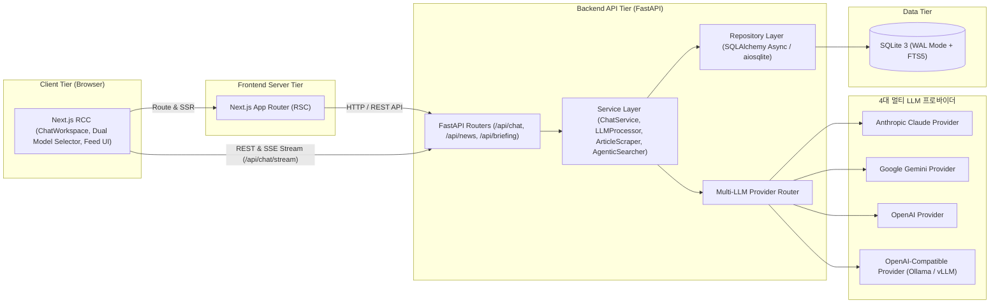

# [ADR-001] 풀스택 시스템 아키텍처 및 핵심 기술 스택 결정 레코드

- **작성일자**: 2026-10-20
- **작성자**: 풀스택 아키텍트 (`fullstack-architect`)
- **상태**: APPROVED
- **영향 범위**: Frontend (Next.js 16 App Router, React 19, Tailwind CSS v4), Backend (FastAPI, Python 3.11+, 4대 멀티 LLM 프로바이더 라우터), Database (SQLite 3 WAL + FTS5), Deployment (Docker Compose)

---

## 1. 배경 및 컨텍스트 (Context & Problem Statement)
- 기획 산출물(`01_PRD.md`, `02_FUNCTIONAL_SPECIFICATION.md`, `03_POLICIES_AND_EDGES.md`)을 충족하기 위한 풀스택 기술적 요구사항 분석.
- AI 에이전트(Autonomous Agents), 엔지니어링 하네스(Engineering Harness), MCP(Model Context Protocol) 분야의 글로벌 기술 소식을 실시간 수집·정제·요약하고, 전용 AI 챗 워크스페이스(`/chat`)에서 근거 기반 심층 리서치를 수행하는 고성능 플랫폼 구축.
- 특정 단일 벤더 종속(Vendor Lock-in)이나 "Claude 전용", "Anti-Gemini"와 같은 편향을 원천 배제하고, 사용자 환경과 필요에 따라 유연하게 선택할 수 있는 **4대 멀티 LLM 프로바이더(Anthropic Claude, Google Gemini, OpenAI, OpenAI-Compatible Ollama/vLLM)**를 동등한 1급 시민으로 지원하는 플러그형 라우팅 아키텍처 수립.
- 프론트엔드-백엔드 간 컨트랙트 기반의 독립적 병렬 개발, 뛰어난 초기 로딩 성능(Core Web Vitals), 철저한 타입 안전성, 기업급 환경변수 보안 거버넌스(Zero-Leak)를 동시에 달성.

---

## 2. 고려된 기술 스택 후보군 (Considered Alternatives)

| 계층 | 후보 1 (선정안) | 후보 2 (대안) | 장단점 비교 및 선정 사유 |
| :--- | :--- | :--- | :--- |
| **Frontend** | **Next.js 16 (React 19, TypeScript, Tailwind CSS v4)** | SPA (Vite + React) | Next.js App Router는 RSC(Server Components)를 통한 초기 번들 최적화, SSR 사전 렌더링 및 `next-themes` 기반 무깜빡임(Zero-Flicker) 다크 모드 지원에 탁월 |
| **Backend** | **Python 3.11+ (FastAPI, Pydantic v2)** | Node.js (Express / NestJS) | 비동기 ASGI SSE 스트리밍(`StreamingResponse`), Pydantic v2 기반 엄격한 스키마 검증, 자동 OpenAPI 3.1 문서화 및 Python 데이터 스크래핑 생태계(`trafilatura`)와의 네이티브 결합 우위 |
| **LLM 엔진 아키텍처** | **4대 멀티 프로바이더 통합 아키텍처 (`Anthropic Claude`, `Google Gemini`, `OpenAI`, `OpenAI-Compatible Ollama/vLLM`)** | 단일 LLM 벤더 하드코딩(Claude 전용 등) 또는 무거운 외장 프레임워크(LangChain) | 경량 비동기 어댑터 패턴으로 4대 프로바이더를 모두 동등하게 지원하여 벤더 유연성과 로컬 LLM 확장성을 확보하고, 투명한 예외 처리 및 정직한 모델 라우팅으로 프로덕션 신뢰성 보장 |
| **데이터베이스** | **SQLite 3 (WAL 모드 + FTS5 전문 검색)** | PostgreSQL + 외장 검색 엔진 (Elasticsearch) | 단일 노드 인텔리전스 플랫폼 특성상 외장 컨테이너 오버헤드 없이 SQLite WAL 동시성 제어와 FTS5(BM25) 역색인만으로 서브 밀리초 검색 및 세션 영속성 충족 |
| **상태/통신** | **SSE 다중 이벤트 스트리밍** | WebSocket 양방향 소켓 | AI 챗 진행 단계(`status`), 출처(`sources`), 토큰(`token`), 완료(`done`), 에러(`error`) 단방향 스트리밍에 HTTP 표준 SSE가 가장 단순하고 안정적 |

---

## 3. 최종 아키텍처 결정 사항 (Decision)

### 3.1 풀스택 전체 시스템 토폴로지

### 3.2 핵심 아키텍처 원칙
1. **RSC vs RCC 경계 원칙 (React Server Components vs React Client Components)**:
   - 레이아웃 골격, 메타데이터 생성, 초기 라우트 껍질(`app/layout.tsx`, `app/chat/page.tsx`, `app/page.tsx`)은 Server Component(RSC)로 유지하여 클라이언트 번들 크기를 최소화하고 초기 로딩(LCP)을 극대화합니다.
   - 실시간 SSE 스트리밍 구독, 듀얼 모델 셀렉터 상태 동기화(`ChatHeader` 우측 및 `ChatPromptInput` 좌하단), 테마 전환(`ThemeProvider`), 키보드 단축키(`HotkeyListener`, `CommandPalette`), 모달/바텀시트 상호작용 등 브라우저 상태 및 이벤트 리스너가 필요한 컴포넌트만 명시적으로 `'use client'`(RCC)로 분리합니다.
   - RSC와 RCC 간의 Props 전달은 순수 JSON 직렬화 가능한 데이터 구조로 엄격히 제한합니다.
2. **계층형 백엔드 아키텍처 (Layered Architecture)**:
   - `Router (API Layer)` $\rightarrow$ `Service (Business & Orchestration Layer)` $\rightarrow$ `Provider / Repository (Data & External Integration Layer)` $\rightarrow$ `Model / Schema (Domain Layer)` 단방향 의존성 규칙을 엄격히 준수합니다.
   - Router는 HTTP 엔드포인트 바인딩, 요청 파라미터 수신 및 응답 반환만 수행하며 비즈니스 로직을 포함하지 않습니다.
   - Service 계층은 RAG 컨텍스트 결합, 비동기 스크래핑, 4대 멀티 프로바이더 호출 오케스트레이션, 세션 영속화를 전담합니다.
   - Model / Schema 계층은 Pydantic v2 기반 엄격한 스키마 유효성 검증과 자동 OpenAPI 3.1 명세를 제공합니다.
3. **4대 멀티 LLM 프로바이더 추상화 및 설정 기반 동적 라우팅**:
   - **프로바이더 어댑터 인터페이스 (`BaseLLMProvider`)**:
     1. **Anthropic Claude 프로바이더**: 비동기 REST 연동, 멀티 티어 라우팅 및 시스템 프롬프트 캐싱(`cache_control: ephemeral`) 지원.
     2. **Google Gemini 프로바이더**: 비동기 REST 연동, 고속 요약 및 저지연 질의응답 지원.
     3. **OpenAI 프로바이더**: 표준 Chat Completions 스트리밍 지원.
     4. **OpenAI-Compatible 프로바이더**: 사내 자체 호스팅 및 로컬 오픈소스 런타임(Ollama / vLLM) 연동 지원.
   - **동적 설정 주입 (Configuration Injection)**: 특정 모델명을 아키텍처에 고정하지 않으며, 프로바이더 및 모델 매핑은 환경변수와 설정 파일(`config.json`)을 통해 런타임에 동적으로 주입됩니다.
   - **실제 사용 모델 식별자 보존**: 데이터베이스(`chat_messages.model_used`, `news_items.model`)에 실제 응답 생성을 수행한 모델의 식별자를 원본 그대로 영속화합니다.
   - **표준 에러 전파 원칙**:
     - 외부 API 키 누락(`LLMProviderUnavailableException`, HTTP 503), 할당량 초과(`LLMQuotaExceededException`, HTTP 429), 업스트림 통신 장애(`LLMUpstreamException`, HTTP 502) 시 표준 에러 코드와 SSE 에러 이벤트(`event: error`)를 통해 장애 원인을 클라이언트에 정확히 전달합니다.
4. **에이전틱 리서치 및 듀얼 레이어 세션 영속화**:
   - **실시간 전문 스크래핑 및 자율 보충 검색**: 단일 기사 집중(Scoped) 질의 시 `trafilatura` 비동기 스크래퍼로 원문 본문을 추출하여 2계층(L1 인메모리 LRU + L2 SQLite `full_content`)에 캐싱하고, 정보 공백 시 DuckDuckGo/Tavily 검색을 결합해 4단 엔지니어링 리포트(핵심 아키텍처, 코드 구현, 차별점, 실무 고려사항)를 합성합니다.
   - **듀얼 레이어 세션 관리**: 대화 세션과 멀티턴 메시지(최근 10턴 슬라이딩 윈도우)를 SQLite(`chat_sessions`, `chat_messages` CASCADE)와 브라우저 `localStorage`에 동기화하고 최대 30개 세션을 FIFO로 유지하며, 대화 도중 모델을 변경해도 세션 맥락을 무손실 인계합니다.
5. **엄격한 환경변수 거버넌스 및 Zero-Leak 보안**:
   - **백엔드 격리 로드**: `pydantic-settings`의 `BaseSettings`를 통해 `ANTHROPIC_API_KEY`, `GEMINI_API_KEY`, `OPENAI_API_KEY`, `OLLAMA_BASE_URL` 등 모든 민감한 외부 API 키를 서버 사이드 런타임 환경변수에서만 격리 로드합니다.
   - **프론트엔드 유출 원천 차단**: 프론트엔드는 Zod 기반 검증 모듈(`frontend/src/lib/env.ts`)을 통해 브라우저에 공개되는 환경변수(`NEXT_PUBLIC_API_URL`)만 명시적으로 파싱하며, 클라이언트 번들에 비밀 키가 포함되는 것을 원천 차단합니다.
   - **표시 마스킹**: 관리자 모달 등 UI 상에서 API 키를 표기할 때는 앞뒤 일부 문자열 외에는 마스킹(`sk-ant-***-Ab3d`) 처리하거나 설정 여부 불리언 플래그로만 노출합니다.

---

## 4. 결과 및 트레이드오프 (Consequences)
- **긍정적 영향**:
  - OpenAPI 3.1 규격 및 TypeScript/Zod 스키마 간의 100% 정합성을 확보하여 프론트엔드와 백엔드가 상호 블로킹 없이 독립적인 병렬 개발을 수행할 수 있음.
  - Anthropic Claude, Google Gemini, OpenAI, Ollama/vLLM을 포괄하는 4대 멀티 프로바이더 플러그형 지원을 통해 특정 벤더 종속성을 제거하고 온프레미스/로컬 인프라 확장성을 보장함.
  - 상단 헤더(`ChatHeader`)와 하단 프롬프트 입력창(`ChatPromptInput`) 듀얼 모델 셀렉터의 단일 상태(SSOT) 동기화로 즉각적인 모델 인지와 대화 중 무손실 모델 전환을 달성함.
  - Pydantic v2와 Zod 기반의 환경변수 검증 거버넌스를 통해 런타임 구성 오류를 방지하고 기업 감사 기준을 충족하는 Zero-Leak 보안을 확립함.
- **수용된 제약사항**:
  - React Server Components와 Client Components 간 Props 직렬화 제약으로 인해 Date 객체나 복합 인스턴스를 직접 전달할 수 없으며, 원시 타입 및 순수 JSON 직렬화 규약을 준수해야 함.
  - 멀티 프로바이더 간 상이한 스트리밍 응답 페이로드를 백엔드 `LLMProcessor` 어댑터 계층에서 표준 SSE 이벤트(`status`, `sources`, `token`, `done`, `error`)로 정규화하여 프론트엔드에 일관된 단일 스트리밍 인터페이스를 제공함.
