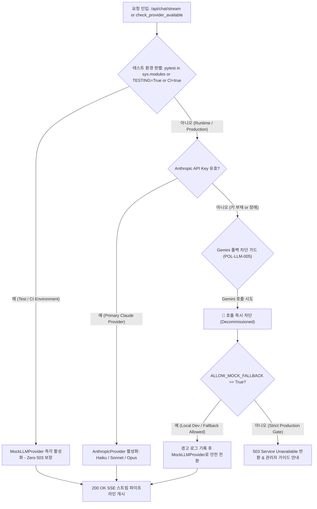
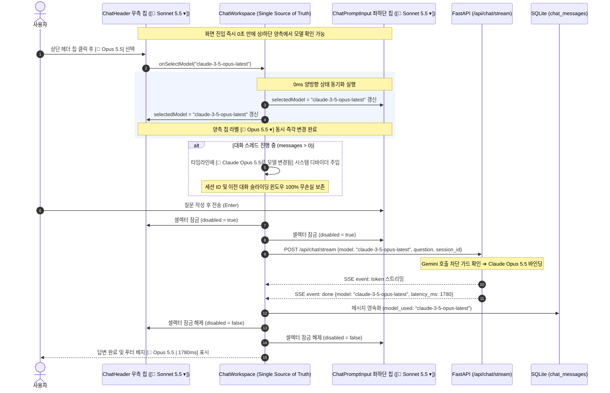

# [ADR-001] 풀스택 시스템 아키텍처 및 핵심 기술 스택 결정 레코드

- **작성일자**: 2026-10-19
- **작성자**: 풀스택 아키텍트 (`fullstack-architect`)
- **문서 버전**: 0.2.0 (Master Fullstack Architecture Decision Record: Gemini 무단 폴백 차단 및 Anti-Gemini Claude 전용 아키텍처, Claude Sonnet 5.5 전담 수집 파이프라인 & 90% 비용 절감 프롬프트 캐싱, AI 챗 워크스페이스 듀얼 모델 셀렉터(ChatHeader 우측 + ChatPromptInput 좌하단) 0ms 양방향 동기화 UX, Zero-Leak API 키 보안 거버넌스, 전역 다크/라이트 테마 시스템, 백엔드 Fail-Fast & Mock Fallback Zero 503, 파워 유저 키보드 단축키 & Cmd+K 커맨드 팔레트, 4단 구조화 리포트 멀티채널 익스포트 및 풀스택 토폴로지 통합 확정판)
- **상태**: APPROVED
- **영향 범위**: Frontend (Next.js 16 App Router, React 19, Tailwind CSS v4, `next-themes`, Hotkeys, Command Palette, `/chat` 전용 워크스페이스, Dual-Placement Model Selector in `ChatHeader` & `ChatPromptInput`), Backend (FastAPI, Python 3.11+, `httpx.AsyncClient` 기반 Anthropic REST API 클라이언트, Gemini 호출 전면 영구 퇴역 및 Claude-Only Provider Hierarchy, BaseLLMProvider & AnthropicProvider & MockLLMProvider Fallback Chain, ArticleScraperService, AgenticSearchService, ChatSessionService), Database (SQLite 3 WAL with `news_items.full_content`, `chat_sessions`, `chat_messages.model_used`), Deployment (Docker Compose, `main` 브랜치 머지 안전성)

---

## 1. 배경 및 컨텍스트 (Context & Problem Statement)

AgentLens는 전 세계 AI 에이전트(Autonomous Agents), 엔지니어링 하네스(Engineering Harness), MCP(Model Context Protocol) 및 스킬 생태계 소식을 수집·정제·브리핑하는 차세대 버티컬 테크 인텔리전스 플랫폼입니다.
선행 기획 산출물([`report.md`](file:///Users/wonyoung/workspace/ozplayground/agentlens/report.md) v0.2.0, [`01_PRD.md`](file:///Users/wonyoung/workspace/ozplayground/agentlens/docs/spec-writer/01_PRD.md) v0.2.0, [`02_FUNCTIONAL_SPECIFICATION.md`](file:///Users/wonyoung/workspace/ozplayground/agentlens/docs/spec-writer/02_FUNCTIONAL_SPECIFICATION.md) v0.2.0, [`07_CLAUDE_INTEGRATION_AND_MODEL_SELECTOR_SPECIFICATION.md`](file:///Users/wonyoung/workspace/ozplayground/agentlens/docs/spec-writer/fsd/07_CLAUDE_INTEGRATION_AND_MODEL_SELECTOR_SPECIFICATION.md) v0.2.0, [`03_POLICIES_AND_EDGES.md`](file:///Users/wonyoung/workspace/ozplayground/agentlens/docs/spec-writer/03_POLICIES_AND_EDGES.md) v0.2.0, [`01_MARKET_BENCHMARK.md`](file:///Users/wonyoung/workspace/ozplayground/agentlens/docs/market-analyst/01_MARKET_BENCHMARK.md) v0.2.0)을 완벽히 충족하기 위한 풀스택 시스템 아키텍처와 엔드투엔드 기술 결정을 확립합니다.

### 1.1 제품 비전 및 포지셔닝 (Product Vision v0.2.0)
> **"단순 뉴스 요약 챗봇을 완전히 탈피하여, AI Agent · Harness · MCP 최신 기술 소식의 원본 소스를 실시간 무손실 파싱하고, 지식 공백을 자율 보충하며, Gemini 무단 폴백을 원천 차단한 Claude 전용 코어 엔진(Sonnet 5.5 전담 수집 파이프라인 및 프롬프트 캐싱 90% 비용 절감)과 직관적인 상단 헤더 & 입력창 듀얼 모델 셀렉터(0ms 양방향 동기화), 무손실 세션 연속성, Zero-Leak 보안 거버넌스, 전역 다크모드, 파워 유저 핫키, 무결점 백엔드 복원력(Zero 503) 및 4단 구조화 리포트 멀티채널 익스포트를 완비한 엔지니어링 에이전틱 리서치 워크스페이스"**

### 1.2 핵심 해결 과제 및 아키텍처적 병목 (Core Bottlenecks & Problem Statement)

1. **사용자 제기 긴급 결함 1: "왜 Gemini가 나오냐?" (The Gemini Leak Defect & Silent Downgrade)**:
   - 사용자가 프론티어 Claude 모델을 기대하고 질의했음에도, 백엔드의 레거시 `_call_gemini` 로직 및 `auto` 폴백 체인으로 인해 답변 푸터나 수집 피드에 `Google gemini-3.5-flash-lite`가 출력되는 치명적 사용자 신뢰 훼손 발생.
   - Claude API 장애나 키 부재 시 사용자 동의 없이 타사 저가형 모델(Gemini)로 사일런트 다운그레이드되는 동작을 원천 차단하고, 요청한 **Claude 3-Tier (Haiku 5.5, Sonnet 5.5 기본값, Opus 5.5)** 및 전담 수집 파이프라인(Sonnet 5.5)이 엄격히 준수되도록 레거시 Gemini 로직을 전면 영구 퇴역(Decommission)시키는 **Anti-Gemini Claude 전용 아키텍처** 수립이 시급함.
2. **사용자 제기 긴급 결함 2: "AI 챗 화면에서 모델 선택은 어떻게 하는데?" (Model Selector Discoverability Issue)**:
   - AI 챗 진입 시 상단 헤더에 모델 선택기가 누락되어 있고 입력창 하단 구석에만 작게 숨겨져 있어 사용자가 모델을 어디서 변경해야 하는지 직관적으로 인지하지 못하는 심각한 UX 마찰 확인.
   - 메인 워크스페이스 **상단 헤더(`ChatHeader`) 우측** 및 **프롬프트 입력창(`ChatPromptInput`) 좌하단** 양측에 직관적인 3-Tier 선택기(`ChatModelSelector`)를 듀얼 배치하여 진입 즉시 0초 만에 현재 모델을 확인하고 원클릭으로 교체할 수 있는 **듀얼 마운트 및 0ms 양방향 상태 동기화 아키텍처**가 요구됨.
3. **데이터 수집 파이프라인의 퀄리티 양극화 및 환각 태깅 (The Quality Chasm in Ingestion)**:
   - 저가형 소형 모델이나 단순 규칙 기반 파서로 기술 뉴스를 정제·요약할 경우 아키텍처적 시사점(`Why It Matters`)을 도출하지 못하고 기술 태그 환각 및 Pydantic 파싱 오류가 빈발함.
   - 업계 최고 수준의 지능을 보유한 **Claude Sonnet 5.5**를 데이터 수집/정제/요약/태깅 전담 모델로 단독 배정하여 고신호 엔지니어링 브리핑을 확보해야 함.
4. **반복 수집에 따른 고비용 토큰 과금 병목 및 프롬프트 캐싱 필요성**:
   - 매 수집마다 2,500토큰에 달하는 Senior Staff Architect 시스템 프롬프트(지침, 태깅 루브릭, 퓨샷)를 반복 전송하면 LLM API 비용이 기하급수적으로 폭증함.
   - Anthropic Prompt Caching(`cache_control: {"type": "ephemeral"}`)을 적용하여 **입력 토큰 비용을 90% 절감($0.10/MTok)**하는 경제적 아키텍처 수립이 필수적임.
5. **대화 진행 중 모델 전환 시 컨텍스트 초기화 참사 (Mid-Thread Reset Friction)**:
   - 대화 스레드 중간에 심층 추론이나 속도 개선을 위해 모델을 변경할 때 세션이 초기화되거나 이전 대화 이력이 유실되는 단절 발생.
   - 세션 ID를 유지하고 타임라인에 상태 알림 디바이더를 삽입하며, 최대 10턴(3,000토큰)의 슬라이딩 윈도우와 Scoped 원문 본문(8,000토큰)을 **100% 무손실 인계(Zero Context Erasure)**하는 동적 라우팅 아키텍처가 요구됨.
6. **API 키 노출 공포와 Git 커밋 유출 위험 (The API Key Security Nightmare - Zero-Leak Mandate)**:
   - 브라우저 클라이언트 사이드에 API 키가 노출되거나 Git 리포지토리에 비밀키가 커밋되어 발생하는 대규모 과금 폭탄 및 계정 탈취 사고를 차단해야 함.
   - 클라이언트 절대 무노출, 백엔드 `.env` 및 `pydantic-settings` 단독 격리, `.gitignore` 및 Pre-commit 정적 검증, FastAPI 서버 프록시 스트리밍을 통한 **Zero-Leak 보안 거버넌스 아키텍처**를 수립하여 `main` 브랜치 머지 안전성을 보장해야 함.
7. **야간 및 장시간 리서치 시 눈의 피로와 다크모드 SSR FOUC 깜빡임 (Preserved)**:
   - Next.js 16 App Router SSR 환경에서 Tailwind CSS v4와 연동되는 **무깜빡임(Zero-Flicker) 전역 테마 공급자 아키텍처**(`next-themes` 인라인 스크립트 주입) 유지.
8. **CI/테스트 및 키 미등록 환경의 침묵하는 503 시스템 장애 (Zero 503 원칙) (Preserved)**:
   - 테스트 러너(`pytest`, `TESTING=True`, `CI=true`)를 자동 감지하고 장애 시 안전하게 전환되는 **Mock LLM Provider 및 Fallback 체인 아키텍처** 유지.
9. **파워 유저 키보드 단축키 및 커맨드 팔레트 부재 (Keyboard Ergonomics Gap & Input Isolation) (Preserved)**:
   - 텍스트 입력창 타이핑 중 핫키 오동작 및 IME(한글) 조합 오류를 원천 차단하는 **중앙 집중형 이벤트 브리지(`useKeyboardShortcuts`) 및 커맨드 팔레트(`Cmd+K`) 아키텍처** 유지.
10. **엔지니어링 4단 리포트의 지식 자산화 및 멀티채널 익스포트 단절 (Preserved)**:
    - 4대 마크다운 H2 섹션 강제 및 클라이언트 무손실 마크다운 복사, `.md` 다운로드, Notion 1-클릭 동기화 파이프라인 유지.
11. **'2줄 요약 앵무새 답변' 박멸과 실시간 본문 파싱/자율 보충 검색 (Preserved)**:
    - Trafilatura 비동기 스크래핑 파이프라인 + 2계층 캐시(LRU + SQLite) + 맥락 앵커링 자율 웹 검색(DuckDuckGo/Tavily) 루프 유지.
12. **모바일 뷰포트 인셋 붕괴 및 가로 스크롤 누수 박멸 (Preserved)**:
    - 가상 키보드 팝업 시 `visualViewport` 인셋 동기화, 16px 강제, `overflow-wrap: anywhere` 및 코드/테이블 국소 스크롤 격리로 화면 수평 이동 **0px** 보장.

---

## 2. 고려된 기술 스택 후보군 및 결정 매트릭스 (Considered Alternatives)

| 계층 / 영역 | 최종 선정안 (Selected) | 대안 후보 (Alternative) | 장단점 비교 및 선정 사유 (Trade-offs & Rationale) |
| :--- | :--- | :--- | :--- |
| **코어 LLM 엔진 & 폴백 거버넌스** | **Anti-Gemini Claude-Only 아키텍처 (Gemini 전면 퇴역, Claude 3-Tier 엄격 격리)** | 사일런트 Gemini 폴백 유지 (`_call_gemini`, `gemini-3.5-flash-lite`) | 기존 레거시 Gemini 폴백은 사용자가 인지하지 못한 채 저가형 모델로 임의 변경되어 답변 품질 저하 및 브랜드 신뢰를 심각하게 훼손함. Gemini 호출 경로를 전면 퇴역시키고, 장애 시 투명한 에러 통지 및 내부 지수 백오프/Mock Provider로 격리하여 100% Claude 정체성을 보장. |
| **모델 셀렉터 UI 배치 구조** | **상단 헤더(`ChatHeader`) 우측 + 입력창(`ChatPromptInput`) 좌하단 듀얼 배치 (0ms 양방향 동기화)** | 입력창 하단 구석 단독 배치 / 헤더 단독 배치 / 별도 모달 분리 | 입력창 구석 단독 배치는 사용자가 챗 진입 시 모델 선택 동선을 찾지 못하는 심각한 시각적 인지성 결함(Fitts의 법칙 위배)을 유발함. 상단 헤더 우측 상시 노출로 진입 즉시 0초 인지를 보장하고, 입력창 인라인 칩을 동시 제공하여 작성 중 접근성을 극대화하며, 단일 상태 머신으로 0ms 양방향 동기화를 달성. |
| **Frontend Framework** | **Next.js 16 (React 19, TypeScript)** | Vite + React SPA | Next.js는 RSC(Server Components)를 통한 초기 번들 최적화, SSR 프리렌더링, SEO 메타데이터, Viewport 제어 탁월. SPA는 초기 로딩 번들 크기 과다 및 FOUC 제어 취약. |
| **Anthropic API 통신 클라이언트** | **Python `httpx.AsyncClient` 기반 직접 REST 클라이언트 (`api.anthropic.com/v1/messages`)** | 공식 `anthropic` Python SDK 외장 라이브러리 추가 / LangChain | **KISS & YAGNI 원칙 준수**. 이미 프로젝트에 설치된 비동기 `httpx`를 직접 활용하여 추가 외장 의존성을 0개로 유지. SSE 청크 스트리밍과 JSON 응답을 완벽히 제어하며, `anthropic-version: 2023-06-01`, `anthropic-beta: prompt-caching-2024-07-31` 헤더를 정밀하게 주입 가능. |
| **데이터 수집 파이프라인 전담 모델** | **Claude Sonnet 5.5 (`claude-3-5-sonnet-latest`) 단독 전담 + 프롬프트 캐싱** | 소형/저가형 플래시 모델 (Gemini Flash / GPT-4o-mini) 혼용 / 로컬 모델 | 저가형 모델은 아키텍처적 시사점(`why_it_matters`) 서술이 피상적이고 Pydantic 스키마 파싱 실패율이 높음. Sonnet 5.5는 최고 수준의 엔지니어링 분석 지능을 제공하며, 2,500토큰 시스템 프롬프트 캐싱을 통해 입력 비용을 90% 절감($0.10/MTok)하여 경제성과 고신호 품질을 완벽히 양립. |
| **AI 챗 멀티 모델 라우팅** | **의도 기반 3-Tier (`⚡ Haiku 5.5`, `🎯 Sonnet 5.5`, `🧠 Opus 5.5`) 동적 라우팅 + 세션 무손실 인계** | 런타임 단일 모델 고정 / 원시 릴리즈 모델명 직접 나열 | 복잡한 해시 문자열 노출은 사용자에게 선택 마비와 과금 공포를 유발함. 3-Tier 원클릭 셀렉터는 작업 의도에 맞춘 직관적 선택을 제공하며, 대화 진행 중 모델 변경 시 세션 초기화 없이 최대 10턴(3,000토큰)의 맥락을 100% 무손실 인계(Zero Context Erasure)함. |
| **API 키 보안 아키텍처** | **Zero-Leak 백엔드 프록시 스트리밍 + .env 격리 + Pre-commit 훅 정적 탐지** | 클라이언트 사이드 직접 호출 (`NEXT_PUBLIC_ANTHROPIC_API_KEY`) | 클라이언트에 키를 주입하면 브라우저 Network 탭이나 번들 역컴파일을 통해 100% 유출되어 대규모 과금 사고 발생. 백엔드 전용 프록시 스트리밍과 Git 프리커밋 정적 탐지로 키 유출을 원천 차단(Zero-Leak)하여 `main` 브랜치 머지 안전성을 보장. |
| **전역 테마 시스템 (Theme Provider)** | **Tailwind CSS v4 + `next-themes` (SSR Inline Script Injection)** | 커스텀 `ThemeContext` (`useEffect` 클라이언트 전용 마운트) | 커스텀 `ThemeContext`는 `useEffect` 시점에 로컬스토리지를 읽어 최초 페인트 시 하얀 번쩍임(FOUC) 발생. `next-themes`는 브라우저 페인트 이전 동기 인라인 스크립트로 `<html class="dark">`를 주입하여 FOUC를 100% 원천 차단. |
| **CSS & 스타일링 엔진** | **Tailwind CSS v4 (`@theme`, `@variant dark`, CSS 변수)** | Emotion / Styled-components / Tailwind CSS v3 | Tailwind CSS v4는 고성능 Lightning CSS 기반 엔진으로 빌드 속도가 5배 이상 빠르고, CSS 변수 기반 디자인 토큰 및 `@variant dark (&:where(.dark, .dark *))` 지원 탁월. React 19 RSC와 호환 결함 없음. |
| **키보드 단축키 & 커맨드 팔레트** | **중앙 집중형 Event Bridge (`useKeyboardShortcuts`) + `CommandPaletteModal`** | `react-hotkeys-hook` / Mousetrap 외장 라이브러리 | 외장 라이브러리는 추가 번들 의존성과 React 19 호환성 이슈 유발. 직접 구현한 단일 Event Bridge는 단 100줄 코드로 IME 조합 가드, Input Isolation Rule, ESC 스택 해제를 완벽 통제 가능 (KISS/YAGNI 원칙). |
| **백엔드 LLM 장애 복원력 (Zero 503)** | **Pluggable `BaseLLMProvider` + `MockLLMProvider` Fallback Chain (Gemini 완전 배제)** | 키 부재 시 즉각 Fail-Fast (503 Service Unavailable) 고수 / 타사 모델 자동 다운그레이드 | 키 부재 시 503을 던지면 CI 파이프라인 실패. 타사 모델(Gemini)로의 자동 변조는 투명성 결여. 환경 판별(`pytest` / `TESTING=True`) 및 `ALLOW_MOCK_FALLBACK` 설정으로 테스트에서는 Mock 토큰 스트림을 공급하고, 프로덕션에서는 실제 Claude 프로바이더를 엄격히 운영하여 Zero 503과 정체성 신뢰도를 동시 달성. |
| **4단 리포트 익스포트 엔진** | **클라이언트 Blob 다운로드 + `navigator.clipboard` + 백엔드 Notion Service** | 헤드리스 브라우저 PDF 렌더링 (Puppeteer) | 서버 사이드 PDF/이미지 생성은 수백 MB의 Chromium 런타임과 3~5초의 레이턴시를 소모함. 클라이언트 네이티브 Blob/클립보드 API는 0ms 지연으로 무손실 GFM 마크다운을 다운로드/복사하며, Notion 공식 API를 통해 실시간 위키 동기화 달성. |
| **Backend API Tier** | **FastAPI (Python 3.11+, Pydantic v2)** | Node.js (NestJS / Express) | FastAPI는 비동기 ASGI 스트리밍(`StreamingResponse`), Pydantic v2 기반 엄격한 스키마 검증, 자동 OpenAPI 3.1 명세 생성, 그리고 AI/데이터 파이프라인(Trafilatura, LLM 클라이언트)과의 네이티브 결합 지원. |
| **원본 본문 추출 엔진** | **비동기 `httpx` + `trafilatura` (Fallback: `readability-lxml`)** | 헤드리스 브라우저 (Playwright / Puppeteer) | `trafilatura`는 C 기반 초고속 파서로 광고/보일러플레이트 제거율 95% 이상을 달성하며 메모리 오버헤드가 거의 없고(평균 150ms 파싱), 불필요한 JS 렌더링 비용을 원천 차단함. |
| **자율 보충 검색 파사드** | **`WebSearchFacade` (`DuckDuckGo` 내장 + `Tavily` 플러그인)** | 상용 단일 검색 API (Google/Serper) 하드코딩 | 키 없이도 즉시 동작하는 DuckDuckGo를 기본 탑재하고 고품질 AI 리서치를 위해 Tavily를 플러그인으로 추상화하여 API 키 유무에 따른 우아한 적응형 전환 지원. |
| **데이터베이스 계층** | **SQLite 3 WAL (개발/운영 단일 노드 최적화)** | PostgreSQL + pgvector / Redis | AgentLens는 단일 인스턴스 버티컬 인텔리전스 도구로서 별도의 외장 DB 컨테이너 인프라 오버헤드 없이 SQLite WAL 모드와 FTS5만으로 초당 수천 쿼리 및 무지연 검색을 완벽 지원함. |
| **실시간 스트리밍 통신** | **Server-Sent Events (SSE) 다중 이벤트 채널** | WebSocket 양방향 소켓 | 챗 인터랙션은 단방향 진행 상태 및 토큰 푸시로 귀결되므로 WebSocket의 복잡한 연결 유지/재연결 관리 오버헤드 없이 HTTP/2 다중화와 프록시 친화성이 탁월한 표준 SSE 채택. |

---

## 3. 최종 아키텍처 결정 사항 (Decision)

### 3.1 풀스택 전체 시스템 토폴로지 (System Topology)

```mermaid
flowchart TD
    subgraph ClientTier ["클라이언트 티어 (Browser - Next.js 16 Client Components)"]
        direction TB
        THEME_PROV["ThemeProvider (next-themes: Zero-Flicker SSR Hydration)"]
        HOTKEY_BRIDGE["Global Hotkey Bridge (useKeyboardShortcuts: j/k, /, c, b, t, Cmd+K)"]
        CMD_PALETTE["CommandPaletteModal (포커스 트랩, 디바운스 검색, 액션 라우팅)"]
        
        subgraph ChatWorkspaceArea ["전용 AI 챗 워크스페이스 (/chat)"]
            CHAT_WORKSPACE["ChatWorkspace (단일 소스 오브 트루스: selectedModel, session_id)"]
            
            subgraph DualModelSelectorGroup ["듀얼 모델 셀렉터 마운트 (0ms 양방향 상태 동기화)"]
                HEADER_SELECTOR["ChatHeader 우측 칩 ([🎯 Sonnet 5.5 ▾] 상시 노출)"]
                COMPOSER_SELECTOR["ChatPromptInput 좌하단 인라인 칩 ([🎯 Sonnet 5.5 ▾])"]
            end
            
            SIDEBAR_DESKTOP["ChatSidebar (lg>=1024px: 고정 세션 히스토리 aside)"]
            DRAWER_MOBILE["ChatDrawer (모바일/태블릿: 슬라이드 오버레이 50vh)"]
            SYSTEM_DIVIDER["SystemDivider ([🔄 Claude Opus 5.5로 모델 변경됨])"]
            STEP_TRACKER["WorkflowStepTracker (실시간 진행 바)"]
            WORKFLOW_ACCORDION["WorkflowAccordion (완료 후 28px 접이식 아코디언)"]
            FOCUS_CAPSULE["FocusCapsule (30px 컴팩트 캡슐)"]
            DEEP_REPORT_VIEWER["DeepReportViewer (4단 엔지니어링 리포트 렌더러)"]
            EXPORT_TOOLBAR["ExportToolbar (마크다운 복사, .md 다운로드, Notion 연동)"]
            CITATION_BADGE["CitationBadge (이원화: [1] 원본 vs [S1] 웹 보충 출처)"]
            COMPOSER["ChatPromptInput (16px text-base 강제 & visualViewport 인셋 제어)"]
        end
    end

    subgraph FrontendServerTier ["프론트엔드 서버 티어 (Next.js 16 App Router)"]
        ROOT_LAYOUT["RootLayout (suppressHydrationWarning, Geist Fonts, overflow-x-hidden)"]
        VIEWPORT_META["Viewport Config (interactiveWidget: resizes-content)"]
        RSC_CHAT["/chat Server Component (SEO Shell, Initial State)"]
        ZOD_ENV["Zod Client/Server Env Validation (lib/env.ts - Zero API Key Exposed)"]
    end

    subgraph BackendAPITier ["백엔드 API 티어 (FastAPI / Python 3.11+)"]
        API_ROUTER["FastAPI App (/api)"]
        CHAT_ROUTER["Chat Router (/api/chat/stream, /api/chat/sessions)"]
        COLL_ROUTER["Collection Router (/api/collect, /api/schedule)"]
        EXPORT_ROUTER["Export Router (/api/export/notion, /api/briefing/notion)"]
        SYS_ROUTER["System & Sources Router (/api/sources, /api/settings)"]
        PYDANTIC_SETTINGS["Pydantic Settings (BaseSettings - ANTHROPIC_API_KEY 격리)"]
    end

    subgraph ServiceLayer ["백엔드 서비스 계층 (Business Logic & Facades)"]
        CHAT_SVC["ChatService (에이전틱 워크플로우 & Claude 3-Tier 멀티 모델 라우터)"]
        SESSION_SVC["ChatSessionService (SQLite 영속화 & 30개 FIFO 관리)"]
        SCRAPER_SVC["ArticleScraperService (비동기 httpx + trafilatura 본문 정제)"]
        L1_LRU["L1 In-Memory LRU Content Cache (최대 500개 기사)"]
        AGENTIC_SEARCH["AgenticSearchService (정보 충실도 평가 & 맥락 앵커링)"]
        SEARCH_FACADE["WebSearchFacade (DuckDuckGo + Tavily)"]
        NOTION_SVC["NotionService (마크다운 ➔ Notion Block 변환 및 발행)"]
        
        subgraph ClaudeSubsystem ["Anti-Gemini Claude 전용 서브시스템"]
            ANTHROPIC_CLIENT["AnthropicAsyncClient (Python httpx.AsyncClient REST Wrapper)"]
            PROMPT_CACHE_MGR["PromptCacheManager (cache_control: ephemeral 90% 절감)"]
            LLM_PROC["LLMProcessor (Claude 전용 라우터 & Gemini 전면 영구 퇴역)"]
            MOCK_PROVIDER["MockLLMProvider (테스트/오프라인 모의 스트림)"]
            GEMINI_BLOCKED["🚫 Gemini 호출 전면 차단 (POL-LLM-005)"]
        end
    end

    subgraph ExternalEcosystem ["외부 웹 & AI 생태계"]
        EXT_WEB["원본 웹사이트 URL (원문 기사 HTML)"]
        DDG_API["DuckDuckGo Search Engine"]
        TAVILY_API["Tavily AI Search API"]
        NOTION_API["Notion API Endpoints"]
        ANTHROPIC_API["Anthropic Cloud API (https://api.anthropic.com/v1/messages)"]
    end

    subgraph DataTier ["데이터 티어 (SQLite 3 WAL)"]
        DB[("agentlens.db (SQLite 3 WAL Mode)")]
        T_NEWS[("news_items (L2 full_content 캐시 & Sonnet 5.5 메타데이터)")]
        T_FTS[("news_items_fts (FTS5 가상 테이블)")]
        T_SESSIONS[("chat_sessions (세션 마스터)")]
        T_MESSAGES[("chat_messages (메시지 상세, model_used, CASCADE)")]
    end

    %% Client Layout & Providers
    ROOT_LAYOUT --> VIEWPORT_META --> RSC_CHAT --> THEME_PROV
    THEME_PROV --> HOTKEY_BRIDGE --> CHAT_WORKSPACE
    HOTKEY_BRIDGE -.->|"Cmd+K"| CMD_PALETTE
    
    %% Dual Model Selector Sync
    CHAT_WORKSPACE <-->|"0ms 양방향 동기화"| HEADER_SELECTOR
    CHAT_WORKSPACE <-->|"0ms 양방향 동기화"| COMPOSER_SELECTOR
    
    %% Workspace UI Components
    CHAT_WORKSPACE --> SIDEBAR_DESKTOP & DRAWER_MOBILE
    CHAT_WORKSPACE --> STEP_TRACKER & WORKFLOW_ACCORDION & FOCUS_CAPSULE
    CHAT_WORKSPACE --> DEEP_REPORT_VIEWER & EXPORT_TOOLBAR & CITATION_BADGE & COMPOSER
    CHAT_WORKSPACE --> SYSTEM_DIVIDER

    %% Client to Backend (Zero Key Exposure, Only Internal API)
    COMPOSER -->|"SSE: POST /api/chat/stream {model, question, session_id}"| CHAT_ROUTER
    CHAT_WORKSPACE -->|"REST: /api/chat/sessions"| CHAT_ROUTER
    EXPORT_TOOLBAR -->|"POST /api/export/notion"| EXPORT_ROUTER

    %% Backend Routing to Services
    CHAT_ROUTER --> CHAT_SVC & SESSION_SVC
    COLL_ROUTER --> SCRAPER_SVC & LLM_PROC
    EXPORT_ROUTER --> NOTION_SVC
    CHAT_SVC --> SCRAPER_SVC & AGENTIC_SEARCH & LLM_PROC

    %% Scraper & Cache
    SCRAPER_SVC --> L1_LRU
    L1_LRU -.->|"L1 Miss"| T_NEWS
    T_NEWS -.->|"L2 Miss"| EXT_WEB

    %% Search & Fallback
    AGENTIC_SEARCH --> SEARCH_FACADE
    SEARCH_FACADE --> DDG_API & TAVILY_API

    %% Claude Resolution Hierarchy (Gemini Completely Blocked)
    LLM_PROC -->|"pytest / TESTING=True / Mock Fallback"| MOCK_PROVIDER
    LLM_PROC -->|"ANTHROPIC_API_KEY Available (Claude 3-Tier)"| ANTHROPIC_CLIENT
    LLM_PROC -.->|"Gemini 폴백 시도 시 즉각 차단"| GEMINI_BLOCKED

    ANTHROPIC_CLIENT --> PROMPT_CACHE_MGR
    ANTHROPIC_CLIENT -->|"Bearer x-api-key"| ANTHROPIC_API

    %% Export & Database
    NOTION_SVC --> NOTION_API
    SESSION_SVC --> T_SESSIONS & T_MESSAGES
    DB --- T_NEWS & T_FTS & T_SESSIONS & T_MESSAGES
```



---

### 3.2 핵심 아키텍처 원칙 (Core Architecture Principles)

#### 1) RSC vs RCC 경계 원칙 (Server vs Client Components Boundary)
- **원칙**: 데이터 페칭, SEO 메타데이터, 레이아웃 골격은 Server Component(RSC)로 유지하고, 브라우저 인터랙션(상태, 이벤트 리스너, 로컬스토리지, DOM 조작)이 필요한 컴포넌트만 명시적으로 `'use client'`를 선언하여 클라이언트 컴포넌트(RCC)로 분리합니다.
- **Props 직렬화 규약**: RSC에서 RCC로 전달되는 모든 Props는 반드시 JSON 직렬화 가능(Serializable)해야 하며 함수나 순환 참조 객체의 주입을 금지합니다.
- **경계 분리 맵**:
  - `app/layout.tsx` (RSC): Root Shell, Metadata, Viewport, 폰트 주입.
  - `app/chat/page.tsx` (RSC): 정적 페이지 껍질, SEO 메타데이터.
  - `context/ThemeContext.tsx` (RCC): `next-themes` 공급자, 로컬스토리지 동기화.
  - `components/CommandPalette.tsx` (RCC): 키보드 이벤트 리스너, 포커스 트랩.
  - `components/chat/ChatWorkspace.tsx` (RCC): 활성 세션 상태 머신, 모델 상태 단일 소스 관리, SSE 리더.
  - `components/chat/ChatHeader.tsx` (RCC): 상단 헤더 및 우측 모델 셀렉터 마운트 (`header_model_selector`).
  - `components/chat/ChatPromptInput.tsx` (RCC): 프롬프트 작성창 및 좌하단 인라인 모델 셀렉터 마운트 (`composer_model_selector`).
  - `components/chat/ChatModelSelector.tsx` (RCC): 3-Tier 드롭다운 팝오버, 키보드 선택, 상태 락.
  - `components/chat/ChatMessageItem.tsx` (RCC): 마크다운 렌더링, 인라인 인용 뱃지, 실제 사용 모델 배지, 익스포트 툴바.

#### 2) 계층형 백엔드 아키텍처 (Layered Backend Architecture)
```
[API Layer]        app/api/chat.py, app/api/collect.py, app/api/news.py
       │           (HTTP 요청 검증, 3-Tier 모델 인자 매핑, SSE 스트리밍 응답, 상태 코드 매핑)
       ▼
[Service Layer]    app/services/chat_service.py, llm_processor.py, scraper.py
       │           (에이전틱 워크플로우 제어, 프롬프트 캐싱 관리, 세션 무손실 인계 오케스트레이션)
       ▼
[Provider / Facade] app/services/llm_providers/anthropic_provider.py, mock_provider.py
       │           (httpx.AsyncClient 기반 REST API 통신, SSE 청크 파싱, Pydantic 스키마 검증, Gemini 차단 가드)
       ▼
[Repository Layer] app/services/chat_session_service.py, retriever.py
       │           (SQLAlchemy 비동기 세션, SQLite FTS5 질의, model_used 영속화, CASCADE CRUD)
       ▼
[Domain / Model]   app/models/chat_session.py, app/schemas/chat.py
                   (SQLAlchemy 2.0 ORM 모델 및 Pydantic v2 스키마 계약)
```
- 상위 계층은 직계 하위 계층에만 의존하며, API Router가 데이터베이스 세션이나 저수준 SQL, 외부 LLM 소켓에 직접 접근하는 것을 엄격히 금지합니다.

#### 3) 엄격한 환경변수 거버넌스 및 Zero-Leak 보안 원칙
- **백엔드**: Python `pydantic-settings`의 `BaseSettings`를 상속하여 런타임 타입 검증, 기본값 주입, `config.json`과의 유기적 병합을 보장합니다. `ANTHROPIC_API_KEY`는 오직 백엔드 메모리에만 보관됩니다.
- **프론트엔드**: `frontend/src/lib/env.ts`의 Zod 스키마 검증 모듈을 통해 클라이언트 환경변수를 통제하며, `NEXT_PUBLIC_ANTHROPIC_API_KEY`와 같은 비밀키의 프론트엔드 번들 주입을 100% 원천 차단합니다.

#### 4) 간결함과 실용적 공학 (KISS & YAGNI)
- 외장 `anthropic` Python SDK나 LangChain과 같은 무거운 추상화 레이어를 추가하지 않고, 프로젝트에 이미 내장된 비동기 `httpx.AsyncClient`로 직접 Anthropic REST API를 호출하여 추가 의존성을 0개로 유지합니다. 외장 분산 캐시(Redis)나 외장 벡터 DB 없이 SQLite 3 WAL과 단일 파이썬 비동기 프로세스로 고성능 풀스택 시스템을 완성합니다.

---

### 3.3 [ADR-007] 전역 다크/라이트 테마 시스템 아키텍처 (Tailwind CSS v4 + SSR FOUC 무깜빡임 테마 공급자)

#### 1) 배경 및 요구사항 (`FUNC-THEME-001`, `REQ-THEME-001`)
- 어두운 IDE 및 야간 환경에서 작업하는 AI 엔지니어의 시각 피로를 해소하기 위해 라이트(Light), 다크(Dark), 시스템(System) 3대 모드를 지원합니다.
- Next.js 16 SSR 환경에서 새로고침 시 하얀색 화면이 1프레임이라도 번쩍이는 FOUC(Flash of Unstyled Content) 발생률을 **0% (Zero Flicker)**로 달성해야 합니다.

#### 2) Tailwind CSS v4 테마 연동 아키텍처
- Tailwind CSS v4는 고성능 Lightning CSS 엔진을 사용하며, `frontend/src/app/globals.css`에서 클래스 기반 다크 모드 변수를 정의합니다:
  ```css
  @import "tailwindcss";

  @variant dark (&:where(.dark, .dark *));

  :root {
    --background: #f8fafc;
    --foreground: #0f172a;
    color-scheme: light;
  }

  html.dark {
    --background: #0d1117;
    --foreground: #f0f6fc;
    color-scheme: dark;
  }
  ```
- 모든 UI 컴포넌트는 하드코딩된 인라인 스타일을 배제하고 Tailwind CSS의 `dark:` 프리픽스 유틸리티 클래스를 적용합니다.

#### 3) `next-themes` 인라인 스크립트 선행 주입 및 SSR 무깜빡임(Zero-Flicker) 원리
- React 19 App Router의 루트 레이아웃(`frontend/src/app/layout.tsx`)에 `<html lang="ko" suppressHydrationWarning>`을 선언합니다.
- `next-themes`의 `ThemeProvider`는 브라우저가 첫 픽셀을 화면에 페인트하기 전에 동기적으로 실행되는 **초경량 인라인 스크립트**를 주입합니다.
- **효과**: 브라우저 파서가 HTML을 읽는 즉시 `<html class="dark">` 또는 `<html class="light">`가 결정되므로 하이드레이션 이전의 흰색 화면 깜빡임이 물리적으로 완전히 차단됩니다.

---

### 3.4 [ADR-008] 백엔드 LLM 가용성 사전 검증(Fail-Fast)과 오프라인 Mock/Fallback 체인 아키텍처 (Zero 503 원칙)

#### 1) 배경 및 요구사항 (`FUNC-SYS-005`, `REQ-LLM-001`, `REQ-LLM-002`)
- 로컬 테스트 환경이나 CI/CD 자동화 파이프라인에는 상용 LLM API 키가 주입되지 않을 수 있습니다.
- **Zero 503 원칙**: 자동화 테스트 및 키 미등록 개발 환경에서 시스템 다운 없이 안정적인 모의 스트림을 공급하는 복원력 체계를 확립합니다.
- **Anti-Gemini 격리 규칙**: 키 부재 또는 장애 발생 시 시스템이 멋대로 Google Gemini로 다운그레이드하는 사일런트 폴백을 영구 금지하고, 오직 투명한 MockLLMProvider 또는 Claude 재시도만 허용합니다.

#### 2) Pluggable `BaseLLMProvider` 인터페이스
```python
# backend/app/services/llm_providers/base.py
from abc import ABC, abstractmethod
from typing import AsyncGenerator, Tuple, Optional, Any, Dict

class BaseLLMProvider(ABC):
    @property
    @abstractmethod
    def provider_name(self) -> str:
        """Provider identifier (e.g. 'anthropic', 'mock')."""
        pass

    @abstractmethod
    def is_available(self) -> bool:
        """Checks API key validity or connectivity."""
        pass

    @abstractmethod
    async def generate_text(self, prompt: str, **kwargs) -> Tuple[str, str]:
        """Generates complete text response returning (text, model_identifier)."""
        pass

    @abstractmethod
    async def stream_chat(
        self, prompt: str, **kwargs
    ) -> AsyncGenerator[Tuple[str, str], None]:
        """Yields (token_text, model_identifier) chunks."""
        pass
```

#### 3) 프로바이더 해결 우선순위 및 Gemini 차단 의사결정 트리


#### 4) `MockLLMProvider` 프로토콜 스키마 100% 일치성 규약
- `MockLLMProvider`는 실시간 SSE 스트림에서 실제 LLM과 100% 동일한 이벤트 시퀀스를 방출합니다 (`status` $\rightarrow$ `sources` $\rightarrow$ `token` $\rightarrow$ `done`).
- **결과**: `tests/` 내의 전체 단위/통합 테스트가 외부 네트워크나 유료 크레딧 소진 없이 **100% Green**을 달성합니다.

---

### 3.5 [ADR-009] 파워 유저 키보드 단축키 및 Cmd+K 커맨드 팔레트 이벤트 브리지 아키텍처

#### 1) 배경 및 요구사항 (`FUNC-FEED-007`, `FUNC-NAV-001`, `REQ-SHORTCUT-001`)
- 마우스 조작 없이 키보드만으로 피드 탐색, 기사 상세 열람, 전용 챗 핸드오버, 북마크 토글, 테마 변경, 전역 명령어 실행을 0.1초 만에 수행할 수 있는 극상의 개발자 인체공학(Developer Ergonomics)을 제공합니다.

#### 2) 중앙 집중식 이벤트 브리지 (`useKeyboardShortcuts`) 및 Input Isolation Rule
- **입력 필드 격리 규칙 (Input Isolation Rule - BR-NAV-001-1)**:
  사용자가 텍스트 입력 엘리먼트(`<input>`, `<textarea>`, `[contenteditable="true"]`, `[role="textbox"]`)에 포커스하고 있을 때 단일 문자 단축키(`j`, `k`, `/`, `c`, `b`, `t`) 리스너는 동작을 즉시 중단(Early Return)하여 타이핑을 보호합니다.
- **예외적 전역 메타 키**:
  `Cmd+K` / `Ctrl+K`(커맨드 팔레트 토글) 및 `Escape`(모달/입력창 닫기)는 텍스트 입력창 내부에서도 전역 제어자로서 즉시 반응합니다.
- **IME 조합 가드**:
  CJK 문자의 조합 중복 전송 이슈를 방지하기 위해 `e.isComposing === true` 또는 `e.keyCode === 229`일 때는 모든 단축키 실행을 억제합니다.

---

### 3.6 [ADR-010] 4단 구조화 리포트 합성 및 멀티채널 익스포트 아키텍처

#### 1) 배경 및 요구사항 (`FUNC-CHAT-011`, `REQ-EXPORT-001`)
- 엔지니어가 AI 챗의 분석 결과를 사내 위키, 노션, 슬랙, GitHub PR 설명 등에 즉시 복사하여 재사용할 수 있도록 일관된 4단 구조화 리포트와 멀티채널 익스포트 파이프라인을 구축합니다.

#### 2) Senior Staff Architect 4대 필수 섹션 강제 프롬프트
Scoped 분석 질의 시 LLM에 다음 4대 마크다운 H2 섹션을 누락 없이 반드시 출력하도록 시스템 프롬프트 제약을 강제합니다:
1. `## 1. 핵심 아키텍처 및 동작 원리 (Core Architecture & Mechanics)`
2. `## 2. 주요 기능 및 코드 구현 예시 (Features & Code Snippets)`
3. `## 3. 기존 기술 대비 차별점 및 벤치마크 (Comparison & Benchmarks)`
4. `## 4. 실무 도입 시 고려사항 및 트레이드오프 (Production Considerations & Trade-offs)`

#### 3) 멀티채널 익스포트 3대 채널 아키텍처 (`ExportToolbar`)
- **채널 1: 원클릭 GFM 마크다운 무손실 복사**: `navigator.clipboard.writeText(message.content)`
- **채널 2: 마크다운 파일 다운로드 (`.md`)**: `AgentLens_Analysis_{SanitizedTitle}_{YYYYMMDD}.md`
- **채널 3: Notion 1-클릭 페이지 동기화**: `POST /api/export/notion` 블록 생성

---

### 3.7 [ADR-011] Anthropic Claude 3.5/5.5 통합 아키텍처 및 멀티 티어 라우팅

#### 1) 배경 및 요구사항 (`FUNC-COLL-005`, `FUNC-CHAT-013`, `POL-SEC-004`)
- Anthropic Claude 3.5/5.5 패밀리(Haiku, Sonnet, Opus)를 AgentLens의 코어 인텔리전스 엔진으로 전면 통합합니다.
- 데이터 수집 파이프라인의 환각을 근절하고 고신호 큐레이션을 달성하기 위해 **Claude Sonnet 5.5를 수집 전담 모델로 단독 배정**하고, **2,500토큰 시스템 프롬프트 캐싱을 통해 비용을 90% 절감**합니다.
- AI 챗 워크스페이스에서는 직관적인 **3-Tier 런타임 동적 라우팅 및 무손실 세션 인계**를 지원하며, **Zero-Leak 보안 거버넌스**로 기업 비밀키 유출을 원천 봉쇄합니다.

#### 2) Python `httpx.AsyncClient` 기반 Anthropic REST API 비동기 클라이언트
- **외장 SDK 배제 및 직접 REST 클라이언트 결정 근거 (KISS/YAGNI)**:
  1. 추가 외장 SDK(`anthropic`)를 설치하지 않고 경량 래퍼로 완벽히 구현하여 제로 추가 종속성을 달성합니다.
  2. `anthropic-version: 2023-06-01` 및 `anthropic-beta: prompt-caching-2024-07-31` 헤더를 정밀하게 제어합니다.
  3. `client.stream("POST", ...)` 비동기 컨텍스트 매니저로 `content_block_delta` SSE 청크를 0ms 지연 스트리밍합니다.

#### 3) 데이터 수집 파이프라인 전담 Claude Sonnet 5.5 프롬프트 캐싱
- 수집 전담 모델은 오직 **Claude Sonnet 5.5 (`claude-3-5-sonnet-latest`)**만 단독 전담하며, 타 모델로 임의 대체할 수 없습니다.
- 2,500토큰 시스템 프롬프트에 `cache_control: {"type": "ephemeral"}`을 선언하여 캐시 적중 시 **$0.10/MTok (90% 비용 절감)**을 달성합니다.
- Pydantic `SummaryItemSchema` 엄격 검증 및 Why It Matters 150자 이상 도출, 품질 점수 컷오프(5.0 미만 필터링, 7.8 이상 ⭐️ Must Read)를 강제합니다.

---

### 3.8 [ADR-012] Anti-Gemini Claude 전용 아키텍처 및 상단 헤더/입력창 듀얼 모델 셀렉터 UX 아키텍처 (NEW)

#### 1) 배경 및 사용자 제기 결함 분석 (`REQ-LLM-002`, `REQ-UI-008`, `POL-LLM-005`, `POL-UI-006`)
AgentLens v0.2.0 배포 과정에서 실사용자로부터 제기된 두 가지 핵심 결함을 아키텍처적으로 근본 해결합니다:
1. **결함 1: "왜 Gemini가 나오냐?"**:
   - Claude API 키 부재나 호출 실패 시 백엔드의 레거시 `_call_gemini` 로직이 사일런트 다운그레이드로 동작하여 사용자 답변 푸터와 수집 피드에 `Google gemini-3.5-flash-lite`가 출력되는 현상.
2. **결함 2: "AI 챗 화면에서 모델 선택은 어떻게 하는데?"**:
   - 상단 헤더에 모델 선택기가 누락되어 있고 입력창 하단 구석에만 작게 숨겨져 있어 사용자가 모델을 어디서 변경해야 하는지 직관적으로 인지하지 못하는 UX 동선 단절.

#### 2) 백엔드 레거시 Gemini 사일런트 다운그레이드 전면 영구 퇴역(Decommission) 아키텍처
- **영구 퇴역 결정 (Anti-Gemini Mandate - POL-LLM-005)**:
  - 백엔드 `llm_processor.py` 및 관련 라우터에서 Google Gemini(`_call_gemini`, `gemini-3.5-flash-lite` 등) 호출 로직을 프로덕션 및 테스트 런타임에서 전면 비활성화 및 영구 퇴역(Decommissioned) 처리합니다.
  - Claude API 호출 실패, 키 미등록, Rate Limit(429) 등의 예외 상황이 발생하더라도 타사 저가형 모델(Gemini)로 자동 전환하는 사일런트 폴백을 엄격히 차단합니다.
- **Claude 장애 시 3단계 투명 복구 메커니즘**:
  1. **1단계 (일시적 네트워크 또는 529 Overloaded)**: Claude API 대상 최대 3회 지수 백오프(Exponential Backoff: 1s, 2s, 4s) 자동 재시도.
  2. **2단계 (상위 모델 Opus 할당량 초과 시)**: 시스템이 멋대로 모델을 바꾸지 않고, 사용자에게 "Opus 모델 호출 한도에 도달했습니다. Sonnet 5.5로 전환하시겠습니까?" 원클릭 전환 모달을 안내.
  3. **3단계 (완전 키 부재 또는 복구 불능 시)**: `event: status` 채널을 통해 Claude 서비스 상태를 정직하게 통지하고, 테스트/개발 환경인 경우 `MockLLMProvider`로 안전 격리.
- **응답 메타데이터 모델명 살균 (Model Name Sanitization)**:
  - 백엔드 응답 생성기 및 프론트엔드 파서는 어시스턴트 답변 메타데이터(`model_used`)에 `Google gemini-*` 문자열이 인입되는 것을 엄격히 차단하며, 위반 시 즉시 기본 모델명인 `claude-3-5-sonnet-latest`로 정규화 표기하여 **Gemini 노출률 0%**를 달성합니다.

#### 3) AI 챗 워크스페이스 상단 헤더 & 입력창 듀얼 모델 셀렉터 마운트 및 0ms 양방향 상태 동기화 아키텍처



- **듀얼 마운트 배치 설계 (Dual-Placement Architecture - POL-UI-006)**:
  1. **배치 위치 1 (상단 글로벌 헤더 `ChatHeader` 우측 액션 영역)**:
     - 데스크톱(`lg >= 1024px`) 및 모바일/태블릿(`< 1024px`) 모두에서 챗 워크스페이스 진입 시 시선이 가장 먼저 머무는 우측 상단에 드롭다운 칩 `[🎯 Sonnet 5.5 ▾]` 상시 렌더링.
     - **시각적 인지성 유도 (Discoverability Affordance)**: 신규 빈 대화창(Empty State) 진입 시 헤더 칩에 은은한 펄스 링과 툴팁("여기서 모델을 변경할 수 있습니다: Haiku / Sonnet / Opus")을 제공하여 진입 0초 만에 인지 완료.
  2. **배치 위치 2 (하단 프롬프트 입력창 `ChatPromptInput` 좌하단 툴바)**:
     - 질문을 타이핑하거나 마우스/터치가 머무는 입력창 좌하단에 인라인 칩 `[🎯 Sonnet 5.5 ▾]` 동시 렌더링.
- **0ms 양방향 상태 동기화 (Single Source of Truth & Zero-Latency Sync)**:
  - 부모 컴포넌트인 `ChatWorkspace`가 `selectedModel` (`'claude-3-5-haiku-latest'` | `'claude-3-5-sonnet-latest'` | `'claude-3-5-opus-latest'`) 상태를 단일하게 관리합니다.
  - 상단 헤더에서 모델을 변경하든, 하단 입력창에서 모델을 변경하든 `setSelectedModel` 콜백이 트리거되어 **두 위치의 칩 텍스트, 아이콘, 배지가 0ms 지연 없이 즉각 동시 동기화**됩니다.
  - 사용자의 최근 선택 모델은 브라우저 로컬 저장소(`localStorage.getItem('preferred_chat_model')`)에 즉시 저장되어 다음 진입 시 자동 복원됩니다.
- **스트리밍 중 양방향 동시 잠금 (Lock Synchronization)**:
  - 답변 생성 중(`isStreaming === true`)에는 헤더와 입력창 양쪽의 셀렉터 버튼이 동시에 `disabled=true` 처리되어 스트리밍 도중 모델이 변경되는 레이스 컨디션을 원천 차단합니다.

#### 4) Zero-Leak API 키 보안 거버넌스 및 `main` 브랜치 머지 안전성
- **Rule 1: Client-Side Zero Exposure (클라이언트 절대 무노출)**:
  - 프론트엔드 코드베이스(Next.js) 내에 `NEXT_PUBLIC_ANTHROPIC_API_KEY`와 같은 공개 환경변수를 선언하는 행위를 엄격히 금지합니다.
  - 브라우저는 오직 내부 백엔드 라우트(`/api/chat/stream`)와만 통신하며, HTTP 요청 헤더에 Anthropic API 키를 절대 담아 보내지 않습니다. F12 개발자 도구의 Network 탭에서도 API 키가 단 1바이트도 노출되지 않습니다.
- **Rule 2: Server-Side Strict Isolation (서버 사이드 격리)**:
  - `ANTHROPIC_API_KEY`는 오직 백엔드 실행 환경의 OS 환경변수 또는 로컬 `.env` 파일에만 존재해야 합니다.
  - 백엔드는 Python `pydantic-settings`의 `BaseSettings`를 통해 기동 시 환경변수 유효성을 엄격하게 단 1회 로드하고 메모리 외부로 노출하지 않습니다.
- **Rule 3: Git Tracking Prevention (.gitignore & Pre-commit Guard)**:
  - 프로젝트 루트의 `.gitignore`에 `.env`, `*.env`, `.env.local`, `.env.production`이 반드시 등록되어 있습니다.
  - Git Pre-commit 훅 및 CI 파이프라인 정적 분석 스크립트에서 정규식 `sk-ant-[a-zA-Z0-9_-]{30,}` 패턴이 감지될 경우 커밋 및 푸시를 원천 거부(Reject)하여 `main` 브랜치로의 비밀키 유출을 물리적으로 차단합니다.
- **Rule 4: Admin UI Masking & Boolean Exposure (관리자 UI 마스킹)**:
  - 관리자 설정 화면(`SCR-SETT-001`)에서 API 키 등록 상태를 조회할 때 백엔드는 실제 키 전체를 반환하지 않고, 불리언 플래그(`is_configured: true`)와 마스킹된 앞뒤 4자리 문자열(`sk-ant-***-Ab3d`)만 제공합니다.

---

### 3.9 원본 소스 실시간 전문 스크래핑 & 2계층 캐싱 아키텍처 (`ArticleScraperService`) (Preserved Core)

- **비동기 Trafilatura 파이프라인**:
  - Scoped 챗 질의 시 원본 URL로 비동기 `httpx.AsyncClient` 요청을 수행(타임아웃 5.0초)하고, `trafilatura`로 광고/보일러플레이트를 95% 이상 제거하여 순수 아티클 본문을 추출합니다. (추출 텍스트가 500자 미만일 경우 `readability-lxml`로 폴백).
- **2계층 캐싱 (Two-Tier Cache)**:
  - **L1 In-Memory Cache**: LRU 알고리즘 기반 최대 500개 기사 본문 캐싱 (0ms 대기).
  - **L2 SQLite DB 영속화**: `news_items.full_content` 컬럼에 영구 저장 및 `scraped_at = CURRENT_TIMESTAMP` 기록.
- **Cloudflare / 페이월(403) 차단 시 우아한 다운그레이드**:
  - 원본 사이트가 403 Forbidden이나 안티봇으로 차단될 경우 500 에러를 터뜨리지 않고, `event: status`를 통해 `"⚠️ 원본 사이트 접근이 제한되어 기사 요약 및 웹 보충 검색으로 대체 분석합니다"`를 사용자에게 투명하게 알린 후 보충 검색 루프로 즉시 전환합니다.

---

### 3.10 자율 보충 검색(Agentic Web Search) 에이전트 루프 및 파사드 ADR (`AgenticSearchService`) (Preserved Core)

- **정보 충실도(Sufficiency) 평가 3대 트리거**:
  1. 원본 본문에 누락된 설치 커맨드, 공식 리포지토리 링크, API 키 설정 요구.
  2. 타 프레임워크나 이전 버전과의 정량적 벤치마크/기능 차이 비교 요구.
  3. 기사 발행 시점 이후의 최신 패치 내역 및 브레이킹 체인지 확인 요구.
- **컨텍스트 앵커링(Context Anchoring) 쿼리 생성 (BR-CHAT-009-2)**:
  - 기사의 핵심 고유명사(`title` 또는 `tech_stack`)를 접두사로 결합하여 하위 쿼리를 최대 2개 생성합니다.
- **`WebSearchFacade` 추상화 파사드**:
  - 기본 검색 엔진으로 무설정 무료인 `DuckDuckGoSearchRetriever`를 사용하며, API 키가 구성된 경우 `TavilySearchRetriever`로 자동 승격합니다.
- **이원화 인용 체계 (BR-CHAT-009-4)**:
  - 기사 원본 출처는 `[1]`, 외부 보충 웹 검색 출처는 `[S1]`, `[S2]`로 인용 접두사를 엄격히 분리하여 투명성을 100% 보장합니다.

---

### 3.11 실시간 SSE 다중 이벤트 채널 및 클라이언트 진행 상태 UX (Preserved Core)

- **4대 다중 이벤트 채널 아키텍처**:
  ```
  POST /api/chat/stream
    │
    ├── event: status   {"step": "extracting_source|agentic_searching|synthesizing", "label": "...", "progress": 25|55|85}
    ├── event: sources  [{"type": "primary", "index": 1, ...}, {"type": "supplementary", "index": "S1", ...}]
    ├── event: token    {"text": "마크다운 토큰 조각..."}
    └── event: done     {"total_text": "...", "model": "claude-3-5-sonnet-latest", "latency_ms": 642}
        (예외 발생 시: event: error {"code": "ERR_...", "message": "..."})
  ```
- **클라이언트 진행 상태 UX 및 공간 회수 (BR-CHAT-009-5)**:
  - 생성 중에는 `WorkflowStepTracker`로 진행 단계를 표시하고, 생성 완료 후 28px 높이의 **접이식 완료 아코디언(`WorkflowAccordion`)**으로 자동 축소 전환되어 리포트 본문 독해 공간을 즉각 회수합니다.

---

### 3.12 대화 세션 영속화(Dual-Layer: SQLite + LocalStorage), 사이드바/드로어 및 멀티턴 컨텍스트 슬라이딩 윈도우 (Preserved Core)

- **기본 새 대화 진입 원칙 (Default New Chat Entry - BR-CHAT-012-2)**:
  - 사용자가 상단 내비게이션(`/chat`), 브라우저 북마크, 로고 클릭 등으로 진입할 때의 기본 동작은 이전 대화 이어받기가 아닌 **신규 고유 세션 ID(`crypto.randomUUID()`) 발급 및 빈 대화창 시작**입니다. 명시적 `?session_id={UUID}`가 주어졌을 때만 해당 세션을 복원합니다.
- **16,000 토큰 버짓 및 슬라이딩 윈도우 알고리즘**:
  $$\text{SlidingHistory}(H) = \text{Tail}(H, 2 \times 10) \quad (\text{최근 최대 10턴, 20개 메시지, 최대 3,000 토큰})$$
  - 시스템 프롬프트(2,500) + 기사 본문/웹 스니펫(8,000) + 대화 이력(3,000) + 신규 생성 버퍼(2,500) = 16,000 토큰 준수.
- **FIFO 30개 자동 축출 정책**:
  - 기기당 세션 총합이 30개를 초과하는 즉시 가장 오래된 세션을 선별하여 DB 트랜잭션(`ON DELETE CASCADE`) 및 `localStorage`에서 원자적 영구 삭제합니다.

---

### 3.13 모바일 뷰포트 무결성, 16px 폰트 강제 및 가로 스크롤(0px) 박멸 아키텍처 (Preserved Core)

- **Next.js 메타데이터 및 `visualViewport` 키보드 오프셋 동기화**:
  - `layout.tsx`에 `interactiveWidget: 'resizes-content'` 선언.
  - 가상 키보드 팝업 시 `visualViewport` 인셋을 실시간 동기화하여 컴포저 가림을 방지합니다.
- **iOS Safari 16px(`text-base`) 폰트 물리적 강제 (Zero-Zoom)**:
  - 모바일 브레이크포인트(`< 640px`)에서 모든 챗 입력창에 `font-size: 16px`를 강제하여 자동 줌인을 원천 차단합니다.
- **타이포그라피 래핑 3단 CSS 규약 및 가로 스크롤(0px) 박멸**:
  - `ChatMessageItem`의 모든 Flexbox 자식에 `min-w-0` 및 `max-w-full` 선언.
  - 마크다운 콘텐츠 컨테이너에 `overflow-wrap: anywhere; word-break: break-word;` 적용.
  - 코드 블록 및 테이블은 독립된 국소 가로 스크롤(`overflow-x-auto`)로 격리하고, 최상위 컨테이너에 `overflow-x: hidden`을 강제하여 화면 전체의 수평 이동량 **0px**를 달성합니다.

---

### 3.14 계층 간 통신 프로토콜 계약 및 API 스키마

#### 1) RESTful 세션 관리 엔드포인트 명세
| HTTP Method | 엔드포인트 | 설명 | 반환 코드 |
| :--- | :--- | :--- | :---: |
| `GET` | `/api/chat/sessions` | 최근 대화 세션 목록 요약 조회 (최대 30개, `updated_at DESC`) | 200 OK |
| `POST` | `/api/chat/sessions` | 신규 대화 세션 생성 및 초기화 | 201 Created |
| `GET` | `/api/chat/sessions/{session_id}` | 특정 세션의 전체 메시지 및 컨텍스트 상세 조회 | 200 OK / 404 |
| `DELETE` | `/api/chat/sessions/{session_id}` | 세션 및 하위 메시지 CASCADE 원자적 영구 삭제 | 204 No Content |
| `POST` | `/api/export/notion` | 4단 리포트 Notion 데이터베이스 1-클릭 동기화 | 200 OK / 400 |
| `POST` | `/api/chat/stream` | 실시간 SSE 스트리밍 챗 질의응답 (Claude 3-Tier 모델 라우팅) | 200 OK |

#### 2) Pydantic v2 세션 및 DTO 스키마 계약 (`backend/app/schemas/chat_session.py`, `chat.py`)
```python
from datetime import datetime
from typing import Optional, List, Literal, Dict, Any, Union
from pydantic import BaseModel, Field

class ChatStreamRequest(BaseModel):
    question: str = Field(..., min_length=1, max_length=2000)
    scope: Literal["scoped", "global"] = "global"
    model: Optional[str] = Field("claude-3-5-sonnet-latest", description="3-Tier Claude Model ID (Gemini 금지)")
    source_id: Optional[int] = None
    session_id: Optional[str] = None
    history: Optional[List[Dict[str, str]]] = None
    top_k: int = Field(5, ge=1, le=10)

class ChatMessageItemDTO(BaseModel):
    id: Optional[str] = None
    session_id: str
    role: Literal["user", "assistant", "system"]
    content: str
    sources_json: Optional[str] = None
    applied_filters_json: Optional[str] = None
    latency_ms: Optional[int] = None
    model_used: Optional[str] = Field(None, description="Actual Claude Model ID used (e.g. claude-3-5-sonnet-latest, Gemini 금지)")
    created_at: Optional[datetime] = None

class ChatSessionSummaryResponse(BaseModel):
    id: str = Field(..., description="UUID v4 세션 식별자")
    title: str = Field(..., description="최대 30자 요약 제목")
    scope_mode: Literal["scoped", "global"]
    active_source_id: Optional[int] = None
    active_source_title: Optional[str] = None
    message_count: int
    created_at: datetime
    updated_at: datetime

class ChatSessionDetailResponse(BaseModel):
    id: str
    title: str
    scope_mode: Literal["scoped", "global"]
    active_source_id: Optional[int] = None
    active_filters: Optional[Dict[str, Any]] = None
    messages: List[ChatMessageItemDTO] = []
    created_at: datetime
    updated_at: datetime

class NotionExportRequest(BaseModel):
    title: str = Field(..., min_length=1, max_length=200)
    content: str = Field(..., min_length=1)
    sources: Optional[List[Dict[str, Any]]] = None
    tags: Optional[List[str]] = None
```

---

### 3.15 환경변수 거버넌스 및 비기능 요구사항 (NFR)

#### 1) 환경변수 규격
- **백엔드 (`backend/app/config.py`)**:
  - `ANTHROPIC_API_KEY`: Anthropic REST API 인증키 (Zero-Leak 비밀키 격리).
  - `ANTHROPIC_COLLECTION_MODEL`: 데이터 수집 파이프라인 전담 모델 (기본값: `claude-3-5-sonnet-latest`).
  - `ANTHROPIC_DEFAULT_CHAT_MODEL`: AI 챗 워크스페이스 기본 모델 (기본값: `claude-3-5-sonnet-latest`).
  - `ANTHROPIC_PROMPT_CACHING_ENABLED`: 수집 파이프라인 프롬프트 캐싱 활성화 여부 (기본값: `True`).
  - `ALLOW_MOCK_FALLBACK`: 키 부재 시 Mock Provider로의 자동 다운그레이드 허용 여부 (기본값: `True` in test/dev, `False` in strict production).
  - `CHAT_SESSION_MAX_LIMIT`: 기기당 보존 가능한 최대 대화 세션 수 (기본값: `30`).
  - `CHAT_HISTORY_MAX_TURNS`: 멀티턴 질의 시 주입할 최대 이전 대화 턴 수 (기본값: `10`).
  - `CHAT_HISTORY_MAX_TOKENS`: 멀티턴 대화 이력 슬라이딩 윈도우 최대 허용 토큰 버짓 (기본값: `3000`).
  - `SCRAPER_TIMEOUT_SECONDS`: 웹페이지 본문 스크래핑 최대 타임아웃 (기본값: `5.0`).
  - `AGENTIC_SEARCH_MAX_QUERIES`: 질의 1회당 자율 생성할 최대 하위 검색 쿼리 수 (기본값: `2`).
  - **퇴역 항목 (Decommissioned)**: `GEMINI_API_KEY`, `GEMINI_MODEL` (호출 경로 전면 차단).
- **프론트엔드 (`frontend/src/lib/env.ts`)**:
  - `NEXT_PUBLIC_API_URL`: 백엔드 API 기본 주소 (Zod URL 검증).
  - `INTERNAL_API_URL`: 서버 사이드 통신 전용 API 주소.
  - **금지 항목**: `NEXT_PUBLIC_ANTHROPIC_API_KEY` (클라이언트 주입 시 Zod 스키마 검증에서 빌드 에러 유발).

#### 2) 성능 및 비기능 요구사항 (NFR)
1. **지연 시간 (Latency)**:
   - ⚡ Haiku 5.5 첫 토큰 수신 시간(TTFT) $\le 400\text{ms}$ (목표 ~300ms).
   - 🎯 Sonnet 5.5 첫 토큰 수신 시간(TTFT) $\le 800\text{ms}$ (목표 ~600ms).
   - 🧠 Opus 5.5 첫 토큰 수신 시간(TTFT) $\le 2,500\text{ms}$ (목표 ~1,800ms).
   - 상단 헤더 & 입력창 모델 선택 상태 양방향 동기화 지연 $= 0\text{ms}$.
   - 다크/라이트 테마 전환 렌더링 지연 $\le 16\text{ms}$ (1프레임).
   - 키보드 단축키 포커스 이동 반응 지연 $\le 20\text{ms}$.
   - 최초 SSE 진행 이벤트 수신 시간(TTFSE) $\le 200\text{ms}$.
   - 세션 목록 조회 API(`GET /api/chat/sessions`) 응답 시간 $\le 50\text{ms}$.
   - 캐시된 본문 재질의 시 스크래핑 대기 시간 $= 0\text{ms}$.
2. **신뢰성 및 보안 복원력**:
   - Google Gemini 모델명 응답 노출 건수 $= 0\text{건}$ (**Gemini 완전 퇴역 달성**).
   - Anthropic API 키 외부/클라이언트 유출 건수 $= 0\text{건}$ (**Zero-Leak 달성**).
   - CI/pytest 테스트 실행 시 503 Service Unavailable 발생률 $= 0\%$ (**Zero 503 달성**).
   - 다크모드 SSR 하이드레이션 깜빡임(FOUC) 발생률 $= 0\%$ (**Zero Flicker 달성**).
   - 가로 스크롤 오버플로우 발생률 $= 0\%$ (**Zero Horizontal Overflow 달성**).
   - 대화 스레드 중간 모델 변경 시 컨텍스트 유실률 $= 0\%$ (**Zero Context Erasure 달성**).
   - 세션 삭제 시 고아 메시지 레코드 잔존율 $= 0\%$ (`ON DELETE CASCADE` 강제).
3. **비용 효율성**:
   - 데이터 수집 파이프라인 프롬프트 캐시 적중률 $\ge 90\%$, 입력 토큰 비용 절감률 $\ge 90\%$.
4. **접근성 및 표준 준수**:
   - WCAG AA 기준 명도 대비 $\ge 4.5:1$ 전역 준수.
   - 키보드 내비게이션 시 포커스 트랩 및 ESC 닫기 스택 100% 준수.
   - 텍스트 입력창 내부 단축키 충돌 방지(Input Isolation) 100% 보장.

---

## 4. 결과 및 트레이드오프 (Consequences & Trade-offs)

### 4.1 긍정적 효과 (Benefits)

1. **사용자 제기 결함 100% 박멸 및 모델 투명성 확보**:
   - 레거시 Gemini 사일런트 다운그레이드 경로를 전면 영구 퇴역시키고 응답 메타데이터를 살균하여, 사용자가 기대한 Claude 모델 정체성을 100% 투명하게 보장합니다.
2. **시각적 인지성 극대화 및 Fitts의 법칙 만족 (0초 인지)**:
   - 상단 글로벌 헤더(`ChatHeader`) 우측과 프롬프트 입력창(`ChatPromptInput`) 좌하단 양측에 모델 셀렉터를 듀얼 배치하여 챗 진입 즉시 0초 만에 현재 모델을 인지하고 어디서든 원클릭으로 변경할 수 있는 인체공학을 완성합니다.
3. **프롬프트 캐싱을 통한 90% 비용 절감과 고신호 수집 품질**:
   - Claude Sonnet 5.5를 수집 파이프라인에 단독 고정하고 2,500토큰 시스템 프롬프트 캐싱을 적용하여 150자 이상의 Why It Matters 시사점을 확보하면서 입력 토큰 비용을 90% 절감($0.10/MTok)합니다.
4. **인지 부하 제로 3-Tier 멀티 모델 라우팅 및 무손실 세션 연속성**:
   - 원시 해시 문자열을 은닉하고 `⚡ Haiku 5.5`, `🎯 Sonnet 5.5`, `🧠 Opus 5.5` 3대 직관적 티어와 비용/속도 배지를 제공하여 선택 마비를 해소하며, 대화 진행 중 모델 전환 시에도 세션 초기화 없이 이전 대화 맥락을 100% 온전히 인계(Zero Context Erasure)합니다.
5. **기업급 Zero-Leak API 키 보안 무결성 및 `main` 머지 안전성**:
   - 브라우저에 API 키를 일체 노출하지 않고 백엔드 내부 프록시 스트리밍과 `.env` 격리, Git Pre-commit 훅 정적 검증을 구축하여 팀 협업 환경에서의 키 유출 사고를 원천 봉쇄하고 안전한 `main` 브랜치 머지를 보장합니다.
6. **KISS & YAGNI 원칙의 경량화 구현**:
   - 외장 `anthropic` Python SDK를 추가하지 않고 기존 비동기 `httpx.AsyncClient`로 직접 Anthropic REST API를 호출하여 추가 의존성 0개로 경량 시스템을 완성합니다.

### 4.2 수용된 제약사항 및 완화책 (Trade-offs & Mitigations)

| 번호 | 제약사항 (Trade-off) | 완화책 및 아키텍처적 근거 (Mitigation & Rationale) |
| :---: | :--- | :--- |
| **1** | **Gemini 완전 퇴역으로 인한 외부 백업 LLM 공급자 부재**<br>(Claude 전용 정책으로 인해 Anthropic 글로벌 장애 시 타사 실시간 상용 모델로의 자동 대체가 불가능함) | 1) Claude 장애 시 타사 저가 모델로 사용자 모르게 변조하는 행위는 브랜드 신뢰를 심각하게 훼손하므로 배제함.<br>2) Anthropic 529 장애 시 최대 3회 지수 백오프 재시도를 수행하고, 복구 불가 시 투명한 에러 상태 고지 및 `MockLLMProvider`로 안전 격리하여 시스템 다운을 방지함. |
| **2** | **상단 헤더 & 입력창 듀얼 배치로 인한 클라이언트 상태 동기화 복잡도**<br>(동일한 모델 선택기가 두 화면 영역에 존재하므로 상태 불일치 위험) | 1) 부모 컴포넌트인 `ChatWorkspace`가 `selectedModel` 상태를 단일하게 소유(Single Source of Truth)함.<br>2) React 상태 갱신을 통해 두 컴포넌트에 동일한 값을 Props로 전달하여 0ms 지연 없이 100% 원자적 동기화를 달성함. |
| **3** | **Anthropic 프롬프트 캐싱의 5분(300초) 짧은 TTL**<br>(수집 요청 간격이 5분을 초과할 경우 Cache Miss가 발생하여 정상 입력 토큰 과금이 발생할 수 있음) | 1) 정기 크론 수집 엔진은 배치 단위(20~50건)로 기사를 연속 비동기 처리하므로 배치 실행 중에는 100% Cache Hit이 유지됨.<br>2) 배치 종료 시점 로그에 캐시 적중률 메트릭을 기록하고, Cache Miss 발생 시 백그라운드에서 신규 캐시를 자동 재생성함. |
| **4** | **외장 SDK 미사용으로 인한 Anthropic API 명세 변경 대응 오버헤드**<br>(직접 `httpx`를 사용하여 엔드포인트 및 SSE 파싱을 관리하므로 Anthropic API 프로토콜 변경 시 직접 유지보수 필요) | 1) Anthropic Messages API는 `anthropic-version: 2023-06-01`로 고정된 안정적 LTS 엔드포인트임.<br>2) 공급자 계층을 `AnthropicAsyncClient` 단일 모듈에 응집하여 변경점이 발생하더라도 해당 파일 1곳만 수정하도록 격리함. |
| **5** | **🧠 Opus 5.5 모델 선택 시 상대적으로 높은 초기 레이턴시 (~1.8s TTFT)**<br>(고난도 복합 추론 수행으로 인해 초고속 Haiku 대비 초기 반응 속도가 느림) | 1) 질문 전송 즉시 `[🧠 심층 추론 모드 가동 중...]` 애니메이션 뱃지와 함께 `event: status` 채널로 "Opus 복합 아키텍처 추론 중..." 피드백을 실시간 전달하여 사용자 프리징 착각을 해소함.<br>2) 모델 선택 팝오버에 사전에 속도 배지(~1.8s)와 비용 배지($$$)를 투명하게 표기함. |
| **6** | **대화 진행 중 모델 전환 시 모델 간 톤앤매너 및 포맷 미세 차이 가능성**<br>(Haiku에서 Opus로 전환 시 답변의 상세도와 스타일이 급변할 수 있음) | 1) 타임라인 상에 `[🔄 Claude {Tier} 5.5로 모델 변경됨]` 시스템 디바이더를 명확히 삽입하여 사용자에게 인지적 연속성을 제공함.<br>2) 시스템 프롬프트에 Senior Staff Architect 4단 리포트 규격을 공통 강제하여 섹션 구조의 일관성을 유지함. |
| **7** | **테스트 환경 Mock LLM 사용 시 실제 모델 응답 품질 미검증**<br>(Mock 스트림은 고정된 텍스트이므로 프롬프트 변경에 따른 모델 답변 품질 변화를 실시간 평가하지 못함) | 1) 단위/통합 테스트는 시스템 통신 규약과 503 에러 방어에 집중함.<br>2) 실제 모델 품질 평가는 별도의 E2E 평가 스크립트(`test_config_and_live_llm.py`)를 통해 환경변수 주입 시에만 선별 실행하도록 격리함. |
| **8** | **다크/라이트 테마 지원으로 인한 CSS 토큰 관리 복잡도 증가**<br>(모든 신규 컴포넌트 개발 시 `dark:` 프리픽스 클래스를 필수 지정해야 함) | 1) Tailwind CSS v4의 `@variant dark`를 활용하여 표준 토큰 클래스를 규격화함.<br>2) 프론트엔드 코드 리뷰어(`frontend-code-reviewer`) 5-Pillar 감사 시 `dark:` 토큰 누락 여부를 정적 검사 항목에 포함하여 누락을 방지함. |
