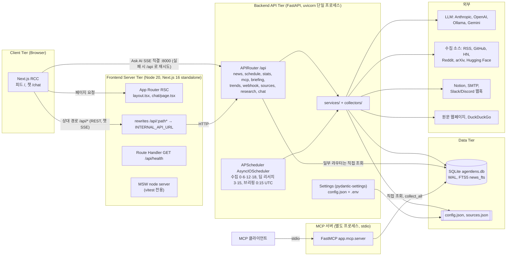
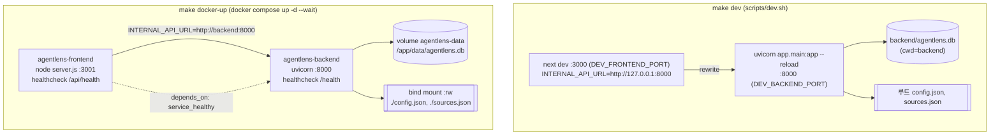
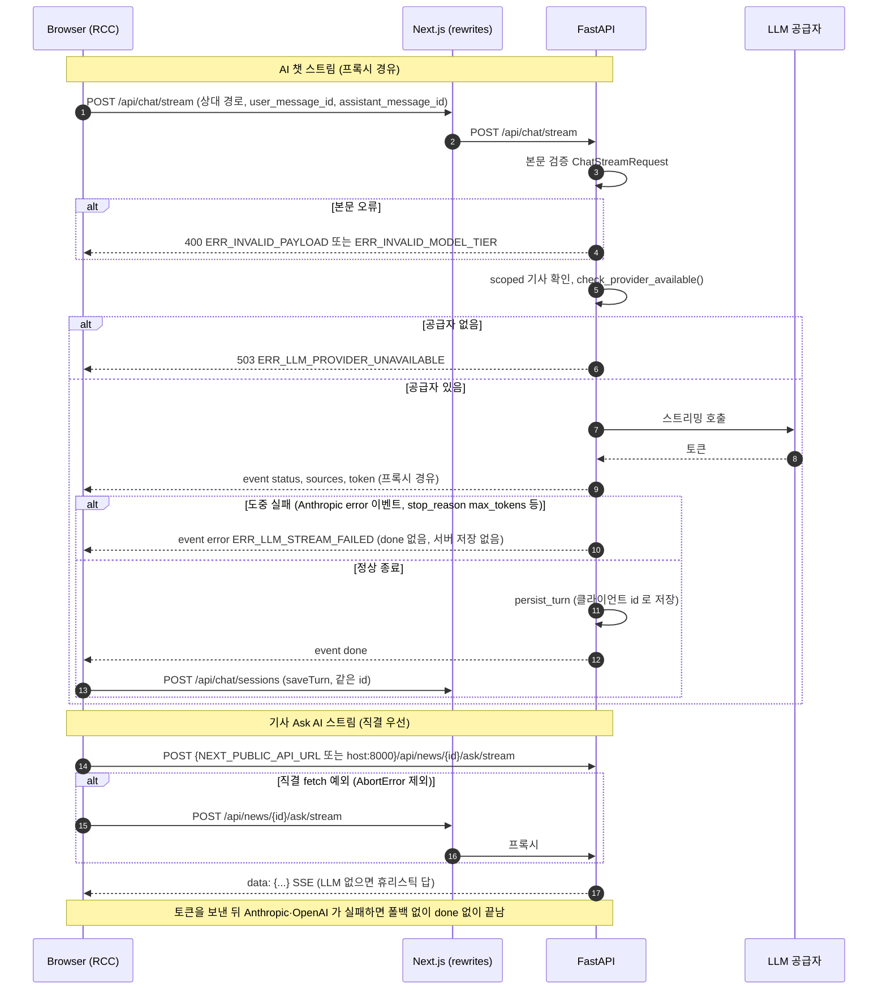

# [ADR-001] 풀스택 시스템 아키텍처 및 핵심 기술 스택 결정 레코드

Updated: 2026-11-09
기준: v0.4.1 (main)

- **작성일자**: 2026-11-09
- **작성자**: 풀스택 아키텍트 (`fullstack-architect`)
- **상태**: PROPOSED (as-built 기록. 이 문서의 결정은 모두 v0.4.1 코드(리뷰 수정 포함)에 이미 반영돼 있다. 승인은 제품·코드 오너가 한다)
- **영향 범위**: Frontend (Next.js 16 App Router standalone, React 19, Tailwind 4, zod 4), Backend (FastAPI, Python 3.11, SQLAlchemy async, APScheduler, pydantic-settings), Database (SQLite + aiosqlite, WAL, FTS5), MCP 서버 (FastMCP stdio), Deployment (Docker Compose 2 컨테이너, `make dev` 로컬 실행)

> 이 문서는 새 설계가 아니라 **지금 코드가 어떤 결정 위에 서 있는지**를 적는다. 옛 `docs/tech-spec.md` 의 모든 내용(시스템 구성, 앱 사이 인터페이스, 데이터, 공통 규칙, 상세 문서, 기술 선택과 근거, 변경 이력)을 옮겼다. 옛 문서 절과 이 문서 절의 대응은 9절에 있다.
>
> 근거 표기: 코드 사실은 `path:line`, 외부 사실은 URL(조회일), 과거 기능 작업의 근거는 `git show <커밋>:<경로>` 로 다시 볼 수 있는 위치를 적는다. 결정 기록이 없어 코드에서 거꾸로 추정한 선택 이유는 **가정** 으로 표시한다. 측정한 성능 수치는 없다 (`bench/` 없음).

---

## 1. 배경 및 컨텍스트 (Context & Problem Statement)

### 1.1 제품과 요구의 출처
AgentLens 는 AI 에이전트·하네스·MCP 기술 소식을 모아 요약하고, AI 챗 질의응답·일일 브리핑·외부 채널 공유·MCP 서버를 제공한다. `backend/`(FastAPI)와 `frontend/`(Next.js) 두 앱이고 인터페이스는 REST `/api/*`(SSE 포함)다.

기능 요구는 아래 기획 산출물에 있다 (이 문서 작성 시점에 함께 쓰이는 중이라 경로로만 참조한다).

| 도메인 | 코드 | FSD |
|---|---|---|
| 뉴스 피드 | NEWS | `docs/spec-writer/fsd/01_NEWS_FEED_SPECIFICATION.md` |
| AI 챗 | CHAT | `docs/spec-writer/fsd/02_AI_CHAT_SPECIFICATION.md` |
| 수집·분류·요약 | COLL | `docs/spec-writer/fsd/03_COLLECTION_SPECIFICATION.md` |
| 브리핑·공유 | BRF | `docs/spec-writer/fsd/04_BRIEFING_AND_SHARING_SPECIFICATION.md` |
| 소스·딥 리서치 | SRC | `docs/spec-writer/fsd/05_SOURCES_AND_RESEARCH_SPECIFICATION.md` |
| MCP 서버 | MCP | `docs/spec-writer/fsd/06_MCP_SERVER_SPECIFICATION.md` |
| UI 공통 | UI | `docs/spec-writer/fsd/07_UI_COMMON_SPECIFICATION.md` |

PRD 는 `docs/spec-writer/01_PRD.md`, 기능 색인은 `docs/spec-writer/02_FUNCTIONAL_SPECIFICATION.md`, 전역 정책·예외는 `docs/spec-writer/03_POLICIES_AND_EDGES.md` 다.

### 1.2 아키텍처에 걸리는 기능 요구 (요약)
| 요구 | 아키텍처에 미치는 영향 | 코드 위치 |
|---|---|---|
| 여러 외부 소스(RSS, GitHub, Hacker News, Reddit, arXiv, Hugging Face)를 정해진 시각에 수집·분류·요약 | 백그라운드 스케줄러, 외부 HTTP, LLM 호출, 긴 작업과 API 요청의 공존 | `backend/app/collectors/manager.py:176-257`, `backend/app/scheduler.py:37-64` |
| 기사 목록·검색·필터 | 전문 검색 인덱스 | `backend/app/database.py:73-112`, `backend/app/services/retriever.py:62-` |
| AI 챗 (멀티턴, 세션 보존, 토큰 스트리밍) | SSE, 세션 영속화, LLM 공급자 추상화 | `backend/app/api/chat.py:277-438`, `backend/app/services/chat_session_service.py`, `backend/app/services/chat_service.py:750-825` |
| 기사별 Ask AI (토큰 스트리밍) | SSE, LLM 없을 때 대체 경로 | `backend/app/api/news.py:137-167` |
| 일일 브리핑 자동 발송 (Notion, SMTP, Slack/Discord 웹훅) | 스케줄러, 외부 연동, 설정 저장 | `backend/app/scheduler.py:55-62`, `backend/app/services/briefing_service.py` |
| 소스 관리·딥 리서치 | 설정 파일(`sources.json`) 읽기·쓰기, 스케줄러 | `backend/app/services/sources_service.py:102-133`, `backend/app/scheduler.py:47-54` |
| MCP 클라이언트에 뉴스 조회·수집 도구 제공 | 별도 진입점, 같은 DB 공유 | `backend/app/mcp/server.py:1-50` |
| 라이트·다크 테마, 키보드 단축키, 오버레이 | 클라이언트 상태, 첫 그리기 전 테마 적용 | `frontend/src/app/layout.tsx:22-32`, `frontend/src/lib/overlay-stack.ts` |

### 1.3 비기능 요구와 지금 상태
| 항목 | 지금 상태 (as-built) | 근거 |
|---|---|---|
| 지연 | 측정값 없음. 프론트 일반 요청은 8초 타임아웃 (`fetchWithTimeout`) | `frontend/src/lib/api.ts:25` |
| Core Web Vitals | 측정값 없음. 피드 `/` 는 페이지 전체가 클라이언트 컴포넌트라 첫 데이터는 하이드레이션 뒤 브라우저 fetch 로 온다 (LCP 가 API 응답에 묶인다, 측정 안 함) | `frontend/src/app/page.tsx:1` |
| 동시성 | backend 는 단일 uvicorn 프로세스(워커 옵션 없음). 수집 중복은 프로세스 안의 `is_running` 플래그로만 막는다. SQLite 는 WAL + `busy_timeout=30000` | `backend/Dockerfile:34`, `backend/app/collectors/manager.py:177-180`, `backend/app/database.py:17-26` |
| 확장성 | 단일 노드 전제. 스케줄러가 앱 프로세스 안에 있어 수평 확장(워커 여러 개) 시 작업이 중복된다 (D06) | `backend/app/main.py:26`, APScheduler FAQ |
| 보안 | 인증 없음, CORS 모든 origin + credentials 허용. 비밀값은 backend 설정에만 있고 프론트 번들에 넣지 않는다 | `backend/app/main.py:50-56`, `frontend/src/lib/env.ts:7-9` |
| 가용성 | Docker healthcheck(`/health`, `/api/health`), frontend 는 backend healthy 뒤 기동, 빈 DB 첫 수집은 백그라운드 | `docker-compose.yml:42-47, 64-72`, `backend/app/main.py:31-36` |

---

## 2. 고려된 기술 스택 후보군 (Considered Alternatives)

선정안은 모두 지금 코드다. "근거 종류" 는 출처(외부 문서·과거 spec 근거)가 있는지, 코드에서 거꾸로 추정한 **가정** 인지를 적는다. 각 행의 상세는 3.3 의 결정 번호(Dxx)를 본다.

| 계층 | 후보 1 (선정안) | 후보 2·3 (대안) | 장단점 비교 및 선정 사유 | 근거 종류 | 결정 |
| :--- | :--- | :--- | :--- | :--- | :--- |
| **Frontend** | Next.js 16 App Router, `output: "standalone"`, React 19 | Vite + React SPA / Remix | standalone 은 Node 런타임 하나로 서빙하고 `rewrites` 로 같은 origin `/api` 프록시를 제공한다. 지금은 RSC 데이터 페칭을 쓰지 않아 SPA 대비 이점은 프록시·메타데이터·첫 그리기 전 스크립트 정도다 | 가정 | D01 |
| **Backend** | FastAPI (Python 3.11, Pydantic v2) | Django / Node(NestJS) | 비동기 `StreamingResponse` 로 SSE, Pydantic 스키마, 런타임 OpenAPI(`/docs`). 수집·스크래핑 라이브러리(feedparser, trafilatura)가 Python 이다 | 가정 | D02 |
| **데이터베이스** | SQLite + aiosqlite (WAL) | PostgreSQL / 파일(JSON) 저장 | 단일 노드·단일 프로세스에 별도 DB 서버가 필요 없다. WAL 은 읽기와 쓰기 하나를 동시에 허용하고 쓰기는 하나뿐이다 | 출처(SQLite WAL 문서) + 가정 | D03 |
| **스키마 변경** | 시작 시 `create_all` + 빠진 열 `ALTER TABLE` | Alembic 마이그레이션 | 도구·버전 파일이 없다. 대신 되돌리기·이력이 없고 실패를 삼킨다 | 가정 | D04 |
| **전문 검색** | SQLite FTS5 가상 테이블 + 트리거 | `LIKE` 검색 / 외부 검색 엔진 | 같은 DB 파일 안에서 인덱스를 유지한다 | 출처(FTS5 문서) | D05 |
| **스케줄러** | APScheduler `AsyncIOScheduler` (앱 프로세스 안, UTC 고정 시각) | 별도 cron 컨테이너 / Celery beat | 추가 프로세스 없음. 대신 워커를 늘리면 작업이 중복된다 | 출처(APScheduler FAQ) + 가정 | D06 |
| **실시간 스트리밍** | SSE (`text/event-stream`, 브라우저는 `fetch` + `ReadableStream` 로 POST) | WebSocket / 폴링 | 서버→클라이언트 단방향 토큰 전달. `EventSource` 는 GET 만 되므로 POST 본문을 쓰려고 `fetch` 스트림을 읽는다 | 출처(MDN) + 가정 | D07 |
| **브라우저→API 경로** | Next `rewrites` 같은 origin 프록시 (예외: 기사 Ask AI SSE 는 backend :8000 직결 + 실패 시 프록시) | 모든 요청 CORS 직결 / 모든 요청 프록시 | 같은 origin 이라 LAN·Tailscale 주소에서도 동작. 직결 예외의 근거(프록시 버퍼링)는 측정 기록이 없다 | 가정 | D08 |
| **LLM 클라이언트** | `httpx` 로 REST 직접 호출 (Anthropic, Gemini, OpenAI 비스트림, Ollama), OpenAI 스트림만 `openai` SDK | 각 공급자 공식 SDK / LangChain | 의존성 최소. `google-genai` 는 설치만 되고 쓰이지 않는다 | 가정 | D09 |
| **LLM 공급자 선택** | Anthropic → OpenAI → Ollama, Gemini 는 모델 명시 때만, 없으면 챗 503 | 단일 공급자 고정 / 흉내 공급자 폴백 | Ollama 가용 판정은 `/api/tags` + 설정 모델 설치 | 출처(Ollama API 문서, backend-llm-test-isolation spec) | D10 |
| **LLM 없을 때** | 수집·기사 Ask AI 는 휴리스틱, 챗은 503 | 전부 503 / 전부 휴리스틱 | 키 없이도 수집·피드가 돈다 | 가정 | D11 |
| **본문 추출** | `httpx` + trafilatura, 실패 시 readability-lxml + BeautifulSoup, L1 메모리 LRU 500 + L2 DB 열 | 헤드리스 브라우저(Playwright) | JS 렌더링 없이 가볍다. JS 로만 그려지는 페이지는 못 읽는다 | 가정 | D13 |
| **보충 웹 검색** | DuckDuckGo Instant Answer API (키 없음), 결과 없으면 GitHub 검색 URL 후보 | Tavily / 상용 검색 API | 키 없이 동작. 결과 품질은 측정 안 함. Tavily 는 docstring 에만 있고 구현이 없다 | 가정 | D14 |
| **설정** | pydantic-settings `Settings` + 루트 `config.json` 기본값 + `.env`, 화면 설정은 `config.json` 에 다시 쓴다 | 환경 변수만 / DB 설정 테이블 | 화면에서 바꾼 설정이 파일에 남는다. 대신 git 추적 파일이 런타임에 바뀐다 | 가정 | D15 |
| **프론트 환경변수** | `NEXT_PUBLIC_API_URL`(직결 주소), `INTERNAL_API_URL`(rewrite 대상), zod 스키마 `env.ts` | 런타임 설정 API | `env.ts` 는 import 되지 않아 검증이 돌지 않는다 | 출처(Next.js 문서) | D16 |
| **계약 동기화** | 손으로 맞춤 (Pydantic ↔ TS + zod ↔ MSW) + 계약 테스트 | OpenAPI 코드 생성 | 생성 도구 없음. 정적 OpenAPI 파일 없음 | 가정 | D17 |
| **프론트 테스트 목** | MSW (vitest `setupFiles` 에서 node 서버) | `fetch` 직접 mock | 네트워크 경계에서 가로챈다 | 가정 | D18 |
| **스타일링·테마** | CSS 변수 토큰 + Tailwind `@theme inline`, `@custom-variant dark`, `<html>` 클래스 | 하드코딩 hex + `!important` 덮어쓰기 | 테마 전환이 클래스 하나로 끝난다 | 출처(Tailwind 문서, ui-redesign spec E1·E2) | D19 |
| **공통 UI 부품** | 자체 부품, `div role="dialog"` + 자체 포커스 트랩 | Radix 등 컴포넌트 킷 / 네이티브 `<dialog>` | 무거운 UI 라이브러리 금지 제약 | 출처(ui-redesign spec E6) + 가정 | D20 |
| **글꼴** | 시스템 글꼴 스택 | Geist (`next/font`) | 외부 글꼴 런타임 의존 금지 | 출처(ui-redesign spec E5) + 가정 | D21 |
| **오버레이·테마 적용 시점** | 오버레이 스택(Escape 맨 위만), 첫 그리기 전 인라인 테마 스크립트 | 컴포넌트별 Escape 리스너, 하이드레이션 뒤 테마 적용 | 겹친 오버레이 Escape 충돌·테마 깜빡임 방지 | 출처(WCAG 2.2, Next.js 로컬 문서, ui-redesign spec E3·E13·E15) | D22 |
| **로컬 동시 실행** | `scripts/dev.sh` (bash, 프로세스 그룹·준비 대기·정리) | Makefile 한 줄 / `concurrently` | 새 의존성 없음 | 출처(make-targets spec E3·E5) | D23 |
| **빈 DB 첫 수집** | lifespan 백그라운드 태스크 | healthcheck `start_period` 늘림 | 첫 수집 시간 측정값이 없다 | 출처(make-targets spec E10) | D24 |
| **Docker 기동 대기** | `docker compose up -d --wait --wait-timeout` | `up -d` 만 | healthcheck 실패가 종료 코드로 드러난다 | 출처(make-targets spec E9) | D25 |
| **MCP 서버** | FastMCP stdio, backend 코드·DB 공유, 별도 배포 단위 아님 | HTTP 전송 MCP 를 backend 에 내장 / 별도 서비스 | 로컬 MCP 클라이언트가 프로세스로 띄운다 | 가정 | D26 |
| **인증·CORS** | 인증 없음, CORS `*` + credentials | 토큰 인증 / origin 제한 | 단일 사용자 로컬 도구 전제로 보인다. 결정 기록 없음 | 가정 | D27 |
| **배포** | Docker Compose 2 컨테이너 (backend :8000, frontend :3001), 이름 있는 volume, 설정 파일 bind mount `:rw` | 단일 컨테이너 / 쿠버네티스 | 배포 대상 서버 없음(프로덕션 배포 없음) | 가정 | D28 |
| **로깅** | `print` + `logging.getLogger("agentlens.*")` 혼용, 핸들러 설정 없음 | 구조화 로깅(`logging.config`) | 설정 코드가 없다 | 가정 | D29 |
| **저장소 도구** | 루트 `Makefile`(대상 12개) + 스크립트 2개, 워크스페이스 도구 없음 | pnpm workspace / Nx / Turborepo | 두 앱 언어가 다르고 앱이 둘뿐 | 가정 | D30 |

---

## 3. 최종 아키텍처 결정 사항 (Decision)

### 3.1 풀스택 전체 시스템 토폴로지



#### 3.1.1 배포 토폴로지 (로컬 실행과 Docker)



- 로컬 포트·경로: `scripts/dev.sh:9-12, 102-121`. Docker: `docker-compose.yml:7-84`, `backend/Dockerfile`, `frontend/Dockerfile`. 운영 상세는 `docs/devops-engineer/01_DEPLOYMENT_SPEC.md`.

#### 3.1.2 계층 간 통신: SSE 두 경로



- 챗 스트림: `frontend/src/components/chat/ChatWorkspace.tsx:338-360`, `backend/app/api/chat.py:277-438` (본문 검증 `:292-345`, 공급자 확인 `:372`, 응답 헤더 `:430-438`), 저장·`done` 순서 `backend/app/services/chat_service.py:803-825`, `event: error` `:757-769`. Ask AI: `frontend/src/lib/api.ts:97-117`, `backend/app/api/news.py:137-167`. 이벤트 형식은 `docs/system-designer/01_SYSTEM_DESIGN.md`, 계약은 `docs/contract-integrator/01_CONTRACT_AND_MSW_SPEC.md`.

### 3.2 핵심 아키텍처 원칙

#### 1) RSC vs RCC 경계 원칙
**as-built 경계**
| 구분 | 파일 | 하는 일 |
|---|---|---|
| RSC | `frontend/src/app/layout.tsx` | `metadata`·`viewport`(`:6-20`), 첫 그리기 전 테마 인라인 스크립트(`:22-32`), `ThemeProvider`·`ToastRegion` 감싸기 |
| RSC | `frontend/src/app/chat/page.tsx` | `metadata`(`:5-8`), `Suspense` 껍질 안에 `ChatWorkspace` (`:10-24`) |
| Route Handler | `frontend/src/app/api/health/route.ts` | 컨테이너 healthcheck. `rewrites` 를 배열로 반환하므로 파일시스템 라우트가 먼저 잡혀 backend 로 넘어가지 않는다 (Next.js 로컬 문서 `frontend/node_modules/next/dist/docs/01-app/03-api-reference/05-config/01-next-config-js/rewrites.md:48`) |
| RCC | `frontend/src/app/page.tsx` (`:1` `'use client'`) | 피드 페이지 전체 |
| RCC | `'use client'` 가 붙은 66개 파일 (`ChatWorkspace`, `ThemeContext`, 모달, 훅 등) | 상태·이벤트·localStorage·fetch |
| 지시어 없는 공용 모듈 | `components/ui/` 의 17개(Badge, Button, Card 등), `components/feed/FeedStatusBar.tsx`·`NewsCardSkeleton.tsx`, `lib/api.ts` 등 | 클라이언트 컴포넌트가 import 하므로 클라이언트 번들에 들어간다 |

- 데이터 페칭은 모두 클라이언트에서 `frontend/src/lib/api.ts` 로 한다. 서버 컴포넌트 fetch 는 없다. `getApiBase()` 의 서버 분기(`api.ts:9`, `INTERNAL_API_URL`)는 준비돼 있으나 쓰는 RSC 가 없다.

**규약 (앞으로)**
1. 상태·이벤트·브라우저 API 가 필요한 컴포넌트만 `'use client'` 를 붙인다. `components/ui/` 의 지시어 없는 부품은 지시어 없이 둔다.
2. RSC 에서 RCC 로 넘기는 props 는 직렬화 가능한 값만 넘긴다.
3. 서버 컴포넌트에서 backend 를 부를 일이 생기면 `INTERNAL_API_URL` 로 부르고(`getApiBase` 서버 분기), 브라우저 코드는 상대 경로 `/api` 를 쓴다.
4. 패키지 메타데이터는 `next.config.ts` 의 `env.NEXT_PUBLIC_APP_VERSION` 처럼 문자열만 넘기고 `src` 에서 `package.json` 을 import 하지 않는다 (`frontend/next.config.ts:4-15`).

#### 2) 계층형 백엔드 아키텍처
**as-built 구조**
```
[진입]        app/main.py (lifespan: ensure_db_schema → start_scheduler → 빈 DB 첫 수집)
              app/mcp/server.py (FastMCP stdio 진입점)
                 │
[API]         app/api/*.py — APIRouter, prefix /api (router.py:13-23)
                 │   요청 검증, 예외 → HTTP 상태 매핑(chat.py:130-275, 282-427), StreamingResponse
                 ▼
[Service]     app/services/*.py, app/collectors/ (manager, categorizer, sources/*)
                 │   수집·분류·요약, 챗(ReAct·검색), 세션, 브리핑, 외부 연동, LLM 공급자
                 ▼
[Provider]    app/services/llm_providers/ (base.py BaseLLMProvider, anthropic_provider.py)
              llm_processor.py 의 _call_gemini/_call_openai/_call_ollama
                 ▼
[Model/Schema] app/models/ (SQLAlchemy: news.py, chat_session.py)
              app/schemas/ (Pydantic: chat.py, news.py)
[공통]        app/database.py (engine, get_db, ensure_db_schema), app/config.py (Settings), app/scheduler.py
```

- 저장소(Repository) 계층은 없다. 라우터가 `Depends(get_db)` 로 세션을 받아 직접 조회하는 곳이 있다: `backend/app/api/news.py:56-77, 97-117`, `backend/app/api/stats.py:12-15`, `schedule.py`, `briefing.py`, `webhook.py`, `chat.py`. MCP 서버도 `AsyncSessionLocal` 로 직접 조회한다 (`backend/app/mcp/server.py:13, 22, 31`).
- 서비스 수명: 모듈 싱글턴(`collector_manager`, `llm_processor`, `briefing_service`, `deep_researcher`)과 요청마다 만드는 객체(`ChatService(db)`, `backend/app/api/chat.py:428`)가 섞여 있다.
- 세션 트랜잭션: `get_db` 가 요청 끝에 commit, 예외 시 rollback (`backend/app/database.py:31-40`).

**규약 (앞으로)**
1. 새 비즈니스 로직은 `services/` 에 둔다. 라우터의 직접 조회는 단순 조회·집계에 한해 지금처럼 허용한다 (기존 코드를 옮기는 리팩터링은 하지 않는다, YAGNI).
2. 외부 HTTP·LLM 호출은 서비스나 공급자 계층에서만 한다. 라우터는 서비스 예외를 HTTP 상태로 바꾸는 일만 한다.
3. 응답 모델은 `app/schemas/` 의 Pydantic 모델로 정하고, 바꾸면 `.claude/rules/contracts.md` 에 따라 프론트 타입·MSW 를 함께 바꾼다.

#### 3) 환경변수 거버넌스 (`.claude/rules/environment-standards.md`)
**backend**
- 설정은 `backend/app/config.py` 의 `Settings(BaseSettings)` 하나다 (`config.py:39-106`). 값의 원천과 우선순위: 프로세스 환경 변수 → `.env` 파일(`load_dotenv(override=False)` 로 `cwd/.env` → `cwd/backend/.env` → `cwd/../.env` → `backend/.env` 순, `config.py:8-10`, 이어서 `env_file=(".env", "backend/.env", "../.env")`, `config.py:102-106`) → 루트 `config.json`(필드 기본값, `config.py:37-100`) → 코드 기본값. 빈 LLM 키·모델은 `merge_json_and_env` 가 `config.json` → `os.environ` → 하드코딩 순으로 다시 채운다 (`config.py:108-142`). 상세 표는 `docs/devops-engineer/01_DEPLOYMENT_SPEC.md`.
- `config.json` 탐색 순서: cwd → cwd 부모 → 저장소 루트 → `backend/app/config/config.json` (`config.py:14-25`). 화면에서 바꾼 설정은 `save_json_config` 가 찾은 파일에 다시 쓰고 `settings.reload()` 한다 (`config.py:153-173`).
- fail-fast: `ENVIRONMENT=production` 이면서 `SECRET_KEY` 가 32자 미만이면 import 때 `ValueError` 로 기동이 멈춘다 (`config.py:140-141`). 선택 기능(LLM 키, Notion, SMTP, 웹훅)은 없으면 기능만 끈다.
- `model_config` 가 `extra="allow"` 라 `.env` 의 다른 키도 오류 없이 받는다 (`config.py:102-106`).

**frontend**
- `NEXT_PUBLIC_API_URL`: 기사 Ask AI SSE 직결 주소 (`frontend/src/lib/api.ts:12-23`). 비어 있으면 브라우저 호스트의 `:8000`.
- `INTERNAL_API_URL`: rewrite 대상(기본 `http://127.0.0.1:8000`, `frontend/next.config.ts:23-31`)이자 서버 측 `getApiBase` 주소 (`api.ts:9`).
- `NEXT_PUBLIC_APP_VERSION`: `next.config.ts` 가 `package.json` 의 `version` 을 넣는다 (`next.config.ts:6-15`).
- zod 스키마 `clientEnvSchema`·`serverEnvSchema` 는 `frontend/src/lib/env.ts:7-28` 에 있으나 `src/` 어디에서도 import 하지 않아 검증이 돌지 않는다.
- `NEXT_PUBLIC_` 값은 `next build` 때 번들에 박힌다 (Next.js 로컬 문서 `frontend/node_modules/next/dist/docs/01-app/02-guides/environment-variables.md:158-166`). `frontend/Dockerfile` 빌드 단계는 `NEXT_PUBLIC_API_URL` 을 넘기지 않으므로 `docker-compose.yml:63` 의 런타임 값은 브라우저 번들에 반영되지 않는다 (추론, 빌드 산출물로 확인하지 않음).

**지금 규칙과 어긋나는 곳 (as-built)**
| 규칙 | 지금 코드 | 위치 |
|---|---|---|
| `os.environ.get()` 을 코드 곳곳에서 직접 부르지 않는다 | `llm_processor.py` 5곳, `anthropic_provider.py` 5곳에서 직접 읽는다 | `backend/app/services/llm_processor.py:137, 204, 293, 295, 308`, `backend/app/services/llm_providers/anthropic_provider.py:37, 39, 43, 50, 160` |
| 새 변수는 zod 스키마로 검증 | 스키마는 있으나 연결 안 됨 | `frontend/src/lib/env.ts` |
| 설정 필드는 실제로 쓰인다 | `CORS_ORIGINS`(main.py 는 `["*"]` 고정), `CHAT_SESSION_MAX_LIMIT`(세션 서비스는 30 고정), `CHAT_HISTORY_MAX_TURNS`·`CHAT_HISTORY_MAX_TOKENS`, `LLM_PROVIDER`, `ENVIRONMENT`(SECRET_KEY 검사 외) 를 읽는 코드가 `config.py` 밖에 없다 | `backend/app/config.py:45, 49, 68-70, 96`, `backend/app/main.py:52`, `backend/app/services/chat_session_service.py:279, 381, 457` |
| 루트 `.env.example` 은 개발 기본값 | `ENVIRONMENT="production"`, `CORS_ORIGINS` 예시가 들어 있다 (CORS 값은 무시됨) | `.env.example` |

#### 4) 간결함과 실용적 공학 (KISS & YAGNI)
- 별도 메시지 큐·캐시 서버·검색 서버·DB 서버가 없다. 프로세스는 backend 1개, frontend 1개, 필요할 때 MCP 서버 1개다.
- 지금 스택(FastAPI, SQLite + aiosqlite, APScheduler, Next.js 16, React 19, Tailwind, Vitest, MSW)을 바꾸는 결정은 이유가 분명할 때만 한다. 이 문서는 바꾸는 결정을 하나도 내리지 않는다.

### 3.3 결정 기록 (Dxx)

각 결정은 맥락 · 선택 · 대안 · 근거 · 결과 순으로 적는다.

#### D01. Frontend 프레임워크: Next.js 16 App Router (standalone)
- **맥락**: 피드·챗 두 화면의 웹 UI 와 backend 프록시가 필요하다.
- **선택**: Next.js 16.3.4, React 19.2.8, `output: "standalone"` (`frontend/package.json:15-17`, `frontend/next.config.ts:9`). Node 20 이미지 (`frontend/Dockerfile`), pnpm (`frontend/package.json:40`).
- **대안**: Vite + React SPA(정적 파일 + 별도 프록시), Remix.
- **근거**: 결정 기록 없음 (**가정**). 코드에서 보이는 이점은 `rewrites` 프록시(D08), `metadata`/`viewport` API, 첫 그리기 전 인라인 스크립트(D22), standalone 단일 서버.
- **결과**: 피드 페이지가 전부 클라이언트 컴포넌트라 RSC 의 데이터 페칭·번들 축소 이점은 지금 쓰지 않는다. Core Web Vitals 는 측정한 적이 없다.

#### D02. Backend 프레임워크: FastAPI (Python 3.11)
- **맥락**: REST + SSE, 백그라운드 수집, Python 수집·추출 라이브러리 사용.
- **선택**: `fastapi>=0.141.0`, `uvicorn[standard]`, `pydantic>=2.8`, `pydantic-settings>=2.4` (`backend/requirements.txt:1-4`), Python 3.11 (`backend/Dockerfile:6`, `Makefile` `setup`).
- **대안**: Django(+DRF), Node(NestJS/Express).
- **근거**: 결정 기록 없음 (**가정**). `StreamingResponse` 로 SSE(`backend/app/api/chat.py:430-438`), 런타임 OpenAPI `/docs`(`backend/app/main.py:73`), feedparser·trafilatura 등 Python 라이브러리.
- **결과**: OpenAPI 는 런타임에만 있고 정적 파일은 없다 (계약은 D17).

#### D03. 데이터베이스: SQLite + aiosqlite (WAL)
- **맥락**: 기사·수집 로그·챗 세션을 저장. 단일 사용자·단일 노드.
- **선택**: `sqlite+aiosqlite`, 연결마다 `journal_mode=WAL`, `synchronous=NORMAL`, `cache_size=-64000`, `busy_timeout=30000`, `foreign_keys=ON`, 연결 `timeout=30.0` (`backend/app/database.py:6-26`). 기본 경로 `./agentlens.db`(`config.json` `app.database_url`, `backend/app/config.py:42`), Docker 는 volume `agentlens-data` 의 `/app/data/agentlens.db` (`docker-compose.yml:21, 37`). 소유 앱은 backend.
- **대안**: PostgreSQL(별도 컨테이너), JSON 파일 저장.
- **근거**: WAL 은 읽기와 쓰기를 동시에 허용하지만 쓰기는 한 번에 하나다 — https://www.sqlite.org/wal.html (2026-11-09 기준 공개 문서). 선택 이유 자체는 기록 없음 (**가정**: 운영 부담 최소).
- **결과**: backend 와 MCP 서버(별도 프로세스)가 같은 파일에 쓸 수 있다. 쓰기 경합은 `busy_timeout` 30초로 기다린다. 수평 확장은 할 수 없다.

#### D04. 스키마 변경: 시작 시 `create_all` + 빠진 열 `ALTER TABLE`
- **맥락**: 열이 추가돼 왔다 (`news_items.full_content`, `scraped_at`, `chat_messages.model_tier`, `usage_json`).
- **선택**: `ensure_db_schema()` 가 `Base.metadata.create_all` 후 `PRAGMA table_info` 로 빠진 열을 `ALTER TABLE ADD COLUMN`, 인덱스 `ix_news_items_scraped_at` 생성 (`backend/app/database.py:45-71`). lifespan 첫 단계에서 부른다 (`backend/app/main.py:25`).
- **대안**: Alembic.
- **근거**: 결정 기록 없음 (**가정**: 도구 없이 열 추가만 처리).
- **결과**: 열 삭제·이름 변경·타입 변경은 처리하지 못한다. 각 단계가 `except Exception: pass` 로 실패를 삼킨다 (`database.py:59-60, 70-71, 113-114`). 테이블·열 상세는 `docs/system-designer/01_SYSTEM_DESIGN.md`.

#### D05. 전문 검색: SQLite FTS5
- **맥락**: 기사 검색과 챗 검색(RAG).
- **선택**: `news_items` 를 외부 콘텐츠로 쓰는 FTS5 가상 테이블 `news_fts`(title, summary, why_it_matters, tech_stack, tags)와 INSERT·DELETE·UPDATE 트리거 3개를 원시 SQL 로 만든다. 인덱스 행 수가 기사 수보다 적으면 `rebuild` (`backend/app/database.py:73-112`). `retriever.py` 도 같은 테이블을 보장한다 (`backend/app/services/retriever.py:57-90`).
- **대안**: `LIKE` 검색, 외부 검색 엔진.
- **근거**: FTS5 외부 콘텐츠 테이블과 트리거 패턴 — https://www.sqlite.org/fts5.html ('External Content Tables'). 선택 이유는 기록 없음 (**가정**: 같은 DB 파일 안에서 끝냄).
- **결과**: 테이블 생성 코드가 두 곳(`database.py`, `retriever.py`)에 있다.

#### D06. 스케줄러: APScheduler `AsyncIOScheduler` (앱 프로세스 안)
- **맥락**: 정기 수집, 딥 리서치, 브리핑 자동 발송.
- **선택**: `AsyncIOScheduler` 에 `CronTrigger` 3개 — 수집 `hour="0,6,12,18"`, 딥 리서치 `hour="3,15"`, 브리핑 `hour="0", minute="15"`, 모두 `timezone="UTC"` (`backend/app/scheduler.py:37-64`). lifespan 에서 시작·종료 (`backend/app/main.py:26, 46`).
- **대안**: 별도 cron 컨테이너가 `/api/schedule/trigger` 호출, Celery beat + 워커.
- **근거**: APScheduler 는 프로세스 사이 동기화가 없어 여러 프로세스가 같은 작업 저장소를 공유할 수 없다 — https://apscheduler.readthedocs.io/en/3.x/faq.html ('How do I share a single job store among one or more worker processes?', 2026-11-09 조회). 선택 이유 자체는 기록 없음 (**가정**: 추가 프로세스 없이).
- **결과**: uvicorn 워커를 늘리면 작업이 워커 수만큼 돈다. 시각이 코드에 고정돼 `config.json` 의 `crawl_hours`·`timezone`·`auto_dispatch_hour` 와 `CRAWL_SCHEDULE_HOURS` 는 화면 표시·다음 실행 시각 계산(`scheduler.py:9, 25-35`)에만 쓰인다.

#### D07. 실시간 스트리밍: SSE
- **맥락**: 챗·Ask AI 답을 토큰 단위로 보여 준다.
- **선택**: `StreamingResponse(media_type="text/event-stream")`, 응답 헤더 `Cache-Control: no-cache`, `Connection: keep-alive`, `X-Accel-Buffering: no` (`backend/app/api/chat.py:430-438`, `backend/app/api/news.py:159-167`). 브라우저는 `fetch` 로 POST 하고 `ReadableStream` 을 읽는다 (`frontend/src/lib/api.ts:102-139`). SSE 엔드포인트는 `POST /api/chat/stream`, `POST /api/news/{id}/ask/stream` 2개.
- **대안**: WebSocket, 폴링.
- **근거**: `EventSource` 는 GET 요청만 만든다 — https://developer.mozilla.org/en-US/docs/Web/API/EventSource. 질문 본문을 POST 로 보내려 `fetch` 스트림을 쓴 것으로 보인다 (**가정**). WebSocket 을 고르지 않은 이유는 기록 없음 (**가정**: 단방향으로 충분).
- **결과**: 끊긴 스트림의 자동 재연결은 없다. 이벤트 형식은 `docs/system-designer/01_SYSTEM_DESIGN.md`·`docs/contract-integrator/01_CONTRACT_AND_MSW_SPEC.md`.
- **v0.4.1 변경 (리뷰 BUG-02R·BUG-06·BUG-08, FE-02·03·33·34)**:
  - 챗 스트림 서버는 턴을 `event: done` **앞에서** 저장한다. 저장이 실패하면 로그만 남기고 `done` 을 보낸다 (`backend/app/services/chat_service.py:803-825`). 이유: 프론트의 세션 POST·상세 재조회와 경합하지 않게 하려고.
  - 요청 본문에 클라이언트가 만든 `user_message_id`·`assistant_message_id`(선택, 1~36자, 둘 다 있으면 달라야 함)가 실린다 (`backend/app/schemas/chat.py:38-46`, `frontend/src/components/chat/ChatWorkspace.tsx:350-353`). 서버와 프론트가 같은 id 로 저장한다 (D31).
  - 본문 검증이 scoped 기사 확인·LLM 가용성 확인보다 먼저다. dict 가 아니거나 필드가 어긋나면 400 `ERR_INVALID_PAYLOAD`, `model_tier` 가 어긋나면 400 `ERR_INVALID_MODEL_TIER` (`backend/app/api/chat.py:292-345`).
  - Anthropic 스트림의 `error` 이벤트는 `overloaded_error` 면 `AnthropicOverloadedException`, 그 밖은 `AnthropicStreamError` 다. `stop_reason == "max_tokens"` 도 끝난 뒤 `AnthropicStreamError` 다 (`backend/app/services/llm_providers/anthropic_provider.py:29-31, 283, 322-334`). 챗 스트림은 이때 `event: error`(`ERR_LLM_STREAM_FAILED`)를 보내고 `done`·저장 없이 끝난다 (`chat_service.py:757-769`).
  - 프론트는 `done` 없이 끝난 스트림과 `error` 이벤트를 오류로 본다. 받은 부분 답을 그대로 그리고 그 아래에 `응답이 중간에 끊겼습니다. 다시 시도해 주세요.` 와 `답변 다시 시도` 를 보인다. 이때는 저장하지 않는다. 세션 저장(`saveTurn`)은 한 턴에 한 번, 완료 또는 사용자 중단일 때만 한다. 중단 뒤 본문이 정상 종료돼도 중단으로 둔다 (`frontend/src/components/chat/ChatWorkspace.tsx:43, 309-318, 444-462`).
  - 남은 문제: 기사 Ask AI 스트림은 도중 실패 시 `error` 이벤트 없이 끝나 프론트가 받은 글자를 답으로 보인다 (N-01, `docs/spec-writer/03_POLICIES_AND_EDGES.md` 4절).

#### D08. 브라우저→API 경로: 같은 origin 프록시, Ask AI 만 직결
- **맥락**: 브라우저는 localhost, LAN IP, Tailscale 주소 등 여러 호스트로 접속한다 (`frontend/next.config.ts:16-22` 의 `allowedDevOrigins`).
- **선택**: 브라우저 요청은 상대 경로 `/api/*` (`frontend/src/lib/api.ts:3-10`) → `rewrites` 가 `INTERNAL_API_URL`(기본 `http://127.0.0.1:8000`)로 넘긴다 (`frontend/next.config.ts:23-31`). 예외로 기사 Ask AI 스트림은 `getDirectApiBase()` (`NEXT_PUBLIC_API_URL`, 없으면 `{protocol}//{hostname}:8000`)로 직결하고, fetch 가 예외를 던지면(AbortError 제외) 상대 경로로 다시 시도한다 (`api.ts:12-23, 97-117`). 챗 스트림은 상대 경로로 프록시를 거친다 (`frontend/src/components/chat/ChatWorkspace.tsx:338`).
- **대안**: 모든 요청 CORS 직결, 모든 요청 프록시.
- **근거**: 직결 이유는 코드 주석 "bypass Next.js rewrites chunk buffering" (`api.ts:17, 101`) 뿐이고 측정 기록이 없다 (**가정**). 같은 SSE 인 챗 스트림은 프록시를 거치므로 두 경로의 판단이 서로 다르다.
- **결과**: `BACKEND_PORT` 를 바꾸거나 :8000 이 막히면 Ask AI 는 직결이 실패한 뒤에만 프록시로 넘어간다. Docker 빌드에 `NEXT_PUBLIC_API_URL` 이 들어가지 않는다 (3.2-3).

#### D09. LLM 클라이언트: `httpx` 직접 호출
- **맥락**: Anthropic, OpenAI, Ollama, Gemini 네 공급자를 부른다.
- **선택**: Anthropic 은 `httpx.AsyncClient` 로 `https://api.anthropic.com/v1/messages`, 헤더 `anthropic-version: 2023-06-01`, `anthropic-beta: prompt-caching-2024-07-31`, 타임아웃 45초(일반)·120초(스트림) (`backend/app/services/llm_providers/anthropic_provider.py:130-186, 238, 285`). Gemini `generativelanguage.googleapis.com` (20초), OpenAI 비스트림 `api.openai.com/v1/chat/completions` (60초), Ollama `/api/generate` (90초) 모두 `httpx` (`backend/app/services/llm_processor.py:196-286`). OpenAI 스트림만 `openai.AsyncOpenAI` SDK (`llm_processor.py:446-460, 928`). 공급자 추상 클래스는 `BaseLLMProvider` (`llm_providers/base.py:4`).
- **대안**: 각 공식 SDK(`anthropic`, `google-genai`), LangChain.
- **근거**: `anthropic_provider.py:134` docstring "Pure httpx REST client (no external anthropic SDK dependency)". 선택 이유는 기록 없음 (**가정**: 의존성 최소).
- **결과**: `google-genai>=2.0.0` 이 `backend/requirements.txt:16` 에 있지만 `backend/app` 에서 import 하지 않는다. 프롬프트 캐싱은 시스템 블록에 `cache_control: {"type": "ephemeral"}` 을 단다 (`anthropic_provider.py:176-186`). 캐싱 효과는 측정하지 않았다.

#### D10. LLM 공급자 선택과 가용 판정
- **맥락**: 키·로컬 모델 유무가 환경마다 다르다. 테스트가 환경에 따라 결과가 바뀌던 문제가 있었다 (backend-llm-test-isolation).
- **선택**: 우선순위 Anthropic → OpenAI → Ollama, Gemini 는 모델 이름에 `gemini` 가 들어간 요청에만 (`backend/app/services/llm_processor.py:340-401`). 가용 판정(`has_live_provider`, `:301-325`): Anthropic·OpenAI 는 키가 있으면 가능. Ollama 는 `GET {주소}/api/tags` 한 번(1초 제한)이 200 이고 응답 `models[].name` 또는 `model` 에 설정 모델(태그 생략 시 `:latest` 를 붙여 비교)이 있을 때만 가능 (`:171-194`). OpenAI 키·모델과 Ollama 주소·모델은 호출 때마다 해석 함수 4개 `_resolve_openai_key`, `_resolve_openai_chat_model`, `_resolve_ollama_url`, `_resolve_ollama_generate_model` 로 정한다 (`:129-169`). 하나도 없으면 `LLMProviderUnavailableException` → 챗 503 `ERR_LLM_PROVIDER_UNAVAILABLE` (`:327-337`, `backend/app/api/chat.py:240-248`). 판정 이유(키 없음, Ollama 연결 실패, 설정 모델 미설치 등)는 서버 로그 WARNING 에만 남는다 (`llm_processor.py:336`).
- **대안**: 단일 공급자 고정, 테스트·키 없음 환경에서 흉내 공급자로 폴백.
- **근거**: Ollama 모델 이름 `model:tag`, 태그 생략 시 `latest`, `/api/tags` 응답 형식 — https://raw.githubusercontent.com/ollama/ollama/main/docs/api.md (2026-11-07 조회). 결정 과정은 `git show 3973ae9:docs/features/backend-llm-test-isolation/spec.md` 근거 E2·E4·E5·E10·E11.
- **결과**: 테스트 환경 판별 함수 `is_test_environment` 가 있다 (`TESTING`, `CI`, `pytest` 로드 여부, `llm_processor.py:288-299`). 공급자 호출 실패 시 다음 공급자로 넘어가되 429 는 바로 `LLMQuotaExceededException` 이다 (`:368-389`).
- **v0.4.1 변경 (리뷰 BUG-07)**: 기사 Ask AI 스트림(`stream_question_answer`)은 토큰을 하나라도 보낸 뒤 Anthropic·OpenAI 가 실패하면 다음 엔진 답을 이어 붙이지 않고 `done` 없이 끝나며 답을 캐시하지 않는다. 토큰을 보내기 전에 실패했을 때만 다음 엔진(마지막은 휴리스틱)으로 넘어간다 (`backend/app/services/llm_processor.py:914-919, 948-951`). 이때 `error` 이벤트를 보내지 않는 것은 남은 문제다 (N-01).

#### D11. LLM 이 없을 때의 동작
- **맥락**: 키 없이도 피드는 써야 한다.
- **선택**: 수집 단계 품질 평가·요약과 기사 Ask AI 는 휴리스틱으로 대신한다 (`llm_processor.py:516-580` `evaluate_quality_and_signal`, `:794-853` `_generate_heuristic_answer`). AI 챗은 503 을 돌려준다 (D10).
- **대안**: 전부 503, 전부 휴리스틱.
- **근거**: 결정 기록 없음 (**가정**). `.env.example` 주석 "Falls back to local zero-config NLP heuristic if empty".
- **결과**: 같은 "LLM 없음" 상황에서 화면마다 반응이 다르다 (FSD 의 각 도메인 예외 흐름 참고).

#### D12. 오류 응답 형식
- **맥락**: 프론트가 오류를 구분해 보여 줘야 한다.
- **선택**: 세 가지 형식이 공존한다. (1) 처리하지 않은 예외: 500 `{"detail": "Internal server error occurred. Please check server logs.", "error": str(exc)}` (`backend/app/main.py:58-67`). (2) 챗 엔드포인트: `{"error_code", "message", "details"}` 와 400·401·404·429·500·502·503·529 매핑 (`POST /api/chat/query` `backend/app/api/chat.py:130-275`, `POST /api/chat/stream` 스트림 시작 전 `:282-427`). 스트림이 열린 뒤 오류는 `event: error` (D07). (3) 그 밖의 라우터: FastAPI `HTTPException` 의 `{"detail": ...}` (예: `backend/app/api/briefing.py:209`).
- **대안**: 전역 단일 오류 봉투.
- **근거**: 결정 기록 없음 (**가정**: 챗만 오류 코드가 필요했다).
- **결과**: 전역 500 응답에 예외 문자열이 그대로 담긴다. v0.4.1 부터 `/api/chat/stream` 만 필드 검증 실패를 400(`ERR_INVALID_PAYLOAD`, `ERR_INVALID_MODEL_TIER`)으로 돌려주고, `/api/chat/query`·`/api/chat/search` 는 여전히 500 이다 (N-03). 엔드포인트별 오류 표는 `docs/system-designer/01_SYSTEM_DESIGN.md`.

#### D13. 원문 본문 추출
- **맥락**: 챗이 요약이 아닌 원문을 근거로 답한다.
- **선택**: `httpx` 로 받고 trafilatura 로 추출, 실패하면 readability-lxml + BeautifulSoup (`backend/app/services/scraper.py:94-110`). L1 클래스 수준 `OrderedDict` LRU 500개 (`:35-62`), L2 `news_items.full_content`·`scraped_at` (`:133-170`).
- **대안**: Playwright 같은 헤드리스 브라우저.
- **근거**: 결정 기록 없음 (**가정**: JS 렌더링 비용 회피).
- **결과**: L1 캐시는 프로세스 메모리라 재시작하면 비고, MCP 서버 프로세스와 공유되지 않는다.

#### D14. 보충 웹 검색
- **맥락**: DB 에 없는 정보를 챗이 보충한다.
- **선택**: DuckDuckGo Instant Answer API `https://api.duckduckgo.com/?q=...&format=json` (3초 제한)의 `AbstractText`·`RelatedTopics` 상위 3개. 결과가 없으면 `https://github.com/search?q=...` 를 후보로 넣는다 (`backend/app/services/agentic_search.py:109-151`).
- **대안**: Tavily, 상용 검색 API.
- **근거**: 결정 기록 없음 (**가정**: 키 없이 동작). docstring 의 "Tavily" 는 구현이 없다 (`agentic_search.py:111-112`).
- **결과**: 검색 품질은 측정하지 않았다.

#### D15. 설정 원천: pydantic-settings + `config.json` + `.env`, 런타임 쓰기
- **맥락**: 브리핑·웹훅·소스 설정을 화면에서 바꾼다.
- **선택**: 3.2-3 의 우선순위. 화면 설정은 `config.json` 에 쓰고 `settings.reload()` (`backend/app/config.py:153-173`, `backend/app/api/briefing.py:163-209`). 수집 소스는 `sources.json`: 루트 파일과 `backend/app/config/sources.json` 두 곳이 있고 cwd → 부모 → 저장소 루트 → `backend/app/config/` 순으로 찾는다 (`backend/app/services/sources_service.py:11-24`). 저장은 임시 파일(`.tmp`)에 쓴 뒤 `replace()` 로 교체하고, 교체가 `OSError` 면(Docker 단일 파일 bind mount 위 rename 은 `EBUSY`) 대상 파일에 제자리로 쓴다. 이어서 거울 경로 `backend/app/config/sources.json` 에도 쓴다 (`:102-133`). 로컬에서는 루트 파일이 먼저 잡히고, Docker 에서는 마운트된 `/app/sources.json` 이 쓰인다.
- **대안**: 환경 변수만, DB 설정 테이블.
- **근거**: 결정 기록 없음 (**가정**). 제자리 쓰기 대체 경로는 make-targets 작업에서 추가 (`git show 3973ae9:docs/features/make-targets/spec.md`).
- **결과**: Docker 는 루트 `config.json`·`sources.json` 을 `:rw` 단일 파일 bind mount 로 둔다 (`docker-compose.yml:38-39`). 그래서 Docker 에서 설정·소스를 저장해도 git 이 추적하는 루트 파일이 바뀐다 (로컬 실행과 같다). `config.json` 저장은 원자적 교체가 아니다 (`config.py:166-168`).

#### D16. 프론트 환경변수
- **맥락·선택·결과**: 3.2-3 frontend 항목. 비밀값은 프론트에 두지 않는다. `env.ts` 연결은 열린 질문 Q3.
- **대안**: 런타임 설정 API 로 브라우저에 값 전달.
- **근거**: Next.js 로컬 문서 `environment-variables.md:158-166` (`NEXT_PUBLIC_` 빌드 때 인라인).

#### D17. 계약 동기화: 손으로 맞춤
- **맥락**: backend Pydantic 과 frontend 타입이 어긋나지 않아야 한다.
- **선택**: 자동 생성 없이 세 곳을 손으로 맞춘다.
  - backend: `backend/app/schemas/chat.py`, `backend/app/schemas/news.py` (Pydantic)
  - frontend: `frontend/src/types/chat.ts`, `news.ts`, `trends.ts` (TS + zod)
  - 목: `frontend/src/mocks/handlers.ts`, `frontend/src/mocks/handlers/chat.ts`, `frontend/src/mocks/fixtures/chat.ts` (MSW)
  - 계약 테스트: `frontend/src/tests/chat/ContractAndMsw.test.ts`
- **대안**: OpenAPI → TS 코드 생성(openapi-typescript 등).
- **근거**: 결정 기록 없음 (**가정**). 규칙은 `.claude/rules/contracts.md`.
- **결과**: 계약을 바꾸면 위 세 곳과 계약 테스트를 함께 바꾼다. 하위 호환·버전 규칙은 아직 정하지 않았다. 상세는 `docs/contract-integrator/01_CONTRACT_AND_MSW_SPEC.md`, OpenAPI 는 `docs/system-designer/02_OPENAPI_SPEC.yaml`.

#### D18. 프론트 테스트 목: MSW
- **선택**: vitest `environment: 'jsdom'`, `setupFiles: ['./src/tests/setup.ts']` (`frontend/vitest.config.ts:8-10`), setup 이 `@/mocks/server` 를 띄운다 (`frontend/src/tests/setup.ts:3`). 앱 코드는 MSW 를 import 하지 않는다 (개발 서버에서 목을 쓰지 않음).
- **대안**: `fetch` 직접 mock.
- **근거**: 결정 기록 없음 (**가정**). MSW 문서 https://mswjs.io/docs/.
- **결과**: 테스트 전략·사례는 `docs/qa-engineer/01_QA_TEST_PLAN.md`.

#### D19. 스타일링·테마 토큰 (ui-redesign)
- **맥락**: 하드코딩 색과 `!important` 덮어쓰기로 다크 모드를 맞추던 구조.
- **선택**: 색은 `frontend/src/app/globals.css` 의 CSS 변수 토큰(`:root`·`.dark`)을 Tailwind `@theme inline` 으로 유틸리티에 잇고, 테마는 `<html>` 의 `dark`/`light` 클래스 하나로 정한다 (`@custom-variant dark`). Tailwind 4 (`frontend/package.json:23, 36`).
- **대안**: 하드코딩 hex + `!important` 덮어쓰기.
- **근거**: Tailwind CSS 문서 'Dark mode' https://tailwindcss.com/docs/dark-mode, 'Theme variables' https://tailwindcss.com/docs/theme (2026-11-06 조회), `git show 3973ae9:docs/features/ui-redesign/spec.md` 근거 E1·E2.
- **결과**: 토큰·공통 부품 규칙은 `docs/ui-system-designer/01_COMPONENT_SPEC.md`.

#### D20. 공통 UI 부품: 자체 구현 (ui-redesign)
- **선택**: `frontend/src/components/ui/` 의 자체 부품, 대화상자는 `div role="dialog"` + 자체 포커스 트랩 (`frontend/src/hooks/useFocusTrap.ts`). 아이콘은 `lucide-react`.
- **대안**: 컴포넌트 킷(Radix 등), 네이티브 `<dialog>`.
- **근거**: intent 제약(무거운 UI 라이브러리 금지), ui-redesign spec 근거 E6. 네이티브 `<dialog>` 의 jsdom 지원은 확인하지 않았다 (**가정**).
- **결과**: 접근성 동작을 직접 유지해야 한다.

#### D21. 글꼴: 시스템 글꼴 (ui-redesign)
- **선택**: 웹 글꼴 없이 시스템 글꼴 스택(`--font-sans`, `--font-mono`).
- **대안**: Geist (`next/font`).
- **근거**: intent 제약(외부 글꼴 런타임 의존 금지), Geist 를 읽지만 쓰지 않던 점, ui-redesign spec 근거 E5. 한글 글꼴 순서는 **가정**.
- **결과**: 운영체제마다 글꼴이 다르게 보인다.

#### D22. 오버레이 스택과 첫 그리기 전 테마 (ui-redesign)
- **선택**: 대화상자·드로어·팝오버·메뉴를 `frontend/src/lib/overlay-stack.ts` 에 등록해 Escape 로 맨 위 레이어만 닫는다 (리스너는 `window`). 테마는 `<head>` 인라인 스크립트가 localStorage `agentlens_theme` 을 읽어 첫 그리기 전에 `<html>` 클래스·`data-theme`·`colorScheme` 을 정한다 (`frontend/src/app/layout.tsx:22-32`). 런타임 테마 상태는 `next-themes` 없이 `useSyncExternalStore` 기반 자체 `ThemeProvider` (`frontend/src/context/ThemeContext.tsx:44-51`, `frontend/src/lib/theme-store.ts`).
- **대안**: 컴포넌트별 Escape 리스너, 하이드레이션 뒤 테마 적용.
- **근거**: WCAG 2.2 (제품 원칙), Next.js 16 로컬 문서 `frontend/node_modules/next/dist/docs/01-app/02-guides/preventing-flash-before-hydration.md`, ui-redesign spec 근거 E3·E13·E15.
- **결과**: `<html suppressHydrationWarning>` 이 필요하다 (`layout.tsx:30`).

#### D23. 로컬 동시 실행: `scripts/dev.sh` (make-targets)
- **선택**: `make dev` → `scripts/dev.sh` 가 backend `uvicorn --reload` 와 frontend `next dev` 를 각자 프로세스 그룹으로 띄우고, 준비 대기(`/health`, `/api/health`), 한쪽 종료 감지, Ctrl-C 정리를 한다. 포트가 쓰이고 있으면 띄우지 않고 실패한다 (`scripts/dev.sh:9-12, 91-153`).
- **대안**: Makefile 한 줄, `concurrently` 같은 npm 도구.
- **근거**: make-targets spec 근거 E3·E5 (지운 `dev.sh` 는 자식 프로세스 그룹을 정리하지 못하고 한쪽이 죽어도 기다렸다. make 3.81·bash 3.2 라 `.ONESHELL`·`wait -n` 이 없다. 새 의존성 없음) — `git show 3973ae9:docs/features/make-targets/spec.md`.
- **결과**: bash 스크립트 유지 부담. 운영 절차는 `docs/devops-engineer/01_DEPLOYMENT_SPEC.md`.

#### D24. 빈 DB 첫 수집: lifespan 백그라운드 태스크 (make-targets)
- **선택**: 시작할 때 `news_items` 가 0건이면 `collector_manager.collect_all()` 을 `asyncio.create_task` 로 띄우고 바로 요청을 받는다. 종료 때 끝나지 않은 첫 수집은 취소하고 기다린다. 태스크 예외는 한 줄 로그 (`backend/app/main.py:15-45`).
- **대안**: healthcheck `start_period` 늘림.
- **근거**: make-targets spec 근거 E10 (첫 수집 시간 측정값이 없어 근거 있는 대기 시간이 없음).
- **결과**: 기동 직후 `/health` 의 `running` 이 `true` 이고 피드가 비어 있을 수 있다 (`main.py:75-77`).

#### D25. Docker 기동 대기: `docker compose up -d --wait --wait-timeout` (make-targets)
- **선택**: `make docker-up` 이 `docker compose up -d --wait --wait-timeout $(DOCKER_WAIT_TIMEOUT)` (기본 180초, 넘기면 실패) (`Makefile:8, 79-84`).
- **대안**: `up -d` 만.
- **근거**: make-targets spec 근거 E9 (compose 의 `--wait` 지원, healthcheck 실패가 종료 코드로 드러남). https://docs.docker.com/reference/cli/docker/compose/up/.
- **결과**: frontend 는 backend 의 healthcheck(`/health`)가 통과한 뒤 뜬다 (`docker-compose.yml:64-66`).

#### D26. MCP 서버: FastMCP stdio, backend 와 같은 코드·DB
- **선택**: `backend/app/mcp/server.py` 의 `FastMCP("AgentLens-MCP-Server")`, `python -m app.mcp.server` 로 stdio 실행 (`:2, 8, 49-50`). 도구 4개 `get_latest_harness_methods`, `get_mcp_and_skills_ecosystem`, `search_agent_news`, `trigger_agentlens_crawl` (`:10-47`). 패키지 `mcp>=1.0.0` (`backend/requirements.txt:15`). 별도 배포 단위가 아니다.
- **대안**: backend 에 HTTP 전송 MCP 엔드포인트 내장, 별도 서비스.
- **근거**: 결정 기록 없음 (**가정**: 로컬 MCP 클라이언트가 프로세스로 띄우는 형태). FastMCP 는 MCP Python SDK 에 포함 — https://github.com/modelcontextprotocol/python-sdk.
- **결과**: `trigger_agentlens_crawl` 은 MCP 프로세스 안에서 `collect_all()` 을 돈다. `is_running` 은 프로세스마다 따로라 backend 의 수집과 겹칠 수 있다 (`backend/app/collectors/manager.py:177-180`). 상세는 `docs/spec-writer/fsd/06_MCP_SERVER_SPECIFICATION.md`.

#### D27. 인증·CORS
- **선택**: 인증 없음. `CORSMiddleware(allow_origins=["*"], allow_credentials=True, allow_methods=["*"], allow_headers=["*"])` (`backend/app/main.py:50-56`).
- **대안**: 토큰 인증, origin 제한(`CORS_ORIGINS` 설정 사용).
- **근거**: 결정 기록 없음 (**가정**: 단일 사용자 로컬 도구).
- **결과**: :8000 에 닿는 누구나 `DELETE /api/news/all`, `POST /api/schedule/reset-and-collect`, 소스 삭제·토글, 설정 저장을 부를 수 있다. 정책은 `docs/spec-writer/03_POLICIES_AND_EDGES.md`.

#### D28. 배포 형태: Docker Compose 2 컨테이너
- **선택**: backend(`python:3.11-slim`, `uvicorn app.main:app --host 0.0.0.0 --port 8000`, 컨테이너 `agentlens-backend`)와 frontend(`node:20-alpine` 3단계 빌드, uid 1001 `nextjs`, `node server.js`, :3001, 컨테이너 `agentlens-frontend`), 네트워크 `agentlens-network`, volume `agentlens-data`, `host.docker.internal:host-gateway` (Ollama 접근) (`docker-compose.yml`, `backend/Dockerfile:6-34`, `frontend/Dockerfile`). 로컬 개발 포트는 frontend 3000 (`scripts/dev.sh:10`).
- **대안**: 단일 컨테이너, 오케스트레이터.
- **근거**: 결정 기록 없음 (**가정**). 프로덕션 배포는 없다 (CLAUDE.md 'Deploy').
- **결과**: 상세는 `docs/devops-engineer/01_DEPLOYMENT_SPEC.md`.

#### D29. 로깅
- **선택**: `print` 로 표준 출력에 쓰는 곳(`backend/app/main.py:20, 34, 61`, `backend/app/scheduler.py:12, 16, 21, 64`)과 `logging.getLogger("agentlens.*")` 를 쓰는 곳(`collectors/manager.py:20`, `services/llm_processor.py:20`, `services/chat_service.py:48` 등 10여 개 모듈)이 섞여 있다. `logging.basicConfig`·`dictConfig` 같은 핸들러 설정 코드는 없다.
- **대안**: 구조화 로깅 설정.
- **근거**: 결정 기록 없음 (**가정**).
- **결과**: `agentlens.*` 로거는 루트 로거로 전파되고 핸들러가 없으면 Python 기본 `lastResort` 가 WARNING 이상만 stderr 에 낸다 (https://docs.python.org/3/library/logging.html#logging.lastResort). 그래서 LLM 판정 이유 WARNING 은 보이고 DEBUG·INFO 는 보이지 않는다고 추론한다 (uvicorn 실행에서 직접 확인하지 않음).

#### D30. 저장소 도구: Makefile + 스크립트 2개
- **선택**: 워크스페이스 도구 없음. 루트 `Makefile`(bash, 대상 12개: setup, dev, test, build, clean, collect, reset, docker-build, docker-up, docker-down, docker-logs, check, `Makefile:1-3`)이 두 앱 명령을 묶는다. 셸 한 줄로 쓰기 어려운 두 가지만 스크립트로 둔다: `scripts/dev.sh`(D23), `scripts/collect.py`(`make collect`, backend 가 떠 있으면 그 API 로 수집시키고 끝날 때까지 기다리고, 없으면 로컬 DB 에 직접 수집, `scripts/collect.py:1-12`). 검사는 `make check`(= `make test`, `Makefile:98-100`).
- **대안**: pnpm workspace, Nx, Turborepo.
- **근거**: make-targets spec (`git show 3973ae9:docs/features/make-targets/spec.md` 40-41행). 워크스페이스 도구를 안 쓴 이유는 **가정** (언어가 다른 앱 둘).
- **결과**: 의존성 설치는 `.venv`(uv 또는 python3.11)와 `pnpm install --frozen-lockfile` (`Makefile` `setup`).

#### D31. 챗 턴 저장: 서버 저장 + 프론트 세션 POST 를 같은 클라이언트 id 로 (v0.4.1)
- **맥락**: 서버(`persist_turn`)와 프론트(세션 POST)가 같은 턴을 각각 저장해 메시지가 두 벌 남거나 PK 충돌로 500 이 났다 (리뷰 BUG-02, BUG-02R).
- **선택**: 프론트가 턴마다 `user_message_id`·`assistant_message_id` 를 만들어(재시도마다 새 id) 스트림 요청과 세션 POST 에 같이 싣는다. 서버 `persist_turn` 은 받은 id 가 있으면 그 id, 없으면 uuid4 로 저장한다 (`backend/app/services/chat_session_service.py:384-`). `append_messages_batch` 는 이미 있는 메시지 id(같은 요청 안 포함)를 건너뛴다 (`chat_session_service.py:301-`). `get_session_detail` 은 `populate_existing` 으로 갱신된 상태를 돌려준다. 서버 저장은 `done` 앞 (D07).
- **대안**: 서버만 저장(프론트 POST 제거), 프론트만 저장(서버 자동 저장 제거), 서버가 만든 id 를 `done` 에 실어 프론트가 따름.
- **근거**: 리뷰 보고서 `docs/backend-code-reviewer/01_CODE_REVIEW_REPORT.md` 10절(BUG-02R), 계약 `docs/contract-integrator/01_CONTRACT_AND_MSW_SPEC.md` 8.1절. 대안을 버린 이유는 기록 없음 (**가정**: 기존 두 저장 경로를 모두 유지하며 바꾸는 범위를 줄임).
- **결과**: 한 턴 = 메시지 2개. 클라이언트 id 가 다른 세션에 이미 있으면 건너뛰어 그 턴 메시지가 빠질 수 있다 (남은 문제, `docs/spec-writer/03_POLICIES_AND_EDGES.md` 4절).

### 3.4 시스템 구성
| 앱/서비스 | 책임 | 스택 | 위치 |
|---|---|---|---|
| backend | REST API, 수집·분류·요약, 스케줄 작업, 챗, 브리핑 발송 | Python 3.11, FastAPI, SQLAlchemy async + aiosqlite, APScheduler, pydantic-settings | `backend/` (`uvicorn app.main:app`, :8000, `backend/Dockerfile`) |
| frontend | 웹 UI (뉴스 피드 `/`, AI 챗 `/chat`), `/api` 프록시 | Node 20, Next.js 16 (standalone), React 19, Tailwind 4, zod 4, pnpm | `frontend/` (Docker :3001, `make dev` :3000, `frontend/Dockerfile`) |
| MCP 서버 | 외부 MCP 클라이언트에 뉴스 조회·수집 도구 제공 | FastMCP (stdio) | `backend/app/mcp/server.py` (`python -m app.mcp.server`, backend 코드와 DB 를 같이 씀. 별도 배포 단위 아님) |

- 두 앱은 루트 `docker-compose.yml` 로 함께 띄운다. frontend 는 backend 의 healthcheck(`/health`)가 통과한 뒤 뜬다. `make docker-up` 은 `docker compose up -d --wait` 로 두 컨테이너가 healthy 가 될 때까지 기다린다 (기본 180초, 넘기면 실패). (D25)
- 워크스페이스 도구는 없다. (D30)

### 3.5 앱 사이 인터페이스 (요약)
- REST: backend 의 모든 API 는 `/api` 아래에 있다 (`backend/app/api/router.py:13-23`). 라우터: news, schedule, stats, mcp, briefing, trends, webhook, sources, research, chat. 그 밖에 `/`, `/health` (`backend/app/main.py:71-77`). OpenAPI 는 런타임 `/docs` 에서 나온다. 정적 OpenAPI 파일은 코드 저장소에 없다 (문서용 명세는 `docs/system-designer/02_OPENAPI_SPEC.yaml`).
- 프록시: `frontend/next.config.ts:23-31` 의 rewrites 가 `/api/:path*` 를 `INTERNAL_API_URL`(기본 `http://127.0.0.1:8000`)로 넘긴다. (D08)
- SSE 2개: `POST /api/chat/stream`, `POST /api/news/{id}/ask/stream`. 챗 스트림은 상대 경로로 불러 rewrite 프록시를 거친다. 기사 Ask AI 스트림만 backend 에 직접 붙는다. (D07, D08)
- 계약 위치와 변경 규칙: D17.
- MCP 도구: `get_latest_harness_methods`, `get_mcp_and_skills_ecosystem`, `search_agent_news`, `trigger_agentlens_crawl`. (D26)
- 엔드포인트·스키마·SSE 이벤트 상세: `docs/system-designer/01_SYSTEM_DESIGN.md`, `docs/system-designer/02_OPENAPI_SPEC.yaml`, `docs/contract-integrator/01_CONTRACT_AND_MSW_SPEC.md`.

### 3.6 데이터 (요약)
- 저장소: SQLite (`sqlite+aiosqlite`, WAL). 기본 경로 `./agentlens.db`(`config.json` 의 `app.database_url`), Docker 에서는 volume `agentlens-data` 의 `/app/data/agentlens.db`. 소유 앱은 backend. (D03)
- 테이블: `news_items`, `crawl_logs`, `source_research_logs` (`backend/app/models/news.py:6, 42, 54`), `chat_sessions`, `chat_messages` (`backend/app/models/chat_session.py:8, 36`).
- 스키마 변경: 마이그레이션 도구가 없다. 시작할 때 `ensure_db_schema()` 가 `create_all` 과 빠진 열 `ALTER TABLE` 을 한다. (D04)
- 수집 소스 목록: `sources.json` 두 곳과 저장 방식. (D15)
- Docker 마운트: 루트 `config.json`·`sources.json` 을 `:rw` 단일 파일 bind mount 로 둔다. (D15)
- 전문 검색: FTS5 `news_fts` 와 트리거 3개. (D05)
- 챗 세션은 `updated_at` 기준 최근 30개만 남긴다. 값은 코드 고정이다 (`backend/app/services/chat_session_service.py:278-279, 381, 457`). `config.json` 의 `chat.max_session_limit`(`CHAT_SESSION_MAX_LIMIT`, `backend/app/config.py:68`)는 읽히지만 쓰이지 않는다.
- 테이블·열 상세와 ERD: `docs/system-designer/01_SYSTEM_DESIGN.md`.

### 3.7 공통 규칙
- **인증**: 없다. CORS 는 모든 origin 을 허용한다. (D27)
- **오류 형식**: 처리하지 않은 예외는 500 과 `{"detail": ..., "error": ...}` 로 돌려준다. 챗은 `{"error_code", "message", "details"}`. (D12)
- **로깅**: `print` 와 `logging.getLogger` 혼용, 로깅 설정 코드 없음. (D29)
- **설정**: backend 는 `backend/app/config.py` 의 pydantic-settings `Settings`. 루트 `config.json`(cwd, 부모, 저장소 루트 순으로 찾음)을 기본값으로 읽고 `.env`, `backend/.env` 를 함께 읽는다. frontend 는 `NEXT_PUBLIC_API_URL`(Ask AI 직접 연결), `INTERNAL_API_URL`(rewrite 대상)을 쓴다. `frontend/src/lib/env.ts` 의 zod 스키마는 어디서도 import 하지 않아 검증이 돌지 않는다. 설정 키 전체는 `docs/devops-engineer/01_DEPLOYMENT_SPEC.md`. (3.2-3, D15, D16)
- **스케줄** (APScheduler, UTC): 수집 0·6·12·18시, 딥 리서치 3·15시, 브리핑 자동 발송 0:15. 시각은 코드에 고정돼 있고 `config.json` 의 `crawl_hours`·`timezone`·`auto_dispatch_hour` 는 화면 표시에만 쓰인다. DB 가 비어 있으면 시작할 때 수집을 백그라운드로 띄우고 바로 요청을 받는다 (종료 때 끝나지 않은 첫 수집은 취소). (D06, D24)
- **UI**: 색은 CSS 변수 토큰 + Tailwind `@theme inline`, 테마는 `<html>` 의 `dark`/`light` 클래스 하나(`@custom-variant dark`). 글꼴은 시스템 글꼴 스택(`--font-sans`, `--font-mono`). 공통 부품은 `frontend/src/components/ui/`, 대화상자·드로어·팝오버·메뉴는 `frontend/src/lib/overlay-stack.ts` 에 등록해 Escape 로 맨 위 레이어만 닫는다. 토큰·부품·오버레이 규칙 상세는 `docs/ui-system-designer/01_COMPONENT_SPEC.md`. (D19~D22)
- **외부 연동**: LLM 은 Anthropic(`backend/app/services/llm_providers/anthropic_provider.py`), Gemini·OpenAI·Ollama(`backend/app/services/llm_processor.py`). 우선순위·가용 판정·503 은 D10, LLM 없을 때 대체는 D11. 그 밖에 Notion(`httpx`, `https://api.notion.com/v1`, 10초, `backend/app/services/notion_service.py:10, 41`), SMTP(`smtplib`, 12초, `backend/app/services/email_service.py:160-162`), Slack/Discord 웹훅(`backend/app/services/webhook_service.py`), 수집 소스(`backend/app/collectors/sources/`), 원문 웹페이지(D13), DuckDuckGo(D14).

---

## 4. 결과 및 트레이드오프 (Consequences)

### 4.1 긍정적 영향
- 외부 인프라 없이 프로세스 둘(backend, frontend)과 SQLite 파일 하나로 전체 기능이 돈다. `make dev`·`make docker-up` 두 경로가 모두 healthcheck 로 준비를 확인한다 (D23~D25).
- 브라우저는 같은 origin `/api` 만 알면 되고 비밀값은 backend 설정에만 있다 (D08, D16).
- LLM 키가 없어도 수집·피드·Ask AI 가 휴리스틱으로 동작한다 (D11).
- 프론트는 MSW 로 backend 없이 테스트한다. backend 테스트는 LLM 호출을 흉내 내고 설정 파일은 임시 사본에 쓴다 (D18, D10).
- 테마·오버레이·부품을 자체 구현해 런타임 UI 라이브러리 의존이 `lucide-react`, `react-markdown`, `remark-gfm` 정도다 (`frontend/package.json:13-21`).

### 4.2 수용된 제약사항
| 제약 | 원인 결정 | 완화 또는 지금 상태 |
|---|---|---|
| 수평 확장 불가 (스케줄러 중복, SQLite 단일 쓰기) | D03, D06 | 단일 uvicorn 프로세스로 운영. 워커를 늘리지 않는다 |
| backend 수집과 MCP 수집이 겹칠 수 있다 | D26 | `busy_timeout` 30초 대기만 있음 |
| 스키마 변경은 열 추가만, 실패를 삼킨다 | D04 | 열 삭제·변경이 필요해지면 마이그레이션 도구 도입을 다시 결정한다 |
| 인증 없음, CORS 전부 허용 | D27 | 로컬·사설망 사용 전제. 열린 질문 Q1 |
| Ask AI 직결 경로가 포트·방화벽에 묶인다, Docker 빌드에 `NEXT_PUBLIC_API_URL` 없음 | D08, D16 | 직결 실패 시 프록시로 재시도. 열린 질문 Q2 |
| 설정 저장이 git 추적 파일을 바꾼다 | D15 | 사용자가 `git status` 로 확인한다 |
| 스케줄 시각이 설정과 무관하게 코드 고정 | D06 | 화면 표시값과 실제 실행 시각이 다를 수 있다 |
| 계약을 손으로 맞춘다 | D17 | 계약 테스트 1개(`ContractAndMsw.test.ts`)와 `.claude/rules/contracts.md` |
| 오류 응답 형식이 세 가지 | D12 | 프론트가 호출마다 다른 필드를 읽는다: Ask AI 는 `detail` (`frontend/src/lib/api.ts:120-126`), 챗 스트림은 `message` (`frontend/src/components/chat/ChatWorkspace.tsx:360, 433`) |
| 쓰이지 않는 의존성·설정·모듈 | D09, 3.2-3 | `google-genai`, `env.ts`, `CORS_ORIGINS` 등. 정리는 열린 질문 Q4 |
| 성능(지연, CWV, 수집 시간)을 측정한 적 없음 | 전체 | 필요하면 `bench/<주제>/` 에 측정 코드를 둔다 |

---

## 5. 기술 선택과 근거 (옛 `docs/tech-spec.md` 표 전 행)

옛 문서의 7행을 그대로 옮기고 이 문서의 결정 번호를 붙였다. 원 근거 문서(`docs/features/<id>/spec.md`)는 커밋 `9e0c9e5` 에서 저장소 작업 트리에서 빠졌고 `git show 3973ae9:docs/features/<id>/spec.md` 로 볼 수 있다.

| 선택 | 대안 | 근거 | 결정한 기능 | 이 문서 |
|---|---|---|---|---|
| CSS 변수 토큰 + Tailwind `@theme inline`, `@custom-variant dark` | 하드코딩 hex + !important 덮어쓰기 | Tailwind CSS 문서 'Dark mode', 'Theme variables' (2026-11-06 조회), ui-redesign spec 근거 E1·E2 | ui-redesign | D19 |
| 자체 공통 부품, `div role="dialog"` + 자체 포커스 트랩 | 컴포넌트 킷(Radix 등), 네이티브 `<dialog>` | intent 제약(무거운 UI 라이브러리 금지), ui-redesign spec 근거 E6. 네이티브 `<dialog>` 의 jsdom 지원은 가정 | ui-redesign | D20 |
| 시스템 글꼴 | Geist(next/font) | intent 제약(외부 글꼴 런타임 의존 금지), Geist 를 읽지만 쓰지 않던 점, ui-redesign spec 근거 E5. 한글 글꼴 순서는 가정 | ui-redesign | D21 |
| 오버레이 스택(Escape 맨 위만), 첫 그리기 전 인라인 테마 스크립트 | 컴포넌트별 Escape 리스너, 하이드레이션 뒤 테마 적용 | WCAG 2.2 (제품 원칙), Next.js 16 로컬 문서 'preventing-flash-before-hydration', ui-redesign spec 근거 E3·E13·E15 | ui-redesign | D22 |
| 로컬 동시 실행을 bash 스크립트(`scripts/dev.sh`, 프로세스 그룹·준비 대기·정리)로 | Makefile 한 줄, `concurrently` 같은 npm 도구 | make-targets spec 근거 E3·E5 (지운 `dev.sh` 는 자식 프로세스 그룹을 정리하지 못하고 한쪽이 죽어도 기다렸다. make 3.81·bash 3.2 라 `.ONESHELL`·`wait -n` 이 없다. 새 의존성 없음) | make-targets | D23 |
| 빈 DB 첫 수집을 lifespan 백그라운드 태스크로 | healthcheck `start_period` 늘림 | make-targets spec 근거 E10 (첫 수집 시간 측정값이 없어 근거 있는 대기 시간이 없음) | make-targets | D24 |
| `docker compose up -d --wait --wait-timeout` | `up -d` 만 | make-targets spec 근거 E9 (compose 의 `--wait` 지원, healthcheck 실패가 종료 코드로 드러남) | make-targets | D25 |
| 챗 턴을 서버(`done` 앞)와 프론트 세션 POST 가 같은 클라이언트 메시지 id 로 저장 | 서버만 저장, 프론트만 저장, 서버 id 를 `done` 으로 전달 | 리뷰 BUG-02·BUG-02R (`docs/backend-code-reviewer/01_CODE_REVIEW_REPORT.md` 10절), 계약 8.1절. 대안 기각 이유는 가정 | v0.4.1 리뷰 수정 | D31 |

옛 표에 없던 결정(D01~D18, D26~D31)은 이번 as-built 정리에서 코드로 확인해 추가했다. 근거가 없는 것은 각 항목에 **가정** 으로 표시했다.

---

## 6. 변경 이력 (옛 `docs/tech-spec.md` 표 전 행 + 이번 행)

| 날짜 | 기능 id | 바뀐 절 |
|---|---|---|
| 2026-11-06 | ui-redesign | 공통 규칙, 상세 문서, 기술 선택과 근거 |
| 2026-11-06 | ui-redesign (2차) | 변경 이력만 (화면·부품 규칙은 `docs/ui-system-designer/01_COMPONENT_SPEC.md`) |
| 2026-11-06 | ui-redesign (리뷰 후속) | 변경 이력만 (화면·부품 규칙은 `docs/ui-system-designer/01_COMPONENT_SPEC.md`) |
| 2026-11-07 | ui-redesign (툴바·카드 지표·챗 용어) | 변경 이력만 (768px 미만 피드 툴바 줄바꿈, 카드 원천 지표, 챗 검색 범위 용어·모델 선택 한 곳·포커스 필터 라벨, `ui-audit` 판정 6종과 측정 상태 '챗 포커스 필터 열림'. 화면·부품 규칙은 `docs/ui-system-designer/01_COMPONENT_SPEC.md`·`docs/spec-writer/fsd/*.md`) |
| 2026-11-07 | ui-redesign | 변경 이력만 (카드 인기 점수를 원천 지표 소스만 그림, `ui-audit` `cardMetric` 판정 추가. 화면·부품 규칙은 `docs/ui-system-designer/01_COMPONENT_SPEC.md`·`docs/spec-writer/fsd/*.md`) |
| 2026-11-07 | ui-redesign | 변경 이력만 (피드 검색 영역·필터 영역·목록 머리줄 분리와 정렬 위치, 카드 바닥 줄바꿈, 챗 헤더 순서, 그림 이모지 대신 lucide 아이콘과 `IconGuard` 정적 검사, 이관 용어 `AI 챗에서 분석`·`AI 질의응답`, 일일 브리핑 설정 한 곳·헤드라인 한 번·분야 긴 라벨, `ui-audit` 새 판정 5종과 바뀐 판정 3종. 화면·부품 규칙은 `docs/ui-system-designer/01_COMPONENT_SPEC.md`·`docs/spec-writer/fsd/*.md`) |
| 2026-11-08 | backend-llm-test-isolation | 공통 규칙 '외부 연동' (Ollama 가용 기준 = `/api/tags` 200 + 설정 모델 설치, OpenAI·Ollama 설정 해석 함수) |
| 2026-11-09 | make-targets | 시스템 구성 (Makefile 대상 12개, `scripts/dev.sh`·`scripts/collect.py`, `docker-up --wait`), 데이터 (Docker `config.json`·`sources.json` `:rw`, 소스 저장 제자리 쓰기 대체 경로), 공통 규칙 스케줄 (빈 DB 첫 수집 백그라운드), 기술 선택과 근거 3행 |
| 2026-11-09 | v0.4.1 하네스 교체·문서 재작성·리뷰 수정 | 옛 `docs/tech-spec.md` 전체를 이 ADR 로 옮김(결정 D01~D30, 토폴로지·배포·SSE Mermaid, RSC/RCC 경계·backend 계층·환경변수 규약). 리뷰 수정 반영: D07(챗 저장을 `done` 앞으로, 클라이언트 메시지 id, 스트림 `error`·`max_tokens` 처리, 프론트 끊김 표시·저장 규칙), D10(기사 Ask AI 스트림은 토큰 뒤 실패 시 폴백 없음), D12(챗 스트림 400 검증), D31 추가, 상세 문서 표의 알려진 문제 위치 |

옛 행의 화면·부품 문서 이름(`design-system.md`, `ui-spec.md`)은 새 경로로 바꿔 적었다. 나머지 원문은 그대로다.

---

## 7. 상세 문서 (옛 '상세 문서' 표의 새 위치)

| 옛 문서 | 내용 | 새 위치 |
|---|---|---|
| `functional-spec/README.md` | 기능명세 색인 (영역 7개, 기능 116개) | `docs/spec-writer/02_FUNCTIONAL_SPECIFICATION.md`, 도메인별 `docs/spec-writer/fsd/0N_*_SPECIFICATION.md` |
| `ui-spec.md` | 화면 명세 | `docs/spec-writer/fsd/*.md` 의 UI 표, `docs/ui-system-designer/01_COMPONENT_SPEC.md` |
| `design-system.md` | 디자인시스템: 토큰, 공통 부품, 오버레이·단축키 규칙, 검사 방법 | `docs/ui-system-designer/01_COMPONENT_SPEC.md` |
| `api.md` | REST API 명세 | `docs/system-designer/01_SYSTEM_DESIGN.md`, `docs/system-designer/02_OPENAPI_SPEC.yaml` |
| `data-model.md` | 데이터 모델 | `docs/system-designer/01_SYSTEM_DESIGN.md` |
| `operations.md` | 운영 가이드 | `docs/devops-engineer/01_DEPLOYMENT_SPEC.md` |
| `test-cases.md` | 테스트 명세 | `docs/qa-engineer/01_QA_TEST_PLAN.md` |
| `known-issues.md` | 알려진 문제 모음 | `docs/spec-writer/03_POLICIES_AND_EDGES.md` 4절 (도메인을 넘나드는 알려진 문제), `docs/backend-code-reviewer/01_CODE_REVIEW_REPORT.md`, `docs/frontend-code-reviewer/01_CODE_REVIEW_REPORT.md`, `docs/qa-engineer/02_QA_TEST_REPORT.md` |

---

## 8. 열린 질문

v0.4.1 리뷰 수정은 아래 질문을 하나도 닫지 않았다. 리뷰 수정이 바꾼 것은 D07·D10·D12·D31 이다.

| # | 질문 | 관련 결정 | 이 문서에서 정하지 않은 이유 | v0.4.1 상태 |
|---|---|---|---|---|
| Q1 | 인증 없이 CORS `*` + credentials 를 유지할지, 최소한 origin 을 `CORS_ORIGINS` 로 제한할지 | D27 | 사용 범위(로컬 전용인지, LAN·Tailscale 공유인지)를 제품 오너가 정해야 한다 | 열림 |
| Q2 | Ask AI 스트림 직결을 없애고 챗처럼 프록시로 통일할지 | D08 | 프록시 버퍼링이 실제로 문제인지 측정한 적이 없다. 측정은 `bench/` 에서 해야 한다 | 열림 |
| Q3 | `frontend/src/lib/env.ts` 를 연결할지 지울지 | D16 | 규칙(`environment-standards.md`)은 연결을 요구하지만 지금 값이 둘뿐이다 | 열림 |
| Q4 | 쓰이지 않는 의존성·설정(`google-genai`, `CORS_ORIGINS`, `CHAT_*`, `LLM_PROVIDER`, `ENVIRONMENT`)을 정리할지 | D09, 3.2-3 | 동작 변경이 없는 정리라 기능 작업으로 따로 잡아야 한다 | 열림 |
| Q5 | 스케줄 시각을 설정(`crawl_hours`, `auto_dispatch_hour`)에 연결할지 | D06 | 화면 표시와 실행이 다른 것이 의도인지 기록이 없다 | 열림 |
| Q6 | `anthropic-beta: prompt-caching-2024-07-31` 헤더가 지금도 필요한지 | D09 | Anthropic 문서로 확인하지 않았다 | 열림 |
| Q7 | backend 와 MCP 서버의 동시 수집을 막을 프로세스 간 잠금이 필요한지 | D26 | 실제 충돌 사례가 기록돼 있지 않다 | 열림 |
| Q8 | 로깅 설정(핸들러·레벨)을 둘지 | D29 | INFO 로그가 필요한 운영 요구가 정해지지 않았다 | 열림 |
| Q9 | 기사 Ask AI 스트림도 챗처럼 도중 실패 시 `error` 이벤트를 보내게 할지 (N-01) | D07, D10 | 리뷰가 권장으로 남겼다. 프론트 Ask AI 표시 규칙과 함께 정해야 한다 | 열림 (v0.4.1 에서 생김) |
| Q10 | `/api/chat/query`·`/api/chat/search` 의 필드 검증도 400 으로 맞출지 (N-03) | D12 | 리뷰가 권장으로 남겼다 | 열림 (v0.4.1 에서 생김) |

---

## 9. 옛 문서 대응표 (`docs/tech-spec.md` → 이 문서)

| 옛 절 | 이 문서 |
|---|---|
| 시스템 구성 (표, Docker·Makefile 문단) | 3.4, D25, D30, 3.1.1 |
| 앱 사이 인터페이스 (REST, 프록시, SSE, 계약 위치, MCP 도구) | 3.5, D07, D08, D17, D26, 3.1.2 |
| 데이터 (저장소, 테이블, 스키마 변경, sources.json, Docker 마운트, FTS, 챗 세션 30개) | 3.6, D03, D04, D05, D15 |
| 공통 규칙 (인증, 오류, 로깅, 설정, 스케줄, UI, 외부 연동) | 3.7, D06, D10~D12, D19~D22, D24, D27, D29, 3.2-3 |
| 상세 문서 | 7 |
| 기술 선택과 근거 (7행) | 5, D19~D25 |
| 변경 이력 (8행) | 6 (+ v0.4.1 행) |
