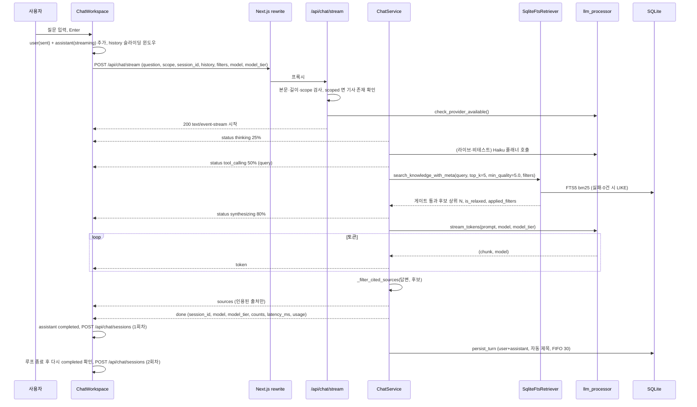

# 기능명세: AI 챗

Updated: 2026-11-06

## 개요
AI 챗은 수집한 기술 소식(`news_items`)을 근거로 질문에 답하는 대화 화면이다. 사용자는 `/chat` 페이지에서 질문을 입력하고, 백엔드 `POST /api/chat/stream` 이 SSE 로 진행 단계(status), 출처(sources), 답변 토큰(token), 완료(done) 또는 오류(error)를 보낸다. 모드는 두 가지다.

- 전체 코퍼스(global): ReAct 방식의 플래너가 검색 여부를 정한다. 검색하면 SQLite FTS5(BM25) + 품질 + 최신성 점수로 기사를 고르고, 답변을 다 받은 뒤 실제로 인용된 출처만 보낸다.
- 단일 기사(scoped): 뉴스 피드에서 넘겨받은 기사 1건만 근거로 4단 구조 리포트를 만든다. 본문이 없으면 원문을 스크래핑한다.

화면 구성 (`frontend/src/components/chat/ChatWorkspace.tsx`):
- 왼쪽: 대화 기록 사이드바 (`ChatSidebar`, 1024px 이상에서만 보임). 1024px 미만은 슬라이드 드로어 (`ChatHistoryDrawer`).
- 위: 헤더 (`ChatHeader`) — 피드로 돌아가기, 스코프 토글(Scoped/Global), 기사 칩(`ActiveSourceChip`), 모델 선택기(헤더용), 기록 토글, 새 대화.
- 가운데: 메시지 타임라인 (`ChatMessageList`) — 빈 상태면 환영 화면과 추천 질문 4개, 메시지가 있으면 메시지와 모델 변경 구분선.
- 아래: 포커스 캡슐(`FocusCapsule`)과 입력창(`ChatPromptInput`, 모델 선택기 포함). 캡슐을 누르면 포커스 필터 시트(`FocusBottomSheet`)가 열린다.

세션은 이중으로 저장한다. 브라우저 localStorage 와 서버 DB(`chat_sessions`, `chat_messages`)다. 서버는 스트림이 끝날 때 한 턴(질문+답변)을 스스로 저장하고, 프론트도 같은 턴을 `POST /api/chat/sessions` 로 다시 보낸다 (중복 문제는 '알려진 불일치·위험' 참고).

## 기능 목록
| ID | 기능 | 설명 | 진입점 (화면 / API) |
|---|---|---|---|
| CHAT-01 | 세션 목록 조회·검색 | 최근 갱신순 세션 목록, 제목 부분일치 검색 | 사이드바/드로어 / `GET /api/chat/sessions` |
| CHAT-02 | 새 대화 | 새 세션 UUID 발급, 화면 상태 초기화 | `+ 새 대화` 버튼 / (서버 호출 없음) |
| CHAT-03 | 세션 선택·복원 | 과거 세션의 메시지·스코프·기사·필터 복원 | 세션 카드, `/chat?session_id=` / `GET /api/chat/sessions/{id}` |
| CHAT-04 | 세션 제목(이름) | 첫 질문으로 30자 자동 제목. 수동 변경 UI 없음 | — / `POST /api/chat/sessions` (title) |
| CHAT-05 | 세션 삭제 | 확인 팝오버 후 세션과 메시지 삭제 | 카드 휴지통 버튼 / `DELETE /api/chat/sessions/{id}` |
| CHAT-06 | 세션 저장·동기화 | 서버 자동 영속화, 프론트 업서트, localStorage 캐시, 최대 30개 FIFO | — / `POST /api/chat/sessions`, 스트림 내부 |
| CHAT-07 | 히스토리 사이드바·드로어 | 데스크톱 사이드바 접기, 모바일 드로어 | 헤더 기록 버튼 |
| CHAT-08 | 메시지 입력·전송 | 2,000자 제한, Enter 전송, 멀티턴 history 첨부 | 입력창, 추천 질문 / `POST /api/chat/stream` |
| CHAT-09 | SSE 스트리밍 수신 | status/sources/token/done/error 파싱과 화면 반영 | — / `POST /api/chat/stream` |
| CHAT-10 | ReAct 검색 계획 | global 모드에서 검색 도구 호출 여부와 검색어 결정 | — / 스트림 내부 |
| CHAT-11 | 워크플로 단계 표시 | 진행률 바, 완료 후 접는 단계 목록 | 답변 말풍선 상단 |
| CHAT-12 | RAG 코퍼스 검색 | FTS5 BM25 + 품질 + 최신성 하이브리드 점수, 관련도 게이트, 상위 N | — / 스트림 내부, `GET /api/chat/search` |
| CHAT-13 | 단일 기사(scoped) 질의 | 기사 1건 근거, 본문 스크래핑, 4단 리포트 프롬프트 | Scoped 모드 / 스트림 내부 |
| CHAT-14 | 인용 출처 | 답변의 `[n]` 만 남기는 출처 정리, 인용 배지·팝오버 | 답변 본문 `[1]` 배지 |
| CHAT-15 | 모델 선택 | Haiku/Sonnet/Opus 티어 선택, 티어 배지, 모델 변경 구분선 | 헤더·입력창 모델 칩 |
| CHAT-16 | 포커스 필터 | 카테고리·기간·정렬·고신호 필터, 0건 시 기간 자동 완화 | 포커스 캡슐 → 시트 |
| CHAT-17 | 스코프 전환·기사 칩 | Scoped/Global 토글, 기사 컨텍스트 해제 | 헤더 토글, `ActiveSourceChip` |
| CHAT-18 | 핸드오버 | 뉴스 기사에서 챗으로 기사 컨텍스트와 질문 넘기기 | `HandoverCtaButton`, 피드 `c` 키 / `GET /api/chat/sources/{id}` |
| CHAT-19 | 내보내기 | 답변 복사, 마크다운 복사, .md 다운로드, Notion 동기화(모의) | 답변 하단 `ExportToolbar` |
| CHAT-20 | 오류·중단·재시도 | HTTP 오류, 스트림 중 오류, 사용자 중단, 다시 시도 | 중단 버튼, 오류 카드 |
| CHAT-21 | 토큰 한도·출력 완료 | 프롬프트 분량 지시, max_tokens, 완료 판정 | — |
| CHAT-22 | LLM 프로바이더·폴백 | Anthropic 우선, OpenAI, Ollama 폴백, 명시적 Gemini/GPT 라우팅 | — |
| CHAT-23 | 동기 단건 질의 API | 스트림 없이 한 번에 답을 돌려주는 API (UI 미사용) | `POST /api/chat/query` |
| CHAT-24 | 보충 웹 검색 엔진 | 충실도 평가와 DuckDuckGo 보충 검색 `[S1]` (챗 흐름에 연결되지 않음) | — |
| CHAT-25 | 반응형·모바일 | 가상 키보드 대응 높이, 드로어, 바텀시트, iOS 줌 방지 | — |

## CHAT-01 세션 목록 조회·검색
- 진입점: 화면 진입 시 자동 조회(`useChatSessions` 마운트), 사이드바/드로어의 `대화 검색...` 입력, 오류 카드의 `다시 시도`. API `GET /api/chat/sessions?limit=&offset=`.
- 입력: `limit` 기본 30, 1~50 (`Query(30, ge=1, le=50)`), `offset` 기본 0, 0 이상. 프론트는 `limit=30` 만 보낸다 (`MAX_SESSIONS = 30`). 검색어는 프론트 상태 `searchQuery` 다.
- 처리 규칙:
  1. 백엔드는 `updated_at DESC` 로 정렬해 offset/limit 을 적용한다. 각 세션의 메시지를 모두 불러와(`selectinload`) `message_count` 와 마지막 메시지 앞 100자(`last_message_preview`)를 만든다.
  2. `active_filters_json` 파싱에 실패하면 `active_filters` 를 null 로 둔다.
  3. 프론트는 응답을 `summaryToSessionMeta` 로 바꿔 상태에 넣고 localStorage `agentlens_chat_sessions_index` 에 저장한다.
  4. 초기 상태는 localStorage 인덱스 캐시로 시작한다(서버 응답 전).
  5. 검색은 서버를 부르지 않는다. 앞뒤 공백을 지우고 소문자로 바꾼 검색어가 제목에 포함된 세션만 보인다 (`ChatSidebar`, `ChatHistoryDrawer` 각각 같은 필터).
- 출력: 세션 카드 목록. 카드는 제목(말줄임), Scoped/Global 배지, 상대 시각(방금 전 / N분 전 / N시간 전 / 어제 / N일 전 / M월 D일)을 보인다. 활성 세션은 왼쪽 인디고 테두리와 `aria-current`.
- 예외·엣지:
  - 로딩 중: 스켈레톤 5줄.
  - 조회 실패: 캐시가 있으면 캐시를 보이고 오류는 숨긴다. 캐시가 없으면 `세션 목록 조회 실패 (상태코드)` 오류 카드와 `다시 시도`.
  - 0건: `저장된 대화 기록이 없습니다` + `새 대화 시작`. 검색 결과 0건: `검색 결과가 없습니다` + `검색어 초기화`.
  - 백엔드 예외: 500 `ERR_SERVER_INTERNAL`.
- 관련 코드: `backend/app/api/chat.py:422-441`, `backend/app/services/chat_session_service.py:58-98`, `frontend/src/components/chat/useChatSessions.ts:44-112`, `frontend/src/components/chat/ChatSidebar.tsx:41-45`, `frontend/src/components/chat/ChatHistoryDrawer.tsx:42-46`, `frontend/src/components/chat/SessionList.tsx:35-84`, `frontend/src/components/chat/SessionItemCard.tsx:15-31`, `frontend/src/components/chat/SessionEmptyState.tsx`, `frontend/src/types/chat.ts:739-751`

## CHAT-02 새 대화
- 진입점: 사이드바/드로어 헤더 `새 대화` 버튼, 헤더 `새 대화` 버튼(사이드바가 닫혀 있을 때만 보임, `showNewChatButton={!isSidebarOpen}`), 빈 목록의 `새 대화 시작`.
- 입력: 없음.
- 처리 규칙:
  1. 진행 중인 스트림을 중단한다 (`handleStopGenerating`).
  2. `crypto.randomUUID()`(없으면 수동 v4 생성)로 새 세션 ID 를 만든다.
  3. 메시지, 모델 변경 이벤트, 입력값을 비우고 모델 티어를 `sonnet`, 기사 컨텍스트를 null, 스코프를 `global`, 포커스 필터를 기본값으로 되돌린다.
  4. 서버 호출은 없다. 세션은 첫 턴이 끝날 때 서버에 생긴다.
- 출력: 환영 화면과 추천 질문 4개.
- 예외·엣지: 스트리밍 중에는 사이드바·헤더의 새 대화 버튼이 비활성화된다 (`disabled={isStreaming}`). 드로어에서 누르면 드로어도 닫힌다.
- 관련 코드: `frontend/src/components/chat/ChatWorkspace.tsx:38-47,182-193`, `frontend/src/components/chat/ChatSidebarHeader.tsx:28-37`, `frontend/src/components/chat/ChatHeader.tsx:138-149`

## CHAT-03 세션 선택·복원
- 진입점: 세션 카드 클릭 또는 Enter/Space, URL `/chat?session_id=<id>` (첫 진입 1회). API `GET /api/chat/sessions/{session_id}`.
- 입력: 세션 ID 문자열. 백엔드는 형식 검사를 하지 않는다.
- 처리 규칙:
  1. 스트리밍 중이면 먼저 중단한다.
  2. `sessionId` 를 대상 ID 로 바꾼다.
  3. `loadSessionDetail`: localStorage `agentlens_chat_session_<id>` 를 먼저 읽어 두고, 서버를 부른다. 200 이면 응답을 localStorage 에 저장하고 쓴다. 404 이거나 네트워크 오류이거나 그 밖의 상태면 캐시를 쓴다(없으면 null).
  4. 상세가 있으면 `scope_mode`, `active_source`(서버가 `news_items` 에서 채운 기사 상세), `active_filters`(없으면 기본값), 메시지를 복원한다. 메시지는 `chatMessageItemToUiMessage` 로 바꾸며 상태는 pending→sending, 나머지는 그대로 대응한다.
  5. 백엔드는 메시지를 `created_at ASC` 로 돌려준다(관계 `order_by`). 메시지별 `sources_json`, `usage_json` 파싱에 실패하면 null 로 둔다.
  6. 드로어를 닫는다.
- 출력: 복원된 타임라인. 복원 메시지에는 `step_history` 가 없으므로 워크플로 트래커는 보이지 않는다.
- 예외·엣지:
  - 백엔드 없음: 404 `ERR_SESSION_NOT_FOUND` (`ID {id}에 해당하는 대화 세션을 찾을 수 없습니다.`), 그 밖의 예외 500 `ERR_SERVER_INTERNAL`.
  - 상세가 null 이면 `sessionId` 만 바뀌고 이전 화면 메시지가 그대로 남는다 (위험 항목 참고).
  - 선택해도 모델 티어와 모델 변경 이벤트는 초기화하지 않는다.
- 관련 코드: `backend/app/api/chat.py:496-523`, `backend/app/services/chat_session_service.py:100-209`, `frontend/src/components/chat/useChatSessions.ts:115-147`, `frontend/src/components/chat/ChatWorkspace.tsx:196-222,502-511`, `frontend/src/types/chat.ts:795-822`

## CHAT-04 세션 제목(이름)
- 진입점: 별도 UI 없음. 제목 수정(rename) 화면과 전용 API 는 없다. `POST /api/chat/sessions` 의 `title` 필드로만 바뀐다.
- 입력: 첫 사용자 질문.
- 처리 규칙:
  1. 백엔드 `generate_auto_title`: `#*_~`` ` 와 HTML 태그를 공백으로 바꾸고, 줄바꿈·탭을 공백으로, 연속 공백을 하나로 줄인다. 비면 `새 대화`, 30자 이하면 그대로, 넘으면 앞 30자 + `...`.
  2. 백엔드는 메시지를 덧붙일 때 세션 제목이 `새 대화` 이거나 비어 있으면 그 사용자 메시지로 제목을 만든다.
  3. 프론트 `generateAutoTitle` 도 같은 규칙이다(줄바꿈은 `\s+` 처리로 함께 정리). `createOrUpdateSession` 은 제목이 없거나 `새 대화` 면 첫 사용자 메시지로 만든다.
  4. 서버 업서트는 `title` 이 null 이 아니면 덮어쓴다.
- 출력: 카드 제목, `title` 속성 툴팁.
- 예외·엣지: DB 컬럼은 `String(100)`, 백엔드 요청 스키마는 길이 제한이 없다. 프론트 zod 는 1~100자.
- 관련 코드: `backend/app/services/chat_session_service.py:38-49,329-331`, `backend/app/models/chat_session.py:11`, `frontend/src/types/chat.ts:762-770`, `frontend/src/components/chat/useChatSessions.ts:170-177`

## CHAT-05 세션 삭제
- 진입점: 세션 카드 휴지통 버튼(호버/포커스 시 보임) → `DeleteConfirmPopover`. API `DELETE /api/chat/sessions/{session_id}`.
- 입력: 세션 ID.
- 처리 규칙:
  1. 팝오버는 열리면 `취소` 버튼에 포커스를 둔다. Esc 또는 바깥 클릭으로 닫힌다.
  2. `삭제` 를 누르면 프론트는 목록과 localStorage 에서 먼저 지운다(낙관적 삭제).
  3. 서버에서 세션을 삭제한다. ORM `cascade="all, delete-orphan"` 과 FK `ondelete="CASCADE"` 로 메시지도 지운다. 응답 `{status: "success", message: "대화 세션 및 하위 메시지가 원자적으로 영구 삭제되었습니다.", deleted_count: 1}`.
  4. 지운 세션이 현재 세션이면 새 대화로 초기화한다.
- 출력: 버튼이 `삭제 중...` 으로 바뀌고, 끝나면 팝오버가 닫힌다.
- 예외·엣지:
  - 없는 세션: 404 `ERR_SESSION_NOT_FOUND`. 커밋 실패: 롤백 후 500 `ERR_SESSION_DELETE_FAILED`.
  - 서버 실패 시 프론트는 목록을 다시 불러오고 오류를 다시 던진다. 카드 컴포넌트가 이 오류를 잡지 않아 처리되지 않은 Promise 거부가 되고, 현재 세션 초기화도 하지 않는다.
- 관련 코드: `backend/app/api/chat.py:525-561`, `backend/app/services/chat_session_service.py:280-297`, `frontend/src/components/chat/useChatSessions.ts:243-267`, `frontend/src/components/chat/SessionItemCard.tsx:61-69,116-140`, `frontend/src/components/chat/DeleteConfirmPopover.tsx`, `frontend/src/components/chat/ChatWorkspace.tsx:225-233`

## CHAT-06 세션 저장·동기화
- 진입점: 자동. 서버 자동 영속화(스트림 생성기 끝), 프론트 `createOrUpdateSession`(done 이벤트, 스트림 루프 종료, 사용자 중단 시), API `POST /api/chat/sessions`.
- 입력 (`POST /api/chat/sessions`, `ChatSessionCreateRequest`): `id`(선택, UUID), `title`(기본 `새 대화`), `scope_mode`(`scoped`|`global`, 기본 `global`), `active_source_id`, `active_filters`, `messages`(`ChatMessageItem[]`).
- 처리 규칙:
  1. 서버 자동 영속화: `stream_chat` 이 done 이벤트를 보낸 뒤 `persist_turn` 으로 사용자 메시지와 어시스턴트 메시지(출처, 모델, 티어, usage, latency 포함)를 한 번에 덧붙인다. 세션이 없으면 `새 대화` 제목으로 만든 뒤 덧붙인다. 실패하면 로그만 남긴다.
  2. 업서트: `id` 가 있으면 UUID 형식을 검사한다(실패 시 400 `ERR_SESSION_INVALID_UUID`). 있는 세션이면 null 이 아닌 `title`, `scope_mode`, `active_source_id`, `active_filters` 만 덮어쓰고 `updated_at` 을 갱신한다. 없으면 새로 만든다. 먼저 커밋한다.
  3. `messages` 가 있으면 `append_messages_batch` 로 덧붙인다(교체가 아니다). 이때 메시지의 `id, role, content, sources, status, model, latency_ms` 만 옮기고 `model_tier`, `usage` 는 옮기지 않는다. 모든 메시지의 `created_at` 은 요청 처리 시각 하나로 같게 저장한다.
  4. 덧붙인 뒤와 업서트 뒤에 세션 수가 30개를 넘으면 `updated_at` 이 오래된 순으로 넘는 만큼 지운다 (`enforce_fifo_retention(max_limit=30)`).
  5. 응답은 201 과 세션 상세(`ChatSessionDetail`).
  6. 프론트 `createOrUpdateSession`: 메시지가 0개면 아무것도 하지 않는다. 목록 메타(제목, 메시지 수, 마지막 메시지 앞 60자)를 맨 앞에 넣고 30개로 자른 뒤 localStorage 인덱스와 세션 상세를 저장한다. 그다음 현재 화면의 메시지 전체를 `uiMessageToChatMessageItem` 으로 바꿔 POST 한다. 응답과 오류는 무시한다.
- 출력: 사이드바 즉시 갱신, 서버 DB 저장.
- 예외·엣지:
  - 본문 JSON 오류 또는 스키마 검증 실패: 400 `ERR_SESSION_INVALID_UUID`. 그 밖의 예외: 500 `ERR_SESSION_CREATE_FAILED`.
  - 프론트는 한 턴에 같은 메시지 ID 로 POST 를 두 번 보낸다(done 이벤트, 루프 종료). 서버 자동 저장과 겹쳐 중복·실패가 생길 수 있다 (위험 항목 참고).
  - 서버 업서트는 `active_source_id` 가 null 이면 기존 값을 지우지 않는다.
- 관련 코드: `backend/app/api/chat.py:443-494`, `backend/app/services/chat_session_service.py:211-278,299-405,437-460`, `backend/app/services/chat_service.py:806-822`, `frontend/src/components/chat/useChatSessions.ts:150-240`, `frontend/src/components/chat/ChatWorkspace.tsx:400-426,439-460,462-476`, `frontend/src/types/chat.ts:827-853`

## CHAT-07 히스토리 사이드바·드로어
- 진입점: 헤더 기록 버튼(`대화 기록 보기`), 사이드바 접기 버튼, 드로어 닫기 버튼, 백드롭 클릭, Esc.
- 입력: 없음.
- 처리 규칙:
  1. 사이드바는 처음에 열린 상태(`isSidebarOpen = true`)이고 CSS 로 1024px 이상에서만 보인다 (`hidden lg:flex`, 폭 `w-64 lg:w-72`). 닫으면 렌더링하지 않는다.
  2. 헤더 기록 버튼은 `window.innerWidth >= 1024` 이면 사이드바를, 아니면 드로어를 토글한다.
  3. 드로어는 왼쪽 슬라이드(`w-72 sm:w-80`)와 반투명 백드롭이다. 열려 있는 동안 `body` 스크롤을 막는다. 세션 선택·새 대화 후 닫힌다.
  4. 사이드바와 드로어는 같은 `ChatSidebarHeader`(새 대화 + 검색)와 `SessionList` 를 쓴다.
- 출력: 세션 목록 패널.
- 예외·엣지: 기록 버튼의 `aria-controls="chat-history-drawer"` 에 해당하는 id 를 가진 요소는 없다.
- 관련 코드: `frontend/src/components/chat/ChatSidebar.tsx`, `frontend/src/components/chat/ChatHistoryDrawer.tsx`, `frontend/src/components/chat/ChatSidebarHeader.tsx`, `frontend/src/components/chat/ChatWorkspace.tsx:80-81,590-605,633-641,691-705`, `frontend/src/components/chat/ChatHeader.tsx:124-136`

## CHAT-08 메시지 입력·전송
- 진입점: 입력창(`질문 입력`), Enter(Shift+Enter 는 줄바꿈), `질문 전송` 버튼, 환영 화면 추천 질문 클릭, 핸드오버 `q` 파라미터. API `POST /api/chat/stream`.
- 입력 (`ChatStreamRequest`): `question` 1~2,000자(필수), `model`(기본 `ANTHROPIC_DEFAULT_CHAT_MODEL`, 설정 기본 `claude-sonnet-5-5`), `model_tier`(`haiku`|`sonnet`|`opus`), `scope`(`scoped`|`global`, 기본 `global`), `source_id`, `session_id`, `history`(`{role, content}[]`), `top_k` 1~10(기본 5), `filters`(`ChatFocusFilter`).
- 처리 규칙:
  1. 입력창: 글자 수 `N / 2000` 을 보이고 넘으면 빨간색이 된다. 공백만 있거나 스트리밍 중이거나 2,000자를 넘으면 전송하지 않는다. IME 조합 중 Enter 는 무시한다(한글 이중 전송 방지). 높이는 내용에 맞춰 최대 180px.
  2. `handleSendMessage`: 앞뒤 공백을 지운다. 스코프는 옵션 값이 있으면 그 값, 없으면 기사 컨텍스트(ID 또는 상세)가 있을 때 `scoped`, 없으면 현재 스코프 상태다.
  3. 사용자 메시지(`msg-user-<랜덤7자>`, 상태 `sent`)와 빈 어시스턴트 메시지(`msg-asst-<랜덤7자>`, 상태 `streaming`, 선택 티어와 모델 ID)를 추가하고 입력창을 비운다.
  4. history: 기존 메시지 중 상태가 `completed` 또는 `sent` 인 것만 `{role, content}` 로 만들고 `applySlidingWindow` 를 적용한다 — 최근 20개(10턴)를 남기고, 전체 글자 수 / 2.5 가 3,000 을 넘으면 남은 메시지가 2개가 될 때까지 앞에서 2개씩 지운다.
  5. 요청 본문: `question, scope, source_id, session_id, history, filters(toChatFocusFilter), model(TIER_TO_MODEL[티어]), model_tier`. `top_k` 는 보내지 않는다(서버 기본 5). URL 은 상대 경로 `/api/chat/stream` 이라 Next.js rewrite 를 거친다.
  6. 백엔드 사전 검사(스트림 열기 전): JSON 파싱(400 `ERR_INVALID_PAYLOAD`), 빈 질문(400 `ERR_CHAT_PAYLOAD_EMPTY`), 2,000자 초과(400 `ERR_CHAT_PAYLOAD_TOO_LARGE`), scope 값(400 `ERR_INVALID_SCOPE_PARAM`), scoped 인데 `source_id` 가 없거나 기사가 없음(404 `ERR_HANDOVER_SOURCE_NOT_FOUND`), LLM 프로바이더 가용성(`check_provider_available`, 없으면 503 `ERR_LLM_PROVIDER_UNAVAILABLE`).
  7. 백엔드 프롬프트의 history 는 마지막 4개 메시지만 쓴다 (`history[-4:]`).
  8. 추천 질문 4개: `💡 FastMCP로 파이썬 기반 경량 MCP 서버 구축하는 방법`, `🔄 LangGraph v0.2의 분기 제어 및 시간 여행 디버깅 원리`, `📊 SWE-bench Multimodal 하네스의 주요 평가 지표`, `⚡ 최근 24시간 내 가장 주목받은 에이전트 오픈소스 동향`. 이모지 포함 문자열 그대로 보낸다.
- 출력: SSE 스트림 (`text/event-stream; charset=utf-8`, `Cache-Control: no-cache, no-transform`, `Connection: keep-alive`, `X-Accel-Buffering: no`).
- 예외·엣지:
  - `ChatStreamRequest(**body)` 는 try 밖에 있어 `top_k`, `filters`, `history.role`, `model_tier` 값이 스키마에 맞지 않으면 전역 예외 처리기로 가서 500 `{"detail", "error"}` 가 된다.
  - 입력창 placeholder 는 scoped 일 때 `선택된 기사 본문을 기반으로 심층 질문을 입력하세요...`, global 일 때 `전체 AI 에이전트 뉴스 코퍼스에 대해 자유롭게 질문하세요...`.
- 관련 코드: `backend/app/api/chat.py:276-416`, `backend/app/schemas/chat.py:28-37`, `backend/app/services/chat_service.py:295-303`, `frontend/src/components/chat/ChatPromptInput.tsx`, `frontend/src/components/chat/ChatWorkspace.tsx:236-314`, `frontend/src/components/chat/ChatMessageList.tsx:20-25`, `frontend/src/types/chat.ts:777-790`

## CHAT-09 SSE 스트리밍 수신
- 진입점: `POST /api/chat/stream` 응답 본문.
- 입력: SSE 블록 (`event: <이름>\ndata: <JSON 한 줄>\n\n`).
- 처리 규칙:
  1. 응답이 ok 가 아니면 JSON 의 `message`(없으면 `서버 에러 (상태코드)`)로 오류를 던진다. 본문이 없으면 `응답 스트림을 찾을 수 없습니다.`.
  2. `ReadableStream` 리더로 읽어 `TextDecoder(stream: true)` 로 누적하고 `\n\n` 으로 나눈다. 마지막 조각은 다음 청크까지 버퍼에 둔다. 스트림이 끝나면 디코더를 비우고 남은 버퍼를 trim 해 마저 처리한다(끝에 빈 줄이 없어도 처리).
  3. 블록 안에서 `event: ` 줄과 `data: ` 줄을 읽는다. data 줄이 여러 개면 마지막 줄만 남는다. data 가 없으면 건너뛴다.
  4. 이벤트별 처리: `status`(`step` 필수) → `current_status` 갱신, `step_history` 에 추가. `sources`(`sources` 필수) → 출처, `applied_filters`, `is_relaxed`, `primary_count`, `supplementary_count` 갱신. `token`(문자열) → 내용에 이어 붙임. `done` → 상태 `completed`, 모델(없으면 선택 모델), 티어, `latency_ms`, `usage` 기록 후 세션 저장. `error` → 오류를 던진다. 그 밖의 이벤트와 JSON 파싱 오류는 무시한다.
  5. 루프가 끝나면 아직 `streaming` 인 어시스턴트 메시지를 `completed` 로 바꾸고 세션을 다시 저장한다.
  6. 런타임에서 zod 스키마(`parseChatSseEvent` 등)는 쓰지 않고 `JSON.parse` 결과를 그대로 쓴다.
- 출력: 토큰이 들어올 때마다 말풍선이 갱신되고, 스트리밍 중에는 커서 막대가 깜빡인다. 원문/보충 건수 배지는 `completed` 이고 내용과 출처가 있을 때만 보인다. 새 메시지·타임라인 변경마다 맨 아래로 부드럽게 스크롤한다.
- 예외·엣지: 이벤트 순서와 필드는 'SSE 이벤트 목록' 절을 따른다. global 검색 모드에서는 출처가 토큰 뒤에 오므로 스트리밍 중 본문의 `[1]` 은 회색 '출처 없음' 배지로 보이다가 sources 이벤트 뒤에 파란 배지로 바뀐다.
- 관련 코드: `frontend/src/components/chat/ChatWorkspace.tsx:316-460`, `frontend/src/components/chat/ChatMessageItem.tsx:133-159,336-338`, `frontend/src/components/chat/ChatMessageList.tsx:39-41`, `frontend/src/types/chat.ts:553-573`

## CHAT-10 ReAct 검색 계획 (global)
- 진입점: global 모드 질의마다 (`_plan_react_action`). scoped 모드는 항상 `action: none` 이다.
- 입력: 질문, 스코프. (history, model, model_tier 인자는 받지만 쓰지 않는다.)
- 처리 규칙 (위에서부터 처음 걸리는 규칙으로 정한다):
  1. 질문을 trim, 소문자, 끝의 `?!.~` 제거한 값이 비었거나 인사말 집합(`안녕`, `안녕하세요`, `hello`, `hi`, `thanks`, `테스트`, `ok` 등 30개)과 정확히 같으면 `none`.
  2. 메타 불만 패턴(`인사했는데`, `왜 뉴스`, `검색하지 마`, `오늘 날씨`, `점심 메뉴`, `스트리밍 도중 끊김` 등 13개)이 포함되면 `none`.
  3. 도메인 신호(`KNOWN_TECH_STACK` 키 + `claude`, `mcp`, `agent`, `llm`, `rag`, `에이전트`, `벤치마크`, `뉴스`, `기사`, `소식`, `트렌드` 등)가 질문에 부분 문자열로 하나도 없으면 `none`.
  4. `extract_keywords` 결과에서 인사말을 뺀 키워드가 없으면 `none`.
  5. 기본 검색어는 키워드를 공백으로 이은 문자열이다.
  6. 테스트 환경이 아니고(`TESTING`, `CI`, `pytest` 로드 여부) 라이브 프로바이더가 있으면 Haiku(`ANTHROPIC_HAIKU_MODEL`, 기본 `claude-haiku-5-5`)에 플래너 프롬프트를 보내 JSON `{thought, action, search_query}` 를 받는다. `none` 이면 검색 안 함. `search_news_corpus` 면 그 검색어(비면 기본 검색어). JSON 이 없으면 `ACTION: NONE` / `ACTION: SEARCH <키워드>` 텍스트를 찾는다. 예외가 나면 경고 로그 후 휴리스틱으로 간다.
  7. 위에서 정하지 못하면 `search_news_corpus` 와 기본 검색어.
- 출력: `{action: "none"|"search_news_corpus", search_query, thought}`. `thought` 는 화면에 보내지 않는다.
- 예외·엣지: 도메인 신호는 부분 문자열 비교라 `o1`, `o3`, `rag`, `agent` 같은 짧은 키가 다른 단어 안에서도 걸린다.
- 관련 코드: `backend/app/services/chat_service.py:305-445`, `backend/app/services/llm_processor.py:40-84,229-240`

## CHAT-11 워크플로 단계 표시 (WorkflowStepTracker)
- 진입점: 어시스턴트 말풍선 상단. `current_status` 나 `step_history` 가 있을 때만 보인다.
- 입력: `currentStatus`, `stepHistory`, `isStreaming`(해당 메시지가 스트리밍 중이고 상태가 `streaming`), `isDone`(상태 `completed`).
- 처리 규칙:
  1. 스트리밍 중이고 완료 전: 현재 단계 아이콘, `label`, 진행률(`progress`, 없으면 50)% 와 진행 바. `query` 가 있으면 `검색어: "<query>"`.
  2. 그 밖의 경우: 높이 28px(`h-7`) 접이식 헤더 `[✓] 심층 분석 과정 {N}단계 완료`(N = `step_history` 길이, 없으면 현재 상태 1). 펼치면 단계별 라벨, 검색어 칩, `progress%`(없으면 `완료`)를 보인다.
  3. 단계 아이콘: thinking(보라 반짝임), tool_calling·agentic_searching(돋보기), observing(체크), extracting_source(지구), evaluating_sufficiency(저울), synthesizing(문서).
- 출력: 진행 영역(`role="region"`, `progressbar`) 또는 접이식 목록.
- 예외·엣지: 오류나 중단으로 끝난 메시지도 `isStreaming` 이 거짓이므로 '단계 완료' 아코디언으로 보인다. `fallbackNotice` prop 은 있지만 워크스페이스에서 넘기지 않는다.
- 백엔드가 실제로 보내는 단계: scoped = `extracting_source`(30) → `synthesizing`(85). global 검색 = `thinking`(25) → `tool_calling`(50, `query`) → `synthesizing`(80). global 직접 답변 = `thinking`(25) → `synthesizing`(75). `observing`, `evaluating_sufficiency`, `agentic_searching` 은 스키마에만 있고 백엔드가 보내지 않는다.
- 관련 코드: `frontend/src/components/chat/WorkflowStepTracker.tsx`, `frontend/src/components/chat/ChatMessageItem.tsx:186-192`, `backend/app/services/chat_service.py:610-741`, `backend/app/schemas/chat.py:54-71`

## CHAT-12 RAG 코퍼스 검색 (retriever)
- 진입점: global 모드에서 플래너가 `search_news_corpus` 를 고를 때 (`_resolve_sources` → `KnowledgeRetrieverFacade.search_knowledge_with_meta`). 미리보기 API `GET /api/chat/search` (UI 미사용).
- 입력: 검색어(플래너 결과), `top_k`(요청 값, 기본 5), `min_quality` 5.0 고정(챗), `filters`.
- 처리 규칙:
  1. FTS 준비: `news_fts` 가상 테이블(FTS5; title, summary, why_it_matters, tech_stack, tags; content=`news_items`)과 INSERT/DELETE/UPDATE 동기화 트리거가 없으면 만들고 `rebuild` 한다. 있으면 FTS 행 수가 `news_items` 보다 적을 때 `rebuild` 한다. 실패하면 경고 후 롤백.
  2. 키워드 추출(`extract_keywords`): 영문·숫자·`_-.` 묶음과 한글 묶음으로 토큰화한다. 한국어 불용어(조사, `알려줘` 류 어미, `최신`, `뉴스`, `소식`, `기사`, `서버`, `기능`, `구현` 등)와 영어 불용어(`what`, `latest`, `news`, `explain` 등)를 뺀다. 2자 이상 한글 토큰은 끝 조사(`에서`, `으로`, `의`, `를` 등)를 한 번 떼되 남는 길이가 2자 이상일 때만 뗀다. 2자 이상만 남긴다. 다 빠지면 1글자 조사를 뺀 원 토큰을 쓴다.
  3. FTS 질의: 키워드를 `"k1" OR "k2"` 로 만든다(따옴표 제거). 키워드가 없으면 `""`.
  4. 후보 조회: `bm25(news_fts, 5.0, 3.0, 2.0, 2.0, 1.0)` 오름차순, `quality_score >= min_quality`, 카테고리(`all` 이 아니면), 소스(`all` 이 아니면), 기간 컷오프(24h/7d/30d), `high_signal_only` 면 `is_high_signal = 1`, 최대 30건.
  5. FTS 오류이거나 0건이면 LIKE 폴백: 같은 조건에 title/tech_stack/summary/tags 중 하나라도 키워드를 포함하는 기사. 키워드가 제목에 있으면 +5, tech_stack +3, summary +2, tags +1 점, 의사 BM25 = `-1 - 점수` 로 정렬해 30건.
  6. 관련도 점수: `bm_rel` = 최고 BM25 가 음수면 `|score| / |best|`, 아니면 최고·최저 간 정규화. `cov` = 맞은 키워드 수 / 전체, `core_cov` = 제목·tech_stack 에 맞은 키워드 수 / max(1, min(키워드 수, 2)). `s_rel = 0.45·bm_rel + 0.35·cov + 0.20·min(1, core_cov)`.
  7. 게이트(하나라도 걸리면 제외):
     - 키워드 1개: `cov < 1.0`.
     - 키워드 2개: `cov < 0.5`, 또는 `cov == 0.5` 이고 핵심 일치 0개이고 `bm_rel < 0.70`.
     - 키워드 3개 이상: 맞은 키워드 < 2, 또는 < max(2, ceil(키워드 수 × 0.35)).
     - 제목 고유성: 1위 후보 `cov >= 0.8` 이고 이 후보 `cov` 가 더 낮은데 1위의 제목 일치 키워드 중 빠진 것이 있음.
     - 노이즈 낙차: 키워드 2개 이상, `bm_rel < 0.55`, 맞은 키워드 수가 1위보다 적음.
     - 최저선: `s_rel < 0.48`.
  8. 최종 점수: 하이브리드 `base = 0.50·bm_rel + 0.30·(quality/10) + 0.20·exp(-Δt/τ)` (0~1 로 자르고 소수 4자리), `rag_score = 0.60·s_rel + 0.40·base`. τ 는 기간별 `24h` 86400초, `7d` 259200초, `30d` 604800초, `all` 1209600초.
  9. 정렬: `latest` = 발행일 내림차순, `quality` = 품질 내림차순, 그 밖(`hot`) = `rag_score` 내림차순.
  10. 자동 완화: 결과 0건이고 기간이 `all` 이 아니면 기간만 `all` 로 바꿔 다시 조회한다. 결과가 생기면 그 결과를 쓰고 `is_relaxed = true`, `applied_filters` 는 완화된 필터.
  11. 상위 `top_k` 개에 1부터 `index` 를 매긴다. 결과 수는 `top_k` 보다 적을 수 있다(관련 없는 기사로 채우지 않는다).
  12. 챗 출처 항목: `index, type: "primary", id, title, url, source, category, quality_score, snippet`(summary → why_it_matters → title), `published_at`.
  13. `/api/chat/search`: `q` 2자 미만이면 400 `ERR_SEARCH_QUERY_TOO_SHORT`. `top_k` 1~20(기본 5), `min_quality` 1.0~10.0(기본 5.0), `category`, `time_range`, `sort`, `high_signal_only`, `source`. 응답 `{query, total_matches, chunks[{index, id, title, url, source, category, snippet, quality_score, published_at, bm25_score, rag_score}], latency_ms}`. 그 밖의 예외(필터 값 검증 실패 포함)는 500 `ERR_RETRIEVER_INDEX_ERROR`.
- 출력: `(chunks, is_relaxed, applied_filters)`.
- 예외·엣지: 검색 결과가 0건이면 `_build_grounding_prompt` 가 global 의 '출처 없음' 프롬프트(일반 어시스턴트 역할, 가짜 인용 금지)로 바꾼다. 이때도 토큰 뒤에 빈 `sources: []` 이벤트를 보낸다.
- 관련 코드: `backend/app/services/retriever.py:15-20,62-120,122-198,204-243,245-387,389-529,531-593,616-666`, `backend/app/services/chat_service.py:127-157,191-211`, `backend/app/api/chat.py:65-122`

## CHAT-13 단일 기사(scoped) 질의
- 진입점: 기사 컨텍스트가 있는 상태에서 전송(핸드오버 또는 복원된 세션). 요청 `scope: "scoped"`, `source_id`.
- 입력: `source_id`(필수), 질문, history.
- 처리 규칙:
  1. 기사가 없으면 스트림을 열기 전에 404 `ERR_HANDOVER_SOURCE_NOT_FOUND`.
  2. status `extracting_source`(30%, `📄 지정된 단일 뉴스 기사 컨텍스트 로드 중...`)를 보낸다.
  3. 본문: `news_items.full_content` 가 있으면 쓴다. 없으면 `ArticleScraperService.get_article_content` — L1 메모리 LRU(500건) → L2 DB(본문 100자 이상) → URL 단위 잠금(single-flight) 후 httpx GET(타임아웃 5.0초, 리다이렉트 허용) → trafilatura 추출 → 500자 미만이면 readability-lxml + BeautifulSoup 폴백 → 그래도 500자 미만이면 예외. 성공하면 DB `full_content`, `scraped_at` 과 L1 에 저장한다. 401/403/429/503 이나 200 이 아니면 차단 예외. 어떤 예외든 경고 후 본문 없이 진행한다.
  4. status `synthesizing`(85%, `📝 Senior Staff Architect 단일 기사 심층 리포트 프롬프트 조립...`).
  5. 출처 1건(`index: 1`, primary, `snippet` = summary → why_it_matters → 본문 앞 400자 → title, `full_content` 포함)으로 sources 이벤트를 토큰보다 먼저 보낸다. `applied_filters: null`, `is_relaxed: false`, `primary_count: 1`, `supplementary_count: 0`.
  6. 프롬프트: Senior Staff Architect 역할, 응답 분량 규칙, 인라인 인용 규칙에 더해 4개 헤딩(`## 1. 핵심 아키텍처 및 동작 원리`, `## 2. 주요 기능 및 코드 구현 예시`, `## 3. 기존 기술 대비 차별점 및 벤치마크`, `## 4. 실무 도입 시 고려사항 및 튜닝 파라미터`)을 강제한다. 기사 제목·출처·카테고리·요약을 넣고, 본문이 요약과 다르면 앞 5,000자를 넣는다. 기사와 무관한 일반 설명 반복을 금지하는 지침을 붙인다.
  7. 출처 필터링(CHAT-14)을 하지 않는다. 포커스 필터는 무시한다.
- 출력: status 2개 → sources → token… → done.
- 예외·엣지: 스크래핑 실패해도 요약만으로 답한다. 프롬프트에 보충 출처(`[S1]`) 자리가 있지만 scoped 스트림은 보충 출처를 만들지 않는다.
- 관련 코드: `backend/app/api/chat.py:323-345`, `backend/app/services/chat_service.py:222-275,603-671`, `backend/app/services/scraper.py:26-180`

## CHAT-14 인용 출처
- 진입점: 답변 본문의 `[n]`, `[Sn]` 표기. 배지 클릭 시 팝오버.
- 입력: 답변 텍스트, 메시지의 `sources`.
- 처리 규칙 (백엔드, global 검색 모드만):
  1. 스트림이 끝난 뒤 답변 전체에서 `[숫자]` 를 모아 그 `index` 를 가진 출처만 남긴다.
  2. `[숫자]` 가 없거나 맞는 출처가 없으면, 출처 제목에서 뽑은 토큰(영숫자 3자 이상 또는 한글 2자 이상) 앞 4개 중 하나라도 답변(소문자)에 들어 있는 출처를 남긴다.
  3. 그것도 없으면 첫 번째 후보 1건을 남긴다.
  4. 남긴 출처로 sources 이벤트를 토큰 뒤에 보내고, `primary_count` = 남긴 수, `supplementary_count` = 0.
  5. 프롬프트는 실제로 쓴 출처만 `[1]`, `[2]` 로 인용하고 없는 번호를 만들지 말라고 지시한다. 출처 없이 답하는 경우 가짜 인용 번호를 붙이지 말라고 지시한다.
- 처리 규칙 (프론트):
  1. `p`, `li`, `blockquote`, `h1~h4`, `strong` 의 직계 문자열 자식에서 `[S숫자]` 또는 `[숫자]` 를 찾아 `CitationBadge` 로 바꾼다.
  2. 출처가 없으면 회색 `[n]` 텍스트(클릭 불가)로 둔다.
  3. 출처가 있으면 원문은 파란, 보충(`type: supplementary` 또는 `S` 로 시작)은 초록 배지. 클릭하면 팝오버(배지 위 가운데, 폭 320px, 최대 90vw)를 연다. Esc·바깥 클릭·닫기 버튼으로 닫는다.
  4. 팝오버: `출처 [n]` 또는 `보충 검색 [Sn]` 라벨, 원문이면 카테고리, 보충이면 도메인(`domain` 또는 URL 호스트), 제목 2줄, 스니펫 3줄, `원문 보기`/`웹 문서 보기` 새 탭 링크. `기사 상세` 버튼은 `onOpenSourceDetail` 이 있을 때만 보인다.
  5. 말풍선 헤더에 `원문 N건`, `보충 N건` 배지(`primary_count`/`supplementary_count`, 없으면 출처 type 으로 셈)를 완료 후에만 보인다.
- 출력: 인용 배지와 팝오버.
- 예외·엣지: 표 셀(`td`, `th`)과 `em`, 링크 안 텍스트의 `[n]` 은 배지로 바뀌지 않는다. 워크스페이스는 `onOpenSourceDetail` 을 넘기지 않아 `기사 상세` 버튼은 보이지 않는다.
- 관련 코드: `backend/app/services/chat_service.py:240-244,276-293,447-476,773-786`, `frontend/src/components/chat/ChatMessageItem.tsx:41,64-92,133-159,249-330`, `frontend/src/components/chat/CitationBadge.tsx`, `frontend/src/components/chat/CitationPopover.tsx`

## CHAT-15 모델 선택
- 진입점: 헤더 모델 칩(`header-chip`), 입력창 왼쪽 아래 모델 칩(`inline-chip`). 둘은 같은 상태(`selectedTier`)를 쓴다.
- 입력: 티어 `haiku` | `sonnet` | `opus`. 기본 `sonnet`.
- 처리 규칙:
  1. 트리거는 스트리밍 중 비활성화되고 툴팁 `답변 생성 중에는 모델을 변경할 수 없습니다` 를 보인다. 평소 툴팁은 `<이름> (<비용>)`.
  2. 드롭다운(`radiogroup`)은 헤더용은 아래로, 입력창용은 위로 열린다. 화살표 위/아래/좌/우로 포커스 이동(순환), Enter/Space 선택, Esc 닫기, 바깥 클릭·터치 닫기.
  3. 티어 정보(`TIER_META`): Haiku 5.5 ⚡ `$` `~0.3s` `초고속 탐색 & 간결 질의` / Sonnet 5.5 🎯 `$$` `~0.6s` `심층 분석 & RAG 최적화`(추천 표시) / Opus 5.5 🧠 `$$$` `~1.8s` `최대 추론 & 복합 아키텍처`. 지연 값은 고정 문구다.
  4. 티어를 바꾸고 메시지가 1개 이상이면 `ModelSwitchEvent`(이전 티어, 새 티어, 시각)를 추가한다. 타임라인은 메시지와 이벤트를 시각순으로 섞어 `ModelChangeDivider`(`이전 ➔ Claude <새 이름>로 모델 변경됨 · HH:MM`, `role="separator"`)를 보인다. 이벤트는 저장하지 않고 새 대화 때 지운다.
  5. 요청에는 `model = TIER_TO_MODEL[티어]`(`claude-haiku-5-5`, `claude-sonnet-5-5`, `claude-opus-5-5`)와 `model_tier` 를 보낸다.
  6. 백엔드 `resolve_model_and_tier`: 값이 없으면 기본 모델·`sonnet`. `gemini`/`google` 이 들어 있으면 기본 모델로 바꾼다. 설정 매핑(티어 이름 또는 설정된 모델 ID 소문자)에 있으면 그 값. 없으면 `haiku`/`opus`/`sonnet` 단어 포함 여부로 티어를 정하되 `claude-` 로 시작하면 요청 문자열을 그대로 모델 ID 로 쓴다. 나머지는 요청 문자열과 `sonnet`.
  7. 답변 말풍선 헤더는 `formatModelDisplayName(model_used || model_tier)` 로 표시한다(Claude 는 `Claude Sonnet 5.5` 형식, Gemini·GPT 이력은 원래 이름 보존). 하단 `ModelTierBadge`(footer)는 티어 아이콘·이름과 `· {latency_ms}ms`.
- 출력: 선택 티어 표시, 구분선, 메시지별 모델 표시.
- 예외·엣지: done 의 `model` 은 실제 사용 모델 ID(OpenAI/Ollama 폴백 시 `OpenAI gpt-4o-mini` 같은 문자열)이고 `model_tier` 는 요청 값으로 계산한 티어다. 폴백해도 티어 배지는 요청 티어를 보인다.
- 관련 코드: `frontend/src/components/chat/ChatModelSelector.tsx`, `frontend/src/components/chat/ModelTierBadge.tsx`, `frontend/src/components/chat/ModelChangeDivider.tsx`, `frontend/src/components/chat/ChatWorkspace.tsx:76-77,138-179,310-311`, `frontend/src/components/chat/ChatMessageItem.tsx:43-44,340-350`, `frontend/src/types/chat.ts:110-231`, `backend/app/services/llm_providers/anthropic_provider.py:29-122`

## CHAT-16 포커스 필터
- 진입점: 입력창 위 포커스 캡슐(`Focus: <요약>`) 클릭 또는 Enter/Space → `FocusBottomSheet`. 캡슐의 X 는 필터 초기화.
- 입력 (`FocusFilters` ↔ API `ChatFocusFilter`): 카테고리 `all`(전체 소식) | `harness`(하네스·평가) | `mcp_plugins_skills`(MCP·도구) | `agent_tech`(에이전트 기술) | `ai_news`(AI 뉴스), 기간 `all` | `24h` | `7d` | `30d`, 정렬 `hot`(화제순) | `latest`(최신순) | `quality`(품질순), `high_signal_only` 토글(`Must-Read 고신호만 (품질 7.8+)`). 기본값 all/all/hot/false.
- 처리 규칙:
  1. 시트는 초안(draft) 상태로 고르고 `적용하기` 를 눌러야 반영된다. `초기화` 는 초안과 실제 필터를 함께 기본값으로 돌린다. Esc, 백드롭, 닫기 버튼, 모바일에서 아래로 100px 이상 스와이프하면 닫힌다(적용 안 함).
  2. 캡슐 요약: 기사 컨텍스트가 있으면 기사 제목 앞 25자, 필터가 기본값이 아니면 카테고리·기간·`고신호` 를 ` · ` 로 이은 문자열(비면 `맞춤 필터`), 그 밖에는 `전체 소식`. 정렬만 바꾼 경우 `맞춤 필터`.
  3. 시트의 건수 표시는 마지막 어시스턴트 메시지의 출처 수(`actualSourceCount`)다. 값이 있으면 `약 N건 매칭 소식`, 0 이면 기간을 넓히라는 경고.
  4. 필터는 매 요청 `filters` 로 보낸다. 백엔드는 global 검색에만 적용한다(CHAT-12). 0건이고 기간이 `all` 이 아니면 기간을 `all` 로 완화하고 `is_relaxed: true` 를 보낸다.
  5. `is_relaxed` 면 답변 위에 `[안내: 선택 조건에 부합하는 소식이 없어 전체 기간으로 확장 검색했습니다]` 배지를 보인다.
- 출력: 캡슐 요약, 완화 안내 배지.
- 예외·엣지: `actualSourceCount` 는 출처가 1건 이상인 메시지만 세므로 0 이 되지 않아 0건 경고는 워크스페이스에서 나오지 않는다. 고신호는 백엔드에서 품질 점수가 아니라 `is_high_signal` 열로 거른다. 캡슐의 `matchedCount` prop 은 받지만 그리지 않는다. 기사 컨텍스트가 있을 때 캡슐 X 는 필터만 초기화하고 기사는 해제하지 않는다.
- 관련 코드: `frontend/src/components/chat/FocusCapsule.tsx`, `frontend/src/components/chat/FocusBottomSheet.tsx`, `frontend/src/components/chat/ChatWorkspace.tsx:92-101,666-673,708-715`, `frontend/src/components/chat/ChatMessageItem.tsx:194-200`, `frontend/src/types/chat.ts:245-295`, `backend/app/schemas/chat.py:22-26`, `backend/app/services/retriever.py:569-586`

## CHAT-17 스코프 전환·기사 칩
- 진입점: 헤더 `단일 기사 (Scoped)` / `전체 코퍼스 (Global)` 토글(`aria-pressed`), 기사 칩의 X(`기사 컨텍스트 해제`).
- 입력: 스코프 값.
- 처리 규칙:
  1. 토글은 `scopeMode` 상태만 바꾼다.
  2. 기사 칩은 기사 컨텍스트가 있을 때 헤더에 보인다. 카테고리(대문자)와 제목 앞 35자. 스트리밍 중 X 는 비활성.
  3. X 를 누르면 기사 컨텍스트를 null, 스코프를 `global` 로 바꾼다.
  4. 전송 시 스코프는 CHAT-08 의 2번 규칙으로 정한다(기사 컨텍스트가 있으면 토글과 무관하게 `scoped`).
  5. 입력창 왼쪽 아래에 `🎯 Scoped Focus` / `🌐 Global RAG` 를 보인다(640px 이상).
- 출력: 헤더 상태, 전송 스코프.
- 예외·엣지: 기사 없이 Scoped 를 누르고 보내면 `source_id` 없이 scoped 요청이 가서 404 `지정된 기사를 찾을 수 없습니다.` 오류 카드가 된다. 기사가 있는 상태에서 Global 을 눌러도 요청은 scoped 로 간다.
- 관련 코드: `frontend/src/components/chat/ChatHeader.tsx:66-111`, `frontend/src/components/chat/ActiveSourceChip.tsx`, `frontend/src/components/chat/ChatWorkspace.tsx:248-250,567-570,627-631`, `frontend/src/components/chat/ChatPromptInput.tsx:106-108`

## CHAT-18 핸드오버 (뉴스 기사 → 챗)
- 진입점:
  - 뉴스 카드 `전용 챗에서 분석` 버튼(`HandoverCtaButton` `card-compact`).
  - 기사 상세 모달 배너 `전용 AI 챗으로 이동`(`modal-banner`, 모달의 질문 입력값을 `draftQuestion` 으로 넘김).
  - 피드에서 포커스된 기사에 `c`/`C` 키(`HotkeyListener`).
  - 커맨드 팔레트 `AI 챗 워크스페이스 이동`(단축키 표시 `C`)과 헤더 링크는 기사 없이 `/chat` 으로 간다.
  - API `GET /api/chat/sources/{source_id}`.
- 입력: URL `/chat?sourceId=<id>&q=<인코딩된 질문>`. `q` 는 질문이 공백이 아닐 때만 붙는다.
- 처리 규칙:
  1. 버튼 클릭은 이벤트 전파를 막고 `onHandoverComplete` 를 부른 뒤 `router.push`.
  2. 챗 첫 렌더 1회: `session_id` 파라미터가 있으면 세션 복원만 하고 끝낸다(CHAT-03).
  3. `sourceId`(또는 prop `initialSourceId`)가 숫자면 `GET /api/chat/sources/{id}` 로 기사 상세를 받아 기사 컨텍스트로 넣고 스코프를 `scoped` 로 바꾼다. `q` 가 있으면 그 기사로 바로 전송한다.
  4. 404 이거나 네트워크 오류면 노란 안내 바 `요청하신 기사를 찾을 수 없어 전체 뉴스 모드로 시작합니다.` 를 보이고 global 로 시작한다. `q` 가 있으면 global 로 전송한다.
  5. `sourceId` 가 없고 `q` 만 있으면 현재 상태로 전송한다.
  6. 백엔드 기사 상세: `tldr_bullets` 는 JSON 배열 파싱(배열이 아니면 문자열 1개 배열, 실패 시 빈 배열), `tech_stack`·`tags` 는 쉼표 분리, `quality_score` 없으면 6.0, `full_content`, `scraped_at` 포함.
- 출력: 기사 칩, scoped 모드, (질문이 있으면) 자동 답변 시작.
- 예외·엣지: 기사 없음은 404 `ERR_HANDOVER_SOURCE_NOT_FOUND` (`기사 ID {id}를 데이터베이스에서 찾을 수 없습니다.`). 안내 바는 X 로 닫는다.
- 관련 코드: `frontend/src/components/chat/HandoverCtaButton.tsx`, `frontend/src/components/NewsCard.tsx:171-175`, `frontend/src/components/NewsDetailModal.tsx:295-302`, `frontend/src/app/page.tsx:91-95`, `frontend/src/components/HotkeyListener.tsx:126-129`, `frontend/src/components/CommandPalette.tsx:38-50`, `frontend/src/components/chat/ChatWorkspace.tsx:502-565,609-624`, `backend/app/api/chat.py:48-63`, `backend/app/services/chat_service.py:86-125`

## CHAT-19 내보내기 (ExportToolbar)
- 진입점: 오류가 아니고 내용이 있는 어시스턴트 말풍선 하단(`4단 리포트 익스포트:`), 말풍선 헤더 `복사` 버튼.
- 입력: 메시지 ID, 마크다운 본문, 첫 번째 출처 제목(파일명용, 없으면 `AgentLens_Engineering_Report`).
- 처리 규칙:
  1. 헤더 `복사`: `navigator.clipboard.writeText`, 2초간 `복사됨`. 실패는 무시한다.
  2. `마크다운 복사`: 클립보드 API, 실패하면 숨긴 textarea + `document.execCommand('copy')` 폴백. 2초간 `복사됨`.
  3. `.md 다운로드`: Blob(`text/markdown;charset=utf-8`), 파일명 = 제목에서 영숫자·한글·`_-` 외 문자를 `_` 로 바꾸고 50자로 자른 값 + `_YYYY-MM-DD.md`.
  4. `Notion 동기화`: 서버를 부르지 않는다. 300ms 기다린 뒤 3초간 `Notion 연동됨` 을 보이고 `https://notion.so/agentlens/report-<messageId>` 를 콜백으로 넘긴다(워크스페이스는 콜백을 넘기지 않는다).
  5. 스트리밍 중에는 툴바가 반투명·클릭 불가다.
- 출력: 클립보드, 파일 다운로드, 버튼 상태 표시.
- 예외·엣지: Notion 동기화는 실제 연동이 아니다(위험 항목 참고). 워크스페이스의 `onCopyMessage` 는 빈 함수다.
- 관련 코드: `frontend/src/components/chat/ExportToolbar.tsx`, `frontend/src/components/chat/ChatMessageItem.tsx:54-62,162-183,340-358`, `frontend/src/components/chat/ChatWorkspace.tsx:658`

## CHAT-20 오류·중단·재시도
- 진입점: 스트리밍 중 입력창의 빨간 `중단` 버튼(`답변 생성 중단`), 오류 카드의 `다시 시도`.
- 입력: 없음.
- 처리 규칙:
  1. 중단: `AbortController.abort()`, 스트리밍 상태 해제, `streaming` 인 메시지를 `aborted` 로 바꾼다. fetch 가 `AbortError` 를 던지면 해당 어시스턴트 메시지를 `aborted` 로 두고 그때까지의 부분 답변을 세션에 저장한다(`createOrUpdateSession`).
  2. HTTP 오류(스트림 시작 전): 응답 JSON `message` 를 오류 문구로 쓴다. 메시지 상태 `error`, `errorMessage` 저장. 세션 저장은 하지 않는다.
  3. 스트림 중 오류: 백엔드는 토큰 생성 중 어떤 예외든 잡아 `event: error` (`ERR_LLM_STREAM_FAILED`, `LLM 스트리밍 도중 외부 프로바이더 오류가 발생했습니다.`, `status_code: 502`, `step: "synthesizing"`, `retryable: true`)를 보내고 끝낸다. done 과 서버 영속화는 하지 않는다. 프론트는 `message` 로 오류 카드를 만든다.
  4. 네트워크 오류 등 기타: `err.message`, 없으면 `네트워크 지연으로 응답이 중단되었습니다.`.
  5. 오류 카드: 빨간 말풍선, 경고 아이콘과 문구, `다시 시도` 버튼. 오류 메시지에는 복사·내보내기를 보이지 않는다.
  6. 다시 시도: 해당 어시스턴트 메시지와 바로 앞 사용자 메시지를 지우고 같은 질문을 다시 보낸다(옵션 없이 현재 상태 기준).
- 출력: `aborted`/`error` 메시지 상태.
- 예외·엣지:
  - `aborted` 메시지에는 별도 표시나 재시도 버튼이 없다. 내용이 비어 있으면 빈 말풍선(트래커만)으로 남는다.
  - 클라이언트가 끊으면 서버 생성기는 done 전에 멈추므로 서버 자동 영속화가 일어나지 않는다. 중단된 턴은 프론트 POST 로만 저장된다.
  - 오류 이벤트의 `retryable` 은 프론트가 쓰지 않는다. 전역 예외 처리기 응답(`{"detail","error"}`)에는 `message` 가 없어 `서버 에러 (500)` 으로 보인다.
- 관련 코드: `backend/app/services/chat_service.py:743-769`, `frontend/src/components/chat/ChatWorkspace.tsx:123-135,316-319,427-433,461-496,572-582`, `frontend/src/components/chat/ChatMessageItem.tsx:203-222`, `frontend/src/components/chat/ChatPromptInput.tsx:124-133`

## CHAT-21 토큰 한도·출력 완료
- 진입점: 프롬프트 조립과 프로바이더 호출.
- 입력: 없음.
- 처리 규칙:
  1. 프롬프트는 `최대 1,500~2,000 토큰 / 공백 포함 1,500~2,500자 이내` 안에서 결론 문장과 닫힌 코드 블록으로 끝맺으라고 지시하고, 코드 예시는 15줄 이내로 제한한다. scoped 는 각 섹션을 불릿 2~3개로 압축하라고 덧붙인다. 출처 없는 global 직접 답변은 인사·일상 대화에 짧게 답하라고 지시한다.
  2. 실제 출력 상한: Anthropic `max_tokens` 4096(스트림·비스트림), OpenAI `max_tokens` 4096, Ollama `num_predict` 4096. Gemini(명시 요청 시) `maxOutputTokens` 2048.
  3. Anthropic 스트림은 `message_start` 의 input/cache 토큰과 `message_delta` 의 `output_tokens` 를 모아 `last_usage` 로 둔다. done 의 `usage` 는 `llm_processor.last_usage` 값이다.
  4. `stop_reason`(예: max_tokens)은 읽지 않는다. 잘림 여부를 알리는 필드나 UI 는 없다.
  5. 완료 판정: done 이벤트를 받으면 `completed`. done 없이 스트림이 닫혀도 루프 종료 후 `completed` 로 바꾼다.
  6. 백엔드 `latency_ms` 는 요청 처리 시작부터 done 직전까지의 시간이다.
- 출력: done `usage`, `latency_ms`.
- 예외·엣지: OpenAI·Ollama 스트림은 `last_usage` 를 갱신하지 않아 done `usage` 에 직전 호출(예: Haiku 플래너)의 값이 남을 수 있다. `llm_processor` 는 프로세스 전역 단일 인스턴스라 동시 요청끼리 `last_usage` 를 덮어쓴다.
- 관련 코드: `backend/app/services/chat_service.py:238-239,281-292,789-804`, `backend/app/services/llm_providers/anthropic_provider.py:208-319`, `backend/app/services/llm_processor.py:151,200,218,359-460`, `frontend/src/components/chat/ChatWorkspace.tsx:439-460`

## CHAT-22 LLM 프로바이더·폴백
- 진입점: `llm_processor.stream_tokens`(스트림), `generate_live_answer`(플래너, `/query`).
- 입력: 프롬프트, `model`, `model_tier`.
- 처리 규칙:
  1. 사전 가용성(`has_live_provider`): Anthropic 키(설정 → 환경변수 → `config.json` `llm.anthropic_api_key`)가 있으면 가능. 없으면 OpenAI 키. 없으면 `OLLAMA_BASE_URL`(기본 `http://localhost:11434`)에 동기 `GET /api/tags`(타임아웃 1.0초)가 200 이면 가능. 모두 아니면 `LLMProviderUnavailableException` → 스트림 전 503.
  2. 요청 모델 문자열(`model` 또는 `model_tier`)에 `gemini` 가 있으면 Gemini 를 직접 부른다(키 없으면 503). 스트림에서도 전체 응답을 한 번에 토큰 1개로 보낸다. 실패하면 `LLMUpstreamException`.
  3. 비스트림에서만 `gpt`/`openai` 가 있으면 OpenAI 를 직접 부른다.
  4. 기본 순서 (스트림): Anthropic → OpenAI(SDK, 기본 `gpt-4o-mini`, temperature 0.3) → Ollama(`/api/generate` 스트림, 모델 `OLLAMA_MODEL`, 설정 기본 `llama3.2:latest`).
     - Anthropic 429 → `LLMQuotaExceededException`(폴백 안 함). 529/503 과부하, 401 키 오류 → 그대로 올림(폴백 안 함). 그 밖의 예외는 토큰을 하나도 안 보냈을 때만 다음 프로바이더로 넘어가고, 보낸 뒤면 `LLMStreamFailedException`.
     - Anthropic 이 예외 없이 토큰 0개로 끝나도 다음 프로바이더로 넘어간다.
     - OpenAI 예외 문자열에 `rate`/`429`/`quota` 가 있으면 한도 초과로 올린다.
     - 모두 실패하면 토큰을 보냈으면 `LLMStreamFailedException`, 아니면 `LLMUpstreamException`. 챗 스트림에서는 어느 경우든 `event: error` `ERR_LLM_STREAM_FAILED` 로 바뀐다.
  5. Anthropic 호출: httpx 로 `https://api.anthropic.com/v1/messages`, 헤더 `anthropic-version: 2023-06-01`, `anthropic-beta: prompt-caching-2024-07-31`. 사용자 메시지 1개로 보낸다. `claude-` 모델에는 temperature 를 넣지 않는다. 타임아웃 비스트림 45초, 스트림 120초. 상태 401/429/503·529 를 각각 키 오류/한도/과부하 예외로, 그 밖의 비200 은 `RuntimeError` 로 바꾼다. 챗 경로는 `system` 블록·캐시를 쓰지 않는다.
  6. 모델 ID 표기는 `sanitize_model_identifier` 가 앞뒤 공백만 지우고 보존한다(비면 기본 챗 모델).
- 출력: `(토큰, 모델 ID)` 스트림.
- 예외·엣지: `/api/chat/stream` 의 사전 검사에는 401/429/529/502 분기가 있지만 `check_provider_available` 은 `LLMProviderUnavailableException` 만 던지므로, 키가 틀렸거나 한도 초과면 HTTP 상태가 아니라 스트림 중 `ERR_LLM_STREAM_FAILED` 로 나타난다.
- 관련 코드: `backend/app/services/llm_processor.py:91-100,113-125,127-227,242-460`, `backend/app/services/llm_providers/anthropic_provider.py:125-319`, `backend/app/api/chat.py:347-403`, `backend/app/config.py:48-73`

## CHAT-23 동기 단건 질의 API
- 진입점: `POST /api/chat/query`. 프론트 화면에서는 부르지 않는다.
- 입력: `ChatQueryRequest` (필드는 `ChatStreamRequest` 와 같다).
- 처리 규칙:
  1. 검증은 스트림과 같다(빈 질문, 2,000자, scope). 스키마 검증 실패는 일반 예외로 500 `ERR_SERVER_INTERNAL`.
  2. scoped: 기사 확인(없으면 404), 본문/스크래핑, 출처 1건. global: ReAct 계획 → 검색 또는 출처 없음.
  3. `generate_live_answer` 로 한 번에 답을 받고, global 이고 출처가 있으면 CHAT-14 규칙으로 인용 출처만 남긴다.
  4. 응답: `{answer, sources, session_id(없으면 새 UUID), model, model_tier, scope, applied_filters, is_relaxed, primary_count, supplementary_count, latency_ms, usage}`.
  5. 오류 매핑: Anthropic 키 401 `ERR_CLAUDE_API_KEY_MISSING`, 429 `ERR_CLAUDE_QUOTA_EXCEEDED`, 529 `ERR_CLAUDE_OVERLOADED`, 503 `ERR_LLM_PROVIDER_UNAVAILABLE`, 502 `ERR_LLM_UPSTREAM_FAILED`, 429 `ERR_LLM_QUOTA_EXCEEDED`, 그 밖 500 `ERR_SERVER_INTERNAL`.
  6. 대화를 DB 에 저장하지 않는다.
- 출력: JSON.
- 관련 코드: `backend/app/api/chat.py:124-274`, `backend/app/services/chat_service.py:478-574`

## CHAT-24 보충 웹 검색 엔진 (AgenticSearchService)
- 진입점: 없음. `ChatService` 가 인스턴스를 만들지만(`self.agentic_search`) 어떤 경로도 호출하지 않는다.
- 입력: 질문, 기사 제목, tech_stack, 본문.
- 처리 규칙 (코드에 있는 동작):
  1. 충실도 평가: 설치 질문(`설치`, `pip`, `install` 등)인데 본문에 `pip install` 류가 없음, 비교 질문(`비교`, `vs`, `benchmark` 등)인데 본문 3,000자 미만, 패치 질문(`최신`, `릴리즈`, `breaking` 등)인데 `changelog`/`breaking changes` 없음, 셋 다 아니고 본문 500자 미만이면 부족으로 본다.
  2. 기준 엔티티: tech_stack 첫 항목, 없으면 제목의 첫 영문 단어. 부족 항목별 검색어를 만들고 최대 2개로 자른다.
  3. DuckDuckGo Instant Answer API(타임아웃 3.0초)에서 Abstract(점수 0.85)와 RelatedTopics 앞 3개(0.70)를 받는다. 0건이면 GitHub 검색 URL 하나(0.75)를 만든다.
  4. URL 중복 제거, 관련도 0.60 이상, 내림차순 상위 3개를 `index: "S1".."S3"`, `type: supplementary`, `source: web_search` 로 만든다.
- 출력: 보충 출처 목록.
- 예외·엣지: 챗 스트림·질의에서 쓰이지 않으므로 `[S1]` 보충 출처와 `evaluating_sufficiency`, `agentic_searching` 단계는 실제 백엔드 응답에 나오지 않는다. 설정 `AGENTIC_SEARCH_MAX_QUERIES` 도 쓰이지 않는다.
- 관련 코드: `backend/app/services/agentic_search.py`, `backend/app/services/chat_service.py:36,83`

## CHAT-25 반응형·모바일
- 진입점: 화면 크기, 가상 키보드.
- 입력: 없음.
- 처리 규칙:
  1. 페이지 높이 `100dvh`. `window.visualViewport` 의 resize/scroll 마다 워크스페이스 높이를 `visualViewport.height px` 로 맞춘다(가상 키보드).
  2. 루트 viewport: `width=device-width`, `initialScale 1`, `maximumScale 1`, `userScalable false`, `interactiveWidget: resizes-content`.
  3. 입력창 textarea 는 모바일 `text-base`(16px), 640px 이상 `text-sm`. 포커스 100ms 뒤 `scrollIntoView({block: 'end'})`. 하단 바는 `env(safe-area-inset-bottom)` 여백.
  4. 1024px 기준: 이상은 사이드바, 미만은 드로어(CHAT-07).
  5. 포커스 시트는 640px 미만에서 아래에 붙는 바텀시트(위 모서리 둥글게, 손잡이, 아래 스와이프 닫기), 이상에서 가운데 모달.
  6. 가로 스크롤 방지: 레이아웃 `overflow-x-hidden`, `max-w-full`. 말풍선은 `[overflow-wrap:anywhere]`, 인라인 코드 `break-all`, 표는 자체 가로 스크롤 래퍼(최소 폭 320px).
  7. 작은 화면에서 숨기는 요소: 전송·중단 버튼 글자, 스코프 표시, 모델 칩의 `추천` 배지(640px 미만), 단축키 안내(1024px 미만).
- 출력: 반응형 레이아웃.
- 예외·엣지: 모바일에서 `isSidebarOpen` 은 기본 true 이므로 헤더의 `새 대화` 버튼이 숨는다. 모바일 새 대화는 드로어에서만 할 수 있다.
- 관련 코드: `frontend/src/app/chat/page.tsx`, `frontend/src/app/layout.tsx:9-15`, `frontend/src/components/chat/ChatWorkspace.tsx:86,103-121,584-688`, `frontend/src/components/chat/ChatPromptInput.tsx:43-48,72-76,81-92`, `frontend/src/components/chat/FocusBottomSheet.tsx:79-88,100-119`, `frontend/src/components/chat/ChatMessageItem.tsx:224-270`

## 처리 흐름
global 모드, 검색이 필요한 질문 한 건 기준이다. scoped 모드 차이는 끝에 적는다.

텍스트 순서:
1. 프론트가 메시지 2개를 화면에 넣고 `POST /api/chat/stream` 을 보낸다.
2. 라우터가 사전 검사를 하고 실패하면 JSON 오류(400/404/503)로 끝난다.
3. `stream_chat` 이 `thinking` 을 보내고 플래너를 돌린다. 검색이 필요 없으면 `synthesizing`(75%) 후 출처 없는 프롬프트로 바로 토큰을 보내고, sources 이벤트 없이 done 을 보낸다.
4. 검색이면 `tool_calling` → 검색 → `synthesizing`(80%) → 토큰 → 인용 출처 정리 → sources → done.
5. done 직후 서버가 턴을 DB 에 저장한다. 프론트는 done 을 받은 시점과 스트림 루프가 끝난 시점에 각각 세션을 localStorage 와 서버에 저장한다.
6. 토큰 생성 중 예외면 `error` 이벤트로 끝나고 done·서버 저장은 없다.

scoped 모드: 사전 검사에서 기사를 확인하고, `extracting_source`(30%) → 본문 확보(DB 또는 스크래핑) → `synthesizing`(85%) → sources(기사 1건, 토큰 전) → token → done → 서버 저장 순서다. 플래너와 인용 정리는 하지 않는다.

## SSE 이벤트 목록
| 이벤트 | 필드 | 언제 | 프론트 처리 |
|---|---|---|---|
| `status` | `step`(`thinking`, `tool_calling`, `extracting_source`, `synthesizing` 만 실제 사용), `label`, `progress`(정수 %), `timestamp`(UTC ISO), `query`(tool_calling 에만) | scoped: extracting_source(30) → synthesizing(85). global 검색: thinking(25) → tool_calling(50) → synthesizing(80). global 직접: thinking(25) → synthesizing(75) | `step` 이 있으면 `current_status` 교체, `step_history` 에 추가 → `WorkflowStepTracker` |
| `sources` | `sources[]`(`ChatSourceItem`: `index, type, id, title, url, source, category, quality_score, score, snippet, full_content, domain, relevance_score, published_at, publisher`), `applied_filters`(global: 필터 dict, scoped: null), `is_relaxed`, `primary_count`, `supplementary_count`(항상 0) | scoped: 토큰 전 1회(기사 1건, `full_content` 포함). global 검색: 토큰 후 1회(인용된 출처만, 검색 0건이면 빈 배열). global 직접 답변: 보내지 않음 | `sources` 가 있으면 메시지에 출처·필터·완화·건수 저장 → 인용 배지, 완화 안내 |
| `token` | `token`(문자열) | 프로바이더가 텍스트 조각을 낼 때마다 | 문자열이면 내용에 이어 붙임 |
| `done` | `done: true`, `session_id`, `model`(실제 모델 ID), `model_tier`, `sources_count`, `primary_count`, `supplementary_count`, `latency_ms`, `usage`(`input_tokens, output_tokens, cache_read_input_tokens, cache_creation_input_tokens` 또는 null) | 토큰과 (global 검색이면) sources 뒤 마지막 | 상태 `completed`, 모델·티어·지연·usage 저장, 세션 저장(POST) |
| `error` | `error_code`(`ERR_LLM_STREAM_FAILED`), `message`, `status_code`(502), `step`(`synthesizing`), `retryable`(true) | 토큰 생성 단계에서 예외가 나면 1회, 그 뒤 스트림 종료 | 오류를 던져 메시지 상태 `error` + 오류 카드 |

## 상수·설정값
| 이름 | 값 | 위치 | 의미 |
|---|---|---|---|
| 질문 최대 길이 | 2000자 | `backend/app/api/chat.py:150,302`, `backend/app/schemas/chat.py:29`, `frontend/src/components/chat/ChatPromptInput.tsx:30` | 초과 시 400 / 전송 막음 |
| `top_k` (챗) | 기본 5, 1~10 | `backend/app/schemas/chat.py:36` | global 검색 상위 N |
| `top_k` (`/search`) | 기본 5, 1~20 | `backend/app/api/chat.py:68` | 미리보기 API |
| `min_quality` | 5.0 (챗 고정), `/search` 기본 5.0, 1.0~10.0 | `backend/app/services/chat_service.py:193`, `backend/app/api/chat.py:69` | 품질 하한 |
| 검색어 최소 길이 | 2자 | `backend/app/api/chat.py:78`, `backend/app/services/chat_service.py:138` | `/search` |
| FTS 후보 수 | 30 | `backend/app/services/retriever.py:299,372` | BM25/LIKE 후보 상한 |
| BM25 열 가중치 | title 5.0, summary 3.0, why_it_matters 2.0, tech_stack 2.0, tags 1.0 | `backend/app/services/retriever.py:279` | FTS5 bm25 |
| LIKE 점수 | 제목 5, tech_stack 3, summary 2, tags 1 | `backend/app/services/retriever.py:358-365` | 폴백 정렬 |
| 관련도 가중치 | 0.45 bm_rel + 0.35 cov + 0.20 core_cov | `backend/app/services/retriever.py:430` | `s_rel` |
| 관련도 최저선 | 0.48 | `backend/app/services/retriever.py:488` | 미만 제외 |
| 게이트 임계값 | 2키워드 bm_rel 0.70, 낙차 0.55, 3키워드 이상 35%, 제목 고유성 cov 0.8 | `backend/app/services/retriever.py:455-485` | 노이즈 제거 |
| 하이브리드 가중치 | 0.50 BM25 + 0.30 품질 + 0.20 최신성 | `backend/app/services/retriever.py:242` | `base` |
| 최종 점수 | 0.60 s_rel + 0.40 base | `backend/app/services/retriever.py:501` | `rag_score` |
| `TAU_MAP` | 24h 86400, 7d 259200, 30d 604800, all 1209600 (초) | `backend/app/services/retriever.py:15-20` | 최신성 감쇠 상수 |
| history (프롬프트) | 마지막 4개 메시지 | `backend/app/services/chat_service.py:297` | 백엔드 멀티턴 |
| history (프론트) | 10턴(20개), 3,000 토큰(글자/2.5) | `frontend/src/types/chat.ts:777-790` | 요청에 담는 양 |
| scoped 본문 길이 | 5000자 | `backend/app/services/chat_service.py:262` | 프롬프트에 넣는 본문 |
| scoped snippet 폴백 | 본문 앞 400자 | `backend/app/services/chat_service.py:514,653` | 요약 없을 때 |
| 스크래퍼 | 타임아웃 5.0초, 최소 본문 500자, L1 500건, L2 재사용 100자 이상 | `backend/app/services/scraper.py:36,74,106,121,141` | scoped 본문 확보 |
| 세션 보존 한도 | 30 (서버 FIFO, 프론트 목록) | `backend/app/services/chat_session_service.py:277,368`, `frontend/src/components/chat/useChatSessions.ts:21` | 오래된 세션 삭제 |
| 세션 목록 limit | 기본 30, 1~50 | `backend/app/api/chat.py:424` | `GET /sessions` |
| 자동 제목 길이 | 30자 + `...` | `backend/app/services/chat_session_service.py:47-49`, `frontend/src/types/chat.ts:768-769` | 세션 이름 |
| 목록 미리보기 | 서버 100자, 프론트 캐시 60자 | `backend/app/services/chat_session_service.py:80`, `frontend/src/components/chat/useChatSessions.ts:193` | `last_message_preview` |
| localStorage 키 | `agentlens_chat_sessions_index`, `agentlens_chat_session_<id>` | `frontend/src/components/chat/useChatSessions.ts:19-20` | 이중 저장 |
| 기본 티어·모델 | `sonnet`, `claude-sonnet-5-5` | `frontend/src/types/chat.ts:116-129` | 프론트 기본값 |
| `ANTHROPIC_DEFAULT_CHAT_MODEL` | `claude-sonnet-5-5` | `backend/app/config.py:53` | 서버 기본 챗 모델 |
| `ANTHROPIC_HAIKU_MODEL` / `SONNET` / `OPUS` | `claude-haiku-5-5` / `claude-sonnet-5-5` / `claude-opus-5-5` | `backend/app/config.py:54-56` | 티어 매핑, 플래너는 Haiku |
| Anthropic `max_tokens` | 4096 | `backend/app/services/llm_providers/anthropic_provider.py:213,251` | 출력 상한 |
| Anthropic 타임아웃 | 비스트림 45초, 스트림 120초 | `backend/app/services/llm_providers/anthropic_provider.py:233,279` | |
| Anthropic 헤더 | `anthropic-version: 2023-06-01`, `anthropic-beta: prompt-caching-2024-07-31` | `backend/app/services/llm_providers/anthropic_provider.py:135-137` | |
| OpenAI | `gpt-4o-mini`, temperature 0.3, max_tokens 4096, 타임아웃 60초(비스트림) | `backend/app/services/llm_processor.py:192-203,413-419` | 폴백 2순위 |
| Ollama | `http://localhost:11434`, `llama3.2:latest`(설정), 스트림 기본 `qwen2.5:latest`(설정 없을 때), num_predict 4096, 타임아웃 90/120초, 가용성 확인 1.0초 | `backend/app/config.py:61-62`, `backend/app/services/llm_processor.py:212-227,267-275,437-456` | 폴백 3순위 |
| Gemini | `gemini-3.5-flash-lite`, maxOutputTokens 2048, temperature 0.3, 타임아웃 20초 | `backend/app/config.py:58`, `backend/app/services/llm_processor.py:141-154` | 명시 요청 시만 |
| 미사용 설정 | `CHAT_SESSION_MAX_LIMIT` 30, `CHAT_HISTORY_MAX_TURNS` 10, `CHAT_HISTORY_MAX_TOKENS` 3000, `SCRAPER_TIMEOUT_SECONDS` 5.0, `AGENTIC_SEARCH_MAX_QUERIES` 2 | `backend/app/config.py:68-72` | 정의만 있고 참조하는 코드가 없다 |
| 보충 검색 | 쿼리 2개, 관련도 0.60, 상위 3, DuckDuckGo 타임아웃 3.0초 | `backend/app/services/agentic_search.py:101,118,193,199` | 챗 흐름에서 미사용 |
| 입력창 최대 높이 | 180px | `frontend/src/components/chat/ChatPromptInput.tsx:46` | 자동 높이 |
| 드로어/사이드바 기준 | 1024px | `frontend/src/components/chat/ChatWorkspace.tsx:634` | |
| 바텀시트 스와이프 | 100px | `frontend/src/components/chat/FocusBottomSheet.tsx:85` | 닫기 |

## 알려진 불일치·위험
버그 의심 (코드 경로로 판단했고 실행으로 확인하지 않았다):
1. 한 턴이 서버에 중복 저장될 수 있다. 서버는 done 뒤 `persist_turn` 으로 서버 UUID 메시지 2개를 덧붙이고, 프론트는 같은 턴을 클라이언트 ID(`msg-user-…`, `msg-asst-…`)로 `POST /api/chat/sessions` 에 보낸다. 서버 업서트는 메시지를 교체하지 않고 덧붙인다. 프론트는 한 턴에 두 번(done 처리, 루프 종료 후) POST 하므로 두 번째부터는 같은 PK 로 INSERT 하게 되어 500 `ERR_SESSION_CREATE_FAILED` 가 나고 응답은 무시된다. 다음 턴부터는 이전 메시지까지 모두 다시 보내 매번 PK 충돌이 난다. 근거: `backend/app/services/chat_service.py:806-822`, `backend/app/services/chat_session_service.py:255-274,349-366`, `frontend/src/components/chat/ChatWorkspace.tsx:416-423,451-458`, `frontend/src/components/chat/useChatSessions.ts:225-236`.
2. `handleSendMessage` 의 `useCallback` 의존성 배열에 `selectedTier` 가 없다. 모델을 바꾼 뒤 `messages`·`focusFilters`·스코프 등이 바뀌지 않은 상태에서 보내면 이전 티어가 요청에 실릴 수 있다. 근거: `frontend/src/components/chat/ChatWorkspace.tsx:277-278,310-311,498`.
3. 세션 상세를 서버와 캐시 어디서도 못 얻으면(`loadSessionDetail` → null) `sessionId` 만 바뀌고 이전 세션 메시지가 화면에 남는다. 그 상태로 보내면 다른 세션 ID 에 이전 대화 history 가 실린다. 근거: `frontend/src/components/chat/ChatWorkspace.tsx:202-219`.
4. 세션을 고를 때 모델 변경 이벤트를 지우지 않아 이전 세션의 구분선이 복원된 타임라인에 섞인다. 근거: `frontend/src/components/chat/ChatWorkspace.tsx:196-222`.
5. done 없이 스트림이 끊겨도 프론트가 `completed` 로 바꾸고, 백엔드는 `stop_reason` 을 보지 않아 4096 토큰에서 잘린 답이 완료로 보인다. 근거: `frontend/src/components/chat/ChatWorkspace.tsx:439-460`, `backend/app/services/llm_providers/anthropic_provider.py:287-319`.
6. `llm_processor` 는 전역 단일 인스턴스이고 `last_usage` 를 요청 간에 공유한다. 동시 요청이나 OpenAI/Ollama 폴백, 플래너 호출 뒤에는 done·저장 `usage` 가 다른 호출 값일 수 있다. 근거: `backend/app/services/llm_processor.py:120-125,320,388`, `backend/app/services/chat_service.py:791`.
7. `has_live_provider` 가 async 라우트 안에서 동기 `httpx.Client` 로 Ollama 를 확인한다(Anthropic/OpenAI 키가 없을 때). 최대 1.0초 이벤트 루프를 막는다. `OLLAMA_BASE_URL` 기본값이 비어 있지 않아 항상 시도한다. 근거: `backend/app/services/llm_processor.py:267-275`, `backend/app/config.py:61`.
8. `/api/chat/stream` 의 `ChatStreamRequest(**body)` 가 try 밖이라 스키마 위반(예: `top_k` 11, 잘못된 카테고리)이 정의된 오류 코드 없이 500 `{"detail","error"}` 가 된다. 프론트는 `message` 가 없어 `서버 에러 (500)` 으로 보인다. 근거: `backend/app/api/chat.py:405-406`, `backend/app/main.py:37-46`.
9. 사전 검사의 401/429/529/502 분기는 실행될 수 없다(`check_provider_available` 은 `LLMProviderUnavailableException` 만 던진다). 키 오류·한도 초과·과부하는 모두 스트림 중 `ERR_LLM_STREAM_FAILED` 로 합쳐져 구분되지 않는다. 근거: `backend/app/api/chat.py:347-403`, `backend/app/services/llm_processor.py:278-286`, `backend/app/services/chat_service.py:759-769`.
10. 세션 삭제 실패 시 `deleteSession` 이 던진 오류를 `SessionItemCard` 와 `handleDeleteSession` 이 잡지 않는다. 근거: `frontend/src/components/chat/useChatSessions.ts:262-266`, `frontend/src/components/chat/SessionItemCard.tsx:61-69`.
11. 같은 시각으로 저장한 user/assistant 메시지는 `created_at` 이 같아 `created_at ASC` 정렬만으로 순서가 보장되지 않는다. 근거: `backend/app/services/chat_session_service.py:308,360`, `backend/app/models/chat_session.py:28`.
12. SQLAlchemy `DateTime`(timezone 없음)과 SQLite 조합에서 `created_at.isoformat()` 이 오프셋 없는 문자열을 낼 수 있고, 브라우저 `new Date()` 는 이를 로컬 시각으로 읽는다. 이 경우 상대 시각이 시간대만큼 어긋난다. 실제 반환 형식은 실행해서 확인하지 못했다. 근거: `backend/app/models/chat_session.py:15-22`, `backend/app/services/chat_session_service.py:82-83`, `frontend/src/components/chat/SessionItemCard.tsx:15-31`.
13. 프론트가 고정 모델 ID(`claude-*-5-5`)를 `model` 로 보내므로, 백엔드 설정에서 티어 모델 ID 를 바꿔도 `claude-` 로 시작하는 요청 문자열이 그대로 쓰인다. 근거: `frontend/src/types/chat.ts:125-129`, `backend/app/services/llm_providers/anthropic_provider.py:109-115`.
14. 프론트 업서트로 저장한 메시지는 `model_tier`, `usage` 가 빠진다. 근거: `backend/app/services/chat_session_service.py:256-266`.
15. scoped 출처는 기사 `full_content` 전문을 SSE 와 `chat_messages.sources_json` 에 그대로 싣는다. 근거: `backend/app/services/chat_service.py:654,661-668,812`.

백엔드 스키마 ↔ 프론트 zod ↔ MSW 목 불일치:
16. 이벤트 순서와 단계: MSW 스트림은 모드와 관계없이 `extracting_source`(20) → `evaluating_sufficiency`(45) → `agentic_searching`(65) → `synthesizing`(85) → sources(토큰 전, 보충 `[S1]` 포함) 순서다. 실제 백엔드는 'SSE 이벤트 목록' 대로이며 global 은 sources 가 토큰 뒤에 오고 보충 출처를 보내지 않는다. 근거: `frontend/src/mocks/handlers/chat.ts:467-532`, `backend/app/services/chat_service.py:576-805`.
17. 세션 업서트: MSW 는 `messages` 를 교체하고, 백엔드는 덧붙인다. 근거: `frontend/src/mocks/handlers/chat.ts:997-1013`, `backend/app/services/chat_session_service.py:255-274`.
18. 모델 검증: MSW 는 세 Claude ID 외 `model` 과 잘못된 `model_tier` 에 400 `ERR_INVALID_MODEL_TIER` 를 주지만, 백엔드는 모델 문자열을 검증하지 않고 `model_tier` 오류는 500 이 된다. 근거: `frontend/src/mocks/handlers/chat.ts:270-289`, `backend/app/schemas/chat.py:30-31`.
19. 오류 코드 주석: zod `LlmErrorCodeSchema` 는 `ERR_CLAUDE_API_KEY_MISSING` 을 HTTP 503 으로 적지만 백엔드는 401 이다. `ERR_CHAT_STREAM_TIMEOUT`(15초), `ERR_STREAM_ABORTED_BY_USER`, `ERR_ARTICLE_EXTRACTION_FAIL`, `ERR_SONNET_SCHEMA_VALIDATION`, `ERR_SESSION_LIMIT_EXCEEDED`, `ERR_INVALID_FILTER_PARAM`, `ERR_ANTHROPIC_*` 별칭은 백엔드가 내지 않는다. 반대로 백엔드의 `ERR_INVALID_PAYLOAD`, `ERR_RETRIEVER_INDEX_ERROR` 는 enum 에 없다. 근거: `frontend/src/types/chat.ts:50-78`, `backend/app/api/chat.py`.
20. 스트림 오류 이벤트: MSW 는 `provider: "anthropic"` 를 넣지만 백엔드는 보내지 않는다. 근거: `frontend/src/mocks/handlers/chat.ts:540-547`, `backend/app/services/chat_service.py:761-767`.
21. zod 와 백엔드 필드: `ChatSourceDetailResponseSchema` 에 `full_content`, `scraped_at` 이 없다. `ChatSessionSummary/Detail` zod 는 제목 1~100자인데 백엔드는 빈 제목을 막지 않는다. `ChatSourceItemSchema.quality_score` 는 1.0 이상, `url` 은 URL 형식을 요구하지만 백엔드는 제약이 없다. UI 메시지 ID(`msg-user-…`)는 `ChatMessageSchema.id`(UUID)에 맞지 않는다. 런타임에서 zod 를 쓰지 않으므로 화면에는 영향이 없고 계약 테스트에서만 드러난다. 근거: `frontend/src/types/chat.ts:331-347,433-450,589-609,672-697`, `backend/app/schemas/chat.py:134-152`, `frontend/src/components/chat/ChatWorkspace.tsx:253-254`.
22. MSW 스트림 404 문구(`ID {id}에 해당하는 기사를 찾을 수 없습니다.`)가 백엔드(`기사 ID {id}를 데이터베이스에서 찾을 수 없습니다.` / `지정된 기사를 찾을 수 없습니다.`)와 다르다. 근거: `frontend/src/mocks/handlers/chat.ts:379-383`, `backend/app/api/chat.py:326-345`.

죽은 코드·미구현 UI:
23. `AgenticSearchService` 는 생성만 되고 호출되지 않는다. `observing`, `evaluating_sufficiency`, `agentic_searching` 단계, `queries`, `sources_found` 필드, `[S1]` 보충 출처, 프롬프트의 보충 출처 절은 실제 응답에서 쓰이지 않는다. 근거: `backend/app/services/chat_service.py:83,264-268`, `backend/app/services/agentic_search.py`.
24. `Notion 동기화` 버튼은 서버를 부르지 않고 300ms 뒤 `Notion 연동됨` 을 보인다. 근거: `frontend/src/components/chat/ExportToolbar.tsx:94-107`.
25. `POST /api/chat/query`, `GET /api/chat/search` 는 UI 에서 부르지 않는다. 테스트 외 코드에서 MSW 를 기동하는 코드도 찾지 못했다.
26. 인용 팝오버의 `기사 상세` 버튼은 `onOpenSourceDetail` 이 전달되지 않아 보이지 않는다. 근거: `frontend/src/components/chat/ChatWorkspace.tsx:648-659`, `frontend/src/components/chat/CitationPopover.tsx:116-130`.
27. 세션 이름 수동 변경 UI, 중단된 답변 재시도, 오류 `retryable` 활용, `FocusCapsule.matchedCount` 표시, `WorkflowStepTracker.fallbackNotice` 는 없거나 연결되지 않았다.
28. 설정 `CHAT_SESSION_MAX_LIMIT`, `CHAT_HISTORY_MAX_TURNS`, `CHAT_HISTORY_MAX_TOKENS`, `SCRAPER_TIMEOUT_SECONDS`, `AGENTIC_SEARCH_MAX_QUERIES` 는 참조되지 않는다(값이 코드에 하드코딩되어 있다). 근거: `backend/app/config.py:68-72`.

동작상 혼동 요소:
29. 오류·중단 메시지도 워크플로 트래커가 `[✓] 심층 분석 과정 N단계 완료` 로 보인다. 근거: `frontend/src/components/chat/WorkflowStepTracker.tsx:68,111-130`.
30. 포커스 시트의 `약 N건 매칭 소식` 은 실시간 매칭 수가 아니라 마지막 답변의 인용 출처 수다. 0건 경고는 워크스페이스에서 나오지 않는다. 고신호 라벨은 `품질 7.8+` 이지만 서버는 `is_high_signal` 열로 거른다. 근거: `frontend/src/components/chat/ChatWorkspace.tsx:93-101`, `frontend/src/components/chat/FocusBottomSheet.tsx:237,264-281`, `backend/app/services/retriever.py:296-297`.
31. 기사 컨텍스트가 있으면 Global 토글이 무시되고, 기사 없이 Scoped 를 고르면 404 로 실패한다. 근거: `frontend/src/components/chat/ChatWorkspace.tsx:248-250`, `backend/app/api/chat.py:325-334`.
32. 챗 SSE 는 상대 경로(`/api/chat/stream`)로 Next.js rewrite 를 거친다. 기존 기술 스펙은 챗 SSE 도 `getDirectApiBase` 로 backend 에 직접 붙는다고 적고 있으나, 그 함수를 쓰는 곳은 뉴스 질문 스트림뿐이다. 근거: `frontend/src/components/chat/ChatWorkspace.tsx:300`, `frontend/src/lib/api.ts:12-23,88-112`, `docs/tech-spec.md:18`.
33. 프론트는 history 를 10턴까지 보내지만 백엔드 프롬프트는 마지막 4개 메시지만 쓴다. 근거: `frontend/src/types/chat.ts:777-790`, `backend/app/services/chat_service.py:297`.
34. 플래너 도메인 신호가 부분 문자열 비교라 `o1`, `o3`, `rag` 같은 짧은 키가 무관한 단어 안에서 걸려 검색 경로로 갈 수 있다. 근거: `backend/app/services/chat_service.py:349-359`, `backend/app/services/llm_processor.py:40-84`.
35. 다시 시도는 이전 메시지를 지우는 상태 갱신 전에 만든 `messages` 클로저로 history 를 계산하므로, 지운 질문이 history 에 포함될 수 있다. 근거: `frontend/src/components/chat/ChatWorkspace.tsx:287-294,572-582`.
