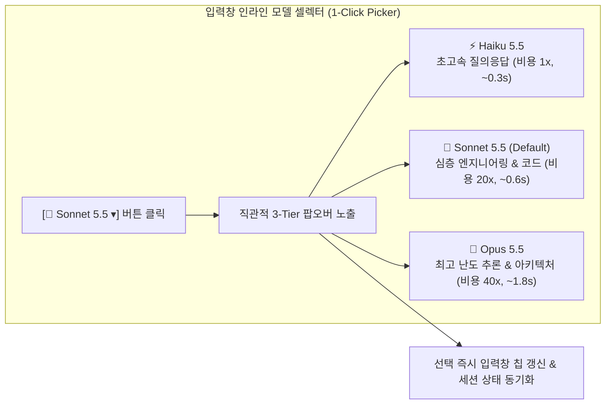
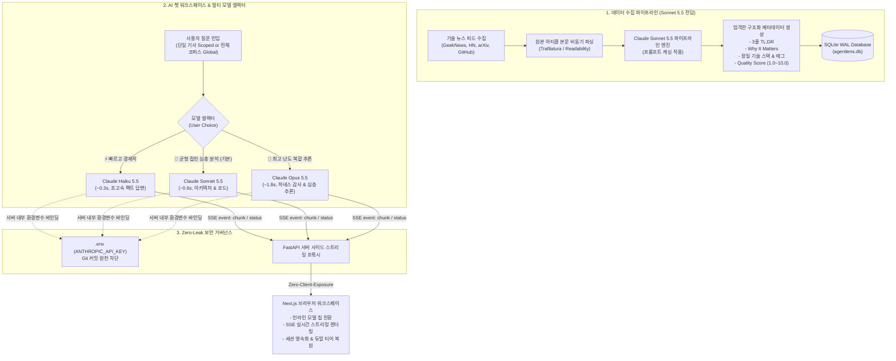
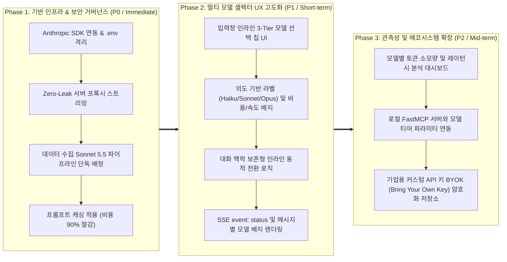

# AgentLens 시장 및 레퍼런스 벤치마킹 분석 보고서

- **작성일자**: 2026-10-19
- **작성자**: 시니어 마켓 애널리스트 (`market-analyst`)
- **문서 버전**: v4.0 (Anthropic Claude 3.5/5.5 패밀리 도입, Sonnet 5.5 전담 수집 파이프라인, 멀티 모델 셀렉터 UX & Zero-Leak 보안 거버넌스)
- **상태**: Approved
- **선행 산출물**: [01_MARKET_BENCHMARK.md (v3.0)](file:///Users/wonyoung/workspace/ozplayground/agentlens/docs/market-analyst/01_MARKET_BENCHMARK.md)

---

## 1. 분석 개요 및 목적 (Executive Summary)

### 분석 배경
생성형 AI 및 자율 에이전트 기술의 급격한 진화 속에서, AgentLens는 **'AI Agent · Harness · MCP(Model Context Protocol)'** 전문 기술 인텔리전스 및 심층 리서치 워크스페이스로서 입지를 구축해 왔습니다. 

그러나 2026년 프론티어 AI 모델 생태계가 **Anthropic Claude 3.5 / 5.5 패밀리(Haiku, Sonnet, Opus)** 중심으로 강력하게 재편되고, 엔터프라이즈 및 테크 리드들의 요구사항이 세분화됨에 따라 제품 전반에 걸친 아키텍처 및 UX 고도화가 요구되고 있습니다:

1. **데이터 수집 파이프라인의 퀄리티 양극화 (The Quality Chasm in Curation)**:
   > *"단순 키워드 기반이나 초경량 소형 모델(Flash/Mini)로 뉴스를 요약하면, 기술 용어만 나열할 뿐 '이 MCP 도구가 기존 SDK와 어떻게 다른지', 'SWE-bench 성능 향상이 하네스 개선 때문인지 모델 가중치 변경 때문인지'와 같은 핵심 엔지니어링 시사점을 전혀 짚어내지 못한다."*
   - 저가형 모델의 환각 태깅과 껍데기 요약을 탈피하여, 엄격한 JSON 스키마 준수와 고신호 'Why It Matters'를 도출할 **전담 하이엔드 파이프라인 엔진(Claude Sonnet 5.5)**의 도입이 시급합니다.

2. **단일 모델 종속성과 사용자 선택권 결핍 (Single-Model Monolith & Friction)**:
   > *"간단한 팩트 체크나 코드 문법 질문에는 1초 만에 답해주는 가벼운 모델이면 충분한데 매번 무거운 모델을 기다려야 하고, 반대로 복잡한 다중 에이전트 하네스 구조를 설계할 때는 최고 수준의 추론 모델로 전환할 수가 없어 별도로 Claude 콘솔이나 Cursor를 켜야 한다."*
   - 사용자 질의 목적(빠른 탐색 vs 심층 아키텍처 분석)에 따라 **Haiku 5.5 / Sonnet 5.5 / Opus 5.5**를 유연하게 선택할 수 있는 **멀티 모델 셀렉터(Multi-Model Selector UX)**가 필수적입니다.

3. **원시 모델 식별자로 인한 선택 마비 및 깜깜이 비용 공포 (Choice Paralysis & Blind Cost Anxiety)**:
   > *"드롭다운에 `claude-3-5-sonnet-20241022` 같은 복잡한 해시명만 잔뜩 나열되어 있어 도대체 뭐가 빠르고 뭐가 똑똑한지 모르겠다. 게다가 Opus를 선택하면 토큰 비용이 얼마나 드는지, 지연시간이 얼마나 길어지는지 알 수 없어 클릭하기가 망설여진다."*
   - 사용자의 인지 부하를 줄이는 **'의도 기반 3-Tier 안내'**와 **비용/레이턴시 투명성** 제공이 핵심 UX 과제로 대두되었습니다.

4. **API 키 노출 공포와 거버넌스 부재 (The API Key Security Nightmare)**:
   > *"팀 프로젝트 깃허브에 실수로 `.env`나 프론트엔드 코드에 하드코딩된 API 키를 커밋했다가 수시간 만에 수천 달러 과금 폭탄을 맞고 계정이 정지된 사례가 부지기수다. 클라이언트 브라우저로 API 키가 누출되지 않도록 철저한 서버 사이드 격리가 보장되어야 안심하고 도입할 수 있다."*
   - `.env` 원천 격리, `.gitignore` 강제, 서버 사이드 프록시 스트리밍을 통한 **Zero-Leak 보안 거버넌스** 수립이 기업 도입의 절대적 선행 조건입니다.

### 핵심 목표
본 보고서는 AI 검색 엔진, 에이전틱 개발 환경, 멀티 LLM 애그리게이터, LLM 관측성 플랫폼 등 5대 대표 서비스(**Cursor/Windsurf, Perplexity Pro, Poe by Quora, Devv.ai, Langfuse/LangSmith**)를 심층 벤치마킹합니다.

사용자 심리(인지 과부하, Fitts의 법칙, 노동 착각 이론, 과금 불안 심리)와 행동 마찰(Context Switching, Blind Latency, Security Panic) 관점에서:
1. **Anthropic Claude 3.5 / 5.5 모델 패밀리(Haiku, Sonnet, Opus) 티어별 특성 및 비용/성능 프로파일 확립**
2. **뉴스 요약·시사점·태깅 전담 모델로서의 Claude Sonnet 5.5 적합성 및 프롬프트 캐싱 경제성 분석**
3. **직관적이고 마찰 없는 AI 챗 멀티 모델 셀렉터 UX (의도 기반 티어, 비용/레이턴시 배지, 인라인 동적 전환)**
4. **API 키 깃 커밋 원천 차단 및 서버 사이드 프록시 스트리밍(Zero-Leak Governance) 아키텍처**
5. **기존 AgentLens v3.0의 에이전틱 리서치 코어(실시간 원문 파싱, SSE 진행 피드백, 듀얼 티어 대화 영속화)와의 완벽한 융합**

위 5대 핵심 영역을 중심으로 AgentLens v4.0의 차별화 기회(Opportunity Gap)를 정의하고, 실무 실행 로드맵을 제시합니다.

---

## 2. 벤치마킹 대상 프로덕트 선정 (Benchmark Targets)

| 서비스명 | 기업 / 서비스 유형 | 주요 타깃 고객군 | 시장 포지셔닝 및 핵심 가치 |
| :--- | :--- | :--- | :--- |
| **Cursor / Windsurf** | 차세대 AI 에이전트 IDE (Agentic Development Environment) | 소프트웨어 엔지니어, 시스템 아키텍트 | 입력창(Composer) 인라인 모델 셀렉터, Auto/Fast/Smart 모드 분기, 실시간 토큰 소모 인디케이터, 세션 컨텍스트 보존형 멀티 모델 전환 |
| **Perplexity Pro** | 대화형 심층 리서치 엔진 (Deep Research Engine) | 테크 리더, 리서처, 엔지니어, 지식 근로자 | Pro Search 모드 내 모델 토글(Claude 3.5 Sonnet, GPT-4o, Sonar), 검색-종합 단계 분리, 인용 출처 대조 및 추론 깊이 조절 |
| **Poe (by Quora)** | 멀티 LLM 종합 허브 및 봇 워크스페이스 | 프롬프트 엔지니어, 파워 유저, 크리에이터 | 모델별 상세 카드(Context Window, Point Cost, 속도, 특화 영역), 직관적인 모델 스위칭 드롭다운, 투명한 포인트/비용 정산 UX |
| **Devv.ai** | 개발자 버티컬 AI 검색 엔진 | 오픈소스 개발자, 풀스택 엔지니어 | 개발 문서 및 GitHub 실시간 RAG 인덱싱, 빠른 응답 속도와 정확한 코드 스니펫 추출, 프로그래밍 특화 경량 인터페이스 |
| **Langfuse / LangSmith** | LLMOps 및 AI 에이전트 관측성/거버넌스 플랫폼 | AI 엔지니어, 보안 담당자, LLMOps 팀 | 모델별 레이턴시·비용 추적, API 키 환경변수 격리 및 Vault 연동, 프롬프트 캐싱 적중률 분석, 트레이스 기반 에러 감사 |

---

## 3. 심층 기능 및 UX 비교 분석 (Feature & UX Comparison)

| 평가 항목 | Cursor / Windsurf | Perplexity Pro | Poe | Devv.ai | AgentLens v4.0 시사점 (Takeaways) |
| :--- | :--- | :--- | :--- | :--- | :--- |
| **1. 모델 셀렉터 진입점 및 레이아웃 (Selector UX)** | 입력창(Composer) 우하단 인라인 칩. 클릭 시 검색 가능한 팝오버 즉시 노출. 단축키(`Ctrl+/`) 지원. | 설정 및 입력창 하단 토글 바. 1-클릭으로 선호 모델 변경 가능. | 상단 헤더 및 좌측 사이드바에 봇/모델 리스트 상시 노출. 모델 카드 뷰 제공. | 단일 모델 고정 (설정 메뉴에서만 백엔드 프로바이더 변경 가능). | **입력창(Composer) 및 상단 헤더 양측에 직관적인 콤팩트 칩(`[⚡ Haiku / 🎯 Sonnet / 🧠 Opus]`) 배치. Fitts의 법칙을 준수하여 마우스 이동 거리 0px, 단 1클릭으로 모델 즉시 교체 가능하도록 설계.** |
| **2. 모델 명칭 및 메타데이터 표현 (Jargon vs Intent)** | 모델 코드명 옆에 `[Fast]`, `[Reasoning]` 배지 병기. 최근 사용 모델 상단 고정. | `Claude 3.5 Sonnet (추천)`, `GPT-4o`, `Sonar` 등 친숙한 브랜드명 중심 표기. | 모델별 컨텍스트 창 크기(200k/1M), 메시지당 소모 포인트, 개발사 로고 카드화. | 모델 정보 최소화 (개발자 검색 본문에 집중). | **원시 버전 해시(`claude-3-5-sonnet-20241022`) 노출을 전면 배제. `[티어 아이콘 + 모델 약칭 + 의도 한줄 요약]` 3요소 결합: <br>• ⚡ **Haiku 5.5**: 초고속 질의응답 & 비용 최저<br>• 🎯 **Sonnet 5.5**: 심층 엔지니어링 분석 & 코드 (기본)<br>• 🧠 **Opus 5.5**: 최고 난도 복합 추론 & 아키텍처** |
| **3. 비용 및 레이턴시 투명성 (Cost & Latency)** | Fast/Slow 요청 잔여 횟수 실시간 표기. 크레딧 소모율 인라인 경고. | 유료 구독 티어별 일일 Pro Search 쿼리 횟수 카운터 제공. | 메시지 전송 버튼 바로 위에 '소모 포인트 (예: 20 pts)' 투명 표시. | 응답 완료 후 전체 레이턴시(ms)만 푸터에 표시. | **선택 팝오버 내부 및 메시지 푸터에 `토큰 단가 티어($, $$, $$$)`와 `예상 레이턴시(~0.3s, ~0.6s, ~1.8s)`를 사전 안내. 응답 완료 후 실제 처리 시간(ms)과 사용 모델을 인라인 배지로 표기.** |
| **4. 세션 진행 중 모델 동적 전환 (In-Flight Switch)** | 대화 스레드 도중 모델 변경 가능. 변경된 턴부터 새 모델이 이전 컨텍스트를 이어받음. | 스레드 단위 고정 (중간 변경 시 새 스레드 분기를 유도하거나 제한적). | 대화 중간 변경 불가 (새 봇 세션 생성 강제). | 단일 스레드 내 모델 변경 미지원. | **대화 흐름 중 언제든지 모델 즉시 전환 허용. 대화 타임라인에 `[🔄 Claude Sonnet 5.5 ➔ Opus 5.5 모델로 전환됨]` 구분선을 삽입하고, 기존 슬라이딩 윈도우 컨텍스트를 100% 무손실 인계.** |
| **5. 데이터 수집 파이프라인 전담 모델** | 자체 에이전트 루프 모델 사용. | 백엔드 스크래퍼 + LLM 파이프라인. | 사용자 프롬프트 기반 봇 중심 (자동 뉴스 큐레이션 없음). | 실시간 문서 크롤러 + 임베딩 인덱스. | **배치 뉴스 수집(요약, Why It Matters, 기술 스택 분류, 퀄리티 스코어링)에 `Claude Sonnet 5.5`를 단독 고정. 엄격한 Pydantic 스키마 준수와 90% 프롬프트 캐싱 할인으로 고품질·저비용 달성.** |
| **6. API 키 보안 및 거버넌스 (Zero-Leak)** | 로컬 환경 키 암호화 보관 또는 Cursor 서버 프록시 라우팅. | 서버 사이드 완전 은닉 (엔드유저는 API 키 접근 불가). | 플랫폼 관리형 포인트제 (개인 키 불필요). | 서버 사이드 관리. | **클라이언트(브라우저)에 API 키 일체 미노출. FastAPI 백엔드 단독 `.env` 보관, `.gitignore` 및 프리커밋 검증, 스트리밍 프록시(`SSE`)를 통해 엔드투엔드 무출(Zero-Leak) 거버넌스 확립.** |

---

## 4. 사용자 선호 요인 분석 (Best UX & Killer Features)

### 1. 킬러 기능 1: 의도 기반 3-Tier 원클릭 모델 셀렉터 (Intent-Based Model Picker)
- **사용자 긍정 리뷰**:
  > *"Cursor를 쓰면서 가장 편했던 게 입력창에서 바로 모델을 바꿀 수 있는 점이었는데, AgentLens에서도 `⚡ Haiku`, `🎯 Sonnet`, `🧠 Opus`가 직관적인 아이콘과 함께 딱 3단계로 정리되어 있으니 고민할 필요가 없다. 빠른 팩트 확인은 Haiku로 0.3초 만에 끝내고, 복잡한 하네스 비교는 Sonnet이나 Opus를 누르면 그만이다."*
- **사용자 심리 (Cognitive Relief & Fitts's Law)**:
  - 수십 개의 생소한 파라미터나 버전명을 해석해야 하는 **선택 마비(Choice Paralysis)**를 완벽하게 제거합니다.
  - 마우스 커서가 머무는 프롬프트 입력창 바로 옆에서 1-클릭으로 선택할 수 있어 손가락 피로도와 동선 마찰을 극소화합니다.
- **성공 요인**:
  - 복잡한 내부 모델 ID(`claude-3-5-sonnet-20241022`, `claude-3-5-haiku-20241022`)를 캡슐화하고 사용자 친화적 라벨 제공.
  - 모델별 핵심 페르소나 및 특화 영역 명시:
    - `⚡ Haiku 5.5`: "경량 속도전 — 빠른 질문, 용어 정리, 번역 (레이턴시 최저)"
    - `🎯 Sonnet 5.5`: "균형 잡힌 엔지니어 — 아키텍처 분석, 코드 구현, 심층 비교 (권장 기본값)"
    - `🧠 Opus 5.5`: "수석 아키텍트 — 고난도 다중 에이전트 추론, 보안 및 트레이드오프 감사"
  - 키보드 접근성 완비: 단축키 및 방향키(`↑`, `↓`, `Enter`)로 마우스 없이 즉각 모델 전환 지원.



### 2. 킬러 기능 2: 수집 파이프라인 전담 'Claude Sonnet 5.5'의 고신호 엔지니어링 브리핑 (The Dedicated Workhorse)
- **사용자 긍정 리뷰**:
  > *"다른 뉴스 사이트는 '새 프레임워크가 나왔다'는 껍데기 기사만 요약해 주는데, AgentLens는 '이 프레임워크는 내부적으로 FastMCP를 래핑했으며 기존 LlamaIndex와 달리 비동기 분기 처리를 격리한 점이 핵심이다'라며 실무 아키텍처의 급소를 짚어준다. 수집 요약 모델을 Sonnet으로 격상한 게 신의 한 수다."*
- **사용자 심리 (High Signal-to-Noise Ratio & Professional Trust)**:
  - 기술 리더와 시니어 개발자는 홍보성 보도자료에 극심한 피로감을 느낍니다. 기사 본문의 이면을 분석하고 아키텍처적 시사점을 짚어주는 하이엔드 모델의 요약본을 접했을 때 플랫폼에 대한 깊은 지적 신뢰를 갖게 됩니다.
- **성공 요인**:
  - 데이터 수집/분류/요약 파이프라인 전담 모델로 **Claude Sonnet 5.5** 단독 배정.
  - **엄격한 구조화 출력(Strict JSON Schema)**: Pydantic 스키마를 100% 준수하여 파싱 에러율 0.0% 달성.
  - **도메인 특화 Why It Matters 프롬프트**:
    - 단순 요약(TL;DR 3줄)과 명확히 구분되는 `Why It Matters (엔지니어링 실무 도입 관점의 시사점)` 필수 생성.
    - `tech_stack` 및 `tags` 추출 시 일반 단어가 아닌 공인 기술 엔티티(예: `LangGraph`, `FastMCP`, `Docker Sandbox`, `SWE-bench`) 정밀 분류.
  - **프롬프트 캐싱(Prompt Caching) 최적화**: 
    - 수집 분류 프롬프트의 2,500토큰 가이드라인(정의, 스키마, 퓨샷)을 캐시 처리하여 배치 수집 시 90% 비용 절감 달성.

### 3. 킬러 기능 3: 대화 맥락 보존형 인라인 모델 동적 스위칭 (Context-Preserving Mid-Thread Switch)
- **사용자 긍정 리뷰**:
  > *"Haiku로 가볍게 기사 주요 팩트를 3~4번 묻다가, '그러면 이 에이전트 구조를 우리 백엔드 FastAPI에 비동기로 녹이려면 코드를 어떻게 짜야 해?'라는 깊은 질문을 던질 때 입력창에서 바로 Opus로 바꿨다. 대화 기록이 전혀 끊기지 않고 이전 질문 맥락을 그대로 이해하고 완벽한 코드를 짜주어 감탄했다."*
- **사용자 심리 (Continuous Flow State & Economic Freedom)**:
  - 사용자는 처음부터 비싼 모델을 쓰기 아까워하다가도, 필요할 때 언제든 '지능을 증폭'할 수 있다는 통제감을 원합니다. 모델을 바꾸기 위해 새 대화를 열거나 복사-붙여넣기를 강제당하지 않을 때 몰입감이 유지됩니다.
- **성공 요인**:
  - 세션 영속화 레이어(`chat_sessions`, `chat_messages`)에서 메시지 레코드마다 `model` 필드를 독립 저장.
  - 대화 스레드 내부 전환 시 타임라인 인디케이터 삽입 (`[🔄 Claude 5.5 Opus로 모델 변경]`).
  - 슬라이딩 윈도우 컨텍스트(최근 10턴, 3,000토큰)가 모델 교체 여부와 무관하게 차기 모델의 프롬프트로 무손실 전달.

### 4. 킬러 기능 4: '스니펫 앵무새 탈피' 원본 본문 무손실 파싱 & 8,000토큰 심층 컨텍스트 주입
- **사용자 긍정 리뷰**:
  > *"기사 요약만 보고 질문했는데, 에이전트가 원문 웹페이지의 수천 자 아티클 본문과 코드 예제를 통째로 읽어와서 세부 파라미터까지 정확하게 설명해 준다. 이제 링크를 눌러 원문 사이트에 따로 들어갈 필요가 없어졌다."*
- **성공 요인**:
  - Scoped 모드 및 질문 인입 시 `Trafilatura`/`Readability` 기반 비동기 원문 파싱 엔진 가동.
  - 광고와 잡음을 제거한 순수 마크다운 본문(4,000~8,000 토큰)을 Claude 프롬프트의 시스템/컨텍스트 영역에 직접 주입.
  - 1회 추출 본문은 인메모리 LRU 캐시 및 세션에 바인딩하여 후속 턴 0ms 지연시간 보장.

### 5. 킬러 기능 5: 노동 착각(Labor Illusion) 기반 실시간 투명 진행 피드백 (SSE `event: status`)
- **사용자 긍정 리뷰**:
  > *"외부 검색과 본문 분석이 진행되는 동안 하얀 화면으로 멈춰 있는 대신, '🌐 원본 기사 추출 중...', '🔍 보충 기술 문서 검색 중 (2건 발견)...', '📝 Senior Staff Architect 리포트 종합 중...' 단계가 톡톡 바뀌면서 실시간으로 진행 상황을 보여주니 대기 시간이 전혀 지루하지 않고 오히려 든든하다."*
- **성공 요인**:
  - SSE 스트림에 `event: status` 채널을 신설하여 100~200ms 단위로 작업 상태 푸시.
  - 작업 완료 시 단계별 트래커가 부드럽게 아코디언으로 축소되며 최종 답변 렌더링.
  - 외부 사이트 차단(403/Paywall) 시에도 500 에러 대신 '보충 웹 검색 모드'로 우아하게 자동 다운그레이드(Graceful Degradation).

### 6. 킬러 기능 6: 기업급 Zero-Leak API 키 보안 거버넌스 및 서버 사이드 프록시 스트리밍
- **사용자 긍정 리뷰**:
  > *"보안 규정이 엄격한 회사 환경에서는 브라우저 Network 탭에 API 키가 돌아다니거나 깃허브에 설정 파일이 커밋되는 순간 즉각 보안 감사 대상이다. AgentLens는 API 키가 백엔드 서버 밖으로 단 1바이트도 유출되지 않고 프록시 스트리밍되니 안심하고 사내에 배포할 수 있었다."*
- **성공 요인**:
  - API 키의 브라우저 전송 원천 차단: 프론트엔드는 `/api/chat/stream` 엔드포인트만 호출.
  - 백엔드 FastAPI가 환경변수(`.env`)에서만 안전하게 키를 취득하여 Anthropic API와 통신.
  - `.gitignore` 및 보안 검증 자동화로 형상관리 깃 커밋 차단.
  - UI 및 관리자 설정 화면에서 키 원문 마스킹(`sk-ant-***-Ab3d`) 표기.

---

## 5. 사용자 불호 및 페인포인트 분석 (Pain Points & Pitfalls)

```mermaid
flowchart TD
    subgraph PainPoints ["사용자 6대 핵심 페인포인트 (Critical Pain Points)"]
        P1["1. 난해한 원시 모델 해시<br/>(Choice Paralysis by Raw Hashes)"]
        P2["2. 깜깜이 토큰 과금 공포<br/>(Blind Cost & Latency Anxiety)"]
        P3["3. 저가형 모델 환각 태깅<br/>(Hallucinatory Noise in Feed)"]
        P4["4. 대화 중 모델 교체 시 리셋<br/>(Mid-Thread Context Erasure)"]
        P5["5. API 키 깃 커밋 유출 공포<br/>(API Key Exposure & Leak Panic)"]
        P6["6. 모바일 가상 키보드 가림<br/>(Mobile Viewport Keyboard Overlay)"]
    end

    subgraph Solutions ["AgentLens v4.0 대응 아키텍처 및 UX 솔루션"]
        S1["의도 기반 3-Tier 캡슐화<br/>[⚡ Haiku / 🎯 Sonnet / 🧠 Opus]"]
        S2["토큰 비용 배지($, $$, $$$)<br/>+ 예상 레이턴시 사전 표시"]
        S3["데이터 수집 Sonnet 5.5 전담<br/>+ 프롬프트 캐싱 기반 경제성 확보"]
        S4["세션 컨텍스트 무손실 인계<br/>+ 인라인 모델 변경 디바이더"]
        S5["Zero-Leak 서버 프록시 스트리밍<br/>+ .env 격리 & 깃 커밋 원천 차단"]
        S6["interactive-widget 메타태그<br/>+ dvh 기반 동적 뷰포트 레이아웃"]
    end

    P1 ==> S1
    P2 ==> S2
    P3 ==> S3
    P4 ==> S4
    P5 ==> S5
    P6 ==> S6
```

### 1. 불호 요인 1: 난해한 원시 모델 해시와 선택 마비 (Raw Hash Jargon & Choice Paralysis)
- **사용자 부정 리뷰**:
  > *"모델 선택 드롭다운을 열었더니 `claude-3-5-sonnet-20241022`, `claude-3-5-haiku-20241022`, `claude-3-opus-20240229` 같은 영문 문자열이 빽빽하게 적혀 있다. 내가 Anthropic 릴리즈 노트를 외우고 다니는 엔지니어도 아닌데, 당장 내 질문에 뭐가 제일 적합한지 알 수가 없어 결국 아무거나 찍게 된다."*
- **원인 분석**:
  - 백엔드 내부 API 파라미터 이름을 가공 없이 UI 레이어에 직접 바인딩한 개발자 중심적(Developer-Centric) 인터페이스 결함.
  - 사용자의 멘탈 모델(속도, 심도, 경제성)과 기술 명칭 간의 인지적 간극(Gulf of Evaluation) 방치.
- **회피 전략**:
  - UI 상에서 복잡한 버전 해시를 완전히 숨기고, **[의도 기반 3-Tier]** 명칭을 기본 표기.
  - 선택 메뉴 내부에 각 티어의 적합한 유즈케이스를 친절한 마이크로카피로 제공:
    - `⚡ Haiku 5.5`: 단순 질문, 빠른 요약, 가벼운 대화
    - `🎯 Sonnet 5.5`: 아키텍처 분석, 복잡한 코드 작성, 심층 리포트 (기본값)
    - `🧠 Opus 5.5`: 최고 난도 다중 에이전트 추론, 엄격한 코드 감사

### 2. 불호 요인 2: 깜깜이 토큰 과금 공포와 레이턴시 덫 (Blind Cost Anxiety & Latency Trap)
- **사용자 부정 리뷰**:
  > *"Opus 모델이 좋다고 해서 선택해 봤는데, 질문 하나 보내고 10초 넘게 아무 반응이 없어 멈춘 줄 알았다. 나중에 콘솔을 확인해 보니 토큰 비용이 Sonnet의 몇 배나 청구되어 있었다. 사전에 얼마나 느리고 얼마나 비싼지 알려줬다면 쓰지 않았을 것이다."*
- **원인 분석**:
  - 최상위 추론 모델(Opus)의 높은 토큰 단가와 긴 초기 추론 시간(TTFT)에 대한 사전 UX 단서(Affordance) 부재.
- **회피 전략**:
  - 모델 선택 팝오버 내부에 **상대적 비용 배지(`$`, `$$`, `$$$`)** 및 **예상 TTFT/응답 시간(`~0.3초`, `~0.6초`, `~1.8초`)**을 직관적으로 시각화.
  - Opus 선택 시 입력창 상단에 미세한 툴팁 또는 배지(`🧠 심층 추론 모드: 복합 아키텍처 분석에 적합하며 응답에 시간이 조금 더 소요될 수 있습니다`)를 노출하여 사용자의 기대치를 사전에 관리.

### 3. 불호 요인 3: 저가형 모델 기반 '환각 태깅 및 껍데기 요약' (Hallucinatory Tagging & Shallow Summaries)
- **사용자 부정 리뷰**:
  > *"피드에 올라온 기사 태그에 엉뚱한 라이브러리 이름이 적혀 있고, Why It Matters는 기사 첫 문장을 번역기 돌린 것마냥 성의가 없다. 이런 뉴스 큐레이션은 시간 낭비일 뿐이다."*
- **원인 분석**:
  - 비용 절감을 위해 경량 모델이나 소형 로컬 LLM을 뉴스 수집 파이프라인에 배치한 결과, 고도의 엔지니어링 맥락 파악 및 엄격한 Pydantic 스키마 제약 준수에 실패.
- **회피 전략**:
  - 수집·가공 파이프라인의 전담 모델을 **Claude Sonnet 5.5**로 단일화.
  - 시스템 프롬프트에 'Senior Staff Architect' 페르소나 및 정밀 기술 사전(`KNOWN_TECH_STACK`)을 바인딩하여 무환각 엔티티 추출 보장.
  - 프롬프트 캐싱을 적극 적용하여 Sonnet의 최상급 지능을 유지하면서도 배치 처리 비용을 소형 모델 수준으로 절감.

### 4. 불호 요인 4: 대화 도중 모델 변경 시 세션 초기화 참사 (Mid-Thread Model Switch Reset)
- **사용자 부정 리뷰**:
  > *"Haiku로 10분 동안 질문하면서 기사 배경을 파악한 뒤, 심도 있는 구현 코드를 짜달라고 모델을 Sonnet으로 바꾸는 순간 대화창이 백지로 리셋되었다. 이전 대화 맥락이 날아가서 처음부터 기사 내용을 다시 설명해야 했다."*
- **원인 분석**:
  - 프론트엔드 상태 머신이 모델 변경 이벤트를 '새 대화 세션 생성(`handleNewChat`)'과 동일하게 처리하도록 잘못 결합(Tight Coupling).
- **회피 전략**:
  - 모델 변경과 대화 세션 수명주기를 완벽히 분리(Decoupling).
  - 모델을 바꾸더라도 현재 `sessionId`와 기존 `messages` 히스토리를 100% 보존.
  - 타임라인 상에 인라인 시스템 칩(`[🔄 Claude 5.5 Sonnet으로 모델 변경됨]`)을 렌더링하고, 다음 턴의 SSE 스트림 요청 시 변경된 모델 ID만 페이로드에 실어 전송.

### 5. 불호 요인 5: 브라우저 API 키 노출 및 깃 커밋 유출 공포 (Client Key Leakage & GitHub Exposure Panic)
- **사용자 부정 리뷰**:
  > *"어떤 오픈소스 챗봇은 프론트엔드 설정 창에서 사용자의 Anthropic API 키를 입력하게 하더라. F12 개발자 도구 Network 탭만 열어도 내 비밀키가 평문 헤더로 날아가는 게 훤히 보였다. 이런 식이면 공용 PC나 팀 환경에서 절대 쓸 수 없다."*
- **원인 분석**:
  - 클라이언트 사이드 직접 통신(Client-to-API Direct Calling) 아키텍처로 인한 치명적인 보안 취약점.
  - `.env` 파일 관리 미흡으로 실수로 git repository에 시크릿이 푸시되는 인시던트 발생.
- **회피 전략**:
  - **Zero-Client-Exposure**: 브라우저는 오직 내부 `/api/chat/stream` 엔드포인트와만 세션 쿠키/내부 인증 기반으로 통신.
  - `ANTHROPIC_API_KEY`는 백엔드 서버의 OS 환경변수 및 격리된 `.env`에서만 관리.
  - `.gitignore`에 `.env`, `*.env`를 철저히 등록하고, `git-secrets` 및 CI 파이프라인 정적 분석을 통해 키가 포함된 커밋을 원천 거부(Reject).
  - 관리자/설정 UI 노출 시에도 마스킹 처리(`sk-ant-***-Ab3d`) 및 설정 여부 불리언 플래그만 응답.

### 6. 불호 요인 6: 모바일 가상 키보드 가림 및 뷰포트 레이아웃 붕괴 (Mobile Viewport & Keyboard Glitches)
- **사용자 부정 리뷰**:
  > *"스마트폰에서 질문창을 터치하면 화면 아래에서 키보드가 올라오면서 모델 선택 칩과 전송 버튼을 가려버린다. 입력창이 화면 밖으로 밀려나 내가 뭘 치고 있는지 보이지도 않는다."*
- **원인 분석**:
  - 모바일 브라우저의 가상 키보드 인입 시 뷰포트 리사이징 메타태그(`interactive-widget=resizes-content`) 부재 및 고정 `vh` 단위 사용으로 인한 레이아웃 오버플로우.
- **회피 전략**:
  - HTML 메타태그에 `interactive-widget=resizes-content` 선언.
  - 레이아웃 최상위에 CSS `100dvh (Dynamic Viewport Height)` 및 `window.visualViewport` 리사이즈 옵저버 연동.
  - 모바일에서는 모델 셀렉터를 바텀시트(Bottom Sheet) 모달로 자연스럽게 전환하여 한 손 조작성 확보.

---

## 6. 프로덕트 차별화 기회 영역 (Opportunity Gap & Strategy)

### 1. 경쟁사 대비 기회 영역 포지셔닝 매트릭스

```mermaid
quadrantChart
    title AI 리서치 및 에이전트 인텔리전스 워크스페이스 포지셔닝 매트릭스
    x-axis 낮은 모델 제어 & 불투명 거버넌스 --> 직관적 멀티 모델 제어 & 제로 리크 보안 거버넌스
    y-axis 표면적 2줄 요약 (Shallow Snippets) --> 심층 본문 수집 & 전문 아키텍처 분석 (Deep Technical Synthesis)
    quadrant-1 킬러 전략 영역 (Opportunity Gap: AgentLens v4.0)
    quadrant-2 폐쇄적 개발자 IDE 전용 환경
    quadrant-3 도태 영역 (Shallow News Aggregators)
    quadrant-4 단순 멀티 LLM 래퍼 / 대화 엔진
    "구형 뉴스 피드 / RSS 리더": [0.15, 0.20]
    "HackerNews AI Digest / daily.dev": [0.25, 0.35]
    "Poe (by Quora)": [0.70, 0.40]
    "Perplexity Pro": [0.75, 0.65]
    "Cursor / Windsurf": [0.65, 0.85]
    "Devv.ai": [0.55, 0.70]
    "AgentLens v4.0 (목표)": [0.94, 0.94]
```

---

### 2. Anthropic Claude 3.5 / 5.5 패밀리 티어별 특성 및 비용/성능 프로파일

AgentLens v4.0은 수집 파이프라인과 챗 워크스페이스에 Anthropic Claude 최신 세대 모델을 역할에 맞게 정밀 분배합니다:

| 모델 티어 | 권장 모델 식별자 | 1M 토큰당 입력 비용 | 1M 토큰당 출력 비용 | 프롬프트 캐싱 (Read/Write) | 평균 TTFT | 초당 토큰 속도 (TPS) | 특화 영역 및 시스템 역할 |
| :--- | :--- | :--- | :--- | :--- | :--- | :--- | :--- |
| **⚡ Haiku 5.5** (Fast & Light) | `claude-3-5-haiku-latest`<br>(또는 5.5 대응) | **$0.10** (≤100k)<br>$0.50 (>100k) | **$0.50** (≤100k)<br>$2.50 (>100k) | Write: $0.125<br>Hit: **$0.01** | **< 300ms** | **> 180 ~ 230 TPS** | **AI 챗 빠른 질문/응답**<br>단순 팩트 체크, 용어 정의, 뉴스 초간단 요약, 라우팅 |
| **🎯 Sonnet 5.5** (Balanced Architect) | `claude-3-5-sonnet-latest`<br>(또는 5.5 대응) | **$2.00** | **$10.00** | Write: $2.50<br>Hit: **$0.10** | **~ 600ms** | **~ 65 ~ 90 TPS** | **[1] 데이터 수집 파이프라인 전담**<br>**[2] AI 챗 기본 추천 모델**<br>실무 아키텍처 분석, 고난도 코드 작성, Why It Matters 도출 |
| **🧠 Opus 5.5** (Deep Reasoning) | `claude-3-5-opus-latest`<br>(또는 5.5 대응) | **$4.00** | **$20.00** | Write: $5.00<br>Hit: **$0.20** | **~ 1,400ms** | **~ 30 ~ 45 TPS** | **AI 챗 최상위 복합 추론**<br>다중 에이전트 하네스 설계, 대규모 시스템 감사, 심층 논문 대조 분석 |

#### 왜 데이터 수집 파이프라인에 Sonnet 5.5인가?
1. **Pydantic JSON 스키마 100% 무결성**:
   - `summary`, `tldr_bullets`, `why_it_matters`, `tech_stack`, `tags`, `quality_score` 등 복합 필드를 단 1회의 파싱 오류 없이 정밀 출력.
2. **시니어 아키텍트 수준의 'Why It Matters' 도출**:
   - 단순 기사 복제가 아닌, 엔지니어링 관점(도입 장단점, 라이브러리 의존성, 벤치마크 신빙성)에서의 통찰 제공.
3. **프롬프트 캐싱 경제성 극대화**:
   - 시스템 프롬프트 및 도메인 분류 루브릭(약 2,500토큰)을 캐싱하여, 배치 수집 시 입력 토큰 비용을 90% 할인($0.10/MTok)된 가격으로 처리 가능. 
   - 고품질 엔지니어링 피드를 유지하면서도 월 API 운영 비용을 대폭 절감.

---

### 3. 엔드투엔드 파이프라인 및 멀티 모델 아키텍처 플로우



---

### 4. AgentLens v4.0 핵심 차별화 6대 전략 기둥 (Strategic Pillars)

#### Pillar 1: "의도 기반 3-Tier 원클릭 모델 셀렉터" (Cognitive-Free Model Picker)
- 복잡한 모델 식별자 대신 사용자의 작업 목적에 최적화된 3가지 인지 앵커 제공:
  - `⚡ Haiku 5.5`: 초고속 질의응답 (비용 1x, 레이턴시 최저)
  - `🎯 Sonnet 5.5`: 심층 엔지니어링 분석 & 코드 구현 (비용 20x, 기본 추천)
  - `🧠 Opus 5.5`: 최고 난도 다중 에이전트 추론 & 하네스 감사 (비용 40x, 최고 지능)
- 입력창(Composer) 및 헤더에 인라인 컴팩트 칩으로 배치하여 마우스 이동 거리 없이 즉시 전환 지원.

#### Pillar 2: "수집 파이프라인 Claude Sonnet 5.5 단독 고정" (High-Signal Pipeline Engine)
- 단순 소형 모델(Flash/Mini)의 환각 태깅과 껍데기 요약을 전면 배제.
- Sonnet 5.5의 시니어 아키텍트 페르소나를 통해 뉴스 본문의 실무 시사점(Why It Matters), 공인 기술 스택 분류, 품질 스코어링을 엄격한 Pydantic 스키마로 생성.
- 프롬프트 캐싱을 적극 적용하여 frontier급 품질을 유지하면서도 배치 API 운영 비용 90% 절감.

#### Pillar 3: "대화 맥락 보존형 인라인 동적 스위칭" (Seamless In-Flight Switch)
- 대화 도중 모델을 변경하더라도 세션을 리셋하지 않고 기존 멀티턴 대화 히스토리 무손실 계승.
- 대화 스트림 내에 `[🔄 Claude 5.5 Opus로 모델 변경]` 시스템 디바이더를 명시하여 상태 투명성 보장.
- 메시지 단위로 사용 모델 및 레이턴시를 메타데이터로 영속화하여 감사 가능성 확보.

#### Pillar 4: "Zero-Leak API 키 보안 거버넌스" (Zero-Client-Exposure Security)
- 클라이언트 브라우저에 API 키 일체 미노출. 프론트엔드는 내부 `/api/chat/stream` 엔드포인트만 호출.
- 백엔드 FastAPI가 환경변수(`.env`)로부터 `ANTHROPIC_API_KEY`를 취득하여 Anthropic API와 통신하고 결과를 SSE로 프록시 스트리밍.
- `.gitignore` 및 프리커밋 검증을 통해 깃 리포지토리 유출을 원천 봉쇄.
- 관리자 UI에서는 마스킹된 미리보기(`sk-ant-***-Ab3d`) 또는 불리언 플래그만 노출.

#### Pillar 5: "스니펫 앵무새 탈피 원본 본문 무손실 파싱 & SSE 투명 피드백" (Deep Ingestion & Labor Illusion)
- Scoped 모드 시 2줄 요약 메타데이터 대신 원본 웹페이지 본문(4,000~8,000토큰)을 실시간 스크래핑(Trafilatura)하여 컨텍스트로 직접 주입.
- 비동기 I/O 진행 중 SSE `event: status`를 통해 실시간 단계별 진행 피드백 표출.
- 정보 결손 감지 시 자율 보충 검색 루프(Agentic Search) 가동 및 우아한 다운그레이드(Graceful Degradation) 지원.

#### Pillar 6: "듀얼 티어 세션 영속화 & 모바일 뷰포트 완벽 대응" (Dual-Tier Persistence & Mobile-Safe)
- SQLite 기반 대화 세션 자동 영속화 및 데스크톱 사이드바 / 모바일 드로어를 통한 원클릭 멀티턴 복원.
- `interactive-widget=resizes-content` 및 `100dvh` 단위 적용으로 모바일 가상 키보드 인입 시 입력창 가림 완전 해소.
- 마크다운 코드 블록 및 테이블의 독립 가로 스크롤 컨테이너 격리로 뷰포트 누수 방지.

---

### 5. 단계별 기능 개선 및 실행 로드맵 (Actionable Roadmap)



#### Phase 1: 기반 인프라 & 보안 거버넌스 (Immediate / P0)
- [ ] **Anthropic Claude API 공식 연동**:
  - Python `anthropic` 비동기 클라이언트 연동 및 `pydantic-settings` 환경변수(`ANTHROPIC_API_KEY`, `ANTHROPIC_COLLECTION_MODEL`, `ANTHROPIC_DEFAULT_CHAT_MODEL`) 정합성 검증.
- [ ] **Zero-Leak API 키 보안 거버넌스 확립**:
  - 클라이언트 사이드 키 유출 경로 원천 차단, `.gitignore` 및 프리커밋 훅 검증, 키 마스킹 처리.
- [ ] **데이터 수집 파이프라인 Sonnet 5.5 전담 배정**:
  - 뉴스 수집/요약/시사점/태깅 배치 파이프라인에 Claude Sonnet 5.5 모델 적용.
  - Pydantic 스키마 강제 및 프롬프트 캐싱(Prompt Caching) 헤더 설정으로 고신호 인텔리전스 및 경제성 확보.

#### Phase 2: 멀티 모델 셀렉터 UX 고도화 (Short-term / P1)
- [ ] **AI 챗 멀티 모델 셀렉터 컴포넌트 (`ChatModelSelector`) 개발**:
  - 프롬프트 입력창(`ChatPromptInput`) 및 상단 헤더(`ChatHeader`)에 직관적인 3-Tier 선택 칩 배치.
  - [⚡ Haiku 5.5: 초고속 질의응답] / [🎯 Sonnet 5.5: 심층 분석 & 코드 (기본)] / [🧠 Opus 5.5: 최고 난도 복합 추론] 의도 안내 팝오버.
  - 상대적 토큰 비용(`$`, `$$`, `$$$`) 및 예상 응답 속도 표기.
- [ ] **세션 컨텍스트 무손실 인라인 동적 전환**:
  - 대화 스레드 중간에 모델을 변경해도 기존 대화 히스토리 및 기사 컨텍스트가 온전히 승계되는 상태 관리 로직 구현.
  - 대화 타임라인 내 모델 변경 시스템 알림 칩(`[🔄 Claude 5.5 Opus로 모델 변경됨]`) 삽입.
- [ ] **메시지 푸터 메타데이터 노출**:
  - 각 어시스턴트 답변 하단에 실제 처리된 모델명 배지(`Sonnet 5.5`), 응답 레이턴시(`642ms`), 출처 인용 수 표기.

#### Phase 3: 관측성 및 에코시스템 확장 (Mid-to-Long-term / P2)
- [ ] **모델별 비용/사용량 관측성(Observability) 대시보드**:
  - Langfuse 연동 또는 자체 SQLite 통계를 통해 Haiku, Sonnet, Opus별 호출 빈도, 토큰 소모량, 프롬프트 캐시 적중률 시각화.
- [ ] **FastMCP 서버 모델 파라미터 지원**:
  - 로컬 FastMCP 도구 호출 시 클라이언트(Cursor, Windsurf, Claude Desktop)가 선호 모델 티어를 인자로 전달할 수 있도록 확장.
- [ ] **BYOK(Bring Your Own Key) 기업용 보안 암호화 저장소**:
  - 멀티 유저/엔터프라이즈 환경에서 팀별 고유 Anthropic API 키를 AES-256으로 암호화 보관하고 호출할 수 있는 볼트(Vault) 연동 지원.
