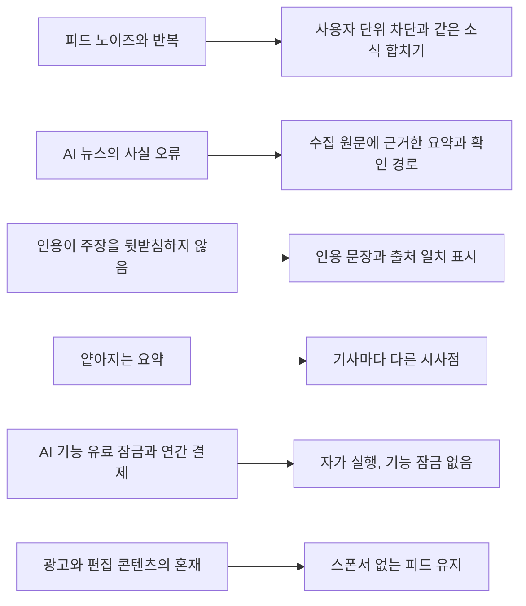
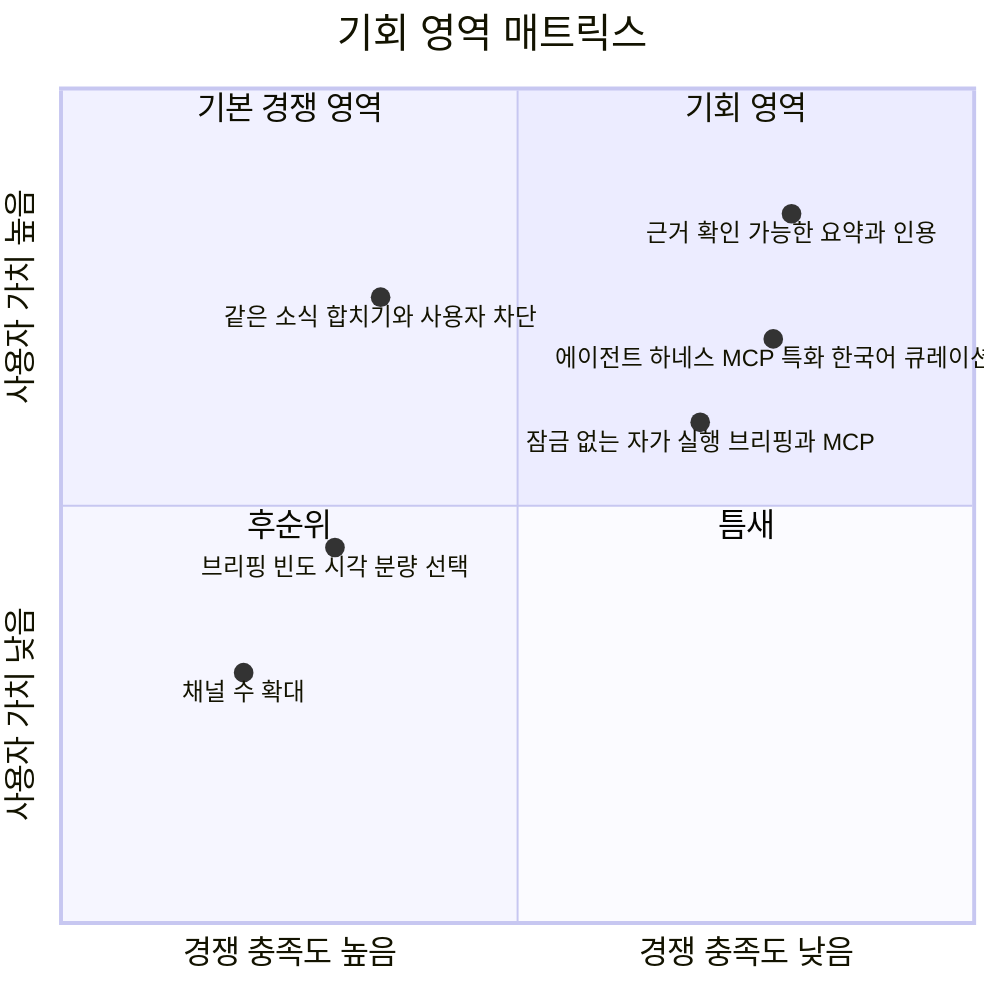

# AgentLens 시장 및 레퍼런스 벤치마킹 분석 보고서

Updated: 2026-11-09
기준: v0.4.2 (main)

- **작성일자**: 2026-11-09
- **작성자**: 시니어 마켓 애널리스트 (`market-analyst`)
- **문서 버전**: v1.0 (v0.3.1 산출물을 대체한다. 재확인 결과는 8절)
- **상태**: Draft

---

## 1. 분석 개요 및 목적 (Executive Summary)

- **분석 배경**: AgentLens 는 AI 에이전트·하네스·MCP 기술 소식을 모아 요약하고, AI 챗 질의응답·일일 브리핑·외부 채널 공유·MCP 서버를 제공한다 (`README.md:3`). 대상 사용자와 사용자 유형별 문제는 v0.4.0 시점에 문서로 정해져 있지 않다. 코드에서 확인되는 접점은 웹 UI(피드 `/`, 챗 `/chat`), MCP 클라이언트(stdio), 브리핑 수신자(Notion·이메일·Slack/Discord)다. 이 보고서는 지금 범위를 기준으로, 비슷한 일을 하는 서비스에서 사용자가 좋아하고 싫어하는 점을 출처와 함께 모아 기회 영역을 정한다.
- **핵심 목표**: 실제 사용자 리뷰·커뮤니티 반응에서 (1) 선호 요인, (2) 불호 요인을 찾고, (3) 지금 AgentLens 가 이미 갖춘 것과 아직 비어 있는 기회 영역을 나눈다.
- **조사 방법과 한계**
  - 2026-11-09 에 웹 검색과 페이지 열람으로 확인했다. 출처 ID(`[R#]`)는 9절 표에 URL 과 함께 있다.
  - G2·Capterra·GetApp 페이지는 열람이 거부(HTTP 403)되어 그 평점·리뷰는 쓰지 않았다. 검색 결과 요약에만 보이고 원문을 열어 확인하지 못한 수치도 쓰지 않았다.
  - Reddit 글은 원 사이트 대신 보관본(`reddit.sentinel-team.org` 스냅샷)으로 확인했다. 글 수가 적고 반응 수가 작아 경향을 일반화하는 근거로는 약하다.
  - 경쟁사가 쓴 비교 글(daily.dev 블로그의 TLDR 리뷰)은 편향 가능성을 표시하고 썼다.
  - 이 문서의 숫자는 출처에 적힌 값이거나 코드의 상수다. 직접 측정한 숫자는 없다.

---

## 2. 벤치마킹 대상 프로덕트 선정 (Benchmark Targets)

선정 기준: AgentLens 의 세 축(기술 소식 큐레이션·요약, AI 질의응답, 정기 브리핑·외부 전달)과 MCP 연동 가운데 둘 이상이 겹치는 서비스. 글로벌 개발자 큐레이션 1, AI 리더 1, AI 검색 1, 국내 1, 브리핑(뉴스레터) 특화 1 로 골랐다.

| 서비스명 | 기업 / 서비스 유형 | 주요 타깃 고객군 | 시장 포지셔닝 및 핵심 가치 | AgentLens 와 겹치는 축 |
| :--- | :--- | :--- | :--- | :--- |
| **daily.dev** | 글로벌, 개발자 뉴스 큐레이션 (웹·브라우저 새 탭) | 개발자 | 개인화 피드 'For you' [R6], AI 브리핑 'Presidential Briefing' [R2], 원격 MCP 서버(베타) [R3] | 큐레이션, 브리핑, MCP |
| **Feedly (Leo)** | 글로벌, RSS 리더 + AI 보조 'Leo' | 정보 추적이 필요한 지식 근로자, 위협 인텔리전스 팀 | Leo 의 주제 우선순위·음소거·중복 제거·요약 [R8], 위협 인텔리전스용 MCP 서버 [R9] | 큐레이션, 요약, MCP |
| **Perplexity (Discover)** | 글로벌, 대화형 AI 검색 + AI 뉴스 피드 'Discover' | 일반 사용자, 리서처 | 답변에 출처를 인용하는 검색 [R14], AI 가 쓴 뉴스 피드 [R11][R12] | AI 질의응답·인용, AI 요약 피드 |
| **GeekNews (긱뉴스)** | 국내, 개발·기술·스타트업 뉴스 커뮤니티 | 국내 개발자·기획자 | 사용자 투표 기반 노출 [R16][R22], 한글 요약 [R22][R19], 주간 이메일·봇 [R16], GN⁺ LLM 요약·번역 [R17] | 큐레이션, 한국어 요약, 외부 채널 전달 |
| **TLDR AI** | 글로벌, AI 뉴스레터 | AI 소식을 짧게 받으려는 독자 | 평일 매일 약 5분 분량 이메일 [R20] | 일일 브리핑 |

참고: GeekNews 는 AgentLens 의 수집 소스이기도 하다 (`backend/app/config/sources.json:6-9`, RSS `https://news.hada.io/rss/news`).

---

## 3. 심층 기능 및 UX 비교 분석 (Feature & UX Comparison)

'확인하지 못함' 은 이번 조사에서 출처로 확인하지 못했다는 뜻이고, 기능이 없다는 뜻이 아니다.

| 평가 항목 | daily.dev | Feedly (Leo) | Perplexity (Discover) | GeekNews | TLDR AI | AgentLens (v0.4.0) | 시사점 (Takeaways) |
| :--- | :--- | :--- | :--- | :--- | :--- | :--- | :--- |
| **수집·선별 방식** | 개인화 피드 'For you', 가장 많이 추천·토론된 목록 [R6][R4] | 사용자가 구독한 피드에 Leo 가 우선순위를 매김 [R8] | AI 가 뉴스를 모아 기사 형태로 씀 [R11][R12] | 사용자가 링크를 올리고 투표로 노출, 홈은 투표·반응·운영 기준을 함께 반영 [R16][R22]. GN⁺ 는 Hacker News·주요 뉴스레터에서 링크를 뽑아 LLM 으로 요약·번역 [R17] | 편집 다이제스트, 모델 출시·LLM 뉴스·생성형 AI 도구 [R20] | 6종 수집기(`backend/app/collectors/sources/` 의 arxiv, github, hackernews, huggingface, reddit, rss)가 매일 0·6·12·18시 UTC 에 수집 (`backend/app/scheduler.py:39`). 사전 필터 뒤 LLM 평가, 실패 시 휴리스틱으로 거르고 (`backend/app/services/llm_processor.py:582-600,679`) 카테고리 4개로 나눔 (`:84-89`) | 주제를 좁게 정한 자동 수집은 AgentLens 의 기본기다. 경쟁 서비스는 사람(투표·편집)이나 개인 학습으로 선별 품질을 보강한다 |
| **노이즈 제어·개인화** | 태그·소스·사용자 차단(플랜 표기 없음), 제목 단어 차단은 Plus [R4]. 키워드 필터·주제별 커스텀 피드는 Plus [R6] | 주제 우선순위, 저장 글과 비슷한 글 우선, 주제·키워드 음소거, 중복 제거 (2019 기사 기준) [R8] | 확인하지 못함 | 운영 정책으로 주제 범위를 좁힘(정치·종교·사건사고·스포츠 제외) [R22] | 개인별 기사 선택 없음, 모든 구독자가 같은 호를 받음 [R21] | 카테고리·소스 필터, 검색, `Must-Read`(하이시그널만) 토글 (`frontend/src/components/feed/FeedToolbar.tsx:194`, `frontend/src/hooks/useNewsFeed.ts:79`). 계정·인증이 없어 사용자별 차단·학습은 없음. 중복 제거는 URL(utm 제거)과 제목으로 만든 해시 (`backend/app/collectors/categorizer.py:84-87`) | 피드 노이즈는 경쟁 서비스 리뷰의 반복 불만이다(5절). 차단·음소거와 다른 URL 로 퍼진 같은 소식 합치기가 기회다 |
| **AI 요약과 신뢰 장치** | 브리핑에 과장·오해 소지 주장을 표시하는 'Bullshit police' 절 [R2] | Leo 요약 기능 [R8] | 인용 출처를 붙임 [R14]. Haus Research 감사에서 Perplexity API 모델(`sonar`, `sonar-pro`)의 수치 문장 인용 1,826건 중 34.7% 가 열 수 없거나 해당 수치가 없는 페이지를 가리킴 [R13] | 원문이 영문이면 한글 번역 요약을 직접 쓰도록 권장 [R22]. GN⁺ 도입 때 운영자가 생성 문장이 아쉽다고 밝힘(2023) [R17] | 짧은 요약, 분석보다 발견용 [R21] | 3줄 요약은 규칙으로 만든다: `핵심 주제: {제목}`, 기술 이름 또는 고정 문구, 요약 첫 문장 (`backend/app/services/llm_processor.py:718-739`). 시사점은 LLM 평가가 준 값이 없으면 카테고리 고정 문장(기술 이름이 있으면 `{기술} 기반 구현에서 ` 를 앞에 붙임)이라 여러 기사에 반복된다 (`:84-89`, `:742-748`). 하이시그널 배지 (`frontend/src/components/NewsCard.tsx:167`) | 요약의 깊이와 사실성은 경쟁 서비스에서도 불만이 크다. AgentLens 는 반복 고정 문장부터 줄여야 신뢰를 얻는다 |
| **질문·인용** | 확인하지 못함 | 확인하지 못함 | 대화형 검색과 인용 [R14] | 댓글 토론 [R16] | 없음(이메일) | AI 챗(세션, SSE 스트리밍 `POST /api/chat/stream`, 인용, 모델 선택 haiku·sonnet·opus)과 기사 단위 AI 질문 (`backend/app/api/chat.py:276`, `frontend/src/components/chat/ChatModelSelector.tsx:10`, `backend/app/api/news.py:137`). 수집 기사에 연결되지 않는 인용 번호는 누를 수 없는 회색 번호로 보임 (`frontend/src/components/chat/CitationBadge.tsx:26-33`) | 자체 수집 코퍼스에 근거한 인용은 열린 웹 인용의 불일치 문제(5절)와 다른 위치에 설 수 있다. 그러려면 인용과 주장의 일치를 보여 줄 장치가 필요하다 |
| **브리핑·배포 채널** | 앱 내 브리핑, 3~5분 분량. Plus 는 이메일·Slack, 매일·평일·주간과 시각 선택. 무료는 첫 브리핑 1회 뒤 Cores 로 낱개 구매 [R2] | 확인하지 못함 | 확인하지 못함 | 매주 월요일 이메일, Slack·Teams·Discord 봇, RSS [R16] | 평일 매일 이메일, 약 5분 [R20] | 일일 브리핑: 카테고리마다 최대 3건 (`backend/app/services/briefing_service.py:119`). Notion 내보내기·이메일 발송 (`backend/app/api/briefing.py:55,75`), Slack/Discord 웹훅, 매일 0:15 UTC 자동 발송 (`backend/app/scheduler.py:55`). RSS 출력 `GET /api/news/feed/rss.xml` (`backend/app/api/news.py:169`) | 채널 수는 경쟁 서비스와 대등하다. 빈도·시각·분량을 사용자가 고르는 기능은 경쟁 서비스(유료)에 있고, AgentLens 는 시각이 코드에 고정돼 있다 (`backend/app/scheduler.py:39,47,55`) |
| **에이전트(MCP) 연동** | 원격 HTTP MCP 서버(베타). OAuth 또는 개인 토큰. Claude Code·Claude·Cursor·Codex·VS Code. 공개 API 작업마다 도구 하나. 무료 월 200 요청, Plus 무제한 [R3]. 'daily.dev for agents' 2026-10-14 Product Hunt 출시 [R5] | 위협 인텔리전스(Threat Graph)용 MCP 서버 [R9] | 확인하지 못함 | 확인하지 못함 | 확인하지 못함 | stdio 로컬 MCP 서버, 도구 4개(`get_latest_harness_methods`, `get_mcp_and_skills_ecosystem`, `search_agent_news`, `trigger_agentlens_crawl`) (`backend/app/mcp/server.py:10-44`) | 개발자 큐레이션 대표 서비스가 이미 MCP 를 냈다. AgentLens 의 차이는 주제 특화와 로컬 실행·사용량 한도 없음이다 |
| **접근 정책** | 브리핑 무제한·이메일·Slack, 키워드 필터, 커스텀 피드가 Plus [R2][R6] | 리뷰어: 좋은 AI 기능은 Pro+ 에만 있고 Pro+ 는 연간 결제만 된다 [R7]. 가격은 출처마다 달라 확인하지 못함 | 구독 없이 Discover 를 쓰는 사례 [R12] | 확인하지 못함 | 무료, 스폰서 항목이 편집 항목과 같은 형식 [R21]. 구독자 1,100,000 명(자체 표기) [R20] | 로컬 Docker Compose(`docker-compose.yml`)로 자가 실행, 요금제·계정 없음. 인증 없이 CORS 가 모든 origin 을 credentials 와 함께 허용 (`backend/app/main.py:52-53`) | 유료 잠금이 불만인 시장에서 '자가 실행, 기능 잠금 없음' 은 차별점이다. 단, 인증이 없는 지금 상태는 공유 환경에서 위험하다 |

---

## 4. 사용자 선호 요인 분석 (Best UX & Killer Features)

### 1. 킬러 기능 1: 흩어진 소식을 한곳에 모아 시간을 줄여 준다
- **사용자 긍정 리뷰**
  - daily.dev: "It aggregates all developer-related news in one single place, which saves me a lot of time." [R1]
  - GeekNews: "긱뉴스로 통일했어요." [R18], "내가 일하면서 짬짬이 서핑을 해서는 절대 못 찾을 뉴스들을 큐레이션 해주지." [R19]
- **사용자 심리**: 여러 사이트를 돌아다니는 탐색 비용을 한 번의 방문으로 바꾸는 데서 가치를 느낀다.
- **성공 요인**: 한 화면 집약. daily.dev 는 브라우저 새 탭, GeekNews 는 투표로 걸러진 목록.
- **AgentLens 현황**: 6종 소스 자동 수집과 단일 피드가 있다 (`backend/app/collectors/sources/`, `backend/app/scheduler.py:39`). 이미 갖춘 것이다.

### 2. 킬러 기능 2: 개인화와 학습으로 노이즈를 줄인다
- **사용자 긍정 리뷰**
  - daily.dev: "the personalized feed cuts a lot of noise compared to jumping between five different sites." [R1]
  - Feedly: "training Leo, you can vastly reduce the amount of time you spend checking sites" (2021) [R7]
- **사용자 심리**: '내 관심사에 맞는 것만' 본다는 통제감. 학습시킨 만큼 돌아온다는 기대.
- **성공 요인**: 차단·음소거·우선순위를 사용자가 직접 조정한다 [R4][R8].
- **AgentLens 현황**: 주제를 4개 카테고리로 좁힌 것과 `Must-Read` 토글이 있다. 사용자 단위 조정(차단·음소거·학습)은 없다. 기회 영역이다.

### 3. 킬러 기능 3: 한국어 요약과 매일 아침의 습관
- **사용자 긍정 리뷰**
  - GeekNews: "해외 뉴스인 경우라도 사이트 제작자(xguru님)가 요약 번역을 제공한다는 거지." [R19]
  - GeekNews: "저에 아침은 항상 긱뉴스 들어와 보는걸로 시작됩니다." [R18], "항상 아침을 긱뉴스로 시작하는데 너무 좋아요!" [R18]
  - daily.dev: "Only downside is that my morning coffee now takes so much longer to finish up..." [R1]
- **사용자 심리**: 언어 장벽을 낮춘 요점 읽기("GeekNews 덕에 일단 요점은 바로 다 읽고 있어." [R19])와 하루 시작 루틴.
- **성공 요인**: 정해진 분량과 시간. TLDR AI 는 약 5분 [R20], daily.dev 브리핑은 3~5분 [R2].
- **AgentLens 현황**: 일일 브리핑과 자동 발송이 있다. 브리핑 헤드라인은 첫 항목 제목을 40자, 분야 요약은 제목 45자·요약 90자에서 잘라 `...` 를 붙여 단어 중간에서 끊길 수 있다 (`backend/app/services/briefing_service.py:86`, `:88`, `:102`). 읽기 경험을 다듬는 것이 남았다.

### 4. 킬러 기능 4: 답변에 출처가 붙는다
- **사용자 긍정 리뷰**
  - Perplexity: 다른 AI 도구와 달리 출처를 "_cites_ its sources incredibly well" 라고 평가, "This saved me a bunch of time" (2024) [R14]
- **사용자 심리**: 답을 직접 확인할 수 있다는 안심. 같은 글타래에 "I usually don't trust the AI and prefer to check the results myself" 라는 반응도 있어 [R14], 출처는 확인 행동을 쉽게 해 주는 장치로 받아들여진다.
- **AgentLens 현황**: AI 챗 인용 배지와 출처 상세가 있다 (`frontend/src/components/chat/CitationBadge.tsx`, `backend/app/api/chat.py:48`). 이미 갖춘 것이다.

### 5. 참고 기능 (사용자 반응은 확인하지 못함)
- daily.dev 브리핑의 'Bullshit police' 절: 과장·오해 소지 주장을 따로 표시한다 [R2]. 사용자 반응은 찾지 못했다. AgentLens 의 품질 점수·하이시그널 판정과 같은 방향이다.

---

## 5. 사용자 불호 및 페인포인트 분석 (Pain Points & Pitfalls)

### 1. 불호 요인 1: 피드 노이즈, 반복 게시, 범위 밖 글
- **사용자 부정 리뷰** (daily.dev) [R1]
  - "better filtering options to hide repetitive 'listicle' type articles or generic content."
  - "the repeatet posters of the same content would be flagged by system automatically"
  - "Occasionally surfaces posts slightly outside my core stack"
- **원인 분석**: 소스를 넓게 모을수록 리스티클·재게시·주변 주제가 섞인다.
- **회피 전략**: 같은 소식의 다른 URL 을 하나로 합치고, 사용자가 소스·태그를 숨길 수 있게 한다. AgentLens 는 해시를 제목과 URL 로 만들기 때문에 (`backend/app/collectors/categorizer.py:84-87`), 다른 소스가 다른 URL 로 올린 같은 소식은 합쳐지지 않을 수 있다 (코드로 추론, 실행해 확인하지 않음).

### 2. 불호 요인 2: AI 가 쓴 뉴스의 사실 오류
- **사용자 부정 리뷰** (Perplexity Discover, r/perplexity_ai 보관본)
  - "Anyone else noticed an increase in fake stories in the discover feed recently?" [R11]
  - 댓글: NBA 기사에서 "Wrong scores.", "Scores for games that have not started." [R11]
- **원인 분석**: 댓글이 전한 피드 자체 설명은, 빠르게 바뀌는 소식에서 오래된 내용·소문이 섞이고 짧은 제목형 입력이 검증보다 이야기 완성을 밀어붙인다는 것이다 [R11]. 사용자 추정이며 회사 공식 설명은 아니다.
- **회피 전략**: 요약을 수집한 원문 범위 안에서 만들고, 원문 링크로 바로 확인하게 한다. GeekNews 는 제목을 누르면 원문으로 바로 간다 [R16].

### 3. 불호 요인 3: 인용이 주장을 뒷받침하지 않는다
- **근거** (감사 보고서) [R13]
  - Perplexity API 모델 `sonar`·`sonar-pro` 에 기술 기업 관련 사실 질문 310개를 묻고 인용 페이지를 받아 확인했다 (2026-09-02).
  - 수치 문장에 붙은 인용 1,826건 중 34.7% 가 읽을 수 없거나 그 문장의 수치가 없는 페이지를 가리켰다. 주장 872건 기준으로는 14.4% 가 실패했다. 죽은 링크는 1.3% 였다.
- **사용자 반응**: "AI had been known to invent sources in the past" 라며 인용을 확인하라는 의견 [R14]. 다른 사용자는 출처를 덜 읽고 훑는 것 같다고 했다 [R15].
- **한계**: 소비자용 Perplexity 화면이 아니라 API 모델을 감사한 결과다. 감사 기관의 독립성은 확인하지 못했다.
- **회피 전략**: 인용 번호가 가리키는 출처의 어느 부분이 답의 근거인지 보여 준다. AgentLens 는 연결되지 않는 인용 번호를 누를 수 없게 표시한다 (`frontend/src/components/chat/CitationBadge.tsx:26-33`). 근거 문단 표시는 아직 없다.

### 4. 불호 요인 4: 요약이 얕아지거나 같은 문장이 반복된다
- **사용자 부정 리뷰**
  - Perplexity Discover: 기사가 "three-point summary block (like teaser)" 로 줄었다는 글에 "Yup, it's pure junk now." 같은 댓글 (2026-02) [R12]
  - TLDR: "Short summaries help discovery, not deep understanding" [R21] (경쟁사 daily.dev 가 쓴 리뷰, 편향 주의)
  - GeekNews GN⁺ 도입 때 운영자: "생성되는 문장이 좀 아쉽지만" (2023) [R17]
- **원인 분석**: 비용·분량 제약으로 요약을 줄이면 사용자는 가치가 떨어졌다고 느낀다. 댓글 하나는 비용 절감을 의심했다 [R12].
- **회피 전략**: 기사마다 다른 '왜 중요한가' 를 준다. AgentLens 는 LLM 시사점이 없으면 카테고리 고정 문장이 여러 기사에 반복되고 (`backend/app/services/llm_processor.py:742-748`), 화면에 '3줄 요약' 으로 보이는 것이 규칙 기반이다 (`:718-739`). 이 둘이 같은 불만을 부를 수 있는 자체 위험이다.

### 5. 불호 요인 5: AI 기능 유료 잠금, 연간 결제, 해지 어려움
- **사용자 부정 리뷰** (Feedly, Trustpilot TrustScore 1.7/5, 리뷰 36건, 1점 48%) [R7]
  - "All the good AI features are locked behind the pro + subscription which only offers annual billing." (2025-10)
  - "almost all AI search terms are paywalled for Enterprise customers only" (2026-02)
  - "Purposely makes it hard to cancel subscription" (2026-07)
  - "it is unwieldy and definitely not user friendly." (2026-06)
- **원인 분석**: 핵심 가치(AI)를 상위 요금제에 묶고 결제 주기 선택을 막아 가격 저항이 불신으로 바뀐다.
- **회피 전략**: AgentLens 는 자가 실행이라 기능 잠금이 없다. 비용은 운영자가 넣은 LLM 키 사용량뿐이다. 이 점을 알리고, 비용이 드는 동작(수집 LLM 평가, 챗 모델 선택)을 사용자가 알 수 있게 한다.

### 6. 불호 요인 6: 광고·스폰서가 편집 콘텐츠와 섞인다
- **사용자 부정 리뷰**
  - Feedly: "Recently they have added ads in the feed disguised as normal posts." (2020) [R7]
  - TLDR: "Sponsored items use the same headline-and-summary format as editorial links." [R21] (경쟁사 리뷰, 편향 주의)
- **회피 전략**: AgentLens 는 광고·스폰서가 없다. 신뢰 요소로 유지한다.

---

## 6. 프로덕트 차별화 기회 영역 (Opportunity Gap & Strategy)

### 6.1 기회 영역 매트릭스

좌표는 측정값이 아니다. 4·5절 근거의 강도(사용자 가치)와 3절에서 경쟁 서비스가 이미 채운 정도(경쟁 충족도)를 분석가가 상대 배치한 것이다.

| 사분면 | 영역 | 근거 |
| :--- | :--- | :--- |
| 기회 영역 (가치 높음, 경쟁 미충족) | 근거 확인 가능한 요약과 인용 | AI 뉴스 사실 오류 [R11], 인용 불일치 [R13], 확인 욕구 [R14]. 조사한 서비스 중 근거 부분을 보여 주는 장치는 확인하지 못했다 |
| 기회 영역 | 에이전트·하네스·MCP 특화 한국어 큐레이션 | 한국어 요약 선호 [R19]. 조사한 한국어 서비스(GeekNews)는 개발·기술 전반을 다룬다 [R22] |
| 기회 영역 | 잠금 없는 자가 실행 브리핑과 MCP | 유료 잠금 불만 [R7], 브리핑·MCP 한도가 유료 요금제에 묶인 사례 [R2][R3] |
| 기본 경쟁 영역 (가치 높음, 경쟁 충족) | 같은 소식 합치기와 사용자 차단 | 노이즈 불만 [R1]. daily.dev [R4], Feedly [R8] 가 이미 제공. AgentLens 에 없으니 따라잡기 과제다 |
| 후순위 | 브리핑 빈도·시각·분량 선택 | daily.dev Plus 가 제공 [R2]. 사용자 요구 근거는 찾지 못했다 |
| 후순위 | 채널 수 확대 | AgentLens 가 이미 Notion·이메일·Slack/Discord 를 지원한다. 추가 채널 요구 근거는 찾지 못했다 |

### 6.2 핵심 차별화 포인트
- **차별화 포인트 1: 확인 가능한 신뢰.** 자체 수집 원문에 근거한 요약·답변과, 인용 출처의 근거 부분으로 바로 가는 경로. 경쟁 서비스의 가장 큰 불만(사실 오류, 인용 불일치)을 정면으로 받는다. 전제: 반복 고정 시사점(`backend/app/services/llm_processor.py:742-748`)과 화면 문구·실제 동작 불일치(7.2 의 마지막 두 행)를 먼저 없앤다.
- **차별화 포인트 2: 좁은 주제, 한국어, 잠금 없음.** 에이전트·하네스·MCP 만 다루는 한국어 피드·브리핑을 자가 실행으로 한도 없이 쓰고, 같은 코퍼스를 MCP 로 코딩 에이전트에 넘긴다. daily.dev 도 MCP 를 냈으므로 [R3][R5] 'MCP 가 있다' 자체는 차별점이 아니다. 주제 특화와 로컬 실행이 차이다.

---

## 7. 지금 범위와 비교: 이미 갖춘 것과 기회 영역

v0.4.0 코드에 있는 기능과 위 분석을 맞대어 나눈다.

### 7.1 이미 갖춘 것 (경쟁 서비스 선호 요인과 겹침)
| 선호 요인 | AgentLens 에 있는 것 | 근거 |
| :--- | :--- | :--- |
| 한곳 집약 | 6종 소스 자동 수집, 하루 4회 | `backend/app/collectors/sources/`, `backend/app/scheduler.py:39` |
| 주제 범위 좁히기 | 카테고리 4개(harness, mcp_plugins_skills, agent_tech, ai_news), 사전 필터와 LLM·휴리스틱 관련성·품질 게이트 | `backend/app/services/llm_processor.py:84-89`, `:582-600` |
| 신호 강조 | 하이시그널 배지, `Must-Read` 토글 | `frontend/src/components/NewsCard.tsx:167`, `frontend/src/components/feed/FeedToolbar.tsx:194` |
| 출처 인용 | AI 챗 인용 배지·출처 상세, 기사 단위 질문(스트리밍) | `frontend/src/components/chat/CitationBadge.tsx`, `backend/app/api/chat.py:48`, `backend/app/api/news.py:137` |
| 정기 브리핑과 외부 전달 | 일일 브리핑, Notion·이메일·Slack/Discord 웹훅, 자동 발송 0:15 UTC, RSS 출력 | `backend/app/scheduler.py:55`, `backend/app/api/briefing.py:55,75`, `backend/app/api/news.py:169` |
| 에이전트 연동 | stdio MCP 도구 4개 | `backend/app/mcp/server.py:10-44` |
| 유료 잠금 없음, 광고 없음 | 로컬 자가 실행, 요금제 없음 | `docker-compose.yml` |

### 7.2 기회 영역 (지금 범위에 없거나 약한 것)
| 기회 | 근거가 된 불호·선호 | 지금 상태 |
| :--- | :--- | :--- |
| 요약·시사점이 기사마다 다르고 원문에 근거하게 | 불호 2, 4 | 3줄 요약은 규칙 기반, 시사점은 LLM 값이 없으면 고정 문장 반복 (`backend/app/services/llm_processor.py:718-748`) |
| 인용 근거 부분 표시 | 불호 3, 선호 4 | 인용 배지와 출처 상세는 있음. 답의 문장과 출처 부분의 대응 표시는 없음 |
| 같은 소식 합치기 | 불호 1 | URL·제목 해시만 (`backend/app/collectors/categorizer.py:84-87`) |
| 사용자 단위 차단·음소거 | 불호 1, 선호 2 | 계정이 없어 사용자 단위 설정이 없음. 브라우저 저장소로 할지는 기획 단계에서 정한다 |
| 브리핑 읽기 품질 | 선호 3 | 헤드라인·분야 요약을 글자 수로 잘라 단어 중간에서 끊길 수 있음 (`backend/app/services/briefing_service.py:86`, `:88`, `:102`) |
| 브리핑 시각·빈도 선택 | 3절 브리핑 행 | 수집·리서치·브리핑 시각이 코드에 고정 (`backend/app/scheduler.py:39,47,55`). 설정 `crawl_hours` 는 `CRAWL_SCHEDULE_HOURS` 로 읽히지만 (`backend/app/config.py:43`) 스케줄러는 고정 값을 쓴다 |
| 화면 문구와 동작 일치 | 불호 2~4 (신뢰) | 기사 Ask AI 에 "Gemini 실시간 스트리밍 가동" 표기 (`frontend/src/components/news-detail/AskAiPanel.tsx:107`, `frontend/src/components/NewsDetailModal.tsx:143`) |
| 공유 환경에서의 안전 | 7.1 의 자가 실행 장점의 전제 | 인증 없음, CORS 전체 허용 (`backend/app/main.py:52-53`). Notion 키·SMTP 비밀번호·웹훅 URL 을 설정 파일(JSON)에 그대로 저장 (`backend/app/api/briefing.py:174-203`) |

---

## 8. v0.3.1 산출물 주장 재확인 결과

v0.3.1 의 같은 문서(작성일 2026-10-19, 문서 버전 v4.0)는 Cursor/Windsurf, Perplexity Pro, Poe, Devv.ai, Langfuse/LangSmith 를 대상으로 모델 선택 UX·수집 모델·API 키 보안을 다뤘다. 다시 확인한 결과는 아래와 같고, 이 문서에는 옮기지 않았다.

| v0.3.1 주장 | 재확인 결과 | 처리 |
| :--- | :--- | :--- |
| 4·5절의 '사용자 긍정/부정 리뷰' 인용문 전부 (예: "Cursor를 쓰면서 가장 편했던 게…", "AgentLens에서도 ⚡ Haiku…") | 출처가 없다. 일부는 AgentLens 자체를 칭찬하는 문장이라 실제 사용자 리뷰일 수 없다 | 삭제 |
| 모델별 가격(Haiku 5.5 입력 $0.10/MTok, Sonnet 5.5 $2.00, Opus 5.5 $4.00 등), TTFT(<300ms, ~600ms, ~1,400ms), TPS | 출처가 없고 측정하지 않았다. 확인하지 못함 | 삭제 |
| 프롬프트 캐싱으로 수집 비용 90% 절감, 파싱 에러율 0.0%, 가이드라인 2,500토큰 | 측정·출처 없음. 코드에 같은 내용의 docstring 이 있지만 (`backend/app/services/llm_providers/anthropic_provider.py:328-331`) 그 함수 `generate_structured_summary`(`:321`)는 부르는 곳이 없다 | 삭제 |
| 상대 비용 1x·20x·40x, 예상 레이턴시 ~0.3s·~0.6s·~1.8s | 측정·출처 없음 | 삭제 |
| 경쟁 서비스 UI 세부(Cursor 단축키 `Ctrl+/`, Poe 전송 버튼 위 소모 포인트 표시, Devv.ai 단일 모델 고정, Perplexity 스레드 단위 모델 고정 등) | 출처가 없다. 이번 조사에서 확인하지 않았다 | 삭제 |
| 원문 본문 4,000~8,000 토큰 주입, Trafilatura/Readability | 시장 근거가 아니라 구현 주장이다. 지금 코드는 챗 프롬프트에 원문 본문을 5,000자까지 넣는다 (`backend/app/services/chat_service.py:261-262`) | 삭제 |
| 수집 파이프라인 Sonnet 전담, Zero-Leak 보안 거버넌스, 단계별 로드맵 | 시장 근거가 아니라 설계·구현 결정이다 (`.claude/rules/planning-boundaries.md` 의 기획 범위 밖). 수집 모델 설정 `ANTHROPIC_COLLECTION_MODEL`(`backend/app/config.py:52`)을 읽는 곳은 호출되지 않는 `generate_structured_summary` 뿐이다 (`backend/app/services/llm_providers/anthropic_provider.py:345`) | 삭제 |
| 매트릭스 좌표(AgentLens 목표 0.94 등) | 측정값처럼 보이나 근거 없음 | 새 매트릭스로 대체하고, 좌표가 측정값이 아님을 밝힘 |

---

## 9. 출처

모두 2026-11-09 에 열람했다. '열람' 은 페이지를 직접 열어 확인한 것이다.

| ID | 출처 | URL | 비고 |
| :--- | :--- | :--- | :--- |
| R1 | daily.dev Product Hunt 리뷰 (4.9/5, 32건) | https://www.producthunt.com/products/daily-dev/reviews | 열람 |
| R2 | daily.dev 문서: Presidential Briefing | https://docs.daily.dev/presidential-briefing.md/ | 열람, 공식 |
| R3 | daily.dev 문서: MCP server | https://docs.daily.dev/mcp-server.md/ | 열람, 공식 |
| R4 | daily.dev 문서: Blocking and report | https://docs.daily.dev/blocking-tags-sources.md/ | 열람, 공식 |
| R5 | Product Hunt: daily.dev for agents (2026-10-14 출시) | https://www.producthunt.com/posts/1278154 | 열람 |
| R6 | daily.dev 문서 색인 (For you 피드, Keyword Filters·Advanced Custom Feeds 는 Plus) | https://docs.daily.dev/llms.txt | 열람, 공식 |
| R7 | Feedly Trustpilot 리뷰 (TrustScore 1.7/5, 36건) | https://nz.trustpilot.com/review/feedly.com | 열람 |
| R8 | Liliputing: Feedly Pro+ 와 Leo 기능 (2019-12-17) | https://liliputing.com/feedly-launches-pro-plans-with-ai-assistant-features/ | 열람. 2019 기사라 지금 요금제 구성과 다를 수 있음 |
| R9 | Feedly 문서: MCP server demo | https://docs.feedly.com/article/823-feedly-mcp-server-demo | 열람, 공식 |
| R10 | (비움) Capterra Feedly 리뷰 | https://www.capterra.com/p/202497/Feedly/reviews/ | HTTP 403 으로 열람하지 못해 쓰지 않음 |
| R11 | r/perplexity_ai "Discover Feed Degrading" 보관본 | https://reddit.sentinel-team.org/posts/1t6u8gt/snapshots/2026-05-08T22%3A11%3A50.661344Z | 열람, 반응 수 적음 |
| R12 | r/perplexity_ai "Disappearance of detailed articles in Perplexity's Discover section?" 보관본 (2026-02) | https://reddit.sentinel-team.org/posts/1r0gzop/snapshots/2026-02-11T02%3A21%3A08.840939Z | 열람 |
| R13 | Haus Research: Perplexity citation audit (HR-2026-09, 2026-09-02) | https://hausresearch.com/reports/perplexity-citation-audit/ | 열람, 기관 독립성 확인하지 못함 |
| R14 | Tildes: "What's our thoughts on Perplexity.ai for search?" (2024-06-28) | https://tildes.net/~tech/1hbf/whats_our_thoughts_on_perplexity_ai_for_search | 열람 |
| R15 | r/perplexity_ai "Perplexity feels a bit inaccurate nowadays" 보관본 | https://reddit.sentinel-team.org/posts/1tauyw9/snapshots/2026-05-15T21%3A30%3A10.456073Z | 열람 |
| R16 | GeekNews 시작하기 | https://news.hada.io/start | 열람, 공식 |
| R17 | GeekNews 주간 GN#208 (GN⁺ 소개, 2023) | https://news.hada.io/weekly/202327 | 열람, 공식 |
| R18 | GeekNews 3주년 회고 댓글 (2022-07-26) | https://news.hada.io/topic?id=7047 | 열람 |
| R19 | seoulalien 뉴스레터 #68 "사랑해요, GeekNews" (2021-06-15) | https://seoulalien.substack.com/p/68 | 열람 |
| R20 | TLDR AI 구독 페이지 | https://signup.tldr.tech/ai | 열람, 구독자 수는 자체 표기 |
| R21 | daily.dev 블로그: TLDR newsletter review (2026-08-01) | https://daily.dev/blog/tldr-newsletter-review-worth-subscribing/ | 열람, 경쟁사 작성이라 편향 가능 |
| R22 | GeekNews 이용법 | https://news.hada.io/guidelines | 열람, 공식 |

열람하지 못해 쓰지 않은 것: G2·Capterra·GetApp 의 Feedly 평점·리뷰(HTTP 403), Feedly 공식 요금 페이지(로드 실패), 출처마다 다른 Feedly 요금.
