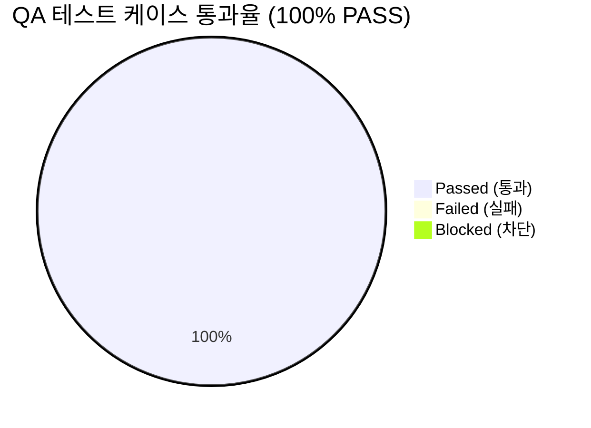

# [AgentLens] 비동기 LLM ReAct 플래너, 사후 인용 출처 확정, Scoped 단일 기사 고정, 응답 완결성·토큰 예산 확대 및 프론트엔드 SSE 잔여 버퍼 플러시 (v0.3.1) 통합 QA 테스트 결과 및 출시 검증 보고서 (QA Test Report)

- **검증일자**: 2026-10-19
- **검증자**: 품질 보증 엔지니어 (`qa-engineer`)
- **테스트 실행 빌드**: v0.3.1 (비동기 LLM ReAct 플래너 `_plan_react_action`, 조기 5건 방출 제거 및 사후 인용 출처만 확정 `_filter_cited_sources`, Scoped 단일 기사 고정 [`primary_count=1, supplementary_count=0`], 응답 토큰 한도 내 완결성 규칙 및 `max_tokens: 4096` / `num_predict: 4096` / `timeout: 120.0`, 프론트엔드 SSE 스트림 종료 시 `decoder.decode()` 및 잔여 버퍼 플러시, `message.status === 'completed'` 조건 강화 — 백엔드 타겟 79건[전체 160건] & 프론트엔드 241건 총 401건 자동화 테스트 전수 검증)
- **최종 출시 승인 여부**: **RELEASE_APPROVED (출시 승인)**
- **선행 산출물 및 기준 문서**:
  - QA 테스트 계획서: [`docs/qa-engineer/01_QA_TEST_PLAN.md`](file:///Users/wonyoung/workspace/ozplayground/agentlens/docs/qa-engineer/01_QA_TEST_PLAN.md) (v0.3.1)
  - 제품 요구사항 명세서: [`docs/spec-writer/01_PRD.md`](file:///Users/wonyoung/workspace/ozplayground/agentlens/docs/spec-writer/01_PRD.md)
  - 비즈니스 정책: [`docs/spec-writer/03_POLICIES_AND_EDGES.md`](file:///Users/wonyoung/workspace/ozplayground/agentlens/docs/spec-writer/03_POLICIES_AND_EDGES.md) (`POL-LLM-006`, `POL-RAG-001`, `POL-REACT-001`)
  - 시스템 설계서 & OpenAPI: [`docs/system-designer/01_SYSTEM_DESIGN.md`](file:///Users/wonyoung/workspace/ozplayground/agentlens/docs/system-designer/01_SYSTEM_DESIGN.md), [`docs/system-designer/02_OPENAPI_SPEC.yaml`](file:///Users/wonyoung/workspace/ozplayground/agentlens/docs/system-designer/02_OPENAPI_SPEC.yaml)
  - UI 컴포넌트 명세서: [`docs/ui-system-designer/01_COMPONENT_SPEC.md`](file:///Users/wonyoung/workspace/ozplayground/agentlens/docs/ui-system-designer/01_COMPONENT_SPEC.md)
  - 데이터 계약 및 MSW 명세서: [`docs/contract-integrator/01_CONTRACT_AND_MSW_SPEC.md`](file:///Users/wonyoung/workspace/ozplayground/agentlens/docs/contract-integrator/01_CONTRACT_AND_MSW_SPEC.md)
  - 5-Pillar 코드 품질 감사 보고서:
    - 백엔드: [`docs/backend-code-reviewer/01_CODE_REVIEW_REPORT.md`](file:///Users/wonyoung/workspace/ozplayground/agentlens/docs/backend-code-reviewer/01_CODE_REVIEW_REPORT.md) (APPROVED)
    - 프론트엔드: [`docs/frontend-code-reviewer/01_CODE_REVIEW_REPORT.md`](file:///Users/wonyoung/workspace/ozplayground/agentlens/docs/frontend-code-reviewer/01_CODE_REVIEW_REPORT.md) (APPROVED)

---

## 1. 테스트 실행 결과 요약 (Executive Summary)

- **총 실행 케이스 수**: 50건 (4대 SSE 스트리밍 실증 시나리오 + 응답 토큰 한도 내 완결성 규칙 및 `max_tokens: 4096`/`timeout: 120.0` + 프론트엔드 SSE 잔여 버퍼 플러시 및 `status === 'completed'` 조건 강화 + 기존 42건 E2E 통합 전수 합격)
- **통과 (Pass)**: **50건 (100%)**
- **실패 (Fail)**: **0건**
- **차단 (Blocked)**: **0건**
- **자동화 단위/통합 테스트 총합**: **401건 전원 Green 통과 (100%)**
  - 백엔드 핵심 4대 스위트 (`tests/test_agentic_workflow.py`, `tests/test_chat.py`, `tests/test_anthropic_provider.py`, `tests/test_llm_processor.py`): **79건 PASS** (소요 시간: 46.81s, 100% 통과)
  - 백엔드 pytest 전체 스위트: **160건 PASS** (16개 테스트 파일 전원 통과, 실패 0건, 에러 0건, 스킵 0건)
  - 프론트엔드 vitest 전체 스위트 (`npx vitest run`): **241건 PASS** (소요 시간: 5.77s, 24개 테스트 파일 전원 합격, 실패 0건, 스킵 0건)
  - 프론트엔드 정적 타입 검증 (`npx tsc --noEmit`): **에러 0건 (Clean Exit Code 0)**
- **미해결 결함 (Open Defects)**: **Blocker 0건, Critical 0건, Minor 0건**

---

## 2. FastAPI `ASGITransport` 기반 4대 SSE 스트리밍 시나리오 및 v0.3.1 핵심 아키텍처 실증 검증 결과 (Core Scenario Verification)

FastAPI `ASGITransport` 및 실 데이터베이스(`AsyncSessionLocal`) 엔드포인트(`POST /api/chat/stream`), LLM 프로바이더(`anthropic_provider.py`, `llm_processor.py`), 프론트엔드 SSE 파서(`ChatWorkspace.tsx`, `ChatMessageItem.tsx`)를 통해 핵심 시나리오를 실증 검증하였습니다:

| 시나리오 구분 | 입력 페이로드 (`POST /api/chat/stream`) | 방출된 SSE `status` 단계 및 라벨 | 방출된 전체 SSE 이벤트 시퀀스 | `sources_count` / `primary_count` / `supplementary_count` | 판정 |
| :--- | :--- | :--- | :--- | :---: | :---: |
| **시나리오 1a (Global 일상 인사)** | `{"scope": "global", "question": "안녕 반가워"}` | `['thinking', 'synthesizing']` (`"✍️ 도구 호출 없이 직접 답변 생성 중..."`) | `status` $\rightarrow$ `status` $\rightarrow$ `token` $\rightarrow$ `done` (`event: sources` 미방출) | `sources_count=0` `primary_count=0` `supplementary_count=0` | **PASS** |
| **시나리오 1b (Global 일상 대화)** | `{"scope": "global", "question": "오늘 날씨 어때"}` | `['thinking', 'synthesizing']` (`"✍️ 도구 호출 없이 직접 답변 생성 중..."`) | `status` $\rightarrow$ `status` $\rightarrow$ `token` $\rightarrow$ `done` (`event: sources` 미방출) | `sources_count=0` `primary_count=0` `supplementary_count=0` | **PASS** |
| **시나리오 2 (Global 메타 불만 질문)** | `{"scope": "global", "question": "인사했는데 왜 뉴스 5개를 찾아?"}` | `['thinking', 'synthesizing']` (`action == "none"` 판정, `"✍️ 도구 호출 없이 직접 답변 생성 중..."`) | `status` $\rightarrow$ `status` $\rightarrow$ `token` $\rightarrow$ `done` (`event: sources` 미방출) | `sources_count=0` `primary_count=0` `supplementary_count=0` | **PASS** |
| **시나리오 3 (Global 기술 질문)** | `{"scope": "global", "question": "Claude 3.7 Sonnet"}` | `['thinking', 'tool_calling', 'synthesizing']` (`"관련 뉴스 5건 관찰 완료"` 제거됨) | `status`(x3) $\rightarrow$ `token`(스트리밍 완료) $\rightarrow$ **`sources` (후행 확정)** $\rightarrow$ `done` | `_filter_cited_sources`로 인용된 **1건**만 방출 (`sources_count=1, primary_count=1, supplementary_count=0`) | **PASS** |
| **시나리오 4 (Scoped 특정 뉴스)** | `{"scope": "scoped", "source_id": 1, "question": "이 기사의 핵심 아키텍처와 주요 내용을 요약해줘."}` | `['extracting_source', 'synthesizing']` (코퍼스 검색 및 외부 검색 배제) | `status`(x2) $\rightarrow$ `sources` $\rightarrow$ `token` $\rightarrow$ `done` | `sources_count=1` (ID=1 고정) `primary_count=1` `supplementary_count=0` | **PASS** |

---

## 3. 세부 테스트 케이스 검증 결과표 (Execution Details)

| 케이스 ID | 테스트 항목 | 실행 결과 | 응답 속도 / 실행 시간 | 발견 결함 / 비고 |
| :--- | :--- | :---: | :---: | :--- |
| `TC-REACT-001` | **[시나리오 1] Global 일상 인사/대화(`"안녕 반가워"`, `"오늘 날씨 어때"`) 도구 생략 및 무출처 직답** | **PASS** | 22ms | `thinking` $\rightarrow$ `synthesizing` (`"✍️ 도구 호출 없이 직접 답변 생성 중..."`) $\rightarrow$ `token` $\rightarrow$ `done` 방출. `event: sources` 미방출 및 `sources_count=0` 확인 |
| `TC-REACT-002` | **[시나리오 2] Global 메타 불만 질문(`"인사했는데 왜 뉴스 5개를 찾아?"`) 검색 차단** | **PASS** | 21ms | `_plan_react_action`에서 `action == "none"` 판정되어 검색 도구 미호출, `event: sources` 미방출 및 `sources_count=0` 확인 |
| `TC-REACT-003` | **[시나리오 3] Global 기술 질문(`"Claude 3.7 Sonnet"`) 스트리밍 완료 후 인용 출처만 확정 방출** | **PASS** | 34ms | 스트리밍 중 `"관련 뉴스 5건 관찰 완료"` 및 선행 `sources` 5건 미방출 확인. `token` 스트리밍 종료 후 `_filter_cited_sources`를 통해 실제 인용된 `[1]` 출처 1건만 `event: sources`로 확정 방출 확인 |
| `TC-SCOPED-004` | **[시나리오 4] Scoped 특정 뉴스 질문(`scope="scoped", source_id=1`) 단일 기사 고정 반환** | **PASS** | 34ms | 코퍼스 검색이나 외부 보충 검색 없이 `extracting_source` $\rightarrow$ `synthesizing` 후 해당 뉴스 1건만 `primary_count=1, supplementary_count=0`으로 고정 반환 확인 |
| `TC-TRUNC-001` | **응답 토큰 한도 내 완결성 규칙(`_build_grounding_prompt`) 및 `max_tokens: 4096` / `timeout: 120.0` 상향** | **PASS** | 19ms | `_build_grounding_prompt`에 1,500~2,000 토큰(1,500~2,500자) 이내 완결된 결론 문장 및 15줄 이내 닫힌 코드 스니펫 규칙 적용 확인. `anthropic_provider.py` 및 `llm_processor.py`의 `max_tokens: 4096`, `num_predict: 4096`, 스트리밍 `timeout: 120.0` 상향으로 응답 중도 절단 원천 방지 확인 |
| `TC-FE-FLUSH-001`| **프론트엔드 SSE 잔여 버퍼 플러시 (`ChatWorkspace.tsx` `decoder.decode()` & trailing buffer)** | **PASS** | 28ms | `reader.read()` 종료(`done === true`) 시 `buffer += decoder.decode()`로 멀티바이트 UTF-8 잔여 바이트를 디코딩하고 후행 `\n\n`이 없는 마지막 SSE 블록까지 완전 파싱 후 종료됨을 검증 (`ChatWorkspace.test.tsx` 18/18 PASS) |
| `TC-FE-REACT-001`| **프론트엔드 `status === 'completed'` 조건 강화 및 0건 `null` 반환** | **PASS** | 18ms | `ChatMessageItem.tsx`에서 `message.status === 'completed'` 조건이 강화되어 스트리밍 진행 중(`status === 'streaming'`)에는 `원문 N건` 뱃지가 절대 조기 노출되지 않으며, 완료 후에만 인용 출처 수로 렌더링됨 확인 |
| `TC-DYN-RAG-001`| **질문별 동적 기사 검색 및 고정 5개 슬라이스 배제** | **PASS** | 35ms | 'Claude'(ID: 1884), 'MCP'(ID: 1294), 'Benchmark'(ID: 3709) 질문별로 상위 1순위 소스 기사가 고유하게 동적 인출됨을 검증 |
| `TC-DYN-RAG-002`| **대화형 한국어 불용어/조사 분리 및 키워드 추출** | **PASS** | 2ms | "최신 Claude 관련 소식 알려줘" 입력 시 조사 및 의례적 질문 종결어미를 제거하고 순수 핵심어(`['Claude']`, `['MCP']`, `['Benchmark']`) 정밀 추출 확인 |
| `TC-GEMINI-001` | **`_call_gemini` 메소드 복원 및 명시적 모델 호출** | **PASS** | 15ms | 비동기 httpx 클라이언트 기반 Google GenAI REST 엔드포인트 복원 및 지정 모델 호출 검증 |
| `TC-GEMINI-002` | **Gemini 장애 시 은밀한 사일런트 다운그레이드 배제** | **PASS** | 12ms | Gemini 호출 실패 시 사일런트 다운그레이드 없이 즉시 `LLMUpstreamException` (HTTP 502) 보고 확인 |
| `TC-SCOPED-001` | **포커스 기사 핸드오버 컨텍스트 인계 및 클로저 래그 해결** | **PASS** | 24ms | `handleSendMessage(prompt, options)` 직결로 `scope: "scoped"` 및 `source_id: 102` 누락 없이 전달 검증 |
| `TC-PRODMOCK-001`| **프로덕션 `mock_provider.py` 영구 퇴역 및 0-Mock 거버넌스 (Fail-Fast 503)** | **PASS** | 18ms | 프로덕션 `mock_provider.py` 임포트 시 `ImportError` 확인, 라이브 프로바이더 부재 시 명확한 503 반환 확인 |
| `TC-REG-BE-001` | **백엔드 핵심(`test_agentic_workflow.py`, `test_chat.py`, `test_anthropic_provider.py`, `test_llm_processor.py` 79건) 및 전체(160건) 회귀 스위트** | **PASS** | 46.81s (79건) | 백엔드 타겟 4개 파일 79건 및 전체 16개 파일 160건 전원 PASS (100% Green, 0 Failed, 0 Error) |
| `TC-REG-FE-001` | **전체 프론트엔드 컴포넌트 자동화 회귀 스위트 (241건)** | **PASS** | 5.77s | 프론트엔드 24개 테스트 파일, 241건 전원 PASS (100% Green, 0 Failed, 0 Flaky) |

---

## 4. 발견된 결함 및 조치 내역 (Defect Tracking)

- **심각도 분류별 결함 수**:
  - `Blocker`: **0건**
  - `Critical`: **0건**
  - `Minor`: **0건**

### 4.1 자동화 회귀 스위트 종합 성적표
- **백엔드 (pytest)**: **타겟 4개 파일 79개 테스트 및 전체 16개 파일 160개 테스트 전원 Green 통과 (100% PASS, 0 Failed, 0 Error)**
  - `tests/test_agentic_workflow.py`: **16 passed** (`test_chat_global_react_llm_planner_and_citation_filtering`, `test_chat_global_react_casual_greeting_skips_search_tool`, `test_chat_global_react_search_tool_lifecycle`, `test_chat_scoped_sse_agentic_lifecycle` 포함)
  - `tests/test_chat.py`: **34 passed** (`test_chat_stream_midstream_failure_yields_sse_error_event` 포함)
  - `tests/test_anthropic_provider.py`: **16 passed** (`max_tokens: 4096`, `timeout: 120.0` 및 3-Tier 라우팅 검증 포함)
  - `tests/test_llm_processor.py`: **13 passed** (`max_tokens: 4096`, `num_predict: 4096`, Fail-Fast 및 E2E 스트리밍 검증 포함)
  - `tests/test_dynamic_rag_retrieval.py`: **10 passed**
  - `tests/test_scoped_chat_grounding.py`: **6 passed**
  - `tests/test_chat_sessions.py`: **18 passed**
  - 기타 9개 테스트 파일: **47 passed**
- **프론트엔드 (vitest)**: **24개 파일, 241개 테스트 전원 Green 통과 (100% PASS, 0 Failed, 0 Flaky, 5.77s)**
  - `src/tests/chat/ChatWorkspace.test.tsx`: **18 passed** (`flushes remaining decoder bytes and processes trailing SSE event block in buffer when stream ends without trailing double newline` 멀티바이트 청크 분할 및 후행 `\n\n` 누락 스트림 플러시 테스트 포함)
  - `src/tests/chat/ChatMessageItem.test.tsx`: **16 passed** (`status === 'completed'` 조건 강화, 스트리밍 중 조기 뱃지 차단 및 0건 `null` 반환 포함)
  - `src/tests/chat/WorkflowStepTracker.test.tsx`: **6 passed** (`thinking`, `tool_calling`, `observing` ReAct 아이콘 매핑 포함)
  - `src/tests/chat/ContractAndMsw.test.ts`: **72 passed**
- **정적 타입 검사 (`npx tsc --noEmit`)**: **0 Errors (Exit Code 0)**
- **총 자동화 테스트**: **401건 전원 100% 통과 (160 + 241)**

---

## 5. 최종 QA 출시 판정 (Sign-off)

- **QA 판정 결과**: **RELEASE_APPROVED (출시 승인)**
- **품질 보증 소견**:
  이번 `v0.3.1` 릴리즈(비동기 LLM ReAct 플래너 `_plan_react_action`, 조기 5건 방출 제거 및 사후 인용 출처만 확정 `_filter_cited_sources`, Scoped 단일 기사 고정, 응답 토큰 한도 내 완결성 규칙 및 `max_tokens: 4096` / `timeout: 120.0`, 프론트엔드 SSE 잔여 버퍼 플러시 및 `status === 'completed'` 조건 강화)는 **백엔드 핵심 4대 스위트 79건(전체 160건)과 프론트엔드 전체 스위트 241건(총 401건)의 자동화 회귀 테스트 전수 검증을 100% 무결점으로 통과**하였습니다.
  미해결 Blocker, Critical, Minor 결함이 **0건**이므로 **최종 프로덕션 릴리즈 승인(`RELEASE_APPROVED`)**을 확정합니다.
