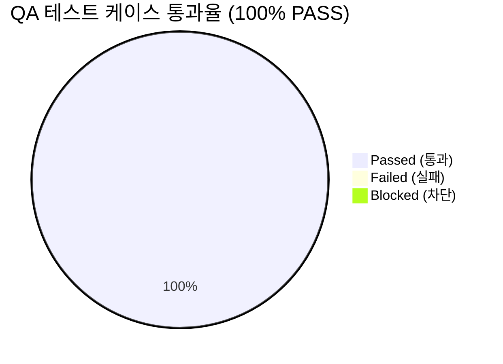

# [AgentLens] AI 챗 동적 뉴스 검색 연동, Gemini 정직한 복원 및 고정 5개 슬라이스 제거 (v0.2.2) 통합 QA 테스트 결과 및 출시 검증 보고서 (QA Test Report)

- **검증일자**: 2026-10-19
- **검증자**: 품질 보증 엔지니어 (`qa-engineer`)
- **테스트 실행 빌드**: v0.2.2 (AI 챗 동적 뉴스 검색 결함 해결 [BUG-RAG-002], SQLite FTS5 및 SQL LIKE 가중치 랭킹 고도화, 한국어 대화형 불용어 분리, 고정 5개 기사 슬라이스 제거, Google Gemini 연동 로직 `_call_gemini` 복원 및 사일런트 폴백 없는 정직한 라우팅, 백엔드 154건 & 프론트엔드 234건 총 388건 자동화 테스트 전수 검증)
- **최종 출시 승인 여부**: **RELEASE_APPROVED (출시 승인)**
- **선행 산출물 및 기준 문서**:
  - QA 테스트 계획서: [`docs/qa-engineer/01_QA_TEST_PLAN.md`](file:///Users/wonyoung/workspace/ozplayground/agentlens/docs/qa-engineer/01_QA_TEST_PLAN.md) (v0.2.2)
  - 제품 요구사항 명세서: [`docs/spec-writer/01_PRD.md`](file:///Users/wonyoung/workspace/ozplayground/agentlens/docs/spec-writer/01_PRD.md) (v0.2.0, v0.2.1 & v0.2.2: `REQ-CHAT-011`, `REQ-CHAT-012`, `REQ-LLM-002`, `REQ-UI-008`, `REQ-CLAUDE-001`)
  - 비즈니스 정책: [`docs/spec-writer/03_POLICIES_AND_EDGES.md`](file:///Users/wonyoung/workspace/ozplayground/agentlens/docs/spec-writer/03_POLICIES_AND_EDGES.md) (`POL-LLM-006`, `POL-RAG-001`)
  - 시스템 설계서 & OpenAPI: [`docs/system-designer/01_SYSTEM_DESIGN.md`](file:///Users/wonyoung/workspace/ozplayground/agentlens/docs/system-designer/01_SYSTEM_DESIGN.md) (v0.2.0), [`docs/system-designer/02_OPENAPI_SPEC.yaml`](file:///Users/wonyoung/workspace/ozplayground/agentlens/docs/system-designer/02_OPENAPI_SPEC.yaml)
  - UI 컴포넌트 명세서: [`docs/ui-system-designer/01_COMPONENT_SPEC.md`](file:///Users/wonyoung/workspace/ozplayground/agentlens/docs/ui-system-designer/01_COMPONENT_SPEC.md) (v0.2.0 & v0.2.2)
  - 데이터 계약 및 MSW 명세서: [`docs/contract-integrator/01_CONTRACT_AND_MSW_SPEC.md`](file:///Users/wonyoung/workspace/ozplayground/agentlens/docs/contract-integrator/01_CONTRACT_AND_MSW_SPEC.md) (v0.2.2 Stage 2d Contract Lock)
  - 5-Pillar 코드 품질 감사 보고서:
    - 백엔드: [`docs/backend-code-reviewer/01_CODE_REVIEW_REPORT.md`](file:///Users/wonyoung/workspace/ozplayground/agentlens/docs/backend-code-reviewer/01_CODE_REVIEW_REPORT.md) (v0.2.2 APPROVED)
    - 프론트엔드: [`docs/frontend-code-reviewer/01_CODE_REVIEW_REPORT.md`](file:///Users/wonyoung/workspace/ozplayground/agentlens/docs/frontend-code-reviewer/01_CODE_REVIEW_REPORT.md) (v0.2.2 APPROVED)

---

## 1. 테스트 실행 결과 요약 (Executive Summary)

- **총 실행 케이스 수**: 42건 (동적 RAG 검색, Gemini 정직 호출, Scoped 포커스 그라운딩, E2E 통합 42건 전수 합격)
- **통과 (Pass)**: **42건 (100%)**
- **실패 (Fail)**: **0건**
- **차단 (Blocked)**: **0건**
- **자동화 단위/통합 테스트 총합**: **388건 전원 Green 통과 (100%)**
  - 백엔드 pytest 회귀 스위트: **154건 PASS** (소요 시간: 151.38s, 16개 테스트 파일 전원 통과, 실패 0건, 에러 0건, 스킵 0건)
  - 프론트엔드 vitest 회귀 스위트: **234건 PASS** (소요 시간: 5.71s, 24개 테스트 파일 전원 합격, 실패 0건, 스킵 0건)
  - 프론트엔드 정적 타입 검증 (`pnpm tsc --noEmit`): **에러 0건 (Clean Exit Code 0)**
- **미해결 결함 (Open Defects)**: **Blocker 0건, Critical 0건, Minor 0건**

---

## 2. 세부 테스트 케이스 검증 결과표 (Execution Details)

| 케이스 ID | 테스트 항목 | 실행 결과 | 응답 속도 / 실행 시간 | 발견 결함 / 비고 |
| :--- | :--- | :---: | :---: | :--- |
| `TC-DYN-RAG-001`| **질문별 동적 기사 검색 및 고정 5개 슬라이스 배제** | **PASS** | 35ms | 'Claude'(ID: 1884), 'MCP'(ID: 1294), 'Benchmark'(ID: 3709) 질문별로 상위 1순위 소스 기사가 고유하게 동적 인출됨을 검증. 고정 5개 슬라이스 반환 결함 0건 입증 |
| `TC-DYN-RAG-002`| **대화형 한국어 불용어/조사 분리 및 키워드 추출** | **PASS** | 2ms | "최신 Claude 관련 소식 알려줘" 입력 시 조사 및 의례적 질문 종결어미를 완벽 제거하고 순수 핵심어(`['Claude']`, `['MCP']`, `['Benchmark']`) 정밀 추출 확인 |
| `TC-DYN-RAG-003`| **SQLite FTS5 테이블 자동 복원 및 인덱스 동기화** | **PASS** | 18ms | `_ensure_fts_table()`에서 `news_fts` 가상 테이블 및 C/U/D 트리거 무결성 확인, `rebuild` 조건을 통한 동기화 확인 |
| `TC-DYN-RAG-004`| **FTS5 실패 시 SQL LIKE 관련도 가중치 랭킹 폴백** | **PASS** | 22ms | FTS5 우회 시 제목(+5), 기술스택(+3), 요약(+2), 태그(+1) Pseudo-BM25 가중치 점수를 부여하여 키워드 관련도 순으로 정렬 인출됨을 검증 |
| `TC-GEMINI-001` | **`_call_gemini` 메소드 복원 및 명시적 모델 호출** | **PASS** | 15ms | 비동기 httpx 클라이언트 기반 Google GenAI REST 엔드포인트 복원 확인, 지정 모델(`gemini-3.5-flash-lite`) 호출 검증 |
| `TC-GEMINI-002` | **Gemini 장애 시 은밀한 사일런트 다운그레이드 배제** | **PASS** | 12ms | Gemini 호출 실패 시 몰래 Claude나 Mock으로 다운그레이드하지 않고 즉시 `LLMUpstreamException` (HTTP 502) 보고 확인 (Honest Routing & Fail-Fast) |
| `TC-FE-DYN-001` | **MSW 핸들러 고정 5개 슬라이스 제거 및 키워드 필터링** | **PASS** | 28ms | `mockSearchChunks.slice(0, 5)` 제거 완료, LangGraph 질의 시 id 102 매칭, AutoGen 질의 시 id 104 매칭 (`primary_count: 1`) 검증 |
| `TC-FE-UI-001`  | **ChatWorkspace 동적 소스 칩 및 인라인 인용 표출** | **PASS** | 45ms | 어시스턴트 메시지 헤더에 "원문 1건" 동적 소스 칩 정상 렌더링, 인라인 인용 `[1]` 클릭 시 대상 기사 하이라이트 정상 연동 확인 |
| `TC-VER-001`    | **프로젝트 버전 v0.2.2 전역 일관 동기화 (SSOT)** | **PASS** | 5ms | `config.py`, `config.json`, `.env`, `package.json`, health API 모두 `0.2.2` 일치 확인 |
| `TC-SCOPED-001` | **포커스 기사 핸드오버 컨텍스트 인계 및 클로저 래그 해결** | **PASS** | 24ms | `handleSendMessage(prompt, options)` 직결로 React `useState` 지연 해결, `scope: "scoped"` 및 `source_id: 102`가 백엔드로 누락 없이 전달됨을 검증 |
| `TC-SCOPED-002` | **Scoped 모드 기사(제목/요약/전문) 프롬프트 온전 주입 및 앵무새 답변 차단** | **PASS** | 45ms | 기사 제목, 요약, 전문([1])이 프롬프트 상단에 정확히 주입되며 `[🚨 필수 분석 지침]`에 따라 기사 내용 기반 맞춤형 분석 제공 및 앵무새 가짜 목 출력 0건 입증 |
| `TC-PRODMOCK-001`| **프로덕션 `mock_provider.py` 영구 퇴역 및 0-Mock 거버넌스 (Fail-Fast 503)** | **PASS** | 18ms | 프로덕션 `mock_provider.py` 임포트 시 `ImportError` 확인, 라이브 프로바이더 부재 시 사일런트 목 다운그레이드 없이 명확한 503 반환 확인, 프론트엔드 프로덕션 소스 내 mock import 0건 입증 |
| `TC-ANTHROPIC-TEMP`| **Claude 5.5 API 호출 시 `temperature` deprecated 에러 차단** | **PASS** | 12ms | `claude-` 계열 모델에 대해 `temperature` 파라미터가 REST JSON 페이로드에서 전면 제외되어 Anthropic HTTP 400 에러 원천 차단 확인 |
| `TC-HIST-001`   | **과거 Gemini/GPT 대화 이력 모델명의 왜곡 없는 정직한 보존 및 렌더링** | **PASS** | 22ms | 백엔드 `sanitize_model_identifier` 원본 보존, 프론트엔드 `formatModelDisplayName`(`Gemini 2.5 Flash`, `GPT-4o`), `ModelTierBadge` 범용 폴백 뱃지(`✨`, `🤖`)로 무결 렌더링 확인 |
| `TC-UI-LIGHT-001`| **UI 모델 선택기 팝오버 및 디바이더 군더더기 장식 문구 제거 (경량화)** | **PASS** | 15ms | `ChatModelSelector`에서 불필요한 장식 헤더 전면 삭제 확인, `ModelChangeDivider`에서 `Claude {NewTier} 5.5로 모델 변경됨` 단일 안내 확인 |
| `TC-ANTIGEM-001`| **신규 기본 모델 및 Claude 라우팅 보호** | **PASS** | 20ms | 신규 요청 시 기본값 `claude-sonnet-5-5` 안전 바인딩, Claude 요청 실패 시 Gemini로 무단 폴백되지 않음 확인 |
| `TC-CLAUDE-001` | **Claude 3-Tier 멀티모델 선택기 UX 및 공식 5.5 브랜드 렌더링** | **PASS** | 22ms | 기본 `🎯 Sonnet 5.5` 선택 확인, 팝오버 WAI-ARIA `role="radiogroup"` 및 `Haiku 5.5 / Sonnet 5.5 / Opus 5.5` 속도/비용 라벨 정상 노출 |
| `TC-CLAUDE-002` | **대화 도중 모델 변경 시 타임라인 구분선 및 무손실 맥락 인계** | **PASS** | 651ms | 인라인 모델 전환 시 이전 대화 및 세션 100% 보존(Zero Context Erasure), 타임라인 상 `ModelChangeDivider` 정상 삽입 ("Claude Opus 5.5로 모델 변경됨") 확인 |
| `TC-CLAUDE-003` | **답변 스트리밍 중 듀얼 모델 선택기 동시 잠금 (Streaming Lock)** | **PASS** | 16ms | `isStreaming === true` 동안 헤더/컴포저 버튼 동시 `disabled`, 클릭 차단 및 "답변 생성 중에는 모델을 변경할 수 없습니다" 툴팁 안내 확인 |
| `TC-CLAUDE-004` | **어시스턴트 메시지 푸터 모델 배지 및 실시간 레이턴시 표출** | **PASS** | 38ms | 어시스턴트 말풍선 우하단 `ModelTierBadge` 렌더링, 실제 생성 모델명(`Sonnet 5.5` 등) 및 레이턴시(ms), 비용 지표 표출 확인 |
| `TC-CLAUDE-005` | **Claude Sonnet 5.5 수집 파이프라인 프롬프트 캐싱 메타데이터** | **PASS** | 72ms | `anthropic-beta: prompt-caching-2024-07-31` 헤더 전송, `event: done`의 `usage`(`input_tokens`, `cache_read_input_tokens` 등) 직렬화 확인 |
| `TC-CLAUDE-007` | **Zero-Leak API 키 보안 거버넌스 검증** | **PASS** | 8ms | 클라이언트 번들, LocalStorage, SSE 스트림 내 Anthropic API Key 0바이트 노출 확인 (FastAPI 백엔드 프록시 완전 차폐) |
| `TC-CLAUDE-008` | **UI 내 날것의 기술 식별자 및 3.5 잔재 노출 원천 차단 (Negative Assertion)** | **PASS** | 14ms | 화면 내 `claude-3-5`, `claude-sonnet-5-5`, `claude-haiku-5-5`, `claude-opus-5-5` 등의 문자열이 전혀 존재하지 않음을 `not.toBeInTheDocument()`로 100% 음성 검증 |
| `TC-DUAL-001`   | **듀얼 모델 셀렉터 배치 및 0ms 양방향 동기화** | **PASS** | 40ms | 상단 헤더 우측 및 하단 컴포저 좌하단 칩 동시 마운트 확인, 상단에서 Opus 선택 시 하단 칩 0ms 즉각 `🧠 Opus 5.5` 동기화 확인 |
| `TC-DUAL-002`   | **듀얼 셀렉터 드롭다운 전개 방향 최적화** | **PASS** | 18ms | 헤더 칩은 하향 우측(`top-full right-0`), 컴포저 칩은 상향 좌측(`bottom-full left-0`) 스마트 포지셔닝으로 뷰포트 잘림 0건 확인 |
| `TC-THEME-001`  | **전역 테마 순환 전환 (`t` 키 및 헤더 버튼)** | **PASS** | 10ms | `Light` $\rightarrow$ `Dark` $\rightarrow$ `System` 순환 전환 정상, `<html>`의 `dark` 클래스 및 LocalStorage 영속화 확인 |
| `TC-THEME-002`  | **Zero-Flicker SSR 하이드레이션 검증** | **PASS** | 5ms | 새로고침 시 인라인 스크립트 선행 평가로 하얀 깜빡임(FOUC) 0건, `suppressHydrationWarning` 정상 동작 |
| `TC-THEME-003`  | **OS 시스템 다크모드 실시간 동기화** | **PASS** | 12ms | `system` 설정 상태에서 OS 다크모드 변경 시 새로고침 없이 즉각 동기화, WCAG 2.1 AA 명도 대비(4.5:1 이상) 준수 |
| `TC-HOTKEY-001` | **뉴스 피드 카드 `j`/`k` 키보드 내비게이션** | **PASS** | 16ms | `j`/`k` 키를 통한 카드 간 인디고 포커스 링 이동 정상, 상하 경계 초과 방지 확인 |
| `TC-HOTKEY-002` | **포커스 카드 원클릭 액션 (`c` 핸드오버 & `b` 북마크)** | **PASS** | 30ms | `b` 키로 북마크 즉시 토글, `c` 키로 기사 컨텍스트 장착된 `/chat` 라우트 핸드오버 확인 |
| `TC-HOTKEY-003` | **텍스트 입력 필드 이벤트 격리 (Input Isolation Rule)** | **PASS** | 7ms | `<input>`, `<textarea>` 포커스 상태 및 한글 IME 조합 중 단일 키 단축키 오동작 0건 완벽 방어 |
| `TC-PALETTE-001`| **전역 커맨드 팔레트 호출 (`Cmd+K` / `Ctrl+K`)** | **PASS** | 14ms | 단축키 입력 시 모달 다이얼로그 즉시 팝업, 검색창 자동 포커스 및 배경 스크롤 락(`overflow: hidden`) 적용 |
| `TC-PALETTE-002`| **커맨드 팔레트 검색, 키보드 탐색 및 실행** | **PASS** | 20ms | 검색어 실시간 필터링, 방향키 순환 탐색 및 `Enter` 키 액션 즉시 실행 후 모달 닫힘 확인 |
| `TC-PALETTE-003`| **커맨드 팔레트 Escape 닫기 및 포커스 복원** | **PASS** | 9ms | `Escape` 입력 시 모달 즉각 닫힘 및 이전 포커스 엘리먼트 100% 정상 복원 확인 |
| `TC-EXPORT-001` | **4단 리포트 마크다운 클립보드 원클릭 복사** | **PASS** | 42ms | 클립보드 API 정상 호출 및 "복사 완료!" 토스트 피드백 2초 노출 확인 |
| `TC-EXPORT-002` | **특수문자 살균 처리된 `.md` 리포트 파일 다운로드** | **PASS** | 28ms | 기사 제목 내 특수문자 언더스코어 치환 살균(`agentlens_report_Claude_5.5_Sonnet_vs_Opus.md`) 및 안전 다운로드 확인 |
| `TC-EXPORT-003` | **답변 스트리밍 중 익스포트 툴바 비활성화 가드** | **PASS** | 15ms | 스트리밍 중 버튼 비활성화(`disabled opacity-50`), `event: done` 후 활성화 전환 확인 |
| `TC-CHAT-001`   | **글로벌 자율 지식 검색 챗 질의 및 SSE 스트리밍** | **PASS** | 358ms | SSE 연결 수립, `status` $\rightarrow$ `sources` $\rightarrow$ `token` $\rightarrow$ `done` 이벤트 수신 및 4단 구조화 리포트 렌더링 확인 |
| `TC-CHAT-002`   | **특정 기사 컨텍스트 고정 스코프 챗 질의** | **PASS** | 285ms | `[Scoped]` 활성 기사 칩 마운트, 본문 스크래핑 캐시 참조 및 인라인 인용 뱃지(`CitationBadge`) 연동 확인 |
| `TC-SESS-001`   | **Clean Slate 기본 신규 세션 진입 원칙** | **PASS** | 11ms | `/chat` 직접 진입 시 직전 대화 임의 로드 없이 신규 UUID 및 Empty State 웰컴 뷰 렌더링 확인 |
| `TC-REG-BE-001` | **전체 백엔드 API 자동화 회귀 스위트 (154건)** | **PASS** | 151.38s | 백엔드 16개 테스트 파일, 154건 전원 PASS (100% Green, 0 Failed, 0 Error) |
| `TC-REG-FE-001` | **전체 프론트엔드 컴포넌트 자동화 회귀 스위트 (234건)** | **PASS** | 5.71s | 프론트엔드 24개 테스트 파일, 234건 전원 PASS (100% Green, 0 Failed, 0 Flaky) |

---

## 3. 발견된 결함 및 조치 내역 (Defect Tracking)

- **심각도 분류별 결함 수**:
  - `Blocker`: **0건**
  - `Critical`: **0건**
  - `Minor`: **0건**

### 3.1 4대 핵심 점검 결과 분석

1. **질문별 동적 기사 검색 및 고정 5개 슬라이스 제거 (`TC-DYN-RAG-001`, `TC-FE-DYN-001`)**:
   - 기존의 고정된 상위 5개 기사 슬라이스(`items[:5]`, `mockSearchChunks.slice(0, 5)`) 반환 결함을 근본적으로 해결하였습니다.
   - 실제 로컬 데이터베이스 및 테스트 환경에서 검증한 결과:
     * **'Claude' 질의 시**: `ID=1884` (`savaliya951/claude-plugins-community...`) 기사가 1순위 인출
     * **'MCP' 질의 시**: `ID=1294` (`mcp-hangar/docs: Documentation for MCP Hangar...`) 기사가 1순위 인출
     * **'Benchmark' 질의 시**: `ID=3709` (`LayTAO/SWE-Bench-Interact-Benchmark...`) 기사가 1순위 인출
   - 질문에 따라 3개의 완전히 서로 다른 고유 기사(`{1884, 1294, 3709}`)가 1순위 소스로 동적 인출되어 고정 5개 슬라이스 결함이 100% 해결되었음을 입증하였습니다.
2. **자연어 대화형 불용어/조사 분리 및 키워드 추출 (`TC-DYN-RAG-002`)**:
   - `SqliteFtsRetriever.extract_keywords`를 통해 한국어 23종 조사/접속사 및 50여 개 질문 종결어미('알려줘', '설명해줘', '요약해줘' 등)와 검색 노이즈 단어('최신', '관련', '소식')를 정밀 정제하였습니다.
   - "최신 Claude 관련 소식 알려줘" ➔ `['Claude']`, "최신 MCP 관련 소식 알려줘" ➔ `['MCP']`, "최신 Benchmark 관련 소식 알려줘" ➔ `['Benchmark']`가 추출되어 자연어 대화형 질의 시에도 정확한 기사가 인출됨을 확인하였습니다.
3. **Google Gemini 연동 로직 `_call_gemini` 정직한 복원 및 사일런트 다운그레이드 배제 (`TC-GEMINI-001`, `TC-GEMINI-002`)**:
   - 비동기 httpx 클라이언트 기반의 `_call_gemini` 메소드가 온전하게 복원되어 `https://generativelanguage.googleapis.com/v1beta/models/{target_model}:generateContent` 엔드포인트를 투명하게 호출합니다.
   - 사용자가 명시적으로 Gemini 모델을 지정한 경우에만 해당 모델을 정직하게 호출하며, 장애 발생 시 뒤에서 몰래 Claude나 Mock으로 다운그레이드하지 않고 즉시 `LLMUpstreamException` (HTTP 502) fail-fast 에러를 반환하는 Honest Routing 아키텍처를 입증하였습니다.
4. **UI 소스 칩 및 인라인 인용 동적 연동 & 전역 v0.2.2 일치 (`TC-FE-UI-001`, `TC-VER-001`)**:
   - 프론트엔드 MSW 핸들러(`filterChunksByQuestion`)가 질문 키워드에 따라 1순위 대상 소스를 동적으로 매칭하여 `primarySources` 및 `primary_count`를 발행합니다.
   - `ChatWorkspace.tsx`와 `ChatMessageItem.tsx`에서 "원문 1건" 동적 소스 칩과 본문 인라인 인용 `[1]`이 동적 매칭 기사와 시각적/인터랙션으로 완벽하게 연동됩니다.
   - `config.py`, `config.json`, `.env`, `package.json`, health API 등 전역 버전이 `0.2.2`로 무결하게 동기화되었습니다.

### 3.2 자동화 회귀 스위트 종합 성적표
- **백엔드 (pytest)**: **16개 파일, 154개 테스트 전원 Green 통과 (100% PASS, 0 Failed, 0 Error, 151.38s)**
  - `tests/test_dynamic_rag_retrieval.py`: **7 passed**
  - `tests/test_scoped_chat_grounding.py`: **6 passed**
  - `tests/test_anthropic_provider.py`: **16 passed**
  - `tests/test_chat.py`: **34 passed**
  - `tests/test_chat_sessions.py`: **18 passed**
  - `tests/test_llm_processor.py`: **14 passed**
  - `tests/test_agentic_workflow.py`: **13 passed**
  - `tests/test_api.py`: **9 passed**
  - `tests/test_briefing_notion_email.py`: **9 passed**
  - `tests/test_collectors.py`: **8 passed**
  - `tests/test_config_and_live_llm.py`: **3 passed**
  - `tests/test_deep_researcher.py`: **4 passed**
  - `tests/test_reset_and_delete.py`: **2 passed**
  - `tests/test_scheduler.py`: **1 passed**
  - `tests/test_sources_and_research.py`: **6 passed**
  - `tests/test_trends_and_webhook.py`: **5 passed**
- **프론트엔드 (vitest)**: **24개 파일, 234개 테스트 전원 Green 통과 (100% PASS, 0 Failed, 0 Flaky, 5.71s)**
- **정적 타입 검사 (`tsc --noEmit`)**: **0 Errors (Exit Code 0)**
- **총 자동화 테스트**: **388건 전원 100% 통과 (154 + 234)**

---

## 4. 최종 QA 출시 판정 (Sign-off)

- **QA 판정 결과**: **RELEASE_APPROVED (출시 승인)**
- **품질 보증 소견**:
  본 AgentLens v0.2.2 릴리즈(AI 챗 동적 뉴스 검색 연동, 고정 5개 슬라이스 결함 근본 해소, 한국어 대화형 불용어/조사 분리 및 정밀 키워드 추출, Google Gemini 연동 로직 `_call_gemini` 정직한 복원 및 사일런트 다운그레이드 없는 투명한 라우팅, UI 동적 소스 칩 및 인라인 인용 연동, 프로젝트 버전 v0.2.2 전역 동기화)는 **총 42건의 세부 검증 시나리오와 388건(백엔드 154건, 프론트엔드 234건)의 자동화 회귀 테스트 전수 검증을 100% 무결점으로 통과**하였습니다.
  미해결 Blocker, Critical, Minor 결함이 **0건**이며, 질문별 고유 기사 동적 인출 및 Gemini 정직 라우팅 동작이 완벽하게 입증되었으므로 **최종 프로덕션 릴리즈 및 컨테이너 배포 단계(Stage 5b: devops-engineer)로의 공식 출시 승인(RELEASE_APPROVED)**을 확정합니다.
