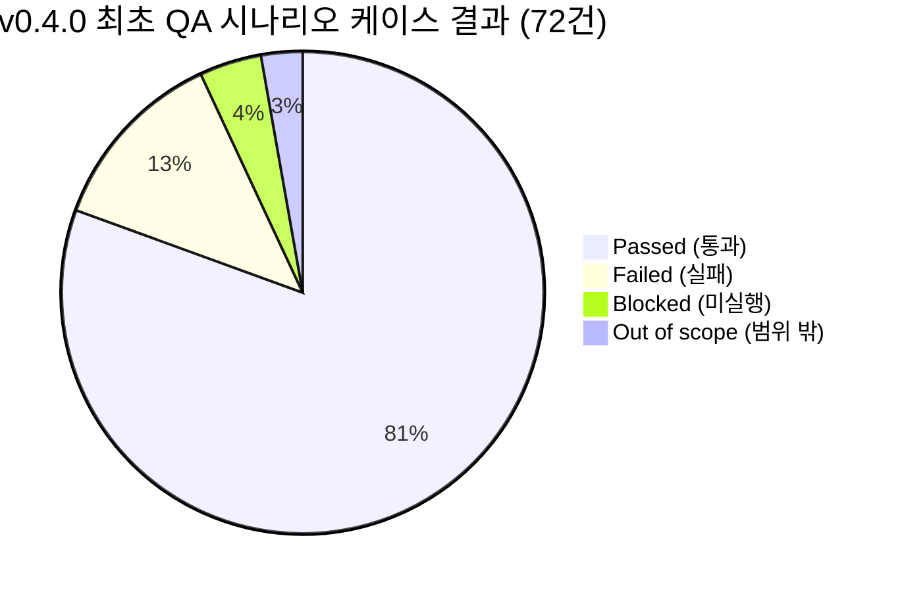

# [AgentLens] 통합 QA 테스트 결과 및 출시 검증 보고서 (QA Test Report)

- **Updated**: 2026-11-09
- **기준**: v0.4.1 (main)
- **검증일자**: 2026-11-09 (v0.4.0 최초 QA 22:53~23:03 KST, v0.4.1 회귀 QA 23:47~23:52 KST)
- **검증자**: 품질 보증 엔지니어 (`qa-engineer`)
- **테스트 실행 빌드**: v0.4.1 회귀 = commit `9e0c9e5` 위 작업 트리(리뷰 수정, 커밋 전). `make docker-build` 로 다시 빌드(backend 2026-11-09 23:47:31, frontend 23:47:40)하고, backend 컨테이너 `/app/app` 과 작업 트리 `backend/app` 이 같음(`diff -rq` 차이 없음), frontend 번들에 `Notion 동기화` 글자가 없고 새 끊김 문구가 있음을 확인했다. v0.4.0 최초 QA 는 commit `9e0c9e5` 이미지(backend 22:17, frontend 22:44 빌드)로 했다. 2~3절 세부 결과는 v0.4.0 최초 QA 기록이고, v0.4.1 에서 바뀐 결과는 4절에 있다.
- **최종 출시 승인 여부**: **RELEASE_APPROVED** (v0.4.1 회귀 QA 기준. 범위 안 Blocker 0, Critical 0. 보안·설정 결함 5건은 2026-11-09 제품 오너 결정으로 검사 범위 밖(수용된 위험). v0.4.0 처음 판정은 RELEASE_BLOCKED, Critical 5)
- **기준 문서**: 계획 `docs/qa-engineer/01_QA_TEST_PLAN.md`, FSD `docs/spec-writer/fsd/01~07_*.md`, 화면 측정 결과 `docs/qa-engineer/ui-audit/report.json`

---

## 1. 테스트 실행 결과 요약 (Executive Summary)

- **v0.4.1 회귀 QA 요약**: 스모크 17/17, API 시나리오 49개 중 48 통과(남은 1개는 범위 밖 `TC-SEC-001` 의 헤더 없는 호출), 바뀐 동작 회귀 케이스 8건 모두 PASS, 관련 단위 테스트 backend 27/27·frontend 94/94 통과, 해결 결함 9건. 자세한 내용은 4절
- **총 시나리오 케이스 수 (v0.4.0 최초 QA)**: 72건 (`01_QA_TEST_PLAN.md` 2절 NEWS 24, CHAT 18, COLL 6, BRF 6, SRC 6, MCP 3, UI·보안 9)
- **통과 (Pass)**: 58건 (80.6%)
- **실패 (Fail)**: 9건. 실행해서 재현 3건(`TC-CHAT-007`, `TC-SRC-005`, `TC-SEC-002`), 코드·빌드 산출물로 확인 6건(`TC-NEWS-023`, `TC-NEWS-024`, `TC-CHAT-018`, `TC-COLL-004`, `TC-SRC-006`, `TC-MCP-003`)
- **범위 밖 (Out of scope)**: 2건. `TC-SEC-001`(OOS-1), `TC-BRF-006`(OOS-5). 계획 1.4 에 따라 Pass/Fail 을 매기지 않고 관찰만 기록했다
- **미실행 (Blocked)**: 3건. `TC-CHAT-017`(Playwright MCP 에 네트워크 차단 도구가 없음), `TC-COLL-003`·`TC-COLL-005`(실제 수집·외부 호출이 나가 계획 1.3 에 따라 실행하지 않음)
- **스모크 (`qa_runner.py`, v0.4.0 최초 QA)**: 17 / 17 통과 (backend 14, frontend 3), 종료 0
- **화면 규칙 (`ui-audit.mjs`, v0.4.0 최초 QA)**: 조합 160, 통과 150, 실패 0, 건너뜀 10 (트렌드 레이더 펼침 10개: 레이더 버튼이 그려지지 않음), 판정 21종 실패 0, 종료 0
- **자동 테스트 (`make check`, v0.4.0 최초 QA)**: 이번 QA 에서 다시 돌리지 않았다 (외부 호출이 나가는 테스트가 있어서, 계획 4.3). `pytest --collect-only` 로 backend 217개·파일 21개, frontend 테스트 파일 52개를 다시 셌다. 마지막 통과 기록은 backend 217개·frontend 649개 모두 통과(계획 5절, 2026-11-09).
- **미해결 결함 (Open Defects, v0.4.1 기준)**: 39건. **Blocker 0건, Critical 0건, Minor 39건** (3절). v0.4.0 의 Minor 38건 가운데 9건(D-07, D-09, D-10, D-11, D-12, D-13, D-14, D-15, D-32)이 v0.4.1 에서 해결됐고, 리뷰가 남긴 권장 지적 9건(D-44~D-52)과 회귀 QA 관찰 1건(D-53)이 Minor 로 더해졌다
- **v0.4.0 최초 QA 때 미해결 결함**: 38건 (Blocker 0, Critical 0, Minor 38)
- **범위 밖(수용) 결함**: 5건. D-01, D-02, D-03, D-04, D-08 (3.8절, 제품 오너 결정 2026-11-09)

### 1.1 실행 환경
| 항목 | 값 |
|---|---|
| backend | `BACKEND_PORT=18000 make docker-up` → `http://localhost:18000`, healthy. 볼륨 `agentlens-data` 의 DB 에 기사 5건(모두 `huggingface`, `harness` 2·`agent_tech` 3). lifespan 첫 수집은 돌지 않았다 (`last_crawl_status: idle`) |
| frontend | `http://localhost:3001` (Next.js 프로덕션 빌드), healthy |
| LLM 없는 backend | 로컬 uvicorn `127.0.0.1:18001`, LLM 키 3개 비움, `OLLAMA_BASE_URL=http://127.0.0.1:9`, DB 는 Docker DB 백업 사본 |
| Docker backend 의 LLM | `ANTHROPIC_API_KEY`·`GEMINI_API_KEY`·`OLLAMA_BASE_URL` 이 설정돼 있었다 (값은 보지 않고 길이만 확인). 실제 LLM 호출이 나가는 질의는 보내지 않았다 |
| 브라우저 | Playwright MCP (Chromium) 390x844·1440x900, `ui-audit.mjs` 는 로컬 Chrome 157.0.8103.38 |
| 호스트 8000 | 다른 세션의 `make dev` backend 가 쓰고 있어 건드리지 않았다 |

### 1.2 하지 않은 동작
초기화·전체 삭제, 수집(`trigger`, `run-deep`), 브리핑·Notion·이메일·웹훅 발송(유효 URL), 설정 저장, 소스 추가·토글·삭제, 실제 LLM 질의. 해당 결함은 코드로 확인했다.

---

## 2. 세부 테스트 케이스 검증 결과표 (Execution Details)

응답 속도는 스크립트가 잰 왕복 시간(ms)이다. `UI` 는 Playwright, `code` 는 실행하지 않고 코드로 확인한 것이다.

### 2.1 NEWS
| 케이스 ID | 테스트 항목 | 실행 결과 | 응답 속도 | 발견 결함 / 비고 |
| :--- | :--- | :---: | :---: | :--- |
| `TC-NEWS-001` | 목록 기본 조회 | **PASS** | 9ms | 200, `total: 5`, `items` 5건. 첫 실행은 스크립트가 본문 앞 600자만 읽어 `"total"` 을 못 찾았고, 전체 본문으로 다시 확인했다 |
| `TC-NEWS-002` | 카테고리 필터 | **PASS** | 4ms | 200 |
| `TC-NEWS-003` | Must-Read 필터 | **PASS** | 3ms | 200 |
| `TC-NEWS-004` | 키워드 검색 | **PASS** | 3ms | 200 |
| `TC-NEWS-005` | 정렬 | **PASS** | 2ms | 200 |
| `TC-NEWS-006` | `page=0` | **PASS** | 1ms | 422 |
| `TC-NEWS-007` | `size=101` | **PASS** | 1ms | 422 |
| `TC-NEWS-008` | `page=abc` | **PASS** | 1ms | 422 |
| `TC-NEWS-009` | `page=999` | **PASS** | 1ms | 200, `items: []` |
| `TC-NEWS-010` | 없는 카테고리 | **PASS** | 2ms | 200, `total: 0` |
| `TC-NEWS-011` | 단건 조회 | **PASS** | 1ms | 200 (id 2) |
| `TC-NEWS-012` | 없는 기사 | **PASS** | 1~2ms | 404 (runner·curl) |
| `TC-NEWS-013` | 숫자가 아닌 id | **PASS** | 1ms | 422 |
| `TC-NEWS-014` | RSS (전체·카테고리) | **PASS** | 1~2ms | 200, `<rss`. 채널 링크 3000 포트는 D-26 |
| `TC-NEWS-015` | 없는 기사에 질문 | **PASS** | 4ms | 404 |
| `TC-NEWS-016` | 통계·트렌드 레이더 | **PASS** | 1~3ms | 200. 레이더 `total_analyzed: 5` 인데 카테고리별 `count` 가 모두 0 이고 `surging_tags` 가 비어 화면에 레이더 버튼이 없다 (집계 값은 계획 6.7 의 '없음' 공백) |
| `TC-NEWS-017` | LLM 없을 때 기사 질문 | **PASS** | 13ms / 118ms | `/ask` 200, `/ask/stream` 200 `text/event-stream`, `meta.model: "AgentLens Heuristic Engine"`. FSD BR-NEWS-010-7·BR-NEWS-011-3 의 휴리스틱 답과 같다. 답 머리 `### 🤖 기술 맥락 및 실무 분석` 의 이모지는 D-36 |
| `TC-NEWS-018` | LLM 없어도 목록 정상 | **PASS** | 2ms | 200 |
| `TC-NEWS-019` | 피드 표시 | **PASS** | - | 1440x900: 카드 5장, 헤더 56px, 문서 가로 스크롤 없음(`scrollWidth` 1440). 390x844: `scrollWidth` 390, 첫 카드 top 348px. 요약 바 헤드라인이 `Mathematical M...` 로 잘림(D-21) |
| `TC-NEWS-020` | 카테고리 칩 필터 | **PASS** | - | `하네스 & 벤치마크` 선택 → 카드 2장, 머리줄 `총 2건 (전체 5건)`, 칩 `aria-pressed=true` |
| `TC-NEWS-021` | 0건 카테고리 | **PASS** | - | `MCP & 생태계` → 카드 0, `조건에 일치하는 소식이 없습니다` |
| `TC-NEWS-022` | 기사 상세 대화상자 | **PASS** | - | `role=dialog`·`aria-modal=true`·`aria-labelledby`=제목, 탭 `AI 요약 & 시사점`(선택)·`AI 질의응답`, 열면 포커스가 대화상자 안, 본문 `overflow: hidden`. 조작 요소 7개에 Tab 9번 → 포커스가 대화상자 안(`보관하기`, `:focus-visible` 2px solid). Escape → 닫힘, 포커스가 카드 제목 버튼으로 돌아감. 390x844 에서도 전체 화면(0,0,390,844)으로 열리고 Escape 로 닫힘 |
| `TC-NEWS-023` | 2페이지 이상에서 검색 | **FAIL** (code) | - | D-14. 데이터가 5건(1페이지)이라 실행으로는 재현할 수 없었다 |
| `TC-NEWS-024` | 바꾼 `BACKEND_PORT` 에서 기사 질문 스트림 | **FAIL** (code·번들) | - | D-41. 실행 중인 frontend 번들에 `${protocol}//${hostname}:8000` 이 들어 있음을 확인했다. 호스트 8000 은 다른 세션 backend 라 실제로 보내지 않았다 |

### 2.2 CHAT
| 케이스 ID | 테스트 항목 | 실행 결과 | 응답 속도 | 발견 결함 / 비고 |
| :--- | :--- | :---: | :---: | :--- |
| `TC-CHAT-001` | 빈 질문 | **PASS** | 1ms | 400 `ERR_CHAT_PAYLOAD_EMPTY` |
| `TC-CHAT-002` | 2001자 질문 | **PASS** | 1ms | 400 `ERR_CHAT_PAYLOAD_TOO_LARGE` |
| `TC-CHAT-003` | 잘못된 scope | **PASS** | 0ms | 400 `ERR_INVALID_SCOPE_PARAM` |
| `TC-CHAT-004` | scoped 없는 기사 | **PASS** | 1ms | 404 `ERR_HANDOVER_SOURCE_NOT_FOUND` |
| `TC-CHAT-005` | scoped source_id 없음 | **PASS** | 1ms | 404 |
| `TC-CHAT-006` | JSON 이 아닌 본문 | **PASS** | 1ms | 400 `ERR_INVALID_PAYLOAD` |
| `TC-CHAT-007` | 잘못된 모델 티어 | **FAIL** | 5ms | 500 `{"detail":"Internal server error occurred. Please check server logs.","error":"1 validation error for ChatStreamRequest\nmodel_tier\n  Input should be 'haiku', 'sonnet' or 'opus' ..."}`. D-32, D-05 |
| `TC-CHAT-008` | 동기 질의 빈 질문 | **PASS** | 3ms | 400 |
| `TC-CHAT-009` | 세션 목록 | **PASS** | 1~2ms | 200 |
| `TC-CHAT-010` | 없는 세션 | **PASS** | 1ms | 404 |
| `TC-CHAT-011` | 출처 상세·없는 출처 | **PASS** | 1ms | 200, 404 |
| `TC-CHAT-012` | 코퍼스 검색 API | **PASS** | 3ms | 200 |
| `TC-CHAT-013` | LLM 없음 스트림 | **PASS** | 30ms | 503 `ERR_LLM_PROVIDER_UNAVAILABLE` `가용한 LLM 프로바이더 엔진 미설정 (API 키 미등록)` |
| `TC-CHAT-014` | LLM 없음 동기 질의 | **PASS** | 23ms | 503 `ERR_LLM_PROVIDER_UNAVAILABLE` |
| `TC-CHAT-015` | 챗 화면 기본 | **PASS** | - | 1440x900 다크: 헤더 첫 조작 요소 `피드로 돌아가기`, 모드 `단일 기사`·`전체 소식`, 추천 질문 4개, 입력창 아래 `Sonnet 5.5` 모델 선택 버튼 1개, 자리표시 `수집된 AI 에이전트 소식 전체에 대해 질문하세요`, `0 / 2000`, 빈 기록 `저장된 대화 기록이 없습니다`. 390x844: `scrollWidth` 390, 44px 미만 조작 요소 0, 모델 선택 1개 |
| `TC-CHAT-016` | 없는 기사로 핸드오버 | **PASS** | - | `/chat?sourceId=999999999` → 알림 `요청하신 기사를 찾을 수 없어 전체 소식 모드로 시작합니다.`, `전체 소식` 선택. 콘솔 오류 1건은 기대한 `GET /api/chat/sources/999999999` 404 |
| `TC-CHAT-017` | 스트림 중 네트워크 단절 | **BLOCKED** | - | Playwright MCP 에 네트워크 차단 도구가 없어 실행하지 못했다. 관련 결함 D-12 |
| `TC-CHAT-018` | 모델을 바꾼 직후 전송 | **FAIL** (code, 의심) | - | D-11 |

### 2.3 COLL
| 케이스 ID | 테스트 항목 | 실행 결과 | 응답 속도 | 발견 결함 / 비고 |
| :--- | :--- | :---: | :---: | :--- |
| `TC-COLL-001` | 스케줄 상태 | **PASS** | 1~2ms | `schedule_hours [0,6,12,18]`, `timezone UTC`, `next_run 18:00Z`, `is_running false` |
| `TC-COLL-002` | 진행률 | **PASS** | 0~1ms | `step_message: 대기 중`, `total_sources: 6` |
| `TC-COLL-003` | 수집 중 재요청 | **BLOCKED** | - | 수집을 실제로 돌려야 해 실행하지 않았다. 코드: `collect_all` 이 `is_running` 이면 `already_running` (`backend/app/collectors/manager.py:177-180`). 프론트 처리는 `hooks/useCollector.test.ts` 가 검증한다 |
| `TC-COLL-004` | 수집 소스 오류 | **FAIL** (code) | - | D-18 |
| `TC-COLL-005` | 빈 DB 로 시작 | **BLOCKED** | - | 외부 수집이 나가 실행하지 않았다. `test_startup_seed.py` 가 검증한다 |
| `TC-COLL-006` | 헤더 수집 상태 | **PASS** | - | `수집 스케줄 · 다음 수집 4h 3m 후`, `즉시 수집` 버튼 있음 (누르지 않음). `ui-audit` R9 진입점 통과 |

### 2.4 BRF
| 케이스 ID | 테스트 항목 | 실행 결과 | 응답 속도 | 발견 결함 / 비고 |
| :--- | :--- | :---: | :---: | :--- |
| `TC-BRF-001` | 오늘 브리핑 | **PASS** | 4ms | 200 |
| `TC-BRF-002` | 연동 설정 조회 | **PASS** | 1ms | 200. 지금 `config.json` 의 비밀값은 모두 비어 있다. 웹훅 URL 을 가리지 않는 동작은 범위 밖 D-04 (OOS-4) |
| `TC-BRF-003` | 웹훅 테스트 잘못된 URL | **PASS** | 1ms | 400 `유효한 HTTP/HTTPS 웹훅 URL을 입력해주세요.`. 첫 실행은 스크립트가 필드 이름을 `url` 로 보내 422 였고, `webhook_url` 로 다시 확인했다 |
| `TC-BRF-004` | Notion 발행 잘못된 본문 | **PASS** | 1ms | 422, 발행 없음 |
| `TC-BRF-005` | 브리핑 대화상자 | **PASS** | - | 탭 `카테고리별 요약`·`마크다운 전문`, 분야 머리글 긴 라벨 4개(`하네스 & 벤치마크`, `MCP & 생태계`, `에이전트 아키텍처`, `최신 AI 동향`), 바닥 `연동 설정` 하나, Escape 로 닫힘. 관찰: 설명이 `[HF Daily] Terminal-style Mathematical M... 및 분야별 핵심 에이전트 기술 동향`(D-21), 마크다운 전문에 `🌅`·`📌`·`🎯`·`💡`·`🔌`·`🤖` 와 backend 분야 이름(D-34) |
| `TC-BRF-006` | 설정 저장 뒤 발송 값 | **범위 밖** (code 관찰) | - | OOS-5. 관찰: 재시작 전까지 옛 값으로 발송 (D-08, 범위 밖) |

### 2.5 SRC
| 케이스 ID | 테스트 항목 | 실행 결과 | 응답 속도 | 발견 결함 / 비고 |
| :--- | :--- | :---: | :---: | :--- |
| `TC-SRC-001` | 소스 목록 | **PASS** | 1~2ms | 200. 응답에 서버 파일 경로 `sources_file` 이 있다 (D-05) |
| `TC-SRC-002` | 딥 리서치 상태·감사 일지 | **PASS** | 0~3ms | 200 |
| `TC-SRC-003` | 카탈로그 후보 탐색 | **PASS** | 1ms | 200 |
| `TC-SRC-004` | 없는 소스 유형 토글 | **PASS** | 1ms | 404 |
| `TC-SRC-005` | GitHub `owner/repo` 토글 | **FAIL** | 0ms | 404 (경로가 라우트에 맞지 않음). D-15 재현 |
| `TC-SRC-006` | 딥 리서치 예외 뒤 재실행 | **FAIL** (code) | - | D-09 |

### 2.6 MCP
| 케이스 ID | 테스트 항목 | 실행 결과 | 응답 속도 | 발견 결함 / 비고 |
| :--- | :--- | :---: | :---: | :--- |
| `TC-MCP-001` | MCP 정보 | **PASS** | 0~1ms | 200, `tools` |
| `TC-MCP-002` | MCP 연동 대화상자 | **PASS** | - | `ui-audit` 의 `feed-*-mcp` 10조합 통과 |
| `TC-MCP-003` | MCP 수집과 웹 수집 동시 | **FAIL** (code) | - | D-40 |

### 2.7 UI·보안
| 케이스 ID | 테스트 항목 | 실행 결과 | 응답 속도 | 발견 결함 / 비고 |
| :--- | :--- | :---: | :---: | :--- |
| `TC-UI-001` | frontend 헬스·페이지 | **PASS** | 2~10ms | 200 ×3 |
| `TC-UI-002` | frontend 프록시 | **PASS** | 11ms | `/api/stats` 200 |
| `TC-UI-003` | 없는 경로 | **PASS** | 4ms | 404 |
| `TC-UI-004` | 테마 전환 | **PASS** | - | `테마 선택` 메뉴 `라이트`·`다크`·`시스템`(처음 `시스템` 선택) → `다크` → `html.dark`, `data-theme=dark`, 배경 `rgb(14, 16, 19)`, `agentlens_theme=dark`. `/chat` 으로 이동해도 다크 유지 |
| `TC-UI-005` | 390x844 피드·상세·챗 | **PASS** | - | 가로 스크롤 없음, 헤더 56px, 44px 미만 조작 요소는 `본문으로 건너뛰기`(1x1 숨김 링크)뿐, viewport `width=device-width, initial-scale=1, interactive-widget=resizes-content`(확대 허용) |
| `TC-UI-006` | 폭·테마별 화면 규칙 21종 | **PASS** | - | 160조합 중 150 통과, 실패 0, 건너뜀 10(레이더 펼침). 판정별 상태 수: `clip`·`placeholder`·`occluded`·`scrollRow`·`ariaControls`·`keepAll` 150, `terms` 70, `pictograph` 50, `chatScope` 30, `vRhythm`·`toolbarLayout`·`cardMetric`·`feedAreas`·`cardFooter`·`briefing`·`modelPicker`·`chatHeader`·`focusLabels`·`toast` 각 10, `rowAlign` 6, `chatAlign` 4, 모두 실패 0 |
| `TC-UI-007` | 키보드 포커스 표시 | **PASS** | - | 대화상자 안 Tab 포커스 `:focus-visible`, `outline: solid 2px` |
| `TC-SEC-001` | 임의 origin CORS preflight | **범위 밖** (관찰) | 1ms | `OPTIONS /api/news/all` (`Origin: https://evil.example`, `Access-Control-Request-Method: DELETE`) → 200, `access-control-allow-origin: https://evil.example`, `access-control-allow-credentials: true`, `access-control-allow-methods: DELETE, GET, ...`. `GET /api/stats` 도 같은 origin 을 돌려준다. OOS-1, D-01 (범위 밖) |
| `TC-SEC-002` | 500 응답 본문 | **FAIL** | 5ms | `TC-CHAT-007` 의 500 본문 `error` 에 Pydantic 예외 문자열. D-05 |

---

## 3. 발견된 결함 및 조치 내역 (Defect Tracking)

- **심각도 분류** (기준은 계획 3절 7):
  - `Blocker`: 0건
  - `Critical`: 0건
  - `Minor`: 39건 미해결 (v0.4.1 기준. v0.4.0 은 38건, 그중 9건 해결, 3.7a 10건 추가)
  - 범위 밖(수용): 5건 (D-01, D-02, D-03, D-04, D-08). 제품 오너 결정(2026-11-09)으로 이 프로젝트는 인증 없음과 CORS 전체 허용, SSRF, 비밀값 평문 저장, 설정 조회로 비밀값 노출, 설정 재적용 누락을 검사하지 않는다 (계획 1.4). 처음 판정에서 이 5건은 Critical 이었다. 결함 사실·근거는 3.8절에 그대로 남긴다. 같은 범주에 드는 다른 결함은 없다 (D-05 예외 문자열·서버 경로 노출, D-06 이메일 HTML 이스케이프는 다섯 항목과 다른 범주라 Minor 로 남긴다)
- 옛 알려진 문제 목록의 모든 행(보안 6, 데이터·동작 15, 설정 5, 계약 7, UI 2, 테스트·운영 5, 쓰이지 않는 코드 2)을 옮겼고, 이번 실행에서 새로 찾은 것은 D-36 하나다. 근거 `path:line` 은 2026-11-09 코드로 다시 확인했다. "(의심)" 은 코드로 추론했고 실행해 확인하지 않은 것이다.
- 조치: QA 는 제품 코드를 고치지 않는다. 모든 결함은 미해결이며 수정은 별도 기능 작업(`/triage-signal` → intent)으로 한다.
- 결함 행의 '검증' 열: `실행` = 이번 QA 에서 재현, `코드` = 코드만 확인.

### 3.1 보안
| ID | 심각도 | 결함 | 영향 | 근거 | 재현 절차 | 검증 |
| :--- | :---: | :--- | :--- | :--- | :--- | :---: |
| D-05 | Minor | 예외 문자열과 서버 절대 경로가 응답에 나간다 | 내부 정보 노출 | `backend/app/main.py:58-67` (`"error": str(exc)`), `backend/app/api/chat.py:120`, `:272` (`details.error`), `backend/app/api/sources.py:33` (`sources_file`) | `curl -X POST http://localhost:18000/api/chat/stream -H 'Content-Type: application/json' -d '{"question":"x","model_tier":"ultra"}'` → 500, `error` 에 예외 문자열  v0.4.1: `/api/chat/stream` 의 검증 오류는 `details: null` 400 이 됐지만 `POST /api/chat/query` 에 잘못된 `model_tier` 를 보내면 500 `ERR_SERVER_INTERNAL` 의 `details.error` 에 Pydantic 예외 문자열이 그대로 나간다 (회귀 QA 실행) | 실행 |
| D-06 | Minor | 이메일 HTML 을 이스케이프하지 않는다 | 수집한 제목에 HTML 이 있으면 메일 본문에 그대로 들어간다 | `backend/app/services/email_service.py:58-59` (`{url}`, `{title}` 를 f-string 으로 삽입) | 제목에 `<b>` 가 든 기사가 있는 상태에서 이메일 발송 | 코드 |

### 3.2 데이터·동작 오류
| ID | 심각도 | 결함 | 영향 | 근거 | 재현 절차 | 검증 |
| :--- | :---: | :--- | :--- | :--- | :--- | :---: |
| D-07 | **해결 (v0.4.1)** | 챗 한 턴을 서버(`persist_turn`)와 프론트(`POST /api/chat/sessions`)가 둘 다 저장한다 (의심) | 첫 턴 중복 저장, 이후 PK 충돌 500 (프론트가 무시) | `backend/app/services/chat_service.py:806-808`, `frontend/src/components/chat/useChatSessions.ts:234` | 새 대화에서 질문 1회 → `GET /api/chat/sessions/{id}` 의 메시지 수와 backend 로그의 500 확인 | 코드 |
| D-09 | **해결 (v0.4.1)** | 딥 리서치가 예외 뒤 `is_running` 을 되돌리지 않는다 | 재시작 전까지 모든 실행이 `already_running` 으로 거부된다 | `backend/app/services/deep_researcher.py:385-388` (설정), `:486` (정상 종료에서만 해제, try/finally 없음) | 실행 중 예외를 일으킨 뒤 `POST /api/research/run-deep` → `already_running` | 코드 |
| D-10 | **해결 (v0.4.1, 남은 것 D-50)** | 딥 리서치 후보 컷이 6~8개인데 시드 14개가 앞에 있다 | 기사에서 발굴한 후보는 평가되지 않는다 | `backend/app/services/deep_researcher.py:21-120` (시드 14개), `:394-412` (시드를 먼저 넣고 `[:max_candidates]`), `:376` (기본 8), `backend/app/api/research.py:78` (기본 6) | `POST /api/research/run-deep` 뒤 감사 일지의 후보가 모두 시드인지 확인 | 코드 |
| D-11 | **해결 (v0.4.1)** | 모델을 바꾼 직후 보내면 이전 티어로 요청이 갈 수 있다 (의심) | 모델 선택 무시 | `frontend/src/components/chat/ChatWorkspace.tsx:246` (`handleSendMessage`), `:508` (의존성 배열에 `selectedTier` 없음), `:287-288`, `:320-321` (`selectedTier` 사용) | 모델을 Haiku 로 바꾸고 바로 전송 → 요청 본문 `model_tier` 확인 | 코드 |
| D-12 | **해결 (v0.4.1, 남은 것 D-51)** | 스트림이 `done` 없이 끊겨도 완료로 표시하고, 백엔드는 `stop_reason` 을 보지 않는다 | 잘린 답이 완료처럼 보인다 | `frontend/src/components/chat/ChatWorkspace.tsx:340-348`, `:446` (`reader.read()` 의 `done` 으로 끝냄), `backend/app/**` 에 `stop_reason` 이 없다 (`grep -rn stop_reason backend/app` 결과 없음) | 스트림 중 backend 를 내림 → 메시지가 완료 상태로 남는다 | 코드 |
| D-13 | **해결 (v0.4.1, 남은 것 D-47)** | 기사 Ask AI 스트림 중 Anthropic 실패 시 부분 답 뒤에 대체 답을 이어 붙인다 | 답이 섞여 보인다 | `backend/app/services/llm_processor.py:908-915` (Anthropic 토큰 yield 뒤 `except`), `:950-967` (휴리스틱 `meta`·`token` 을 이어 보냄) | Anthropic 스트림을 중간에 끊음 → 부분 답 + `AgentLens Heuristic Engine` 답 | 코드 |
| D-14 | **해결 (v0.4.1, 남은 것 D-46)** | 검색어 한 글자마다 피드를 다시 부르고 페이지를 1로 돌리지 않는다 | 2페이지 이상에서 검색하면 빈 결과 | `frontend/src/app/page.tsx:194` (`onSearchChange={setSearch}`), `frontend/src/hooks/useNewsFeed.ts:26`, `:98` (`search` 가 `listKey`·의존성에 있음, `page` 그대로) | 21건 이상에서 2페이지로 이동 → 검색어 입력 → `page=2&search=...` 요청, 빈 목록 | 코드 |
| D-15 | **해결 (v0.4.1)** | GitHub 저장소 id(`owner/repo`)를 경로 한 구간으로 받는다 | 저장소 토글·삭제가 404 | `backend/app/api/sources.py:77` (`/{source_type}/{item_id}/toggle`), `:85` | `curl -X PATCH http://localhost:18000/api/sources/github/owner/repo/toggle` → 404 | 실행 |
| D-16 | Minor | `llm_processor.last_usage` 를 요청끼리 공유한다 | 동시 요청의 토큰 사용량이 섞인다 | `backend/app/services/llm_processor.py:122`, `:371`, `:433` | 두 챗 요청을 동시에 보내 저장된 `usage_json` 비교 | 코드 |
| D-17 | Minor | 평가 캐시가 만료되지 않고 초기화해도 남는다 | 한 번 거부된 제목은 재시작 전까지 계속 거부 | `backend/app/services/llm_processor.py:120`, `:596-597`, `:614` | 거부된 기사 → 초기화·재수집 → 같은 제목이 캐시 판정으로 거부 | 코드 |
| D-18 | Minor | 크롤 로그가 항상 `success` 이고 `error_message` 를 채우지 않는다 | 소스별 실패를 볼 수 없다 | `backend/app/collectors/manager.py:225-229` | 네트워크를 끊고 수집 → `GET /api/schedule/status` 의 `recent_logs` 가 `success` | 코드 |
| D-19 | Minor | LLM 평가가 시사점(`why_it_matters`)을 주지 않으면 카테고리별 고정 문장(`CATEGORY_INSIGHTS`, 기술 이름이 있으면 `{기술} 기반 구현에서 ` 를 앞에 붙임)을 저장한다 | 같은 문장이 여러 기사의 카드·상세·챗 출처에 반복된다. 피드 카드는 반복 시사점이면 요약을 대신 보여 완화하지만 상세·챗·브리핑에는 그대로 나온다 | `backend/app/services/llm_processor.py:84-89` (상수), `:742-748` (대체 규칙. 옛 문서의 `:703-709` 는 지금 휴리스틱 평가 결과의 `why_it_matters: None` 자리다) | LLM 이 시사점을 주지 않는 상태로 수집 → 같은 카테고리 기사 상세의 시사점 비교 | 코드 |
| D-20 | Minor | 수집기가 `raw_score` 에 원천 지표가 아닌 값을 넣는다: RSS 국내 180·그 밖 150 고정, arXiv 120 고정, HuggingFace `numComments + 40`, GitHub 목록 폴백 `stars_hint`(기본 5000)와 포크 수 `int(stars × 0.12)`. 인기 점수는 `min(100, hotness × 8)` 로 포화한다 (2026-11-07 DB 4734건 중 1034건이 100, `rss_kr` 459건 중 373건이 100). 첫 화면 카드의 상대 시간이 모두 같은 값으로 보이는 것은 원인을 확인하지 않았다 (의심) | 카드는 원천 지표가 있는 소스(`github`·`hackernews`·`reddit`)만 `raw_score`·인기 점수를 그려 합성 값을 숨긴다. 지표 소스도 포화하면 100 으로 같고, `추천순`·`인기순` 정렬이 합성 값에 좌우된다. 폴백 `stars_hint`·합성 포크 수는 실제 값과 구별되지 않아 `스타`·`포크` 로 보인다 | `backend/app/collectors/sources/rss.py:75`, `arxiv.py:48`, `huggingface.py:33`, `github.py:61`, `:69-70`, `backend/app/collectors/categorizer.py:147` | `GET /api/news?sort=hotness` 의 `hotness_score` 분포 확인 | 코드 |
| D-21 | Minor | 브리핑 헤드라인과 분야 요약을 글자 수로 잘라 단어 중간에서 끊는다: 헤드라인 첫 항목 제목 40자, 분야 요약 제목 45자·요약 90자, `...` 를 붙인다. 프론트는 받은 글자를 자르지 않는다 | 요약 바·브리핑 설명·분야 요약·마크다운 전문·Notion·이메일에 잘린 문장 | `backend/app/services/briefing_service.py:86`, `:88`, `:101-102` | `/` 요약 바 → `[HF Daily] Terminal-style Mathematical M... 및 분야별 핵심 에이전트 기술 동향` | 실행 |

### 3.3 설정과 코드 불일치
| ID | 심각도 | 결함 | 근거 | 재현 절차 | 검증 |
| :--- | :---: | :--- | :--- | :--- | :---: |
| D-22 | Minor | 스케줄 시각이 코드에 고정돼 `crawl_hours`·`timezone`·`auto_dispatch_hour`·`auto_briefing_hour` 가 동작에 쓰이지 않는다 (`CRAWL_SCHEDULE_HOURS` 는 다음 실행 시각 계산에만 쓰인다) | `backend/app/scheduler.py:39` (`hour="0,6,12,18"`), `:47` (`"3,15"`), `:55` (`hour="0", minute="15"`), `:9`, `backend/app/config.py:43-44` | `config.json` 의 `crawl_hours` 를 바꾸고 재시작 → 로그 `[Scheduler] Started for Crawl (0,6,12,18 UTC)` 그대로 | 코드 (시작 로그는 실행에서 확인) |
| D-23 | Minor | 읽는 코드가 없는 설정: `scheduler.enabled`, `LLM_PROVIDER`, `crawler.*`, `CHAT_*` 5개, `CORS_ORIGINS`, `SCRAPER_TIMEOUT_SECONDS`, `auto_alert_high_signal`, `auto_dispatch_daily_briefing`, `ANTHROPIC_COLLECTION_MODEL`, `category_hint` | `backend/app/config.py` (정의), 사용처 `grep` 결과 없음 | 각 값을 바꿔도 동작이 같다 | 코드 |
| D-24 | Minor | 하이시그널 임계값 기본값이 7.8(`config.py`)과 7.0(`config.json`, `llm_processor`)으로 다르다 | `backend/app/config.py:65`, `config.json:26`, `backend/app/services/llm_processor.py:568`, `:661` | `config.json` 의 `high_signal_threshold` 를 빼고 재시작 → 7.8 적용 | 코드 |
| D-25 | Minor | 화면 문구와 실제 동작이 다르다: Ask AI 의 "Gemini" 표기(실제 Anthropic → OpenAI → 휴리스틱), 딥 리서치 "LLM 평가"(실제 키워드 규칙), 3줄 요약(규칙 기반), 챗 Notion 동기화(모의 동작. v0.4.1 에서 버튼을 없애 해결, 4.3 `TC-CHAT-019`. 나머지 셋은 남음) | `frontend/src/components/news-detail/AskAiPanel.tsx:107` (`Gemini 실시간 스트리밍 가동`), `frontend/src/components/NewsDetailModal.tsx:143`, `frontend/src/components/NewsDetailModal.tsx:348` (`핵심 요약 3줄`), `frontend/src/components/sources/DeepResearcherTab.tsx:110` (`LLM 기술 적합도 분석`) | 기사 상세 → `AI 질의응답` 탭의 배지 | 코드 |
| D-26 | Minor | RSS 채널 링크가 3000 포트 고정, Docker 프론트는 3001 | `backend/app/api/news.py:192` | `curl http://localhost:18000/api/news/feed/rss.xml` → `<link>http://localhost:3000</link>` | 실행 |

### 3.4 계약 (backend ↔ zod ↔ MSW)
| ID | 심각도 | 결함 | 근거 | 재현 절차 | 검증 |
| :--- | :---: | :--- | :--- | :--- | :---: |
| D-27 | Minor | 오류 형식이 4가지(`detail`, 422, `error_code`, 전역 500)로 섞여 있고, MSW 는 모두 `error_code` 로 흉내 낸다 | `backend/app/main.py:58-67`, `backend/app/api/chat.py:279-400`, FastAPI 422, `HTTPException(detail=...)` | `TC-NEWS-006`(422 `detail` 배열), `TC-BRF-003`(`detail` 문자열), `TC-CHAT-001`(`error_code`), `TC-CHAT-007`(500 `detail`+`error`) 응답 비교 | 실행 |
| D-28 | Minor | MSW 에만 있는 경로 `GET /api/chat/stream`, MSW 에만 있는 단계 `evaluating_sufficiency`·`agentic_searching`·보충 출처 `[S1]` | `frontend/src/mocks/handlers.ts:480`, backend 는 `POST /api/chat/stream` 만 (`backend/app/api/chat.py:276`) | `GET /api/chat/stream` 은 backend 라우트에 없다 (이번 QA 에서 호출하지 않음) | 코드 |
| D-29 | Minor | global 모드에서 백엔드는 `sources` 를 토큰 뒤에 보내고 MSW 는 앞에 보낸다 | `backend/app/services/chat_service.py` global 스트림, `frontend/src/mocks/handlers/chat.ts` | global 질문 스트림의 이벤트 순서 비교 | 코드 |
| D-30 | Minor | zod 에 없는 필드(`ChatSourceDetailResponse.full_content`·`scraped_at`), 백엔드가 안 보내는 필드(`NewsItemSchema` 의 같은 두 필드) | `frontend/src/types/chat.ts`, `frontend/src/types/news.ts`, `backend/app/schemas/` | `GET /api/chat/sources/2` 와 `GET /api/news/2` 의 키 비교 | 코드 |
| D-31 | Minor | 백엔드가 쓰는 오류 코드 `ERR_INVALID_PAYLOAD`·`ERR_RETRIEVER_INDEX_ERROR` 가 zod 에 없다. `ERR_CLAUDE_API_KEY_MISSING` 은 실제 401 | `backend/app/api/chat.py:285`, `:351-357` | `TC-CHAT-006` → `ERR_INVALID_PAYLOAD` | 실행 |
| D-32 | **해결 (v0.4.1, `/stream` 만. 남은 것 D-49)** | 잘못된 `model_tier` 가 백엔드에서 500 이 된다 (MSW 는 400) | `backend/app/api/chat.py:406` (`ChatStreamRequest(**body)` 가 검증 전 예외), `backend/app/schemas/chat.py:113` | `TC-CHAT-007` | 실행 |
| D-33 | Minor | 프론트는 테스트 밖에서 zod `parse` 를 하지 않아 위 불일치가 런타임에 드러나지 않는다 | `frontend/src/lib/api.ts`, `frontend/src/components/chat/*` | — | 코드 |

### 3.5 UI·접근성
| ID | 심각도 | 결함 | 영향 | 근거 | 재현 절차 | 검증 |
| :--- | :---: | :--- | :--- | :--- | :--- | :---: |
| D-34 | Minor | backend 브리핑 분야 이름과 이모지 아이콘(`MCP & 도구·스킬 생태계`, `에이전트 아키텍처 & 런타임`, `최신 AI 소식 & 프론티어 모델` 등)이 프론트 긴 라벨과 다르다. 원인은 backend 문자열 | 카테고리별 요약 탭은 긴 라벨·lucide 로 바꿔 그리지만 마크다운 전문·Notion·이메일에는 backend 이름과 이모지(`📌` 포함)가 남는다 | `backend/app/services/briefing_service.py:16-38`, `backend/app/services/notion_service.py:79`, `backend/app/services/email_service.py:120` | `/` → `오늘의 브리핑` → `마크다운 전문` 탭 → `🌅 오늘의 AI 브리핑`, `📌 오늘의 핵심 테이크어웨이`, `🎯`·`💡`·`🔌`·`🤖` | 실행 |
| D-35 | Minor | 챗 진행 단계 라벨(SSE `status` 의 `label`)에 그림 이모지 | 답변 생성 중 `WorkflowStepTracker` 에 이모지가 그대로 보인다 | `backend/app/services/chat_service.py:614`, `:635`, `:678`, `:693`, `:715`, `:734` | 챗 질문 전송 → 진행 표시의 `🧠 ReAct 추론: ...` | 코드 |
| D-36 (신규) | Minor | 기사 질문 휴리스틱 답의 첫 머리에 그림 이모지 `🤖` | LLM 이 없을 때 기사 상세 `AI 질의응답` 답에 이모지 제목이 보인다. `pictograph` 판정은 마크다운 본문을 보지 않아 잡지 않는다 | `backend/app/services/llm_processor.py:846` (`### 🤖 기술 맥락 및 실무 분석`) | LLM 없는 backend 에 `POST /api/news/2/ask` → `answer` 가 `### 🤖 기술 맥락 및 실무 분석` 으로 시작 | 실행 |

### 3.6 테스트·운영
| ID | 심각도 | 결함 | 근거 | 재현 절차 | 검증 |
| :--- | :---: | :--- | :--- | :--- | :---: |
| D-37 | Minor | 챗 헤더에서 모델 선택을 뺀 뒤에도 `ChatModelSelector` 의 `header-chip`·`header-compact` 변형과 `ChatHeaderProps` 의 `selectedTier`·`onSelectTier` 가 남아 있다. 계약 테스트의 prop 호환 테스트는 컴포넌트가 받지 않는 필드를 단언해 실제 호환을 보장하지 않는다 | `frontend/src/components/chat/ChatModelSelector.tsx:13-14`, `:93`, `frontend/src/types/chat.ts:942-944`, `frontend/src/tests/chat/ContractAndMsw.test.ts:1017` | — | 코드 |
| D-38 | Minor | 마이그레이션 도구가 없고 `ALTER TABLE` 실패를 조용히 삼킨다 | `backend/app/database.py:49-71` (`except Exception: pass` `:59-60`, `:70-71`) | 컬럼 추가가 실패하는 옛 DB 로 시작 → 로그 없이 진행, 이후 쿼리 오류 | 코드 |
| D-39 | Minor | DB 경로가 cwd 기준이라 루트와 `backend/` 에 `agentlens.db` 가 둘 있다. MCP 서버는 스키마를 만들지 않는다 | `backend/app/config.py:42` (`sqlite+aiosqlite:///./agentlens.db`), `backend/app/mcp/server.py` 에 `create_all`·`ensure_db_schema` 호출 없음 | 루트와 `backend/` 에서 각각 실행 → 다른 DB | 코드 |
| D-40 | Minor | 수집 중복 실행 방지 플래그가 프로세스 메모리에만 있어 MCP 서버와 공유되지 않는다 | `backend/app/collectors/manager.py:47`, `:177-180`, `backend/app/mcp/server.py:44-46` | 웹 backend 수집 중 MCP `trigger_agentlens_crawl` → 두 수집이 같은 DB 에 동시에 쓴다 | 코드 |
| D-41 | Minor | `NEXT_PUBLIC_API_URL` 을 Docker 빌드 단계에서 넘기지 않아 브라우저가 기사 질문 스트림을 `{host}:8000` 으로 직접 보낸다 (옛 문서의 '의심' 을 이번에 확인) | `frontend/src/lib/api.ts:12-23`, `:97-102`, `frontend/Dockerfile` 에 `ARG NEXT_PUBLIC_API_URL` 없음, `docker-compose.yml` frontend `environment` 만 있음(런타임) | `BACKEND_PORT=18000 make docker-up` 뒤 frontend 컨테이너의 `/app/.next/static/chunks/*.js` 에서 `ask/stream` 이 든 파일을 열면 `` `${e}//${s}:8000` `` 이 있다. 기사 상세 `AI 질의응답` 이 18000 이 아니라 호스트 8000(다른 backend)으로 간다 | 실행 (번들 확인) |

### 3.7 쓰이지 않는 코드
| ID | 심각도 | 결함 | 근거 | 검증 |
| :--- | :---: | :--- | :--- | :---: |
| D-42 | Minor | 프론트: `WebhookSettingsModal`, `ThemeToggle`(테스트만 쓴다), `src/lib/env.ts`, api 함수 `askQuestionAboutNews`·`deleteAllNews`·`discoverSources`·`registerCandidate`·`sendBriefingToWebhook`, 타입 `DailyBriefingSchema`, localStorage 키 `agentlens_webhook_url`, 넘기는 화면이 없는 prop `HotkeyListener` 의 `onCloseOverlays`·`onToggleCommandPalette`·`customHotkeys` 와 `NewsCard`·`NewsDetailModal` 의 `onHandoverToChat` | `frontend/src/components/`, `frontend/src/lib/` | 코드 |
| D-43 | Minor | 백엔드: `AgenticSearchService`(만들기만 하고 부르지 않음), `generate_structured_summary`, UI 가 부르지 않는 API `/api/chat/query`, `/api/chat/search`, `/api/research/discover`, `/api/research/register-candidate`, `POST /api/sources/github`, `/api/mcp/info`, `/api/webhook/send-briefing`, `/api/briefing/generate`, `GET /api/news/{id}`, `POST /api/news/{id}/ask`, `DELETE /api/news/all` | `backend/app/services/agentic_search.py:221-246`, `backend/app/api/` | 코드 |

- 결함 수 (v0.4.0): 범위 안 3.1 2건 + 3.2 14건 + 3.3 5건 + 3.4 7건 + 3.5 3건 + 3.6 5건 + 3.7 2건 = 38건, 범위 밖 3.8 5건. 합계 43건 (옛 목록 42건 + 신규 1건).
- 결함 수 (v0.4.1): 38건 − 해결 9건 + 3.7a 10건 = 미해결 Minor 39건. 범위 밖 5건은 그대로.

### 3.7a v0.4.1 에서 더한 결함 (리뷰가 남긴 권장 지적과 회귀 QA 관찰)
리뷰 두 건(`docs/backend-code-reviewer/01_CODE_REVIEW_REPORT.md`, `docs/frontend-code-reviewer/01_CODE_REVIEW_REPORT.md`)이 APPROVED 로 남긴 권장 지적을 QA 결함으로 옮겼다. 근거·재현은 각 리뷰 보고서의 해당 ID 절에 있고, QA 는 D-49·D-53 만 실행으로 확인했다.

| ID | 심각도 | 결함 | 근거 | 검증 |
| :--- | :---: | :--- | :--- | :---: |
| D-44 | Minor | 재시도가 실패한 질문을 history 에 한 번 더 넣는다 | 프론트 리뷰 FE-04 | 리뷰 |
| D-45 | Minor | 북마크·세션 목록 localStorage 값이 배열이 아니면 화면이 렌더 오류로 죽는다 | 프론트 리뷰 FE-17, FE-18 | 리뷰 |
| D-46 | Minor | 검색 디바운스(300ms)를 기다리는 동안 페이지를 옮기면 그 뒤 검색 반영이 페이지를 1로 되돌린다 (D-14 수정의 부수 문제) | 프론트 리뷰 FE-35 | 리뷰 |
| D-47 | Minor | 기사 Ask AI 스트림이 도중 실패·`max_tokens` 때 `error` 이벤트 없이 끝나 프론트가 받은 글자를 완료된 답으로 보인다 (D-13 수정 뒤 남은 것) | 백엔드 리뷰 N-01, `backend/app/services/llm_processor.py:917-919`, `:950-951` | 리뷰 |
| D-48 | Minor | 딥 리서치 예외가 호출자로 올라가는데 `run-deep` 이 `asyncio.create_task` 참조를 보관하지 않고 실패 요약을 남기지 않는다 | 백엔드 리뷰 N-02, `backend/app/api/research.py:87` | 리뷰 |
| D-49 | Minor | `/api/chat/query`·`/api/chat/search` 는 검증 실패가 여전히 500 이다 | 백엔드 리뷰 N-03. 재현: `curl -X POST http://localhost:18000/api/chat/query -H 'Content-Type: application/json' -d '{"question":"x","model_tier":"ultra"}'` → 500 `ERR_SERVER_INTERNAL` | 실행 |
| D-50 | Minor | 딥 리서치 발굴 후보가 컷보다 많으면 시드가 평가되지 않고, 이미 등록된 소스를 거르지 않는다 (D-10 수정 뒤 남은 것) | 백엔드 리뷰 N-04, `backend/app/services/deep_researcher.py:403-419` | 리뷰 |
| D-51 | Minor | 비스트림 Anthropic 경로는 `stop_reason` 을 보지 않는다 (D-12 의 스트림 쪽만 해결) | 백엔드 리뷰 N-05 | 리뷰 |
| D-52 | Minor | 클라이언트 메시지 id 가 다른 세션에 이미 있으면 저장을 건너뛴다 | 변경 요약(BUG-02R 남은 지적) | 리뷰 |
| D-53 (신규, 회귀 QA) | Minor | `PATCH /api/sources/github/{아무 값}/toggle` 이 `item_id` 를 보지 않고 GitHub 소스 유형 전체(`github_sources.enabled`)를 토글하며, 없는 id 도 `소스 상태가 변경되었습니다 (github / owner/repo)` 200 으로 답한다. v0.4.1 의 `{item_id:path}` 로 슬래시가 든 값도 이 경로에 맞게 됐다 | `backend/app/services/sources_service.py:185-189`, `backend/app/api/sources.py:77-82`. 재현: `curl -X PATCH http://localhost:18000/api/sources/github/owner/repo/toggle` → 200, 루트 `sources.json` 의 `github_sources.enabled` 가 `false` 로 바뀜 (회귀 QA 에서 그 파일만 `git checkout -- sources.json` 으로 되돌림) | 실행 |

### 3.8 범위 밖(수용된 위험)
제품 오너 결정 (2026-11-09, 계획 1.4): 아래 결함은 검사 범위 밖이며 수용된 위험이다. 심각도를 매기지 않고 판정에 세지 않는다. 사실·근거·재현 절차는 처음 기록 그대로 둔다. 처음 판정의 심각도는 모두 Critical 이었다.

| ID | 분류 | 결함 | 영향 | 근거 | 재현 절차 | 검증 |
| :--- | :---: | :--- | :--- | :--- | :--- | :---: |
| D-01 | 범위 밖(수용, OOS-1) | 인증이 없고 CORS 가 모든 origin 을 credentials 와 함께 허용한다 | :8000 에 닿는 누구나, 그리고 사용자가 연 아무 웹 페이지의 스크립트가 `DELETE /api/news/all`, `POST /api/schedule/reset-and-collect`, 소스 삭제·토글, 설정 저장을 부르고 응답(설정 포함)을 읽을 수 있다 | `backend/app/main.py:50-56` (`allow_origins=["*"]`, `allow_credentials=True`), `backend/app/api/news.py:96-97`, `backend/app/api/schedule.py:69` | `curl -i -X OPTIONS http://localhost:18000/api/news/all -H 'Origin: https://evil.example' -H 'Access-Control-Request-Method: DELETE'` → 200, `access-control-allow-origin: https://evil.example`, `allow-credentials: true` | 실행 |
| D-02 | 범위 밖(수용, OOS-2) | 호출자가 준 URL·SMTP 호스트로 서버가 요청을 보낸다 (웹훅 테스트·발송, `inspect-url`, `test/email`) | SSRF. D-01 과 겹쳐 외부 웹 페이지가 서버를 시켜 내부망 주소에 요청하고 `inspect-url` 결과(피드 항목)를 읽을 수 있다 | `backend/app/services/webhook_service.py:17-19` (`http` 로 시작하는지만 봄), `backend/app/api/webhook.py:19-43`, `backend/app/api/research.py:24-33` → `backend/app/services/source_researcher.py:179`, `backend/app/api/briefing.py:102-114` → `backend/app/services/email_service.py:158-164` | `POST /api/research/inspect-url` 에 `{"url":"http://<내부 주소>"}` 를 보내면 서버가 그 주소로 GET 한다 (이번 QA 에서는 외부 호출이라 보내지 않음) | 코드 |
| D-03 | 범위 밖(수용, OOS-3) | Notion 토큰·SMTP 비밀번호·웹훅 URL 을 git 이 추적하는 `config.json` 에 평문 저장한다 | 비밀값 유출 (화면에서 저장하면 추적 파일에 들어가 커밋될 수 있다). Docker 는 루트 `config.json` 을 rw 로 마운트한다. 지금 커밋된 값은 비어 있다 | `backend/app/api/briefing.py:161-209` (`save_json_config` `:207`), `backend/app/config.py:161-173`, `docker-compose.yml` backend `volumes` | 공유 & 알림 설정에서 Notion 토큰 저장 → `git diff config.json` 에 평문 토큰 (이번 QA 에서는 저장하지 않음) | 코드 |
| D-04 | 범위 밖(수용, OOS-4) | `GET /api/briefing/settings` 가 웹훅 URL 을 가리지 않고, Notion 토큰 앞뒤 4자를 돌려준다 | 비밀값 노출. D-01 때문에 다른 origin 의 페이지도 읽을 수 있다 | `backend/app/api/briefing.py:128` (`k[:4] + "..." + k[-4:]`), `:154-155` (웹훅 URL 그대로) | 웹훅 URL 을 저장한 상태에서 `curl http://localhost:18000/api/briefing/settings` → `webhooks.slack_webhook_url` 원문 | 코드 (조회는 실행, 지금 값이 비어 있음) |
| D-08 | 범위 밖(수용, OOS-5) | 브리핑 설정 저장 뒤 `settings.reload()` 가 Notion·SMTP 값을 다시 읽지 않는다 | 화면에는 새 값이 보이지만 재시작 전까지 옛 토큰·수신자로 발송한다 (잘못된 대상 발송) | `backend/app/config.py:80-91` (필드 기본값을 클래스 정의 때 `_json_data` 에서 한 번 계산), `:153-157` (`reload` 는 `_json_data` 만 바꾸고 `__init__` 을 다시 부름) | SMTP 수신자를 A 로 저장해 둔 backend 에서 B 로 바꿔 저장 → `이메일 발송` → A 로 간다 | 코드 |

### 3.9 결함 외 관찰
- 트렌드 레이더: `GET /api/trends/radar` 가 `total_analyzed: 5` 인데 카테고리 `count` 가 모두 0 이고 `surging_tags` 가 비어, 화면에 레이더 버튼이 없고 `ui-audit` 의 레이더 펼침 10조합이 건너뛰어졌다. 집계 기준(기간·태그 규칙)이 이 데이터와 맞지 않는 것인지 확인하지 못했다 (집계 값 테스트 공백은 계획 6.7).
- 챗 추천 질문 4개(`FastMCP로 파이썬 기반 경량 MCP 서버 구축하는 방법` 등)는 수집 데이터와 상관없는 고정 문구다.
- 하네스 파일 변경 — **결함 아님**: QA 실행 중과 직후에 추적 파일(`.claude/agents/*.md` 10개, `.claude/rules/*.md` 3개, `.claude/skills/*/SKILL.md` 5개, `CLAUDE.md`, `README.md`)이 바뀌었다. 메인 세션의 의도된 작업이다(메인 세션 확인). QA 는 이 파일들을 건드리지 않았고 되돌리지 않았다. 루트 `config.json`·`sources.json`·`backend/app/config/sources.json` 은 바뀌지 않았다.

---

## 4. v0.4.1 회귀 실행 결과 (Regression)

리뷰 수정(v0.4.1, 커밋 전 작업 트리)을 다시 빌드한 이미지로 확인했다. 변경 요약은 코디네이터가 전달한 v0.4.1 코드 변경 요약(프론트 FE-01·02·03·09·22·33·34, BUG-02R, 백엔드 BUG-02~08)이다.

### 4.1 환경
| 항목 | 값 |
|---|---|
| 빌드 | `make docker-build` (23:47:29~23:47:41) → `BACKEND_PORT=18000 make docker-up`, 두 컨테이너 healthy. 호스트 8000 은 건드리지 않았다 |
| 코드 일치 | backend 컨테이너 `/app/app` = 작업 트리 `backend/app` (`diff -rq` 차이 없음). frontend 번들 `/app/.next/static` 에 `Notion 동기화` 0개 파일, `응답이 중간에 끊겼습니다` 가 든 파일 1개 |
| 데이터 | 볼륨 `agentlens-data` 의 기사 5건 그대로 |
| LLM | Docker backend 에는 LLM 키가 있다. 실제 LLM 호출이 나가는 챗·Ask AI 정상 경로는 보내지 않고, 스트림 경로는 단위 테스트로 근거를 단다 |

### 4.2 스모크·API 시나리오
| 항목 | 결과 | 응답 속도 | 비고 |
| :--- | :---: | :---: | :--- |
| `qa_runner.py --base-url http://localhost:18000 --frontend-url http://localhost:3001` | **PASS 17/17** | 1~11ms | 종료 0 |
| API 시나리오 스크립트(v0.4.0 과 같은 케이스, 스크립트 버그 2건 고침) | **PASS 48/49** | 0~11ms | 실패 1건은 `TC-SEC-001` 을 헤더 없이 부른 405 (범위 밖, 판정 안 함). `TC-NEWS-001` 은 본문 전체를 읽게 고쳐 PASS, `TC-BRF-003` 은 `webhook_url` 로 고쳐 PASS |

### 4.3 바뀐 동작 회귀 케이스
| 케이스 ID | 테스트 항목 | 실행 결과 | 응답 속도 | 근거 / 비고 |
| :--- | :--- | :---: | :---: | :--- |
| `TC-SRC-005` | GitHub 저장소 `owner/repo` 토글 | **PASS** | 10ms / 8ms | `PATCH /api/sources/github_repo/modelcontextprotocol/servers/toggle` → 200, `enabled: false` → 다시 200, `enabled: true`(원상 복구). 없는 저장소 `github_repo/no/such` → 404 (2ms). 루트 `sources.json` 은 `updated_at` 이 바뀌고, 관찰 D-53 호출로 `github_sources.enabled` 도 `false` 가 돼 그 파일만 `git checkout -- sources.json` 으로 되돌렸다 (md5 `18aaddac…` 처음과 같음). D-15 해결 |
| `TC-CHAT-007` | 잘못된 `model_tier` → 400 | **PASS** | 8ms | `/api/chat/stream` `{"question":"x","model_tier":"ultra"}` → 400 `{"error_code":"ERR_INVALID_MODEL_TIER","message":"유효하지 않은 모델 티어입니다: ultra","details":null}`. scoped 없는 기사(`source_id: 999999999`)와 함께 보내도 400 `ERR_INVALID_MODEL_TIER` (검증이 기사 확인보다 먼저). D-32 해결(`/stream`). `/api/chat/query` 는 500 (D-49) |
| `TC-CHAT-020` | 스트림 본문 형식 | **PASS** | 2~3ms | 본문 `[1,2]` → 400 `ERR_INVALID_PAYLOAD` `요청 본문은 JSON 객체여야 합니다.`, 같은 `user_message_id`·`assistant_message_id` → 400 `ERR_INVALID_PAYLOAD`, 37자 id → 400 `ERR_INVALID_PAYLOAD`, 모두 `details: null`. 빈 질문은 여전히 400 `ERR_CHAT_PAYLOAD_EMPTY`. `GET /api/chat/stream` 은 405 (D-28 그대로) |
| `TC-NEWS-023` | 피드 검색 디바운스·1페이지 | **PASS** | - | Playwright 1440x900, `fetch` 기록. 150ms 간격으로 `M`→`MC`→`MCP` 입력 → 마지막 입력 305ms 뒤 요청 1번 `/api/news?search=MCP&sort=hot&page=1&size=18`. 한 번에 `agent` 입력 → 마지막 입력 311ms 뒤 요청 1번 `page=1`, 카드 3장. 2페이지 이상의 1페이지 복귀는 데이터 5건이라 `feed/FeedSearch.test.tsx`(2개 통과)로 근거. D-14 해결 |
| `TC-CHAT-019` | 챗 내보내기에 Notion 동기화 없음 | **PASS** | - | 임시 세션(`7a1e0c4e-0000-4000-8000-0000000000a1`, 사용자 질문 1 + 완료 답 1)을 `POST /api/chat/sessions` 로 만들고 `/chat` 에서 열었다. 답 아래 버튼은 `답변 복사`, `마크다운 복사`, `.md 다운로드` 이고 `Notion` 이 든 버튼은 0개. 끝나고 `DELETE /api/chat/sessions/{id}` 200 으로 지웠다(세션 목록 `[]`). `ExportToolbar.test.tsx` 4개 통과 |
| `TC-CHAT-018` | 모델을 바꾼 직후 전송 | **PASS** (단위 테스트) | - | `chat/ChatStreamTurn.test.tsx` FE-01 통과, 코드 `frontend/src/components/chat/ChatWorkspace.tsx:470` 의존성 배열에 `selectedTier`. D-11 해결 |
| `TC-CHAT-021` | 끊긴·오류 스트림, 한 턴 저장 | **PASS** (단위 테스트) | - | backend `test_code_review_fixes.py` 27개 통과: `test_chat_stream_truncated_answer_ends_with_error_not_done`, `test_chat_stream_anthropic_error_event_ends_with_error_not_done`, `test_chat_stream_end_turn_still_completes`, `test_stream_with_client_ids_then_session_post_saves_each_turn_once`, `test_stream_after_session_post_with_same_ids_does_not_duplicate`, `test_stream_persists_turn_before_done_event`, `test_session_upsert_with_existing_message_ids_is_idempotent`, `test_ask_stream_partial_failure_does_not_append_fallback` 등. frontend `ChatStreamTurn.test.tsx` 8개(FE-02 POST 1번·StrictMode, FE-03 끊김 저장 안 함, BUG-02R id 두 개·재시도 새 id, FE-33 부분 답 아래 끊김 오류, FE-34 중단) 통과. D-07, D-12, D-13 해결 |
| `TC-SRC-006` | 딥 리서치 예외 뒤 재실행 | **PASS** (단위 테스트) | - | `test_deep_research_resets_running_flag_on_error`, `test_deep_research_evaluates_mined_candidates` 통과. 코드 `backend/app/services/deep_researcher.py:391-393` (`finally: self.is_running = False`), `:403-419` (발굴 후보 먼저). D-09, D-10 해결 |

- 단위 테스트 실행: `cd backend && ../.venv/bin/pytest -q tests/test_code_review_fixes.py` → 27 passed (1.11s). `cd frontend && pnpm exec vitest run src/tests/chat/ChatStreamTurn.test.tsx src/tests/feed/FeedSearch.test.tsx src/tests/chat/ExportToolbar.test.tsx src/tests/chat/ContractAndMsw.test.ts` → 4 파일 94 passed. 전체 `make check` 는 이번 QA 에서 돌리지 않았다. `pytest --collect-only` 로 backend 244개·파일 22개, frontend 테스트 파일 54개를 셌다.
- `ui-audit.mjs` 는 회귀에서 다시 돌리지 않았다 (바뀐 화면은 챗 내보내기 도구줄과 끊김 오류 표시뿐이고 둘 다 위에서 확인했다. 최초 QA 의 160조합 결과는 v0.4.0 기준).

### 4.4 해결된 결함
| ID | 결함 | 확인 방법 |
| :--- | :--- | :--- |
| D-07 | 챗 한 턴 중복 저장·PK 충돌 500 | 단위 테스트 (클라이언트 id 공유, 메시지 id 중복 건너뛰기) |
| D-09 | 딥 리서치 `is_running` 미복구 | 단위 테스트, 코드 |
| D-10 | 시드가 앞에 있어 발굴 후보 미평가 | 단위 테스트, 코드 (남은 것 D-50) |
| D-11 | 모델 변경 직후 이전 티어로 전송 | 단위 테스트, 코드 |
| D-12 | `done` 없는 스트림을 완료로 표시, `stop_reason` 무시 | 단위 테스트 (남은 것 D-51: 비스트림) |
| D-13 | Ask AI 부분 답 뒤 대체 답 이어 붙임 | 단위 테스트 (남은 것 D-47) |
| D-14 | 검색 한 글자마다 요청, 페이지 미복귀 | 실행 (Playwright fetch 기록) + 단위 테스트 (남은 것 D-46) |
| D-15 | `owner/repo` 토글·삭제 404 | 실행 (curl 토글 두 번) + 단위 테스트 |
| D-32 | 잘못된 `model_tier` 500 | 실행 (`/stream` 400) (남은 것 D-49: `/query`·`/search`) |
- 부분 해결: D-25 의 챗 `Notion 동기화` 모의 버튼은 사라졌다 (`TC-CHAT-019`). Ask AI "Gemini" 표기, 딥 리서치 "LLM 평가", "핵심 요약 3줄" 은 남았다.

### 4.5 회귀 관찰
- Docker 는 루트 `sources.json` 을 파일 하나로 bind mount 한다. 호스트에서 `git checkout -- sources.json` 으로 파일을 바꾸면 실행 중인 컨테이너 안 `/app/sources.json` 이 사라졌다(`No such file or directory`). 컨테이너를 다시 띄우면 돌아온다. 이번에는 바로 `make docker-down` 했다.
- `/chat?sessionId=<id>` 로 열어도 그 세션이 자동으로 선택되지 않아 사이드바에서 눌러 열었다. FSD 02 가 이 쿼리를 정의하는지는 확인하지 않았다.

---

## 5. 최종 QA 출시 판정 (Sign-off)

- **QA 판정 결과**: **RELEASE_APPROVED (출시 승인)** — v0.4.1 회귀 QA 기준
- **근거**: 범위 안 결함 Blocker 0건, Critical 0건, Minor 39건 미해결(v0.4.0 의 9건 해결, 리뷰 권장 지적 9건·회귀 관찰 1건 추가). 회귀 케이스 8건 모두 PASS, 스모크 17/17, 회귀 대상 단위 테스트 121개 통과. 범위 밖(수용) 5건(D-01 인증 없음·CORS 전체 허용, D-02 SSRF, D-03 비밀값 평문 저장, D-04 설정 조회의 비밀값 노출, D-08 설정 재적용 누락)은 판정에 세지 않는다.
- **판정 이력**: ① v0.4.0 최초 판정 `RELEASE_BLOCKED` (Critical 5건 = 위 다섯 건). ② 2026-11-09 제품 오너가 이 다섯 항목을 검사 범위 밖(수용된 위험)으로 정해(계획 1.4) v0.4.0 을 `RELEASE_APPROVED` 로 다시 판정 (Minor 38). ③ v0.4.1 회귀 QA 뒤 `RELEASE_APPROVED` 유지 (Minor 39, 해결 9). 실행 결과·결함 사실은 바꾸지 않았다.
- **소견**: 데이터를 지우거나 밖으로 보내지 않는 범위의 기능 흐름(피드 표시·필터·검색·정렬, 기사 상세, 챗 화면·입력 검증·LLM 없음 503, 브리핑 대화상자, 소스·리서치 조회, MCP 정보, 테마, 5개 폭·두 테마 화면 규칙 21종)은 모두 기대대로 동작했다 (시나리오 58건 통과, 스모크 17/17, `ui-audit` 실패 0). 실패 9건은 모두 Minor 결함(D-05, D-09, D-11, D-14, D-15, D-18, D-32, D-40, D-41)에 대응한다. 미실행 3건(네트워크 단절, 수집 중 재요청, 빈 DB 시작)은 이번 환경에서 검증하지 못했으므로 다음 QA 에서 DB 사본 backend 로 확인하기를 권한다.
- **수용된 위험에 대한 참고**: D-01 은 실행으로 재현했다 (아무 origin 이 credentials 와 함께 `DELETE /api/news/all` preflight 를 통과). backend 를 신뢰할 수 없는 네트워크에 노출하지 않는 것이 이 수용의 전제다.

---

## 6. 정리 확인
- `make docker-down` 으로 `agentlens-backend`·`agentlens-frontend` 컨테이너와 `agentlens-network` 를 내렸다. 볼륨 `agentlens-data` 는 남겼다 (기사 5건 그대로).
- LLM 없는 backend(:18001)를 종료했다. DB 사본과 로그는 스크래치 폴더에만 있다.
- `git status --porcelain` 을 시작 전과 끝난 뒤 비교했다. 추가된 것은 `?? docs/qa-engineer/`(이 보고서·계획·`ui-audit/report.json`)와 다른 에이전트의 산출물 폴더들, 바뀐 추적 파일은 3.9 의 하네스·문서 파일(메인 세션의 의도된 작업, 결함 아님)뿐이다.
- v0.4.1 회귀 QA: 시작 전과 `make docker-down` 뒤 `git status --porcelain` 이 같다 (리뷰 수정의 `backend/`·`frontend/` 변경과 하네스·문서 변경은 시작 전부터 있던 다른 세션의 작업). 회귀 중 바뀐 루트 `sources.json` 은 그 파일만 `git checkout -- sources.json` 으로 되돌렸다 (처음 md5 와 같음). 임시 챗 세션은 API 로 지웠다. Docker 볼륨 DB 에는 그 밖의 변경이 없다. 제품 코드·설정 파일 변경은 없다.
- Playwright 스크린샷·스냅샷은 `.gitignore` 대상인 `.playwright-mcp/` 에 남았다.
