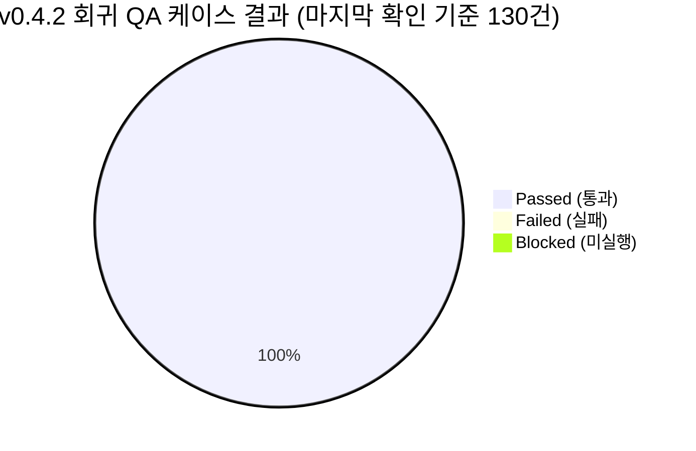

# [AgentLens] 통합 QA 테스트 결과 및 출시 검증 보고서 (QA Test Report)

- **Updated**: 2026-11-10
- **기준**: v0.4.2 (main)
- **검증일자**: 2026-11-10. 1차 회귀 14:27~14:50 KST(v0.4.2 수정 1·2차), 마지막 확인 14:57~15:07 KST(그 뒤 들어간 마지막 수정: spec-writer 지적 5건, D-54, frontend 문구·시간 제한 4건). v0.4.0 최초 QA·v0.4.1 회귀 QA(2026-11-09)의 세부 기록은 git 이력에 있다.
- **검증자**: 품질 보증 엔지니어 (`qa-engineer`)
- **테스트 실행 빌드**: commit `4944a5e`(v0.4.1) 위 작업 트리(v0.4.2 수정 전부, 커밋 전). backend 는 작업 트리 `backend/` 를 그대로 uvicorn 으로 띄웠고, frontend 는 작업 트리 `frontend/` 를 스크래치 폴더에 복사해(`diff -rq` 차이 없음, `node_modules` 제외) `next build` 한 프로덕션 빌드다. 마지막 확인 때 두 앱을 마지막 작업 트리로 다시 띄우고 다시 빌드했다. 앱 버전 `0.4.2` (`/health`, frontend `/api/health`).
- **최종 출시 승인 여부**: **RELEASE_APPROVED** (범위 안 Blocker 0, Critical 0, Minor 0. 1차 회귀에서 찾은 D-54 는 마지막 수정으로 해결. 범위 밖(수용된 위험) 5건은 판정에 세지 않는다)
- **기준 문서**: 계획 `docs/qa-engineer/01_QA_TEST_PLAN.md`, FSD `docs/spec-writer/fsd/01~07_*.md`, 계약 `docs/contract-integrator/01_CONTRACT_AND_MSW_SPEC.md` v1.4, 리뷰 `docs/backend-code-reviewer/01_CODE_REVIEW_REPORT.md`(v0.4.2 3차 APPROVED)·`docs/frontend-code-reviewer/01_CODE_REVIEW_REPORT.md`(v0.4.2 2차 APPROVED), 화면 측정 `docs/qa-engineer/ui-audit/report.json`

---

## 1. 테스트 실행 결과 요약 (Executive Summary)

- **총 실행 케이스 수**: 130건 = 스모크 16 + API 시나리오 86 + 수집 잠금 3 + UI 17 (1차 회귀 122건) + 마지막 수정 확인 8 (2.9절). 단위 테스트로만 확인한 항목은 이 수에 넣지 않았다
- **통과 (Pass)**: 130건 (100%). 1차 회귀의 122건은 마지막 작업 트리로 다시 돌려 같은 결과를 얻었다(스모크 16/16, API 시나리오, 수집 잠금 3건, UI 스크립트 3개)
- **실패 (Fail)**: 0건. 1차 회귀에서 실패한 `TC-RM-008`(지운 `POST /api/sources/github` 가 307 → 405, D-54)은 마지막 수정(`redirect_slashes=False`) 뒤 404 `ERR_NOT_FOUND` 로 통과
- **스모크 (`qa_runner.py`)**: 16 / 16 통과 (backend 13, frontend 3), 두 번 모두. v0.4.1 의 17개에서 지운 `GET /api/mcp/info` 하나가 빠졌다
- **API 시나리오 (`api_scen.py`)**: 86건. 마지막 실행에서 스크립트 판정 83 통과·3 실패이고, 3건은 기대값·스크립트 잘못으로 확인해 PASS 로 고쳤다(`TC-NEWS-025` 토큰 필드 이름 `text` 를 스크립트가 `token` 으로 읽음, `TC-BRF-007` 이모지는 수집한 기사 제목·요약 원문, `TC-CHAT-026` 은 OpenAPI 가 세션 상세의 형식 검증 없음·404 로 정함)
- **화면 규칙 (`ui-audit.mjs`)**: 마지막 빌드에서 사용자 DB 사본 그대로 조합 160, 통과 156, 실패 4(모두 `pictograph`, 사용자 DB 의 옛 세션 제목 `⚡ …`, 관찰 O-1), 건너뜀 0, 종료 1. 같은 사본에서 그 세션 2개만 API 로 지운 뒤 다시 돌리면 160 / 160 통과, 판정 21종 실패 0, 종료 0. 코드 결함은 없다 (1차 회귀도 같은 결과)
- **자동 테스트 (`make check`)**: 마지막 수정 뒤 실행 종료 0. backend `418 passed in 12.88s`, frontend `Test Files 70 passed (70)`, `Tests 833 passed (833)`, eslint 출력 없음, `tsc --noEmit` 출력 없음. (1차 회귀 실행: 410 / 823, 종료 0)
- **결함 확인**: v0.4.1 의 미해결 Minor 39건(D-05, D-06, D-16~D-31, D-33~D-53) **모두 해결**. 리뷰 새 지적(N-08~N-12, M003-01, ARCH-03R, CFG-02R, TEST-07·08, FE-36~FE-42)과 1차 회귀의 D-54 도 해결 확인
- **미해결 결함 (Open Defects)**: **Blocker 0건, Critical 0건, Minor 0건**
- **범위 밖(수용) 결함**: 5건 (D-01, D-02, D-03, D-04, D-08). 판정에 넣지 않는다 (3.8절)
- **관찰 (결함 아님)**: 6건 (3.9절). 사용자 DB 데이터 조건 3건과 동작 관찰 3건

### 1.1 실행 환경
| 항목 | 값 |
|---|---|
| backend | 로컬 `.venv` uvicorn `127.0.0.1:28000` (`cd backend`). DB 는 사용자 `backend/agentlens.db` 를 `sqlite3 .backup` 한 스크래치 사본(1차 `qa.db`: `PRAGMA user_version` 3, `integrity_check` ok, 기사 4,938건, 세션 29개. 마지막 확인은 새로 뜬 `qa2.db`: 기사 4,938건, 세션 30개). 환경 변수로 `ANTHROPIC_API_KEY=`·`OPENAI_API_KEY=`·`GEMINI_API_KEY=` 비움, `OLLAMA_BASE_URL=http://127.0.0.1:9`, `SLACK_WEBHOOK_URL=`·`DISCORD_WEBHOOK_URL=`·`NOTION_API_KEY=`·`SMTP_*=` 비움, `SCHEDULER_ENABLED=false`(시작 로그 `[Scheduler] scheduler.enabled=false, 스케줄러를 띄우지 않는다`), `PUBLIC_WEB_URL=http://localhost:23001`. 수집 잠금 파일은 사본 옆 `qa.db.crawl.lock` 이라 사용자 DB 잠금과 겹치지 않는다 |
| frontend | 스크래치 사본 `next build`(`INTERNAL_API_URL=http://127.0.0.1:28000`, `NEXT_PUBLIC_API_URL` 없음) → `next start -p 23001 -H 127.0.0.1`. 번들 `.next/static/chunks/*.js` 에 `:8000` 이 든 파일 0개 |
| 사용자 서버 | `make dev` 의 3000·8000 은 건드리지 않았다 (시작·끝 `lsof` 로 그대로 있음 확인). 3001·18000 도 쓰지 않았다 |
| 브라우저 | Playwright(Chromium headless shell 1248) 스크립트 `fe36.cjs`·`ui_scen.cjs`·`ui_scen2.cjs`, Playwright MCP 1440x900 스냅샷, `ui-audit.mjs` 는 로컬 Chrome 157.0.8103.39 |
| 실행하지 않은 동작 | 실제 수집(외부 스크래핑), Notion·메일·웹훅 발송, 실제 LLM 호출, 설정·소스 저장. 쓰기가 나갈 수 있는 화면 요청은 `page.route` 로 막았다. `trigger`·`reset-and-collect`·`make collect` 는 다른 프로세스가 사본의 수집 잠금을 쥔 동안에만 불러 `already_running` 경로만 탔다 (기사 수 4,938 → 4,938) |

---

## 2. 세부 테스트 케이스 검증 결과표 (Execution Details)

응답 속도는 스크립트가 잰 왕복 시간(ms)이다. `UI` 는 Playwright, `code` 는 코드로 확인했다는 뜻이다.

### 2.1 스모크 (`qa_runner.py --base-url http://localhost:28000 --frontend-url http://localhost:23001`)
| 케이스 ID | 테스트 항목 | 실행 결과 | 응답 속도 | 비고 |
| :--- | :--- | :---: | :---: | :--- |
| `TC-SMOKE-001` | backend GET 13개 (`/`, `/health`, 뉴스·없는 기사 404·RSS·통계·스케줄 상태·진행·소스·레이더·연동 설정·세션·리서치 상태) | **PASS 13/13** | 0~5ms | 없는 기사 `GET /api/news/999999999` 는 라우트가 지워져 404 `ERR_NOT_FOUND` |
| `TC-SMOKE-002` | frontend `/api/health`, `/`, `/chat` | **PASS 3/3** | 2~5ms | `/api/health` `version: 0.4.2` |

### 2.2 오류 형식·지운 엔드포인트
| 케이스 ID | 테스트 항목 | 실행 결과 | 응답 속도 | 발견 결함 / 비고 |
| :--- | :--- | :---: | :---: | :--- |
| `TC-NEWS-006` | `GET /api/news?page=0` | **PASS** | 5ms | 400 `{"error_code":"ERR_INVALID_PAYLOAD","message":"요청 형식이 올바르지 않습니다.","details":[{"loc":["query","page"],"msg":"Input should be greater than or equal to 1"}]}`. 422 없음 |
| `TC-NEWS-007` | `size=101` | **PASS** | 1ms | 400 `ERR_INVALID_PAYLOAD`, details `[{loc,msg}]` |
| `TC-NEWS-008` | `page=abc` | **PASS** | 1ms | 400, 입력값 `abc` echo 없음 |
| `TC-ERR-001` | 없는 경로 `GET /api/news/123456789` | **PASS** | 1ms | 404 `ERR_NOT_FOUND` `요청한 대상을 찾을 수 없습니다.` |
| `TC-ERR-002` | 허용 안 된 방식 `PUT /api/news` | **PASS** | 1ms | 405 `ERR_METHOD_NOT_ALLOWED` `허용되지 않는 요청 방식입니다.` |
| `TC-ERR-003` | `GET /api/does-not-exist` | **PASS** | 1ms | 404 `ERR_NOT_FOUND` |
| `TC-RM-001` | 지운 `GET /api/chat/search` | **PASS** | 1ms | 404 `ERR_NOT_FOUND` |
| `TC-RM-002` | 지운 `POST /api/chat/query` (`model_tier:"ultra"`) | **PASS** | 1ms | 404 (v0.4.1 의 500 D-49 경로 없음) |
| `TC-RM-003` | 지운 `GET /api/news/1` | **PASS** | 1ms | 404 |
| `TC-RM-004` | 지운 `POST /api/news/1/ask` | **PASS** | 1ms | 404 |
| `TC-RM-005` | 지운 `DELETE /api/news/all` | **PASS** | 1ms | 404 (사본 기사 수 그대로) |
| `TC-RM-006` | 지운 `POST /api/research/discover` | **PASS** | 1ms | 404 |
| `TC-RM-007` | 지운 `POST /api/research/register-candidate` | **PASS** | 1ms | 404 |
| `TC-RM-008` | 지운 `POST /api/sources/github` | **PASS** (마지막 확인) | 1ms | 마지막 확인: 404 `ERR_NOT_FOUND`, 리다이렉트 없음. 1차 회귀는 FAIL 이었다: 307 `location: /api/sources/github/` (본문 없음) → 따라가면 405. **D-54 해결** |
| `TC-RM-012` | 끝 슬래시 경로 (마지막 확인) | **PASS** | 1ms | `POST /api/sources/github/` 405, `PATCH /api/sources/github/` 405, `GET /api/news/`·`/api/sources/`·`/api/chat/sessions/` 404, `DELETE /api/sources/github` 404. 모두 `{error_code,message,details}`, 307 없음. 화면 흐름(피드·챗·대화상자)은 끝 슬래시를 쓰지 않아 UI 재실행에서 모두 정상 |
| `TC-RM-009` | 지운 `GET /api/mcp/info` | **PASS** | 0ms | 404 |
| `TC-RM-010` | 지운 `POST /api/briefing/generate` | **PASS** | 0ms | 404 |
| `TC-RM-011` | 지운 `POST /api/webhook/send-briefing` | **PASS** | 0ms | 404 |
| `TC-API-001` | 런타임 OpenAPI | **PASS** | 1ms | `/openapi.json` 에 `"422"` 없음, `ErrorResponse` 있음, `HTTPValidationError` 없음. 라우트 33개에 지운 11개 없음 (앱 라우트 목록으로도 확인) |

### 2.3 NEWS
| 케이스 ID | 테스트 항목 | 실행 결과 | 응답 속도 | 발견 결함 / 비고 |
| :--- | :--- | :---: | :---: | :--- |
| `TC-NEWS-001` | 목록 기본 | **PASS** | 3ms | 200 `total: 4938` |
| `TC-NEWS-003` | Must-Read | **PASS** | 2ms | 200 `total: 3849` |
| `TC-NEWS-004` | 검색 `MCP` | **PASS** | 7ms | 200 `total: 1345` |
| `TC-NEWS-005` | 정렬 `hot`·`latest`·`score`·`hotness` | **PASS** | 1ms | 200 ×4 |
| `TC-NEWS-009` | `page=9999` | **PASS** | 8ms | 200 `items: []` |
| `TC-NEWS-010` | 없는 카테고리 | **PASS** | 2ms | 200 `total: 0` |
| `TC-TIME-001` | 목록 시각 오프셋 | **PASS** | 3ms | `size=100` 응답의 ISO 시각 200개 모두 `Z`·`+00:00` 오프셋 |
| `TC-TIME-002` | 최신순 100건 미래 시각 | **PASS** | 2ms | `published_at` 이 지금보다 뒤인 행 0 (사본 DB 전체도 `published_at > now` 0행, N-11) |
| `TC-TIME-003` | 다른 응답의 시각 오프셋 | **PASS** | 1~6ms | 세션 목록 54개(사본 원본 60개)·세션 상세 4개·출처 상세 2개·스케줄 상태 13개·감사 일지 200개·브리핑·통계·레이더·소스 각 1~5개, 오프셋 없는 시각 0 (N-09) |
| `TC-NEWS-014` | RSS | **PASS** | 7ms | XML 파싱 성공, 채널 `<link>http://localhost:23001</link>`(= `PUBLIC_WEB_URL`), 항목 50개 |
| `TC-NEWS-014b` | RSS 카테고리 5종(`a&b<c>` 포함) | **PASS** | 1~6ms | 200 ×5, 모두 XML 유효 |
| `TC-NEWS-029` | RSS `pubDate` 미래 시각 | **PASS** | - | 0건 |
| `TC-NEWS-016` | 통계·트렌드 레이더 | **PASS** | 2~5ms | 200, 레이더 `total_analyzed: 500`, 급상승 태그 6개 (화면 `급상승` 줄 표시) |
| `TC-NEWS-015` | 없는 기사 Ask AI | **PASS** | 1ms | 404 `ERR_NOT_FOUND` `기사를 찾을 수 없습니다.` |
| `TC-NEWS-017` | LLM 없음 Ask AI 스트림 | **PASS** | 387ms | 200 `text/event-stream; charset=utf-8`, `Cache-Control: no-cache, no-transform`, 이벤트 `meta`(`AgentLens Heuristic Engine`) → `token`… → `done` |
| `TC-NEWS-025` | 휴리스틱 답 이모지 | **PASS** | 387ms | 기사 4개(id 1, 1361, 1143, 37) 답 335~538자, 그림 이모지 0, 머리 `### 기술 맥락 및 실무 분석` (D-36). 스크립트가 처음에 토큰 필드를 `token` 으로 읽어 0자로 FAIL 을 냈고 `text` 로 다시 셌다 |
| `TC-NEWS-026` | Ask AI 빈 질문 | **PASS** | 1ms | 400 `ERR_INVALID_PAYLOAD` details `[{loc:["body","question"],…}]` |
| `TC-NEWS-027` | Ask AI 2001자 | **PASS** | 1ms | 400 `ERR_INVALID_PAYLOAD` |
| `TC-NEWS-028` | Ask AI 공백만 질문 | **PASS** (관찰) | 391ms | 200 휴리스틱 답. FSD BR-NEWS-010-1 이 "공백만 있는 질문은 막지 않는다" 로 정한 동작이다. 화면은 trim 후 비면 보내지 않는다 |
| `TC-NEWS-022` | 기사 상세 키보드 | **PASS** | - | UI 1024x768: 카드 제목에서 Enter → 포커스가 대화상자 안, Tab 12번 뒤에도 안, `:focus-visible` `solid 2px`, Escape → 닫히고 포커스가 카드 제목으로 |
| `TC-NEWS-024` | 기사 Ask AI 연결 주소 | **PASS** | - | 번들에 `:8000` 없음, Ask AI 가 같은 출처(23001 → rewrite → 28000)로 가서 답을 받음 (D-41) |
| `TC-NEWS-030` | Ask AI 실제 backend 와 배지 (1440·390) | **PASS** | - | 질문 전 배지 `실시간 스트리밍` → 답 뒤 `응답 엔진: AgentLens Heuristic Engine`, 답 `기술 맥락 및 실무 분석`. 390 문서 가로 스크롤 없음(`scrollWidth` 390) (D-25) |
| `TC-NEWS-031` | Ask AI 끊김 (1440·390) | **PASS** | - | 스트림을 흉내 내 ① 토큰 뒤 `error` 이벤트(`ERR_LLM_STREAM_FAILED`) ② `done` 없이 연결 끝. 둘 다 부분 답 `부분 답 첫 문장입니다.` 가 남고 알림 `답변 생성이 중간에 끊겼습니다. 다시 시도해 주세요.` + `답변 다시 시도`, 끊긴 답의 `복사` 는 `disabled`. `답변 다시 시도` → 실제 backend 답으로 바뀜 (D-47, FE-33) |

### 2.4 CHAT
| 케이스 ID | 테스트 항목 | 실행 결과 | 응답 속도 | 발견 결함 / 비고 |
| :--- | :--- | :---: | :---: | :--- |
| `TC-CHAT-001` | 빈 질문 | **PASS** | 1ms | 400 `ERR_CHAT_PAYLOAD_EMPTY` |
| `TC-CHAT-002` | 2001자 | **PASS** | 0ms | 400 `ERR_CHAT_PAYLOAD_TOO_LARGE` |
| `TC-CHAT-003` | 잘못된 scope | **PASS** | 0ms | 400 `ERR_INVALID_SCOPE_PARAM` |
| `TC-CHAT-004` | scoped 없는 기사 | **PASS** | 2ms | 404 `ERR_HANDOVER_SOURCE_NOT_FOUND` |
| `TC-CHAT-005` | scoped source_id 없음 | **PASS** | 1ms | 404 `ERR_HANDOVER_SOURCE_NOT_FOUND` |
| `TC-CHAT-006` | JSON 아닌 본문 | **PASS** | 1ms | 400 `ERR_INVALID_PAYLOAD` |
| `TC-CHAT-007` | `model_tier:"ultra"` | **PASS** | 0ms | 400 `ERR_INVALID_MODEL_TIER` |
| `TC-CHAT-013` | LLM 없음 스트림 | **PASS** | 22ms | 503 `ERR_LLM_PROVIDER_UNAVAILABLE` `가용한 LLM 프로바이더 엔진 미설정 (API 키 미등록)` |
| `TC-CHAT-020` | 배열 본문 | **PASS** | 0ms | 400 `ERR_INVALID_PAYLOAD` `요청 본문은 JSON 객체여야 합니다.` |
| `TC-CHAT-022` | 스트림 `session_id` UUID 아님 (`not-a-uuid-<script>`) | **PASS** | 1ms | 400 `ERR_SESSION_INVALID_UUID` `유효하지 않은 세션 UUID 형식입니다.`, 입력값 echo 없음 |
| `TC-CHAT-023` | 37자 `user_message_id` | **PASS** | 0ms | 400 `ERR_INVALID_PAYLOAD` |
| `TC-CHAT-024` | `session_id: null` | **PASS** | 1ms | 검증 통과 → 503 (LLM 없음). null 은 서버가 만든다 |
| `TC-CHAT-009` | 세션 목록 | **PASS** | 2ms | 200, 30개, 시각 오프셋 모두 있음 |
| `TC-CHAT-025` | `limit=0` | **PASS** | 1ms | 400 `ERR_INVALID_PAYLOAD` |
| `TC-CHAT-026` | 세션 상세 `not-uuid` | **PASS** | 1ms | 404 `ERR_SESSION_NOT_FOUND`. OpenAPI 가 "session_id 형식 검증 없음" 으로 정한 동작 (스크립트 기대값 400 이 틀렸다). 메시지에 경로 값이 들어간다(관찰 O-6) |
| `TC-CHAT-010` | 없는 세션 | **PASS** | 1ms | 404 `ERR_SESSION_NOT_FOUND` |
| `TC-CHAT-011` | 출처 상세·없는 출처 | **PASS** | 1ms | 200(시각 오프셋), 404 `ERR_HANDOVER_SOURCE_NOT_FOUND` |
| `TC-CHAT-027` | 세션 POST 저장·상세 | **PASS** | 6ms | 201, `created_at` 없는 메시지 2개 → `2026-11-10T00:00:00+00:00` 처럼 오프셋, assistant `model_tier: haiku`·`usage {input_tokens:10, output_tokens:20,…}` 저장·반환 (CT-004) |
| `TC-CHAT-028` | 세션 상세 오프셋 | **PASS** | 1ms | 시각 4개 모두 오프셋 |
| `TC-CHAT-029` | 다른 세션의 메시지 id | **PASS** | 1ms | 400 `ERR_INVALID_PAYLOAD` `다른 대화에서 이미 쓰는 메시지 id 입니다: qa-u-…`, `details.message_ids: ["qa-u-…"]` (D-52) |
| `TC-CHAT-029b` | 400 뒤 부분 변경 없음 | **PASS** | 0ms | 거절된 두 번째 세션 `GET` → 404 (ARCH-03R) |
| `TC-CHAT-030` | 세션 POST 깨진 JSON | **PASS** | 0ms | 400 `ERR_INVALID_PAYLOAD` |
| `TC-CHAT-031` | 세션 POST `id` UUID 아님 | **PASS** | 0ms | 400 `ERR_SESSION_INVALID_UUID` |
| `TC-CHAT-032` | 임시 세션 삭제 | **PASS** | 1ms | DELETE 200, 다시 GET 404 |
| `TC-CHAT-033` | 모바일 챗 긴 답 스크롤 (FE-36) | **PASS** | - | 4개 폭(375x667·390x844·360x780 모바일, 1280x800)에서 90문단 스트림(흉내). 입력창 top 이 9개 시점 내내 557 / 734 / 644 / 705 그대로, `document.scrollingElement.scrollTop` 0, 목록 밖 조상 상자 스크롤 0곳. 스트리밍 중 목록을 위로 올리면 머묾(맨 아래와 거리 3948 / 3718 / 3861 / 2022), 맨 아래로 내리면 다시 따라감(0), 새 질문은 맨 아래로. 완료 sr-only `답변이 완료되었습니다.`, `aria-busy` true → false, 콘솔 경고·오류 0 |
| `TC-CHAT-034` | 인용 팝오버 키보드 (FE-37) | **PASS** | - | 같은 4개 폭: 배지 Enter → 팝오버(부모 `body`, `position: fixed`, 화면 안) 안 `팝오버 닫기` 에 포커스 → Tab → `원문 보기` → Escape → 닫히고 배지 `출처 1번: 테스트 출처 기사` 로 복귀. 닫기 버튼 모바일 44x44, 데스크톱 32x32 |
| `TC-CHAT-035` | 가상 키보드 흉내 | **PASS** | - | 390x844 에서 스트림 중 뷰포트를 390x500 으로 줄이고 입력창에 포커스: 입력창 top 390·bottom 436(화면 안), 문서 스크롤 0, 목록 맨 아래 따라감 |
| `TC-CHAT-036` | 실제 backend LLM 없음 화면 | **PASS** | - | 390x844 `/chat` 질문 → 요청 `POST /api/chat/stream` 1번, 답 자리에 `가용한 LLM 프로바이더 엔진 미설정 (API 키 미등록)` + `다시 시도`, 입력창 제자리(734~780) |
| `TC-CHAT-016` | 없는 기사로 이관 | **PASS** | - | `/chat?sourceId=999999999` → `요청하신 기사를 찾을 수 없어 전체 소식 모드로 시작합니다.` |
| `TC-CHAT-037` | 이관 기사 조회 실패·성공 (FE-41) | **PASS** | - | 출처 조회 500 흉내 → `기사 정보를 불러오지 못해 전체 소식 모드로 시작합니다. 연결 상태를 확인해 주세요.`. 실제 조회 → 알림 없음, `단일 기사` 칩에 기사 제목 |

### 2.5 COLL
| 케이스 ID | 테스트 항목 | 실행 결과 | 응답 속도 | 발견 결함 / 비고 |
| :--- | :--- | :---: | :---: | :--- |
| `TC-COLL-001` | 스케줄 상태 | **PASS** | 2ms | `schedule_hours [0,6,12,18]`, `timezone UTC`, `last_crawl_time 2026-11-10T05:07:35.230128+00:00` |
| `TC-COLL-002` | 진행률 | **PASS** | 1ms | `step_message: 대기 중`, 이모지 없음 |
| `TC-COLL-007` | `recent_logs[].status` | **PASS** | 0ms | 5개 모두 `success` (enum 안) |
| `TC-COLL-003` | 다른 프로세스 수집 중 `trigger` | **PASS** | 1ms | 별도 python 프로세스가 `qa.db.crawl.lock` 을 `flock(LOCK_EX\|LOCK_NB)` 로 쥐고(쥔 것을 따로 확인) 호출 → 200 `{"status":"already_running","message":"다른 프로세스(MCP 서버·make collect)가 같은 DB 에 수집 중입니다.","other_process":true,…}`. 수집 시작 안 함 (D-40, N-12) |
| `TC-COLL-008` | 다른 프로세스 수집 중 `reset-and-collect` | **PASS** | 1ms | 200 `{"status":"already_running","message":"현재 수집이 진행 중이므로 초기화할 수 없습니다. 잠시 후 다시 시도해주세요.","deleted_count":0}`. 기사 수 4,938 그대로, 진행 상태 `대기 중` 그대로 |
| `TC-COLL-009` | 다른 프로세스 수집 중 `make collect` | **PASS** | - | `AGENTLENS_API_URL=http://localhost:28000 COLLECT_MODE=api make collect` → stderr `다른 프로세스(MCP 서버·make collect)가 같은 DB 에 수집 중입니다. 그 수집이 끝난 뒤 다시 실행한다`, 스크립트 종료 1(make 2), 기다리지 않음 (N-12) |
| `TC-COLL-010` | 스케줄 대화상자 오류·다시 시도 (FE-39) | **PASS** | - | 1440: `/api/schedule/status` 503 흉내 → `스케줄 정보를 불러오지 못했습니다. 백엔드 서버 연결 상태를 확인해주세요.` + `다시 시도` → 실제 응답으로 `수집 주기 (UTC) 00:00 · 06:00 · 12:00 · 18:00 (KST: 09:00, 15:00, 21:00, 03:00)`, Escape 로 닫히고 포커스가 헤더 `수집 스케줄` 버튼으로 |
| `TC-COLL-011` | 스케줄 수집 시각 없음 | **PASS** | - | `schedule_hours: []` 흉내 → `정해진 수집 시각이 없습니다` |
| `TC-COLL-006` | 헤더 수집 상태 | **PASS** | - | `수집 스케줄 · 다음 수집 24m 후`, `즉시 수집` 있음 (누르지 않음). 스케줄러를 끈 backend 에서도 다음 시각을 보인다(관찰 O-5) |

### 2.6 BRF
| 케이스 ID | 테스트 항목 | 실행 결과 | 응답 속도 | 발견 결함 / 비고 |
| :--- | :--- | :---: | :---: | :--- |
| `TC-BRF-001` | 오늘 브리핑 | **PASS** | 5ms | 200, 키 `title`·`date`·`headline`·`overview`·`categories`·`action_items`·`markdown_report`·`featured_items_count`·`generated_at` |
| `TC-BRF-007` | 브리핑 문자열 이모지 | **PASS** | 5ms | backend 고정 문자열(제목 `# 오늘의 AI 브리핑`, `## 오늘의 핵심 테이크어웨이 (Overview)`, 분야 이름·요약 문장)에 이모지 0. 응답에 보이는 `🎨`·`🖥`·`🖼`·`🔥`·`🤖` 는 모두 수집한 GitHub 저장소 설명 원문(`nexu-io/open-design: 🎨 Best DeepSeek Harness…`, `firecrawl/firecrawl … superintelligence. 🔥`)이다. backend·Notion·메일·웹훅 서비스 파일에 그림 이모지 0 (`chat_service.py:225` 의 `🚨` 는 LLM 프롬프트 안이라 화면에 나오지 않음) (D-34) |
| `TC-BRF-008` | 분야 이름·아이콘 | **PASS** | 0ms | `하네스 & 벤치마크`, `MCP & 생태계`, `에이전트 아키텍처`, `최신 AI 동향`, `icon` = `harness`·`mcp_plugins_skills`·`agent_tech`·`ai_news` |
| `TC-BRF-009` | 헤드라인·요약 자르기 | **PASS** | - | 헤드라인 `affaan-m/ECC: The agent harness… 및 분야별 핵심 에이전트 기술 동향`, 분야 요약 `'upstash/context7: Context7 Platform --…'` — 공백 경계에서 자르고 `…` (D-21) |
| `TC-BRF-002` | 연동 설정 조회 | **PASS** | 1ms | `webhooks` 키 `slack_webhook_url`·`discord_webhook_url`·`auto_dispatch_daily_briefing`, `auto_alert_high_signal` 없음 |
| `TC-BRF-003` | 웹훅 테스트 잘못된 URL | **PASS** | 1ms | 400 `ERR_INVALID_PAYLOAD` `유효한 HTTP/HTTPS 웹훅 URL을 입력해주세요.` (외부 전송 없음) |
| `TC-BRF-004` | Notion 발행 잘못된 본문 | **PASS** | 1ms | 400 `ERR_INVALID_PAYLOAD` details `[{loc:["body","page_id"],…}]` (발행 없음) |

### 2.7 SRC
| 케이스 ID | 테스트 항목 | 실행 결과 | 응답 속도 | 발견 결함 / 비고 |
| :--- | :--- | :---: | :---: | :--- |
| `TC-SRC-001` | 소스 목록 | **PASS** | 2ms | `sources_file: "sources.json"` (경로 없음, D-05) |
| `TC-SRC-007`~`011` | RSS 추가 검증 위반 5종 (`ftp://` url, 빈 이름, 201자 이름, `category_hint: bogus`, `country: JP`) | **PASS** | 1ms | 모두 400 `ERR_INVALID_PAYLOAD`, details 에 해당 `loc`, 201자 입력 echo 없음. `sources.json` 두 벌·`config.json` md5 그대로 |
| `TC-SRC-012` | `PATCH /api/sources/github/owner/repo/toggle` | **PASS** | 1ms | 404 `해당 소스를 찾을 수 없습니다.` (D-53. 유형 토글은 `item_id=all` 만) |
| `TC-SRC-013` | `PATCH /api/sources/reddit/xyz/toggle` | **PASS** | 1ms | 404 |
| `TC-SRC-004` | 없는 유형 토글 | **PASS** | 1ms | 404 |
| `TC-SRC-002` | 딥 리서치 상태 | **PASS** | 1ms | 200, 설명 이모지 없음 |
| `TC-SRC-014` | 감사 일지 200개 | **PASS** | 6ms | 시각 200개 모두 오프셋 |
| `TC-SRC-015`~`018` | `audit-logs limit` 0·201, `run-deep max_candidates` 0·21 | **PASS** | 1ms | 모두 400 `ERR_INVALID_PAYLOAD` (실행 안 함) |
| `TC-SRC-019` | 소스 대화상자 오류 (FE-30) | **PASS** | - | `/api/sources` 500 흉내 → `소스 정보를 불러오지 못했습니다. 백엔드 서버 연결 상태를 확인해주세요.` + `다시 시도` |
| `TC-SRC-020` | 소스 대화상자 받기 전·빈 목록·실행 기록 없음 | **PASS** | - | 응답을 붙잡은 동안 `불러오는 중...`(없다고 말하지 않음) → 빈 목록 흉내 `등록된 RSS 피드가 없습니다.`·`모니터링 중인 GitHub 저장소가 없습니다.`, 딥 리서처 탭 `최근 리서치 일시 실행 기록 없음`, 문구 `키워드 규칙 기반 적합도 점수가 기준을 넘는 피드를…` (D-25) |

### 2.8 UI 공통
| 케이스 ID | 테스트 항목 | 실행 결과 | 응답 속도 | 발견 결함 / 비고 |
| :--- | :--- | :---: | :---: | :--- |
| `TC-UI-003` | 없는 경로 | **PASS** | 4ms | `GET http://localhost:23001/no-such-page` → 404 |
| `TC-UI-006` | 폭·테마별 화면 규칙 21종 | **PASS** (데이터 조건 관찰) | - | 사용자 DB 사본 그대로: 160조합 중 156 통과, 실패 4(`chat-{light,dark}-{1024x768,1440x900}` 의 `pictograph`, 사이드바 세션 제목 `⚡ 최근 24시간 내 가장 주목받은 에이전트 오픈소스 ...`, 10월 19일 대화). 그 세션 2개만 사본에서 지운 뒤: 160 / 160 통과, 21종 실패 0, 종료 0. `report.json` 은 사용자 데이터 그대로의 실행이다 |
| `TC-UI-008` | 깨진 저장값 (D-45) | **PASS** | - | `agentlens_bookmarks` = `{"x":1}`, `agentlens_chat_sessions_index` = `"str"` 로 열어도 피드 카드 18장, `/chat` 입력창 그림, 오류 경계 `화면을 그리지 못했습니다` 없음, 콘솔 오류 0 |
| `TC-UI-007` | 키보드 포커스 표시 | **PASS** | - | `TC-NEWS-022` 와 같은 실행 |

### 2.9 마지막 수정 확인 (14:57~15:07, 마지막 작업 트리)
조건은 1차와 같다(28000·23001, DB 새 사본 `qa2.db`, LLM 키 빈 값, 스케줄러 끔, 외부 발송·수집 없음). 1차 회귀 케이스 전부(스모크, `api_scen.py`, 수집 잠금, `fe36.cjs`·`ui_scen.cjs`·`ui_scen2.cjs`)를 다시 돌려 같은 결과를 얻었고(FE-36 입력창 top 557 / 734 / 705 / 644 고정, 문서 스크롤 0, FE-37 팝오버 흐름 같음, 콘솔 오류 0), 아래 케이스를 더했다.

| 케이스 ID | 테스트 항목 | 실행 결과 | 응답 속도 | 발견 결함 / 비고 |
| :--- | :--- | :---: | :---: | :--- |
| `TC-COLL-012` | `make collect` 직접 모드 경고·잠금 실패 | **PASS** | - | 다른 프로세스가 `qa2.db.crawl.lock` 을 쥔 동안 `DATABASE_URL=<사본> AGENTLENS_API_URL=http://localhost:28000 COLLECT_MODE=direct make collect` → `직접 모드: …/qa2.db`, `경고: http://localhost:28000 에 backend 가 떠 있다. 같은 DB 라면 수집 잠금으로 한 번에 하나만 수집한다. …`, `수집 실패: status=already_running 다른 프로세스가 같은 DB 에 수집 중입니다.`, 스크립트 종료 1(make 2). 기사 수 4,938 그대로. 단위 `test_direct_mode_with_backend_up_reports_lock` |
| `TC-SRC-021` | `inspect-url` 예외 원문 숨김 | **PASS** | 14ms | 닫힌 루프백 포트 `http://127.0.0.1:9/feed`·`/feed.xml` → 200 `{"status":"error","message":"URL 에 접속하지 못했습니다. 주소와 네트워크를 확인해주세요.","input_url":…}`. 예외 문자열(`ConnectError` 등) 없음 (외부 호스트로는 보내지 않음). 단위 `test_inspect_url_hides_connection_exception_text` |
| `TC-CHAT-038` | 챗 포커스 필터 라벨 (390·1440) | **PASS** | - | `신호 품질 필터` 의 토글 라벨 `Must-Read 고신호만`, `7.8` 글자 없음 |
| `TC-SRC-022` | 감사 일지 라벨 | **PASS** | - | 실제 감사 일지 30건에 `판정 사유:` 30번, `AI 판정 사유` 0번 |
| `TC-NEWS-032` | Ask AI 연결 실패 | **PASS** | - | `page.route` 로 연결 거부 → 알림 `서버에 연결하지 못했습니다. 연결 상태를 확인하고 다시 시도해 주세요.` + `다시 시도` |
| `TC-NEWS-033` | Ask AI 첫 응답 30초 시간 제한 | **PASS** | 30s | 응답을 붙잡아 두자 30초 뒤 `응답이 늦어 요청을 멈췄습니다. 다시 시도해 주세요.` + `다시 시도` (연결 실패 문구와 다름) |
| `TC-CHAT-039` | 챗 연결 실패 | **PASS** | - | 390 `/api/chat/stream` 연결 거부 → 답 자리 `서버에 연결하지 못했습니다. 연결 상태를 확인하고 다시 시도해 주세요.` + `다시 시도` |
| `TC-RM-008`·`012` | D-54 | **PASS** | 1ms | 2.2절 |

- 실행 밖(단위·코드)으로 확인한 마지막 수정: 웹훅 테스트 문구(이모지·`⭐️ Must Read` 제거, 실제 동작 `auto_dispatch_daily_briefing` 안내, 예외 원문 대신 고정 문장 — `backend/app/services/webhook_service.py`, 단위 `test_webhook_test_messages_describe_only_daily_briefing`. 유효 URL 로 보내지 않았다), `category_hint` 를 분류 실패 항목의 기본 카테고리로(`backend/app/collectors/manager.py:163-165`, `collectors/sources/rss.py:80`, 단위 `test_feed_category_hint_is_default_when_classifier_cannot_decide`, `test_rss_items_carry_feed_category_hint`), 딥 리서치 채택 저장 실패 시 WATCHLIST + `last_run_summary.adopt_failed`(`backend/app/services/deep_researcher.py:439`, `:481-483`, `:515`, 단위 `test_deep_research_adoption_write_failure_is_audited`), 지운 경로 리다이렉트 없음(단위 `test_deleted_endpoints_answer_404_or_405_without_redirect`), FE-43 화면 테스트(`make check` 의 frontend 833개에 포함).

---

## 3. 발견된 결함 및 조치 내역 (Defect Tracking)

- **심각도 분류** (기준은 계획 3절 7):
  - `Blocker`: 0건
  - `Critical`: 0건
  - `Minor`: 0건 미해결. v0.4.1 의 미해결 39건과 1차 회귀에서 새로 찾은 D-54 는 모두 해결
  - 범위 밖(수용): 5건 (D-01, D-02, D-03, D-04, D-08). 판정에 넣지 않는다 (3.8절, 계획 1.4)
- 조치: QA 는 제품 코드를 고치지 않는다. 해결 확인 방법은 `실행`(이번 회귀에서 앱으로 확인), `UI`(Playwright), `단위`(`make check` 안의 테스트 이름), `코드`(`path:line`) 중 하나 이상이다.
- D-07, D-09~D-15, D-32 는 v0.4.1 에서 해결됐고 이번에도 다시 깨지지 않았다(D-09·D-10 `TC-SRC-015`~`018` 주변 코드, D-15 `TC-SRC-012`, D-32 `TC-CHAT-007`).

### 3.1 보안
| ID | 심각도 | 결함 | 상태 | 확인 |
| :--- | :---: | :--- | :---: | :--- |
| D-05 | Minor | 예외 문자열·서버 절대 경로가 응답에 나간다 | **해결** | 실행: 검증 오류는 모두 `{error_code,message,details}` 400(`TC-NEWS-006`~`008`, `TC-SRC-007`~`011`), `/api/chat/query` 지움(`TC-RM-002`), `sources_file: "sources.json"`(`TC-SRC-001`). 코드: 처리 못 한 예외는 고정 문장 500 (`backend/app/api/errors.py` `_unhandled_exception_handler`), 라우터의 `str(e)` 는 앱이 정한 예외 문장뿐(`backend/app/api/chat.py:121-123` LLM 가용성 예외, `:181`·`:184`·`:202`·`:218` 세션 예외) |
| D-06 | Minor | 이메일 HTML 을 이스케이프하지 않는다 | **해결** | 코드: `backend/app/services/email_service.py:2` `from html import escape`, `:12-15` `_safe_href`(http/https 만), `:27-37` 날짜·헤드라인·개요·분야 이스케이프 |

### 3.2 데이터·동작 오류
| ID | 심각도 | 결함 | 상태 | 확인 |
| :--- | :---: | :--- | :---: | :--- |
| D-16 | Minor | `last_usage` 를 요청끼리 공유 | **해결** | 코드: `grep -rn last_usage backend/app` 0건 |
| D-17 | Minor | 평가 캐시 만료 없음, 초기화 뒤에도 남음 | **해결** | 코드: `backend/app/services/llm_processor.py:93` `TTLCache`, `:172-174` 질문 1000/6h·평가 5000/24h·Ollama 30s, `:177` `clear_caches`, `backend/app/api/schedule.py` reset 이 `llm_processor.clear_caches()` |
| D-18 | Minor | 크롤 로그가 항상 `success` | **해결** | 코드: `backend/app/collectors/manager.py:296-310` `partial_failure`·소스별 JSON `error_message`. 실행: `recent_logs[].status` enum 안 (`TC-COLL-007`). 사본의 기존 로그 118행은 옛 수집이라 모두 `success` |
| D-19 | Minor | 시사점이 없으면 카테고리 고정 문장 저장 | **해결** | 코드: `backend/app/services/llm_processor.py:810-816` LLM 시사점이 10자 넘을 때만, 아니면 빈 값. `CATEGORY_INSIGHTS` 는 휴리스틱 질문 답(`:830`)에만 쓰인다. 기존 행은 `make reset` 전까지 남는다(FSD BR-NEWS-008-3) |
| D-20 | Minor | 합성 `raw_score`, 인기 점수 포화 | **해결** | 코드: `backend/app/collectors/sources/huggingface.py:33` 실제 upvotes, `stars_hint`·합성 포크 없음(grep 0), `backend/app/services/categorizer.py:150` `min(100, 20·log10(1+hotness))`. 실행(사본 DB, m003 적용 뒤): 인기 점수 100 은 3행, `rss`·`rss_kr` `raw_score` 0 |
| D-21 | Minor | 브리핑 글자 수 자르기가 단어 중간에서 끊음 | **해결** | 실행 `TC-BRF-009`. 코드 `backend/app/services/briefing_service.py:47-58` `clip_words` |

### 3.3 설정과 코드 불일치
| ID | 심각도 | 결함 | 상태 | 확인 |
| :--- | :---: | :--- | :---: | :--- |
| D-22 | Minor | 스케줄 시각이 코드에 고정 | **해결** | 코드: `backend/app/scheduler.py:50-66` 수집 `CronTrigger(hour=settings.CRAWL_SCHEDULE_HOURS, minute="0", timezone=tz)`, 브리핑 `BRIEFING_AUTO_DISPATCH_HOUR` 시 15분, 딥 리서치 UTC 3·15. 실행: `SCHEDULER_ENABLED=false` 로 띄우자 스케줄러를 띄우지 않음(시작 로그) |
| D-23 | Minor | 읽는 코드가 없는 설정 | **해결** | 코드: `CORS_ORIGINS`·`USER_AGENT`·`LLM_PROVIDER`·`ANTHROPIC_COLLECTION_MODEL`·`CHAT_HISTORY_MAX_*`·`AGENTIC_SEARCH_*`·`auto_briefing_hour`·`auto_alert_high_signal`·`crawler.*` 가 `backend/app` 에 0건. 남긴 설정은 사용처 있음: `SCHEDULER_ENABLED`(`scheduler.py:73`), `SCRAPER_TIMEOUT_SECONDS`(`services/scraper.py:116`), `CHAT_SESSION_MAX_LIMIT`(`services/chat_session_service.py:302`), `auto_dispatch_daily_briefing`(`services/briefing_service.py:266-267`), `category_hint`(분류 실패 항목의 기본 카테고리, `collectors/manager.py:163-165`, 마지막 수정) |
| D-24 | Minor | 하이시그널 임계값 7.8 / 7.0 | **해결** | 코드: `backend/app/config.py` `HIGH_SIGNAL_THRESHOLD` 기본 7.0, `grep 7\.8 backend/app` 0건 |
| D-25 | Minor | 화면 문구와 실제 동작이 다름 | **해결** | UI: Ask AI 배지 `실시간 스트리밍`/`응답 엔진: …`(`TC-NEWS-030`), 딥 리서치 `키워드 규칙 기반 적합도 점수…`(`TC-SRC-020`). 코드: `frontend/src/components/NewsDetailModal.tsx:338` `핵심 정리 (규칙 기반 자동 추출)`. `Gemini 실시간`·`LLM 기술 적합도`·`핵심 요약 3줄` 0건 |
| D-26 | Minor | RSS 채널 링크 3000 고정 | **해결** | 실행 `TC-NEWS-014` (`PUBLIC_WEB_URL`) |

### 3.4 계약 (backend ↔ zod ↔ MSW)
| ID | 심각도 | 결함 | 상태 | 확인 |
| :--- | :---: | :--- | :---: | :--- |
| D-27 | Minor | 오류 형식 4가지 혼재 | **해결** | 실행 2.2절 전체, `TC-API-001` |
| D-28 | Minor | MSW 에만 있는 `GET /api/chat/stream`·단계·`[S1]` | **해결** | 코드·단위: `ContractAndMsw.test.ts` 'never emits MSW-only steps, supplementary sources or [S1] citations', `frontend/src/types/chat.ts:260` 4단계 |
| D-29 | Minor | global `sources` 순서가 backend 와 MSW 에서 다름 | **해결** | 코드: `frontend/src/mocks/handlers/chat.ts:439` global 은 `token*` → `sources` → `done`, `:492` 인용된 출처만 |
| D-30 | Minor | zod 에 없는·backend 가 안 보내는 필드 | **해결** | 코드: `frontend/src/types/chat.ts:399-400` 출처 상세에 `full_content`·`scraped_at`, `frontend/src/types/news.ts` 에서 두 필드 제거 |
| D-31 | Minor | backend 오류 코드가 zod 에 없음 | **해결** | 코드: `frontend/src/types/chat.ts:35` `ERR_INVALID_PAYLOAD`, `:48` `ERR_CLAUDE_API_KEY_MISSING`(401), `:59` `ERR_RETRIEVER_INDEX_ERROR` |
| D-33 | Minor | 런타임 zod 검증 없음 | **해결** | 코드: `frontend/src/lib/contract.ts:20-44` `safeParse`·`readJson`(실패 시 dev 경고 후 원본 사용). UI 실행 중 계약 경고 0 |

### 3.5 UI·접근성
| ID | 심각도 | 결함 | 상태 | 확인 |
| :--- | :---: | :--- | :---: | :--- |
| D-34 | Minor | backend 분야 이름·이모지가 프론트와 다름 | **해결** | 실행 `TC-BRF-007`, `TC-BRF-008` |
| D-35 | Minor | 챗 진행 단계 라벨 이모지 | **해결** | 코드: `backend/app/services/chat_service.py:479`, `:500`, `:543`, `:563`, `:590`, `:609` 라벨에 그림 이모지 없음 (파일 안 이모지는 프롬프트 `:225` 하나) |
| D-36 | Minor | 휴리스틱 답 머리 `🤖` | **해결** | 실행 `TC-NEWS-025` |

### 3.6 테스트·운영
| ID | 심각도 | 결함 | 상태 | 확인 |
| :--- | :---: | :--- | :---: | :--- |
| D-37 | Minor | 챗 모델 선택 옛 변형·prop | **해결** | 코드: `ChatModelSelector.tsx`·`ChatHeader.tsx` 에 `variant`·`header-chip`·`header-compact` 0건 |
| D-38 | Minor | 마이그레이션 도구 없음, 실패를 삼킴 | **해결** | 코드: `backend/app/database.py:78-79` 순서 목록, `:153` `MIGRATIONS` 3개, `:189-198` `PRAGMA user_version`, 실패는 `logger.exception` 후 `raise`. 실행: 사본 `user_version` 3, `integrity_check` ok |
| D-39 | Minor | DB 경로 cwd 기준, MCP 스키마 없음 | **해결** | 코드: `backend/app/config.py` `DEFAULT_DATABASE_URL`(backend 기준)·`resolve_database_url`, `backend/app/mcp/server.py:22` `ensure_db_schema`. 실행: `mcp` 2.3.0 에서 `app.mcp.server` import 성공, 서버 객체 `MCPServer` |
| D-40 | Minor | 수집 플래그가 프로세스 메모리에만 | **해결** | 실행 `TC-COLL-003`, `TC-COLL-008`, `TC-COLL-009` |
| D-41 | Minor | 브라우저가 `{host}:8000` 으로 직접 연결 | **해결** | 실행 `TC-NEWS-024`. 코드: `frontend/src/lib/api.ts:62-67`, `docker-compose.yml:64` `NEXT_PUBLIC_API_URL=${NEXT_PUBLIC_API_URL:-}` (Docker 빌드는 이 값을 쓰지 않음) |

### 3.7 쓰이지 않는 코드
| ID | 심각도 | 결함 | 상태 | 확인 |
| :--- | :---: | :--- | :---: | :--- |
| D-42 | Minor | 프론트 미사용 코드 | **해결** | 코드: `WebhookSettingsModal`·`ThemeToggle`·`askQuestionAboutNews`(스트림 아닌 것)·`deleteAllNews`·`discoverSources`·`registerCandidate`·`sendBriefingToWebhook`·`agentlens_webhook_url`·`onHandoverToChat` 0건. `DailyBriefingSchema` 는 이제 `frontend/src/lib/api.ts:119` 응답 검증에 쓰인다 |
| D-43 | Minor | backend 미사용 코드·API | **해결** | 실행 `TC-RM-001`~`011`. 코드: `backend/app/services/agentic_search.py` 없음, `generate_structured_summary`·`AgenticSearchService` 0건 |

### 3.7a v0.4.1 리뷰 권장 지적에서 옮긴 결함
| ID | 심각도 | 결함 | 상태 | 확인 |
| :--- | :---: | :--- | :---: | :--- |
| D-44 | Minor | 재시도가 실패한 질문을 history 에 다시 넣음 | **해결** | 단위: `frontend/src/tests/chat/ChatStreamTurn.test.tsx` FE-04 (`make check` 통과) |
| D-45 | Minor | 깨진 localStorage 로 화면이 죽음 | **해결** | UI `TC-UI-008`, 단위 FE-17·FE-18 |
| D-46 | Minor | 검색 대기 중 바꾼 페이지가 1로 돌아감 | **해결** | 단위 FE-35 (`feed/FeedSearch.test.tsx`) |
| D-47 | Minor | Ask AI 도중 실패를 완료로 보임 | **해결** | UI `TC-NEWS-031`. 단위 `test_n01_ask_stream_truncated_answer_ends_with_error_event`, `test_n01_ask_stream_error_event_after_tokens_ends_with_error_event`, `test_ask_stream_partial_failure_does_not_append_fallback` |
| D-48 | Minor | 딥 리서치 태스크 참조·실패 요약 없음 | **해결** | 코드: `backend/app/api/research.py` `_background_tasks` 보관·`add_done_callback(discard)`, `backend/app/services/deep_researcher.py:394` 실패 `last_run_summary` |
| D-49 | Minor | `/api/chat/query`·`/search` 검증 500 | **해결** | 실행 `TC-RM-001`, `TC-RM-002` (엔드포인트 지움) |
| D-50 | Minor | 딥 리서치 후보에 시드가 빠지고 등록된 소스를 안 거름 | **해결** | 코드: `backend/app/services/deep_researcher.py:170` 등록된 `site_url` 수집, `:316` 등록 여부 검사. 백엔드 리뷰 11.3절 해결 판정 |
| D-51 | Minor | 비스트림 Anthropic `stop_reason` 무시 | **해결** | 코드: `backend/app/services/llm_providers/anthropic_provider.py:236` 비스트림 `max_tokens` → 예외, `:333-334` 스트림 |
| D-52 | Minor | 다른 세션 메시지 id 를 조용히 건너뜀 | **해결** | 실행 `TC-CHAT-029` (400 `details.message_ids`) |
| D-53 | Minor | `github/{아무 값}/toggle` 이 유형 전체 토글 | **해결** | 실행 `TC-SRC-012`. 코드 `backend/app/services/sources_service.py:209` `item_id == "all"` 만 |

### 3.7b 리뷰 새 지적 (v0.4.2 재리뷰) 확인
| 지적 | 상태 | 확인 |
| :--- | :---: | :--- |
| N-08 휴리스틱 폴백 답 캐시 | 해결 | 단위 `test_n08_heuristic_fallback_answer_is_not_cached` |
| N-09 모든 응답 시각 UTC 오프셋 | 해결 | 실행 `TC-TIME-001`, `TC-TIME-003`, `TC-CHAT-027`·`028`, `TC-SRC-014`. 단위 `test_n09_*` |
| N-10 메일 대시보드 링크 | 해결 | 단위 `test_email_dashboard_link_uses_public_web_url` (메일은 보내지 않음) |
| N-11 m003 옛 행 보정 | 해결 | 실행(사본): `user_version` 3, 미래 시각 0행, `rss`·`rss_kr` 합성 지표 0, 인기 점수 100 은 3행 |
| N-12 `make collect` 의 다른 프로세스 | 해결 | 실행 `TC-COLL-009` |
| M003-01 GitHub 실제 지표 보존 | 해결 | 실행: 사본의 GitHub 카드에 실제 별(예 `affaan-m/ECC` 277,217)·포크가 보인다. 스크래치의 m003 적용 전 사본(`user_version` 2)은 GitHub 2,510행 중 `raw_score=0` 1,567행, 지금 사본은 2,529행 중 1,131행(줄었다). 백엔드 리뷰 11.12절 |
| ARCH-03R 실패 업서트 뒤 부분 변경 | 해결 | 실행 `TC-CHAT-029b`, 단위 `test_arch03r_*` 2개 |
| CFG-02R `TESTING` 설정 | 해결 | 코드: `grep TESTING backend/app` 0건, 단위 `test_cfg02r_testing_setting_is_removed` |
| TEST-07·TEST-08 | 해결 | 코드: `backend/tests/conftest.py:8` 실행마다 `mkdtemp`, `:12-15` 세션 끝에 삭제 |
| FE-36 모바일 챗 입력창 밀림 | 해결 | UI `TC-CHAT-033`, `TC-CHAT-035` |
| FE-37 인용 팝오버 키보드 | 해결 | UI `TC-CHAT-034` |
| FE-38 챗 SSE `any` | 해결 | 코드: `frontend/src/lib/contract.ts` `ChatSsePayloads` |
| FE-39 스케줄 오류 상태 | 해결 | UI `TC-COLL-010`, `TC-COLL-011` |
| FE-40 세션 전환 실패 | 해결 | 단위 `chat/ChatSessionParam.test.tsx` FE-40 |
| FE-41 이관 기사 오류 문구 | 해결 | UI `TC-CHAT-016`, `TC-CHAT-037` |
| FE-42 Ask AI 파서 `any` | 해결 | 코드: `frontend/src/lib/api.ts:192` 캐스트 없음, `frontend/src/lib/contract.ts:89` 반환 타입 `NewsAskSseEvent \| null` |
| FE-30 소스 대화상자 Error·Empty | 해결 | UI `TC-SRC-019`, `TC-SRC-020` |
| TEST-05 (기록) | 조치 없음 | v0.1.0~v0.3.1 의 Red→Green 순서 기록 문제. 결함으로 세지 않는다 |

### 3.7c 이번 회귀에서 새로 찾은 결함
| ID | 심각도 | 결함 | 영향 | 근거 | 재현 절차 (1차 회귀) | 상태 |
| :--- | :---: | :--- | :--- | :--- | :--- | :---: |
| D-54 | Minor | 지운 `POST /api/sources/github` 가 404 가 아니라 307 리다이렉트(`location: /api/sources/github/`, 본문 없음)를 주고, 따라가면 405 `ERR_METHOD_NOT_ALLOWED` 였다. FSD 는 404 `ERR_NOT_FOUND` 로 정했다 | 화면은 이 경로를 부르지 않아 사용자 영향은 없었다. 원인은 FastAPI 기본 `redirect_slashes` 가 끝 `/` 를 붙인 경로가 `DELETE /api/sources/{source_type}/{item_id:path}` 에 맞는다고 보고 리다이렉트한 것 | 명세 `docs/spec-writer/fsd/05_SOURCES_AND_RESEARCH_SPECIFICATION.md:381`, 수정 `backend/app/main.py:50-52` `FastAPI(…, redirect_slashes=False)` | `curl -i -X POST http://localhost:28000/api/sources/github -H 'Content-Type: application/json' -d '{}'` → (수정 전) `HTTP/1.1 307` / (수정 뒤) `404 {"error_code":"ERR_NOT_FOUND",…}` | **해결** (실행 `TC-RM-008`·`012`, 단위 `test_deleted_endpoints_answer_404_or_405_without_redirect`) |

- 결함 수: v0.4.1 미해결 Minor 39건 → 해결 39건, 1차 회귀 신규 1건(D-54) → 해결 = **미해결 0건**. 범위 밖 5건은 그대로.
- 동작 변화 (결함 아님): `redirect_slashes=False` 라 끝 슬래시를 붙인 호출(`GET /api/news/` 등)은 이제 리다이렉트 없이 404 다. 화면·`qa_runner.py`·`scripts/collect.py`·`Makefile` 은 끝 슬래시를 쓰지 않는다.

### 3.8 범위 밖(수용된 위험)
제품 오너 결정 (2026-11-09, 계획 1.4). 심각도를 매기지 않고 판정에 세지 않는다. 이번 회귀에서 검사하지 않았고, 사실은 아래처럼 남긴다.

| ID | 분류 | 결함 | 이번 회귀의 사실 |
| :--- | :---: | :--- | :--- |
| D-01 | 범위 밖(수용, OOS-1) | 인증 없음, CORS 가 모든 origin 을 credentials 와 함께 허용 | `backend/app/main.py` `CORSMiddleware(allow_origins=["*"], allow_credentials=True)` 그대로. 옛 재현 경로 `DELETE /api/news/all` 은 지워졌고(`TC-RM-005`), 초기화(`reset-and-collect`)·소스 변경·설정 저장 경로는 남아 있다 |
| D-02 | 범위 밖(수용, OOS-2) | 호출자가 준 URL·SMTP 호스트로 서버가 요청 (SSRF) | 웹훅 테스트·`inspect-url`·`test/email` 경로 그대로. 실행하지 않았다 |
| D-03 | 범위 밖(수용, OOS-3) | Notion 토큰·SMTP 비밀번호·웹훅 URL 을 추적 파일 `config.json` 에 평문 저장 | 그대로. 지금 `config.json` 의 해당 값은 모두 비어 있다(길이만 확인) |
| D-04 | 범위 밖(수용, OOS-4) | 설정 조회가 웹훅 URL·Notion 토큰 일부를 돌려줌 | 그대로 (`TC-BRF-002` 는 값이 비어 있어 노출 여부를 보지 않음) |
| D-08 | 범위 밖(수용, OOS-5) | 설정 저장 뒤 Notion·SMTP 값 재적용 누락 | 실행하지 않았다 (설정 저장은 하지 않음) |

### 3.9 관찰 (결함 아님)
| ID | 구분 | 관찰 | 근거 |
| :--- | :--- | :--- | :--- |
| O-1 | 데이터 조건 | 사용자 DB 의 옛 세션 제목 2개 `⚡ 최근 24시간 내 가장 주목받은 에이전트 오픈소스 ...`(10월 19일)가 챗 사이드바에 그대로 보여 `ui-audit` `pictograph` 4조합이 실패한다. 지금 코드는 세션 제목에 이모지를 만들지 않는다(그 두 세션을 사본에서 지우면 160/160 통과). 사용자가 그 대화를 지우면 사라진다 | `ui-audit/report.json` failures 4건, 사본 `chat_sessions` 29행 중 2행 |
| O-2 | 데이터 조건 | 날짜 없는 피드(요즘IT, `rss_kr` 36행)는 `published_at` 이 수집 시각(마이크로초 단위)이다. 피드 시간 순서가 실제 글 날짜와 다를 수 있다 | 사본 `news_items` `author='요즘IT'` 의 `published_at` ≈ `created_at` |
| O-3 | 데이터 조건 | 9시간보다 오래된 글만 있는 KST 피드(토스 테크 5행, 네이버 D2 5행, 모두 10행)는 m003 이 KST 로 저장됐는지 판정할 수 없어 보정하지 않았다. 최대 9시간 늦게 보일 수 있다. 미래 시각 행은 0이다 | 변경 요약 N-11, 사본 `rss_kr` 저자별 집계 |
| O-4 | 데이터 조건 | 수집한 GitHub 저장소 설명 원문에 그림 이모지가 있어(예 `🎨`, `🔥`, `🤯`, `🌊`) 피드 카드 제목·요약과 브리핑 항목에 보인다. backend 고정 문자열은 이모지가 없다 | `TC-BRF-007`, 피드 스냅샷 |
| O-5 | 동작 | `scheduler.enabled=false` 로 띄워도 헤더·스케줄 대화상자가 `다음 수집 24m 후` 처럼 다음 시각을 보인다. FSD 03 이 "작업이 없으면 `timezone` 기준으로 오늘 남은 첫 시각" 으로 정한 동작이라 결함으로 세지 않는다. 스케줄러를 끈 환경에서는 실제로 수집하지 않으므로 오해할 수 있다 | `docs/spec-writer/fsd/03_COLLECTION_SPECIFICATION.md:1161`, `backend/app/scheduler.py` `get_next_run_time` |
| O-6 | 동작 | 세션 상세·삭제의 404 메시지에 요청 경로의 세션 id 가 그대로 들어간다 (`ID not-uuid에 해당하는 대화 세션을 찾을 수 없습니다.`). JSON 응답이고 화면은 404 를 `null` 로 처리해 이 문장을 그리지 않는다. 스트림 `session_id` 는 echo 하지 않는다 | `TC-CHAT-026`, `backend/app/api/chat.py:202`, `:218` |

- 변경 요약이 적은 다른 관찰(global 모드 출처가 토큰 뒤라 스트리밍 중 `[1]` 을 누를 수 없음, `/api/schedule/status`·`/progress` 의 `is_running` 은 이 프로세스 수집만)도 이번 실행과 맞다(`TC-COLL-003`: 다른 프로세스가 잠금을 쥔 동안 `is_running: false`, `last_crawl_status: idle`).
- `trigger` 는 `is_busy()` 로 잠금을 잠깐 쥐었다 놓고 백그라운드 `collect_all` 이 다시 쥔다. 그 사이 다른 프로세스가 잠금을 쥐면 API 는 `started` 라고 답하고 실제 수집은 `already_running` 으로 조용히 끝난다 (코드 `backend/app/api/schedule.py`, `backend/app/collectors/manager.py:245-248`. 실행으로 재현하지 않았다). 수집이 겹치지는 않으므로 데이터 영향은 없다.

---

## 4. 최종 QA 출시 판정 (Sign-off)

- **QA 판정 결과**: **RELEASE_APPROVED (출시 승인)** — v0.4.2 회귀 QA 기준
- **근거**: 범위 안 Blocker 0건, Critical 0건, Minor 0건. v0.4.1 의 미해결 Minor 39건, v0.4.2 리뷰 새 지적, 1차 회귀의 D-54, 마지막 수정 항목을 모두 확인했다. 마지막 작업 트리 기준 130건 모두 통과, 스모크 16/16, `make check` 종료 0(backend 418, frontend 833), `ui-audit` 코드 기준 160/160(사용자 데이터 그대로는 데이터 조건 4건, 관찰 O-1). 범위 밖(수용) 5건은 판정에 세지 않는다.
- **판정 이력**:

| 차수 | 날짜 | 기준 | 판정 | 내용 |
| :---: | :--- | :--- | :---: | :--- |
| ① | 2026-11-09 | v0.4.0 최초 QA | `RELEASE_BLOCKED` | Critical 5 (D-01·D-02·D-03·D-04·D-08), Minor 38 |
| ② | 2026-11-09 | v0.4.0 재판정 | `RELEASE_APPROVED` | 제품 오너가 그 다섯 항목을 검사 범위 밖(수용된 위험)으로 정함. Minor 38 |
| ③ | 2026-11-09 | v0.4.1 회귀 QA | `RELEASE_APPROVED` | Minor 39 (해결 9, 추가 10) |
| ④ | 2026-11-10 14:50 | v0.4.2 1차 회귀 QA | `RELEASE_APPROVED` | Minor 39 해결, 신규 Minor 1 (D-54). 122건 중 121 통과 |
| ⑤ | 2026-11-10 15:07 | v0.4.2 마지막 확인 | `RELEASE_APPROVED` | D-54 해결, 마지막 수정 확인. Minor 0. 130건 모두 통과, `make check` 418 / 833 |

- **소견**: 사용자 보고 FE-36(모바일 챗에서 답이 길어지면 입력창이 밀려 올라감)은 네 폭에서 스트리밍 내내 입력창 위치가 그대로였고, 가상 키보드처럼 뷰포트를 줄여도 입력창이 화면 안에 있었다(마지막 빌드에서 다시 확인). 오류 형식은 확인한 모든 경로에서 `{error_code, message, details}` 로 같았고 422·307 은 없었다. 수집 잠금은 다른 프로세스가 쥔 동안 `trigger`·`reset-and-collect`·`make collect`(API·직접 모드) 모두 수집·삭제 없이 거절했다. 남은 것은 사용자 DB 의 데이터 조건(3.9절)뿐이다.

---

## 5. 정리 확인
- 두 번의 실행 모두 끝에 backend(28000)·frontend(23001) 프로세스를 내렸다 (`lsof` 로 두 포트 비어 있음 확인, 15:07). 사용자 `make dev` 의 3000·8000 은 그대로 떠 있다 (8000 의 PID 는 다른 에이전트의 코드 변경으로 `--reload` 가 다시 띄운 것이다. QA 는 건드리지 않았다). Playwright 브라우저를 닫았다.
- 사본 DB 에서 바꾼 것: 임시 세션 생성·삭제(`TC-CHAT-027`·`032`), `ui-audit` 비교용으로 옛 `⚡` 세션 2개 삭제(두 사본 각각). 사용자 `backend/agentlens.db` 는 `.backup` 으로 읽기만 했다.
- `git status --porcelain` 을 비교했다. 1차 시작 전과 비교해 이 QA 가 바꾼 추적 파일은 `docs/qa-engineer/01_QA_TEST_PLAN.md`, `02_QA_TEST_REPORT.md`, `ui-audit/report.json` 뿐이다(그 밖의 차이는 같은 시간에 다른 에이전트가 고친 `docs/spec-writer/*`, `frontend/src/components/chat/FocusBottomSheet.tsx` 등 마지막 수정이다). 마지막 확인 시작 전(14:57)과 끝난 뒤(15:07)의 `git status --porcelain` 은 같다 (`make check` 두 번 포함). `sources.json`·`backend/app/config/sources.json`(md5 `32ed0854…`)·`config.json`(md5 `0654cac2…`)은 처음과 같다 (사용자·버전 변경은 되돌리지 않았다). 제품 코드는 고치지 않았다.
- 스크래치에 남긴 것: DB 사본·로그·스크립트(`api_scen.py`, `fe36.cjs`, `ui_scen.cjs`, `ui_scen2.cjs`, `ui_scen3.cjs`)·스크린샷·데이터 정리 뒤 `ui-audit` 결과. 저장소에는 넣지 않았다.
