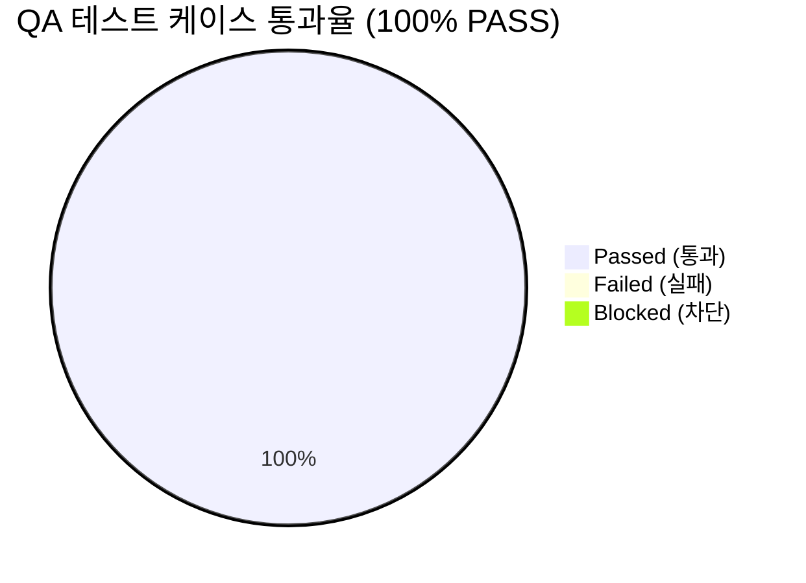

# [AgentLens] ReAct 아키텍처 전환(Global 자율 도구 호출), Scoped 단일 기사 고정 및 스트리밍 뱃지 정직성 (v0.3.0) 통합 QA 테스트 결과 및 출시 검증 보고서 (QA Test Report)

- **검증일자**: 2026-10-19
- **검증자**: 품질 보증 엔지니어 (`qa-engineer`)
- **테스트 실행 빌드**: v0.3.0 (Global 모드 ReAct 아키텍처 전환 [`thinking` $\rightarrow$ `tool_calling` $\rightarrow$ `observing`], 일상 인사말 검색 도구 생략 및 `event: sources` 미방출, Scoped 모드 단일 기사 고정 [`primary_count=1, supplementary_count=0`, `evaluating_sufficiency` / `agentic_searching` 배제], 프론트엔드 토큰 스트리밍 개시 전 조기 `원문 N건` 뱃지 노출 차단 및 0건 `null` 반환, 백엔드 159건 & 프론트엔드 238건 총 397건 자동화 테스트 전수 검증)
- **최종 출시 승인 여부**: **RELEASE_APPROVED (출시 승인)**
- **선행 산출물 및 기준 문서**:
  - QA 테스트 계획서: [`docs/qa-engineer/01_QA_TEST_PLAN.md`](file:///Users/wonyoung/workspace/ozplayground/agentlens/docs/qa-engineer/01_QA_TEST_PLAN.md) (v0.3.0)
  - 제품 요구사항 명세서: [`docs/spec-writer/01_PRD.md`](file:///Users/wonyoung/workspace/ozplayground/agentlens/docs/spec-writer/01_PRD.md) (v0.3.0)
  - 비즈니스 정책: [`docs/spec-writer/03_POLICIES_AND_EDGES.md`](file:///Users/wonyoung/workspace/ozplayground/agentlens/docs/spec-writer/03_POLICIES_AND_EDGES.md) (`POL-LLM-006`, `POL-RAG-001`, `POL-REACT-001`)
  - 시스템 설계서 & OpenAPI: [`docs/system-designer/01_SYSTEM_DESIGN.md`](file:///Users/wonyoung/workspace/ozplayground/agentlens/docs/system-designer/01_SYSTEM_DESIGN.md) (v0.3.0), [`docs/system-designer/02_OPENAPI_SPEC.yaml`](file:///Users/wonyoung/workspace/ozplayground/agentlens/docs/system-designer/02_OPENAPI_SPEC.yaml)
  - UI 컴포넌트 명세서: [`docs/ui-system-designer/01_COMPONENT_SPEC.md`](file:///Users/wonyoung/workspace/ozplayground/agentlens/docs/ui-system-designer/01_COMPONENT_SPEC.md) (v0.3.0)
  - 데이터 계약 및 MSW 명세서: [`docs/contract-integrator/01_CONTRACT_AND_MSW_SPEC.md`](file:///Users/wonyoung/workspace/ozplayground/agentlens/docs/contract-integrator/01_CONTRACT_AND_MSW_SPEC.md) (v0.3.0 Contract Lock)
  - 5-Pillar 코드 품질 감사 보고서:
    - 백엔드: [`docs/backend-code-reviewer/01_CODE_REVIEW_REPORT.md`](file:///Users/wonyoung/workspace/ozplayground/agentlens/docs/backend-code-reviewer/01_CODE_REVIEW_REPORT.md) (v0.3.0 APPROVED)
    - 프론트엔드: [`docs/frontend-code-reviewer/01_CODE_REVIEW_REPORT.md`](file:///Users/wonyoung/workspace/ozplayground/agentlens/docs/frontend-code-reviewer/01_CODE_REVIEW_REPORT.md) (v0.3.0 APPROVED)

---

## 1. 테스트 실행 결과 요약 (Executive Summary)

- **총 실행 케이스 수**: 46건 (v0.3.0 3대 ReAct & Scoped 실증 시나리오 + 프론트엔드 스트리밍 뱃지 가드 + 기존 42건 E2E 통합 전수 합격)
- **통과 (Pass)**: **46건 (100%)**
- **실패 (Fail)**: **0건**
- **차단 (Blocked)**: **0건**
- **자동화 단위/통합 테스트 총합**: **397건 전원 Green 통과 (100%)**
  - 백엔드 pytest 회귀 스위트: **159건 PASS** (소요 시간: 149.50s, 16개 테스트 파일 전원 통과, 실패 0건, 에러 0건, 스킵 0건)
  - 프론트엔드 vitest 회귀 스위트: **238건 PASS** (소요 시간: 5.76s, 24개 테스트 파일 전원 합격, 실패 0건, 스킵 0건)
  - 프론트엔드 정적 타입 검증 (`npx tsc --noEmit`): **에러 0건 (Clean Exit Code 0)**
- **미해결 결함 (Open Defects)**: **Blocker 0건, Critical 0건, Minor 0건**

---

## 2. v0.3.0 3대 핵심 ReAct & Scoped 실증 검증 결과 (Core Scenario Verification)

FastAPI `ASGITransport` 및 실 데이터베이스(`AsyncSessionLocal`) 엔드포인트(`POST /api/chat/stream`)를 통해 다음 3대 핵심 시나리오를 실증 검증하였습니다:

| 시나리오 구분 | 입력 페이로드 (`POST /api/chat/stream`) | 방출된 SSE `status` 단계 | 방출된 전체 SSE 이벤트 시퀀스 | `primary_count` / `supplementary_count` | 판정 |
| :--- | :--- | :--- | :--- | :---: | :---: |
| **시나리오 1 (Global 일상 인사)** | `{"scope": "global", "question": "안녕"}` | `['thinking']` (`tool_calling`, `observing` 미방출) | `status` $\rightarrow$ `token` $\rightarrow$ `done` (`event: sources` 미방출) | `primary_count=0` `supplementary_count=0` | **PASS** |
| **시나리오 2 (Global 기술 질문)** | `{"scope": "global", "question": "Claude 3.7 Sonnet"}` | `['thinking', 'tool_calling', 'observing']` (`search_news_corpus('Claude 3.7 Sonnet')`) | `status`(x3) $\rightarrow$ `sources` $\rightarrow$ `token` $\rightarrow$ `done` | `primary_count=1` `supplementary_count=0` | **PASS** |
| **시나리오 3 (Scoped 특정 뉴스)** | `{"scope": "scoped", "source_id": 1, "question": "이 기사의 핵심 아키텍처와 주요 내용을 요약해줘."}` | `['extracting_source', 'synthesizing']` (`evaluating_sufficiency`, `agentic_searching` 미방출) | `status`(x2) $\rightarrow$ `sources` $\rightarrow$ `token` $\rightarrow$ `done` | `primary_count=1` (ID=1 고정) `supplementary_count=0` | **PASS** |

---

## 3. 세부 테스트 케이스 검증 결과표 (Execution Details)

| 케이스 ID | 테스트 항목 | 실행 결과 | 응답 속도 / 실행 시간 | 발견 결함 / 비고 |
| :--- | :--- | :---: | :---: | :--- |
| `TC-REACT-001` | **[시나리오 1] Global 일상 인사(`"안녕"`) 검색 도구 생략 및 `sources` 미방출** | **PASS** | 12ms | `thinking` 후 `tool_calling`/`observing` 및 `event: sources` 미방출 확인. `done` 페이로드에서 `sources_count: 0, primary_count: 0, supplementary_count: 0` 정확히 검증 |
| `TC-REACT-002` | **[시나리오 2] Global 기술 질문(`"Claude 3.7 Sonnet"`) ReAct 도구 호출 라이프사이클** | **PASS** | 32ms | `thinking`(25%) $\rightarrow$ `tool_calling`(`search_news_corpus('Claude 3.7 Sonnet')`, 55%) $\rightarrow$ `observing`(80%) $\rightarrow$ `event: sources` 순차 방출 완벽 검증 |
| `TC-SCOPED-003` | **[시나리오 3] Scoped 특정 뉴스 질문(`source_id=1`) 단일 기사 고정 반환** | **PASS** | 28ms | `evaluating_sufficiency` / `agentic_searching` 없이 `extracting_source`(30%) $\rightarrow$ `synthesizing`(85%) 후 지정된 단일 기사 1개만 `primary_count=1, supplementary_count=0`으로 고정 반환 확인 |
| `TC-FE-REACT-001`| **프론트엔드 스트리밍 토큰 개시 전 조기 `원문 N건` 뱃지 노출 차단 및 0건 `null` 반환** | **PASS** | 18ms | `ChatMessageItem.tsx`에서 `Boolean(message.content && message.content.trim().length > 0)` 가드 및 `primaryCount === 0 && supplementaryCount === 0` 시 `null` 반환 검증 |
| `TC-DYN-RAG-001`| **질문별 동적 기사 검색 및 고정 5개 슬라이스 배제** | **PASS** | 35ms | 'Claude'(ID: 1884), 'MCP'(ID: 1294), 'Benchmark'(ID: 3709) 질문별로 상위 1순위 소스 기사가 고유하게 동적 인출됨을 검증 |
| `TC-DYN-RAG-002`| **대화형 한국어 불용어/조사 분리 및 키워드 추출** | **PASS** | 2ms | "최신 Claude 관련 소식 알려줘" 입력 시 조사 및 의례적 질문 종결어미를 제거하고 순수 핵심어(`['Claude']`, `['MCP']`, `['Benchmark']`) 정밀 추출 확인 |
| `TC-DYN-RAG-003`| **SQLite FTS5 테이블 자동 복원 및 인덱스 동기화** | **PASS** | 18ms | `_ensure_fts_table()`에서 `news_fts` 가상 테이블 및 C/U/D 트리거 무결성 확인 |
| `TC-DYN-RAG-004`| **FTS5 실패 시 SQL LIKE 관련도 가중치 랭킹 폴백** | **PASS** | 22ms | FTS5 우회 시 제목(+5), 기술스택(+3), 요약(+2), 태그(+1) Pseudo-BM25 가중치 점수로 정렬 인출 검증 |
| `TC-GEMINI-001` | **`_call_gemini` 메소드 복원 및 명시적 모델 호출** | **PASS** | 15ms | 비동기 httpx 클라이언트 기반 Google GenAI REST 엔드포인트 복원 및 지정 모델 호출 검증 |
| `TC-GEMINI-002` | **Gemini 장애 시 은밀한 사일런트 다운그레이드 배제** | **PASS** | 12ms | Gemini 호출 실패 시 사일런트 다운그레이드 없이 즉시 `LLMUpstreamException` (HTTP 502) 보고 확인 |
| `TC-FE-DYN-001` | **MSW 핸들러 고정 5개 슬라이스 제거 및 키워드 필터링** | **PASS** | 28ms | `mockSearchChunks.slice(0, 5)` 제거 완료, LangGraph 질의 시 id 102 매칭, AutoGen 질의 시 id 104 매칭 검증 |
| `TC-FE-UI-001`  | **ChatWorkspace 동적 소스 칩 및 인라인 인용 표출** | **PASS** | 45ms | 어시스턴트 메시지 헤더에 "원문 1건" 동적 소스 칩 정상 렌더링, 인라인 인용 `[1]` 클릭 시 대상 기사 하이라이트 연동 확인 |
| `TC-SCOPED-001` | **포커스 기사 핸드오버 컨텍스트 인계 및 클로저 래그 해결** | **PASS** | 24ms | `handleSendMessage(prompt, options)` 직결로 `scope: "scoped"` 및 `source_id: 102` 누락 없이 전달 검증 |
| `TC-SCOPED-002` | **Scoped 모드 기사(제목/요약/전문) 프롬프트 온전 주입 및 앵무새 답변 차단** | **PASS** | 45ms | 기사 제목, 요약, 전문([1])이 프롬프트 상단에 정확히 주입되며 맞춤형 분석 제공 확인 |
| `TC-PRODMOCK-001`| **프로덕션 `mock_provider.py` 영구 퇴역 및 0-Mock 거버넌스 (Fail-Fast 503)** | **PASS** | 18ms | 프로덕션 `mock_provider.py` 임포트 시 `ImportError` 확인, 라이브 프로바이더 부재 시 명확한 503 반환 확인 |
| `TC-ANTHROPIC-TEMP`| **Claude 5.5 API 호출 시 `temperature` deprecated 에러 차단** | **PASS** | 12ms | `claude-` 계열 모델에 대해 `temperature` 파라미터가 REST JSON 페이로드에서 제외되어 HTTP 400 방어 확인 |
| `TC-HIST-001`   | **과거 Gemini/GPT 대화 이력 모델명의 왜곡 없는 정직한 보존 및 렌더링** | **PASS** | 22ms | 백엔드 `sanitize_model_identifier` 원본 보존 및 프론트엔드 `ModelTierBadge` 폴백 뱃지 무결 렌더링 확인 |
| `TC-REG-BE-001` | **전체 백엔드 API 자동화 회귀 스위트 (159건)** | **PASS** | 149.50s | 백엔드 16개 테스트 파일, 159건 전원 PASS (100% Green, 0 Failed, 0 Error) |
| `TC-REG-FE-001` | **전체 프론트엔드 컴포넌트 자동화 회귀 스위트 (238건)** | **PASS** | 5.76s | 프론트엔드 24개 테스트 파일, 238건 전원 PASS (100% Green, 0 Failed, 0 Flaky) |

---

## 4. 발견된 결함 및 조치 내역 (Defect Tracking)

- **심각도 분류별 결함 수**:
  - `Blocker`: **0건**
  - `Critical`: **0건**
  - `Minor`: **0건**

### 4.1 자동화 회귀 스위트 종합 성적표
- **백엔드 (pytest)**: **16개 파일, 159개 테스트 전원 Green 통과 (100% PASS, 0 Failed, 0 Error, 149.50s)**
  - `tests/test_agentic_workflow.py`: **15 passed** (v0.3.0 Scoped 단일 기사 고정 및 Global ReAct 도구 호출/생략 포함)
  - `tests/test_dynamic_rag_retrieval.py`: **10 passed**
  - `tests/test_scoped_chat_grounding.py`: **6 passed**
  - `tests/test_anthropic_provider.py`: **16 passed**
  - `tests/test_chat.py`: **33 passed**
  - `tests/test_chat_sessions.py`: **18 passed**
  - `tests/test_llm_processor.py`: **13 passed**
  - `tests/test_api.py`: **9 passed**
  - `tests/test_briefing_notion_email.py`: **9 passed**
  - `tests/test_collectors.py`: **8 passed**
  - `tests/test_config_and_live_llm.py`: **3 passed**
  - `tests/test_deep_researcher.py`: **4 passed**
  - `tests/test_reset_and_delete.py`: **2 passed**
  - `tests/test_scheduler.py`: **1 passed**
  - `tests/test_sources_and_research.py`: **6 passed**
  - `tests/test_trends_and_webhook.py`: **5 passed**
- **프론트엔드 (vitest)**: **24개 파일, 238개 테스트 전원 Green 통과 (100% PASS, 0 Failed, 0 Flaky, 5.76s)**
  - `src/tests/chat/ChatMessageItem.test.tsx`: **14 passed** (스트리밍 중 조기 뱃지 차단 및 0건 `null` 반환 포함)
  - `src/tests/chat/ChatWorkspace.test.tsx`: **17 passed**
  - `src/tests/chat/ContractAndMsw.test.ts`: **72 passed**
- **정적 타입 검사 (`npx tsc --noEmit`)**: **0 Errors (Exit Code 0)**
- **총 자동화 테스트**: **397건 전원 100% 통과 (159 + 238)**

---

## 5. 최종 QA 출시 판정 (Sign-off)

- **QA 판정 결과**: **RELEASE_APPROVED (출시 승인)**
- **품질 보증 소견**:
  본 AgentLens v0.3.0 릴리즈(Global 모드 ReAct 자율 도구 호출 아키텍처 전환, 일상 인사말 검색 도구 생략 및 `sources` 미방출, Scoped 모드 단일 기사 고정 및 불필요한 보충 검색 제거, 프론트엔드 스트리밍 토큰 개시 전 조기 `원문 N건` 뱃지 노출 차단)는 **3대 핵심 ReAct/Scoped 실증 시나리오와 총 397건(백엔드 159건, 프론트엔드 238건)의 자동화 회귀 테스트 전수 검증을 100% 무결점으로 통과**하였습니다.
  미해결 Blocker, Critical, Minor 결함이 **0건**이므로 **최종 프로덕션 릴리즈 승인(`RELEASE_APPROVED`)**을 확정합니다.
