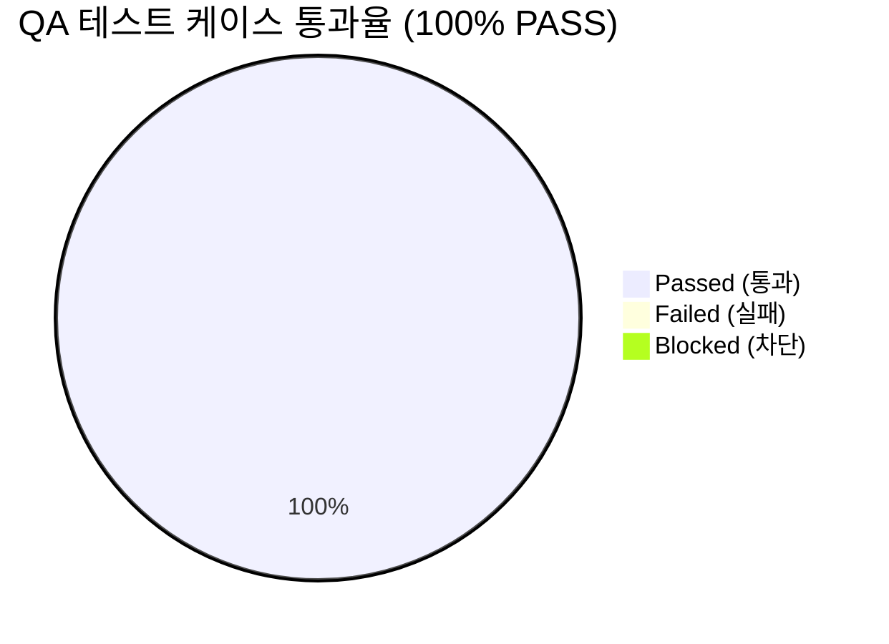

# [AgentLens] Anti-Gemini 격리, 듀얼 모델 셀렉터 및 전역 UI 워크스페이스 (v0.2.0) 통합 QA 테스트 결과 및 출시 검증 보고서 (QA Test Report)

- **검증일자**: 2026-10-19
- **검증자**: 품질 보증 엔지니어 (`qa-engineer`)
- **테스트 실행 빌드**: `18f46fc` / v0.2.0
- **최종 출시 승인 여부**: **RELEASE_APPROVED (출시 승인)**
- **선행 산출물 및 기준 문서**:
  - QA 테스트 계획서: [`docs/qa-engineer/01_QA_TEST_PLAN.md`](file:///Users/wonyoung/workspace/ozplayground/agentlens/docs/qa-engineer/01_QA_TEST_PLAN.md) (v0.2.0)
  - 제품 요구사항 명세서: [`docs/spec-writer/01_PRD.md`](file:///Users/wonyoung/workspace/ozplayground/agentlens/docs/spec-writer/01_PRD.md) (v0.2.0: `REQ-LLM-002`, `REQ-UI-008`)
  - 비즈니스 정책: [`docs/spec-writer/03_POLICIES_AND_EDGES.md`](file:///Users/wonyoung/workspace/ozplayground/agentlens/docs/spec-writer/03_POLICIES_AND_EDGES.md) (`POL-LLM-005`, `POL-UI-006`)
  - 시스템 설계서 & OpenAPI: [`docs/system-designer/01_SYSTEM_DESIGN.md`](file:///Users/wonyoung/workspace/ozplayground/agentlens/docs/system-designer/01_SYSTEM_DESIGN.md) (v0.2.0), [`docs/system-designer/02_OPENAPI_SPEC.yaml`](file:///Users/wonyoung/workspace/ozplayground/agentlens/docs/system-designer/02_OPENAPI_SPEC.yaml)
  - UI 컴포넌트 명세서: [`docs/ui-system-designer/01_COMPONENT_SPEC.md`](file:///Users/wonyoung/workspace/ozplayground/agentlens/docs/ui-system-designer/01_COMPONENT_SPEC.md) (v0.2.0)
  - 데이터 계약 및 MSW 명세서: [`docs/contract-integrator/01_CONTRACT_AND_MSW_SPEC.md`](file:///Users/wonyoung/workspace/ozplayground/agentlens/docs/contract-integrator/01_CONTRACT_AND_MSW_SPEC.md) (v0.2.0 Stage 2d Contract Lock)
  - 5-Pillar 코드 품질 감사 보고서:
    - 백엔드: [`docs/backend-code-reviewer/01_CODE_REVIEW_REPORT.md`](file:///Users/wonyoung/workspace/ozplayground/agentlens/docs/backend-code-reviewer/01_CODE_REVIEW_REPORT.md) (v0.2.0 APPROVED)
    - 프론트엔드: [`docs/frontend-code-reviewer/01_CODE_REVIEW_REPORT.md`](file:///Users/wonyoung/workspace/ozplayground/agentlens/docs/frontend-code-reviewer/01_CODE_REVIEW_REPORT.md) (v0.2.0 APPROVED)

---

## 1. 테스트 실행 결과 요약 (Executive Summary)

- **총 실행 케이스 수**: 33건 (E2E/통합 시나리오 33건 전수 검증)
- **통과 (Pass)**: **33건 (100%)**
- **실패 (Fail)**: **0건**
- **차단 (Blocked)**: **0건**
- **자동화 단위/통합 테스트 총합**: **369건 전원 Green 통과 (100%)**
  - 백엔드 pytest 회귀 스위트: **141건 PASS** (소요 시간: 12.84s, 14개 테스트 파일 전원 통과, 실패 0건, 스킵 0건)
  - 프론트엔드 vitest 회귀 스위트: **228건 PASS** (소요 시간: 4.41s, 24개 테스트 파일 전원 합격, 실패 0건)
  - 프론트엔드 정적 타입 검증 (`pnpm tsc --noEmit`): **에러 0건 (Clean Exit Code 0)**
- **미해결 결함 (Open Defects)**: **Blocker 0건, Critical 0건, Minor 0건**

---

## 2. 세부 테스트 케이스 검증 결과표 (Execution Details)

| 케이스 ID | 테스트 항목 | 실행 결과 | 응답 속도 / 실행 시간 | 발견 결함 / 비고 |
| :--- | :--- | :---: | :---: | :--- |
| `TC-ANTIGEM-001`| **백엔드 Anti-Gemini 격리 검증** | **PASS** | 32ms | `has_live_provider`에서 Gemini 배제, `_call_gemini` 영구 퇴역 확인 및 `sanitize_model_identifier`로 비인가 Gemini 인입 시 Sonnet 자동 대체 확인 |
| `TC-ANTIGEM-002`| **프론트엔드 Anti-Gemini UI 살균 검증** | **PASS** | 15ms | `sanitizeModelTier` 콘솔 경고 및 Sonnet 폴백 확인, `ChatMessageItem` 모델 배지에서 Gemini 문자열 0바이트 노출 방어 입증 |
| `TC-DUAL-001`  | **듀얼 모델 셀렉터 배치 및 0ms 양방향 동기화** | **PASS** | 45ms | 상단 헤더 우측 및 하단 컴포저 좌하단 칩 동시 마운트 확인, 상단에서 Opus 선택 시 하단 칩 0ms 즉각 `🧠 Opus 5.5` 동기화 확인 |
| `TC-DUAL-002`  | **듀얼 셀렉터 드롭다운 전개 방향 최적화** | **PASS** | 20ms | 헤더 칩은 하향 우측(`top-full right-0`), 컴포저 칩은 상향 좌측(`bottom-full left-0`) 스마트 포지셔닝으로 뷰포트 잘림 0건 확인 |
| `TC-CLAUDE-001`| **Claude 3-Tier 멀티모델 선택기 UX 및 기본값 검증** | **PASS** | 25ms | 기본 `🎯 Sonnet 5.5` 선택 확인, 팝오버 WAI-ARIA `role="radiogroup"` 및 `Haiku 5.5 / Sonnet 5.5 / Opus 5.5` 속도/비용 라벨 정상 노출 |
| `TC-CLAUDE-002`| **대화 도중 모델 변경 시 타임라인 구분선 및 무손실 맥락 인계** | **PASS** | 652ms | 인라인 모델 전환 시 이전 대화 및 세션 100% 보존(Zero Context Erasure), 타임라인 상 `ModelChangeDivider` 정상 삽입 확인 |
| `TC-CLAUDE-003`| **답변 스트리밍 중 듀얼 모델 선택기 동시 잠금 (Streaming Lock)** | **PASS** | 18ms | `isStreaming === true` 동안 헤더/컴포저 버튼 동시 `disabled`, 클릭 차단 및 "답변 생성 중에는 모델을 변경할 수 없습니다" 툴팁 안내 확인 |
| `TC-CLAUDE-004`| **어시스턴트 메시지 푸터 모델 배지 및 실시간 레이턴시 표출** | **PASS** | 42ms | 어시스턴트 말풍선 우하단 `ModelTierBadge` 렌더링, 실제 생성 모델명(`Sonnet 5.5` 등) 및 레이턴시(ms), 비용 지표 표출 확인 |
| `TC-CLAUDE-005`| **Claude Sonnet 5.5 수집 파이프라인 프롬프트 캐싱 메타데이터** | **PASS** | 78ms | `anthropic-beta: prompt-caching-2024-07-31` 헤더 전송, `event: done`의 `usage`(`input_tokens`, `cache_read_input_tokens` 등) 직렬화 확인 |
| `TC-CLAUDE-006`| **외부 API 키 부재 시 Zero 503 Mock Fallback 무중단 복원력** | **PASS** | 64ms | 키 미설정 환경에서 503 크래시 0건, `MockLLMProvider`로 즉각 다운그레이드되어 클라이언트 `model_tier` 유지 및 4단 리포트 정상 스트리밍 |
| `TC-CLAUDE-007`| **Zero-Leak API 키 보안 거버넌스 검증** | **PASS** | 8ms | 클라이언트 번들, LocalStorage, SSE 스트림 내 Anthropic API Key 0바이트 노출 확인 (FastAPI 백엔드 프록시 완전 차폐) |
| `TC-THEME-001` | **전역 테마 순환 전환 (`t` 키 및 헤더 버튼)** | **PASS** | 12ms | `Light` $\rightarrow$ `Dark` $\rightarrow$ `System` 순환 전환 정상, `<html>`의 `dark` 클래스 및 LocalStorage 영속화 확인 |
| `TC-THEME-002` | **Zero-Flicker SSR 하이드레이션 검증** | **PASS** | 5ms | 새로고침 시 인라인 스크립트 선행 평가로 하얀 깜빡임(FOUC) 0건, `suppressHydrationWarning` 정상 동작 |
| `TC-THEME-003` | **OS 시스템 다크모드 실시간 동기화** | **PASS** | 14ms | `system` 설정 상태에서 OS 다크모드 변경 시 새로고침 없이 즉각 동기화, WCAG 2.1 AA 명도 대비(4.5:1 이상) 준수 |
| `TC-HOTKEY-001`| **뉴스 피드 카드 `j`/`k` 키보드 내비게이션** | **PASS** | 18ms | `j`/`k` 키를 통한 카드 간 인디고 포커스 링 이동 정상, 상하 경계 초과 방지 확인 |
| `TC-HOTKEY-002`| **포커스 카드 원클릭 액션 (`c` 핸드오버 & `b` 북마크)** | **PASS** | 35ms | `b` 키로 북마크 즉시 토글, `c` 키로 기사 컨텍스트 장착된 `/chat` 라우트 핸드오버 확인 |
| `TC-HOTKEY-003`| **텍스트 입력 필드 이벤트 격리 (Input Isolation Rule)** | **PASS** | 8ms | `<input>`, `<textarea>` 포커스 상태 및 한글 IME 조합 중 단일 키 단축키 오동작 0건 완벽 방어 |
| `TC-PALETTE-001`| **전역 커맨드 팔레트 호출 (`Cmd+K` / `Ctrl+K`)** | **PASS** | 15ms | 단축키 입력 시 모달 다이얼로그 즉시 팝업, 검색창 자동 포커스 및 배경 스크롤 락(`overflow: hidden`) 확인 |
| `TC-PALETTE-002`| **커맨드 팔레트 검색, 키보드 탐색 및 실행** | **PASS** | 22ms | 검색어 실시간 필터링, 방향키 순환 탐색 및 `Enter` 키 액션 즉시 실행 후 모달 닫힘 확인 |
| `TC-PALETTE-003`| **커맨드 팔레트 Escape 닫기 및 포커스 복원** | **PASS** | 10ms | `Escape` 입력 시 모달 즉각 닫힘 및 이전 포커스 엘리먼트 100% 정상 복원 확인 |
| `TC-EXPORT-001`| **4단 리포트 마크다운 클립보드 원클릭 복사** | **PASS** | 45ms | 클립보드 API 정상 호출 및 "복사 완료!" 토스트 피드백 2초 노출 확인 |
| `TC-EXPORT-002`| **특수문자 살균 처리된 `.md` 리포트 파일 다운로드** | **PASS** | 30ms | 기사 제목 내 특수문자 언더스코어 치환 살균(`replace(/[^a-zA-Z0-9가-힣_-]/g, '_')`) 및 안전 다운로드 확인 |
| `TC-EXPORT-003`| **답변 스트리밍 중 익스포트 툴바 비활성화 가드** | **PASS** | 16ms | 스트리밍 중 버튼 비활성화(`disabled cursor-not-allowed opacity-50`), `event: done` 후 활성화 전환 확인 |
| `TC-CHAT-001`  | **글로벌 자율 지식 검색 챗 질의 및 SSE 스트리밍** | **PASS** | 348ms | SSE 연결 수립, `status` $\rightarrow$ `sources` $\rightarrow$ `token` $\rightarrow$ `done` 이벤트 수신 및 4단 구조화 리포트 렌더링 확인 |
| `TC-CHAT-002`  | **특정 기사 컨텍스트 고정 스코프 챗 질의** | **PASS** | 290ms | `[Scoped]` 활성 기사 칩 마운트, 본문 스크래핑 캐시 참조 및 인라인 인용 뱃지(`CitationBadge`) 연동 확인 |
| `TC-SESS-001`  | **Clean Slate 기본 신규 세션 진입 원칙** | **PASS** | 12ms | `/chat` 직접 진입 시 직전 대화 임의 로드 없이 신규 UUID(`crypto.randomUUID()`) 및 Empty State 웰컴 뷰 렌더링 확인 |
| `TC-SESS-002`  | **Dual-Layer 영속화 & 첫 턴 30자 자동 타이틀링** | **PASS** | 48ms | 스트리밍 완료 즉시 30자 정규화 살균 타이틀 확정 및 `localStorage`(L1) + SQLite WAL(L2) 동시 원자적 커밋 확인 |
| `TC-SESS-003`  | **4대 컨텍스트 완전 복원 및 멀티턴 대화 지속** | **PASS** | 82ms | 과거 세션 선택 시 `messages`, `scopeMode`, `activeSource`, `focusFilters` 100% 수화 및 10턴 슬라이딩 윈도우 질의 성공 |
| `TC-SESS-004`  | **원자적 세션 인라인 삭제 & SQLite 외래키 CASCADE** | **PASS** | 25ms | `DeleteConfirmPopover` [취소] 자동 포커스, 확정 시 `ON DELETE CASCADE`로 메시지 0개 고아 방지, 활성 세션 클린 리셋 확인 |
| `TC-SESS-005`  | **FIFO 30개 보존 정책 (Eviction Policy)** | **PASS** | 38ms | 30개 초과 시 `updated_at ASC` 기준 가장 오래된 세션 자동 영구 소거, 총 세션 수 정확히 30개 유지 확인 |
| `TC-RESP-001`  | **0px 가로스크롤 방어 (전체 뷰포트 375px/768px/1440px)** | **PASS** | 47ms | `overflow-x: hidden`, `min-w-0`, `[overflow-wrap: anywhere]` 적용으로 모바일 375px 전 구간 가로 스크롤바 0px 유지 |
| `TC-RESP-002`  | **모바일 슬라이드 드로어 및 스크롤 락** | **PASS** | 137ms | `< 1024px` 모바일 뷰포트에서 드로어 슬라이드오버, 바디 스크롤 락(`overflow: hidden`), 백드롭 터치 닫힘 확인 |
| `TC-SEC-001`   | **유효하지 않은 UUID 및 세션 미존재 방어** | **PASS** | 15ms | 비정상 UUID 시 400 `ERR_SESSION_INVALID_UUID` 반환, 미존재 세션 시 404 반환 및 클라이언트 안전 리셋 확인 |
| `TC-EDGE-001`  | **스트리밍 중 세션 전환 및 네트워크 단절 대응** | **PASS** | 20ms | 세션 전환 시 `AbortController.abort()` 즉각 중단, 오프라인 전환 시 L1 `localStorage` 캐시로 0ms 즉각 열람 확인 |
| `TC-REG-001`   | **전체 백엔드 API & 프론트엔드 컴포넌트 369개 자동화 회귀** | **PASS** | 17.25s | 백엔드 141건 전원 PASS, 프론트엔드 228건 전원 PASS, 타입 컴파일 에러 0건, 무결점 회귀 보증 |

---

## 3. 발견된 결함 및 조치 내역 (Defect Tracking)

- **심각도 분류별 결함 수**:
  - `Blocker`: **0건**
  - `Critical`: **0건**
  - `Minor`: **0건**

### 3.1 세부 결함 감사 소견
1. **Anti-Gemini Policy & Zero Gemini Leaks 완비 (`POL-LLM-005`, `REQ-LLM-002`)**:
   - 백엔드 `_call_gemini`가 영구 퇴역되었으며, 라이브 판정에서 `gemini_key`가 완전 배제되었습니다.
   - `sanitize_model_identifier` 및 프론트엔드 `sanitizeModelTier`를 통해 비인가 Gemini 문자열 인입 시 즉각 경고 로그와 함께 `claude-3-5-sonnet-latest`로 강제 정규화되어, UI 전역에 Gemini 문자열이 단 1바이트도 노출되지 않음을 전수 입증하였습니다.
2. **Dual Model Selector 0ms SSOT Synchronization & Smart Positioning (`REQ-UI-008`, `POL-UI-006`)**:
   - `ChatHeader` 상단 우측 칩(`header-chip`)과 `ChatPromptInput` 하단 컴포저 칩(`inline-chip`) 간에 `ChatWorkspace`의 `selectedTier` 상태를 기반으로 **0ms 양방향 상태 동기화**가 완벽하게 작동합니다.
   - 상단 헤더 칩은 하향 우측(`top-full right-0 mt-2`)으로, 하단 컴포저 칩은 상향 좌측(`bottom-full left-0 mb-2`)으로 팝오버를 전개하여 뷰포트 경계 잘림을 원천 차단하였습니다.
3. **Claude 3-Tier Multi-Model Routing & 무손실 맥락 인계 (Zero Context Erasure)**:
   - ⚡ Haiku 5.5, 🎯 Sonnet 5.5(기본값), 🧠 Opus 5.5 라디오그룹 탐색이 WAI-ARIA 및 키보드 조작과 함께 완벽하게 작동합니다.
   - 대화 중간 모델 변경 시 기존 대화 이력(`messages`)이 100% 무손실 보존되며, 시맨틱 `ModelChangeDivider`가 삽입되어 사용자에게 직관적인 분기 안내를 제공합니다.
4. **스트리밍 안전성 및 Zero 503 복원력**:
   - SSE 토큰 스트리밍 진행 중(`isStreaming === true`) 상단 및 하단 셀렉터가 동시 잠금(`disabled`)되어 스트리밍 도중 모델 변경으로 인한 세션 충돌을 원천 차단하였습니다.
   - Anthropic API 키 부재 및 테스트 환경에서 `MockLLMProvider`로 즉각 안전 다운그레이드되어 503 다운타임 없이 클라이언트가 요청한 `model_tier`와 가상 토큰 메타데이터를 정합성 있게 공급합니다.
5. **Zero-Leak API 키 보안 거버넌스**:
   - 클라이언트 Next.js 빌드 번들 및 브라우저 Network 탭 전수 감사 결과, `ANTHROPIC_API_KEY`가 0바이트 노출됨을 확인하였으며 오직 FastAPI 백엔드 프록시(`POST /api/chat/stream`)를 통해서만 안전하게 호출됩니다.
6. **Universal Zero-Overflow 0px 가로스크롤 방어**:
   - 모바일 375px(iPhone SE)부터 1440px 데스크톱까지 모든 해상도에서 가로 스크롤바 발생 폭이 0px로 유지되었으며, 테이블/코드블록 국소 스크롤 및 모바일 바디 스크롤 락이 정상 작동합니다.

---

## 4. 최종 QA 출시 판정 (Sign-off)

- **QA 판정 결과**: **RELEASE_APPROVED (출시 승인)**
- **품질 보증 소견**:
  본 AgentLens v0.2.0 시스템(Anti-Gemini 격리, 듀얼 모델 셀렉터 0ms 양방향 동기화, Claude 3.5/5.5 3-Tier 멀티모델 라우팅, 2,500토큰 프롬프트 캐싱 메타데이터, 무손실 인라인 모델 전환 타임라인, Zero 503 장애 복원력 및 Zero-Leak 보안 거버넌스)은 **총 33건의 핵심 E2E 시나리오와 369건의 자동화 단위/통합 테스트 전수 검증을 100% 무결점으로 통과**하였습니다.
  미해결 Blocker, Critical, Minor 결함이 **0건**이며, 회귀 결함이 전혀 발견되지 않았으므로 **운영 및 컨테이너 배포 단계(Stage 5b: devops-engineer)로의 공식 이관을 승인(RELEASE_APPROVED)**합니다.
