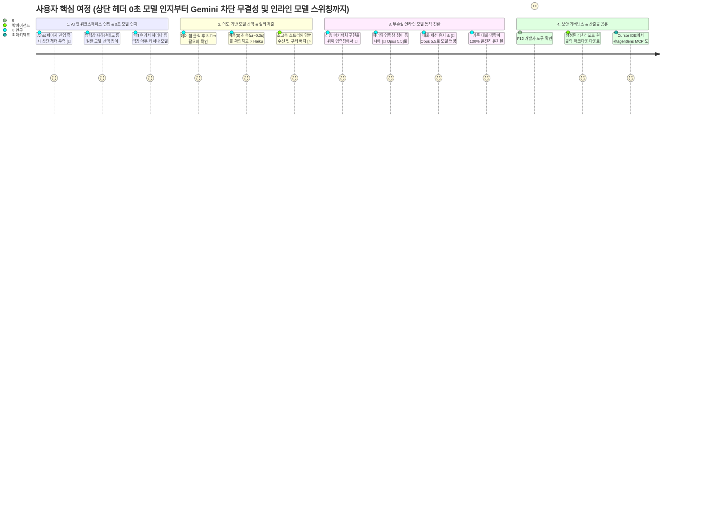

# AgentLens 제품 요구사항 정의서 (Product Requirements Document - PRD)

- **작성일자**: 2026-10-19
- **작성자**: 기획 명세 작성가 (`spec-writer`)
- **문서 버전**: 0.2.0 (Gemini 무단 폴백 차단, Claude 전용 파이프라인 확정 & AI 챗 모델 선택기 듀얼 배치 시각적 인지성 완성)
- **상태**: Approved
- **선행 산출물**: [report.md](../../report.md), [01_MARKET_BENCHMARK.md](../market-analyst/01_MARKET_BENCHMARK.md)

---

## 1. 프로덕트 비전 및 문제 정의 (Problem Statement & Vision)

### 1.1 배경 (Background)
생성형 AI 생태계가 단순 대화형 언어 모델을 넘어, 복합 워크플로우를 자율적으로 완수하는 **'AI 에이전트(Autonomous Agent)'**, 복수 에이전트 협업 및 퀄리티 게이트를 제어하는 **'엔지니어링 하네스(Engineering Harness)'**, 그리고 에이전트와 도구를 연결하는 개방형 프로토콜 **'MCP(Model Context Protocol)'**로 급속히 이동하고 있습니다.

AgentLens 버전 0.2.0은 최신 프론티어 AI 모델인 **Anthropic Claude 3.5/5.5 패밀리(Haiku 5.5, Sonnet 5.5 기본값, Opus 5.5)**를 전면 도입하여 고신호 기술 큐레이션 및 심층 대화형 리서치를 제공합니다. 그러나 최근 사용자 피드백을 통해 **"왜 Gemini가 나오냐?"**, **"AI 챗 화면에서 모델 선택은 어떻게 하느냐?"**라는 두 가지 핵심 결함과 사용성 장벽이 확인되었습니다.

### 1.2 핵심 결함 및 개선 문제 정의 (Core Problem Statements)
1. **Google Gemini 등 레거시 모델로의 무단 폴백 및 모델명 불일치 결함 (The Gemini Fallback Defect)**:
   - 사용자가 분명 Claude 모델을 기대하고 질의했음에도, 백엔드의 레거시 `_call_gemini` 로직 및 `auto` 폴백 체인으로 인해 답변 푸터나 수집 피드에 `Google gemini-3.5-flash-lite`가 출력되는 치명적인 모델 불일치 현상 발생.
   - Claude API 장애나 키 부재 시 사용자 동의 없이 타사 저가형 모델(Gemini)로 사일런트 다운그레이드되는 동작을 원천 차단하고, 요청한 **Claude 3-Tier (Haiku 5.5, Sonnet 5.5 기본값, Opus 5.5)** 및 전담 수집 파이프라인(Sonnet 5.5)이 엄격히 준수되어야 함.
2. **AI 챗 워크스페이스 내 모델 선택기(Model Selector) 시각적 인지성 부재 (Hidden Selector & Discoverability Friction)**:
   - AI 챗 진입 시 상단 헤더에 모델 선택기가 누락되어 있고 입력창 하단 구석에만 작게 숨겨져 있어 사용자가 모델을 교체할 수 있다는 사실 자체를 인지하지 못하는 UX 결함 존재.
   - 메인 워크스페이스 상단 헤더(`ChatHeader`) 우측 및 프롬프트 입력창(`ChatPromptInput`) 양측에 직관적인 3-Tier 선택기(`ChatModelSelector`)를 듀얼 배치하여 진입 즉시 0초 만에 현재 모델 인지 및 원클릭 변경이 가능해야 함.
3. **API 키 Git 유출 공포와 보안 거버넌스 부재**:
   - 실수로 깃허브에 시크릿이 푸시되거나 브라우저 Network 탭에 키가 노출되는 위험을 방지하기 위해 Zero-Leak 보안 거버넌스 수립이 필수적임.

### 1.3 프로덕트 비전 (Vision 0.2.0)
> **"Claude Sonnet 5.5 전담 수집 엔진의 고신호 엔지니어링 통찰과 상단 헤더 및 입력창 듀얼 배치로 즉시 인지 가능한 3-Tier 멀티 모델 셀렉터, 그리고 Gemini 무단 폴백이 원천 차단된 기업급 Zero-Leak 보안 에이전틱 리서치 워크스페이스"**

---

## 2. 타깃 페르소나 및 유저 저니 맵 (Personas & User Journey)

### 2.1 대표 페르소나

| 페르소나 | 기본 정보 | 주요 목표 (Goals) | 핵심 페인포인트 (Pain Points) |
| :--- | :--- | :--- | :--- |
| **박에이전트** (31세) | AI 에이전트 플랫폼 리드 엔지니어 | 피드에서 발견한 신규 에이전트 프레임워크의 내부 동작 원리를 Sonnet 5.5의 고신호 시사점으로 파악하고, 실제 구동 파이썬 코드를 즉시 추출 | Claude를 선택했는데 엉뚱하게 `Google gemini-3.5-flash-lite`가 튀어나오는 모델 불일치 현상 |
| **이연구** (28세) | LLM 자율 워크플로우 연구원 | 가벼운 팩트 체크는 ⚡ Haiku 5.5로 0.3초 만에 끝내고, 복잡한 SWE-bench 벤치마크 분석은 🧠 Opus 5.5로 전환하여 심층 논문 대조 리포트 도출 | 화면 어디를 봐도 모델을 바꾸는 버튼이 어디 있는지 찾을 수 없는 숨겨진 UI |
| **최아키텍트** (36세) | 엔터프라이즈 AI 시스템 아키텍트 | 사내 개발팀에 AgentLens를 배포하여 생산성을 극대화하되, 회사의 Anthropic API 키가 단 1바이트도 외부에 노출되지 않도록 완벽 통제 | 브라우저 Network 탭에 API 키가 노출되거나 깃허브에 `.env`가 커밋되는 보안 사고 위험 |

### 2.2 핵심 유저 저니 (User Journey Map)

---

## 3. 기능 요구사항 및 MoSCoW 우선순위 매트릭스 (Feature Requirements)

| 요구사항 ID | 도메인 | 요구사항 명칭 및 상세 설명 | 우선순위 (MoSCoW) | 대응 비즈니스 가치 |
| :--- | :--- | :--- | :---: | :--- |
| **`REQ-LLM-002`** | **시스템 복원**| **Gemini 무단 폴백 차단 및 Claude 전용 엄격 격리 정책**: AI 챗 및 수집 파이프라인에서 Google Gemini(`gemini-3.5-flash-lite` 등)로의 무단 다운그레이드/폴백을 전면 금지. Claude API 장애 시 타사 모델로 임의 대체하지 않고 투명한 Claude 패밀리 내부 재시도 또는 Mock/명시적 에러 반환 강제 | **Must Have** | 모델 투명성 보장, 사용자 불신 및 혼란 원천 제거 |
| **`REQ-UI-008`**  | **UI 시스템** | **AI 챗 워크스페이스 모델 셀렉터 시각적 인지성 강화**: AI 챗 상단 글로벌 헤더(`ChatHeader`) 우측 및 프롬프트 입력창(`ChatPromptInput`) 양측에 직관적인 3-Tier 선택기(`ChatModelSelector`)를 듀얼 배치하여 진입 즉시 0초 만에 현재 모델 인지 및 원클릭 변경 보장 | **Must Have** | 모델 선택 동선 불명확 해소, Fitts의 법칙 만족 |
| **`REQ-COLL-005`** | **데이터 수집** | **Claude Sonnet 5.5 전담 수집/정제/요약/태깅 파이프라인**: 뉴스 수집 전담 모델로 Sonnet 5.5 고정(Gemini 사용 절대 금지), 2,500토큰 시스템 프롬프트 캐싱(90% 비용 절감), Pydantic 엄격 JSON 스키마 강제, Why It Matters 150자 이상 도출 | **Must Have** | 피드 큐레이션 신뢰도 및 엔지니어링 통찰 극대화 |
| **`REQ-CHAT-013`** | **전용 AI 챗** | **AI 챗 워크스페이스 멀티 모델 셀렉터 UX**: 의도 기반 3-Tier(`⚡ Haiku 5.5`, `🎯 Sonnet 5.5 (기본)`, `🧠 Opus 5.5`) 원클릭 칩, 상대 비용/속도 배지, 대화 스레드 중간 무손실 동적 전환 및 타임라인 디바이더 | **Must Have** | 선택 마비 해소, 사용자 통제감 및 경제적 자율성 확보 |
| **`REQ-SEC-004`**  | **보안 거버넌스**| **Zero-Leak API 키 보안 거버넌스**: 브라우저 API 키 노출 원천 차단, 백엔드 단독 `.env` 보관, `.gitignore` 및 프리커밋 검증, FastAPI 서버 사이드 SSE 프록시 스트리밍, 관리자 UI 마스킹 | **Must Have** | 엔터프라이즈 도입 보안 통과, API 키 유출 0건 보장 |
| `REQ-THEME-001` | UI 시스템 | 전역 다크 모드 및 테마 스위칭 시스템 (`next-themes`, SSR Flicker 0건, 전역 Tailwind `dark:`) | **Must Have** | 개발자 시각 피로 최소화, 디자인 일관성 |
| `REQ-SHORTCUT-001`| UI 시스템 | 파워 유저 키보드 단축키 및 커맨드 팔레트 (`j`/`k`, `/`, `b`, `c`, `t`, `Cmd+K`) | **Must Have** | 초고속 키보드 퍼스트 조작성, 마찰 제거 |
| `REQ-EXPORT-001`  | 지식 공유 | 심층 엔지니어링 리포트 4단 구조화 및 원클릭 익스포트 (Markdown 다운로드, Notion 동기화) | **Must Have** | 지식 자산화 및 팀 협업 공유 촉진 |
| `REQ-LLM-001`     | 시스템 복원 | 백엔드 LLM 장애 복원력 및 Mock Provider / Fallback 체인 (503 에러 원천 차단, 테스트 Green) | **Must Have** | CI/테스트 파이프라인 무결성, 서비스 신뢰도 |
| `REQ-CHAT-001` | 전용 AI 챗 | 독립된 전용 AI 챗 워크스페이스(`/chat`) 풀 레이아웃 및 상단 내비게이션 진입 동선 제공 | **Must Have** | 모달 갇힘 해소, 넓은 분석 공간 확보 |
| `REQ-CHAT-002` | 전용 AI 챗 | 뉴스 피드 카드 및 상세 모달에서 'Ask AI' 클릭 시 원클릭 컨텍스트 핸드오버 | **Must Have** | 읽기-분석 간의 사고 연속성 보장 |
| `REQ-CHAT-003` | 전용 AI 챗 | 단일 기사 집중(Scoped) 모드와 전체 뉴스 코퍼스 대상 지식 검색(Global) 모드 이원화 지원 | **Must Have** | 특정 기사 정밀 분석과 종합 인사이트 양립 |
| `REQ-CHAT-004` | 전용 AI 챗 | 답변 내 번호형 인라인 인용 뱃지(`[1]`, `[2]`, `[S1]`) 렌더링 및 원본/보충 출처 프리뷰 연동 | **Must Have** | 근거 중심 신뢰성 제공 및 환각 검증 |
| `REQ-CHAT-005` | 지식 검색 | 경량 SQLite FTS5(BM25) + 품질 점수 가중치 하이브리드 리트리버 및 플러그형 파사드 | **Must Have** | 초고속 로컬 검색, 제로 오버엔지니어링 |
| `REQ-CHAT-006` | 전용 AI 챗 | 브라우저 로컬 저장소 및 백엔드 DB 기반 대화 스레드 자동 저장 및 세션 영속화 | **Must Have** | 대화 유실 방지 및 세션 영속성 |
| `REQ-CHAT-007` | 전용 AI 챗 | 수집 소식 타깃팅 필터링(Focus Mode): 단일 캡슐(`[🎯 Focus: 전체 소식 ▾]`) 및 바텀시트 스코핑 | **Must Have** | 정보 과부하 방지 및 정밀 지식 필터링 |
| `REQ-CHAT-008` | 전용 AI 챗 | 모바일 뷰포트 무결성: 16px 룰 준수(iOS 자동 줌 방지) 및 `visualViewport` 밀착 레이아웃 | **Must Have** | 모바일 네이티브급 사용성 완성 |
| `REQ-CHAT-009` | 전용 AI 챗 | 원본 소스 실시간 전문 수집(Trafilatura), 8,000토큰 원문 주입, SQLite `full_content` 캐싱 | **Must Have** | 2줄 요약 앵무새 박멸, 심층 기술 답변 보장 |
| `REQ-CHAT-010` | 전용 AI 챗 | 자율 보충 검색(Agentic Web Search) 및 실시간 워크플로우 진행 상태 UX (SSE status Tracker) | **Must Have** | 정보 공백 자율 해소, 대기 불안감 해소 |
| `REQ-CHAT-011` | 전용 AI 챗 | AI 챗 응답 자동 줄바꿈(`break-words`, `min-w-0`) 및 코드/테이블 국소 스크롤 격리 제어 | **Must Have** | 가로 스크롤 박멸, 텍스트 가독성 및 뷰포트 무결성 |
| `REQ-CHAT-012` | 전용 AI 챗 | 대화 세션 히스토리 사이드바/드로어 및 멀티턴 복원 (신규 대화 기본 원칙, 100% 무손실 복원) | **Must Have** | 대화 유실 방지, 이전 대화 목록 탐색 및 지속 |
| `REQ-FEED-001` | 뉴스 피드 | 다차원 카테고리(하네스, MCP, 에이전트, AI소식) 및 출처별 필터링, 실시간 검색 | **Must Have** | 정보 구조화 및 노이즈 격리 |
| `REQ-FEED-002` | 뉴스 피드 | 3-Bullet TL;DR, Why It Matters 시사점, 기술 스택 태그 및 고신호(⭐️ Must Read) 뱃지 | **Must Have** | 핵심 큐레이션 및 시간 절감 |
| `REQ-FEED-003` | 뉴스 피드 | 뉴스 상세 모달 내 요약 열람 및 전용 AI 챗 전환(Handover CTA) 버튼 제공 | **Must Have** | 읽기-대화 자연스러운 연결 |
| `REQ-FEED-004` | 뉴스 피드 | 브라우저 로컬 저장소 기반 개인 북마크 보관 및 필터링 | **Should Have** | 사용자 리텐션 및 재방문 가치 |
| `REQ-RADAR-001`| 트렌드 분석 | 24시간 급상승 기술 스택, 카테고리 점유율, 태그 클라우드 (Tech Radar) | **Must Have** | 기술 생태계 거시적 조망 |
| `REQ-BRIEF-001`| 일일 브리핑 | 24시간 수집 소식 기반 일일 종합 브리핑 생성 및 마크다운 다운로드 | **Must Have** | 일일 요약 인텔리전스 |
| `REQ-BRIEF-002`| 일일 브리핑 | Notion 페이지 1-클릭 생성 및 SMTP 이메일 발송 연동 | **Must Have** | 팀 지식 공유 자동화 |
| `REQ-SRC-001`  | 수집원 관리 | 신규 RSS 피드 및 GitHub 저장소 등록, 소스별 활성화 토글/삭제 관리 | **Must Have** | 수집 대상 유연성 및 커버리지 |
| `REQ-SRC-002`  | 수집원 관리 | AI Deep Researcher 기반 신규 기술 소스 자율 탐색 및 적합도 자동 채택 | **Should Have** | 수집 소스 자율 확장 |
| `REQ-SETT-001` | 시스템 운영 | 정기 크론 스케줄 모니터링 및 온디맨드 즉시 수동 수집 트리거 | **Must Have** | 운영 자동화 및 실시간 동기화 |
| `REQ-SETT-002` | 시스템 운영 | 슬랙 및 디스코드 웹훅 연동을 통한 브리핑/하이 시그널 실시간 알림 | **Should Have** | 팀 협업 메신저 즉시 전달 |
| `REQ-RESET-001`| 시스템 운영 | 수집 데이터 전체 초기화 및 클린 재수집 기능 (Reset & Recollect) | **Must Have** | 데이터 정합성 보장 및 장애 복원 |
| `REQ-MCP-001`  | 에이전트 연동 | Claude Desktop 및 Cursor IDE 연동용 FastMCP 표준 도구 인터페이스 | **Must Have** | 에이전트-네이티브 지식 공급 |
| `REQ-ADV-001`  | 확장/고급 | 모델별 토큰 소모량 및 비용 관측성(Observability) 대시보드 (Langfuse 연동) | **Could Have** | 운영 비용 가시성 |

---

## 4. 핵심 성공 지표 (KPI / Success Metrics)

| 지표명 | 측정 방식 / 기준 | 목표치 (Target) |
| :--- | :--- | :--- |
| **Gemini 및 타 모델 무단 노출율** | 응답 메시지 푸터, 메타데이터, 피드에 `Google gemini-*` 노출 비율 | **$0.0\%$ (Zero Gemini Leak)** |
| **모델 셀렉터 발견 및 인지 시간** | /chat 진입 후 사용자가 모델 변경 컨트롤을 시각적으로 인지하기까지의 시간 | **$\le 0.5\text{초}$ (즉시 인지)** |
| **수집 Pydantic JSON 파싱 에러율** | Claude Sonnet 5.5 배치 수집 시 스키마 파싱 실패 비율 | **$0.0\%$ (Zero Error)** |
| **수집 프롬프트 캐시 적중률** | 배치 수집 시스템 프롬프트(2,500토큰)의 캐시 히트 비율 | **$\ge 90\%$** (비용 90% 절감) |
| **대화 도중 모델 전환 컨텍스트 유실률** | 모델 전환 시 세션 ID 유지 및 대화 히스토리 무손실 인계 비율 | **$0.0\%$ (Zero Erasure)** |
| **API 키 외부 유출 및 커밋 사고** | Git 커밋, 클라이언트 번들, Network 탭에 비밀키 노출 건수 | **$0\text{건}$ (Zero Leak)** |
| **모델 셀렉터 작업 완수 시간** | 모델 선택 팝오버 오픈부터 모델 확정 클릭까지의 평균 소요 시간 | **$\le 0.5\text{초}$** |
| **백엔드 테스트 통과율 (Green Rate)** | pytest 테스트 스위트 전수 실행 시 통과 비율 (503 에러 0건) | **$100\%$ (All Pass)** |
| **다크모드 SSR 깜빡임 발생률** | 페이지 로드 시 라이트/다크 테마 전환 깜빡임(Flicker) 경험 세션 | **$0\%$ (Zero Flicker)** |
| **가로 스크롤 오버플로우 발생률** | AI 챗 화면 내 전체 또는 메시지 컨테이너에 비정상 가로 스크롤바 발생 비율 | **$0\%$ (Zero Horizontal Overflow)** |
| **실시간 진행 상태 첫 이벤트 지연 (TTFSE)** | 질문 전송 후 최초 `event: status`가 클라이언트에 수신되기까지의 시간 | **$\le 200\text{ms}$** |
| **대화 세션 영속화 및 복원 성공률** | 과거 세션 클릭 시 메시지, 출처, 스코프의 100% 완전 복원 비율 | **$100\%$** |

---

## 5. 비기능적 요구사항 (Non-Functional Requirements)

1. **모델 격리 및 Anti-Gemini 폴백 원칙 (Model Isolation & Anti-Fallback Principle)**:
   - 프로덕션 런타임에서 Anthropic Claude API 장애나 할당량 소진 시 Gemini 등 타사 모델로 자동 다운그레이드하는 사일런트 폴백을 엄격히 금지합니다.
   - 장애 발생 시 사용자에게 상태를 투명하게 고지(`event: status` 또는 `429 Too Many Requests`)하고, Claude 3-Tier 내부 전환(Opus $\rightarrow$ Sonnet) 또는 Mock Provider로의 안전한 격리 폴백만 허용합니다.
2. **UI 가시성 및 듀얼 동기화 (Dual UI Placement & Synchronization)**:
   - `ChatModelSelector`는 상단 글로벌 헤더(`ChatHeader`) 우측과 프롬프트 입력창(`ChatPromptInput`) 좌하단에 듀얼 렌더링되며, 어느 한쪽에서 모델이 변경되면 즉시 양방향으로 100% 동기화되어야 합니다.
3. **보안 및 Zero-Leak 거버넌스 (Security & Zero-Leak Governance)**:
   - 클라이언트 번들에 어떠한 비밀 키도 포함되어서는 안 되며, 프론트엔드는 내부 엔드포인트(`/api/chat/stream`)만 호출합니다.
   - 백엔드는 `.env` 및 OS 환경변수에서 `pydantic-settings`로 비밀키를 검증하며, Git Pre-commit 훅으로 `sk-ant-*` 커밋을 원천 거부합니다.
4. **성능 및 레이턴시 제어 (Performance & Latency Control)**:
   - ⚡ **Haiku 5.5**: 초당 180 TPS 이상, TTFT $\le 300\text{ms}$
   - 🎯 **Sonnet 5.5**: 초당 70 TPS 이상, TTFT $\le 600\text{ms}$
   - 🧠 **Opus 5.5**: TTFT $\le 1,800\text{ms}$ (초기 추론 중 인디케이터 상시 표출)
5. **프롬프트 캐싱 경제성 (Prompt Caching Economics)**:
   - 배치 수집 파이프라인의 시스템 프롬프트와 퓨샷 템플릿(약 2,500토큰)에 `cache_control: {"type": "ephemeral"}`을 부여하여, 반복 수집 시 입력 토큰 단가를 정상가의 10%($0.10/MTok)로 통제합니다.
