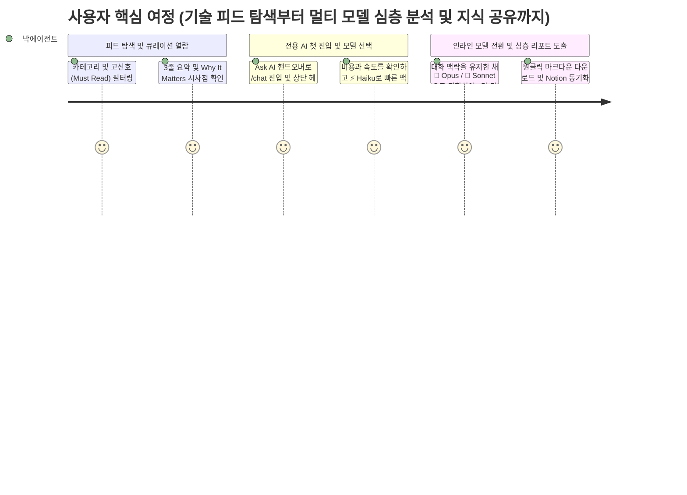

# AgentLens 제품 요구사항 정의서 (Product Requirements Document - PRD)

- **작성일자**: 2026-10-20
- **작성자**: 기획 명세 작성가 (`spec-writer`)
- **문서 버전**: v1.0
- **상태**: Approved

---

## 1. 프로덕트 비전 및 문제 정의 (Problem Statement & Vision)
- **배경 (Background)**: 생성형 AI 기술이 자율 에이전트(Autonomous Agent), 엔지니어링 하네스(Engineering Harness), MCP(Model Context Protocol) 생태계로 빠르게 진화함에 따라, 엔지니어와 리서처에게는 노이즈가 제거된 고신호 기술 큐레이션과 원본 문서 기반의 심층 대화형 분석 환경이 요구됨.
- **문제 정의 (Problem Statement)**:
  1. 기존 뉴스 피드의 표면적 요약으로는 실무 아키텍처 시사점(`Why It Matters`)과 핵심 기술 스택을 파악하기 어려움.
  2. 단일 LLM 종속 구조로는 조직별 다양한 인프라 요구사항을 충족하기 어렵고, 대화 중 질의 난이도에 따라 모델 티어를 직관적으로 전환하기 불편함.
  3. 클라이언트 사이드 API 키 노출이나 형상관리 커밋 실수로 인한 보안 유출 위험을 원천 차단해야 함.
- **프로덕트 비전 (Vision)**: 멀티 프로바이더 LLM(Anthropic Claude, Google Gemini, OpenAI, OpenAI-Compatible / Ollama) 기반의 고신호 기술 큐레이션과 상단 헤더·입력창 듀얼 배치 멀티 모델 셀렉터, 그리고 기업급 Zero-Leak 보안을 갖춘 에이전틱 리서치 워크스페이스 제공.

---

## 2. 타깃 페르소나 및 유저 저니 맵 (Personas & User Journey)

### 2.1 대표 페르소나
- **페르소나명**: 박에이전트 (31세, AI 에이전트 플랫폼 리드 엔지니어 & 시스템 아키텍트)
- **주요 목표**: 매일 수집되는 AI 에이전트·하네스·MCP 소식에서 핵심 엔지니어링 시사점을 신속히 파악하고, 질의 목적에 맞는 최적의 LLM 모델을 선택해 심층 아키텍처 리포트 및 구현 코드를 도출함.
- **핵심 페인포인트**: 피상적인 2줄 요약의 한계, 불명확한 모델 선택 동선 및 대화 중 모델 변경 시 맥락 유실, API 키 유출에 대한 보안 우려.

### 2.2 핵심 유저 저니 (User Journey Map)

---

## 3. 기능 요구사항 및 MoSCoW 우선순위 매트릭스 (Feature Requirements)

| 요구사항 ID | 도메인 | 요구사항 명칭 및 상세 설명 | 우선순위 (MoSCoW) | 대응 비즈니스 가치 |
| :--- | :--- | :--- | :---: | :--- |
| `REQ-LLM-001` | 멀티 프로바이더 | 멀티 프로바이더 LLM(Anthropic Claude, Google Gemini, OpenAI, OpenAI-Compatible / Ollama) 플러그형 지원 및 표준 에러 핸들링 (API 키 누락 시 HTTP 503, 업스트림 장애 시 HTTP 502, 쿼터 초과 시 HTTP 429 정직한 안내) | **Must Have** | 벤더 종속성 탈피 및 투명한 신뢰성 보장 |
| `REQ-LLM-002` | 모델 라우팅 | 사용자 선택 모델 티어 정밀 라우팅 및 응답 푸터 내 실제 사용 모델·레이턴시 투명 표기 | **Must Have** | 모델 응답 투명성 및 사용자 신뢰 확보 |
| `REQ-UI-008` | UI 시스템 | AI 챗 상단 글로벌 헤더 우측 및 하단 프롬프트 입력창 좌하단에 멀티 모델 셀렉터 듀얼 배치 및 양방향 실시간 동기화 | **Must Have** | 모델 선택 인지성 극대화 및 동선 마찰 제거 |
| `REQ-COLL-005` | 데이터 수집 | 고신호 데이터 수집·정제·요약·태깅 파이프라인 (기본 모델 & 멀티 프로바이더 호환, 프롬프트 캐싱, 엄격 JSON 스키마) | **Must Have** | 큐레이션 품질 극대화 및 수집 운영 비용 절감 |
| `REQ-CHAT-013` | 전용 AI 챗 | 의도 기반 3-Tier(⚡ Haiku 고속, 🎯 Sonnet 기본, 🧠 Opus 심층) 및 멀티 프로바이더 선택 UX, 비용/속도 배지, 대화 중 무손실 모델 전환 | **Must Have** | 선택 마비 해소 및 멀티턴 리서치 연속성 보장 |
| `REQ-SEC-004` | 보안 거버넌스 | Zero-Leak API 키 보안 거버넌스 (브라우저 키 노출 원천 차단, 백엔드 환경변수 격리, SSE 프록시 스트리밍, 관리자 UI 마스킹) | **Must Have** | 기업 보안 감사 통과 및 API 키 유출 원천 차단 |
| `REQ-FEED-001` | 뉴스 피드 | 다차원 카테고리(하네스, MCP, 에이전트, AI소식) 및 출처별 필터링, 실시간 검색 | **Must Have** | 기술 정보 구조화 및 노이즈 격리 |
| `REQ-FEED-002` | 뉴스 피드 | 3-Bullet TL;DR, Why It Matters 시사점, 기술 스택 태그 및 고신호(⭐️ Must Read) 배지 | **Must Have** | 핵심 엔지니어링 인사이트 빠른 파악 |
| `REQ-FEED-003` | 뉴스 피드 | 뉴스 상세 모달 내 요약 열람 및 전용 AI 챗 컨텍스트 핸드오버 버튼 제공 | **Must Have** | 읽기-분석 간의 자연스러운 연결 |
| `REQ-FEED-004` | 뉴스 피드 | 브라우저 로컬 저장소 기반 개인 북마크 보관 및 필터링 | **Should Have** | 개인화 지식 보관 및 재방문 가치 향상 |
| `REQ-RADAR-001` | 트렌드 분석 | 24시간 급상승 기술 스택, 카테고리 점유율, 태그 클라우드 (Tech Radar) | **Must Have** | 기술 생태계 거시적 트렌드 조망 |
| `REQ-CHAT-001` | 전용 AI 챗 | 독립된 전용 AI 챗 워크스페이스(`/chat`) 레이아웃 및 상단 내비게이션 진입 동선 제공 | **Must Have** | 심층 분석을 위한 전용 작업 공간 확보 |
| `REQ-CHAT-002` | 전용 AI 챗 | 뉴스 피드 카드 및 상세 모달에서 'Ask AI' 클릭 시 원클릭 컨텍스트 핸드오버 | **Must Have** | 단일 기사 기반 즉각적 심층 질의 |
| `REQ-CHAT-003` | 전용 AI 챗 | 단일 기사 집중(Scoped, 1건 대상 4단 심층 분석) 모드와 전체 뉴스 코퍼스 지식 검색(Global, 일상 대화 즉시 응답 및 기술 질문 코퍼스 검색 후 완료 시점 출처 인용) 모드 이원화 지원 | **Must Have** | 정밀 분석과 종합 트렌드 질의 양립 |
| `REQ-CHAT-004` | 전용 AI 챗 | 답변 내 번호형 인라인 인용 배지(`[1]`, `[S1]`) 렌더링 및 출처 프리뷰 팝오버 연동 | **Must Have** | 근거 중심 신뢰성 제공 및 환각 검증 |
| `REQ-CHAT-005` | 지식 검색 | 경량 SQLite FTS5(BM25) + 품질 점수 가중치 하이브리드 리트리버 | **Must Have** | 초고속 로컬 코퍼스 검색 지원 |
| `REQ-CHAT-006` | 전용 AI 챗 | 브라우저 로컬 저장소 및 백엔드 DB 기반 대화 스레드 자동 저장 | **Must Have** | 대화 유실 방지 및 세션 영속성 |
| `REQ-CHAT-007` | 전용 AI 챗 | 수집 소식 타깃팅 필터링(Focus Mode) 캡슐 및 바텀시트 스코핑 | **Must Have** | 정밀 지식 범위 필터링 |
| `REQ-CHAT-008` | 전용 AI 챗 | 모바일 뷰포트 무결성(16px 룰 및 가상키보드 동적 레이아웃) 제어 | **Must Have** | 모바일 사용성 확보 |
| `REQ-CHAT-009` | 전용 AI 챗 | 원본 소스 실시간 전문 수집(Trafilatura), 8,000토큰 원문 주입 및 DB 캐싱 | **Must Have** | 원문 기반의 심층 엔지니어링 답변 보장 |
| `REQ-CHAT-010` | 전용 AI 챗 | 자율 보충 검색(Agentic Web Search) 및 실시간 진행 상태 UX (SSE Status Tracker) | **Must Have** | 정보 공백 자율 보완 및 대기 피드백 제공 |
| `REQ-CHAT-011` | 전용 AI 챗 | AI 챗 응답 자동 줄바꿈 및 코드/테이블 블록 국소 스크롤 격리 제어 | **Must Have** | 뷰포트 가로 스크롤 오버플로우 차단 |
| `REQ-CHAT-012` | 전용 AI 챗 | 대화 세션 히스토리 사이드바/드로어 및 멀티턴 대화 복원/지속 관리 | **Must Have** | 과거 리서치 세션 탐색 및 연속 대화 지원 |
| `REQ-EXPORT-001` | 지식 공유 | 심층 엔지니어링 리포트 4단 구조화 및 원클릭 익스포트 (Markdown 다운로드, Notion 동기화) | **Must Have** | 리서치 결과물 자산화 및 팀 공유 |
| `REQ-BRIEF-001` | 일일 브리핑 | 24시간 수집 소식 기반 일일 종합 브리핑 생성 및 마크다운 다운로드 | **Must Have** | 일일 요약 인텔리전스 제공 |
| `REQ-BRIEF-002` | 일일 브리핑 | Notion 페이지 1-클릭 생성 및 SMTP 이메일 발송 연동 | **Must Have** | 외부 협업 채널 공유 자동화 |
| `REQ-SRC-001` | 수집원 관리 | 신규 RSS 피드 및 GitHub 저장소 등록, 소스별 활성화 토글/삭제 관리 | **Must Have** | 수집 대상 유연성 확보 |
| `REQ-SRC-002` | 수집원 관리 | AI Deep Researcher 기반 신규 기술 소스 자율 탐색 및 적합도 자동 채택 | **Should Have** | 고신호 수집 소스 자율 확장 |
| `REQ-SETT-001` | 시스템 운영 | 정기 크론 스케줄 모니터링 및 온디맨드 즉시 수동 수집 트리거 | **Must Have** | 운영 자동화 및 즉시 동기화 |
| `REQ-SETT-002` | 시스템 운영 | 슬랙 및 디스코드 웹훅 연동을 통한 브리핑/고신호 소식 실시간 알림 | **Should Have** | 팀 메신저 실시간 전파 |
| `REQ-RESET-001` | 시스템 운영 | 수집 데이터 전체 초기화 및 클린 재수집 기능 (Reset & Recollect) | **Must Have** | 데이터 정합성 복원 |
| `REQ-MCP-001` | 에이전트 연동 | Claude Desktop 및 Cursor IDE 연동용 FastMCP 표준 도구 인터페이스 | **Must Have** | 외부 AI 에이전트에 지식 공급 |
| `REQ-THEME-001` | UI 시스템 | 전역 다크 모드 및 테마 스위칭 시스템 (SSR 무깜빡임 지원) | **Must Have** | 개발자 시각 피로도 절감 |
| `REQ-SHORTCUT-001`| UI 시스템 | 파워 유저 키보드 단축키(`j`/`k`, `/`, `b`, `c`, `t`) 및 전역 커맨드 팔레트(`Cmd+K`) | **Must Have** | 키보드 퍼스트 고속 탐색 |
| `REQ-ADV-001` | 확장/고급 | 프로바이더·모델별 토큰 소모량 및 비용 관측성 대시보드 | **Could Have** | 운영 비용 가시성 확보 |

---

## 4. 핵심 성공 지표 (KPI / Success Metrics)

| 지표명 | 측정 방식 / 기준 | 목표치 (Target) |
| :--- | :--- | :--- |
| **모델 셀렉터 인지 및 선택 완료 시간** | `/chat` 진입 후 모델 변경 컨트롤 인지 및 모델 확정 클릭까지의 소요 시간 | $\le 0.5\text{초}$ |
| **수집 파이프라인 JSON 스키마 정합률** | 배치 수집 시 구조화 출력(Pydantic Schema) 검증 통과 비율 | $100\%$ |
| **수집 프롬프트 캐시 적중률** | 배치 수집 시스템 프롬프트의 캐시 히트 비율 | $\ge 90\%$ |
| **대화 중 모델 전환 맥락 보존율** | 스레드 도중 모델 변경 시 세션 ID 및 멀티턴 히스토리 무손실 인계 비율 | $100\%$ |
| **API 키 외부 유출 건수** | 클라이언트 번들, 브라우저 네트워크 탭, Git 커밋 내 비밀키 노출 건수 | $0\text{건}$ |
| **백엔드 및 프론트엔드 테스트 통과율** | 외부 API 키 유무와 무관한 전체 자동화 테스트 스위트 통과 비율 | $100\%$ |

---

## 5. 비기능적 요구사항 (Non-Functional Requirements)
- **성능 (Performance)**: 주요 화면 첫 렌더링(LCP) 1.5초 이내, SSE 진행 상태 첫 이벤트(`event: status`) 수신 200ms 이하, 경량 모델(Haiku/Flash 등) TTFT 300ms 이하 및 균형 모델(Sonnet 등) TTFT 600ms 이하 달성.
- **보안 (Security)**: 클라이언트 번들 내 LLM API 키 포함을 전면 금지하고 백엔드 환경변수(`.env`) 격리 및 서버 사이드 SSE 프록시 스트리밍을 강제하며, 관리자 UI에서는 키 마스킹 표시만 허용.
- **호환성 및 확장성 (Compatibility & Extensibility)**: 멀티 프로바이더(Anthropic Claude, Google Gemini, OpenAI, OpenAI-Compatible / Ollama) 플러그형 인터페이스 준수 및 모바일(375px~), 태블릿, 데스크톱 반응형 레이아웃과 다크 모드 완벽 지원.
