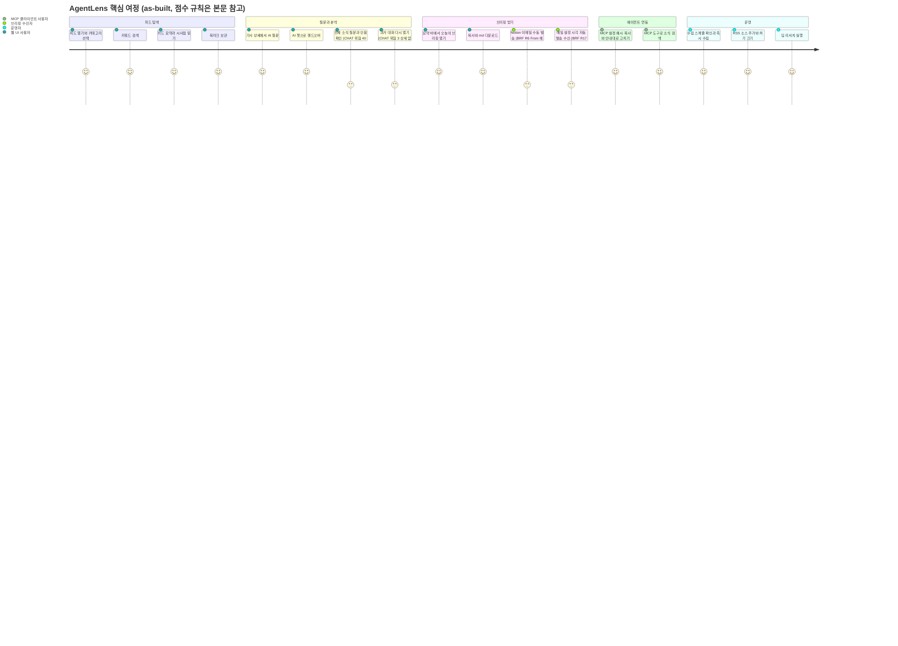

# AgentLens 제품 요구사항 정의서 (Product Requirements Document - PRD)

Updated: 2026-11-10
기준: v0.4.2 (main)

- **작성일자**: 2026-11-09 (v0.4.2 갱신 2026-11-10)
- **작성자**: 기획 명세 작성가 (`spec-writer`)
- **문서 버전**: v1.1 (as-built: 지금 코드가 하는 일을 요구사항으로 적는다. 새 범위를 만들지 않는다. v0.3.1 산출물을 대체한다)
- **상태**: Draft
- **선행 산출물**: 시장 벤치마크 `docs/market-analyst/01_MARKET_BENCHMARK.md`
- **후속 산출물**: 기능 인덱스 `docs/spec-writer/02_FUNCTIONAL_SPECIFICATION.md`, 전역 정책 `docs/spec-writer/03_POLICIES_AND_EDGES.md`, 도메인 FSD `docs/spec-writer/fsd/*.md`

---

## 0. 한 줄 설명

AI 에이전트·하네스·MCP 기술 소식을 모아 요약하고, AI 챗 질의응답·일일 브리핑·외부 채널 공유·MCP 서버를 제공한다 (`README.md:3`). 누구를 위한 제품인지는 아직 문서로 정하지 않았다 (열린 질문 Q1).

---

## 1. 프로덕트 비전 및 문제 정의 (Problem Statement & Vision)

### 1.1 배경 (Background)
- 제품 오너가 쓴 문제 정의·사용자 요청 원문은 없다. 이 절은 지금 코드가 해결하는 문제를 코드와 시장 벤치마크에서 거꾸로 적은 것이다.
- 시장 벤치마크(`docs/market-analyst/01_MARKET_BENCHMARK.md` 4·5절)가 출처와 함께 확인한 사용자 반응:
  - 흩어진 개발 소식을 한곳에 모으면 시간을 아낀다는 선호 (daily.dev, GeekNews 리뷰 [R1][R18][R19]).
  - 한국어 요약과 매일 아침 읽는 습관 (GeekNews [R18][R19]), 정해진 분량의 브리핑 (TLDR AI 약 5분 [R20], daily.dev 3~5분 [R2]).
  - 답변에 출처가 붙는 것을 신뢰 장치로 받아들임 (Perplexity [R14]).
  - 불만: 피드 노이즈·반복 [R1], AI 가 쓴 뉴스의 사실 오류 [R11], 인용이 주장을 뒷받침하지 않음 [R13], 얕아지는 요약 [R12][R21], AI 기능 유료 잠금 [R7], 광고와 편집 콘텐츠 혼재 [R7][R21].
- 벤치마크의 출처 ID(`[R#]`)는 그 문서 9절에 URL 과 함께 있다.

### 1.2 문제 정의 (Problem Statement, 지금 코드가 다루는 것)
1. **소식이 흩어져 있다**: AI 에이전트·하네스·MCP 관련 글이 arXiv, GitHub, HackerNews, Hugging Face, Reddit, RSS 블로그에 흩어져 있어 직접 돌아다니며 찾아야 한다. AgentLens 는 6종 소스를 설정한 시각(기본 하루 4번, `scheduler.crawl_hours`)에 자동으로 모으고(`backend/app/collectors/sources/`, `backend/app/scheduler.py` `add_jobs`) 주제 밖 글을 걸러 4개 카테고리로 나눈다 (`backend/app/services/llm_processor.py`, `backend/app/services/categorizer.py`).
2. **읽고 판단하는 데 시간이 든다**: 카드마다 규칙 기반 3줄 정리·개발자 시사점(LLM 평가가 준 값이 있을 때)·기술 스택을 붙이고(`backend/app/services/llm_processor.py`), 기사 단위·전체 소식 단위로 AI 에게 질문하고 출처를 확인할 수 있게 한다 (`POST /api/news/{id}/ask/stream`, `POST /api/chat/stream`).
3. **정해진 시간에 정리된 소식을 다른 도구로 받아야 한다**: 일일 브리핑을 만들어 Notion·이메일·Slack/Discord 로 보내고(`backend/app/services/briefing_service.py`, `backend/app/scheduler.py` `add_jobs`), 코딩 에이전트가 MCP 도구로 같은 코퍼스를 조회하게 한다 (`backend/app/mcp/server.py`).

### 1.3 프로덕트 비전 (Vision)
- 제품 오너가 정한 비전 문장은 없다 (열린 질문 Q1).
- 벤치마크가 제시한 차별화 방향(벤치마크 6.2절)은 '확인 가능한 신뢰'와 '좁은 주제·한국어·잠금 없음'이다. 이 PRD 는 이 방향을 이번 버전 요구사항으로 만들지 않고 3.2절 Won't(후속 후보)로만 연결한다.

---

## 2. 타깃 페르소나 및 유저 저니 맵 (Personas & User Journey)

### 2.1 사용자 유형 (코드에서 확인한 접점, 페르소나 미정)
나이·직무를 가진 페르소나는 정하지 않았다 (열린 질문 Q1). 코드에서 확인한 접점만 적는다. '목표' 열은 제품이 지원하는 일을 코드 기준으로 적은 것이고 사용자 조사 결과가 아니다.

| 사용자 유형 | 접점 (근거) | 제품이 지원하는 목표 (코드 기준) | 관련 페인포인트 (시장 근거, 벤치마크 5절) |
| :--- | :--- | :--- | :--- |
| 웹 UI 사용자 | 뉴스 피드 `/`, AI 챗 `/chat` (`frontend/src/app/`) | 소식 훑기·필터·검색, 요약 읽기, 기사·코퍼스 질문, 북마크, 브리핑 열람 | 피드 노이즈 [R1], 얕은 요약 [R12], 인용 불일치 [R13] |
| MCP 클라이언트 사용자 | stdio 로 `python -m app.mcp.server` 를 띄워 도구 4개 호출 (`backend/app/mcp/server.py`, 설정 예시는 MCP 연동 대화상자) | 코딩 에이전트 안에서 하네스·MCP 소식 조회·검색, 수집 실행 | 유료 요금제에 묶인 MCP 한도 [R3] |
| 브리핑 수신자 | Notion 페이지, 이메일(SMTP), Slack/Discord 웹훅 (`backend/app/services/notion_service.py`, `email_service.py`, `webhook_service.py`) | 매일 설정 시각(`briefing.auto_dispatch_hour`:15, 기본 00:15 UTC) 자동 브리핑 받기, Notion·이메일 수동 발송 | 브리핑 유료 잠금 [R2] |
| 운영자 (자가 실행자) | `make dev`, `make docker-up`, `make collect`, `make reset`, 설정 대화상자, `config.json`·`sources.json` | 로컬에서 띄우고 LLM 키·연동값·소스를 설정, 수집·초기화 실행 | AI 기능 유료 잠금·연간 결제 [R7] |

### 2.2 핵심 유저 저니 (User Journey Map)

점수는 측정값이 아니다. 규칙: 그 단계에 해당 FSD '알려진 불일치·위험' 에 사용자에게 보이는 문제가 있으면 3, 없으면 5 로 spec-writer 가 표시했다. 괄호 안은 근거 번호다.

v0.4.2 에서 점수가 3 → 5 로 바뀐 단계: 기사 상세 AI 질문(NEWS 위험 2·3·4 해결, 첫 응답 30초 제한), 딥 리서치 실행(표기·예외 원문·채택 저장 실패 처리 해결), 키워드 검색(NEWS 위험 15 해결), 카드 요약과 시사점(NEWS 위험 7 해결), 브리핑 열기(BRF R9 해결), MCP 설정 예시(MCP 설정 예시 불일치 해결), 수집 스케줄과 즉시 수집(스케줄 대화상자가 응답 시각을 그림, 프로세스 사이 수집 잠금), RSS 소스 추가(SRC `id` 충돌 해결). 다른 프로세스(MCP·`make collect`)의 수집이 웹 화면 진행 표시에 나타나지 않는 것은 결함이 아니라 동작으로 기록했다 (`docs/spec-writer/03_POLICIES_AND_EDGES.md` 4.10절).

근거 위치: NEWS = `docs/spec-writer/fsd/01_NEWS_FEED_SPECIFICATION.md` '알려진 불일치·위험', CHAT = `fsd/02_AI_CHAT_SPECIFICATION.md`, BRF = `fsd/04_BRIEFING_AND_SHARING_SPECIFICATION.md`, MCP = `fsd/06_MCP_SERVER_SPECIFICATION.md`, COLL = `fsd/03_COLLECTION_SPECIFICATION.md`, SRC = `fsd/05_SOURCES_AND_RESEARCH_SPECIFICATION.md`.

---

## 3. 기능 요구사항 및 MoSCoW 우선순위 매트릭스 (Feature Requirements)

### 3.0 우선순위 판정 기준
as-built 문서라 우선순위는 지금 제품에서 그 요구사항이 맡는 역할로 spec-writer 가 분류했다 (제품 오너 확정 전, 열린 질문 Q2).
- **Must Have**: 소식 수집·탐색·요약 읽기·질문·브리핑의 핵심 경로. 빠지면 제품 설명(0절)이 성립하지 않는다.
- **Should Have**: 가치가 크지만 다른 경로로 우회할 수 있는 편의·운영 기능.
- **Could Have**: 코드에 있지만 화면이 부르지 않는 API·부가 출력.
- **Won't Have (이번 버전 아님)**: 코드는 있으나 어떤 경로에도 연결되지 않은 기능, 또는 코드에 없고 벤치마크가 기회로 꼽은 후속 후보.

요구사항 하나에 우선순위가 다른 단위 기능이 섞일 때는 요구사항의 우선순위를 따로 적고, 단위 기능의 우선순위는 기능 인덱스(`docs/spec-writer/02_FUNCTIONAL_SPECIFICATION.md` 2절)를 따른다.

### 3.1 지금 범위 (코드에 있는 것)

| 요구사항 ID | 도메인 | 요구사항 명칭 및 상세 설명 | 우선순위 (MoSCoW) | 대응 단위 기능 | 대응 비즈니스 가치 |
| :--- | :--- | :--- | :---: | :--- | :--- |
| `REQ-NEWS-001` | 뉴스 피드 | 피드 목록 탐색: 한 페이지 18건 카드 목록과 페이지 이동, 카테고리 5개 칩(전체 + 4개), 키워드 검색, 정렬 4종(인기순·품질순·최신순·추천순) | **Must Have** | FUNC-NEWS-001, 002, 005, 006 | 흩어진 소식을 한 화면에서 훑기 |
| `REQ-NEWS-002` | 뉴스 피드 | 보조 필터: 소스 칩(건수가 있는 소스), `Must-Read`(하이시그널만) 토글 | **Should Have** | FUNC-NEWS-003, 004 | 노이즈 줄이기 |
| `REQ-NEWS-003` | 뉴스 피드 | 기사 요약 읽기: 카드(3줄 요약 또는 시사점, 기술 스택 배지, 원천 지표)와 상세 대화상자(요약·시사점·기술 스택·원문 링크) | **Must Have** | FUNC-NEWS-008, 009 | 읽고 판단하는 시간 줄이기 |
| `REQ-NEWS-004` | 뉴스 피드 | 기사 단위 AI 질문: 상세 대화상자에서 그 기사에 대해 묻고 SSE 로 답을 받는다. LLM 이 없으면 휴리스틱 답 | **Must Have** | FUNC-NEWS-010 | 기사 이해 보조 |
| `REQ-NEWS-005` | 뉴스 피드 | 북마크: 브라우저 localStorage(`agentlens_bookmarks`)에 기사 스냅샷 보관, 북마크 보기 | **Should Have** | FUNC-NEWS-007 | 재방문 가치 |
| `REQ-NEWS-006` | 뉴스 피드 | 트렌드 레이더(`GET /api/trends/radar`, 요약 바의 급상승 칩과 펼침 패널)와 통계(전체·카테고리·소스 건수) | **Should Have** | FUNC-NEWS-014, 015 | 생태계 흐름 조망 |
| `REQ-NEWS-007` | 뉴스 피드 | 화면 밖 출력: RSS 출력 `GET /api/news/feed/rss.xml`(최신 50건). 기사 단건 조회·질문 일괄 응답 API 는 v0.4.2 에서 지웠다 | **Could Have** | FUNC-NEWS-013 (011·012 삭제) | 외부 리더 연동 |
| `REQ-CHAT-001` | AI 챗 | 전체 소식 질의응답: 질문 입력(최대 2,000자)·전송, SSE 스트리밍(`status`·`sources`·`token`·`done`·`error`), ReAct 검색 계획, SQLite FTS5(BM25)+품질+최신성 RAG 검색 | **Must Have** | FUNC-CHAT-008, 009, 010, 012 | 수집 코퍼스에 근거한 답 |
| `REQ-CHAT-002` | AI 챗 | 단일 기사(scoped) 질의: 기사 1건 본문(없으면 원문 스크래핑)으로 4단 구조 리포트 | **Must Have** | FUNC-CHAT-013, FUNC-COLL-025 | 기사 심층 분석 |
| `REQ-CHAT-003` | AI 챗 | 인용 출처: 답의 `[n]` 배지와 출처 팝오버, 인용된 출처만 전송 | **Must Have** | FUNC-CHAT-014 | 답 확인 경로 (벤치마크 선호 4) |
| `REQ-CHAT-004` | AI 챗 | 모델 선택(haiku·sonnet·opus 3단계, 기본 sonnet)과 출력 상한·완료 판정 | **Must Have** | FUNC-CHAT-015, 021 | 질문 성격에 맞는 모델 고르기 |
| `REQ-CHAT-005` | AI 챗 | 오류·중단·다시 시도: HTTP 오류·스트림 오류 카드(backend `message` 표시), 시간 제한(REST 8초, 스트림 첫 응답 30초), 생성 중단, 같은 질문 재전송 | **Must Have** | FUNC-CHAT-020 | 실패 복구 |
| `REQ-CHAT-006` | AI 챗 | 핸드오버: 피드 카드·상세의 `AI 챗에서 분석`, 포커스 카드 `c` 로 `/chat?sourceId=` 단일 기사 시작 | **Must Have** | FUNC-CHAT-018, FUNC-NEWS-019 | 읽기에서 분석으로 이어가기 |
| `REQ-CHAT-007` | AI 챗 | 대화 세션 관리: 목록·검색, 새 대화, 선택·복원, 자동 제목, 삭제, 서버+localStorage 이중 저장(최대 30개), 사이드바·드로어 | **Should Have** | FUNC-CHAT-001~007 | 대화 이어가기 |
| `REQ-CHAT-008` | AI 챗 | 검색 범위 조정: 포커스 필터(카테고리·기간·정렬·Must-Read), 스코프 전환과 기사 칩 | **Should Have** | FUNC-CHAT-016, 017 | 질문 대상 좁히기 |
| `REQ-CHAT-009` | AI 챗 | 워크플로 단계 표시: 진행 단계 트래커 | **Should Have** | FUNC-CHAT-011 | 대기 중 진행 상황 안내 |
| `REQ-CHAT-010` | AI 챗 | 답변 내보내기: 답변 복사, `마크다운 복사`, `.md 다운로드` (모의 `Notion 동기화` 는 v0.4.1 에서 지웠다) | **Should Have** | FUNC-CHAT-019 | 답 재사용 |
| `REQ-CHAT-011` | AI 챗 | (삭제, v0.4.2) 동기 단건 질의 API `POST /api/chat/query`·검색 미리보기 `GET /api/chat/search`. 화면이 부르지 않아 지웠다 | **삭제** (옛 Could) | (FUNC-CHAT-023 삭제) | — |
| `REQ-COLL-001` | 수집 | 6종 소스(RSS, HackerNews, GitHub, arXiv, Hugging Face, Reddit) 동시 수집, `sources.json` 설정 로딩 | **Must Have** | FUNC-COLL-001, 003~009 | 한곳 집약 (벤치마크 선호 1) |
| `REQ-COLL-002` | 수집 | 관련성·품질 게이트(사전 필터 → LLM 평가 → 실패 시 휴리스틱)와 카테고리 4개(harness, mcp_plugins_skills, agent_tech, ai_news) 분류·태그 | **Must Have** | FUNC-COLL-010, 011, 012 | 주제 밖 글 거르기 |
| `REQ-COLL-003` | 수집 | 저장 시 인기도(hotness, 로그 척도 0~100)·3줄 정리·개발자 시사점(LLM 평가 값이 없으면 빈 값)·기술 스택 합성, URL·제목 해시로 중복 제거·갱신. 원천 지표가 없으면 지어내지 않는다 | **Must Have** | FUNC-COLL-013, 014, 015 | 읽기 시간 줄이기 |
| `REQ-COLL-004` | 수집 | 정기 스케줄(`scheduler.crawl_hours`·`timezone`, 기본 매일 0·6·12·18시 UTC, `scheduler.enabled=false` 면 끔), 즉시 수집(`POST /api/schedule/trigger`), 같은 DB 를 쓰는 프로세스 사이 수집 잠금, 진행 상태·크롤 로그(`success`/`partial_failure`/`failed`)·스케줄 상태 표시 | **Must Have** | FUNC-COLL-017, 018, 019, FUNC-UI-002 | 최신성 유지 |
| `REQ-COLL-005` | 수집·공통 | LLM 공급자 선택·폴백·가용성 판정: Anthropic → OpenAI → Ollama, Gemini·GPT 는 명시 요청 시만. 정책은 `docs/spec-writer/03_POLICIES_AND_EDGES.md` 2.1절 | **Must Have** | FUNC-COLL-023, FUNC-CHAT-022 | 키 하나로 동작, 공급자 장애 대응 |
| `REQ-COLL-006` | 수집 | 운영 보조: `make collect`(CLI), 서버 시작 시 빈 DB 초기 수집, 시드 데이터 (테스트 환경 판정은 v0.4.2 에서 지웠다) | **Should Have** | FUNC-COLL-002, 016, 021 | 첫 실행·운영 편의 |
| `REQ-COLL-007` | 수집 | 초기화 후 재수집: 확인 창을 거쳐 수집 잠금 아래 `news_items`·`crawl_logs` 를 한 트랜잭션으로 삭제하고 평가 캐시를 비운 뒤 재수집(`POST /api/schedule/reset-and-collect`, `make reset`). 기사 전체 삭제 API `DELETE /api/news/all` 은 v0.4.2 에서 지웠다 | **Should Have** | FUNC-COLL-020, FUNC-NEWS-017, FUNC-UI-002 | 데이터 정합성 복구 |
| `REQ-BRF-001` | 브리핑 | 일일 브리핑 생성: 카테고리 4개마다 최대 3건, 헤드라인·개요·마크다운 보고서. LLM 을 부르지 않는다 | **Must Have** | FUNC-BRF-001 | 정해진 분량의 요약 (벤치마크 선호 3) |
| `REQ-BRF-002` | 브리핑 | 브리핑 열람: 요약 바 바로가기, 대화상자(카테고리별 요약·마크다운 전문 탭, 복사, `.md` 다운로드) | **Must Have** | FUNC-BRF-002, 003, FUNC-NEWS-018 | 하루 시작 루틴 |
| `REQ-BRF-003` | 브리핑 | Notion 발행 (수동) | **Must Have** | FUNC-BRF-004 | 팀 문서로 공유 |
| `REQ-BRF-004` | 브리핑 | 이메일(SMTP) 발송 (수동)과 이메일 템플릿(HTML·텍스트) | **Must Have** | FUNC-BRF-006, 008 | 메일로 공유 |
| `REQ-BRF-005` | 브리핑 | 연동 설정 조회·저장(`config.json`)과 Notion·SMTP·웹훅 연결 테스트 | **Must Have** | FUNC-BRF-011, 005, 007, 009 | 채널 연결 |
| `REQ-BRF-006` | 브리핑 | Slack·Discord·일반 웹훅 브리핑 발송 (자동 발송 때만, `webhooks.auto_dispatch_daily_briefing` 으로 켜고 끔. 수동 발송 API 는 v0.4.2 에서 지웠다) | **Should Have** | FUNC-BRF-010 | 메신저로 공유 |
| `REQ-BRF-007` | 브리핑 | 자동 발송: 매일 `briefing.auto_dispatch_hour`:15(시간대 `scheduler.timezone`, 기본 00:15 UTC)에 켜진 채널(Notion·이메일·웹훅)로 발송 | **Should Have** | FUNC-BRF-013 | 매일 자동 수신 |
| `REQ-SRC-001` | 소스 | 소스 설정 파일 `sources.json` 과 소스 & 리서처 대화상자, 소스 목록 조회 | **Must Have** | FUNC-SRC-001, 002, 003 | 수집 대상 관리 |
| `REQ-SRC-002` | 소스 | RSS 피드 추가·켜기/끄기·삭제 | **Must Have** | FUNC-SRC-004, 006, 007 | 커버리지 조정 |
| `REQ-SRC-003` | 소스 | 자율 딥 리서치: 매일 03:00·15:00 UTC 와 수동 실행, 규칙 점수 8.2 이상 자동 채택, 상태 조회, 감사 일지 | **Should Have** | FUNC-SRC-011, 012, 013, 014 | 소스 자동 확장 |
| `REQ-SRC-004` | 소스 | 단일 URL 검사(피드 감지) | **Should Have** | FUNC-SRC-008 | 소스 후보 확인 |
| `REQ-SRC-005` | 소스 | (삭제, v0.4.2) API 전용 확장: GitHub 저장소 추가, 카탈로그 후보 탐색, 후보 등록. 화면이 부르지 않아 지웠다 | **삭제** (옛 Could) | (FUNC-SRC-005, 009, 010 삭제) | — |
| `REQ-MCP-001` | MCP | stdio MCP 서버와 조회 도구 3개(`get_latest_harness_methods`, `get_mcp_and_skills_ecosystem`, `search_agent_news`) | **Must Have** | FUNC-MCP-001~004 | 코딩 에이전트에 코퍼스 공급 |
| `REQ-MCP-002` | MCP | MCP 수집 트리거 도구 `trigger_agentlens_crawl` | **Should Have** | FUNC-MCP-005, FUNC-COLL-022 | 에이전트에서 수집 실행 |
| `REQ-MCP-003` | MCP | MCP 연동 대화상자(도구 목록, `claude_desktop_config.json` 예시 복사, `cwd`·`command` 바꾸는 법 안내) | **Should Have** | FUNC-MCP-007 | 연동 안내 |
| `REQ-MCP-004` | MCP | (삭제, v0.4.2) MCP 정보 API `GET /api/mcp/info`. 화면이 부르지 않아 지웠다 | **삭제** (옛 Could) | (FUNC-MCP-006 삭제) | — |
| `REQ-UI-001` | UI 공통 | 피드 헤더: 브랜드, 주 내비(`피드`·`AI 챗`), 수집 상태·즉시 수집, 팔레트, 테마, 더보기 메뉴 | **Must Have** | FUNC-UI-001 | 기능 진입 |
| `REQ-UI-002` | UI 공통 | 반응형: PC(1024px 이상)·태블릿(768~1023px)·모바일(768px 미만)에서 같은 기능에 닿는다 | **Must Have** | FUNC-UI-009 | 제품 원칙 (4절) |
| `REQ-UI-003` | UI 공통 | 접근성: WCAG 2.2 AA 의 대비·키보드 조작·포커스 표시, ARIA 속성 | **Must Have** | FUNC-UI-014 | 제품 원칙 (4절) |
| `REQ-UI-004` | UI 공통 | 키보드: 전역 단축키(⌘K, Escape, j/k/b/c/`/`/t, Enter/Space), 피드 키보드 탐색, 커맨드 팔레트 | **Should Have** | FUNC-UI-005, 006, 007, FUNC-NEWS-016 | 키보드만으로 조작 |
| `REQ-UI-005` | UI 공통 | 테마: 라이트·다크·시스템, 첫 그리기 전 적용, 탭 간 동기화 | **Should Have** | FUNC-UI-003, 004 | 제품 원칙 (4절) |
| `REQ-UI-006` | UI 공통 | 공통 표시: 대화상자·오버레이 규칙, 로딩·오류·빈 상태(라우트 오류 경계 포함), 마크다운 렌더링 | **Must Have** | FUNC-UI-008, 011, 012 | 일관된 화면 동작 |
| `REQ-UI-007` | UI 공통 | 모바일 뷰포트·가상 키보드 대응 (챗 반응형 포함. 답이 길어져도 메시지 목록만 스크롤되고 입력창은 제자리) | **Should Have** | FUNC-UI-010, FUNC-CHAT-025 | 모바일 사용성 |
| `REQ-UI-008` | UI 공통 | 복사 피드백 (`복사됨`·`복사 실패` 2,000ms) | **Should Have** | FUNC-UI-013 | 조작 결과 확인 |

### 3.2 Won't Have (이번 버전 아님)

v0.4.1 까지 코드에 있으나 연결되지 않았던 것 2건(v0.4.2 에서 코드를 지워 '삭제' 로 표시)과, 코드에 없고 시장 벤치마크(`docs/market-analyst/01_MARKET_BENCHMARK.md` 6·7.2절)가 기회로 꼽은 후속 후보다. v0.4.2 에서 구현된 후보는 '구현됨' 으로 표시했다. 후속 후보는 이번 문서가 범위로 정한 것이 아니다. 다음 버전에서 다룰지는 제품 오너가 정한다 (열린 질문 Q4).

| 요구사항 ID | 도메인 | 요구사항 명칭 및 상세 설명 | 우선순위 | 지금 상태 (근거) | 연결된 기회 (벤치마크) |
| :--- | :--- | :--- | :---: | :--- | :--- |
| `REQ-CHAT-012` | AI 챗 | 보충 웹 검색(`AgenticSearchService`) | **삭제 (v0.4.2)** | 챗 흐름에서 호출하지 않던 코드를 지웠다 (FUNC-CHAT-024 삭제) | — |
| `REQ-BRF-008` | 브리핑 | 웹훅 단독 설정 모달(`WebhookSettingsModal`, localStorage `agentlens_webhook_url`) | **삭제 (v0.4.2)** | 어느 화면에도 붙지 않던 컴포넌트와 수동 브리핑 웹훅 API 를 지웠다 (FUNC-BRF-012 삭제) | — |
| `REQ-COLL-008` | 수집 | 기사마다 다르고 원문에 근거한 요약·시사점 | **Won't Have (후속 후보)** | 3줄 정리는 규칙 기반이다. 시사점은 LLM 평가가 준 값만 쓰고, 없으면 v0.4.2 부터 빈 값이다(고정 문장 반복은 사라짐). 쓰이지 않던 LLM 요약 함수 `generate_structured_summary` 는 지웠다 (`backend/app/services/llm_processor.py`, FUNC-COLL-014) | 기회 '근거 확인 가능한 요약과 인용', 불호 2·4 |
| `REQ-CHAT-013` | AI 챗 | 인용 번호가 가리키는 출처의 근거 부분 표시 | **Won't Have (후속 후보)** | 인용 배지·출처 팝오버만 있다 (`frontend/src/components/chat/CitationBadge.tsx`) | 기회 '근거 확인 가능한 요약과 인용', 불호 3 |
| `REQ-COLL-009` | 수집 | 다른 URL 로 퍼진 같은 소식 합치기 | **Won't Have (후속 후보)** | 중복 판정은 URL(utm 제거)·제목 해시뿐 (`backend/app/services/categorizer.py`) | 기회 '같은 소식 합치기와 사용자 차단', 불호 1 |
| `REQ-NEWS-008` | 뉴스 피드 | 사용자 단위 소스·태그 차단·음소거 | **Won't Have (후속 후보)** | 계정이 없어 사용자 단위 설정이 없다. 브라우저 저장소로 할지는 정하지 않았다 | 기회 '같은 소식 합치기와 사용자 차단', 선호 2 |
| `REQ-BRF-009` | 브리핑 | 브리핑 읽기 품질(단어 중간에서 자르지 않는 헤드라인·분야 요약) | **구현됨 (v0.4.2, REQ-BRF-001 에 포함)** | 헤드라인 40자, 분야 요약 제목 45자·요약 90자를 단어 경계에서 자르고 `…` 를 붙인다 (`clip_words`, FUNC-BRF-001 BR-0). 마크다운·Notion·이메일·웹훅의 이모지를 뺐고 분야 이름을 화면 라벨과 맞췄다 | 7.2 '브리핑 읽기 품질', 선호 3 |
| `REQ-BRF-010` | 브리핑 | 브리핑·수집 시각·빈도·분량 선택 | **Won't Have (후속 후보, 일부 구현)** | v0.4.2 부터 수집 시각(`scheduler.crawl_hours`)·시간대(`scheduler.timezone`)·자동 발송 시(`briefing.auto_dispatch_hour`)·스케줄러 켜기(`scheduler.enabled`)를 `config.json` 으로 정한다(재시작 후 반영). 화면에서 고르는 기능, 빈도·분량 선택, 딥 리서치 시각 설정은 없다 (`backend/app/scheduler.py`) | 6.1 후순위 '브리핑 빈도 시각 분량 선택' |
| `REQ-BRF-011` | 브리핑 | 하이시그널 기사 즉시 웹훅 알림 | **Won't Have (후속 후보)** | 기능이 없다. 쓰이지 않던 설정 키 `webhooks.auto_alert_high_signal` 은 v0.4.2 에서 지웠고, Slack 테스트 메시지도 일일 브리핑 자동 발송 전달만 안내한다 (`backend/app/services/webhook_service.py:48`) | — (벤치마크 근거 없음) |
| `REQ-UI-009` | UI 공통 | 화면 문구와 실제 동작 일치 | **구현됨 (v0.4.2)** | 고친 것: Ask AI 의 `Gemini` 표기(받은 응답 엔진을 보임), 딥 리서치 'LLM 평가' 표기('키워드 규칙 기반 적합도 점수'), 3줄 정리 라벨(`핵심 정리 (규칙 기반 자동 추출)`), 감사 일지 라벨 `판정 사유:`, 챗 포커스 필터 라벨 `Must-Read 고신호만`(숫자 없음), Slack 테스트 메시지(일일 브리핑 전달 안내), `make collect` 직접 모드 경고(수집 잠금 안내) | 7.2 '화면 문구와 동작 일치' |
| `REQ-UI-010` | UI 공통 | 사용자 인증·계정과 공유 환경 접근 제어 | **Won't Have** | 인증·계정이 없다. 제품 오너가 인증 없음·CORS 전체 허용을 '검사 범위 밖(수용된 위험)' 으로 정했다 (2026-11-09, `docs/spec-writer/03_POLICIES_AND_EDGES.md` 2.2절) | 7.2 '공유 환경에서의 안전' |

벤치마크 6.1절의 '잠금 없는 자가 실행 브리핑과 MCP', '에이전트·하네스·MCP 특화 한국어 큐레이션' 은 지금 범위가 이미 갖춘 성격(로컬 자가 실행, 주제 4개 카테고리)이라 새 요구사항으로 만들지 않았다. '채널 수 확대' 는 근거가 없어(벤치마크 6.1) 후보로도 두지 않았다.

### 3.3 범위 밖 (하지 않는다)
- 제품 오너가 명시한 비범위는 아래 수용된 위험 한 줄뿐이다. 나머지는 코드에 없는 것을 적는다.
- 사용자 인증·계정이 없다 (`REQ-UI-010`).
- 원격 프로덕션 배포가 없다. 로컬 실행(`make dev`)과 로컬 Docker Compose(`docker-compose.yml`, `make docker-up`)만 있다.
- **검사 범위 밖 (수용된 위험, 제품 오너 결정 2026-11-09)**: 인증 없음과 CORS 전체 허용, 서버 측 요청 위조(SSRF), 비밀값 평문 저장, 설정 조회로 비밀값 노출, 설정 저장 뒤 재적용 누락은 검사하지 않는다. 지금 동작과 근거는 `docs/spec-writer/03_POLICIES_AND_EDGES.md` 2.2절에 남긴다.

---

## 4. 제품 원칙과 제약

- **같은 기능, 다른 배치**: 웹 UI 는 PC(1024px 이상)·태블릿(768~1023px)·모바일(768px 미만)에서 같은 기능에 닿는다. 화면 폭에 따라 위치는 바뀌어도 기능은 빠지지 않는다 (`REQ-UI-002`, FUNC-UI-009).
- **하나의 디자인시스템**: 화면은 하나의 디자인시스템(토큰과 공통 부품)으로 만들고, 라이트·다크 테마를 같은 품질로 지원한다 (`REQ-UI-005`). 디자인 토큰·부품 규칙은 디자인 시스템 산출물이 다룬다.
- **접근성**: WCAG 2.2 AA 의 대비·키보드 조작·포커스 표시를 지킨다 (`REQ-UI-003`, `REQ-UI-004`).
- **UI 언어와 아이콘**: UI 문구는 한국어다 (`<html lang="ko">`, `frontend/src/app/layout.tsx:30`). 프론트가 정한 UI 글자에는 그림 이모지를 쓰지 않고 `lucide-react` 아이콘을 쓴다 (정적 검사 `frontend/src/tests/ui/IconGuard.test.ts`, FSD `docs/spec-writer/fsd/07_UI_COMMON_SPECIFICATION.md` 개요). v0.4.2 부터 backend 가 만드는 글자(브리핑 마크다운·Notion·이메일·웹훅, 챗 진행 라벨, 수집 진행 문구)에도 그림 이모지가 없다.
- **오류 응답 형식**: 모든 API 오류는 `{error_code, message, details}` 한 형식이고, 화면은 `message` 를 보인다. 예외 원문은 응답에 넣지 않는다 (v0.4.2, `docs/spec-writer/03_POLICIES_AND_EDGES.md` 3절).
- **수용된 위험**: 3.3절의 검사 범위 밖 항목은 결함으로 보고하지 않는다.
- 그 밖의 원칙은 아직 정하지 않았다 (열린 질문 Q5).

---

## 5. 핵심 성공 지표 (KPI / Success Metrics)

목표치는 정하지 않았다 (열린 질문 Q3). 측정해 본 값은 없다. '측정 방식' 은 지금 코드·데이터로 셀 수 있는 원천이 있을 때만 적고, 없으면 '측정 방법 미정' 으로 둔다.

| 지표명 | 측정 방식 / 기준 | 목표치 (Target) |
| :--- | :--- | :--- |
| 수집 1회당 저장 건수 | `crawl_logs.items_saved` (실행당 1행, `GET /api/schedule/status` 의 `recent_logs` 5개로도 볼 수 있다. `backend/app/collectors/manager.py` `collect_all`) | 미정 |
| 수집 게이트 통과율 | `crawl_logs.items_saved / items_crawled`. 소스별 값과 걸러진 수(`items_filtered`)는 메모리에만 있어 실행 중 `GET /api/schedule/progress` 로만 보인다 | 미정 |
| 수집 실패 소스 수 | v0.4.2 부터 셀 수 있다: `crawl_logs.status`(`success`/`partial_failure`/`failed`)와 `error_message`(실패 소스별 오류 JSON). `GET /api/schedule/status` 의 `recent_logs` 로도 보인다 (FUNC-COLL-017) | 미정 |
| LLM 평가 비율 (LLM 경로 대 휴리스틱 폴백) | 측정 방법 미정. 평가 결과의 `evaluated_by` 는 메모리 평가 캐시에만 있고 `news_items` 에 저장하는 열이 없다 (`backend/app/services/llm_processor.py`, `backend/app/models/news.py`). 휴리스틱 결과는 캐시하지도 않는다 (v0.4.2) | 미정 |
| 챗 답변에 인용 출처가 붙은 비율 | `chat_messages` 중 어시스턴트 메시지의 `sources_json` 이 빈 배열이 아닌 비율. v0.4.1 부터 한 턴 = 메시지 2개로 저장된다. 그 전에 저장된 행은 중복이 섞여 있을 수 있다(CHAT 위험 1, 해결 전 데이터) | 미정 |
| 챗 스트림 오류율 | 측정 방법 미정. 스트림 오류(`ERR_LLM_UPSTREAM_FAILED`·`ERR_RETRIEVER_INDEX_ERROR`·`ERR_LLM_STREAM_FAILED`)는 서버 로그에만 남고 오류 턴은 저장하지 않는다 (FUNC-CHAT-020 BR-2) | 미정 |
| 일일 브리핑 자동 발송 성공률 | 측정 방법 미정. 결과는 로그(`agentlens.briefing`)뿐이고 웹훅 결과는 버린다 (FUNC-BRF-013 BR-4) | 미정 |
| 딥 리서치 자동 채택 수 | `source_research_logs.verdict = 'AUTO_ADOPTED'` 건수 (FUNC-SRC-011, 014). 메모리 누적값 `auto_adopted_count` 는 재시작하면 0 이 된다 | 미정 |
| 사용자 활동 (방문·질문 수) | 측정 방법 미정. 계정·분석 도구가 없다 | 미정 |
| 접근성 기준 충족 | 측정 방법 미정 (WCAG 2.2 AA 를 자동 판정하는 검사를 이번에 확인하지 못했다) | WCAG 2.2 AA (4절 원칙) |
| 자동 검사 통과 | `make check` 종료 코드 (backend pytest, frontend vitest·eslint·`tsc --noEmit`) | 0 (CLAUDE.md 규칙) |

---

## 6. 비기능적 요구사항 (Non-Functional Requirements, 지금 동작)

- **성능**: 측정한 목표치는 없다. 지금 코드의 시간 제한: 프론트 일반 API 8,000ms (`frontend/src/lib/api.ts` `fetchWithTimeout`), 챗 REST 8,000ms·챗 스트림 첫 응답 30,000ms (`frontend/src/lib/chatApi.ts`, v0.4.2), 기사 질문 스트림 첫 응답 30,000ms (`frontend/src/lib/api.ts`, v0.4.2). 공급자별 타임아웃은 `docs/spec-writer/03_POLICIES_AND_EDGES.md` 2.1절. 평가 캐시는 5,000건·24시간, 질의응답 캐시 1,000건·6시간이다 (v0.4.2).
- **보안**: 인증 없음, CORS 전체 허용, 비밀값 `config.json` 평문 저장 (`backend/app/main.py`, `backend/app/api/briefing.py`). 제품 오너가 검사 범위 밖(수용된 위험)으로 정했다 (3.3절). v0.4.2 에서 이메일 HTML 이스케이프·링크 스킴 제한, RSS 출력 이스케이프, 오류 응답·`inspect-url`·딥 리서치 감사 기록에서 예외 원문 제거, `GET /api/sources` 의 서버 절대 경로 제거가 들어갔다.
- **데이터**: DB 기본 경로는 `backend/agentlens.db` 이고 SQLite 상대 경로도 `backend/` 기준으로 푼다(웹 서버·MCP·`make collect` 가 같은 파일). 스키마 변경은 버전 붙은 마이그레이션(`PRAGMA user_version`)으로 적용한다. 시각은 UTC 로 저장하고 `Z` 로 응답한다 (v0.4.2).
- **호환성**: 768px·1024px 기준 반응형, 라이트·다크·시스템 테마, viewport `width=device-width, initial-scale=1, interactive-widget=resizes-content`, 확대를 막지 않는다 (`frontend/src/app/layout.tsx:6-15`).
- **실행 환경**: backend FastAPI(Python 3.11) + SQLite, frontend Next.js 16. 로컬 실행과 로컬 Docker Compose 만 지원한다. 상세 구성은 엔지니어링 산출물이 다룬다.
- **LLM 의존**: LLM 키가 없어도 수집(휴리스틱 게이트)·기사 질문(휴리스틱 답)·브리핑(LLM 미사용)은 동작한다. AI 챗은 가용 공급자가 없으면 503 이다 (`docs/spec-writer/03_POLICIES_AND_EDGES.md` 2.1절).

---

## 7. 기능 목록 (옛 `docs/product.md` 기능 묶음 대응)

| 기능 id (옛 기능 묶음) | 한 줄 설명 | 도메인 FSD | 요구사항 |
|---|---|---|---|
| news-feed | 뉴스 피드: 필터·검색·정렬, 북마크, 상세, 기사 단위 AI 질문(스트리밍), RSS, 트렌드 레이더 | `docs/spec-writer/fsd/01_NEWS_FEED_SPECIFICATION.md` (NEWS, 17개 + 삭제 2) | `REQ-NEWS-001`~`007` |
| ai-chat | AI 챗: 세션, SSE 스트리밍, RAG·ReAct 검색, 인용, 모델 선택, 포커스 필터, 핸드오버 | `docs/spec-writer/fsd/02_AI_CHAT_SPECIFICATION.md` (CHAT, 23개 + 삭제 2) | `REQ-CHAT-001`~`010` (011·012 삭제) |
| collection | 수집·분류·요약 파이프라인과 스케줄 | `docs/spec-writer/fsd/03_COLLECTION_SPECIFICATION.md` (COLL, 24개 + 삭제 1) | `REQ-COLL-001`~`007` |
| briefing-sharing | 일일 브리핑과 Notion·이메일·웹훅 공유 | `docs/spec-writer/fsd/04_BRIEFING_AND_SHARING_SPECIFICATION.md` (BRF, 12개 + 삭제 1) | `REQ-BRF-001`~`007` (008 삭제) |
| sources-research | 수집 소스 관리와 자율 딥 리서치 | `docs/spec-writer/fsd/05_SOURCES_AND_RESEARCH_SPECIFICATION.md` (SRC, 11개 + 삭제 3) | `REQ-SRC-001`~`004` (005 삭제) |
| mcp-server | 외부 MCP 클라이언트용 도구 4개 | `docs/spec-writer/fsd/06_MCP_SERVER_SPECIFICATION.md` (MCP, 6개 + 삭제 1) | `REQ-MCP-001`~`003` (004 삭제) |
| ui-common | 헤더, 테마, 단축키, 커맨드 팔레트, 반응형, 공통 상태 표시 | `docs/spec-writer/fsd/07_UI_COMMON_SPECIFICATION.md` (UI, 14개) | `REQ-UI-001`~`008` |

살아 있는 단위 기능 107개(Must 60 / Should 46 / Could 1 / Won't 0)와 v0.4.2 에 삭제 표시한 10개, 화면 코드는 `docs/spec-writer/02_FUNCTIONAL_SPECIFICATION.md`.

### 7.1 범위 상세 (옛 `docs/product.md` '범위 - 한다' 의 사실)
- 수집: arXiv, GitHub, HackerNews, HuggingFace, Reddit, RSS 에서 소식을 모은다 (`backend/app/collectors/sources/`). 스케줄은 `scheduler.crawl_hours`·`timezone`(기본 매일 0, 6, 12, 18시 UTC, `backend/app/scheduler.py` `add_jobs`). 수동 실행 `POST /api/schedule/trigger`, `make collect`. 같은 DB 를 쓰는 프로세스 사이에서는 수집 잠금으로 한 번에 하나만 수집한다.
- 분류·요약: 카테고리 4개(harness, mcp_plugins_skills, agent_tech, ai_news)로 나눈다. 관련성·품질 점수는 LLM 평가가 되면 LLM 으로, 안 되면 휴리스틱으로 매긴다. 3줄 정리·기술 스택은 규칙으로 만든다. 시사점은 LLM 평가가 준 값(10자 초과)이 있으면 그 값, 없으면 빈 값이다 (v0.4.2, `backend/app/services/categorizer.py`, `backend/app/services/llm_processor.py`).
- 뉴스 피드: 카테고리·소스 필터, 검색, 북마크(브라우저 localStorage), 상세 보기, 기사 단위 AI 질문(스트리밍), RSS 출력 `GET /api/news/feed/rss.xml`.
- AI 챗: 세션 저장·삭제, SSE 스트리밍 답변, 인용 출처, 모델 선택, 단일 기사 범위 질문 (`backend/app/api/chat.py`, `frontend/src/components/chat/`).
- 일일 브리핑: 생성, Notion 내보내기, 이메일 발송(수동·자동), 웹훅 발송(자동만). 자동 발송은 매일 `briefing.auto_dispatch_hour`:15, 시간대 `scheduler.timezone` (기본 0:15 UTC).
- 트렌드 레이더: `GET /api/trends/radar`, 피드 위 요약 바(`frontend/src/components/feed/InsightsBar.tsx`)에서 펼치는 패널(`frontend/src/components/feed/TrendRadarPanel.tsx`).
- 소스 관리와 딥 리서치: `sources.json` 의 RSS 소스 추가·끄기·삭제(화면), GitHub 저장소 추가는 파일 편집만, 새 소스 후보 발굴(매일 3, 15시 UTC 자동 실행).
- MCP 서버: 도구 `get_latest_harness_methods`, `get_mcp_and_skills_ecosystem`, `search_agent_news`, `trigger_agentlens_crawl` (`backend/app/mcp/server.py`).
- UI: 테마(light, dark, system), 단축키, 커맨드 팔레트.

---

## 8. 근거

- 시장 근거: `docs/market-analyst/01_MARKET_BENCHMARK.md` (2026-11-09 조사, 출처 R1~R22). 옛 `docs/product.md` 의 '근거: 아직 없다' 를 대체한다.
- 코드 근거: 각 요구사항에 대응하는 도메인 FSD 의 단위 기능 근거(`path:line`).
- 사용자 조사·사용량 측정: 없다.

---

## 9. 열린 질문 (제품 오너 결정 필요)

- **Q1 대상 사용자와 비전**: 누구를 위한 제품인지, 페르소나와 비전 문장을 정하지 않았다. 2.1절은 코드의 접점만 적었다.
- **Q2 우선순위 확정**: 3절 MoSCoW 와 단위 기능 우선순위는 as-built 역할로 spec-writer 가 분류했다. 같은 기능을 두 FSD 가 다르게 적은 곳(FUNC-NEWS-018 ↔ FUNC-BRF-002, FUNC-NEWS-019 ↔ FUNC-CHAT-018)은 Must 로 맞췄다. 확정이 필요하다.
- **Q3 KPI 목표치**: 5절 지표의 목표치와, '측정 방법 미정' 지표의 측정 수단(로그 저장, 분석 도구)을 둘지 정해야 한다.
- **Q4 후속 후보**: 3.2절 Won't(후속 후보) 중 다음 버전에 넣을 것.
- **Q5 그 밖의 제품 원칙**: 옛 문서의 '그 밖의 원칙은 아직 정하지 않았다' 가 그대로다.
- **Q6 정본 값**: (일부 해결, v0.4.2) 하이시그널 임계값은 `config.json`·코드 기본 모두 7.0 이고, 수집 시각은 `scheduler.crawl_hours`·`timezone` 이 정본이다. 챗 포커스 필터 라벨도 숫자를 뺐다. 남은 것: `sources.json` 두 사본(루트, `backend/app/config/`) 중 정본을 정하지 않았다 (`docs/spec-writer/03_POLICIES_AND_EDGES.md` 4절).
- **Q7 챗 턴 저장의 정답 동작**: (해결, v0.4.1) 서버와 프론트가 같은 클라이언트 메시지 id 로 저장하고 서버가 이미 있는 id 를 건너뛴다 (CHAT 위험 1).
- **Q8 미연결 코드의 처리**: (해결, v0.4.2) `AgenticSearchService`, `WebhookSettingsModal`, 화면이 부르지 않던 API 11개(`REQ-NEWS-007` 의 단건 조회·일괄 응답, `REQ-CHAT-011`, `REQ-SRC-005`, `REQ-MCP-004`, 기사 전체 삭제, 브리핑 생성 POST, 수동 웹훅 발송)를 지웠다. RSS 출력(`REQ-NEWS-007`)은 남겼다.
- **Q9 다른 프로세스 수집의 화면 안내**: 즉시 수집 응답의 `other_process: true` 를 화면이 따로 안내할지 정해지지 않았다. 지금은 진행 줄이 곧 `수집 완료 (+0건 신규 반영)` 을 보일 수 있다 (`docs/spec-writer/03_POLICIES_AND_EDGES.md` 4.10절).
- **Q10 자동 채택과 추적 파일**: 딥 리서치 자동 채택이 git 이 추적하는 `sources.json` 을 바꾼다. v0.4.2 작업 트리의 `Evil Martians` 피드는 사용자 `make dev` 의 자동 채택이 넣은 앱 데이터라 릴리스 커밋에서 뺀다. 운영 사본을 따로 둘지는 정해지지 않았다 (SRC 열린 질문 6).

---

## 10. 옛 문서 대응

| 옛 `docs/product.md` 절 | 이 문서 |
|---|---|
| 한 줄 설명 | 0절 |
| 사용자 | 2.1절 |
| 범위 - 한다 | 3.1절 표, 7.1절 |
| 범위 - 하지 않는다 | 3.3절 |
| 제품 원칙과 제약 | 4절 |
| 기능 목록 | 7절 |
| 근거 | 8절 |

v0.3.1 PRD(`REQ-LLM-002`, `REQ-SEC-004` 등)의 요구사항 ID 는 지금 코드와 맞지 않아(예: Sonnet 전담 수집 파이프라인은 호출되지 않음, 헤더·입력창 이중 모델 선택기는 입력창 하나뿐) 이어 쓰지 않았다. 이 문서의 ID 는 새로 매겼다.

---

## 11. 변경 이력

| 버전 | 날짜 | 바뀐 점 |
|---|---|---|
| v0.4.2 | 2026-11-10 | `REQ-CHAT-011`·`012`, `REQ-BRF-008`, `REQ-SRC-005`, `REQ-MCP-004` 삭제 표시(API 11개·미연결 코드 삭제). `REQ-NEWS-007` 을 RSS 출력만으로. `REQ-BRF-009`·`REQ-UI-009` 구현됨, `REQ-BRF-010` 일부 구현. 기사 질문 스트림 첫 응답 30초. 스케줄·자동 발송 시각 설정 연결, 웹훅 자동 발송 스위치, 수집 잠금, 크롤 로그 상태, 시사점 빈 값, 오류 응답 형식 통일, 챗 시간 제한, 모바일 챗 스크롤. 여정 점수 8단계 3 → 5. KPI '수집 실패 소스 수' 측정 가능. 단위 기능 117 → 107. Q6 일부·Q8 해결, Q9·Q10 추가 |
| v0.4.1 | 2026-11-09 | as-built 재작성 |
