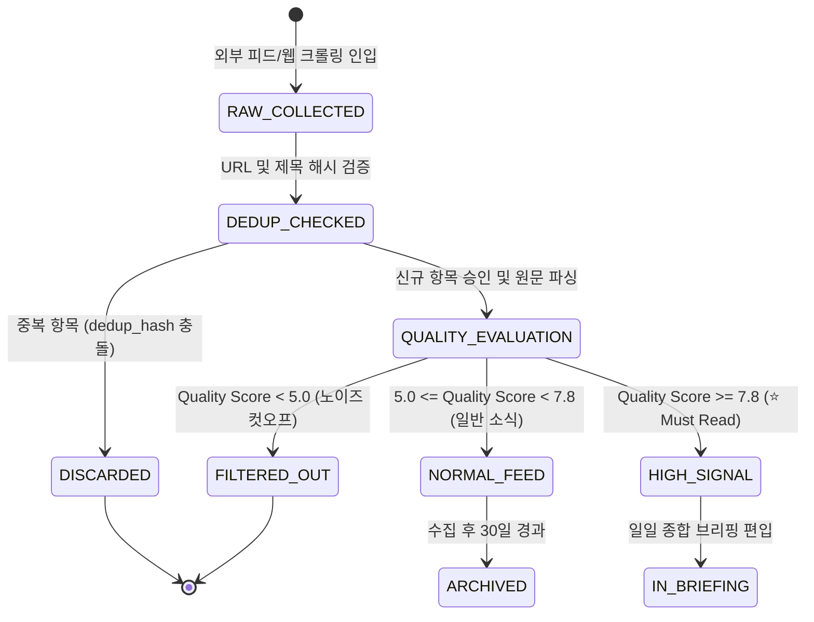
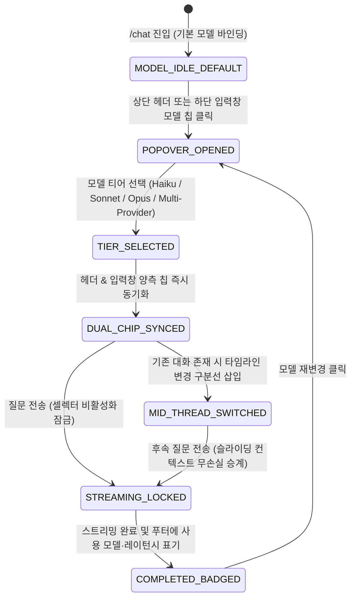

# AgentLens 비즈니스 정책 및 전역 예외 처리 명세서 (Policy & Edge Cases)

- **작성일자**: 2026-10-20
- **작성자**: 기획 명세 작성가 (`spec-writer`)
- **문서 버전**: v1.0
- **상태**: Approved

---

## 1. 핵심 엔티티 상태 전이 머신 (State Machine Policies)

시스템 내 핵심 엔티티인 뉴스 아이템(`NewsItem`), 대화 세션(`ChatSession`), 멀티 프로바이더 LLM 라우팅 및 모델 셀렉터(`MultiProviderModelState`)의 생명주기 및 전이 조건을 명세합니다.

### 1.1 뉴스 아이템(NewsItem) 및 수집 파이프라인 상태 머신

### 1.2 멀티 프로바이더 LLM 가용성 및 듀얼 모델 셀렉터 상태 머신

### 상태 전이 매트릭스 및 권한 규칙
| 현재 상태 | 대상 상태 | 전이 트리거 이벤트 | 필수 사전 조건 | 실행 가능 권한 |
| :--- | :--- | :--- | :--- | :--- |
| `RAW_COLLECTED` | `QUALITY_EVALUATION` | 신규 수집 항목 검증 통과 | 고유 `dedup_hash` 확인 및 본문/스니펫 확보 | 시스템 수집 워커 |
| `QUALITY_EVALUATION` | `HIGH_SIGNAL` | LLM 구조화 평가 완료 | `Quality Score >= 7.8` 및 스키마 검증 통과 | AI 큐레이션 엔진 |
| `MODEL_IDLE_DEFAULT` | `DUAL_CHIP_SYNCED` | 헤더 또는 입력창에서 모델 선택 | 스트리밍 대기 상태 (`isStreaming === false`) | 일반 사용자 |
| `DUAL_CHIP_SYNCED` | `MID_THREAD_SWITCHED` | 진행 중인 세션 내 모델 변경 | 현재 세션 내 메시지 1건 이상 존재 | 일반 사용자 |
| `STREAMING_LOCKED` | `COMPLETED_BADGED` | SSE `event: done` 수신 | 스트리밍 토큰 수신 완료 및 DB/로컬 커밋 | 시스템 자동 |

---

## 2. 공통 비즈니스 제약 및 유효성 검증 정책 (Global Business Policies)

### 2.1 문자열 및 텍스트 정책
- **XSS 방어 및 살균 처리**: 외부에서 수집된 기사 제목, 본문, 웹 검색 스니펫 및 LLM 스트리밍 응답은 렌더링 시 스크립트 태그 및 위험 속성을 자동 살균(Sanitization) 처리합니다.
- **URL 정규화 및 공백 처리**: 기사 URL에서 추적용 파라미터(`utm_*`, `fbclid` 등)를 제거하여 중복 해시를 산출하며, 모든 입력 문자열의 앞뒤 공백(Trim)은 자동 제거합니다.
- **반응형 줄바꿈 및 국소 스크롤 격리**: AI 챗 응답 본문은 자동 줄바꿈(`overflow-wrap: anywhere`)을 적용하여 페이지 가로 오버플로우를 차단하고, 긴 코드 블록과 마크다운 테이블은 해당 요소 내부에서만 가로 스크롤을 허용합니다.

### 2.2 시간 및 타임존 정책
- 모든 데이터베이스 저장(`created_at`, `published_at`, `updated_at`)은 **UTC 기준 ISO 8601** 형식(`YYYY-MM-DDTHH:mm:ssZ`)으로 기록합니다.
- 클라이언트 화면 표시 시에는 사용자의 로컬 브라우저 타임존을 감지하여 표기하며, 정기 수집 크론은 UTC 기준 매일 6시간 주기로 실행합니다.

### 2.3 멀티 프로바이더 LLM 라우팅 및 모델 셀렉터 정책
- **멀티 프로바이더 지원 (`POL-LLM-001`)**: 백엔드는 플러그형 프로바이더 인터페이스를 통해 **Anthropic Claude**, **Google Gemini**, **OpenAI**, **OpenAI-Compatible / Ollama** 멀티 프로바이더를 모두 지원합니다.
- **수집 파이프라인 및 프롬프트 캐싱 (`POL-LLM-002`)**: 뉴스 수집·요약·태깅 파이프라인은 환경 설정에 따라 구성된 프로바이더 모델을 지원하며, 시스템 프롬프트 캐싱을 통해 반복 수집 비용을 최적화합니다.
- **LLM 에러 전파 및 장애 처리 정책 (`POL-LLM-003`)**: 사용 가능한 프로바이더 API 키나 가용한 로컬 런타임이 없을 경우 HTTP 503 `ERR_LLM_PROVIDER_UNAVAILABLE` 오류로 키 설정을 안내하며, 업스트림 통신 장애 시 HTTP 502 `ERR_LLM_UPSTREAM_FAILED`, 호출 한도 초과 시 HTTP 429 `ERR_LLM_QUOTA_EXCEEDED`를 반환합니다.
- **헤더 & 입력창 듀얼 배치 및 무손실 전환 (`POL-UI-006`)**: 모델 선택기(`ChatModelSelector`)는 AI 챗 상단 글로벌 헤더 우측과 하단 프롬프트 입력창 좌하단에 동시 배치되어 실시간 양방향 동기화됩니다. 대화 도중 모델을 변경해도 세션을 리셋하지 않고 최근 10턴(최대 3,000토큰)의 대화 컨텍스트를 신규 모델로 무손실 인계합니다.
- **Zero-Leak API 키 보안 거버넌스 (`POL-SEC-004`)**: 어떠한 LLM API 키도 클라이언트 번들(`NEXT_PUBLIC_*`)이나 브라우저 네트워크 요청에 노출하지 않습니다. 모든 키는 백엔드 `.env` 및 OS 환경변수에만 격리 보관하고 FastAPI SSE 프록시로 스트리밍하며, 관리자 화면에서는 마스킹된 문자열(`sk-ant-***-Ab3d` 등)과 설정 여부 불리언 플래그만 노출합니다.

### 2.4 RAG 검색, 세션 영속화 및 챗 동작 정책
- **하이브리드 RAG 스코어링**: 키워드 일치도(SQLite FTS5 BM25 50%), 품질 점수(30%), 최신성 감쇠(20%)를 결합하여 상위 기사를 선별합니다.
- **챗 의도 기반 라우팅 및 인용 표시**: 일상 대화나 인사(안녕, hello, 감사 등)는 뉴스 DB 검색 도구를 호출하지 않고 즉시 자연스럽게 답변하며 가짜 출처 번호를 붙이지 않습니다. 기술 질문은 ReAct 플래너를 통해 코퍼스 검색을 수행하고, 답변 완료 시점에 실제 인용된 출처만을 필터링하여 인라인 인용(`[1]`, `[2]`, `[S1]`) 및 출처 메타데이터를 표시합니다.
- **단일 기사 Scoped 모드 심층 분석**: 단일 기사 집중(Scoped) 질의 시 대상 기사 1건의 원문 및 요약을 바탕으로 핵심 아키텍처, 코드 구현 예시, 기존 기술 대비 차별점, 실무 도입 고려사항의 4단 구조로 리포트를 합성합니다.
- **2계층 세션 영속화**: 대화 세션은 백엔드 SQLite DB와 브라우저 `localStorage`에 동시 동기화되며, 기기당 최대 30개 세션을 보존(초과 시 최선행 세션 FIFO 자동 정리)합니다.

---

## 3. 전역 엣지 케이스 및 장애 복구 UX 가이드 (Global Edge Cases)

| 장애 / 예외 유형 | 감지 방식 | 사용자 경험(UX) 복구 처리 방식 |
| :--- | :--- | :--- |
| **LLM API 키 미등록 / 프로바이더 미설정** | 서버 환경변수 내 활성 프로바이더 키 부재 감지 | HTTP 503 (`ERR_LLM_PROVIDER_UNAVAILABLE`) 에러를 반환하고 키 설정 안내 인라인 배너 노출 |
| **LLM 업스트림 통신 장애 / 5xx 에러** | 외부 LLM API 연결 실패 또는 502/503 수신 감지 | HTTP 502 (`ERR_LLM_UPSTREAM_FAILED`) 에러 안내 및 기존 작성 질문 보존, 재시도 버튼 노출 |
| **LLM API 호출 한도 초과 (429)** | 프로바이더 HTTP 429 응답 감지 | HTTP 429 (`ERR_LLM_QUOTA_EXCEEDED`) 경고 토스트 노출 및 다른 가용 모델 전환 유도 |
| **스트리밍 도중 연결 중단 / 타임아웃** | SSE 연결 단절 또는 15초 무응답 감지 | `event: error` (`ERR_LLM_STREAM_FAILED`) 전달, 부분 답변 보존 및 재시도 버튼 노출 |
| **원본 기사 스크래핑 차단 (403 / Paywall / Timeout)** | 추출기 HTTP 403 응답 또는 5초 타임아웃 감지 | 에러 중단 없이 `event: status`로 안내 후 피드 요약 메타데이터와 자율 웹 검색(Agentic Search) 보충 모드로 우아하게 다운그레이드 |
| **답변 스트리밍 중 모델 셀렉터 클릭** | `isStreaming === true` 상태 감지 | 스트리밍 진행 중에는 모델 셀렉터 칩을 비활성화(Disabled)하고 완료 후 변경 가능함을 안내 |
| **대화 도중 모델 변경 시 맥락 단절 우려** | 활성 세션 내 메시지 존재 상태에서 모델 변경 | 세션을 유지한 채 타임라인에 모델 변경 시스템 구분선을 삽입하고 이전 대화 히스토리를 차기 모델에 그대로 전달 |
| **오프라인 / 네트워크 단절** | 브라우저 `navigator.onLine === false` 또는 스트림 끊김 | 끊긴 시점까지의 생성 토큰을 로컬에 보존 및 재시도 버튼을 노출하고, 로컬 저장소 캐시 기반으로 과거 세션 열람 지원 |
| **수집 및 리셋 동시 실행 충돌 (409)** | 세션 상태 `is_collecting` 또는 `is_resetting` 잠금 확인 | 중복 요청을 즉시 거부(`409 Conflict`)하고 "현재 작업 완료 후 실행할 수 있습니다" 토스트 안내 |
| **모바일 가상 키보드 팝업 시 입력창 가림** | `visualViewport` 리사이즈 및 모바일 브레이크포인트 감지 | 16px 폰트 적용으로 자동 줌인을 방지하고 동적 뷰포트(`100dvh`) 및 바텀시트 모달로 입력창과 셀렉터 가시성 유지 |
