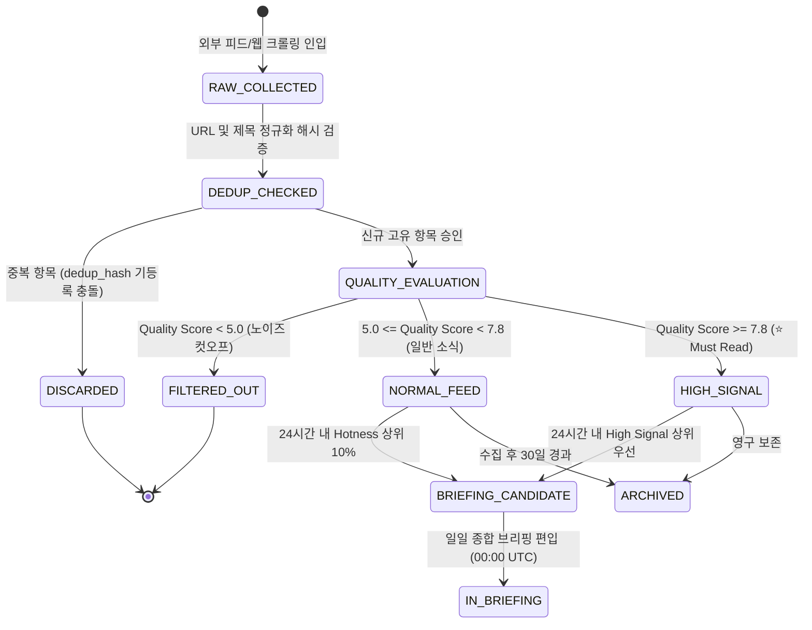
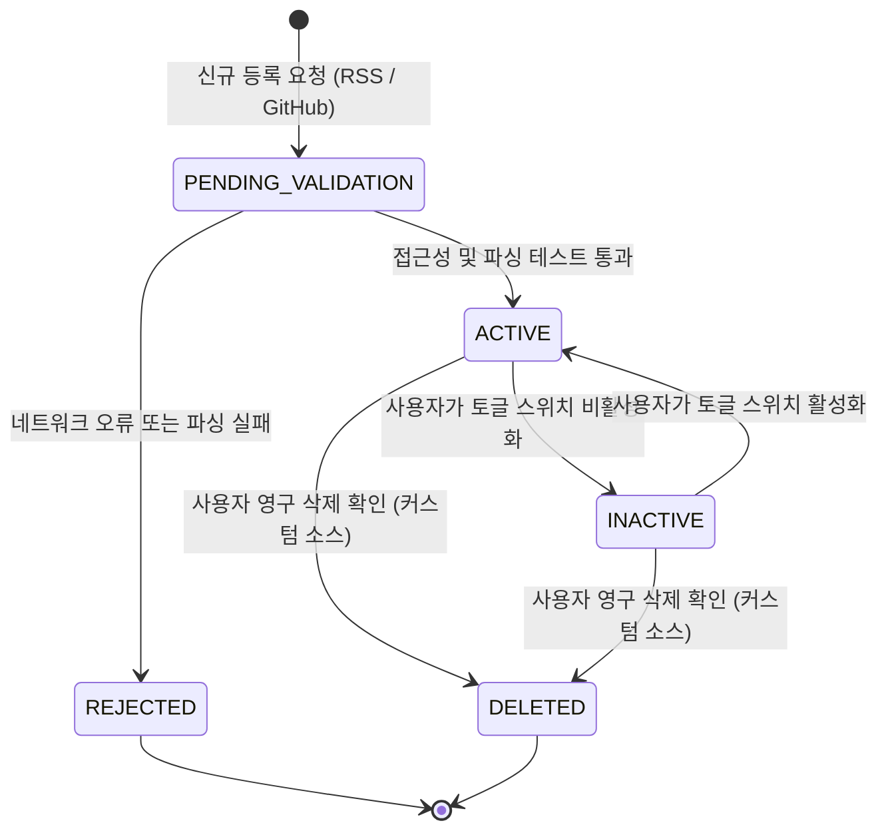
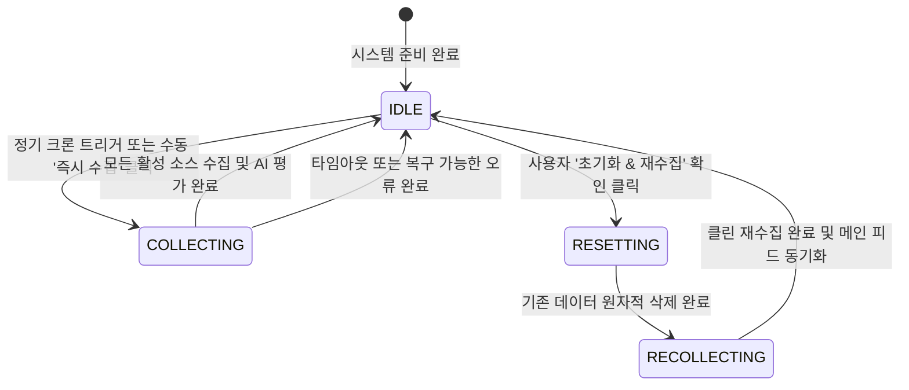
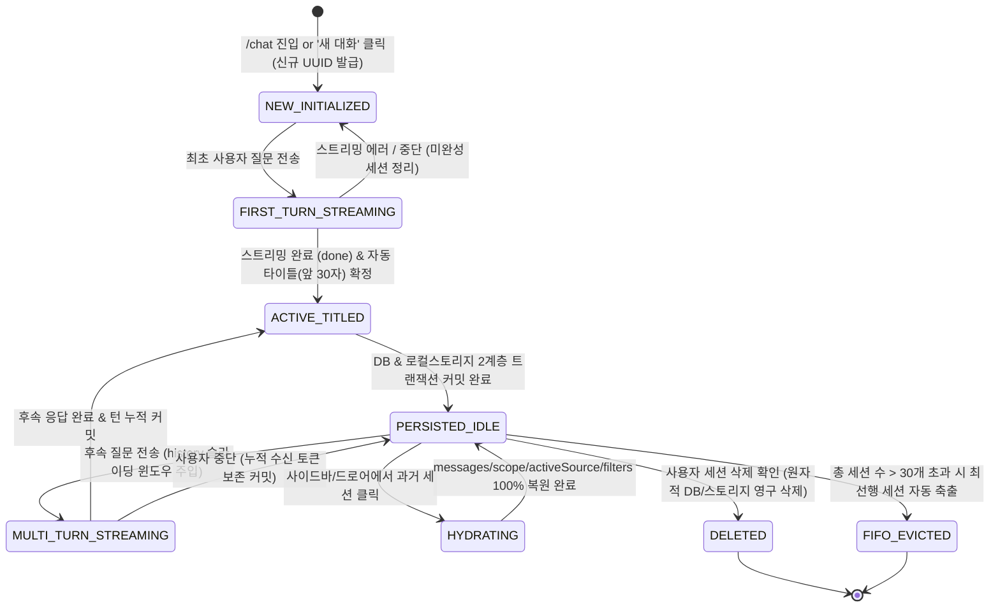
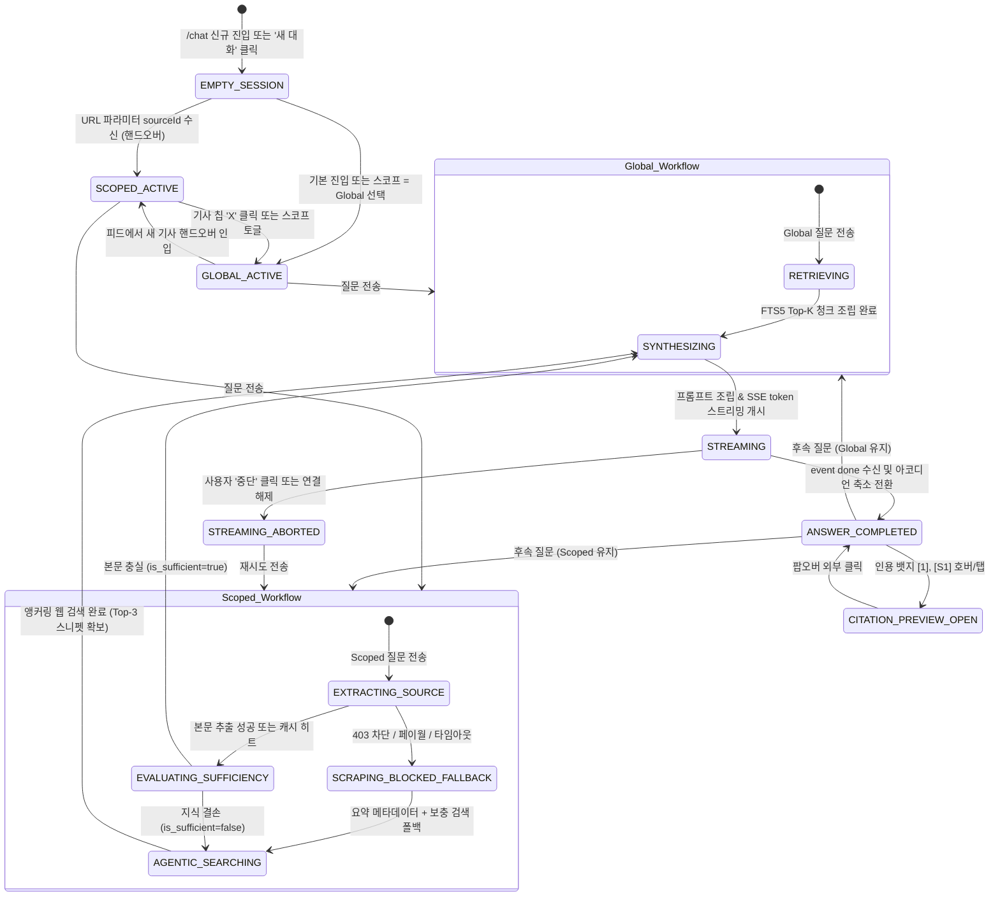
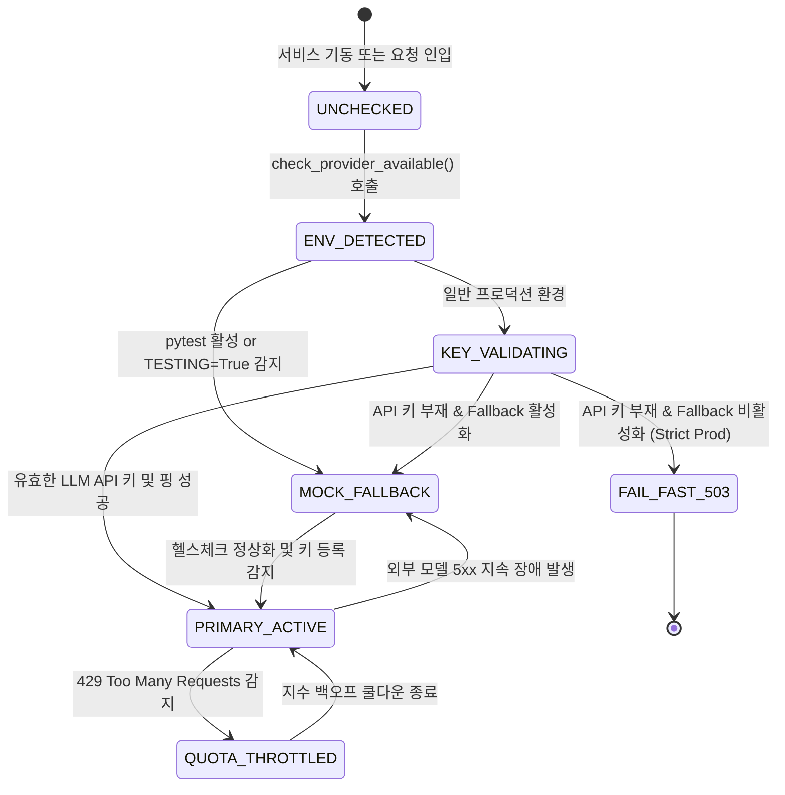
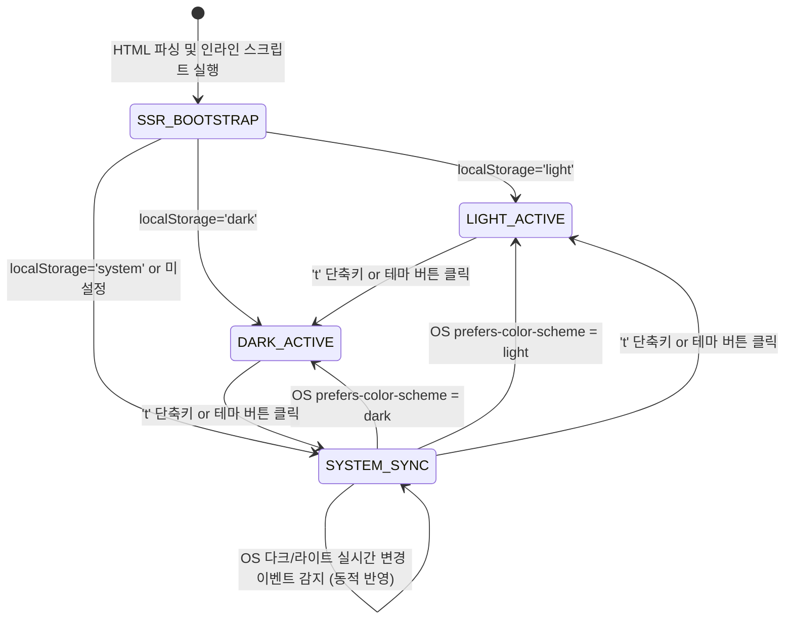
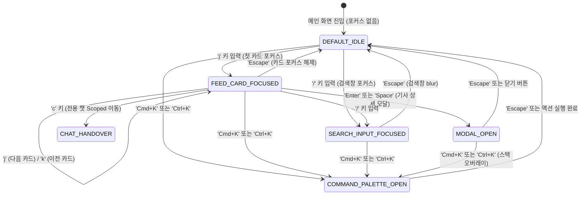
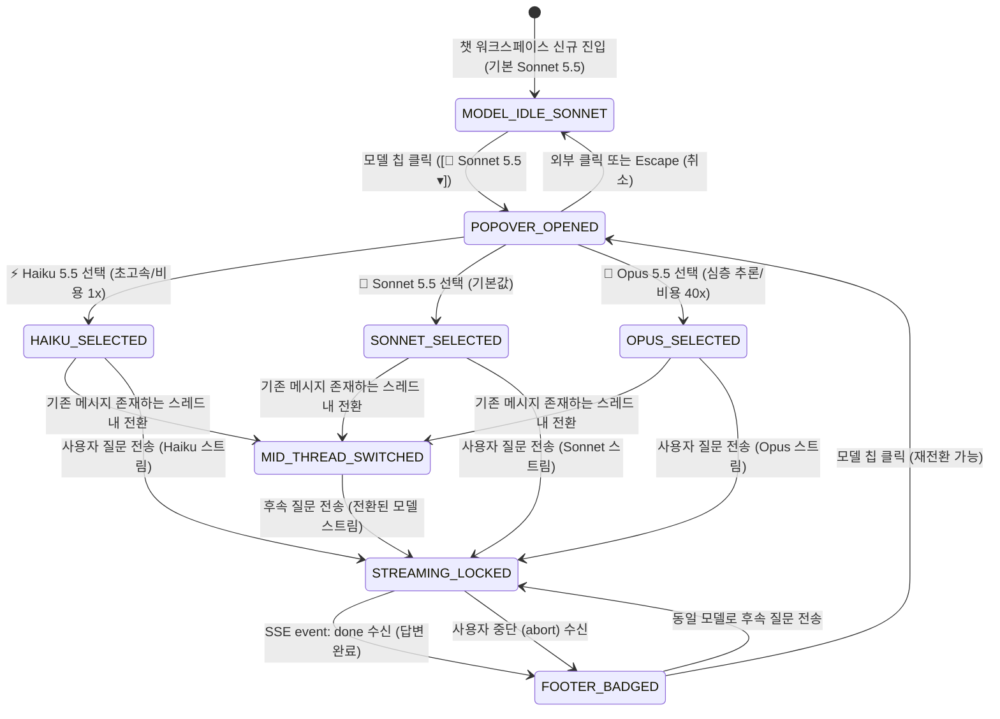
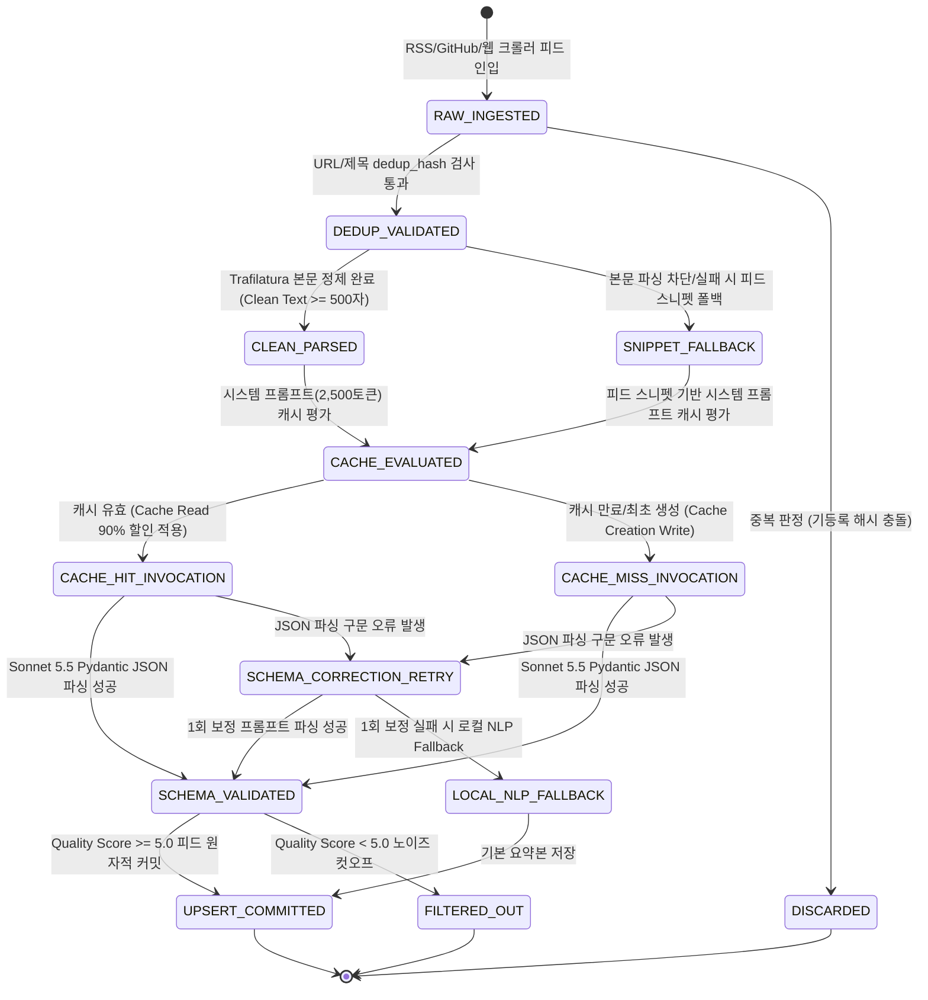

# AgentLens 비즈니스 정책 및 전역 예외 처리 명세서 (Policy & Edge Cases)

- **작성일자**: 2026-10-19
- **작성자**: 기획 명세 작성가 (`spec-writer`)
- **문서 버전**: 0.2.0 (Gemini 무단 폴백 차단, Claude 전용 파이프라인 확정 & AI 챗 모델 선택기 듀얼 배치 반영)
- **상태**: Approved
- **선행 산출물**: [01_PRD.md](./01_PRD.md), [report.md](../../report.md), [01_MARKET_BENCHMARK.md](../market-analyst/01_MARKET_BENCHMARK.md)

---

## 1. 핵심 엔티티 상태 전이 머신 (State Machine Policies)

AgentLens의 핵심 도메인 엔티티인 **NewsItem(뉴스 아이템)**, **Source(수집 소스)**, **CollectionSession(수집 및 리셋 세션)**, **ChatSession(대화 세션 영속화 수명주기)**, **Agentic Workflow(AI 챗 에이전틱 질의 워크플로우)**, **LLMProviderFailover(LLM 가용성 및 Mock Fallback 전이 머신)**, **UIThemeState(전역 테마 상태 머신)**, **KeyboardFocusState(키보드 내비게이션 & 커맨드 팔레트 상태 머신)**, **MultiModelSelectorState(멀티 모델 선택 및 동적 전환 상태 머신)**, **SonnetIngestionState(Claude Sonnet 5.5 수집 및 프롬프트 캐싱 상태 머신)**의 수명주기 및 전이 조건을 수학적으로 명확하게 규정합니다.

### 1.1 뉴스 아이템(NewsItem) 수명주기 상태 머신



#### 뉴스 아이템 상태 전이 매트릭스 및 권한 규칙
| 현재 상태 | 대상 상태 | 전이 트리거 이벤트 | 필수 사전 조건 | 실행 주체 |
| :--- | :--- | :--- | :--- | :--- |
| `RAW_COLLECTED` | `DEDUP_CHECKED` | 크롤러 수집 스트림 인입 | URL 프로토콜 정규화 및 제목 트림 완료 | 수집 파이프라인 |
| `DEDUP_CHECKED` | `DISCARDED` | 중복 판정 | 동일 `dedup_hash`가 이미 존재함 | 중복 방지 엔진 |
| `DEDUP_CHECKED` | `QUALITY_EVALUATION` | 신규 판정 | 고유한 식별자 검증 통과 | 수집 파이프라인 |
| `QUALITY_EVALUATION` | `FILTERED_OUT` | 품질 평가 완료 | `Quality Score < 5.0` | AI 큐레이션 엔진 |
| `QUALITY_EVALUATION` | `NORMAL_FEED` | 품질 평가 완료 | `5.0 <= Quality Score < 7.8` | AI 큐레이션 엔진 |
| `QUALITY_EVALUATION` | `HIGH_SIGNAL` | 품질 평가 완료 | `Quality Score >= 7.8` | AI 큐레이션 엔진 |
| `HIGH_SIGNAL` | `IN_BRIEFING` | 정기 브리핑 생성 (00:00 UTC) | 최근 24시간 내 수집 & 카테고리별 상위 3~5위 | 브리핑 엔진 |
| `NORMAL_FEED` | `ARCHIVED` | 데이터 보관 정책 | 생성 시각 기준 30일 경과 | 시스템 배치 |

---

### 1.2 수집 소스(Source) 수명주기 상태 머신



#### 소스 상태 전이 매트릭스 및 권한 규칙
| 현재 상태 | 대상 상태 | 전이 트리거 이벤트 | 필수 사전 조건 | 권한 / 주체 |
| :--- | :--- | :--- | :--- | :--- |
| `PENDING_VALIDATION` | `ACTIVE` | 등록 검증 성공 | 유효한 XML/RSS 파싱 확인 또는 공개 GitHub 저장소 확인 | 시스템 검증기 |
| `PENDING_VALIDATION` | `REJECTED` | 등록 검증 실패 | 404 Not Found 또는 XML 파싱 구문 오류 | 시스템 검증기 |
| `ACTIVE` | `INACTIVE` | 활성화 토글 클릭 | 비활성화 후에도 최소 1개 이상 활성 소스 존재 | 사용자 / 운영자 |
| `INACTIVE` | `ACTIVE` | 활성화 토글 클릭 | 소스 접근성 유효 상태 | 사용자 / 운영자 |
| `ACTIVE`/`INACTIVE` | `DELETED` | 영구 삭제 확인 | 기본 내장(Built-in) 소스가 아님 | 사용자 / 운영자 |

---

### 1.3 수집 및 리셋 세션(CollectionSession) 상호 배제 상태 머신



#### 세션 상태 전이 규칙 (Mutual Exclusion)
- **MUTEX-001**: `COLLECTING` 또는 `RESETTING` 상태에서는 신규 수집 또는 리셋 요청이 인입될 경우 즉시 거절(`409 Conflict`)된다.
- **MUTEX-002**: `RESETTING` 진입 시 기존 데이터베이스의 모든 소식, 중복 해시, 수집 로그가 원자적으로 삭제된 후 즉시 `RECOLLECTING` 단계로 자동 전이된다.

---

### 1.4 대화 세션 영속화 수명주기 상태 머신 (Chat Session Persistence Lifecycle State Machine)

AgentLens의 대화 세션(`ChatSession`)은 백엔드 관계형 DB(`chat_sessions`, `chat_messages`)와 브라우저 로컬 저장소(`localStorage`)에 걸쳐 동기화되는 2계층 영속성 엔티티입니다. 어디서든 챗 진입 시 기본은 '신규 세션'으로 시작하되, 사용자의 멀티턴 질의응답 및 세션 전환/삭제에 따른 라이프사이클을 다음과 같이 엄격히 관리합니다.



#### 대화 세션 영속화 상태 전이 매트릭스
| 현재 상태 | 대상 상태 | 전이 트리거 이벤트 | 필수 사전 조건 | 시스템 처리 및 데이터 영속화 |
| :--- | :--- | :--- | :--- | :--- |
| `[*]` | `NEW_INITIALIZED` | `/chat` 진입 or '새 대화' 버튼 클릭 | 브라우저 진입 | UUID v4 `session_id` 신규 발급, 대화창 빈 상태 리셋 |
| `NEW_INITIALIZED` | `FIRST_TURN_STREAMING` | 첫 사용자 질문 전송 | 텍스트 1~2,000자 | 사용자 메시지 로컬 임시 적재, 백엔드 SSE 스트림 연결 |
| `FIRST_TURN_STREAMING` | `ACTIVE_TITLED` | 최초 답변 스트리밍 완료 | SSE `event: done` 수신 | 첫 질문 기반 자동 타이틀(앞 30자) 생성, 어시스턴트 메시지 DB 커밋 |
| `FIRST_TURN_STREAMING` | `NEW_INITIALIZED` | 스트리밍 전송 에러/중단 | 실패 이벤트 감지 | 미완성 세션 정리, 재입력 대기 |
| `ACTIVE_TITLED` | `PERSISTED_IDLE` | 2계층 동기화 완료 | DB & 로컬 커밋 성공 | `chat_sessions` 및 `localStorage` 인덱스 갱신, 유휴 상태 전이 |
| `PERSISTED_IDLE` | `MULTI_TURN_STREAMING` | 후속 질문 전송 | 세션 활성 & 텍스트 유효 | 최근 10턴 슬라이딩 윈도우(`history`) 첨부하여 백엔드 전송 |
| `MULTI_TURN_STREAMING` | `ACTIVE_TITLED` | 후속 답변 스트리밍 완료 | SSE `event: done` 수신 | 신규 메시지 쌍 DB/로컬 원자적 커밋, `updated_at` 갱신 |
| `MULTI_TURN_STREAMING` | `PERSISTED_IDLE` | 사용자 중단(`abort`) | 중단 버튼 클릭 | 중단 시점까지의 누적 텍스트 커밋 후 대기 상태 전이 |
| `PERSISTED_IDLE` | `HYDRATING` | 사이드바 과거 세션 클릭 | 유효한 `sessionId` 선택 | 현재 스트리밍 확인/중단 후 세션 역직렬화 시작 |
| `HYDRATING` | `PERSISTED_IDLE` | 컨텍스트 복원 완료 | 메시지/스코프/필터 로드 성공 | 대화 버블 복원, 최하단 스크롤, 멀티턴 질의 대기 |
| `PERSISTED_IDLE` | `DELETED` | 사용자 세션 삭제 확인 | 삭제 모달 확정 | DB `chat_sessions` & `chat_messages` 및 로컬 키 CASCADE 삭제 |
| `PERSISTED_IDLE` | `FIFO_EVICTED` | 신규 세션 생성으로 세션 수 > 30 | 세션 총합 31개 도달 | `updated_at` 최선행 세션 선별 후 DB/로컬 백그라운드 자동 영구 삭제 |

---

### 1.5 AI 챗 질의 및 에이전틱 워크플로우 상태 머신 (Agentic Query Workflow State Machine)



#### 챗 세션 및 에이전틱 워크플로우 상태 전이 매트릭스
| 현재 상태 | 대상 상태 | 전이 트리거 이벤트 | 필수 사전 조건 | 시스템 처리 및 SSE 통지 |
| :--- | :--- | :--- | :--- | :--- |
| `EMPTY_SESSION` | `SCOPED_ACTIVE` | 핸드오버 라우팅 인입 | 유효한 `sourceId` 존재 | 기사 메타데이터 로드, 상단 활성 기사 칩 렌더링 |
| `SCOPED_ACTIVE` | `GLOBAL_ACTIVE` | 컨텍스트 칩 제거 (X) | 칩 닫기 버튼 클릭 | 단일 기사 바인딩 해제, 코퍼스 검색 모드로 전환 |
| `SCOPED_ACTIVE` | `EXTRACTING_SOURCE` | Scoped 질문 전송 | 텍스트 2자 이상 | `event: status` (`extracting_source`), DB 캐시 조회 |
| `EXTRACTING_SOURCE` | `EVALUATING_SUFFICIENCY` | 본문 확보 완료 | 캐시 히트 또는 Clean Text $\ge 500$자 | `full_content` DB 저장 및 LRU 캐시 적재 |
| `EXTRACTING_SOURCE` | `SCRAPING_BLOCKED_FALLBACK` | 추출 차단 감지 | 페이월, 403 Forbidden, 5초 타임아웃 | `event: status` 차단 알림 및 요약 모드 전환 |
| `SCRAPING_BLOCKED_FALLBACK` | `AGENTIC_SEARCHING` | 자동 폴백 전이 | 기사 제목/기술 스택 유효 | `event: status` (`agentic_searching`), 대체 검색 가동 |
| `EVALUATING_SUFFICIENCY` | `SYNTHESIZING` | 충실도 만족 | `is_sufficient === true` | `event: status` (`synthesizing`), 프롬프트 조립 |
| `EVALUATING_SUFFICIENCY` | `AGENTIC_SEARCHING` | 충실도 결손 | `is_sufficient === false` | `event: status` (`agentic_searching`), 앵커링 쿼리 생성 |
| `AGENTIC_SEARCHING` | `SYNTHESIZING` | 웹 검색 완료 | DuckDuckGo/Tavily Top-3 확보 | 원본/보충 소스 결합 및 프롬프트 조립 |
| `GLOBAL_ACTIVE` | `RETRIEVING` | 질문 전송 | 텍스트 2자 이상 | FTS5 BM25 + Quality Score + Recency 연산 |
| `RETRIEVING` | `SYNTHESIZING` | 청크 선별 완료 | Top-K 청크 조립 | `event: status` (`synthesizing`), 프롬프트 주입 |
| `SYNTHESIZING` | `STREAMING` | LLM 응답 시작 | 최초 토큰 생성 | `event: sources`, `event: token` 실시간 스트리밍 |
| `STREAMING` | `ANSWER_COMPLETED` | 스트림 종료 | `event: done` 수신 | 스텝 트래커 $\rightarrow$ 접이식 아코디언 자동 축소 전환 |
| `STREAMING` | `STREAMING_ABORTED` | 중단 버튼 클릭 | `AbortController.abort()` | 누적 토큰까지 저장, 연결 해제 및 입력창 재활성화 |

---

### 1.6 백엔드 LLM 프로바이더 가용성 및 Mock Fallback 전이 머신 (LLM Provider Failover State Machine)

백엔드 LLM 서비스 계층(`llm_processor.py`)은 실제 서드파티 API 키의 등록 상태, 런타임 네트워크 연결성, 그리고 CI/pytest 테스트 환경 플래그에 따라 서비스 다운타임(HTTP 503)을 원천 차단하고 결함 허용성을 보장하는 상태 머신을 운영합니다.



#### LLM 프로바이더 가용성 상태 전이 매트릭스
| 현재 상태 | 대상 상태 | 전이 트리거 이벤트 | 필수 사전 조건 | 시스템 처리 및 응답 형태 |
| :--- | :--- | :--- | :--- | :--- |
| `UNCHECKED` | `ENV_DETECTED` | `/api/chat/stream` 호출 | 요청 수신 | 환경변수 및 모듈 인덱스 스캔 |
| `ENV_DETECTED` | `MOCK_FALLBACK` | 테스트 환경 감지 | `pytest` 모듈 로드 or `TESTING=True` | `MockLLMProvider` 바인딩, 200 OK 모의 스트림 반환 |
| `ENV_DETECTED` | `KEY_VALIDATING` | 일반 런타임 환경 | 테스트 플래그 미설정 | 설정 파일(`config.json`) 및 환경변수 키 검증 |
| `KEY_VALIDATING` | `PRIMARY_ACTIVE` | API 키 유효 확인 | Gemini/OpenAI/Claude 키 존재 | 주 프로바이더 스트림 생성기 활성화 |
| `KEY_VALIDATING` | `MOCK_FALLBACK` | 키 부재 및 폴백 허용 | `ALLOW_MOCK_FALLBACK=True` | 경고 로그 기록 후 `MockLLMProvider`로 안전 전환 |
| `KEY_VALIDATING` | `FAIL_FAST_503` | 키 부재 및 엄격 프로덕션 | `ALLOW_MOCK_FALLBACK=False` | `503 Service Unavailable` 즉시 반환 |
| `PRIMARY_ACTIVE` | `QUOTA_THROTTLED` | 429 응답 수신 | 서드파티 쿼터 초과 | 지연 안내 토스트 반환 및 서킷 브레이커 작동 |

---

### 1.7 전역 UI 테마 수명주기 및 사용자/시스템 선호도 상태 머신 (UI Theme State Machine)

`next-themes` 기반 테마 엔진은 브라우저 렌더링 전 인라인 스크립트 실행부터 사용자의 수동 조작, 그리고 OS 레벨의 다크모드 전환 이벤트를 조율합니다.



#### 테마 상태 전이 매트릭스
| 현재 상태 | 대상 상태 | 전이 트리거 이벤트 | 필수 사전 조건 | 시스템 처리 및 DOM 제어 |
| :--- | :--- | :--- | :--- | :--- |
| `SSR_BOOTSTRAP` | `DARK_ACTIVE` | 인라인 평가 결과 = dark | 로컬스토리지='dark' or (system & OS dark) | `<html class="dark">` 주입, FOUC 깜빡임 0건 |
| `SSR_BOOTSTRAP` | `LIGHT_ACTIVE` | 인라인 평가 결과 = light | 로컬스토리지='light' or (system & OS light)| `<html class="">` 주입, 라이트 팔레트 렌더링 |
| `LIGHT_ACTIVE` | `DARK_ACTIVE` | 테마 토글 액션 | 버튼 클릭 or `t` 키 | `setTheme('dark')`, `class="dark"` 토글, 로컬 저장 |
| `DARK_ACTIVE` | `SYSTEM_SYNC` | 테마 토글 액션 | 버튼 클릭 or `t` 키 | `setTheme('system')`, OS 미디어 쿼리 리스너 활성화 |
| `SYSTEM_SYNC` | `LIGHT_ACTIVE` | 테마 토글 액션 | 버튼 클릭 or `t` 키 | `setTheme('light')`, `class` 제거, 로컬 저장 |
| `SYSTEM_SYNC` | `SYSTEM_SYNC` | OS 테마 변경 감지 | `matchMedia.addEventListener` | 새로고침 없이 즉시 `html.dark` 클래스 동적 갱신 |

---

### 1.8 파워 유저 키보드 포커스 및 커맨드 팔레트 상태 머신 (Keyboard Navigation & Command Palette State Machine)

웹 애플리케이션 전반에서 사용자의 마우스 없는 키보드 인터랙션을 조율하며, 텍스트 입력창 타이핑과의 충돌을 방지합니다.



#### 키보드 내비게이션 상태 전이 매트릭스
| 현재 상태 | 대상 상태 | 전이 트리거 이벤트 | 시스템 가드 및 처리 |
| :--- | :--- | :--- | :--- |
| `DEFAULT_IDLE` | `FEED_CARD_FOCUSED` | `j` 키보드 입력 | `focusedIndex = 0`, 파란색 포커스 링 렌더링, `e.preventDefault()` |
| `FEED_CARD_FOCUSED` | `FEED_CARD_FOCUSED` | `j` 또는 `k` 입력 | 인덱스 $\pm 1$ 보정 (0 ~ N-1 범위 내), `scrollIntoView` 실행 |
| `FEED_CARD_FOCUSED` | `MODAL_OPEN` | `Enter` 키 입력 | 선택된 기사 상세 모달 오픈, 모달 내부 포커스 트랩 |
| `FEED_CARD_FOCUSED` | `CHAT_HANDOVER` | `c` 키 입력 | `/chat?sourceId={id}` 라우팅, Scoped 전용 챗 초기화 |
| `ANY_STATE` | `SEARCH_INPUT_FOCUSED` | `/` 키 입력 | 상단 검색바 DOM 포커스 및 텍스트 선택, `e.preventDefault()` |
| `ANY_STATE` | `COMMAND_PALETTE_OPEN`| `Cmd+K` / `Ctrl+K` | 전역 커맨드 팔레트 모달 오픈, 배경 스크롤 고정 |
| `COMMAND_PALETTE_OPEN` | 이전 상태 | `Escape` 키 입력 | 팔레트 닫힘, 직전 포커스 엘리먼트로 복원 |

---

### 1.9 AI 챗 멀티 모델 셀렉터 및 인라인 동적 전환 상태 머신 (Multi-Model Selector & In-Flight Transition State Machine)

사용자의 질의 의도(속도/비용 vs 심층 분석 vs 고난도 추론)에 따른 모델 선택, 세션 진행 중 모델 교체, 그리고 스트리밍 중 상태 락(Lock)을 관장하는 상태 머신입니다.



#### 멀티 모델 셀렉터 상태 전이 매트릭스
| 현재 상태 | 대상 상태 | 전이 트리거 이벤트 | 필수 사전 조건 | 시스템 처리 및 UX 반응 |
| :--- | :--- | :--- | :--- | :--- |
| `[*]` | `MODEL_IDLE_SONNET` | `/chat` 진입 or '새 대화' | 신규 세션 초기화 | 기본 모델 `claude-3-5-sonnet-latest` 바인딩, 입력창에 `[🎯 Sonnet 5.5 ▾]` 칩 표시 |
| `MODEL_IDLE_*` | `POPOVER_OPENED` | 셀렉터 칩 클릭 | `isStreaming === false` | 3-Tier 팝오버 표시 (Haiku/Sonnet/Opus), 비용/속도 배지 노출, 첫 번째 포커스 |
| `POPOVER_OPENED` | `HAIKU_SELECTED` | ⚡ Haiku 항목 클릭 | 팝오버 오픈 상태 | 모델 `claude-3-5-haiku-latest` 지정, 칩 `[⚡ Haiku 5.5 ▾]` 갱신, 팝오버 닫힘 |
| `POPOVER_OPENED` | `SONNET_SELECTED` | 🎯 Sonnet 항목 클릭 | 팝오버 오픈 상태 | 모델 `claude-3-5-sonnet-latest` 지정, 칩 `[🎯 Sonnet 5.5 ▾]` 갱신, 팝오버 닫힘 |
| `POPOVER_OPENED` | `OPUS_SELECTED` | 🧠 Opus 항목 클릭 | 팝오버 오픈 상태 | 모델 `claude-3-5-opus-latest` 지정, 칩 `[🧠 Opus 5.5 ▾]` 갱신, 심층 모드 툴팁 노출 |
| `ANY_SELECTED` | `MID_THREAD_SWITCHED` | 대화 진행 중 모델 교체 | `messages.length > 0` | 세션 ID 유지, 타임라인에 `[🔄 Claude {Tier} 5.5로 모델 변경됨]` 시스템 디바이더 삽입 |
| `*_SELECTED` | `STREAMING_LOCKED` | 사용자 질문 제출 | 텍스트 유효 | 모델 셀렉터 버튼 `disabled=true` 락, 선택 모델 ID를 페이로드에 실어 SSE 스트림 요청 |
| `STREAMING_LOCKED` | `FOOTER_BADGED` | 스트리밍 완료 또는 중단 | `done` 또는 `abort` | 셀렉터 락 해제, 어시스턴트 메시지 푸터에 실제 모델 배지(`Sonnet 5.5`) 및 레이턴시(`ms`) 영속화 |

---

### 1.10 Claude Sonnet 5.5 전담 수집 및 프롬프트 캐싱 파이프라인 상태 머신 (Sonnet Ingestion & Prompt Caching State Machine)

수집된 원시 뉴스 기사가 Claude Sonnet 5.5를 통해 정제, 요약, Why It Matters 도출, 공인 기술 스택 분류를 거쳐 피드에 반영되기까지의 상태 전이를 엄격히 규정합니다.



#### Sonnet 수집 및 캐싱 파이프라인 상태 전이 매트릭스
| 현재 상태 | 대상 상태 | 전이 트리거 이벤트 | 필수 사전 조건 | 시스템 처리 및 데이터 전이 |
| :--- | :--- | :--- | :--- | :--- |
| `RAW_INGESTED` | `DEDUP_VALIDATED` | 중복 검증 통과 | 신규 URL & 제목 해시 | `news_items` 테이블 dedup_hash 충돌 없음 확인 |
| `DEDUP_VALIDATED` | `CLEAN_PARSED` | Trafilatura 파싱 성공 | HTTP 200 & 클린 마크다운 | 4,000~8,000토큰 본문 확보, `full_content` 메모리 적재 |
| `DEDUP_VALIDATED` | `SNIPPET_FALLBACK` | 본문 스크래핑 차단 | 403/Paywall/Timeout | 피드 RSS description 텍스트로 대체 바인딩 |
| `CLEAN_PARSED` | `CACHE_HIT_INVOCATION` | Anthropic API 호출 | 5분 이내 동일 시스템 프롬프트 | `cache_read_input_tokens > 0` 확인 ($0.10/MTok 단가 적용) |
| `CLEAN_PARSED` | `CACHE_MISS_INVOCATION` | Anthropic API 호출 | 최초 또는 캐시 TTL 만료 | `cache_creation_input_tokens > 0` 확인 (신규 캐시 생성) |
| `*_INVOCATION` | `SCHEMA_VALIDATED` | LLM 응답 수신 | `SummaryItemSchema` 일치 | 3줄 TL;DR, 150자 Why It Matters, 기술태그, 점수 검증 완료 |
| `*_INVOCATION` | `SCHEMA_CORRECTION_RETRY`| Pydantic 파싱 실패 | JSON 비정형/코드블록 감싸기 | 정규식 추출 시도 및 1회 보정 프롬프트 재호출 |
| `SCHEMA_VALIDATED` | `UPSERT_COMMITTED` | 품질 평가 통과 | `quality_score >= 5.0` | SQLite WAL DB 원자적 트랜잭션 커밋, 7.8점 이상 Must Read 뱃지 |
| `SCHEMA_VALIDATED` | `FILTERED_OUT` | 품질 컷오프 | `quality_score < 5.0` | 저품질/광고 판정으로 DB 저장 배제 |

---

## 2. 공통 비즈니스 제약 및 알고리즘 정책 (Global Business Policies)

### 2.1 텍스트 정규화 및 보안 살균(Sanitization) 정책
- **XSS 방어 및 스크립트 제거**: 외부에서 수집된 모든 제목, 원문, 마크다운 텍스트, 스크래핑 본문, 웹 검색 스니펫 및 LLM 스트리밍 답변은 인입/렌더링 즉시 스크립트 태그(`<script>`, `javascript:`, `onload=` 등)를 원천 살균(DOMPurify) 처리한다.
- **URL 정규화 및 추적 파라미터 제거**: 기사 URL에서 분석 및 추적용 파라미터(`utm_source`, `utm_medium`, `utm_campaign`, `fbclid`, `gclid`)를 완전 제거한 후 정규화된 URL을 생성한다.
- **공백 및 길이 제약**: 제목 및 검색어의 시작과 끝 공백(Trim)은 인입 시 자동 제거되며, 연속된 다중 공백은 단일 공백으로 치환한다.

### 2.2 시간, 타임존 및 크론 스케줄 정책
- **저장 타임존**: 모든 생성 일시(`created_at`), 발행 일시(`published_at`), 실행 일시(`run_at`), 스크래핑 일시(`scraped_at`)는 **UTC 기준 ISO 8601** 형식(`YYYY-MM-DDTHH:mm:ssZ`)으로 저장한다.
- **표시 타임존**: 사용자 화면 표시는 브라우저의 로컬 타임존(한국 사용자 기준 KST `UTC+9`)으로 변환하며, 24시간 이내의 소식은 상대 시간("방금 전", "3시간 전"), 24시간 초과 소식은 절대 시간("YYYY-MM-DD")으로 표기한다.
- **정기 크론 주기**: 매일 UTC 기준 `00:00, 06:00, 12:00, 18:00` (한국 시간 `09:00, 15:00, 21:00, 03:00`)에 정기 수집 파이프라인을 가동한다.

### 2.3 정량적 알고리즘 산출 공식

#### 1) 품질 점수 (Quality Score: $S_{quality}$)
AI 큐레이션 모델 또는 로컬 분석 엔진에 의해 1.0에서 10.0 사이의 실수로 산출된다:
$$S_{quality} = w_1 \cdot \text{기술적 신규성} + w_2 \cdot \text{구현 구체성} + w_3 \cdot \text{벤치마크 신뢰도} - w_4 \cdot \text{홍보성 노이즈}$$
- $S_{quality} < 5.0$: 노이즈로 간주되어 메인 피드 및 지식 검색 대상에서 영구 제외(`FILTERED_OUT`).
- $S_{quality} \ge 7.8$: 고신호 아티클(`HIGH_SIGNAL`, ⭐️ Must Read)로 자동 승격.

#### 2) 추천도 점수 (Hotness Score: $S_{hot}$)
품질 점수와 시간 경과에 따른 감쇠(Decay)를 결합하여 산출된다:
$$S_{hot} = S_{quality} \times 0.4 + \left(\max\left(0, 10 - \frac{\Delta t}{3600 \times 6}\right)\right) \times 0.6$$
(단, $\Delta t$는 현재 시각과 발행 시각 사이의 경과 시간(초)이다.)

#### 3) Tech Radar 급상승 속도 (Surging Velocity: $V$)
특정 기술 태그의 최근 24시간 언급 빈도($C_{recent}$)와 직전 24시간 언급 빈도($C_{prev}$)의 증감률로 계산된다:
$$V = \begin{cases} 
\frac{C_{recent} - C_{prev}}{\max(1, C_{prev})} \times 100\% & (C_{recent} \ge 2) \\
0\% & (C_{recent} < 2)
\end{cases}$$
- $V \ge +20\%$이고 최근 24시간 내 최소 2회 이상 언급된 태그를 `Surging Tag`로 발탁한다.

---

### 2.4 개인용 RAG 지식 검색 랭킹 및 인용 무결성 정책 (Personal RAG & Citation Policies)

#### 1) 통합 하이브리드 RAG 검색 랭킹 공식
사용자 질의 $Q$에 대해 후보 기사 $i$의 최종 검색 스코어 $S_{rag}(i, Q)$는 다음과 같이 산출된다:
$$S_{rag}(i, Q) = w_{bm25} \cdot \text{Norm}(S_{bm25}(i, Q)) + w_{qual} \cdot \left(\frac{S_{quality}(i)}{10.0}\right) + w_{rec} \cdot \exp\left(-\frac{\Delta t_i}{\tau}\right)$$
- **파라미터 가중치**:
  - $w_{bm25} = 0.50$: 키워드 일치도 가중치 (SQLite FTS5 BM25 점수를 [0, 1] 구간으로 Min-Max 정규화)
  - $w_{qual} = 0.30$: 에이전트렌즈 품질 점수 가중치 (1.0~10.0을 10으로 나눈 정규화 값)
  - $w_{rec} = 0.20$: 발행일자 최신성 가중치 ($\tau = 7\text{일} = 604,800\text{초}$ 반감기 지수 감쇠)
- **Top-K 선별 규칙**:
  - $S_{rag}$ 점수 기준 내림차순 정렬 후 상위 $K=5$개 아티클 청크를 선별.
  - 단, $S_{quality} < 5.0$인 아티클은 점수와 무관하게 사전 컷오프(Pruning) 처리.

#### 2) 컨텍스트 윈도우 및 청킹(Chunking) 정책
- 단일 기사 집중(Scoped) 모드:
  - 기사의 제목, 카테고리, 기술스택, 3-Bullet TL;DR, Why It Matters, 그리고 실시간 스크래핑된 `full_content` 본문 전체를 프롬프트에 주입 (최대 12,000 토큰).
- 전체 코퍼스(Global) 모드:
  - 선별된 상위 5개 기사 각각에 대해 `[기사 N] 제목 / 카테고리 / 요약 / 핵심 발췌문` 구조로 청크를 포맷팅하여 최대 4,000 토큰 이내로 조립.

#### 3) 환각 제로 그라운딩(Zero-Hallucination Grounding) 지침
LLM 시스템 프롬프트에 다음 제약 조건을 엄격히 강제한다:
1. **증거 기반 답변**: 제공된 기사 컨텍스트에 명시된 사실에만 근거하여 서술할 것.
2. **엄격한 인라인 인용**: 각 주장의 근거가 된 기사에 대해 문장 말미에 반드시 번호형 뱃지(`[1]`, `[2]`, `[S1]`)를 표기할 것.
3. **유령 인용 금지**: 주입된 기사/웹 소스 목록에 없는 번호(예: 제공된 기사가 3건인데 `[5]`를 생성)는 절대 부여하지 말 것.
4. **정직한 한계 인정**: 주어진 기사들로 답변할 수 없는 내용은 추측하지 않고 "제공된 뉴스 코퍼스에서 관련 정보를 찾을 수 없습니다"라고 명시할 것.

#### 4) 인용 역참조(Reverse Lookup) 무결성 검증
클라이언트 렌더러는 LLM 답변 스트림 수신 시 다음 정합성을 검증한다:
- 응답 내 모든 `[N]` 및 `[SN]` 패턴에 대해 서버가 전달한 `sources` 배열에서 `source.index === N`인 항목이 존재하는지 확인한다.
- 매칭되는 소스가 없는 경우, 해당 뱃지는 인터랙티브 뱃지가 아닌 일반 텍스트로 폴백 렌더링하여 허위 링크 연결을 원천 방지한다.

---

### 2.5 수집 소식 타깃팅 필터 조합 및 RAG 쿼리 바인딩 정책 (Targeted Focus Scoping & Query Binding Policy)

#### 1) 다차원 필터 파라미터 매트릭스
사용자가 바텀 시트(`FUNC-CHAT-006`)에서 선택한 타깃 조건은 백엔드 RAG 리트리버(`FUNC-CHAT-005`)의 SQL WHERE 절 및 랭킹 가중치 파라미터에 다음과 같이 결정론적으로 바인딩된다:

| 필터 파라미터 | 허용 값 (Enum / Type) | 기본값 | SQL 쿼리 조건 바인딩 | 비고 |
| :--- | :--- | :---: | :--- | :--- |
| `category` | `all`, `harness`, `mcp_plugins_skills`, `agent_tech`, `ai_news` | `all` | `category != 'all'` 시 `AND category = :category` | 단일 카테고리 필터링 |
| `time_range` | `all`, `24h`, `7d`, `30d` | `all` | 아래 기간별 타임스탬프 절 적용 | 기간별 최신성 감쇠 반감기($\tau$) 동적 보정 |
| `sort` | `hot`, `latest`, `quality` | `hot` | `latest`: `published_at DESC`, `quality`: `quality_score DESC` | 최종 후보 정렬 우선순위 |
| `high_signal_only` | `true`, `false` | `false` | `high_signal_only = true` 시 `AND is_high_signal = 1` | ⭐️ Must-Read 전용 필터링 |

#### 2) 기간(Recency Range) 변환 및 감쇠 반감기 동적 보정
- `time_range === '24h'`: `published_at >= datetime('now', '-24 hours')`, 지수 감쇠 반감기 $\tau = 1\text{일} (86,400\text{초})$
- `time_range === '7d'`: `published_at >= datetime('now', '-7 days')`, 지수 감쇠 반감기 $\tau = 3\text{일} (259,200\text{초})$
- `time_range === '30d'`: `published_at >= datetime('now', '-30 days')`, 지수 감쇠 반감기 $\tau = 7\text{일} (604,800\text{초})$
- `time_range === 'all'`: 시간 조건 배제, 지수 감쇠 반감기 $\tau = 14\text{일} (1,209,600\text{초})$

#### 3) 실시간 예측 카운팅 정책
바텀 시트 내 옵션 터치 시, 클라이언트 로컬 캐시 메모리에 로드된 기사 메타데이터에 대해 $O(N)$ 인메모리 필터링을 100ms 디바운스로 수행하여 "타깃 뉴스: N건 매칭" 카운트를 산출한다.

#### 4) 0건 결과 시 지능적 자동 완화(Auto-Relaxation) 정책
사용자가 과도하게 좁은 조건(예: 특정 마이너 카테고리 + 최근 24시간)을 설정하여 타깃 검색 결과가 0건일 때:
- 시스템은 에러(`ERR_EMPTY_CORPUS`)를 내뿜지 않고, 1차로 기간 조건을 `all`로 자동 완화하여 검색을 재수행한다.
- 완화된 결과로 답변이 생성되는 경우, 응답 상단에 `[안내: 선택 조건(최근 24시간)의 소식이 없어 전체 기간으로 확장 검색했습니다]` 시스템 피드백 뱃지를 자동으로 부착한다.

---

### 2.6 모바일 뷰포트 무결성 및 가상키보드 렌더링 규약 (Mobile Viewport & Keyboard Rendering Standard)

#### 1) iOS Safari 16px 폰트 물리적 강제 룰
iOS Safari는 폼 인풋(`input`, `textarea`, `select`)의 폰트 크기가 16px 미만일 때 접근성 지원 명목으로 뷰포트를 강제 줌인(115~130%)시킨다. 이를 방지하기 위해:
- 모바일 브레이크포인트(`< 640px`)에서는 모든 프롬프트 입력창에 `font-size: 16px` (Tailwind `text-base`)를 필수 적용한다.
- 데스크톱 화면(`sm: >= 640px`)에서만 `text-sm`(14px)으로 렌더링을 허용한다.

#### 2) Next.js 뷰포트 메타데이터 규약
최상위 `layout.tsx`의 뷰포트 설정에 다음 속성을 선언한다:
```ts
export const viewport: Viewport = {
  width: 'device-width',
  initialScale: 1,
  maximumScale: 1,
  userScalable: false,
  interactiveWidget: 'resizes-content',
  viewportFit: 'cover',
};
```

#### 3) 가로 스크롤(overflow-x) 박멸 룰
`html`, `body`, `#root`, 그리고 전용 챗 최상위 컨테이너에 다음 스타일을 엄격히 강제한다:
- `overflow-x: hidden; width: 100%; max-width: 100%; box-sizing: border-box;`
- 스크롤 가능 메시지 영역에는 `overscroll-behavior-y: contain;`을 적용하여 iOS 바디 바운스(Rubber-banding)로 인한 레이아웃 깨짐을 방어한다.

#### 4) `visualViewport` 키보드 오프셋 동기화 룰
가상 키보드가 팝업될 때:
- `window.innerHeight - window.visualViewport.height`를 실시간 계산하여 컴포저 래퍼의 하단 인셋(`padding-bottom: ${H_{kb}}px`)을 `requestAnimationFrame` 주기로 동기화한다.
- 키보드 상단과 입력창 사이의 흡착 오차는 $\le 2\text{px}$ 이내로 유지되어야 한다.

---

### 2.7 원본 소스 실시간 전문 스크래핑 및 캐싱 무결성 정책 (Live Scraping & Caching Policy)

#### 1) Trafilatura / Readability 본문 정제 규칙
- **스크래핑 엔진**: 기본 엔진으로 Python `trafilatura`를 사용하며, 실패 시 `readability-lxml` + `BeautifulSoup4`로 2차 시도한다.
- **제거 대상 노이즈 요소**:
  - 광고 배너, 소셜 공유 버튼, 헤더 네비게이션 바, 푸터 링크, 쿠키 동의 팝업, 댓글(Comments) 블록, 자바스크립트(`<script>`), CSS(`<style>`), 임베드된 트위터/유튜브 iframe.
- **보존 대상 핵심 엔지니어링 콘텐츠**:
  - H1~H4 마크다운 제목 계층, 문단 텍스트, 코드 블록(인라인 및 ` ``` ` 블록과 프로그래밍 언어 태그), 데이터 표(`<table>`), 수식(`$...$`), 인용문(`>`).
- **본문 유효성 임계치 (Clean Text Threshold)**:
  - 정제 후 텍스트 길이가 최소 **500자 이상**이어야 유효한 본문 추출로 인정한다. 500자 미만인 경우 본문 추출 실패(`ERR_SCRAPE_EMPTY_CONTENT`)로 처리한다.

#### 2) 스크래핑 타임아웃 및 동시성 제어
- 단일 기사 스크래핑 네트워크 요청 타임아웃은 **5.0초**로 엄격히 제한한다.
- 동일 기사에 대해 여러 사용자가 동시에 스크래핑을 요청할 경우, 락(Lock)을 통해 첫 번째 작업만 네트워크를 수행하고 나머지는 대기 후 캐시 결과를 공유(Single-flight Pattern)한다.

#### 3) 영속화 및 인메모리 2계층 캐싱 정책
- **1계층 (Database)**: 추출 성공 시 SQLite `news_items` 테이블의 `full_content` 컬럼에 텍스트를 영구 저장하고 `scraped_at = CURRENT_TIMESTAMP`를 기록한다.
- **2계층 (Memory Cache)**: 최근 조회된 500개 기사의 본문을 LRU 메모리 캐시에 적재한다.
- **캐시 유효성(TTL)**: 영구 보존을 기본으로 하되, 30일 이상 경과한 아카이브 기사는 `full_content`를 유지하고 메모리 캐시에서만 퇴출한다.
- **캐시 히트 시 레이턴시 보장**: 캐시된 본문이 존재할 경우 스크래핑 네트워크 대기 시간은 **0ms**이다.

---

### 2.8 정보 충실도(Sufficiency) 평가 및 자율 검색 쿼리 앵커링 정책 (Sufficiency Evaluation & Query Anchoring Policy)

#### 1) 정보 충실도 판정 수학적 기준 및 의사결정 트리
LLM은 1차 원문 본문과 사용자 질문 $Q$를 대조하여 다음 의사결정 함수 $\text{EvalSufficient}(Q, C_{source})$를 수행한다:
$$\text{EvalSufficient}(Q, C_{source}) = \begin{cases} 
\text{False} & \text{if } \exists \kappa \in \text{KeyRequirements}(Q) \text{ s.t. } \kappa \notin C_{source} \\
\text{True} & \text{otherwise}
\end{cases}$$
- **결손 판정 조건 ($\text{False}$)**:
  1. 원본 본문 내에 설치 명령어(`pip install`, `brew install`, `docker run`), 공식 GitHub 리포지토리 URL, CLI 실행 문법이 누락되어 있으나 질문자가 이를 요구하는 경우.
  2. 원본 본문에 서술되지 않은 타 라이브러리(예: LangGraph vs AutoGen vs CrewAI)와의 성능/아키텍처 비교를 요구하는 경우.
  3. 기사 발행 시점 이후의 최근 변경점이나 최신 패치 버전을 질문하는 경우.
- **충족 판정 조건 ($\text{True}$)**:
  - 질문에서 요구하는 모든 아키텍처 원리, 기능 설명, 코드 조각이 원문 본문 $C_{source}$ 내에 충분히 기술되어 있는 경우.

#### 2) 컨텍스트 앵커링 쿼리 생성 공식
검색 에이전트가 생성하는 하위 검색어 $Q_{sub}$는 반드시 원본 기사의 메타데이터를 기반으로 맥락이 고정(Anchored)되어야 한다:
$$Q_{sub} = \text{AnchorPrefix}(\text{Title}_{source}, \text{TechStack}_{source}) + " " + \text{ExtractIntent}(Q)$$
- **구체적 생성 예시**:
  - 사용자 질문: "이거 어떻게 설치하고 파이썬에서 불러와?"
  - 원본 기사: `LangGraph v0.3 Release: Functional API Introduced`
  - 잘못된 생성 (Drift 발생): `how to install and import in python` $\rightarrow$ 엉뚱한 라이브러리 검색
  - **올바른 앵커링 생성**: `"LangGraph v0.3" install pip python import example`
- **쿼리 생성 제약**:
  - 질문 1턴당 생성되는 검색 쿼리는 **최대 2개**로 제한.
  - 검색어 길이는 5~15단어로 간결하게 유지.

#### 3) 검색 결과 관련도 필터링 및 쿼리 드리프트 차단
- DuckDuckGo / Tavily에서 수집된 상위 스니펫에 대해 기사 주제와의 코사인 유사도 또는 키워드 중복도 $\text{Relevance} \ge 0.60$인 항목만 선별한다.
- 관련도가 0.60 미만인 스니펫은 프롬프트 주입 대상에서 즉시 폐기한다.
- 턴당 외부 웹 검색 타임아웃은 **3.0초**로 엄격히 제한한다.

---

### 2.9 SSE `event: status` 이벤트 스트림 프로토콜 규약 (SSE Status Event Protocol)

백엔드와 프론트엔드는 SSE 스트림 수립 시 실시간 상태 전이를 위해 다음 표준 이벤트 페이로드를 교환한다:

```json
event: status
data: {
  "step": "extracting_source" | "evaluating_sufficiency" | "agentic_searching" | "synthesizing",
  "label": "한국어 안내 메시지",
  "progress": 0 ~ 100,
  "query": "검색 쿼리 문자열 (agentic_searching 단계 시 선택)",
  "queries": ["쿼리1", "쿼리2"],
  "sources_found": 2
}
```

#### 단계별 프로토콜 시퀀스 및 진행률 규칙
1. `POST /api/chat/stream` 요청 수신 즉시 (0~100ms):
   `{"step": "extracting_source", "label": "🌐 원본 소스 본문 추출 중...", "progress": 20}`
2. 본문 확보 후 충실도 분석 진입 (1.5~2.5초):
   `{"step": "evaluating_sufficiency", "label": "🧠 본문 정보 충실도 분석 중...", "progress": 45}`
3. 지식 결손 감지 및 보충 검색 가동 시 (2.5~4.0초):
   `{"step": "agentic_searching", "label": "🔍 보충 기술 문서 자율 검색 중...", "progress": 65, "query": "LangGraph v0.3 install python"}`
4. 종합 리포트 생성 진입 (4.0~5.0초):
   `{"step": "synthesizing", "label": "📝 심층 엔지니어링 리포트 종합 중...", "progress": 85}`
5. 첫 토큰 전송 시점:
   - `event: sources`: 주입된 출처 메타데이터 전송
   - `event: token`: 마크다운 텍스트 연속 스트리밍
6. 생성 완료 시점:
   - `event: done`: 스트리밍 완료 통지 $\rightarrow$ UI는 스텝 트래커를 접이식 아코디언으로 즉시 축소 전환.

---

### 2.10 페이월 및 Anti-bot 차단 시 우아한 다운그레이드(Graceful Degradation) 정책

- **감지 기준**:
  - 원본 URL HTTP 상태 코드가 `403 Forbidden`, `401 Unauthorized`, `429 Too Many Requests`, `503 Service Temporarily Unavailable`이거나 Cloudflare/Datadome 챌린지 HTML이 반환된 경우.
- **다운그레이드 실행 절차**:
  1. 에러를 뿜고 연결을 끊지 않는다.
  2. 즉시 SSE `event: status`를 발송한다:
     `{"step": "agentic_searching", "label": "⚠️ 원본 사이트 보안 정책으로 직접 추출 제한: 기사 요약 및 웹 검색 보충 모드로 전환", "progress": 50}`
  3. 피드 수집 시점의 3줄 요약(`summary`)과 `why_it_matters`를 기본 베이스라인 지식으로 확보한다.
  4. 기사 제목과 기술 스택을 기반으로 외부 웹 검색(DuckDuckGo / Tavily)을 즉시 가동하여 대체 공개 기술 블로그, 공식 GitHub 리포지토리, 릴리즈 노트를 수집한다.
  5. 확보된 보충 웹 문서들로 4단 엔지니어링 리포트를 완성하고, 사용자에게 다운그레이드 경고 배지(`scrape_fallback_notice`)를 투명하게 표기한다.

---

### 2.11 심층 엔지니어링 4단 구조화 리포트 및 이원화 인용 표기 정책

#### 1) 4단 구조화 마크다운 리포트 템플릿
Scoped 심층 질의에 대해 LLM은 다음 마크다운 H2 섹션을 반드시 순서대로 포함해야 한다:
- `## 1. 핵심 아키텍처 및 동작 원리`: 내부 시스템 구조, 제어 흐름, 상태 전이 메커니즘
- `## 2. 주요 기능 및 코드 구현 예시`: 실제 구동 가능한 파이썬/TS 코드 스니펫, API 엔드포인트 및 파라미터
- `## 3. 기존 기술 대비 차별점 및 벤치마크`: 이전 버전 또는 경쟁 프레임워크 대비 정량적 개선점, 레이턴시/정확도 지표 비교표
- `## 4. 실무 도입 시 고려사항 및 튜닝 파라미터`: 프로덕션 배포 시 주의점, 의존성 요구사항, 튜닝 권장 파라미터

#### 2) 출처 이원화 인용 뱃지 규칙
- **기사 원본 출처**: `[1]` (Primary Source, 원본 아티클 URL 및 해당 문맥 발췌문)
- **자율 보충 웹 출처**: `[S1]`, `[S2]` (Supplementary Web Sources, 외부 검색을 통해 발굴한 공식 문서/블로그)
- **프리뷰 팝오버 분리**: `[1]` 클릭 시 "뉴스 원문 보기 / 상세 모달 열기", `[S1]` 클릭 시 "외부 웹 문서 새 탭 열기" 인터랙션을 제공하여 신뢰성을 극대화한다.

---

### 2.12 AI 챗 응답 자동 줄바꿈(Word Wrapping) 및 가로 오버플로우 방어 규약 (Text Wrapping & Zero Horizontal Scroll Standard)

#### 1) Flexbox `min-w-0` 하드 강제 룰 (Flex Shrink Lock)
- **원인 분석**: CSS Flexbox 명세(W3C Flexbox Specification Level 1)에 따라, flex 컨테이너 내부 아이템의 기본 `min-width`는 `auto`로 설정된다. 그 결과 자식 요소에 긴 텍스트, 인라인 코드, 테이블이 포함되면 컨테이너가 축소되지 못하고 최소 고유 너비(`min-content`)까지 무한히 팽창하여 화면 바깥으로 삐져나온다.
- **물리적 강제 규약**:
  - `ChatMessageList` 및 `ChatMessageItem`의 모든 flex-1 자식 엘리먼트에 반드시 `min-w-0` (`min-width: 0px`) 및 `max-w-full`을 선언한다.
  - 마크다운 콘텐츠 최상위 래퍼(`div.markdown-content`)에 `w-full max-w-full min-w-0`을 강제하여 flex 축소 제약을 100% 활성화한다.

#### 2) 타이포그라피 래핑 3단 CSS 규약 (Universal Word Wrapping)
AI 챗 응답의 모든 문단(`p`), 리스트(`li`), 헤딩(`h1`~`h4`), 강조(`strong`), 링크(`a`) 엘리먼트에 다음 3단 래핑 속성을 복합 적용한다:
```css
overflow-wrap: anywhere; /* W3C 최신 표준: 공백이 없는 긴 문자열도 컨테이너 경계에서 강제 분할 */
word-break: break-word;  /* 웹킷/레거시 브라우저 호환성 */
break-words: true;       /* Tailwind 유틸리티 클래스 */
```
- **효과**: 공백(Space)이 전혀 없는 1,000자 이상의 초장문 URL, Base64 인코딩 문자열, SHA-256 해시값, 정규식 패턴이 인입되더라도 컨테이너 경계에 닿는 즉시 정확히 글자 단위로 다음 줄로 줄바꿈된다.

#### 3) 인라인 코드(`inline-code`) 글자 단위 줄바꿈 룰
인라인 코드(`<code>` 태그)는 프로그래밍 식별자, 긴 파일 경로(`file:///Users/.../node_modules/...`), API 엔드포인트 URL을 자주 포함한다.
- **적용 스타일**: `font-mono text-[12px] bg-slate-100 px-1.5 py-0.5 rounded border border-slate-200 break-all`
- **효과**: `break-all`을 통해 기호나 슬래시(`/`) 뒤뿐 아니라 임의의 글자 위치에서도 유연하게 줄바꿈되어 부모 버블의 폭을 1px도 넓히지 않는다.

#### 4) 코드 블록(`pre`) 및 마크다운 테이블(`table`) 국소 스크롤 격리 룰
코드 블록과 데이터 표는 가로로 길어지더라도 상위 대화창 화면 전체를 밀어내서는 안 된다.
- **코드 블록 래퍼**:
  - 외곽 컨테이너: `<div className="w-full max-w-full min-w-0 overflow-hidden my-3 rounded-lg border border-slate-200">`
  - 내부 `<pre>` 요소: `p-3 overflow-x-auto font-mono text-[12px] leading-relaxed`
- **테이블 래퍼**:
  - `<div className="w-full max-w-full min-w-0 overflow-x-auto my-3 border border-slate-200 rounded-lg">`
  - `<table className="w-full text-xs text-left border-collapse">`
- **효과**: 코드 블록이나 테이블이 화면 폭보다 넓을 때, **오직 해당 블록 내부에서만 부드러운 가로 스크롤바가 생성**되며, 전체 대화 버블과 페이지 레이아웃은 0px의 가로 흔들림 없이 완전하게 고정된다.

#### 5) 가로 스크롤 제로(0px) 수학적 검증 수식
대화 화면 내 모든 컨테이너 노드 $C$는 렌더링 완료 및 스트리밍 진행 중 다음 부등식을 100% 만족해야 한다:
$$\forall C \in \{\text{Window}, \text{ChatWorkspace}, \text{ChatMessageList}, \text{ChatMessageItem}\}, \quad \text{scrollWidth}(C) \le \text{clientWidth}(C)$$
(단, 국소 스크롤 래퍼로 격리된 `pre.overflow-x-auto` 및 `div.table-wrapper`에 한해서만 $\text{scrollWidth} > \text{clientWidth}$ 허용)

---

### 2.13 대화 세션 영속화 수명주기, 멀티턴 컨텍스트 윈도우 및 데이터 보존 정책 (Chat Session Persistence & Data Retention Policies)

#### 1) 2계층 영속화 아키텍처 및 원자적 동기화 규약 (Dual-Layer Persistence Architecture)
AgentLens의 대화 세션은 백엔드 관계형 데이터베이스와 브라우저 로컬 저장소 간 상호 보완적인 2계층(Dual-Layer) 구조로 영속화됩니다:
- **1계층 (Database Engine)**:
  - SQLite `chat_sessions` 테이블: `id (UUID PK)`, `title (VARCHAR(200))`, `created_at (TIMESTAMP UTC)`, `updated_at (TIMESTAMP UTC)`, `scope_mode (VARCHAR(20))`, `active_source_id (INTEGER FK news_items.id)`, `active_filters (JSON)`.
  - SQLite `chat_messages` 테이블: `id (UUID PK)`, `session_id (UUID FK chat_sessions.id ON DELETE CASCADE)`, `role (VARCHAR(20))`, `content (TEXT)`, `timestamp (TIMESTAMP UTC)`, `status (VARCHAR(20))`, `sources (JSON)`, `applied_filters (JSON)`, `latency_ms (INTEGER)`.
  - 인덱스: `idx_chat_sessions_updated_at (updated_at DESC)`, `idx_chat_messages_session_time (session_id, timestamp ASC)`.
- **2계층 (Browser Client Engine)**:
  - 개별 세션 캐시 키: `agentlens_chat_session_{session_id}` (직렬화된 JSON 문자열 `ChatSession`).
  - 세션 목록 메타데이터 인덱스 키: `agentlens_chat_sessions_index` (`Array<{id, title, updatedAt, scopeMode, messageCount}>`).
- **원자적 동기화 프로토콜**:
  1. **사용자 질의 전송 즉시**: 클라이언트 `localStorage` 및 `sessionStorage`에 사용자 메시지가 즉각 선반영(Optimistic Update)되어 브라우저 새로고침이나 탭 닫힘 시에도 질문이 유실되지 않는다.
  2. **스트리밍 응답 진행 중**: 청크 토큰 누적 상태는 클라이언트 메모리 및 세션 스토리지에 임시 보존된다.
  3. **스트리밍 완료 통지(`event: done`) 수신 즉시**: 백엔드는 `chat_messages` 레코드를 원자적 트랜잭션으로 DB에 영구 커밋하고, 세션의 `updated_at`을 갱신한다. 클라이언트는 수신된 최종 메타데이터를 `localStorage`에 즉시 확정 커밋한다.
  4. **오프라인 퍼스트(Offline-First) 무결성**: 브라우저 오프라인 상태에서도 `localStorage`에 캐시된 과거 대화 세션 및 메시지 전체를 지연 없이 즉각 로드할 수 있으며, 온라인 재연결 시 백엔드 세션 인덱스와 머지(Merge)된다.

#### 2) 기본 새 대화 진입 원칙 및 컨텍스트 격리 규약 (Default New Chat Entry Principle)
- **신규 진입 시 제로 컨텍스트 격리**:
  - 사용자가 상단 글로벌 내비게이션 바(`/chat`), 브라우저 북마크, 메인 피드 로고 클릭 등을 통해 챗 워크스페이스에 진입할 때, 시스템은 **이전 대화의 자동 이어받기를 엄격히 금지**하고 항상 신규 고유 세션 ID(`crypto.randomUUID()`)를 발급하여 빈 대화창(Empty State)으로 진입한다.
  - 이를 통해 사용자는 이전 리서치 주제의 잔여 컨텍스트에 방해받지 않고 완전히 새로운 주제의 탐색을 즉각 개시할 수 있다.
- **예외적 복원 라우팅**:
  - 명시적인 URL 쿼리 파라미터 `?session_id={UUID}`가 주어졌을 때에만 해당 세션을 DB/스토리지에서 조회하여 멀티턴 복원을 수행한다.
- **피드 핸드오버 컨텍스트 격리**:
  - 뉴스 피드 카드나 상세 모달에서 `?sourceId={id}`를 장착하고 인입될 경우에도 과거 대화와 결합하지 않고, 해당 기사를 바인딩한 '신규 Scoped 세션'을 생성하여 이전 대화와의 맥락 오염(Context Bleeding)을 100% 방지한다.

#### 3) 멀티턴 컨텍스트 윈도우 슬라이딩 압축 알고리즘 (Multi-turn Context Sliding Window Algorithm)
사용자가 과거 세션 복원 후 후속 질의를 하거나 대화를 연속해서 이어갈 때, LLM 프롬프트에 주입되는 대화 이력(History)은 다음 슬라이딩 윈도우 함수 $\text{SlidingHistory}(H)$에 의해 결정론적으로 산출된다:
$$\text{SlidingHistory}(H, W_{max}) = \text{Tail}(H, 2 \times W_{max}) \quad (\text{단, } W_{max} = 10 \text{ 턴, 최대 } 20 \text{ 개 메시지})$$
- **토큰 버짓 분배 정책 (Total 16,000 Tokens)**:
  - 시스템 프롬프트 (Senior Staff Architect 페르소나 및 4단 구조 제약): 최대 **2,000 토큰**
  - 뉴스 기사 본문(`full_content`) 또는 자율 웹 검색 결과(`sources` Top-3): 최대 **10,000 토큰**
  - 멀티턴 대화 이력 슬라이딩 윈도우(`history`): 최대 **3,000 토큰** (최근 10턴 이내)
  - 사용자 신규 질의 및 완성형 응답 생성 여유분: 최소 **1,000 토큰**
- **히스토리 토큰 초과 시 슬라이딩 축소 룰**:
  - 만약 최근 10턴의 총 토큰 수가 3,000 토큰을 초과할 경우, 가장 오래된 턴(User-Assistant 쌍)부터 1턴씩 순차 제외하여 3,000 토큰 이하가 되도록 동적으로 슬라이딩 축소한다. 화면상의 전체 UI 버블 렌더링은 유지하되 백엔드 전송 페이로드만 안전하게 최적화한다.

#### 4) 세션 자동 타이틀링(Auto-Titling) 정규화 알고리즘
- **제목 생성 함수**:
  신규 세션의 초기 제목은 `'새 대화'`이며, 사용자의 최초 질문 $Q_1$이 제출되는 순간 다음 정규화 규칙에 의해 확정된다:
  $$\text{Title} = \begin{cases}
  \text{Truncate}(\text{Sanitize}(Q_1), 30) + "\dots" & (\text{length}(\text{Sanitize}(Q_1)) > 30) \\
  \text{Sanitize}(Q_1) & (1 \le \text{length}(\text{Sanitize}(Q_1)) \le 30) \\
  \text{"새 대화"} & (\text{length}(\text{Sanitize}(Q_1)) = 0)
  \end{cases}$$
- **살균 정규화 규칙 ($\text{Sanitize}$)**:
  - 마크다운 기호(`#`, `*`, `_`, `~`, `` ` ``), HTML 태그(`<.../>`), 줄바꿈 문자(`\n`, `\r`)를 공백으로 치환.
  - 연속된 공백 문자열(`\s+`)을 단일 공백으로 압축.
  - 문자열 앞뒤 공백 트림(Trim).

#### 5) 30개 세션 보존 및 FIFO 자동 축출 정책 (Retention & FIFO Eviction Policy)
- **최대 허용 세션 한도**: 클라이언트 디바이스 스토리지 및 무로그 데이터베이스의 용량 한계 방어를 위해 기기당 최대 보존 세션 수 $S_{max} = 30$을 엄격히 강제한다.
- **FIFO 자동 축출 (Auto-Eviction)**:
  - 신규 세션 생성 또는 기존 세션 갱신으로 세션 총 개수 $N_{session} > S_{max}$가 되는 즉시, 최종 수정 시각(`updated_at`)이 가장 오래된 세션 $s_{victim}$을 선별한다:
    $$s_{victim} = \arg\min_{s \in \text{Sessions}} s.updated\_at$$
  - 선별된 $s_{victim}$ 세션 및 연관된 `chat_messages` 레코드는 백그라운드에서 트랜잭션으로 원자적 영구 삭제되며, 클라이언트 `localStorage` 키에서도 즉시 소거된다.
- **데이터 보존 수명(TTL)**:
  - 세션 데이터의 최대 보존 수명은 최종 활동 시점 기준 **30일**이며, 30일 동안 활동이 없는 세션은 정기 시스템 배치에 의해 자동 만료 정리 대상이 된다.
- **명시적 삭제 원자성**:
  - 사용자가 세션 삭제(휴지통) 버튼을 누르고 확정하면 `DELETE /api/chat/sessions/{session_id}` 호출을 통해 외래키 `ON DELETE CASCADE`에 의해 모든 메시지 및 인용 메타데이터가 DB와 브라우저 로컬 저장소에서 지연 없이 0ms로 원자적 동시 소거된다.

---

### 2.14 전역 테마(다크/라이트/시스템) 지속성 및 SSR 무깜빡임(Zero-Flicker) 정책
- **SSR 인라인 스크립트 선행 주입**:
  Next.js 16 App Router의 루트 레이아웃에 `<html lang="ko" suppressHydrationWarning>`을 선언하고 `next-themes`를 장착한다. 브라우저가 첫 DOM을 페인트하기 전, 인라인 스크립트를 통해 `localStorage.getItem('theme')` 및 미디어 쿼리 `(prefers-color-scheme: dark)`를 동기적으로 평가하여 `<html class="dark">`를 주입한다. 이를 통해 최초 화면 로드 시 하얀 화면이 번쩍이는 FOUC(Flash of Unstyled Content) 현상을 0건으로 완전 차단한다.
- **Tailwind CSS dark: 토큰 명도 대비 규약**:
  모든 메인 피드 카드, 헤더, 모달, 챗 버블, 코드 블록, 상태 표시기 등은 Tailwind CSS `dark:` 토큰을 100% 매핑하며, WCAG AA 기준 텍스트-배경 명도 대비(Contrast Ratio) 4.5:1 이상을 엄격히 충족해야 한다.

---

### 2.15 파워 유저 키보드 이벤트 격리 및 포커스 트랩 정책 (Input Isolation & Focus Trapping)
- **입력 엘리먼트 핫키 격리 (Input Isolation Rule)**:
  사용자가 `<input>`, `<textarea>`, 또는 `contenteditable="true"` 엘리먼트에 포커스하고 있을 때 전역 단일 키(`j`, `k`, `/`, `b`, `c`, `t`) 리스너는 동작을 즉시 중단(Early Return)하여 일반 타이핑을 100% 온전히 보존해야 한다. 단, `Cmd+K`, `Ctrl+K`, `Escape`는 전역 제어자로서 입력 필드 내부에서도 즉시 반응해야 한다.
- **모달 및 팔레트 포커스 트랩 (Focus Trap)**:
  커맨드 팔레트 또는 기사 상세 모달이 오픈된 동안에는 배경 본문의 스크롤이 고정(`overflow: hidden`)되며, `Tab` 및 `Shift+Tab` 키 입력 시 포커스가 모달 내부의 인터랙티브 요소 사이에서만 순환해야 한다.
- **Escape 키 스택 기반 닫기 (Stack-based Dismissal)**:
  복수의 레이어(예: 기사 상세 모달 위에 커맨드 팔레트가 오픈된 경우)가 열려 있을 때, `Escape` 입력 시 z-index가 가장 높은 최상위 레이어부터 1개씩 순차적으로 닫히며, 마지막 레이어가 닫힐 때 원래 포커스되었던 DOM 요소로 포커스를 복원한다.

---

### 2.16 백엔드 LLM 가용성 사전 검증(Fail-Fast) 및 Mock Provider Fallback 규약 (Zero 503 Policy)
- **테스트 환경 503 원천 차단 (Zero 503 in Test Environment)**:
  FastAPI 백엔드의 `llm_processor.check_provider_available()` 메서드는 `os.getenv("TESTING") == "True"` 또는 `sys.modules` 내에 `pytest`가 활성화되어 있을 때 외부 API 키 유무와 관계없이 `MockLLMProvider`를 즉시 활성화한다.
- **프로덕션 환경 폴백 거버넌스**:
  프로덕션 환경에서는 `ALLOW_MOCK_FALLBACK` 환경변수가 `true`인 경우에 한하여 키 누락 시 Mock Provider로 다운그레이드하며, `false`인 경우 명확한 관리자 조치를 위해 `503 Service Unavailable`을 반환한다.
- **테스트 스위트 100% Green 보장**:
  이 정책을 통해 외부 네트워크 통신이나 API 키 주입 없이도 백엔드 116개 단위/통합 테스트가 100% 통과(Green)하도록 보장한다.

---

### 2.17 심층 엔지니어링 리포트 4단 구조화 템플릿 및 원클릭 익스포트 규약
- **4대 필수 섹션 강제**:
  Scoped 모드 분석 질의 시 LLM은 다음 4대 마크다운 H2 섹션을 누락 없이 포함해야 한다:
  1. `## 1. 핵심 아키텍처 및 동작 원리`
  2. `## 2. 주요 기능 및 코드 구현 예시`
  3. `## 3. 기존 기술 대비 차별점 및 벤치마크`
  4. `## 4. 실무 도입 시 고려사항 및 트레이드오프`
- **파일명 살균 규약**:
  다운로드 파일명은 `AgentLens_Analysis_{SanitizedTitle}_{YYYYMMDD}.md` 형식을 준수하며, 파일시스템 금지 특수문자(`\ / : * ? " < > |`)는 자동 제거하고 공백은 언더스코어(`_`)로 치환하여 최대 50자로 제한한다.
- **마크다운 무손실 클립보드 복사**:
  클립보드 복사 시 인라인 각주(`[1]`, `[S1]`), 코드 블록 언어 식별자(````python`), 마크다운 테이블 구조를 순수 GFM 서식으로 100% 보존한다.

---

### 2.18 [POL-SEC-004] Zero-Leak API 키 보안 거버넌스 및 서버 프록시 스트리밍 규약
- **클라이언트 사이드 절대 무노출 원칙 (Zero-Client-Exposure Mandate)**:
  - 브라우저 Next.js 클라이언트 번들에 `NEXT_PUBLIC_ANTHROPIC_API_KEY`와 같은 공개 환경변수를 선언하거나 인라인 주입하는 행위를 전면 금지한다.
  - 프론트엔드는 Anthropic Cloud 엔드포인트(`https://api.anthropic.com`)를 직접 호출하지 않으며, 오직 FastAPI 백엔드가 제공하는 내부 프록시 라우트(`/api/chat/stream`)와만 통신한다.
- **백엔드 환경변수 격리 및 Pydantic 런타임 검증**:
  - `ANTHROPIC_API_KEY`, `ANTHROPIC_COLLECTION_MODEL`, `ANTHROPIC_DEFAULT_CHAT_MODEL`은 백엔드 루트의 `.env` 파일 또는 OS 환경변수로만 관리된다.
  - 백엔드 구동 시 Python `pydantic-settings`의 `SettingsConfigDict`를 통해 타입을 엄격히 검증하며, 로드된 비밀키는 메모리 객체 내부에만 은닉 보관된다.
- **Git 형상관리 유출 원천 차단 (.gitignore & Pre-commit Hook Guard)**:
  - 프로젝트 루트 및 모든 하위 디렉토리의 `.gitignore`에 `.env`, `*.env`, `.env.local`, `.env.production`이 필수 포함되어야 한다.
  - 로컬 Git Pre-commit 훅 및 CI/CD 워크플로우에 정적 시크릿 탐지 스크립트를 상시 가동하여, 커밋 변경분 내에 Anthropic API 키 패턴(`sk-ant-[a-zA-Z0-9_-]{30,}`)이 단 1건이라도 발견될 경우 커밋 및 원격 푸시를 즉각 거부(Reject)한다.
- **관리자 설정 UI 원천 마스킹 및 불리언 플래그 제공**:
  - 관리자 설정 화면(`SCR-SETT-001`)에서 API 키 상태를 조회할 때 백엔드는 실제 키를 반환하지 않고, 불리언 플래그(`is_configured: true`)와 마스킹된 미리보기 문자열(`sk-ant-***-Ab3d`)만 응답하여 화면 캡처나 F12 개발자 도구를 통한 키 유출을 방지한다.

---

### 2.19 Anthropic 프롬프트 캐싱(Prompt Caching) 및 90% 비용 절감 제어 규약
- **캐싱 대상 프롬프트 청크 정의**:
  - 데이터 수집 파이프라인(`FUNC-COLL-005`)에서 사용되는 2,500토큰 규모의 시스템 프롬프트(Senior Staff Architect 페르소나, Why It Matters 가이드라인, 공인 기술 스택 분류 사전, 퓨샷 예시)를 정적 캐시 블록으로 격리한다.
  - API 요청 시 해당 블록 끝에 `cache_control: {"type": "ephemeral"}` 헤더를 필수 지정한다.
- **캐시 유효기간(TTL) 및 자동 연장 규칙**:
  - Anthropic 프롬프트 캐시의 기본 TTL은 5분(300초)이며, 정기 크론 배치(1시간 주기) 또는 연속 수집 작업 시 후속 기사 처리 호출이 5분 이내에 인입되어 캐시가 자동으로 최신 상태로 연장(Refresh)된다.
- **비용 최적화 SLA 지표**:
  - 배치 수집 파이프라인의 캐시 적중률(Cache Hit Ratio) 목표를 **90% 이상**으로 유지하여, 수집 기사당 프롬프트 입력 비용을 정상가($2.00/MTok) 대비 10% 수준인 **$0.10/MTok**으로 방어한다.
  - 캐시 미스 발생 시 백엔드 메트릭스에 로그를 기록하고, 수집 속도에 미치는 영향을 모니터링한다.

---

### 2.20 멀티 모델 슬라이딩 윈도우 인계 및 무손실 세션 지속성 정책
- **대화 스레드 중간 모델 교체 시 세션 보존 규약**:
  - 사용자가 대화 도중 `Haiku` $\leftrightarrow$ `Sonnet` $\leftrightarrow$ `Opus` 모델을 변경하더라도 현재 활성 세션 ID(`session_id`)와 기존 메시지 배열(`messages`)을 절대 초기화하거나 삭제하지 않는다.
  - 타임라인 상에 `[🔄 Claude {Tier} 5.5로 모델 변경됨]` 시스템 구분선 메시지를 동적으로 주입하여 모델 전환 이력을 감사(Audit)할 수 있도록 보존한다.
- **슬라이딩 윈도우 무손실 인계 공식**:
  - 변경된 신규 모델로 첫 질문이 전송될 때, 직전 모델까지 누적된 대화 이력 중 최근 $W_{max}=10$턴(최대 20개 메시지, 3,000토큰 이내)을 슬라이딩 윈도우로 압축하여 신규 모델의 컨텍스트로 온전히 전달한다.
  - Scoped 모드인 경우 원본 기사 본문(`full_content`) 8,000토큰 컨텍스트 역시 변경된 모델에 즉시 주입된다.
- **메시지 단위 모델 식별자 영속화**:
  - DB `chat_messages` 테이블의 `model_used` 컬럼에 각 답변을 생성한 실제 모델명(`claude-3-5-haiku-latest`, `claude-3-5-sonnet-latest`, `claude-3-5-opus-latest`)과 소요 시간(`latency_ms`)을 개별 영속화한다.

---

### 2.21 Claude 3-Tier 모델 의도 매핑 및 원시 식별자 캡슐화 정책
- **원시 버전 해시 은닉 원칙**:
  - 클라이언트 UI 컴포넌트(`ChatModelSelector`)는 `claude-3-5-sonnet-20241022`와 같은 릴리즈 해시 문자열의 노출을 전면 금지하며, 오직 다음 3가지 직관적 의도 기반 티어로 캡슐화하여 제공한다:
    1. **⚡ Haiku 5.5**: "초고속 질의응답 (비용 1x, 레이턴시 ~0.3s)" — 단순 팩트, 용어 설명, 코드 번역
    2. **🎯 Sonnet 5.5 (기본 추천)**: "심층 엔지니어링 분석 & 코드 (비용 20x, 레이턴시 ~0.6s)" — 아키텍처 비교, 파이썬 구현, 리포트 합성
    3. **🧠 Opus 5.5**: "최고 난도 복합 추론 & 아키텍처 감사 (비용 40x, 레이턴시 ~1.8s)" — 다중 에이전트 하네스 설계, 대규모 시스템 감사
- **비용 및 레이턴시 사전 공지 (Affordance)**:
  - 모델 선택 팝오버 및 툴팁 내부에 상대적 토큰 비용 기호(`$`, `$$`, `$$$`)와 예상 TTFT를 사전에 표기하여 깜깜이 과금 공포와 레이턴시 불안감을 사전에 해소한다.

---

### 2.22 [POL-LLM-005] Gemini 무단 폴백 차단 및 Claude 전용 엄격 격리 정책 (Anti-Gemini & Claude-Only Policy)
- **Gemini 및 타사 모델 사일런트 다운그레이드 전면 금지**:
  - 백엔드 `llm_processor.py` 및 관련 라우터에서 Google Gemini(`_call_gemini`, `gemini-3.5-flash-lite` 등) 호출 로직은 프로덕션 및 테스트 런타임에서 전면 비활성화(Decommissioned) 처리한다.
  - Claude API 호출 실패, 키 미등록, Rate Limit(429) 등의 예외 상황이 발생하더라도 시스템이 사용자 모르게 Gemini 또는 OpenAI로 자동 전환하는 사일런트 폴백(Silent Fallback)을 엄격히 차단한다.
- **Claude 장애 시 투명한 에러 및 내부 티어 복구 원칙**:
  - Claude 호출 오류 발생 시 시스템은 Gemini로 대체하는 대신, 다음 3단계로 투명하게 처리한다:
    1. 일시적 네트워크 장애 또는 529 Overloaded: Claude API 대상 최대 3회 지수 백오프(Exponential Backoff) 재시도.
    2. 상위 모델(Opus) 할당량 초과 시: 사용자 동의 하에 하위 티어(Sonnet 5.5)로 원클릭 전환 안내.
    3. 완전 키 부재 또는 복구 불능 시: `event: status`를 통해 Claude 서비스 상태를 정직하게 통지하고 `MockLLMProvider`로 안전 격리.
- **응답 메타데이터 모델명 살균 (Sanitization)**:
  - 백엔드 응답 생성기 및 프론트엔드 파서는 어시스턴트 답변 메타데이터(`model_used`)에 `Google gemini-*` 문자열이 인입되는 것을 엄격히 차단하며, 위반 시 즉시 기본 모델명인 `claude-3-5-sonnet-latest`로 정규화한다.

---

### 2.23 [POL-UI-006] AI 챗 워크스페이스 상단 헤더 & 입력창 듀얼 모델 셀렉터 동기화 정책
- **헤더 & 입력창 듀얼 배치 강제**:
  - AI 챗 워크스페이스(`/chat`) 화면에서 모델 선택기(`ChatModelSelector`)는 반드시 다음 두 위치에 동시 렌더링되어야 한다:
    1. **상단 글로벌 헤더(`ChatHeader`) 우측 액션 영역**: 데스크톱 및 모바일 진입 시 시선이 가장 먼저 도달하는 영역에 `[🎯 Sonnet 5.5 ▾]` 칩 상시 노출.
    2. **하단 프롬프트 입력창(`ChatPromptInput`) 좌하단 툴바**: 질문 작성 시 손가락/마우스 동선이 머무는 영역에 인라인 칩 노출.
- **양방향 무지연 상태 동기화 (0ms Bidirectional State Sync)**:
  - 헤더 칩을 통해 모델을 변경하든, 입력창 칩을 통해 모델을 변경하든 클라이언트 상태 머신(`selectedTier`)은 즉시 갱신되며, 양쪽 컴포넌트의 칩 텍스트, 아이콘, 뱃지가 0ms 지연 없이 동일하게 동기화되어야 한다.
- **신규 진입 시 시각적 인지성 유도 (Discoverability Affordance)**:
  - 사용자가 빈 대화창(Empty State)에 처음 진입했을 때, 헤더의 모델 선택 칩에 미세한 포커스 링 또는 툴팁 안내("여기서 모델을 변경할 수 있습니다: Haiku / Sonnet / Opus")를 제공하여 모델 선택 인터랙션 동선을 직관적으로 인지시킨다.

---

## 3. 전역 엣지 케이스 및 장애 복구 UX 가이드 (Global Edge Cases)

| 장애 / 예외 시나리오 | 감지 메커니즘 | 시스템 처리 및 사용자 경험(UX) 복구 방식 |
| :--- | :--- | :--- |
| **공백 없는 1,000자 초장문 문자열 (URL/토큰) 인입** | 텍스트 내 공백 없이 글자 수 100자 초과 | `overflow-wrap: anywhere`에 의해 컨테이너 우측 패딩에 닿는 순간 글자 단위 강제 분할 줄바꿈 수행하여 가로 스크롤 0px 보장 |
| **10컬럼 이상의 초대형 마크다운 테이블 렌더링** | 테이블 컬럼 수가 화면 폭 초과 | 상위 뷰포트를 밀어내지 않고 `div.table-wrapper` 내부에서만 독립된 가로 스크롤바(`overflow-x-auto`) 제공 |
| **한 줄에 500자 이상 이어지는 초장문 코드 스니펫** | 코드 블록 내 단일 라인 너비 폭발 | 코드 블록 내부 `<pre>` 요소에만 국소 가로 스크롤 적용, 전체 대화 버블은 고정 |
| **인라인 코드(`inline-code`) 내 긴 파일 경로 포함** | 인라인 코드 내 150자 이상 경로 | `break-all` 적용으로 인라인 코드 박스 내부에서 글자 단위 자연 래핑 수행 |
| **모바일 Safari 스크롤 체이닝 및 수평 바운스 간섭** | 코드 블록 터치 스와이프 시 뷰포트 흔들림 | 코드 블록 및 테이블 래퍼에 `overscroll-behavior-x: contain` 적용하여 수평 제스처 간섭 원천 차단 |
| **Cloudflare / Anti-Bot 페이월(403) 차단** | HTTP 403 응답 또는 Cloudflare 챌린지 본문 감지 | 500 에러를 전면 차단하고 `event: status`로 차단 사실을 사용자에게 투명하게 알린 후, 기존 피드 요약 + 자율 보충 웹 검색으로 즉시 전환하여 답변 완성 |
| **원본 사이트 응답 지연 (Scraping 5s 초과)** | 스크래핑 HTTP 클라이언트 5.0초 소요 | 스크래핑을 즉시 강제 중단(Cancel)하고, 확보된 요약 메타데이터 기반으로 웹 검색을 보충 실행하여 6초 이내 첫 토큰 생성 보장 |
| **외부 검색 API(DuckDuckGo/Tavily) Rate Limit 429** | 외부 검색 호출 시 429 응답 | 보충 검색 단계를 안전하게 스킵하고 원본 본문만으로 답변을 생성하며, 아코디언 내에 "외부 검색 일시 제한으로 원문 중심으로 분석됨" 안내 |
| **자율 검색 쿼리 드리프트 (관련도 0.6 미만)** | 스니펫 키워드 유사도 연산 결과 < 0.60 | 저품질/무관한 웹 스니펫을 프롬프트 주입 대상에서 영구 폐기하고, 원문 본문 지식만으로 답변을 정직하게 합성 |
| **외부 보충 웹 검색 결과 0건** | 외부 검색 API 반환 리스트 빈 배열 (`[]`) | 환각을 지어내지 않고 "보충 웹 문서를 찾지 못해 기사 원본을 토대로 분석합니다" 명시 후 원본 본문 기반 리포트 생성 |
| **본문이 50,000자 초과 초장문인 경우 (논문 전문 등)** | 추출 본문 토큰 수 > 12,000 토큰 | 서론, H2/H3 섹션별 핵심 문단, 코드 블록, 결론을 보존하는 슬라이딩 윈도우 압축 청킹을 적용하여 LLM 컨텍스트 한도 내 최적 주입 |
| **기사 원본 본문 추출 결과가 500자 미만인 빈 페이지** | Trafilatura 정제 후 글자 수 < 500자 | 본문 추출 실패로 간주하고 피드 요약 메타데이터 + 1단계 자율 웹 검색으로 즉각 우아하게 다운그레이드 |
| **정보 충실도 평가 단계 지연 (3초 초과)** | LLM 충실도 판정 3.0초 타임아웃 | 충실한 것으로 간주하고 즉시 4단 리포트 종합 생성 단계로 강제 전이 |
| **외부 LLM API 할당량 소진 또는 5xx 장애** | HTTP 429 / 5xx 응답 또는 8초 타임아웃 | 내장 로컬 NLP 분석 엔진으로 자동 전환(Graceful Degradation). 서비스 중단 없이 요약 및 키워드 제공 |
| **특정 RSS 피드 호스트 다운 / 404** | 수집기 HTTP 연결 실패 또는 404 반환 | 해당 소스만 실패 로그로 기록하고 스킵. 타 정상 소스의 수집 및 피드 반영은 정상 완료 |
| **클라이언트 네트워크 단절 (오프라인)** | 브라우저 `navigator.onLine === false` | 메인 피드 상단에 오프라인 경고 배너 표시, 로컬 저장소 기반 북마크 탭으로 즉시 열람 유도 |
| **온디맨드 수동 수집 버튼 연타** | 세션 상태 `is_collecting === true` | 최초 클릭 시 버튼 즉시 비활성화(Debounce/Lock), 409 Conflict 응답 시 "수집 진행 중" 안내 토스트 |
| **데이터 리셋과 수집의 동시 충돌** | 수집 실행 중 리셋 요청 인입 | 리셋 요청 거부(`ERR_RESET_CONFLICT`), "수집 작업이 완료된 후 초기화할 수 있습니다" 모달 경고 |
| **검색 결과 0건 (Empty Search)** | 검색 API 반환 건수 0건 | 빈 화면 대신 추천 검색어 칩(SWE-bench, LangGraph, FastMCP) 및 "필터 초기화" 버튼 노출 |
| **Notion API 토큰 무효화 / 권한 오류** | Notion 블록 생성 시 401/403 응답 | "Notion API 토큰 권한을 확인해주세요" 안내 토스트 및 연동 설정 모달 원클릭 오픈 버튼 제공 |
| **모바일 저사양 기기 대량 렌더링** | 뷰포트 너비 < 640px | 1열 반응형 배치 및 페이지당 18개 엄격 제한으로 DOM 노드 수 최적화, 스크롤 버벅임 방지 |
| **모달 닫힘 시 진행 중 대화 증발 위기** | 상세 모달 언마운트 이벤트 감지 | 질문 작성 중이거나 대화가 존재할 경우 `sessionStorage`에 실시간 미러링 저장. 재오픈 시 100% 자동 복구 |
| **유효하지 않거나 삭제된 기사 ID로 핸드오버 인입** | `/chat?sourceId=99999` 조회 결과 없음 (404) | 사용자에게 "기사를 찾을 수 없어 전체 뉴스 모드로 시작합니다" 토스트 안내 후 `global` 모드로 자동 전환 |
| **전체 코퍼스 검색(Global RAG) 매칭 기사 0건** | FTS5 검색 쿼리 결과 0건 | 에러를 뿜지 않고 일반 LLM 모델 지식 모드로 안전 전환하여 답변하되 "수집된 뉴스에 직접 일치 기사 없음" 배지 표시 |
| **SSE 스트리밍 응답 도중 네트워크 단절** | `EventSource` 또는 `fetch` 스트림 단절 | 끊긴 시점까지의 생성 토큰을 로컬에 영구 커밋하고, 말풍선 하단에 "재시도(Retry)" 버튼 활성화 |
| **LLM의 미등록 유령 인용 번호 생성** | `[N]` 번호가 서버의 `sources` 메타데이터에 미존재 | 클릭 인터랙션을 차단하고 비활성 텍스트로 안전 렌더링하여 잘못된 링크 이동 방지 |
| **iOS Safari 입력창 포커스 시 강제 줌인 시도** | 포커스 시 뷰포트 배율 변경 이벤트 감지 | 입력창 폰트 16px(`text-base`) 강제 및 메타 태그 차단으로 줌 배율 1.0 완벽 고정 |
| **가상 키보드 오픈 중 포커스 바텀 시트 호출** | 바텀 시트 열림 트리거 시 `isFocused === true` | 바텀 시트 오픈 즉시 입력창에 `blur()`를 실행하여 가상 키보드를 자동 닫기(Dismiss) 처리 |
| **타깃팅 필터 0건 선택 후 질문 전송** | 타깃 코퍼스 매칭 0건 상태에서 전송 | 기간 조건을 자동으로 `all`로 완화하여 질의하고, 답변 상단에 검색 범위 확장 피드백 뱃지 노출 |
| **가상 키보드 오픈 상태에서 화면 가로 회전** | `orientationchange` 및 `resize` 동시 발생 | visualViewport 재계산 후 컴포저 높이를 1줄로 최소화하여 대화 메시지 가독 영역 긴급 확보 |
| **포커스 바텀 시트 스와이프 다운 제스처** | 터치 이동 거리 $\Delta y > 100\text{px}$ | 드래그 거리에 비례하여 시트를 아래로 이동시킨 후 100px 초과 시 자연스러운 관성 애니메이션으로 시트 닫기 |
| **브라우저 로컬 저장소 용량 초과 (`QuotaExceededError`)** | `localStorage.setItem` 실패 예외 감지 | 에러를 뿜지 않고 `updated_at` 기준 가장 오래된 과거 세션 5건을 즉시 원자적 삭제하여 여유 공간을 확보한 후 현재 세션 저장 재시도 |
| **삭제되었거나 존재하지 않는 세션 ID URL 직접 접근** | `/chat?session_id={UUID}` 조회 시 404 Not Found 수신 | 404 에러 화면 대신 상단 경고 안내 토스트 노출 후 즉시 신규 빈 세션으로 안전하게 자동 전환 |
| **답변 스트리밍 진행 도중 다른 과거 세션 카드 클릭** | 세션 전환 클릭 이벤트 감지 시 `isStreaming === true` | 진행 중인 SSE 스트림을 즉각 안전하게 중단(`AbortController.abort()`)하고 현재까지 생성된 토큰을 저장한 후 선택 세션으로 즉시 전환 |
| **답변 스트리밍 도중 현재 활성 세션의 삭제 버튼 클릭** | 삭제 이벤트 감지 시 `isStreaming === true` | 인라인 삭제 확인 다이얼로그 노출, 확정 시 스트림 중단과 동시에 세션 데이터 원자적 영구 삭제 |
| **Scoped 세션 복원 시 원본 기사가 삭제된 상태인 경우** | 세션 복원 시 `active_source_id`에 해당하는 기사가 DB에 미존재 | 대화 메시지는 100% 정상 복원하되, 상단 기사 칩에 "[삭제된 기사]" 안내 배지를 표기하고 스코프 모드를 안전하게 `global`로 전환 |
| **네트워크 단절(오프라인) 상태에서 세션 전환 및 열람** | 브라우저 `navigator.onLine === false` | 백엔드 API 호출 대신 브라우저 `localStorage`에 캐시된 세션 데이터를 즉시 복원하여 이전 대화 열람 100% 보장 |
| **멀티턴 대화가 20턴 이상 누적되어 토큰 한도 초과 위험 시** | 누적 대화 턴 수 > 10턴 감지 | 백엔드 전송 시 최근 10턴(20개 메시지)만 슬라이딩 윈도우로 압축 전송하고, 화면에는 전체 대화 버블 보존 |
| **CI/테스트 환경에서 LLM API 키 부재 시 503 에러 발생** | `pytest` 모듈 로드 또는 `TESTING=True` 플래그 감지 | `check_provider_available()`에서 503 에러를 터뜨리지 않고 `MockLLMProvider`로 즉시 자동 전환하여 테스트 스위트 100% 통과(Green) 보장 |
| **다크모드 로드 시 SSR 하이드레이션 깜빡임 (FOUC)** | 초기 HTML 페인트 시점 | `next-themes` 인라인 스크립트 선행 주입으로 DOM 렌더링 전 `<html class="dark">`를 부여하여 하얀색 번쩍임 0건 달성 |
| **텍스트 입력창 타이핑 중 단축키(`j`/`k`, `/`, `b`, `c`, `t`) 오작동** | 활성 엘리먼트가 `input`, `textarea`, `[contenteditable]` | 단일 키 핫키 핸들러를 즉시 차단(Early Return)하여 타이핑 문자 유실 및 불필요한 단축키 오동작 원천 차단 |
| **한글/일본어 등 IME 조합 중복 전송 (Composition Issue)** | `e.isComposing === true` 또는 `keyCode === 229` | IME 조합이 진행 중인 동안 전송 및 핫키 이벤트를 억제하여 조합 완료 후 1회만 정확히 실행 |
| **커맨드 팔레트 오픈 중 타 모달 중첩 충돌** | 상세 모달 또는 소스 모달이 열린 상태에서 `Cmd+K` 입력 | z-index 50의 최상위 오버레이로 팔레트 마운트, `Escape` 입력 시 최상위 레이어부터 1개씩 역순 닫힘 |
| **클립보드 복사 API 거부 (`NotAllowedError` / `SecurityError`)** | `navigator.clipboard.writeText` 프로미스 거절 | 임시 가상 `<textarea>` 엘리먼트를 DOM에 생성 후 `document.execCommand('copy')`로 안전 폴백 복사 실행 |
| **Opus 모델 선택 후 초기 추론(TTFT) 지연 발생 (~1.8s)** | Opus 선택 후 질문 전송 | 입력창 상단에 `[🧠 심층 추론 모드 가동 중...]` 애니메이션 뱃지를 표출하고, `event: status` 채널로 "Opus 복합 아키텍처 추론 중..." 피드백을 전달하여 프리징 착각 방지 |
| **Haiku 모델 선택 상태에서 고난도 아키텍처 다이어그램 요청** | Haiku 답변 생성 완료 시점 | 답변 자체는 정상 출력하되, 말풍선 하단에 "더 깊은 아키텍처 및 코드 분석이 필요하시면 Sonnet 5.5 또는 Opus 5.5로 전환해보세요" 제안 칩 노출 |
| **답변 스트리밍 진행 중 모델 셀렉터 조작 시도** | `isStreaming === true` 상태에서 셀렉터 클릭 | 모델 셀렉터 버튼을 즉시 `disabled` 처리하고 "답변 생성이 완료된 후 모델을 변경할 수 있습니다" 툴팁 노출 |
| **사용자가 선택한 모델이 일시적 Anthropic 429 / 529 에러 반환** | HTTP 429 또는 529 Overloaded 감지 | 에러 팝업 대신 인접 티어로 즉시 재시도할 수 있는 CTA ("Sonnet 5.5로 즉시 전환하여 답변 받기") 제공 |
| **수집 파이프라인의 프롬프트 캐시 미스(Prompt Cache Miss) 발생** | `cache_read_input_tokens === 0` | 백그라운드에서 신규 캐시 생성(`cache_creation`)을 완료하고 수집 로그에 기록, 사용자 피드 노출에는 지연 없음 |
| **클라이언트 브라우저 F12 개발자 도구 Network 탭 키 유출 시도** | 사용자가 `/api/chat/stream` 요청 헤더/바디 검사 | Network 탭 페이로드에 Anthropic API 키 일체 미존재 확인, 순수 내부 세션 쿠키 및 `model` 식별자만 전송됨 |
| **Git 커밋 시 소스 코드 내 실수로 API 키 문자열 포함 시도** | `git commit` 실행 시 Pre-commit 훅 감지 | 정규식 `sk-ant-[a-zA-Z0-9_-]{30,}` 감지 즉시 커밋 강제 중단 및 "Zero-Leak 보안 정책 위반: API 키 커밋 거절" 에러 출력 |
| **Google Gemini 모델명 응답 인입 버그** | 응답 메타데이터에 `gemini` 문자열 감지 | 백엔드/프론트엔드 인터셉터에서 즉시 강제 차단 및 `Claude Sonnet 5.5`로 정규화 표기 (Gemini 노출 0건) |
| **AI 챗 화면에서 모델 선택기 위치 미인지** | 사용자가 모델 변경 동선을 찾지 못함 | 상단 헤더 우측 및 프롬프트 입력창 좌하단에 듀얼 칩 상시 노출로 0초 만에 시각적 인지 보장 |


