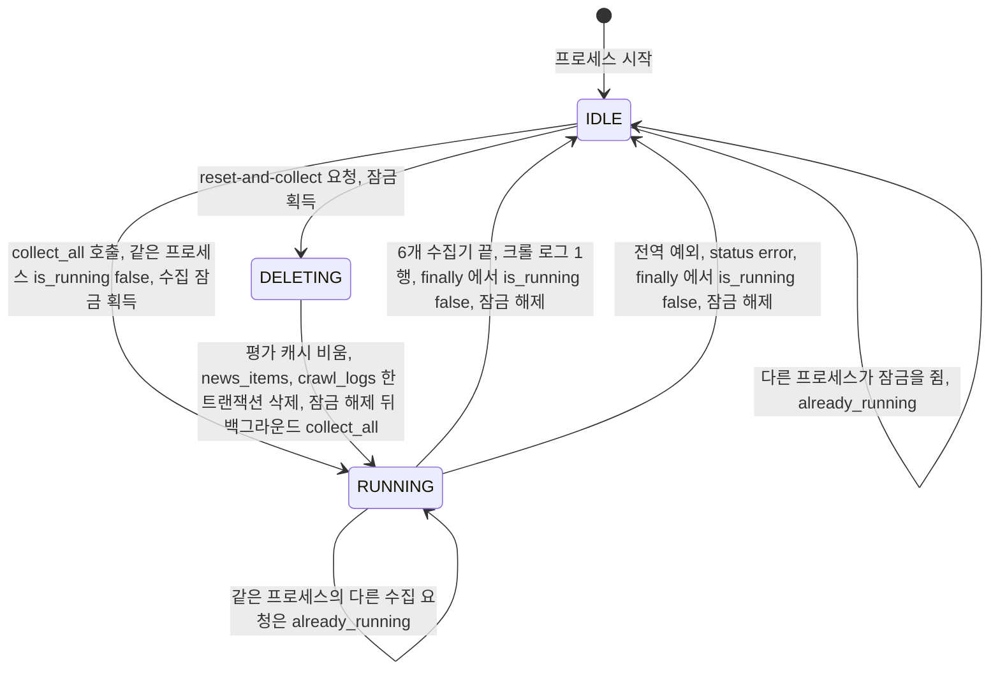
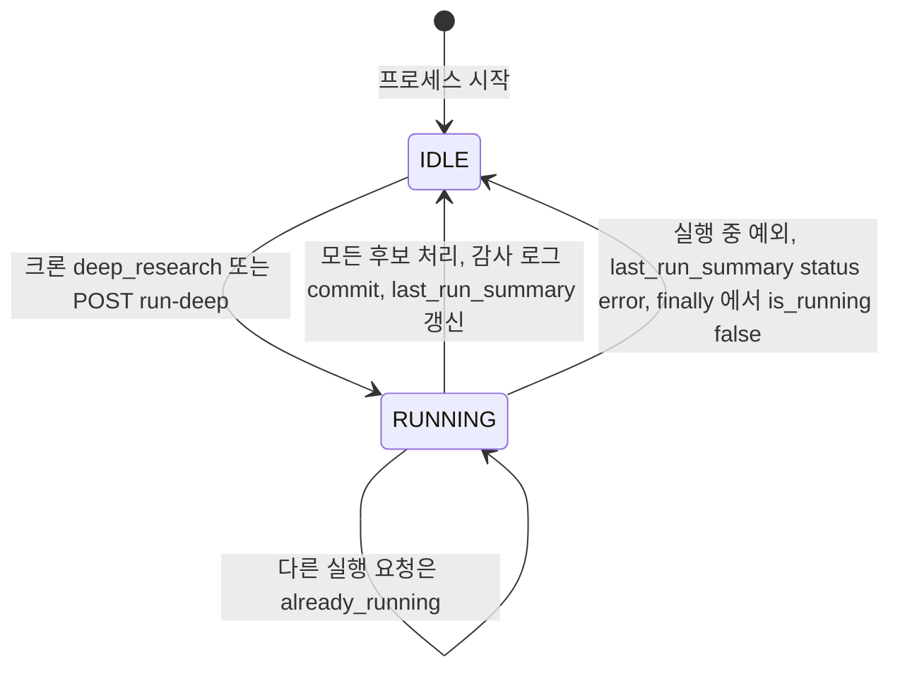
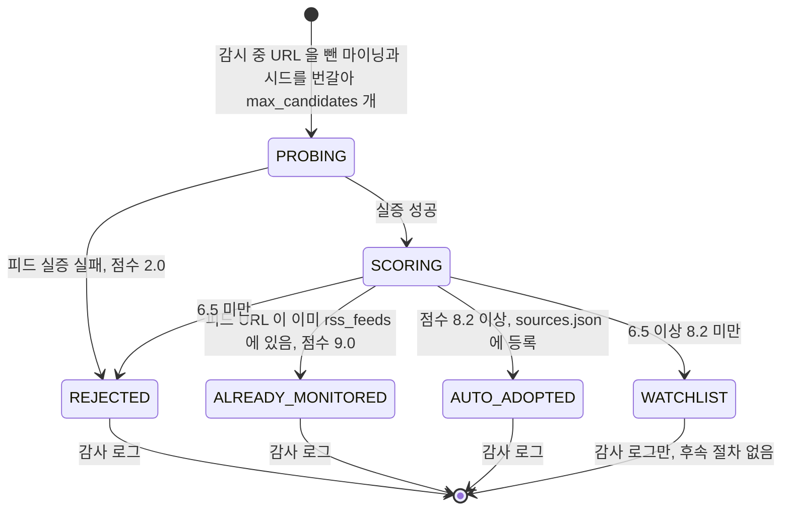
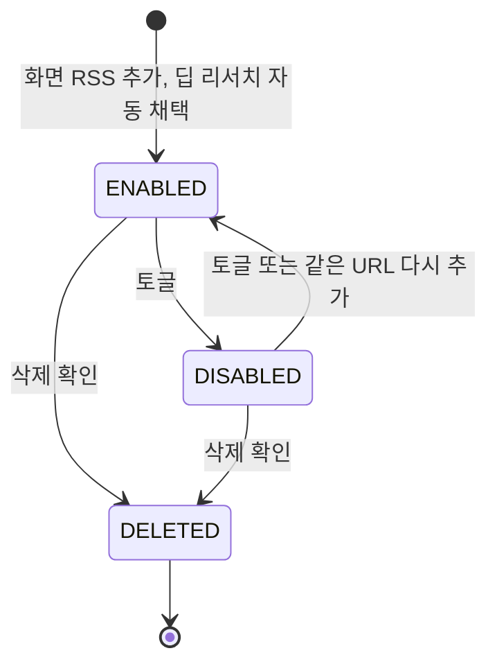
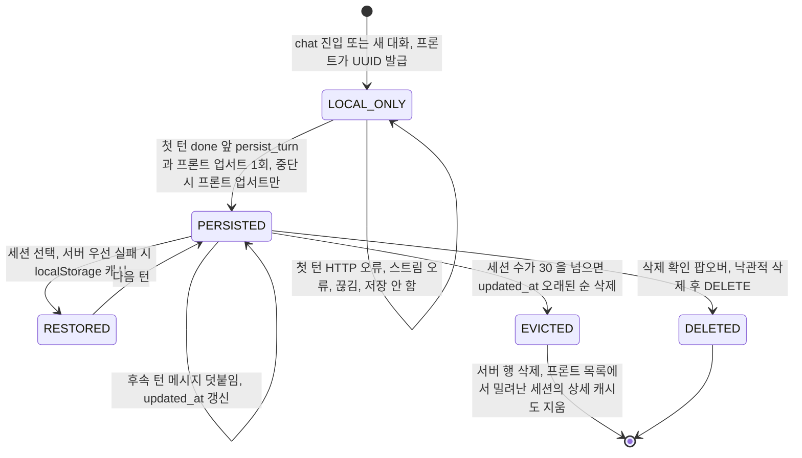
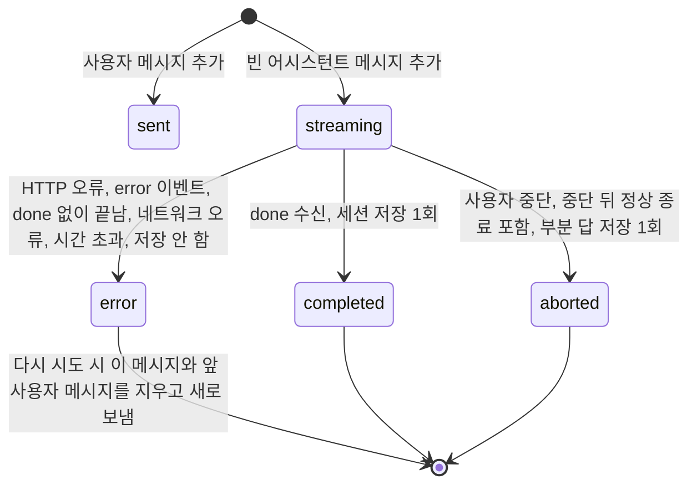

# AgentLens 비즈니스 정책 및 전역 예외 처리 명세서 (Policy & Edge Cases)

Updated: 2026-11-10
기준: v0.4.2 (main)

- **작성일자**: 2026-11-09 (v0.4.2 갱신 2026-11-10)
- **작성자**: 기획 명세 작성가 (`spec-writer`)
- **문서 버전**: v1.1 (as-built: 지금 코드의 정책을 적는다. v0.3.1 산출물을 대체한다)
- **상태**: Draft
- **선행 산출물**: PRD `docs/spec-writer/01_PRD.md`, 기능 인덱스 `docs/spec-writer/02_FUNCTIONAL_SPECIFICATION.md`, 도메인 FSD `docs/spec-writer/fsd/*.md`

이 문서는 도메인을 가로지르는 정책만 적는다. 단위 기능의 세부 동작은 도메인 FSD 가 정본이고, 여기 적은 사실은 FSD 와 같다. 근거는 `path:line` 이다. 다른 에이전트가 같은 시기에 코드를 고치고 있어 줄 번호가 조금 어긋날 수 있으므로, 줄 번호가 흔들리는 곳은 함수 이름으로 적었다. 코드에 있는 동작이 버그로 보여도 '지금 동작' 으로 적고, 문제는 4절에 모았다. v0.4.2 에서 해결된 문제는 4.9절, 결함이 아니라 동작으로 기록하는 관찰 사항은 4.10절이다.

---

## 1. 핵심 엔티티 상태 전이 머신 (State Machine Policies)

### 1.1 수집 작업 (`collector_manager`, 프로세스당 하나 + 프로세스 사이 수집 잠금)

| 현재 상태 | 대상 상태 | 전이 트리거 | 필수 사전 조건 | 실행 주체 | 근거 |
| :--- | :--- | :--- | :--- | :--- | :--- |
| `IDLE` | `RUNNING` | 크론 `daily_crawl`(`scheduler.crawl_hours` 의 각 시 정각, 시간대 `scheduler.timezone`, 기본 UTC 0·6·12·18시), `POST /api/schedule/trigger`, 서버 시작 시 기사 0건, `make collect`, MCP `trigger_agentlens_crawl` | 같은 프로세스의 `is_running` 이 false 이고, DB 파일 옆 수집 잠금(`<db>.crawl.lock`, 비차단 `flock`)을 쥔다 | 스케줄러, 웹 사용자(인증 없음), 시작 루틴, CLI, MCP 클라이언트 | `backend/app/collectors/manager.py:64-124`, `:242-338`, `backend/app/scheduler.py:47-56`, `backend/app/mcp/server.py:61-66` |
| `IDLE`/`RUNNING` | (변화 없음) | 수집 요청 | 같은 프로세스가 수집 중이거나 다른 프로세스가 잠금을 쥠 | 누구나 | 수집기: 같은 프로세스 `{"status": "already_running", "message": "Collector is currently running"}`, 다른 프로세스 `{"status": "already_running", "message": "다른 프로세스가 같은 DB 에 수집 중입니다."}`. API: `already_running` + `other_process`(다른 프로세스면 true, 메시지 `다른 프로세스(MCP 서버·make collect)가 같은 DB 에 수집 중입니다.`, 아니면 false, `이미 수집이 진행 중입니다.`) (`backend/app/api/schedule.py:39-53`, FUNC-COLL-019) |
| `RUNNING` | `IDLE` | 수집 완료 또는 전역 예외 | 없음 | 시스템 | `finally` 에서 `is_running = False`, 잠금 해제 (`manager.py:336-338`). 수집기 0건이면 시드를 넣는다 |
| `IDLE` | `DELETING` → `RUNNING` | `POST /api/schedule/reset-and-collect` (확인 창 `SCR-COLL-003`, `make reset`) | 이 프로세스가 수집 중이 아니고 수집 잠금을 쥔다. 아니면 `already_running`, `현재 수집이 진행 중이므로 초기화할 수 없습니다. 잠시 후 다시 시도해주세요.`, `deleted_count: 0`, 삭제 없음 | 웹 사용자(인증 없음), 운영자 | `backend/app/api/schedule.py:64-95`, FUNC-COLL-020 |

- **상태 위치**: `is_running`·진행 카운터·`last_crawl_stats` 는 프로세스 메모리다. 재시작하면 사라진다. 프로세스 사이 중복 수집은 수집 잠금이 막는다 (v0.4.2). 잠금은 프로세스가 죽으면 OS 가 푼다. `fcntl` 이 없는 OS 는 같은 프로세스 안에서만 막는다. 다른 프로세스의 수집은 이 프로세스의 진행 상태에 나타나지 않는다 (4.10절 관찰 사항).
- **`make collect`**: API 모드에서 trigger 응답이 `already_running` + `other_process: true` 면 기다리지 않고 종료 1, `other_process: false` 면 그 수집이 끝날 때까지 기다린다. 직접 모드는 잠금을 못 쥐면 `수집 실패: status=already_running 다른 프로세스가 같은 DB 에 수집 중입니다.` 를 내고 종료 코드 1 이다 (`scripts/collect.py:72-80`, `:139-155`, FUNC-COLL-002).
- **초기화 경쟁**: 초기화는 삭제하는 동안 잠금을 쥐고 응답 전에 푼다. `started` 응답 직후 백그라운드 수집이 잠금을 쥐기 전에 두 번째 초기화 요청이 오면 그것도 삭제를 수행할 수 있다 (두 번째 `collect_all` 은 `already_running`). 코드 경로 판단이다 (FUNC-COLL-020).
- **크롤 로그 (v0.4.2)**: 실행당 1행, `source="all_sources_stream_ingestion"`. `status` 는 실패 소스가 없으면 `success`, 일부 실패면 `partial_failure`, 6개 모두 실패면 `failed` 이고, 실패 소스별 오류를 `error_message`(JSON)에 남긴다 (`manager.py:296-314`).

### 1.2 딥 리서치 실행과 후보 판정

| 현재 상태 | 대상 상태 | 전이 트리거 | 필수 사전 조건 | 실행 주체 | 근거 |
| :--- | :--- | :--- | :--- | :--- | :--- |
| `IDLE` | `RUNNING` | 크론 `deep_research`(UTC 3·15시 고정, `max_candidates=8`), `POST /api/research/run-deep`(기본 6, 1~20, 화면 6) | `is_running` 이 false. `scheduler.enabled=false` 면 크론이 없다 | 스케줄러, 웹 사용자(인증 없음) | `backend/app/scheduler.py:10-11`, `:57-63`, `backend/app/api/research.py:41-58`, FUNC-SRC-011 |
| `RUNNING` | `IDLE` | 처리 완료 또는 예외 | 없음 (`try/finally` 로 `is_running=False` 보장) | 시스템 | `backend/app/services/deep_researcher.py:378-405` |
| `SCORING` | `AUTO_ADOPTED` | 규칙 점수 8.2 이상 | 기등록 아님 | 시스템 (LLM 미사용) | FUNC-SRC-012, `deep_researcher.py:306-376` |

- 점수는 키워드 규칙(`evaluate_quality_and_signal(…, "rss")` + 깊이 가산)이고 LLM 을 부르지 않는다. 최종 점수 범위 1.0~9.9 (FUNC-SRC-012 BR-1).
- 후보 풀 (v0.4.2): `sources.json` RSS 의 `url`·`site_url` 과 같은 대상 URL 은 뺀다. 인용 도메인 마이닝 결과(최대 15개)와 시드 14개를 번갈아 채워 앞에서 `max_candidates`(API 6, 스케줄 8)개만 자른다 (FUNC-SRC-011 BR-1, `deep_researcher.py:411-434`).
- API 실행은 태스크 참조를 끝날 때까지 들고 있고, 예외는 `last_run_summary` 에 `{status: "error", error: <예외 클래스 이름>, completed_at}` 으로 남는다 (v0.4.2). 화면은 이 요약을 보여 주지 않는다 (SRC 열린 질문 5).
- 자동 채택 중 `sources.json` 저장이 실패하면 그 후보를 `WATCHLIST` 로 기록(사유에 저장 실패)하고 다음 후보를 계속 본다. 실패 수는 `last_run_summary.adopt_failed` 다 (v0.4.2, FUNC-SRC-011 BR-7).
- 탐침의 접속·다운로드 예외 원문은 감사 기록에 싣지 않고 고정 문장(`연결 실패`, `피드 다운로드 실패`)을 쓴다. 원문은 로그에만 남는다 (v0.4.2).

### 1.3 수집 소스 (`sources.json` 의 RSS 피드)

| 현재 상태 | 대상 상태 | 전이 트리거 | 필수 사전 조건 | 실행 주체 | 근거 |
| :--- | :--- | :--- | :--- | :--- | :--- |
| `[*]` | `ENABLED` | `POST /api/sources/rss`, 자동 채택 | 서버 검증(이름 1~200자, URL `^https?://\S+$`·1000자 이하, 카테고리 4개·국가 2개 중 하나, v0.4.2). 같은 URL(끝 `/` 무시)이 있으면 새로 만들지 않고 그 항목을 `enabled: true` 로 바꾼다 | 웹 사용자(인증 없음), 딥 리서치 | `backend/app/api/sources.py:9-16`, `:53-67`, `backend/app/services/sources_service.py:220-244` |
| `ENABLED`/`DISABLED` | 반대 | `PATCH /api/sources/{source_type}/{item_id:path}/toggle` (`owner/repo`·URL 같은 `/` 가 든 id 도 받는다. 소스 유형 섹션은 `item_id=all` 만, v0.4.2) | 대상이 있음. 없으면 404 | 웹 사용자 | `backend/app/api/sources.py:69-75`, `sources_service.py:193-218`, FUNC-SRC-006 |
| `ENABLED`/`DISABLED` | `DELETED` | 화면 확인 창(`SCR-SRC-004`) 뒤 `DELETE /api/sources/{source_type}/{item_id:path}` | 없음 (내장 소스 보호 규칙 없음) | 웹 사용자 | `backend/app/api/sources.py:77-83`, `sources_service.py:246-263`, FUNC-SRC-007 |

- `id` (v0.4.2): 이름 슬러그. 슬러그가 비거나 이미 쓰였으면 URL 의 SHA-1 앞 8자를 붙인다 (`sources_service.py:35-41`). 파일을 손으로 고쳐 같은 `id` 를 두면 토글은 첫 항목만 바꾸고 삭제는 모두 지운다.
- 저장이 실패하면 API 는 500 `ERR_SERVER_INTERNAL` "소스 파일(sources.json)을 저장하지 못했습니다. 파일 권한과 디스크를 확인해주세요." 로 알린다 (v0.4.2, `backend/app/api/sources.py:19-24`).
- 파일 잠금이 없어 자동 채택과 화면 편집이 겹치면 한쪽 변경이 사라질 수 있다. 저장 때마다 `backend/app/config/sources.json` 사본에도 쓴다 (FUNC-SRC-001).

### 1.4 AI 챗 세션

| 현재 상태 | 대상 상태 | 전이 트리거 | 필수 사전 조건 | 실행 주체 | 근거 |
| :--- | :--- | :--- | :--- | :--- | :--- |
| `[*]` | `LOCAL_ONLY` | `/chat` 진입, `새 대화` | 없음. 서버를 부르지 않는다 | 사용자 | FUNC-CHAT-002 BR-1 |
| `LOCAL_ONLY` | `PERSISTED` | 스트림 `done` 송신 직전 서버 `persist_turn`(클라이언트 메시지 id), 스트림이 끝난 뒤 프론트 `POST /api/chat/sessions` 1회(완료 또는 중단, 8초 제한) | 메시지 1개 이상. 오류·끊김이면 저장 안 함 | 서버, 프론트 | `backend/app/services/chat_service.py` `stream_chat`, `frontend/src/components/chat/ChatWorkspace.tsx`, FUNC-CHAT-006 |
| `PERSISTED` | `PERSISTED` | 후속 턴 | 업서트는 메시지를 덧붙이며 같은 세션에 이미 있는 id 는 건너뛴다. 다른 세션에 있는 id 면 400(`details.message_ids`, v0.4.2) | 서버, 프론트 | FUNC-CHAT-006 BR-2 |
| `PERSISTED` | `EVICTED` | 저장 뒤 세션 수 초과 | `CHAT_SESSION_MAX_LIMIT`(`chat.max_session_limit`, 기본 30) | 서버 | `backend/app/services/chat_session_service.py`, `backend/app/config.py:91` |
| `PERSISTED` | `DELETED` | 삭제 확인 | 프론트 목록·localStorage 를 먼저 지운다. 서버 삭제가 실패하면 알림을 띄우고 목록을 다시 읽는다 (v0.4.2) | 사용자 | FUNC-CHAT-005 |

- **이중 저장**: 세션은 서버 DB(`chat_sessions`, `chat_messages`)와 localStorage(`agentlens_chat_sessions_index`, `agentlens_chat_session_<id>`)에 함께 저장한다. 서버와 프론트가 같은 클라이언트 메시지 id 로 저장하고 서버가 같은 세션의 이미 있는 id 를 건너뛰므로, 완료된 턴은 메시지 2개로 남는다. 세션 POST 는 메시지의 `model_tier`·`usage`·`created_at` 도 저장한다 (v0.4.2, FUNC-CHAT-006).
- **localStorage 검증 (v0.4.2)**: 인덱스가 배열이 아니면 빈 목록, 형식이 다른 항목은 버린다. 상세는 문자열 `id` 와 메시지 배열이 있을 때만 쓴다.
- **자동 제목**: 첫 사용자 메시지에서 마크다운 기호·HTML 태그를 지우고 30자 + `...` (FUNC-CHAT-004).

### 1.5 AI 챗 메시지

- 프론트 상태 값은 `sending` | `sent` | `streaming` | `completed` | `aborted` | `error` 다 (FUNC-CHAT-008, FUNC-CHAT-020).
- history 에는 완료된 턴(`completed` 답과 그 질문)만 들어간다 (v0.4.2). 프론트는 최근 10턴(20개)·3,000 토큰(글자/2.5)까지 보내고 서버 프롬프트는 마지막 4개 메시지만 쓴다 (FUNC-CHAT-008 BR-4, 챗 FSD 위험 33).
- `done` 없이 스트림이 끝나면(사용자 중단이 아니면) `error` 로 바꾸고 받은 부분 답 아래에 `응답이 중간에 끊겼습니다. 다시 시도해 주세요.` 를 보인다. 스트림 첫 응답이 30초 안에 오지 않으면 `응답이 늦어 요청을 멈췄습니다. 다시 시도해 주세요.` (v0.4.2, `frontend/src/lib/chatApi.ts`). Anthropic 은 스트림·비스트림 모두 `stop_reason == "max_tokens"` 를 실패로 본다 (FUNC-CHAT-020, FUNC-CHAT-021).
- 오류 상태에서도 받은 부분 답 본문은 보이지만 모델 배지와 내보내기 도구줄은 보이지 않는다 (FUNC-CHAT-019).

### 1.6 SSE 스트림 단계

| 스트림 | 모드·경우 | 이벤트 순서 (`status.step`, `progress`) | 근거 |
|---|---|---|---|
| 챗 `POST /api/chat/stream` | scoped (단일 기사) | `extracting_source`(30) → `synthesizing`(85) → `sources`(기사 1건, 토큰 전) → `token`… → (서버 저장) → `done` | 챗 FSD '처리 흐름', 'SSE 이벤트 목록' |
| | global, 검색함 | `thinking`(25) → `tool_calling`(50) → `synthesizing`(80) → `token`… → `sources`(인용된 출처만, 토큰 뒤) → (서버 저장) → `done` | 같음. `sources` 가 토큰 뒤에 오는 것은 의도된 동작 (4.10절) |
| | global, 검색 안 함 | `thinking`(25) → `synthesizing`(75) → `token`… → (서버 저장) → `done` (`sources` 없음) | 같음 |
| | 단계별 실패 (v0.4.2) | 플래너 `error`(`ERR_LLM_UPSTREAM_FAILED`, 502, `step: thinking`), 검색 `error`(`ERR_RETRIEVER_INDEX_ERROR`, 500, `step: tool_calling`), 토큰 생성 `error`(`ERR_LLM_STREAM_FAILED`, 502, `step: synthesizing`). 모두 `retryable: true` 1회 후 종료. `done`·서버 저장 없음 | `backend/app/services/chat_service.py` `stream_chat`, FUNC-CHAT-009·020 |
| 기사 질문 `POST /api/news/{id}/ask/stream` | 정상 | `meta`(응답 엔진) → `token`… → `done` | FUNC-NEWS-010 |
| | 토큰 뒤 실패 (v0.4.2) | … → `error`(`ERR_LLM_STREAM_FAILED`, `답변 생성이 중간에 끊겼습니다. 다시 시도해 주세요.`, `retryable: true`). `done`·캐시 없음. 프론트는 부분 답 + 오류 알림 + `다시 시도`, 복사 비활성 | FUNC-NEWS-010 BR-9·10·13 |

- 두 스트림 모두 `Cache-Control: no-cache, no-transform` 이다. 챗 서버 턴 저장은 `done` 을 보내기 전에 하고, 실패해도 로그만 남기고 `done` 을 보낸다.

---

## 2. 공통 비즈니스 제약 및 정책 (Global Business Policies)

### 2.1 LLM 공급자 선택·폴백·가용성 판정

LLM 을 부르는 경로는 네 가지이고 규칙이 서로 다르다. 함수는 모두 `backend/app/services/llm_processor.py` 에 있다.

| 경로 | 공급자 순서 | 가용성 사전 판정 | 공급자 없음·실패 시 | 근거 |
|---|---|---|---|---|
| AI 챗 스트림 (`stream_tokens`) | Anthropic → OpenAI(SDK 스트림) → Ollama. 요청 모델에 `gemini` 가 있으면 Gemini 만 | 라우터가 스트림 전에 `check_provider_available()`. 없으면 503 `ERR_LLM_PROVIDER_UNAVAILABLE` | 스트림 중 실패는 `error` 이벤트 `ERR_LLM_STREAM_FAILED` | `backend/app/api/chat.py`, FUNC-CHAT-022 |
| 일괄 생성 (`generate_live_answer`: 챗 플래너, 수집 게이트) | Anthropic → OpenAI(httpx) → Ollama. `gemini` 는 Gemini 만, `gpt`/`openai` 는 OpenAI 만 | 함수 안에서 `check_provider_available()` | `LLMUpstreamException` 등. 수집 게이트는 예외를 삼키고 휴리스틱으로 간다. Anthropic 비스트림 답이 `max_tokens` 로 잘리면 실패로 보고 다음 공급자로 간다 (v0.4.2) | FUNC-COLL-023, FUNC-CHAT-021 |
| 수집 게이트 (`evaluate_content_with_llm`) | 위 일괄 생성 | `has_live_provider()` 가 거짓이면 LLM 을 건너뛴다 | 휴리스틱 게이트. 휴리스틱 결과는 캐시하지 않는다 (v0.4.2) | FUNC-COLL-010 |
| 기사 질문 스트림 (`stream_question_answer`) | 캐시 → Anthropic → OpenAI(SDK, `max_tokens` 2048) → 휴리스틱 템플릿. Ollama·Gemini 없음 | 없음 (공급자별 키 유무만) | 토큰 전 실패면 다음 엔진, 모두 실패하면 휴리스틱 답. 토큰을 보낸 뒤 실패하면 이어 붙이지 않고 `error` 이벤트로 끝내며 캐시하지 않는다 (v0.4.2) | FUNC-NEWS-010 |

- **가용성 판정 (`has_live_provider`)**: Anthropic 키 → OpenAI 키 → Ollama(주소가 있으면 `{주소}/api/tags` 를 1.0초 시간 제한으로 비동기 확인, 200 이고 설정 모델이 설치돼 있으면 가능. 판정 결과는 30초 캐시, v0.4.2) 순으로 처음 참인 것. 판정 이유는 서버 로그에만 남는다.
- **즉시 전파 (폴백 안 함)**: Anthropic 401(`AnthropicKeyMissingException`)·429(`LLMQuotaExceededException`)·503/529(`AnthropicOverloadedException`, 스트림 본문의 `overloaded_error` 이벤트 포함). 그 밖의 Anthropic 실패(스트림의 다른 `error` 이벤트 포함)는 토큰 전이면 다음 공급자로 넘어간다.
- **스트림 중 실패**: 토큰을 하나라도 보낸 뒤에는 다른 공급자로 넘어가지 않고 `LLMStreamFailedException`.
- **잘림 판정**: Anthropic 은 스트림·비스트림 모두 `stop_reason == "max_tokens"` 를 실패로 본다. OpenAI·Ollama 는 잘림을 보지 않는다 (4.2절).
- **모델 결정 (v0.4.2)**: 요청 `model` 기본은 null 이고, 우선순위는 `model` > `model_tier` > 기본 챗 모델(`ANTHROPIC_DEFAULT_CHAT_MODEL`, `claude-sonnet-5-5`)이다. 티어 `haiku`/`sonnet`/`opus` 는 설정 모델(`claude-haiku-5-5`, `claude-sonnet-5-5`, `claude-opus-5-5`)로 바꾼다 (`backend/app/config.py:76-80`). 수집 게이트는 모델을 지정하지 않아 기본 챗 모델을 쓴다.
- **사용량 (v0.4.2)**: 토큰 사용량은 요청마다 따로 담는다(`usage_out`). 요청끼리 공유하던 `last_usage` 는 지웠다.
- **캐시 (v0.4.2)**: 평가 캐시 5,000건·24시간, 질의응답 캐시 1,000건·6시간, Ollama 판정 30초. 초기화(`reset-and-collect`)는 평가·질의응답 캐시를 비운다 (`llm_processor.py:172-180`).
- **출력 상한**: Anthropic·OpenAI(챗)·Ollama 4096, Gemini 2048, 기사 질문 스트림의 OpenAI 2048 (FUNC-CHAT-021 BR-1).
- **타임아웃**: Anthropic 45초(스트림 120초), OpenAI 60초, Ollama 90초(스트림 120초), Gemini 20초 (챗 FSD '상수·설정값').
- **미가용 시 기능별 동작 요약**: 수집은 휴리스틱 게이트로 계속 저장하고 시사점은 빈 값이다 (v0.4.2). 기사 질문은 휴리스틱 답을 준다. 브리핑은 LLM 을 쓰지 않아 영향이 없다 (FUNC-BRF-001). 딥 리서치는 LLM 을 쓰지 않는다 (FUNC-SRC-012 BR-4). AI 챗은 503 오류 카드 `가용한 LLM 프로바이더 엔진 미설정 (API 키 미등록)` 이다.
- **테스트 환경**: v0.4.2 에서 제품 코드의 테스트 환경 판정(`is_test_environment`)을 지웠다 (FUNC-COLL-024 삭제). 테스트에서 실제 LLM 호출을 막는 것은 `backend/tests/conftest.py` 의 하네스뿐이다.

### 2.2 인증·CORS·비밀값 (검사 범위 밖, 수용된 위험)

**정책 (제품 오너 결정, 2026-11-09)**: 아래 다섯 항목은 이 프로젝트의 검사 범위 밖이다. 리뷰·QA·테스트에서 결함으로 보고하지 않고, 수정 과제로 올리지 않는다. 지금 동작 사실과 근거는 기록으로 남긴다. v0.4.2 에서도 이 다섯 항목의 동작은 바뀌지 않았다 (SSRF 경로 하나가 API 삭제로 줄었다).

| 수용된 위험 | 지금 동작 | 근거 |
|---|---|---|
| 인증 없음과 CORS 전체 허용 | 모든 API(파괴적 동작 포함)를 누구나 부른다. 사용자·계정 개념이 없다. `allow_origins=["*"]`, `allow_credentials=True`, 메서드·헤더 전체 허용 | `backend/app/main.py`, `backend/app/api/router.py` |
| 서버 측 요청 위조(SSRF) | 호출자가 준 URL·호스트로 서버가 요청한다: `/api/webhook/test`(`http` 로 시작하는 임의 URL, 실패 시 응답 본문 앞 100자 반환), `/api/research/inspect-url`(리다이렉트 따라감), `/api/briefing/test/email`(SMTP 호스트), 딥 리서치 인용 도메인 마이닝. `/api/webhook/send-briefing` 은 v0.4.2 에서 지웠다 | `backend/app/api/webhook.py`, `backend/app/services/webhook_service.py:17-32`, `backend/app/services/source_researcher.py:57-59`, `backend/app/services/deep_researcher.py:185-227` |
| 비밀값 평문 저장 | Notion 토큰, SMTP 비밀번호, 웹훅 URL 을 루트 `config.json` 에 평문으로 저장한다 (git 이 추적하는 파일). 저장은 임시 파일 교체 방식이다 (v0.4.2) | `backend/app/api/briefing.py`, `backend/app/config.py:178-199`, FSD BRF R3 |
| 설정 조회로 비밀값 노출 | `GET /api/briefing/settings` 가 웹훅 URL 원문과 Notion 토큰 앞뒤 4자를 돌려준다 | `backend/app/api/briefing.py:92-134` |
| 설정 저장 뒤 재적용 누락 | 저장 뒤 `settings.reload()` 가 Notion·SMTP 값을 다시 읽지 않아 재시작 전까지 이전 값으로 발송·테스트한다. 웹훅 URL 은 이전 값이 빈 문자열일 때만 바뀐다. 화면 조회는 새 값을 보인다 | `backend/app/config.py:60-174`, FSD BRF R1 |

- 수용 범위와 별개였던 '예외 문자열·서버 절대 경로 노출' 과 '이메일 HTML 이스케이프 없음' 은 v0.4.2 에서 고쳤다 (4.9절).
- 파괴적 동작에 대한 하네스 쪽 게이트(2.5절)는 제품 코드의 인증이 아니다.

### 2.3 오류 응답 형식 (v0.4.2 통일)

모든 HTTP 오류 응답은 `{"error_code": "ERR_…", "message": "<한국어 문장>", "details": <배열|객체|null>}` 한 형식이다 (`backend/app/api/errors.py:1-7`).

| 경우 | 상태·코드 | `message` | `details` | 근거 |
|---|---|---|---|---|
| 요청 검증 실패 (쿼리·본문 스키마 위반, 예: `page < 1`, `size` 1~100 밖, RSS URL 형식) | 400 `ERR_INVALID_PAYLOAD` (FastAPI 기본 422 를 쓰지 않는다) | `요청 형식이 올바르지 않습니다.` | `[{loc, msg}]` | `errors.py:69-72` |
| 라우터가 정한 오류 | 그 상태와 코드 (예: 챗 `ERR_INVALID_MODEL_TIER`, `ERR_SESSION_INVALID_UUID`, `ERR_LLM_PROVIDER_UNAVAILABLE` 503, `ERR_CLAUDE_API_KEY_MISSING` 401) | 라우터 문장 | 라우터 값 (예: 다른 세션 메시지 id 면 `message_ids`) | `errors.py:42-66`, FUNC-CHAT-003·005·006·008·022 |
| 문장만 준 `HTTPException` | 상태별 기본 코드: 400 `ERR_INVALID_PAYLOAD`, 404 `ERR_NOT_FOUND`, 405 `ERR_METHOD_NOT_ALLOWED`, 409 `ERR_CONFLICT`, 500 `ERR_SERVER_INTERNAL`, 502 `ERR_UPSTREAM_FAILED`, 503 `ERR_SERVICE_UNAVAILABLE` | 라우터 문장 (없으면 상태별 기본 문장) | null | `errors.py:21-35`, `:52-66` |
| 처리하지 못한 예외 | 500 `ERR_SERVER_INTERNAL` | `서버 내부 처리 중 오류가 발생했습니다.` (예외 내용은 로그에만) | null | `errors.py:75-78` |
| 본문 안 상태 | 수집 트리거·초기화·딥 리서치·URL 검사 | HTTP 200 과 `status`(`started`/`already_running`/`error`/`not_found`/`empty`) | — | FUNC-COLL-019·020, FUNC-SRC-008·011 |
| SSE 안 오류 | 챗·기사 질문 스트림 | `event: error` (1.6절) | — | 1.6절 |

- **화면 표시 규칙**: 프론트는 오류 응답의 `message` 를 먼저 쓰고, 오류 형식이 아니면 함수별 기본 문구를 쓴다 (`frontend/src/lib/api.ts` `readErrorMessage`). 일반 API 시간 제한은 8,000ms(`fetchWithTimeout`), 챗 REST 8,000ms, 챗 스트림 첫 응답 30,000ms 다. 네트워크 실패·시간 초과면 브라우저 예외 문구 또는 함수별 문구가 보인다. 응답 본문은 zod 로 확인하되 맞지 않아도 던지지 않고 받은 값을 쓴다(개발 중 콘솔 경고) (`frontend/src/lib/contract.ts`).
- MSW 목도 같은 오류 형식을 흉내 낸다 (4.9절).
- 문서에서 쓰는 `BRF_*`·`COLL_*` 같은 코드는 FSD 가 경우를 가리키려고 붙인 문서용 식별자이고 응답에 나가지 않는다.

### 2.4 동시 실행·중복 요청 방지

| 대상 | 서버 쪽 방지 | 화면 쪽 방지 | 근거 |
|---|---|---|---|
| 수집 | 같은 프로세스 `is_running` + 프로세스 사이 수집 잠금 파일 → `already_running` (v0.4.2) | 수집 중이거나 요청 중이면 즉시 수집·초기화 진입점 비활성, 요청 중 플래그 | 1.1절, FUNC-UI-002 BR-2·6 |
| 초기화 | 수집 중이거나 잠금을 못 쥐면 삭제 없이 `already_running`. 삭제는 잠금 아래 한 트랜잭션 | 확인 창 `busy` 동안 버튼·Escape·배경막 무시. 앞선 초기화 요청이 끝나기 전 재요청은 `이미 초기화 요청을 처리하고 있습니다.` 로 거절 (v0.4.2) | FUNC-COLL-020, FUNC-UI-002 BR-7 |
| 딥 리서치 | 프로세스 메모리 `is_running` → `already_running` | 실행 중·요청 중 버튼 비활성 | 1.2절 |
| 챗 전송 | 없음 | 스트리밍 중 전송 버튼이 중단 버튼으로 바뀌고 모델 선택 비활성. 사이드바·헤더의 새 대화 버튼 비활성 | FUNC-CHAT-002, FUNC-CHAT-015 |
| 챗 턴 저장 | 같은 세션의 이미 있는 메시지 id 는 건너뜀, 다른 세션의 id 는 400 | 턴마다 POST 1회 | FUNC-CHAT-006 |
| 검색 요청 | — | 입력이 300ms 멈출 때까지 목록 요청을 미룸. 그 사이 페이지를 옮기면 기다리던 검색어를 먼저 반영하고 고른 페이지를 유지 (v0.4.2) | FUNC-NEWS-005 |
| 공통 버튼 | — | `Button` 은 `loading` 이면 `disabled`·`aria-busy` | `frontend/src/components/ui/Button.tsx` |
| 같은 URL 스크래핑 | URL 별 `asyncio.Lock` 으로 하나로 묶음 | — | FUNC-COLL-025 BR-2 |
| `sources.json` 쓰기 | 잠금 없음 | — | 1.3절 |
| `config.json` 쓰기 | 잠금 없음. 임시 파일에 쓴 뒤 교체(v0.4.2) | 저장 중 버튼 비활성 | FUNC-BRF-011 |
| 수집 배치 저장 | 기사별 LLM 평가는 저장 잠금 밖, DB 저장만 잠금 안 (v0.4.2) | — | FUNC-COLL-015 |

- SQLite 는 WAL, `busy_timeout` 30,000ms 로 두 프로세스의 쓰기를 기다린다 (`backend/app/database.py:17-26`).

### 2.5 파괴적 동작 정책

| 동작 | 확인 절차 | 되돌리기 | 근거 |
|---|---|---|---|
| 수집 데이터 초기화 & 재수집 | 위험 톤 확인 창 `SCR-COLL-003` (`취소` 가 처음 포커스). 문구 `현재 데이터베이스에 저장된 모든 뉴스 소식 및 수집 로그가 영구 삭제되며, …` | 불가. `news_items`·`crawl_logs` 를 한 트랜잭션으로 지우고 평가·질의응답 캐시를 비운다(v0.4.2). `source_research_logs`·설정·`sources.json`·localStorage 북마크는 남는다 | FUNC-COLL-020 BR-1·2, FUNC-NEWS-017 |
| 소스 삭제 | 확인 창 `SCR-SRC-004` `이 소스를 목록에서 삭제하시겠습니까?` | 불가 (같은 URL 을 다시 추가해야 함) | FUNC-SRC-007 |
| 챗 세션 삭제 | 확인 팝오버 `SCR-CHAT-003`, `삭제된 대화 기록과 모든 메시지는 영구 복구할 수 없습니다.` | 불가. 낙관적 삭제라 서버 실패 시 알림을 띄우고 목록을 다시 읽는다 | FUNC-CHAT-005 |
| 기사 질문 대화 초기화 | 확인 창 `AI 대화 내역을 모두 초기화하시겠습니까?` | 화면 상태만 지운다 | UI 공통 FSD 대화상자 표 |
| 챗 세션 FIFO 삭제 | 없음 (자동) | 불가 | 1.4절 |

- 기사 전체 삭제 API `DELETE /api/news/all` 은 v0.4.2 에서 지웠다. 데이터 삭제 경로는 초기화 & 재수집 하나다.
- 브라우저 기본 대화상자(`window.confirm`, `alert`)는 쓰지 않는다 (UI 공통 FSD).
- `make reset` 은 `{URL}/health` 를 확인한 뒤 `reset-and-collect` 를 부르고 재수집 완료를 기다리지 않는다 (FUNC-COLL-020).

### 2.6 시간 및 타임존 정책

- **저장 (v0.4.2)**: backend 는 시각을 UTC 로 만들고 UTC 로 저장한다 (열 타입은 timezone 없는 `DateTime`, 값은 UTC). 수집기는 피드 시각에 오프셋이 있으면 UTC 로 바꾸고, 없으면 UTC 로 보며, 날짜가 없으면 수집 시각(UTC)을 쓴다 (4.10절 관찰 사항).
- **응답 (v0.4.2)**: 뉴스 목록의 `published_at`·`created_at` 은 `Z`, 챗 세션·메시지·기사 출처·크롤 로그·감사 일지 시각은 `+00:00` 오프셋이 붙은 UTC ISO 문자열이다. 오프셋 없는 값은 UTC 로 본다 (`backend/app/schemas/news.py:32-36`, `backend/app/time_utils.py:6-21`).
- **옛 데이터 (v0.4.2)**: 스키마 준비 때 마이그레이션 3(`_m003_fix_legacy_news_rows`)이 KST 벽시계로 저장됐던 국내 RSS 피드를 가려낼 수 있으면 9시간 당겨 UTC 로 고친다. 가려낼 수 없는 피드의 행은 그대로다 (`backend/app/database.py:94-141`, FSD NEWS 위험 17).
- **스케줄 (v0.4.2)**: 수집은 `scheduler.crawl_hours` 의 각 시 정각, 브리핑 자동 발송은 `briefing.auto_dispatch_hour`:15, 둘 다 시간대 `scheduler.timezone`(기본 `UTC`) 기준이다. 딥 리서치는 UTC 3·15시 고정이다. `scheduler.enabled=false` 면 셋 다 돌지 않는다 (`backend/app/scheduler.py:47-83`). 설정은 재시작해야 반영된다.
- **화면 표시**: 스케줄 대화상자는 응답의 `schedule_hours`·`timezone` 으로 시각을 그리고 시간대가 UTC 일 때만 KST 환산을 덧붙인다 (v0.4.2, FUNC-COLL-017). 딥 리서치 최근 실행은 브라우저 로캘 시각, 고정 문구 `매일 03:00, 15:00 UTC` (FUNC-SRC-013). 카드 상대 시각은 60초마다 다시 그린다.
- **브리핑 날짜**: `datetime.now(timezone.utc).strftime("%Y년 %m월 %d일")` 이라 UTC 날짜다. 그래서 KST 0시~9시 사이에 만든 브리핑에는 한국 날짜로 전날이 보인다 (`backend/app/services/briefing_service.py:128`). 브리핑에는 기간 필터가 없다 (FSD BRF R13).
- **웹훅 메시지 시각**: `%Y-%m-%d %H:%M UTC` (`backend/app/services/webhook_service.py`).

### 2.7 외부 발송 정책 (Notion·이메일·웹훅)

| 항목 | 수동 발송 | 자동 발송 (매일 `auto_dispatch_hour`:15, 기본 00:15 UTC) | 근거 |
|---|---|---|---|
| 트리거 | 브리핑 대화상자 `Notion 내보내기`, `이메일 발송`(주소 입력), 설정 대화상자 `연결 테스트`. 웹훅 브리핑 수동 발송은 없다 (v0.4.2 에서 `POST /api/webhook/send-briefing` 삭제) | job `daily_briefing_dispatch` | FUNC-BRF-004·006·009·010·013 |
| 브리핑 | 요청마다 새로 만든다. 저장하지 않는다 | 한 번 만들어 모든 채널에 쓴다 | FUNC-BRF-001, FUNC-BRF-013 |
| 채널 조건 | 각 버튼 | Notion: `NOTION_AUTO_EXPORT` 참이고 키 있음. 이메일: `EMAIL_AUTO_SEND` 참이고 `SMTP_HOST`·`SMTP_TO` 있음. 웹훅: `webhooks.auto_dispatch_daily_briefing` 참(기본 true, v0.4.2)이고 `SLACK_WEBHOOK_URL`·`DISCORD_WEBHOOK_URL` 이 있으면 보낸다 | FUNC-BRF-013 |
| 순서 | — | Notion → 이메일 → 웹훅(Slack → Discord). 한 채널의 실패가 다음을 막지 않는다 | FUNC-BRF-013 BR-2 |
| 재시도·알림 | 없음. 화면에 결과 인라인 알림 | 없음. 로그(`agentlens.briefing`)만, 웹훅 결과는 버린다 | FUNC-BRF-013 BR-4 |
| 중복 방지 | 없음 (같은 날 여러 번 발행 가능) | 없음. 수동 발행과 별개로 새 Notion 페이지 | FUNC-BRF-013 BR-5 |
| 웹훅 제공자 판별 | (테스트만) URL 로 Slack·Discord·일반을 판별. 성공 코드 200·204, 타임아웃 8.0초 | 같음. 같은 URL 이 두 칸에 있으면 두 번 보낸다 | `backend/app/services/webhook_service.py:17-32`, FUNC-BRF-013 BR-3 |
| 내용 (v0.4.2) | 이모지 없음. 분야 이름은 화면 긴 라벨과 같다. 헤드라인·분야 요약은 단어 경계에서 자르고 `…`. 이메일 HTML 은 이스케이프하고 링크는 `http(s)` 만, 대시보드 링크는 `app.public_web_url` | 같음 | FUNC-BRF-001·004·008·010 |
| 타임아웃 | 서버: Notion 10~15초, SMTP 12초, 웹훅 8초. 프론트: Notion 발행·이메일 20,000ms, Notion 테스트 12,000ms, SMTP 테스트 15,000ms, 설정 저장 10,000ms | 서버 값만 | FSD BRF '상수·설정값' |

- 서버 외부 호출 시간의 합이 프론트 타임아웃보다 길 수 있어, 화면이 실패를 보여도 페이지·메일이 실제로 만들어질 수 있다 (코드 읽기 기준, FSD BRF R19).
- 고신호 기사 즉시 알림 기능은 없다. 쓰이지 않던 설정 키 `webhooks.auto_alert_high_signal` 은 v0.4.2 에서 지웠고, Slack 테스트 메시지도 일일 브리핑 자동 발송(`auto_dispatch_daily_briefing` 이 켜져 있을 때) 전달만 안내한다 (PRD `REQ-BRF-011`, FSD BRF R15).
- 비밀값 저장·노출·재적용 누락은 2.2절의 수용된 위험이다.

### 2.8 품질·하이시그널 판정 값

| 값 | 지금 코드 | 근거 |
|---|---|---|
| 저장 최소 품질 | `QUALITY_CUTOFF_SCORE` = `config.json` `llm.quality_cutoff_score` (키 없으면 5.0) | `backend/app/config.py:87` |
| LLM 경로 저장 조건 | `is_worthwhile` 참, 관련 있음, 카테고리가 `irrelevant` 아님, `relevance_score >= 5.0`, `quality_score >= 컷오프` | `backend/app/services/llm_processor.py` `evaluate_content_with_llm` |
| 하이시그널 임계값 (v0.4.2 하나로) | `HIGH_SIGNAL_THRESHOLD` = `config.json` `llm.high_signal_threshold` (키 없으면 7.0). `llm_processor` 는 설정값만 읽는다 | `backend/app/config.py:88`, `llm_processor.py:634`, `:726` |
| 피드 `Must-Read` 필터 | `is_high_signal` 열만 본다 | FUNC-NEWS-004 |
| 챗 포커스 필터 라벨 | `Must-Read 고신호만` (숫자 없음, v0.4.2. 서버는 `is_high_signal` 열로 거른다) | `frontend/src/components/chat/FocusBottomSheet.tsx:156`, 챗 FSD 위험 30 |
| MSW 목 | `is_high_signal` 만으로 거른다 (v0.4.2) | `frontend/src/mocks/handlers.ts:248` |

정본 값은 7.0 하나이고 화면 라벨도 숫자를 쓰지 않는다 (v0.4.2).

---

## 3. 전역 엣지 케이스 및 장애 복구 UX 가이드 (Global Edge Cases)

| 장애 / 예외 유형 | 감지 방식 | 사용자 경험(UX) 복구 처리 방식 | 근거 |
| :--- | :--- | :--- | :--- |
| backend 연결 실패·타임아웃 (피드) | `fetchWithTimeout` 8,000ms abort, 네트워크 예외 | 목록이 없으면 오류 상태(`백엔드 서버 연결 상태를 확인해주세요.` + `다시 시도`), 같은 조건 다시 읽기면 목록 유지 + `danger` 알림 | FUNC-NEWS-001, FUNC-UI-011 |
| backend 연결 실패·지연 (챗) | fetch 예외, REST 8초·스트림 첫 응답 30초 시간 제한 (v0.4.2) | 오류 카드 + `다시 시도`. 스트림 시간 초과는 `응답이 늦어 요청을 멈췄습니다. 다시 시도해 주세요.` | FUNC-CHAT-020 |
| backend 연결 실패 (소스 대화상자) | 세 요청 중 하나라도 실패 | 데이터가 없으면 오류 상태 + `다시 시도`, 있으면 이전 데이터 유지 + `소스 정보를 불러오지 못했습니다.` (v0.4.2) | FUNC-SRC-002 |
| 렌더 중 예외 | 라우트 오류 경계 (v0.4.2) | 헤더는 남기고 본문에 `화면을 그리지 못했습니다` + `다시 시도`. 예외 원문은 화면에 없다 | FUNC-UI-011 BR-9 |
| 가용 LLM 공급자 없음 | 챗 라우터 사전 검사 | 챗: 503 오류 카드. 수집: 휴리스틱 게이트, 시사점 빈 값. 기사 질문: 휴리스틱 답 | 2.1절 |
| LLM 키 오류·한도 초과·과부하 (챗) | 스트림 중 예외 | 모두 같은 `ERR_LLM_STREAM_FAILED` 오류 카드로 합쳐져 구분되지 않는다 | FUNC-CHAT-022, 챗 FSD 위험 9 |
| 챗 플래너·검색 단계 실패 | 스트림 앞 단계 예외 (v0.4.2) | 단계별 `error` 이벤트(`ERR_LLM_UPSTREAM_FAILED` / `ERR_RETRIEVER_INDEX_ERROR`)로 오류 카드 + `다시 시도` | 1.6절 |
| 챗 스트림이 `done` 없이 끊김 | 프론트 루프 종료, `done` 받지 않음, 사용자 중단 아님 | 받은 부분 답 아래 `응답이 중간에 끊겼습니다. 다시 시도해 주세요.` 와 `답변 다시 시도`. 저장하지 않는다 | 1.5절, FUNC-CHAT-020 |
| 기사 질문 스트림이 토큰 뒤 실패 | `error` 이벤트 또는 `done` 없는 종료 (v0.4.2) | 부분 답 + 오류 알림 + `다시 시도`, 복사 비활성 | FUNC-NEWS-010 |
| 기사 질문 스트림 첫 응답 지연 | 첫 응답 30,000ms 시간 제한 (v0.4.2) | 요청을 멈추고 `응답이 늦어 요청을 멈췄습니다. 다시 시도해 주세요.` + `다시 시도`. 대체 경로로 다시 보내지 않는다. 첫 응답 뒤 토큰 사이에는 제한이 없다 | FUNC-NEWS-010 |
| 빈 DB 로 서버 시작 | 시작 루틴의 기사 수 0 | 백그라운드 첫 수집, 요청은 바로 받는다. 피드는 빈 상태에서 점진 반영 | FUNC-COLL-021 |
| 빈 DB 로 MCP 서버 시작 | 첫 도구 호출 (v0.4.2) | 스키마를 만든 뒤 처리, 조회는 빈 배열 | FUNC-MCP-001 |
| 수집 중 다른 화면에 갔다 돌아옴 | 30초 스케줄 상태 재조회 `is_running: true` | 진행 줄과 폴링을 다시 붙인다 (`실시간 소식 수집 중...`) | FUNC-UI-002 BR-9 |
| 다른 프로세스(MCP·`make collect`)가 수집 중일 때 즉시 수집 | trigger `already_running` + `other_process: true` | 진행 줄에 응답 문구 후 곧 `수집 완료 (+0건 신규 반영)`. 관찰 사항 (4.10절) | FUNC-UI-002 BR-2 |
| 수집 진행 조회 실패 | progress 요청 실패 | 폴링을 멈추고 메시지를 지운다. 다음 30초 재조회가 다시 붙인다 | FUNC-UI-002 BR-3 |
| 서버 재시작 | — | 수집·딥 리서치 진행 상태, 평가·질문 캐시, 딥 리서치 누적 채택 수가 사라진다. 딥 리서치 화면은 `최근 가동됨` 을 보인다 | FUNC-COLL-017, FUNC-SRC-013 |
| 크론 시각에 서버가 꺼져 있음 | — | 놓친 회차를 다시 돌리는 코드는 없다. APScheduler 의 놓친 실행 기본 동작은 확인하지 못했다 | FUNC-COLL-018, FUNC-BRF-013 |
| 북마크 기사가 DB 에서 사라짐 (초기화 뒤) | — | 북마크는 스냅샷이라 남는다. 챗 핸드오버 시 챗이 `요청하신 기사를 찾을 수 없어 전체 소식 모드로 시작합니다.` 경고 후 전체 소식 범위로 시작 | FUNC-NEWS-019 |
| Docker 웹 서버와 호스트 MCP 서버 | — | Docker 웹 서버는 volume 의 `/app/data/agentlens.db` 를 써서 호스트에서 띄운 MCP 서버와 DB 가 다르다. 호스트끼리는 `backend/agentlens.db` 하나를 쓴다 (v0.4.2) | FSD MCP '알려진 불일치·위험' |
| localStorage 쓰기 실패 | `try/catch` | 무시한다 (챗 세션 캐시, 북마크) | FUNC-CHAT-006 |
| localStorage 값이 깨짐 (챗 세션 인덱스·상세, 북마크) | 읽을 때 형식 검사 (v0.4.2) | 배열이 아니면 0개, 형식이 다른 항목은 버린다 | FUNC-NEWS-007 BR-6, FUNC-CHAT-001 |
| 응답이 계약과 조금 다름 | zod `safeParse` (v0.4.2) | 던지지 않고 받은 값으로 그린다. 개발 중 콘솔 경고 | 2.3절 |
| `sources.json`·`config.json` 쓰기 실패 | 저장 예외 (v0.4.2) | 500 과 저장 실패 문구. `config.json` 원본과 메모리 설정은 그대로 | FUNC-SRC-001, FUNC-BRF-011 |
| 오버레이가 열린 상태의 단일 키 단축키 | 오버레이 스택 | 단일 키(j/k/b/c/`/`/t)를 막고 Escape 는 맨 위 레이어 하나만 닫는다 | FUNC-UI-005, FUNC-UI-008 |
| IME 조합 중 키 입력 | `isComposing` | 단축키·Enter 전송을 무시한다 | UI 공통 FSD 단축키 표 |
| 비보안 출처(HTTP LAN IP)에서 복사 | `navigator.clipboard` 실패 | 폐기 예정 `execCommand('copy')` 로 다시 시도, 결과 `복사됨`/`복사 실패` 2,000ms | FUNC-UI-013 |
| 모바일 챗에서 긴 답 스트리밍 | — | 메시지 목록만 스크롤되고 입력창은 제자리. 위로 올려 읽는 중이면 따라 내려가지 않는다 (v0.4.2 FE-36) | FUNC-UI-009 BR-10, FUNC-CHAT-025 |

---

## 4. 도메인을 넘나드는 알려진 문제 (옛 `docs/known-issues.md` 대응)

"의심" 은 코드로 추론했고 실행해 확인하지 않은 것이다. 2.2절의 수용된 위험에 해당하는 항목은 '수용' 으로 표시했다 (검사·수정 대상 아님). 세부 근거는 '문서' 열의 FSD '알려진 불일치·위험' 절에 있다. 해결된 항목은 4.8절(v0.4.1)과 4.9절(v0.4.2)에, 결함이 아닌 관찰 사항은 4.10절에 모았다.

### 4.1 보안
| 문제 | 영향 | 문서 | 상태 |
|---|---|---|---|
| 인증이 없고 CORS 가 모든 origin 을 credentials 와 함께 허용한다 | :8000 에 닿는 누구나 `POST /api/schedule/reset-and-collect`, 소스 삭제·토글, 설정 저장을 부를 수 있다 | 2.2절 | 수용 |
| 호출자가 준 URL·SMTP 호스트로 서버가 요청한다 (웹훅 테스트, `inspect-url`, `test/email`, 딥 리서치 마이닝) | SSRF | FSD BRF R4, FSD SRC | 수용 |
| Notion 토큰·SMTP 비밀번호·웹훅 URL 을 git 이 추적하는 `config.json` 에 평문 저장한다 | 비밀값 유출 | FSD BRF R3 | 수용 |
| `GET /api/briefing/settings` 가 웹훅 URL 을 가리지 않고 Notion 토큰 앞뒤 4자를 돌려준다 | 비밀값 노출 | FSD BRF R3 | 수용 |

### 4.2 데이터·동작 오류
| 문제 | 영향 | 문서 |
|---|---|---|
| 브리핑 설정 저장 뒤 `settings.reload()` 가 Notion·SMTP 값을 다시 읽지 않는다 | 화면에는 새 값이 보이지만 재시작 전까지 이전 값으로 발송한다 (수용, 2.2절) | FSD BRF R1 |
| (리뷰 N-05 일부) OpenAI·Ollama 호출이 `finish_reason`·`done_reason` 을 보지 않는다 | 상한에서 잘린 답이 완료로 남는다 | 챗 FSD 위험 40 |
| 세션 상세를 서버·캐시 어디서도 못 얻으면 이전 세션 메시지가 화면에 남는다 | 그 상태로 보내면 다른 세션 ID 에 이전 대화 history 가 실린다 | 챗 FSD 위험 3 |
| 브리핑 보충 규칙이 `tags` 문자열을 글자 단위로 이어 붙인다 | 태그로는 키워드가 거의 맞지 않는다 | FSD BRF R12 |
| 브리핑에 기간 필터가 없고 Action Items 는 고정 문장이다 | 오래된 고신호 기사가 계속 상위에 남을 수 있다 | FSD BRF R13 |
| 이메일 From 헤더를 다시 감싼다 | placeholder 대로 입력하면 `AgentLens <AgentLens <…>>` | FSD BRF R6 |
| 웹훅 탭 저장 시 불러온 Slack/Discord URL 이 입력란보다 우선한다 | URL 을 바꾸거나 지울 수 없고 일반 웹훅 URL 은 저장되지 않는다 | FSD BRF R7 |
| `hotness_score` 는 수집 시점 값이다 | 정렬 `hot` 순위가 시간이 지나도 바뀌지 않는다 | FSD NEWS 위험 13 |

### 4.3 설정과 코드 불일치
| 문제 | 문서 |
|---|---|
| 쓰이지 않는 설정: `briefing.title`, `notion.enabled`, `email.enabled` | FSD BRF R15 |
| `sources.json` 이 저장소 루트와 `backend/app/config/` 두 곳에 있고, cwd 에 따라 다른 파일을 읽을 수 있다. 딥 리서치 자동 채택은 git 이 추적하는 이 파일을 바꾼다 (v0.4.2 작업 트리의 `Evil Martians` 는 사용자 `make dev` 딥 리서치가 넣은 앱 데이터라 릴리스 커밋에서 뺀다) | FSD SRC, FSD COLL |
| `config.json` `app.frontend_port` 는 3001, 로컬 개발 프론트는 3000. 링크는 `app.public_web_url`(기본 `http://localhost:3000`)을 따른다 | FSD NEWS, FSD BRF |

### 4.4 계약 (backend ↔ zod ↔ MSW)
| 문제 | 문서 |
|---|---|
| 이 영역(소스·딥 리서치·스케줄 상태 일부)의 backend 응답은 Pydantic 응답 스키마 없이 딕셔너리를 돌려준다. 프론트 zod 로만 모양을 확인한다 | FSD SRC |
| Pydantic `ChatStatusStep` Literal 에 보내지 않는 값(`observing`·`evaluating_sufficiency`·`agentic_searching`)이 남아 있다 (zod 는 4값만) | `docs/contract-integrator/01_CONTRACT_AND_MSW_SPEC.md` |
| MSW 목은 Notion·이메일·설정·웹훅 엔드포인트가 없다 | FSD BRF R16 |
| 그 밖의 계약 차이의 정본은 계약 문서다 (v1.3 이후 판). v0.4.1 의 오류 형식 혼재, MSW 전용 경로·단계, `sources` 순서, zod 필드·오류 코드 차이는 v0.4.2 에서 해결됐다 (4.9절) | 계약 문서 |

### 4.5 UI·접근성
| 문제 | 영향 | 문서 |
|---|---|---|
| 가로 스크롤 줄의 사용자 스크롤 판정이 측정 근거 없는 시간 값(150ms·1,000ms)에 기댄다 | `scrollend` 가 없는 브라우저에서 관성 스크롤 뒤 선택 항목으로 줄이 끌려올 수 있다 | UI 공통 FSD 위험 5 |
| 클립보드 복사가 폐기 예정 `execCommand('copy')` 대체에 기댄다 | 비보안 출처에서 복사 실패 가능 | UI 공통 FSD 위험 1 |
| 설정 대화상자 `이메일 설정 열기` 가 이메일 탭으로 열지 않는다 | 사용자가 탭을 다시 골라야 한다 | FSD BRF R8 |

### 4.6 테스트·운영
| 문제 | 문서 |
|---|---|
| 딥 리서치·소스 테스트가 실제 `sources.json` 과 외부 네트워크를 쓸 수 있다 (하네스 임시 사본 사용 여부는 확인하지 못함) | FSD SRC |
| `make check` 의 pytest 가 스크래퍼·Notion·SMTP 호출을 실제로 내보낸다 | `CLAUDE.md`, `docs/qa-engineer/01_QA_TEST_PLAN.md` |

### 4.7 쓰이지 않는 코드
- v0.4.1 에 적었던 미사용 코드(`WebhookSettingsModal`, `ThemeToggle`, api 함수 `askQuestionAboutNews`·`deleteAllNews`·`discoverSources`·`registerCandidate`·`sendBriefingToWebhook`, `HotkeyListener` 의 쓰지 않는 prop, `AgenticSearchService`, `generate_structured_summary`, 화면이 부르지 않는 API 11개)는 v0.4.2 에서 지웠다. `src/lib/env.ts` 는 이제 환경 변수 검증에 쓰인다.
- 남은 것: 설정 `briefing.title`·`notion.enabled`·`email.enabled`(4.3절), Pydantic `ChatStatusStep` 의 보내지 않는 값(4.4절). `category_hint` 는 v0.4.2 에서 수집 기본 카테고리로 쓰이게 됐다.

### 4.8 v0.4.1 에서 해결된 문제 (리뷰 수정)
| 예전 문제 | 지금 동작 | 근거 |
|---|---|---|
| 챗 한 턴을 서버와 프론트가 각자 다른 id 로 저장해 중복·PK 충돌 500 (리뷰 BUG-02·BUG-02R·FE-02) | 프론트가 클라이언트 메시지 id 를 스트림 요청에 싣고, 서버가 `done` 앞에서 그 id 로 저장하며, 업서트는 이미 있는 id 를 건너뛴다. 프론트 POST 는 턴마다 1회 (StrictMode 포함) | FUNC-CHAT-006 |
| 모델을 바꾼 직후 이전 티어로 요청 (리뷰 FE-01) | `handleSendMessage` 의존성에 `selectedTier` | FUNC-CHAT-015 |
| `done` 없이 끊긴 챗 스트림·Anthropic 잘린 답이 완료로 보임 (리뷰 FE-03·FE-33, BUG-08) | 끊김은 부분 답 아래 오류 문구, 저장 안 함. Anthropic `error` 이벤트·`stop_reason` max_tokens 는 `event: error` | 1.5절, 1.6절 |
| 중단한 뒤 본문이 정상 종료되면 완료로 바뀜 (리뷰 FE-34) | `aborted` 로 두고 한 번 저장 | FUNC-CHAT-020 |
| 챗 모의 `Notion 동기화` 버튼 (리뷰 FE-22) | 지웠다. 내보내기는 `마크다운 복사`, `.md 다운로드` 둘 | FUNC-CHAT-019 |
| 검색어 한 글자마다 피드 재조회, page 미리셋 (리뷰 FE-09) | 300ms 디바운스, 반영 때 page 1 | FUNC-NEWS-005 |
| 기사 질문 스트림이 부분 답 뒤에 대체 답을 이어 붙임 (리뷰 BUG-07) | 토큰 뒤 실패면 이어 붙이지 않고 캐시 안 함 (v0.4.2 에서 `error` 이벤트 추가) | FUNC-NEWS-010 |
| 딥 리서치 예외 뒤 `is_running` 고착 (리뷰 BUG-03) | `try/finally` 로 `is_running=False` 보장 | FUNC-SRC-011 |
| 딥 리서치 시드 14개가 앞이라 발굴 후보 미평가 (리뷰 BUG-04) | 발굴 후보 → 시드 순서 (v0.4.2 에서 번갈아 채우기로 바뀜) | FUNC-SRC-011 |
| GitHub 저장소 id(`owner/repo`)의 토글·삭제가 404 (리뷰 BUG-05) | 경로가 `{item_id:path}` 라 `/` 가 든 id 도 동작 | FUNC-SRC-006·007 |
| `/api/chat/stream` 스키마 위반이 500 (리뷰 BUG-06) | 400 `ERR_INVALID_PAYLOAD`·`ERR_INVALID_MODEL_TIER` | FUNC-CHAT-008 |

### 4.9 v0.4.2 에서 해결된 문제
| 예전 문제 | 지금 동작 | 근거 |
|---|---|---|
| 오류 응답이 `detail`·422·`error_code`·전역 500 네 형식으로 섞이고, 전역 500 이 예외 문자열을 실음 | `{error_code, message, details}` 한 형식, 검증 실패 400, 처리 못 한 예외는 고정 문장 | 2.3절, `backend/app/api/errors.py` |
| 화면이 부르지 않는 API 11개·미연결 코드 | 지웠다 (단위 기능 10개 삭제 표시) | `docs/spec-writer/02_FUNCTIONAL_SPECIFICATION.md` 0절 |
| 프로세스가 다르면 수집이 겹침 (MCP·`make collect`) | DB 파일 옆 수집 잠금. API trigger 는 `other_process` 를 싣고 `make collect` 는 바로 끝낸다 | 1.1절 |
| 크롤 로그가 늘 `success` | `success`/`partial_failure`/`failed` 와 소스별 `error_message` | 1.1절 |
| 수집기가 원천 지표를 지어냄, 인기 점수 포화 | 지표가 없으면 0, GitHub 실제 값, 인기 점수 로그 척도. 옛 행은 마이그레이션 3 이 고침 | FSD NEWS 위험 12, FUNC-COLL-013 |
| 시사점 고정 문장 반복 | LLM 시사점이 없으면 빈 값 | FUNC-COLL-014 BR-2 |
| 평가 캐시가 만료되지 않고 초기화해도 남음, 휴리스틱 결과도 캐시 | TTL 캐시(5,000건·24시간), 휴리스틱 미캐시, 초기화 때 비움 | 2.1절 |
| 스케줄 시각이 코드에 고정, 설정이 쓰이지 않음 | `crawl_hours`·`timezone`·`auto_dispatch_hour`·`enabled` 가 실제 cron 에 쓰인다. 스케줄 대화상자도 응답으로 그린다 | 2.6절 |
| `webhooks.auto_dispatch_daily_briefing` 이 쓰이지 않음, `auto_alert_high_signal` 흔적 | 앞엣것이 웹훅 자동 발송 스위치, 뒤엣것은 지움 | 2.7절 |
| 하이시그널 임계값 7.8·7.0 혼재 | 7.0 하나 (챗 라벨만 남음) | 2.8절 |
| DB 경로가 cwd 기준, MCP 서버가 스키마를 만들지 않음, `ALTER TABLE` 실패를 삼킴 | `backend/` 기준 경로, MCP 첫 호출 때 스키마, `PRAGMA user_version` 마이그레이션(실패 시 로그 후 예외) | FUNC-MCP-001, `backend/app/database.py:179-201` |
| 시각에 오프셋이 없어 브라우저가 현지 시각으로 읽음, KST 피드가 미래 시각 | UTC 저장, `Z`·`+00:00` 응답, 옛 행 보정 | 2.6절 |
| 브리핑 글자 수 자르기, 이모지, backend 분야 이름 | `clip_words` 단어 경계, 이모지 없음, 화면 라벨과 같은 이름 | FSD BRF R9·R10 |
| 이메일 HTML 이스케이프 없음, 대시보드 링크 `localhost:3001` 고정 | `html.escape`, `_safe_href`(http(s)만), `app.public_web_url` | FSD BRF R5·R18 |
| RSS 채널 링크 고정·이스케이프 누락·NULL 500 | `PUBLIC_WEB_URL`, 이스케이프, NULL 처리 | FSD NEWS 위험 10 |
| MCP 정보 API 가 서버 절대 경로를, `GET /api/sources` 가 `sources.json` 절대 경로를 돌려줌 | 앞엣것은 API 삭제, 뒤엣것은 파일 이름만 | FSD MCP, FSD SRC |
| 기사 질문 스트림 중간 실패를 알리지 않음, `Gemini` 표기 | `error` 이벤트와 부분 답 + 오류 알림 + `다시 시도`, 받은 응답 엔진 배지 | FSD NEWS 위험 2·3 |
| 챗 플래너·검색 단계 예외가 스트림을 비정상 종료 | 단계별 `error` 이벤트 | 1.6절 |
| 챗 API 시간 제한 없음, 챗 진행 라벨 이모지 | REST 8초·스트림 첫 응답 30초, 라벨 이모지 없음 | 1.5절, FUNC-CHAT-011 |
| `last_usage` 를 요청끼리 공유 | 요청별 `usage_out` | 2.1절 |
| 챗 다시 시도 history 에 지운 질문이 들어감 (리뷰 FE-04) | 완료된 턴만 history | 1.5절 |
| 다른 세션에 같은 메시지 id 가 있으면 조용히 건너뜀 | 400 `details.message_ids` | 1.4절 |
| localStorage 챗 세션·북마크 형식 검사 없음 (리뷰 FE-17·18) | 읽을 때 형식 검사 | 3절 |
| 검색 디바운스 중 페이지 이동이 1페이지로 돌아감 (리뷰 FE-35) | 기다리던 검색어를 먼저 반영하고 고른 페이지 유지 | FSD NEWS 위험 15 |
| 딥 리서치 백그라운드 실패를 알 수 없음, 발굴·시드 컷 굶김, 감시 중 소스 재평가 (리뷰 N-02·N-04) | 태스크 참조 보관·실패 요약, 번갈아 채우기, 감시 중 URL 제외 | 1.2절 |
| RSS `id` 충돌, 소스 저장 실패를 성공으로 응답, 서버 검증 없음 | URL 해시 접미사, 500 알림, 이름·URL·카테고리·국가 검증 | 1.3절 |
| 설정 저장이 얕은 복사로 메모리를 먼저 바꾸고 제자리 쓰기 | 깊은 사본, 임시 파일 교체 | FUNC-BRF-011 |
| 인용 팝오버가 포털 없이 `
` 안에 그려짐, 세션 카드 버튼 중첩 | `body` 포털, 버튼 형제 | UI 공통 FSD 위험 2·3 |
| 모바일 챗에서 답이 길어지면 입력창이 밀려 올라감 (FE-36) | 메시지 목록 상자 `scrollTop` 만, 24px 따라가기 | FUNC-UI-009 BR-10 |
| 계약 차이(MSW 전용 경로·단계, `sources` 순서, MSW 오류 형식, zod 필드·오류 코드) | 계약 문서 대로 맞춤 | 계약 문서 |
| 화면·안내 문구와 동작 불일치: Slack 테스트 메시지의 'Must Read 자동 전달', 챗 포커스 라벨 `품질 7.8+`, 감사 일지 `AI 판정 사유:`, 직접 모드 `make collect` 의 '동시에 수집할 수 있다' 경고 | 각각 '일일 브리핑 자동 발송(`auto_dispatch_daily_briefing` 켜짐) 시 전달', `Must-Read 고신호만`, `판정 사유:`, '수집 잠금으로 한 번에 하나만 수집' 으로 고쳤다. 직접 모드는 잠금을 못 쥐면 `수집 실패: status=already_running 다른 프로세스가 같은 DB 에 수집 중입니다.` 로 종료 1 | FSD BRF R15, 챗 FSD 위험 30, FSD SRC, FSD COLL |
| RSS 피드의 `category_hint` 를 수집기가 읽지 않음 | 관련성 평가를 통과했지만 카테고리가 `unrelated` 인 항목의 기본 카테고리로 쓴다. 예전에 버려지던 일부 항목이 저장된다 | FUNC-COLL-012 |
| `inspect-url`·딥 리서치 탐침이 접속 예외 원문을 응답·감사 기록에 실음 | 고정 문장, 원문은 로그에만 | FSD SRC |
| 자동 채택 저장 실패가 딥 리서치 사이클을 끝내 감사 기록이 사라짐 | 그 후보를 `WATCHLIST` 로 기록하고 계속, `last_run_summary.adopt_failed` | 1.2절 |
| 기사 질문 스트림에 시간 제한 없음 | 첫 응답 30초, 넘으면 대체 경로 없이 실패 표시 | FUNC-NEWS-010 |
| `NEXT_PUBLIC_API_URL` 을 Docker 빌드에 넘기지 않아 브라우저가 `{host}:8000` 으로 붙을 수 있음 (의심) | 기본 빈 값이면 같은 출처(`/api/...`)로 보낸다 | FUNC-NEWS-010, `frontend/src/lib/env.ts` |

### 4.10 관찰 사항 (결함 아님, 지금 동작으로 기록)
| 동작 | 이유·영향 | 문서 |
|---|---|---|
| global 검색 모드의 출처(`sources`)는 토큰 뒤에 온다 | 답에서 실제로 인용된 출처만 보이려는 의도다. 스트리밍 중에는 본문의 `[1]` 이 회색 글자이고 누를 수 없다 | 챗 FSD 위험 43, 계약 D-29 |
| 날짜가 없는 피드 항목은 수집 시각(UTC)을 `published_at` 으로 받는다 | 발행일을 알 수 없는 글의 시각을 지어내지 않는 대신 처음 본 시각을 쓴다. 옛 KST 행 중 가려낼 수 없는 것은 `make reset` 전까지 상대 시간이 어긋날 수 있다 | FSD NEWS 위험 17, FUNC-COLL-004 |
| `is_running`·진행 상태는 이 프로세스 기준이다 | MCP 서버·직접 모드 `make collect` 의 수집은 웹 서버의 진행 표시·스케줄 상태에 나타나지 않는다. 그동안 즉시 수집은 `already_running` + `other_process: true` 로 막히고 진행 줄은 곧 `수집 완료 (+0건 신규 반영)` 을 보인다 | FUNC-COLL-019, FUNC-UI-002, FUNC-MCP-005 |

---

## 5. 열린 질문

- 정본 값: 하이시그널 임계값은 7.0, 수집 시각은 설정이 정본이다. 남은 것은 `sources.json` 두 사본 중 정본이다 (PRD Q6).
- 브리핑 날짜를 UTC 로 둘지 KST 로 둘지 정해지지 않았다 (2.6절).
- 크론 시각에 서버가 꺼져 있던 회차를 다시 돌려야 하는지 정해지지 않았다 (APScheduler 기본 동작도 확인하지 못함).
- 다른 프로세스 수집 중에 화면이 `other_process` 를 따로 안내할지 정해지지 않았다 (PRD Q9).
- 딥 리서치 자동 채택은 git 추적 파일 `sources.json` 을 바꾼다. v0.4.2 작업 트리의 `Evil Martians` 는 사용자 `make dev` 의 자동 채택이 넣은 앱 데이터라 릴리스 커밋에서 뺀다. 운영 사본을 따로 둘지는 정해지지 않았다 (PRD Q10).

---

## 6. 변경 이력

| 버전 | 날짜 | 바뀐 점 |
|---|---|---|
| v0.4.2 | 2026-11-10 | 수집 잠금·크롤 로그 상태로 1.1절 갱신, 딥 리서치 후보 규칙·실패 요약(1.2), 소스 검증·`id`·저장 실패(1.3), 챗 세션 저장 필드·다른 세션 id 400·캐시 정리(1.4), 챗 시간 제한·history(1.5), 단계별 SSE 오류와 기사 질문 `error` 이벤트(1.6). 2.1 LLM 캐시·모델 우선순위·사용량·테스트 환경 판정 삭제. 2.3 오류 형식 통일. 2.4~2.8 갱신(스케줄 설정, 웹훅 스위치, 임계값 7.0). 3절 엣지 케이스 추가(오류 경계, 소스 대화상자, MCP 빈 DB, 모바일 챗 스크롤). 4절 정리, 4.9절(v0.4.2 해결)·4.10절(관찰 사항) 추가. 수용된 위험 5개는 사실로 유지. 후속 수정(Slack 테스트 문구, 챗 포커스 라벨, 감사 일지 라벨, `make collect` 직접 모드 문구, `category_hint` 기본 카테고리, 탐침 예외 원문 제거, 채택 저장 실패 WATCHLIST·`adopt_failed`, 기사 질문 스트림 첫 응답 30초)을 4.9절로 옮김 |
| v0.4.1 | 2026-11-09 | as-built 재작성 |
