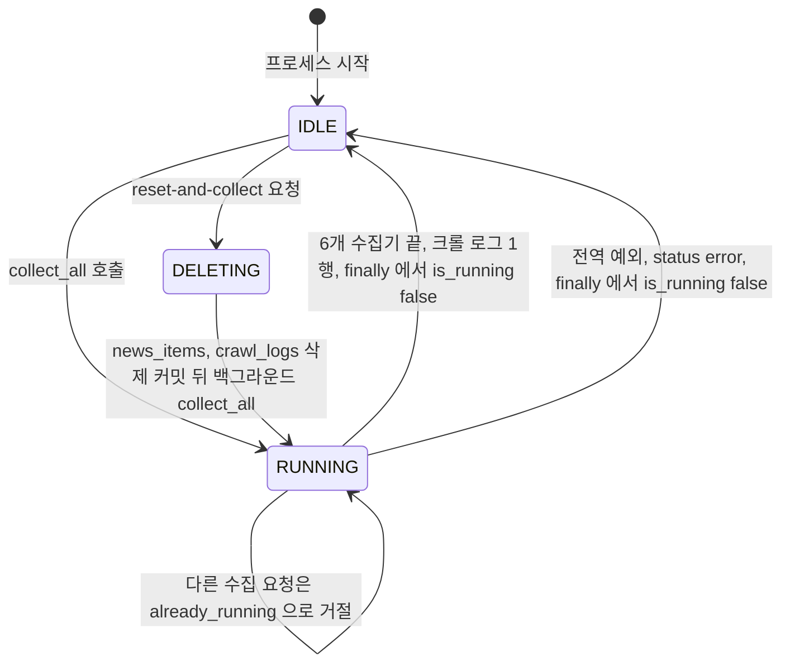
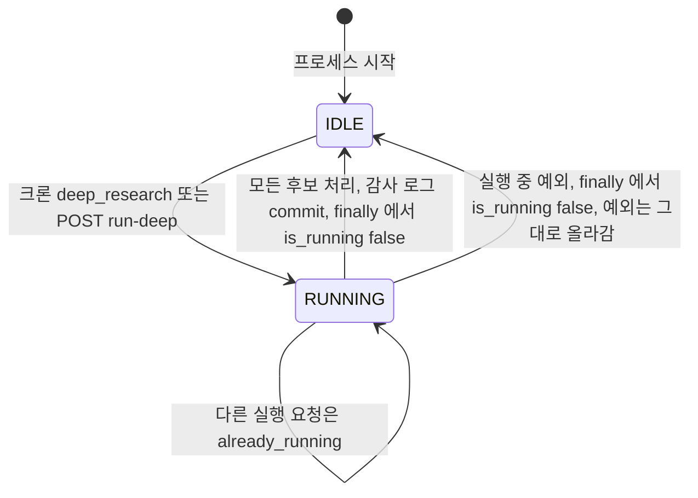
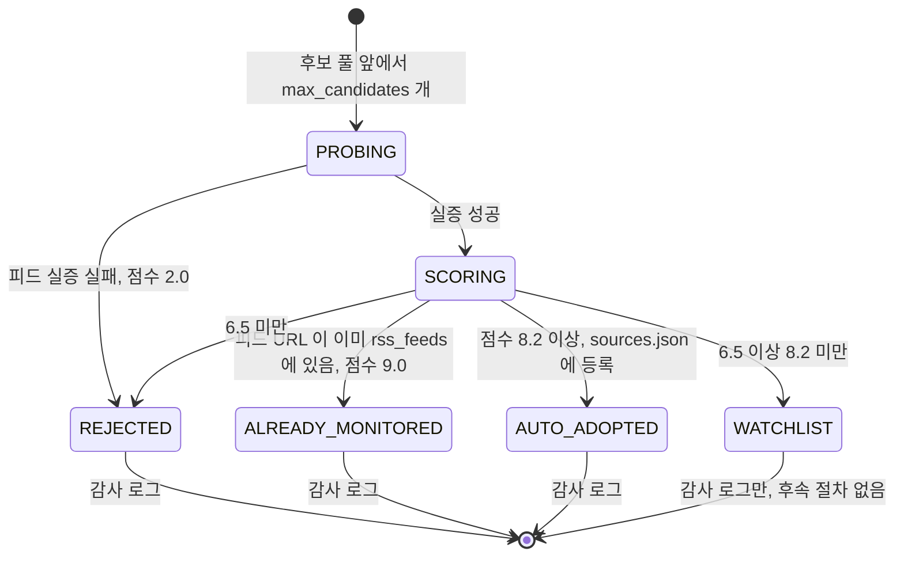
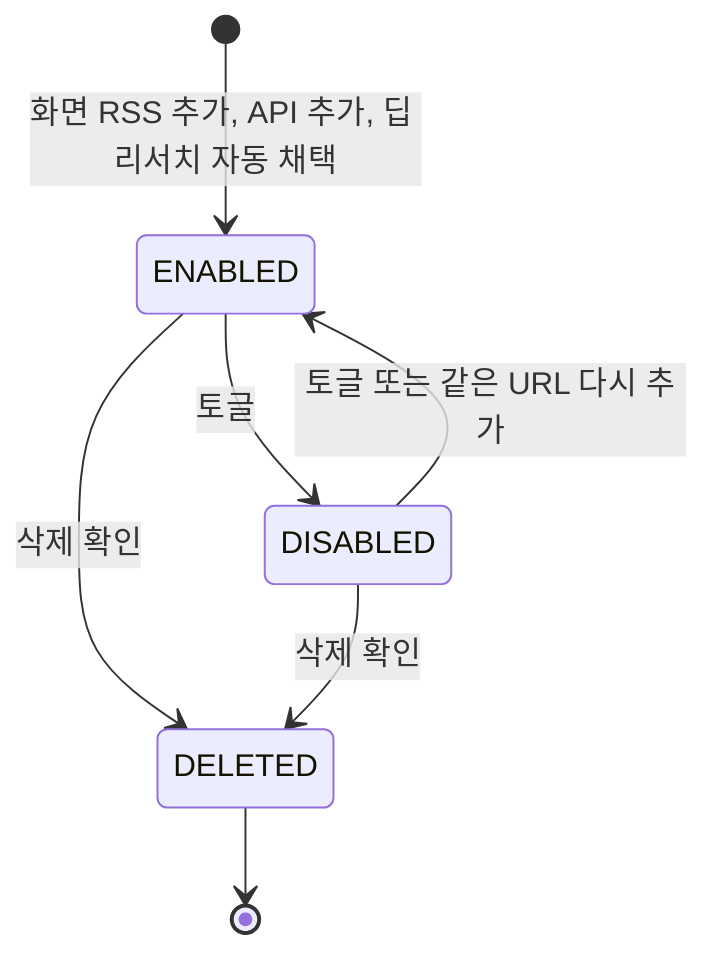
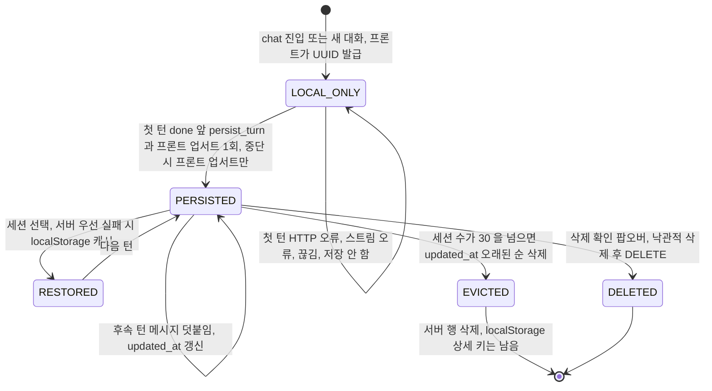
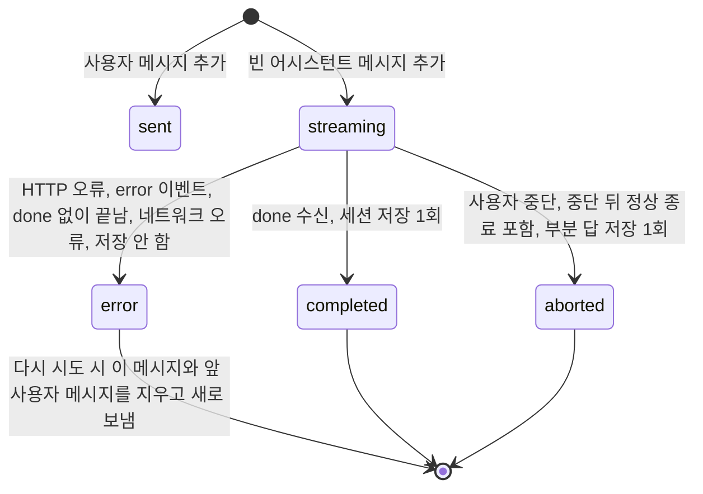

# AgentLens 비즈니스 정책 및 전역 예외 처리 명세서 (Policy & Edge Cases)

Updated: 2026-11-10
기준: v0.4.1 (main)

- **작성일자**: 2026-11-09
- **작성자**: 기획 명세 작성가 (`spec-writer`)
- **문서 버전**: v1.0 (as-built: 지금 코드의 정책을 적는다. v0.3.1 산출물을 대체한다)
- **상태**: Draft
- **선행 산출물**: PRD `docs/spec-writer/01_PRD.md`, 기능 인덱스 `docs/spec-writer/02_FUNCTIONAL_SPECIFICATION.md`, 도메인 FSD `docs/spec-writer/fsd/*.md`

이 문서는 도메인을 가로지르는 정책만 적는다. 단위 기능의 세부 동작은 도메인 FSD 가 정본이고, 여기 적은 사실은 FSD 와 같다. 근거는 `path:line` 이다. 코드에 있는 동작이 버그로 보여도 '지금 동작' 으로 적고, 문제는 4절에 모았다. v0.3.1 정책 문서의 상태 머신(품질 7.8 컷오프·30일 보관·Sonnet 수집·프롬프트 캐싱·Gemini 차단 등)은 지금 코드와 다르므로 옮기지 않았다.

---

## 1. 핵심 엔티티 상태 전이 머신 (State Machine Policies)

### 1.1 수집 작업 (`collector_manager`, 프로세스당 하나)

| 현재 상태 | 대상 상태 | 전이 트리거 | 필수 사전 조건 | 실행 주체 | 근거 |
| :--- | :--- | :--- | :--- | :--- | :--- |
| `IDLE` | `RUNNING` | 크론 `daily_crawl`(UTC 0·6·12·18시), `POST /api/schedule/trigger`, 서버 시작 시 기사 0건, `make collect`, MCP `trigger_agentlens_crawl` | 같은 프로세스의 `is_running` 이 false | 스케줄러, 웹 사용자(인증 없음), 시작 루틴, CLI, MCP 클라이언트 | `backend/app/collectors/manager.py:176-180`, `backend/app/scheduler.py:39`, `backend/app/main.py:33-36`, `backend/app/mcp/server.py:43-47` |
| `RUNNING` | (변화 없음) | 수집 요청 | `is_running` 이 true | 누구나 | 수집기는 `{"status": "already_running", "message": "Collector is currently running"}`, API 는 `{"status": "already_running", "message": "이미 수집이 진행 중입니다.", …}` (`manager.py:177-178`, FUNC-COLL-019) |
| `RUNNING` | `IDLE` | 수집 완료 또는 전역 예외 | 없음 | 시스템 | `finally: self.is_running = False` (`manager.py:256-257`). 수집기 0건이면 시드를 넣는다 (`:219-221`) |
| `IDLE` | `DELETING` → `RUNNING` | `POST /api/schedule/reset-and-collect` (확인 창 `SCR-COLL-003`, `make reset`) | `is_running` 이 false. 아니면 `already_running`, `deleted_count: 0`, 삭제 없음 | 웹 사용자(인증 없음), 운영자 | `backend/app/api/schedule.py:69-99`, FUNC-COLL-020 |

- **상태 위치**: `is_running`·진행 카운터·`last_crawl_stats` 는 프로세스 메모리다. 재시작하면 사라진다. MCP 서버와 직접 모드 `make collect` 는 별도 프로세스라 웹 서버와 상태를 공유하지 않아 두 수집이 동시에 돌 수 있다 (FUNC-COLL-017 BR-2, FUNC-COLL-022 BR-1, `scripts/collect.py:134-135` 는 경고만 낸다).
- **초기화 경쟁**: `is_running` 은 백그라운드 작업이 실제로 시작될 때 true 가 되므로, `started` 응답 직후의 두 번째 초기화 요청도 삭제를 수행할 수 있다 (두 번째 `collect_all` 은 `already_running` 으로 끝난다) (FUNC-COLL-020 엣지 케이스).
- **크롤 로그**: 실행당 1행, `source="all_sources_stream_ingestion"`, `status` 는 늘 `"success"` 다 (`manager.py:224-234`).

### 1.2 딥 리서치 실행과 후보 판정

| 현재 상태 | 대상 상태 | 전이 트리거 | 필수 사전 조건 | 실행 주체 | 근거 |
| :--- | :--- | :--- | :--- | :--- | :--- |
| `IDLE` | `RUNNING` | 크론 `deep_research`(UTC 3·15시, `max_candidates=8`), `POST /api/research/run-deep`(기본 6, 화면 6) | `is_running` 이 false | 스케줄러, 웹 사용자(인증 없음) | `backend/app/scheduler.py:47`, `backend/app/api/research.py:77-92`, FUNC-SRC-011 |
| `RUNNING` | `IDLE` | 처리 완료 또는 예외 | 없음 (`try/finally` 로 `is_running=False` 보장) | 시스템 | `backend/app/services/deep_researcher.py:376-393` |
| `SCORING` | `AUTO_ADOPTED` | 규칙 점수 8.2 이상 | 기등록 아님 | 시스템 (LLM 미사용) | FUNC-SRC-012, `deep_researcher.py:304-374` |

- 점수는 키워드 규칙(`evaluate_quality_and_signal(…, "rss")` + 깊이 가산)이고 LLM 을 부르지 않는다. 최종 점수 범위 1.0~9.9 (FUNC-SRC-012 BR-1).
- 후보 풀은 인용 도메인 마이닝 결과(최대 15개)를 앞에, 시드 14개를 뒤에 두고 앞에서 `max_candidates`(API 6, 스케줄 8)개만 자른다. 그래서 마이닝 후보가 컷보다 많으면 시드는 평가되지 않고, 마이닝 후보는 이미 등록된 소스를 거르지 않는다 (v0.4.1, FUNC-SRC-011 BR-1, `deep_researcher.py:399-419`).
- API 실행은 `asyncio.create_task` 로 백그라운드에 띄우고 태스크를 보관하지 않아, 실행 중 예외는 받는 곳 없이 로그에도 요약이 남지 않는다 (리뷰 N-02, `backend/app/api/research.py:77-92`).

### 1.3 수집 소스 (`sources.json` 의 RSS 피드)

| 현재 상태 | 대상 상태 | 전이 트리거 | 필수 사전 조건 | 실행 주체 | 근거 |
| :--- | :--- | :--- | :--- | :--- | :--- |
| `[*]` | `ENABLED` | `POST /api/sources/rss`, 자동 채택 | 같은 URL(끝 `/` 무시)이 있으면 새로 만들지 않고 그 항목을 `enabled: true` 로 바꾼다 | 웹 사용자(인증 없음), 딥 리서치 | `backend/app/services/sources_service.py:196-220` |
| `ENABLED`/`DISABLED` | 반대 | `PATCH /api/sources/{source_type}/{item_id:path}/toggle` (`owner/repo`·URL 같은 `/` 가 든 id 도 받는다) | 없음 | 웹 사용자 | `backend/app/api/sources.py:77-83`, FUNC-SRC-006 |
| `ENABLED`/`DISABLED` | `DELETED` | 화면 확인 창(`SCR-SRC-004`) 뒤 `DELETE /api/sources/{source_type}/{item_id:path}` | 없음 (내장 소스 보호 규칙 없음) | 웹 사용자 | `backend/app/api/sources.py:85-91`, `sources_service.py:245-262`, FUNC-SRC-007 |

- `id` 는 이름에서 영숫자가 아닌 글자를 `_` 로 바꿔 만들고 중복 검사를 하지 않는다. 같은 `id` 가 생기면 토글은 첫 항목만 바꾸고 삭제는 모두 지운다 (`sources_service.py:206`, `:250`).
- 파일 잠금이 없어 자동 채택과 화면 편집이 겹치면 한쪽 변경이 사라질 수 있다. 저장 때마다 `backend/app/config/sources.json` 사본에도 쓴다 (FUNC-SRC-001, `sources_service.py:102-132`).

### 1.4 AI 챗 세션

| 현재 상태 | 대상 상태 | 전이 트리거 | 필수 사전 조건 | 실행 주체 | 근거 |
| :--- | :--- | :--- | :--- | :--- | :--- |
| `[*]` | `LOCAL_ONLY` | `/chat` 진입, `새 대화` | 없음. 서버를 부르지 않는다 | 사용자 | FUNC-CHAT-002 BR-1 |
| `LOCAL_ONLY` | `PERSISTED` | 스트림 `done` 송신 직전 서버 `persist_turn`(클라이언트 메시지 id), 스트림이 끝난 뒤 프론트 `POST /api/chat/sessions` 1회(완료 또는 중단) | 메시지 1개 이상. 오류·끊김이면 저장 안 함 | 서버, 프론트 | `backend/app/services/chat_service.py:804-825`, `frontend/src/components/chat/ChatWorkspace.tsx:308-318`, FUNC-CHAT-006 |
| `PERSISTED` | `PERSISTED` | 후속 턴 | 업서트는 메시지를 교체하지 않고 덧붙이며 이미 있는 id 는 건너뛴다 | 서버, 프론트 | FUNC-CHAT-006 BR-2 |
| `PERSISTED` | `EVICTED` | 저장 뒤 세션 수 30 초과 | `enforce_fifo_retention(max_limit=30)` | 서버 | `backend/app/services/chat_session_service.py:279`, `:381` |
| `PERSISTED` | `DELETED` | 삭제 확인 | 프론트 목록·localStorage 를 먼저 지운다 | 사용자 | FUNC-CHAT-005 |

- **이중 저장**: 세션은 서버 DB(`chat_sessions`, `chat_messages`)와 localStorage(`agentlens_chat_sessions_index`, `agentlens_chat_session_<id>`)에 함께 저장한다. 서버와 프론트가 같은 클라이언트 메시지 id(`user_message_id`, `assistant_message_id`, 1~36자, 서로 달라야 함)로 저장하고 서버가 이미 있는 id 를 건너뛰므로, 완료된 턴은 메시지 2개로 남는다 (v0.4.1, FUNC-CHAT-006). 이미 있는 id 검사는 세션을 가리지 않는다 (4.2절).
- **자동 제목**: 첫 사용자 메시지에서 마크다운 기호·HTML 태그를 지우고 30자 + `...` (FUNC-CHAT-004).

### 1.5 AI 챗 메시지

- 프론트 상태 값은 `sending` | `sent` | `streaming` | `completed` | `aborted` | `error` 다. 사용자 메시지는 추가할 때 `sent` 다 (FUNC-CHAT-008, FUNC-CHAT-020).
- history 에는 `completed`·`sent` 만 들어간다. 프론트는 최근 10턴(20개)·3,000 토큰(글자/2.5)까지 보내고 서버 프롬프트는 마지막 4개 메시지만 쓴다 (FUNC-CHAT-008 BR-4, 챗 FSD 위험 33).
- `done` 없이 스트림이 끝나면(사용자 중단이 아니면) `error` 로 바꾸고 받은 부분 답 아래에 `응답이 중간에 끊겼습니다. 다시 시도해 주세요.` 를 보인다. Anthropic 스트림이 4096 토큰에서 잘리면(`stop_reason == "max_tokens"`) 서버가 `event: error` 를 보낸다 (v0.4.1, FUNC-CHAT-020, FUNC-CHAT-021).
- 오류 상태에서도 받은 부분 답 본문은 보이지만 모델 배지와 내보내기 도구줄은 보이지 않는다 (FUNC-CHAT-019).

### 1.6 SSE 스트림 단계 (챗 `POST /api/chat/stream`)

| 모드 | 이벤트 순서 (`status.step`, `progress`) | 근거 |
|---|---|---|
| scoped (단일 기사) | `extracting_source`(30) → `synthesizing`(85) → `sources`(기사 1건, 토큰 전) → `token`… → (서버 저장) → `done` | 챗 FSD '처리 흐름', 'SSE 이벤트 목록' |
| global, 검색함 | `thinking`(25) → `tool_calling`(50) → `synthesizing`(80) → `token`… → `sources`(인용된 출처만) → (서버 저장) → `done` | 같음 |
| global, 검색 안 함 | `thinking`(25) → `synthesizing`(75) → `token`… → (서버 저장) → `done` (`sources` 없음) | 같음 |
| 토큰 생성 중 예외 (Anthropic 스트림 `error` 이벤트·`stop_reason` max_tokens 포함) | … → `error`(`ERR_LLM_STREAM_FAILED`, `status_code: 502`, `retryable: true`) 1회 후 종료. `done`·서버 저장 없음 | `backend/app/services/chat_service.py:743-769`, `backend/app/services/llm_providers/anthropic_provider.py:318-334` |

서버 턴 저장은 `done` 을 보내기 전에 하고, 실패해도 로그만 남기고 `done` 을 보낸다 (`chat_service.py:804-825`). 기사 단위 AI 질문(`POST /api/news/{id}/ask/stream`)은 다른 형식(`meta`·`token`·`done`)이고 오류 이벤트가 없다. 토큰을 보낸 뒤 실패하면 `done` 없이 끝난다 (FUNC-NEWS-010).

---

## 2. 공통 비즈니스 제약 및 정책 (Global Business Policies)

### 2.1 LLM 공급자 선택·폴백·가용성 판정

LLM 을 부르는 경로는 네 가지이고 규칙이 서로 다르다.

| 경로 | 공급자 순서 | 가용성 사전 판정 | 공급자 없음·실패 시 | 근거 |
|---|---|---|---|---|
| AI 챗 스트림 (`stream_tokens`) | Anthropic → OpenAI(SDK 스트림) → Ollama. 요청 모델에 `gemini` 가 있으면 Gemini 만 | 라우터가 스트림 전에 `check_provider_available()`. 없으면 503 `ERR_LLM_PROVIDER_UNAVAILABLE` | 스트림 중 실패는 모두 `error` 이벤트 `ERR_LLM_STREAM_FAILED` | `backend/app/api/chat.py:370-426`, `backend/app/services/llm_processor.py:404-499`, FUNC-CHAT-022 |
| 일괄 생성 (`generate_live_answer`: 챗 플래너, `/api/chat/query`, 수집 게이트, 기사 질문 일괄 응답) | Anthropic → OpenAI(httpx) → Ollama. `gemini` 는 Gemini 만, `gpt`/`openai` 는 OpenAI 만 | 함수 안에서 `check_provider_available()` | `LLMUpstreamException` 등. 수집 게이트·기사 질문 일괄 응답은 `_generate_live_answer` 가 예외를 삼키고 휴리스틱으로 간다 | `llm_processor.py:340-401`, `:502-506`, FUNC-COLL-023 |
| 수집 게이트 (`evaluate_content_with_llm`) | 위 일괄 생성 | `has_live_provider()` 가 거짓이면 LLM 을 건너뛴다 | 휴리스틱 게이트 | `llm_processor.py:619`, `:649`, `:681-709` |
| 기사 질문 스트림 (`stream_question_answer`) | 캐시 → Anthropic → OpenAI(SDK, `max_tokens` 2048) → 휴리스틱 템플릿. Ollama·Gemini 없음 | 없음 (공급자별 키 유무만) | 토큰 전 실패면 다음 엔진, 모두 실패하면 휴리스틱 답 (`AgentLens Heuristic Engine`). 토큰을 보낸 뒤 실패하면 다른 엔진 답을 이어 붙이지 않고 `done` 없이 끝내며 캐시하지 않는다 (오류 이벤트 없음). HTTP 오류 없음 | `llm_processor.py:855-977`, FUNC-NEWS-010 |

- **가용성 판정 (`has_live_provider`)**: Anthropic 키 → OpenAI 키 → Ollama(주소가 있으면 동기 `httpx.Client` 로 `{주소}/api/tags` 를 1.0초 timeout 으로 한 번 호출, 200 이고 설정 모델이 설치돼 있으면 가능. 태그 없는 모델명은 `:latest` 를 붙여 비교) 순으로 처음 참인 것. 판정 이유는 서버 로그에만 남는다 (`llm_processor.py:171-194`, `:301-337`).
- **즉시 전파 (폴백 안 함)**: Anthropic 401(`AnthropicKeyMissingException`)·429(`LLMQuotaExceededException`)·503/529(`AnthropicOverloadedException`, 스트림 본문의 `overloaded_error` 이벤트 포함) (`llm_processor.py:373-376`, `:435-438`, `backend/app/services/llm_providers/anthropic_provider.py:323-327`). 그 밖의 Anthropic 실패(스트림의 다른 `error` 이벤트 = `AnthropicStreamError` 포함)는 토큰 전이면 다음 공급자로 넘어간다.
- **스트림 중 실패**: 토큰을 하나라도 보낸 뒤에는 다른 공급자로 넘어가지 않고 `LLMStreamFailedException` (`llm_processor.py:440-441`, `:471-472`, `:493-494`).
- **잘림 판정**: Anthropic 스트림이 `stop_reason == "max_tokens"` 로 끝나면 토큰을 다 보낸 뒤 `AnthropicStreamError` 를 올려 챗은 `event: error` 가 된다 (`anthropic_provider.py:333-334`). 비스트림과 OpenAI·Ollama 스트림은 잘림을 보지 않는다 (4.2절 남은 권장 지적).
- **OpenAI 한도 초과**: 스트림은 오류 문자열의 `rate`/`429`/`quota` 를 `LLMQuotaExceededException` 으로 올린다. 일괄은 `_call_openai` 가 예외를 삼키므로 한도 초과로 올라가지 않고 Ollama 로 넘어간다 (`llm_processor.py:248-269`, `:380-391`, `:467-470`).
- **모델 결정**: 티어 `haiku`/`sonnet`/`opus` 는 설정 모델(`claude-haiku-5-5`, `claude-sonnet-5-5`, `claude-opus-5-5`)로, 빈 값은 기본 챗 모델(`ANTHROPIC_DEFAULT_CHAT_MODEL`, `claude-sonnet-5-5`)로, Anthropic 경로에서 `gemini`/`google` 이 들어간 값은 기본 모델로 바꾼다 (`backend/app/config.py:53-56`, `backend/app/services/llm_providers/anthropic_provider.py:95-127`). 수집 게이트는 모델을 지정하지 않아 기본 챗 모델을 쓴다 (FUNC-COLL-023 BR-3).
- **설정 해석 순서**: Anthropic 키 = 명시 키 → `settings` → 환경 변수 → `config.json`. OpenAI 키 = 덮어쓰기 → `settings` → `config.json` → 환경 변수. Ollama 주소 = 덮어쓰기 → `settings.OLLAMA_BASE_URL`(기본 `http://localhost:11434`) → `config.json`. 상세는 FUNC-CHAT-022 BR-1.
- **쓰이지 않는 설정**: `LLM_PROVIDER`(`auto`)는 공급자 순서에 쓰이지 않는다 (`backend/app/config.py:49`). `ANTHROPIC_COLLECTION_MODEL` 을 읽는 `generate_structured_summary` 는 파이프라인에서 호출되지 않는다 (FSD COLL '알려진 불일치·위험').
- **출력 상한**: Anthropic·OpenAI(챗)·Ollama 4096, Gemini 2048, 기사 질문 스트림의 OpenAI 2048 (FUNC-CHAT-021 BR-1, `llm_processor.py:935`).
- **타임아웃**: Anthropic 45초(스트림 120초), OpenAI 60초, Ollama 90초(스트림 120초), Gemini 20초 (챗 FSD '상수·설정값').
- **미가용 시 기능별 동작 요약**: 수집은 휴리스틱 게이트로 계속 저장한다. 기사 질문은 휴리스틱 답을 준다. 브리핑은 LLM 을 쓰지 않아 영향이 없다 (FUNC-BRF-001). 딥 리서치는 LLM 을 쓰지 않는다 (FUNC-SRC-012 BR-4). AI 챗은 503 오류 카드 `가용한 LLM 프로바이더 엔진 미설정 (API 키 미등록)` 이다.
- **테스트 환경**: `is_test_environment()`(`TESTING`·`CI` 환경 변수, pytest 로드)는 챗 플래너 분기에서만 쓴다. 테스트에서 실제 LLM 호출을 막는 것은 `backend/tests/conftest.py` 의 하네스다 (FUNC-COLL-024).

### 2.2 인증·CORS·비밀값 (검사 범위 밖, 수용된 위험)

**정책 (제품 오너 결정, 2026-11-09)**: 아래 항목은 이 프로젝트의 검사 범위 밖이다. 리뷰·QA·테스트에서 결함으로 보고하지 않고, 수정 과제로 올리지 않는다. 지금 동작 사실과 근거는 기록으로 남긴다.

| 수용된 위험 | 지금 동작 | 근거 |
|---|---|---|
| 인증 없음 | 모든 API(파괴적 동작 포함)를 누구나 부른다. 사용자·계정 개념이 없다 | 라우터 전반, `backend/app/api/router.py` |
| CORS 전체 허용 | `allow_origins=["*"]`, `allow_credentials=True`, 메서드·헤더 전체 허용. 설정 `CORS_ORIGINS` 는 읽히지 않는다 | `backend/app/main.py:50-56`, `backend/app/config.py:45` |
| 서버 측 요청 위조(SSRF) | 호출자가 준 URL·호스트로 서버가 요청한다: `/api/webhook/test`·`/api/webhook/send-briefing`(`http` 로 시작하는 임의 URL, 실패 시 응답 본문 앞 100자 반환), `/api/research/inspect-url`(리다이렉트 따라감), `/api/briefing/test/email`(SMTP 호스트), 딥 리서치 인용 도메인 마이닝 | `backend/app/api/webhook.py:19-43`, `backend/app/services/webhook_service.py:17-32`, `backend/app/services/source_researcher.py:205-207`, `backend/app/services/deep_researcher.py:186-225` |
| 비밀값 평문 저장 | Notion 토큰, SMTP 비밀번호, 웹훅 URL 을 루트 `config.json` 에 평문으로 저장한다 (git 이 추적하는 파일) | `backend/app/api/briefing.py:174-203`, FSD BRF R3 |
| 설정 조회로 비밀값 노출 | `GET /api/briefing/settings` 가 웹훅 URL 원문과 Notion 토큰 앞뒤 4자를 돌려준다 | `backend/app/api/briefing.py:116-159`, `:207` |
| 설정 저장 뒤 재적용 누락 | 저장 뒤 `settings.reload()` 가 Notion·SMTP 값을 다시 읽지 않아 재시작 전까지 이전 값으로 발송·테스트한다. 웹훅 URL 은 이전 값이 빈 문자열일 때만 바뀐다. 화면 조회는 새 값을 보인다 | `backend/app/config.py:39-157`, FSD BRF R1 |

- 함께 남기는 관련 사실(수용 범위와 별개로 4절에 둔다): 전역 예외 처리기와 MCP 정보 API 가 예외 문자열·서버 절대 경로를 응답에 싣는다, 이메일 HTML 을 이스케이프하지 않는다.
- 파괴적 동작에 대한 하네스 쪽 게이트(2.5절)는 제품 코드의 인증이 아니다.

### 2.3 오류 응답 형식

backend 의 오류 응답은 네 형식이 섞여 있다. 비즈니스 에러 코드(`error_code`)를 쓰는 것은 AI 챗 API 뿐이다.

| 형식 | 쓰는 곳 | 모양 | 근거 |
|---|---|---|---|
| FastAPI `HTTPException` | 뉴스·브리핑·소스·리서치·스케줄 등 대부분 | `{"detail": "<문자열>"}` (브리핑은 대부분 400) | 각 FSD 7번 표 |
| FastAPI 검증 오류 | 쿼리·본문 스키마 위반 (예: `page < 1`, `size` 1~100 밖) | 422 `{"detail": [ … ]}` | FUNC-NEWS-001 7번 표 |
| 챗 비즈니스 오류 | `/api/chat/*` | `{"error_code": "ERR_…", "message": "…", "details": null}` (400/401/404/429/502/503/529, 세션 API 400/404/500). `/stream` 은 스키마 위반도 400 으로 답한다(`model_tier` 는 `ERR_INVALID_MODEL_TIER`, 그 밖은 `ERR_INVALID_PAYLOAD`) | `backend/app/api/chat.py:280-426`, FUNC-CHAT-003·005·006·008·022 |
| 전역 예외 처리기 | 잡히지 않은 예외 (예: `/api/chat/query`·`/search` 의 스키마 위반) | 500 `{"detail": "Internal server error occurred. Please check server logs.", "error": "<예외 문자열>"}` | `backend/app/main.py:58-67` |
| 본문 안 상태 | 수집 트리거·초기화·딥 리서치·URL 검사 | HTTP 200 과 `status`(`started`/`already_running`/오류 상태) | FUNC-COLL-019·020, FUNC-SRC-008·011 |
| SSE 안 오류 | 챗 스트림 | `event: error` (`ERR_LLM_STREAM_FAILED`, `status_code: 502`) | 1.6절 |

- 화면 표시 규칙: 프론트 `fetchWithTimeout` 기본 8,000ms (`frontend/src/lib/api.ts:25-37`). 뉴스·브리핑 쪽 API 함수는 `ok` 가 아니면 `data.detail`(없으면 함수별 기본 문구)로 예외를 던지고, 화면은 그 문구를 보인다. 네트워크 실패·타임아웃·JSON 이 아닌 응답이면 브라우저 예외 문구가 그대로 보인다 (FSD BRF '공통 표기와 오류 표시 규칙'). 챗은 응답 `message` 를 오류 카드에 쓰고, `message` 가 없는 전역 500 은 `서버 에러 (500)` 으로 보인다 (FUNC-CHAT-020).
- MSW 목은 오류를 모두 `error_code`·`message` 형식으로 흉내 내 backend 와 다르다 (4.4절).
- 문서에서 쓰는 `BRF_*` 같은 코드는 FSD 가 경우를 가리키려고 붙인 문서용 식별자이고 응답에 나가지 않는다.

### 2.4 동시 실행·중복 요청 방지

| 대상 | 서버 쪽 방지 | 화면 쪽 방지 | 근거 |
|---|---|---|---|
| 수집 | 프로세스 메모리 `is_running` → `already_running` | 수집 중이거나 요청 중이면 즉시 수집·초기화 진입점 비활성, 요청 중 플래그 | 1.1절, FUNC-UI-002 BR-2·6 |
| 초기화 | 수집 중이면 삭제 없이 `already_running` | 확인 창 `busy` 동안 버튼·Escape·배경막 무시 | FUNC-COLL-020 |
| 딥 리서치 | 프로세스 메모리 `is_running` → `already_running` | 실행 중·요청 중 버튼 비활성 | 1.2절 |
| 챗 전송 | 없음 | 스트리밍 중 전송 버튼이 중단 버튼으로 바뀌고 모델 선택 비활성. 사이드바·헤더의 새 대화 버튼 비활성 | FUNC-CHAT-002, FUNC-CHAT-015 |
| 챗 턴 저장 | 이미 있는 메시지 id 는 건너뜀 | 턴마다 POST 1회 (상태 갱신 함수 밖) | FUNC-CHAT-006 |
| 검색 요청 | — | 입력이 300ms 멈출 때까지 목록 요청을 미룸 | FUNC-NEWS-005 |
| 공통 버튼 | — | `Button` 은 `loading` 이면 `disabled`·`aria-busy` | `frontend/src/components/ui/Button.tsx:59-60` |
| 같은 URL 스크래핑 | URL 별 `asyncio.Lock` 으로 하나로 묶음 | — | FUNC-COLL-025 BR-2 |
| `sources.json` 쓰기 | 잠금 없음 | — | 1.3절 |
| 수집 배치 저장 | 배치 저장 락 안에서 기사별 LLM 평가가 직렬로 일어난다 | — | `backend/app/collectors/manager.py:77-99` |

- 프로세스가 다르면(MCP 서버, 직접 모드 `make collect`) 서버 쪽 방지가 통하지 않는다 (1.1절).
- SQLite 는 WAL, `busy_timeout` 30,000ms 로 두 프로세스의 쓰기를 기다린다 (`backend/app/database.py:17-26`).

### 2.5 파괴적 동작 정책

| 동작 | 확인 절차 | 되돌리기 | 근거 |
|---|---|---|---|
| 수집 데이터 초기화 & 재수집 | 위험 톤 확인 창 `SCR-COLL-003` (`취소` 가 처음 포커스). 문구 `현재 데이터베이스에 저장된 모든 뉴스 소식 및 수집 로그가 영구 삭제되며, …` | 불가. `news_items`·`crawl_logs` 만 지운다. `source_research_logs`·설정·`sources.json`·localStorage 북마크·평가 캐시는 남는다 | FUNC-COLL-020 BR-1·2, FUNC-NEWS-017 BR-5 |
| 기사 전체 삭제 `DELETE /api/news/all` | 화면 진입점이 없다 (API 만) | 불가. `crawl_logs` 는 지우지 않는다 | FUNC-NEWS-017 BR-1 |
| 소스 삭제 | 확인 창 `SCR-SRC-004` `이 소스를 목록에서 삭제하시겠습니까?` | 불가 (같은 URL 을 다시 추가해야 함) | FUNC-SRC-007 |
| 챗 세션 삭제 | 확인 팝오버 `SCR-CHAT-003`, `삭제된 대화 기록과 모든 메시지는 영구 복구할 수 없습니다.` | 불가. 낙관적 삭제라 서버 실패 시 목록만 다시 읽는다 | FUNC-CHAT-005 |
| 기사 질문 대화 초기화 | 확인 창 `AI 대화 내역을 모두 초기화하시겠습니까?` | 화면 상태만 지운다 | UI 공통 FSD 대화상자 표 |
| 챗 세션 FIFO 삭제 | 없음 (자동) | 불가 | 1.4절 |

- 브라우저 기본 대화상자(`window.confirm`, `alert`)는 쓰지 않는다 (UI 공통 FSD).
- 하네스 규칙(제품 코드 밖): `make reset` 과 `curl … reset-and-collect` 는 `RELEASE_APPROVAL` 이 있는 세션에서만 실행된다 (`CLAUDE.md`, FUNC-COLL-020 BR-3). `make reset` 은 `{URL}/health` 를 5초 안에 확인하고 30초 요청 뒤 재수집 완료를 기다리지 않는다 (`Makefile:57-73`).

### 2.6 시간 및 타임존 정책

- **저장**: backend 는 `datetime.now(timezone.utc)` 로 시각을 만든다 (`backend/app/models/news.py:31-32`, `:50-51`, `:65`, `backend/app/models/chat_session.py:15-19`, `:53`). 열 타입은 timezone 없는 `DateTime` 이라 SQLite 에서 오프셋 없는 문자열로 돌아올 수 있다. 실제 반환 형식은 실행해 확인하지 못했다 (챗 FSD 위험 12).
- **수집 원천 시각**: 수집기는 피드의 발행 시각을 쓰고, 시간대가 없으면 UTC 로 보며, 없으면 수집 시각(UTC)을 쓴다 (`backend/app/collectors/sources/rss.py:49-61`, `github.py:35`, `arxiv.py:40`, `huggingface.py:25`, `hackernews.py:31`, `reddit.py:28`).
- **스케줄 (모두 UTC, 코드 고정)**: 수집 0·6·12·18시 (KST 9·15·21·3시), 딥 리서치 3·15시, 브리핑 자동 발송 0시 15분 (KST 9시 15분) (`backend/app/scheduler.py:39`, `:47`, `:55`). `config.json` 의 `scheduler.crawl_hours`·`timezone` 은 상태 API 표시(`schedule_hours`, `timezone`, 폴백 `next_run`)에만 쓰인다 (FUNC-COLL-018 BR-1).
- **화면 표시**: 스케줄 대화상자는 고정 문구 `00:00 · 06:00 · 12:00 · 18:00` 과 `(KST: 09:00, 15:00, 21:00, 03:00)`, `next_run` 을 ko-KR 로 보인다 (FUNC-COLL-017). 딥 리서치 최근 실행은 브라우저 로캘 시각, 고정 문구 `매일 03:00, 15:00 UTC` (FUNC-SRC-013). 카드 상대 시각은 60초마다 다시 그린다 (`frontend/src/components/NewsCard.tsx:34`).
- **브리핑 날짜**: `datetime.now(timezone.utc).strftime("%Y년 %m월 %d일")` 이라 UTC 날짜다. 그래서 KST 0시~9시 사이에 만든 브리핑에는 한국 날짜로 전날이 보인다 (`backend/app/services/briefing_service.py:114`). 브리핑에는 기간 필터가 없다 (FSD BRF R13).
- **웹훅 메시지 시각**: `%Y-%m-%d %H:%M UTC` (`backend/app/services/webhook_service.py:35`).
- **예외**: `sources_service` 의 피드 `id` 대체값(`feed_<타임스탬프>`)만 로컬 시각 `datetime.now()` 를 쓴다 (`backend/app/services/sources_service.py:206`).

### 2.7 외부 발송 정책 (Notion·이메일·웹훅)

| 항목 | 수동 발송 | 자동 발송 (매일 00:15 UTC) | 근거 |
|---|---|---|---|
| 트리거 | 브리핑 대화상자 `Notion 내보내기`, `이메일 발송`(주소 입력), 설정 대화상자 `연결 테스트`, API `POST /api/webhook/send-briefing`(화면 미사용) | job `daily_briefing_dispatch` | FUNC-BRF-004·006·009·010·013 |
| 브리핑 | 요청마다 새로 만든다. 저장하지 않는다 | 한 번 만들어 모든 채널에 쓴다 | FUNC-BRF-001, FUNC-BRF-013 |
| 채널 조건 | 각 버튼 | Notion: `NOTION_AUTO_EXPORT` 참이고 키 있음. 이메일: `EMAIL_AUTO_SEND` 참이고 `SMTP_HOST`·`SMTP_TO` 있음. 웹훅: 켜기 스위치 없이 `SLACK_WEBHOOK_URL`·`DISCORD_WEBHOOK_URL` 이 있으면 보낸다 | FUNC-BRF-013 |
| 순서 | — | Notion → 이메일 → 웹훅(Slack → Discord). 한 채널의 실패가 다음을 막지 않는다 | FUNC-BRF-013 BR-2 |
| 재시도·알림 | 없음. 화면에 결과 인라인 알림 | 없음. 로그(`agentlens.briefing`)만, 웹훅 결과는 버린다 | FUNC-BRF-013 BR-4 |
| 중복 방지 | 없음 (같은 날 여러 번 발행 가능) | 없음. 수동 발행과 별개로 새 Notion 페이지 | FUNC-BRF-013 BR-5 |
| 웹훅 제공자 판별 | URL 로 Slack·Discord·일반을 판별. 성공 코드 200·204, 타임아웃 8.0초 | 같음. 같은 URL 이 두 칸에 있으면 두 번 보낸다 | `backend/app/services/webhook_service.py:22-26`, FUNC-BRF-013 BR-3 |
| 타임아웃 | 서버: Notion 10~15초, SMTP 12초, 웹훅 8초. 프론트: Notion 발행·이메일 20,000ms, Notion 테스트 12,000ms, SMTP 테스트 15,000ms | 서버 값만 | FSD BRF '상수·설정값' |

- 서버 외부 호출 시간의 합이 프론트 타임아웃보다 길 수 있어, 화면이 실패를 보여도 페이지·메일이 실제로 만들어질 수 있다 (코드 읽기 기준, FSD BRF R19).
- 고신호 기사 즉시 알림(`webhooks.auto_alert_high_signal`)은 설정 키만 있고 기능은 없다 (PRD `REQ-BRF-011`).
- 비밀값 저장·노출·재적용 누락은 2.2절의 수용된 위험이다.

### 2.8 품질·하이시그널 판정 값

| 값 | 지금 코드 | 근거 |
|---|---|---|
| 저장 최소 품질 | `QUALITY_CUTOFF_SCORE` = `config.json` `llm.quality_cutoff_score` (키 없으면 5.0) | `backend/app/config.py:64` |
| LLM 경로 저장 조건 | `is_worthwhile` 참, 관련 있음, 카테고리가 `irrelevant` 아님, `relevance_score >= 5.0`, `quality_score >= 컷오프` | `backend/app/services/llm_processor.py:663` |
| 하이시그널 임계값 | `config.json` 7.0. 키가 없으면 `config.py` 기본 7.8, `llm_processor` 의 `getattr` 폴백 7.0. Anthropic 시스템 프롬프트 문구 7.8 | `backend/app/config.py:65`, `llm_processor.py:568`, `:661` |
| 피드 `Must-Read` 필터 | `is_high_signal` 열만 본다 | `backend/app/api/news.py:63-64` |
| 챗 포커스 필터 라벨 | `품질 7.8+` (서버는 `is_high_signal` 열로 거른다) | 챗 FSD 위험 30 |
| MSW 목 | `quality_score >= 7.8 \|\| is_high_signal` | `frontend/src/mocks/handlers.ts:266` |

정본 값은 정해지지 않았다 (PRD 열린 질문 Q6).

---

## 3. 전역 엣지 케이스 및 장애 복구 UX 가이드 (Global Edge Cases)

| 장애 / 예외 유형 | 감지 방식 | 사용자 경험(UX) 복구 처리 방식 | 근거 |
| :--- | :--- | :--- | :--- |
| backend 연결 실패·타임아웃 (피드) | `fetchWithTimeout` 8,000ms abort, 네트워크 예외 | 목록이 없으면 오류 상태(`백엔드 서버(포트 8000) 연결 상태를 확인해주세요.` + `다시 시도`), 같은 조건 다시 읽기면 목록 유지 + `danger` 알림 | FUNC-NEWS-001, FUNC-UI-011 |
| backend 연결 실패 (챗) | fetch 예외 | 오류 카드 + `다시 시도`. 챗 API 에는 시간 제한이 없어 멈추면 로딩이 계속될 수 있다 | FUNC-CHAT-020, UI 공통 FSD 위험 7 |
| 가용 LLM 공급자 없음 | 챗 라우터 사전 검사 | 챗: 503 오류 카드. 수집: 휴리스틱 게이트. 기사 질문: 휴리스틱 답 | 2.1절 |
| LLM 키 오류·한도 초과·과부하 (챗) | 스트림 중 예외 | 모두 같은 `ERR_LLM_STREAM_FAILED` 오류 카드로 합쳐져 구분되지 않는다 | FUNC-CHAT-022, 챗 FSD 위험 9 |
| 챗 스트림이 `done` 없이 끊김 | 프론트 루프 종료, `done` 받지 않음, 사용자 중단 아님 | 받은 부분 답 아래 `응답이 중간에 끊겼습니다. 다시 시도해 주세요.` 와 `답변 다시 시도`. 저장하지 않는다 | 1.5절, FUNC-CHAT-020 |
| 기사 질문 스트림이 토큰 뒤 실패 | backend 가 `done` 없이 끝냄 | 프론트는 구분하지 않아 받은 부분 글자를 답으로 보인다 (오류 표시 없음) | FUNC-NEWS-010, 4.2절 |
| 빈 DB 로 서버 시작 | 시작 루틴의 기사 수 0 | 백그라운드 첫 수집, 요청은 바로 받는다. 피드는 빈 상태에서 점진 반영 | FUNC-COLL-021 |
| 수집 중 다른 화면에 갔다 돌아옴 | 30초 스케줄 상태 재조회 `is_running: true` | 진행 줄과 폴링을 다시 붙인다 (`실시간 소식 수집 중...`) | FUNC-UI-002 BR-9 |
| 수집 진행 조회 실패 | progress 요청 실패 | 폴링을 멈추고 메시지를 지운다. 다음 30초 재조회가 다시 붙인다 | FUNC-UI-002 BR-3 |
| 서버 재시작 | — | 수집·딥 리서치 진행 상태, 평가·질문 캐시, 딥 리서치 누적 채택 수가 사라진다. 딥 리서치 화면은 `최근 가동됨` 을 보인다 | FUNC-COLL-017 BR-2, FUNC-SRC-013 |
| 크론 시각에 서버가 꺼져 있음 | — | 놓친 회차를 다시 돌리는 코드는 없다. APScheduler 의 놓친 실행 기본 동작은 확인하지 못했다 | FUNC-COLL-018, FUNC-BRF-013 |
| 북마크 기사가 DB 에서 사라짐 (초기화 뒤) | — | 북마크는 스냅샷이라 남는다. 챗 핸드오버 시 챗이 `요청하신 기사를 찾을 수 없어 전체 소식 모드로 시작합니다.` 경고 후 전체 소식 범위로 시작 | FUNC-NEWS-019 |
| 웹 서버와 MCP 서버의 DB 가 다름 | — | `./agentlens.db` 가 cwd 기준이라 서로 다른 DB 를 볼 수 있다. Docker 웹 서버는 volume 의 `/app/data/agentlens.db` 를 쓴다. MCP 서버는 스키마를 만들지 않는다 | FSD MCP '알려진 불일치·위험' |
| localStorage 쓰기 실패 | `try/catch` | 무시한다 (챗 세션 캐시) | FUNC-CHAT-006 |
| localStorage 값이 배열이 아님 (챗 세션 인덱스, 북마크) | 없음 (`JSON.parse` 결과를 그대로 씀) | 목록 렌더에서 오류가 날 수 있다 (코드 경로 판단) | 4.2절 |
| 오버레이가 열린 상태의 단일 키 단축키 | 오버레이 스택 | 단일 키(j/k/b/c/`/`/t)를 막고 Escape 는 맨 위 레이어 하나만 닫는다 | FUNC-UI-005, FUNC-UI-008 |
| IME 조합 중 키 입력 | `isComposing` | 단축키·Enter 전송을 무시한다 | UI 공통 FSD 단축키 표 |
| 비보안 출처(HTTP LAN IP)에서 복사 | `navigator.clipboard` 실패 | 폐기 예정 `execCommand('copy')` 로 다시 시도, 결과 `복사됨`/`복사 실패` 2,000ms | FUNC-UI-013 |

---

## 4. 도메인을 넘나드는 알려진 문제 (옛 `docs/known-issues.md` 대응)

"의심" 은 코드로 추론했고 실행해 확인하지 않은 것이다. 2.2절의 수용된 위험에 해당하는 항목은 '수용' 으로 표시했다 (검사·수정 대상 아님). 세부 근거는 '문서' 열의 FSD '알려진 불일치·위험' 절에 있다. v0.4.1 리뷰 수정으로 해결된 항목은 4.8절에 따로 모았고, 리뷰에서 남은 권장 지적은 4.2절에 '(리뷰 …)' 로 표시했다.

### 4.1 보안
| 문제 | 영향 | 문서 | 상태 |
|---|---|---|---|
| 인증이 없고 CORS 가 모든 origin 을 credentials 와 함께 허용한다 (`backend/app/main.py:50-56`) | :8000 에 닿는 누구나 `DELETE /api/news/all`, `POST /api/schedule/reset-and-collect`, 소스 삭제·토글, 설정 저장을 부를 수 있다 | 2.2절 | 수용 |
| 호출자가 준 URL·SMTP 호스트로 서버가 요청한다 (웹훅 테스트·발송, `inspect-url`, `test/email`) | SSRF | FSD BRF R4, FSD SRC | 수용 |
| Notion 토큰·SMTP 비밀번호·웹훅 URL 을 git 이 추적하는 `config.json` 에 평문 저장한다 | 비밀값 유출 | FSD BRF R3 | 수용 |
| `GET /api/briefing/settings` 가 웹훅 URL 을 가리지 않고 Notion 토큰 앞뒤 4자를 돌려준다 | 비밀값 노출 | FSD BRF R3 | 수용 |
| 예외 문자열과 서버 절대 경로가 응답에 나간다 (전역 처리기 `error` 필드 `backend/app/main.py:66`, MCP 정보 API 의 `cwd` `backend/app/api/mcp.py:23`) | 내부 정보 노출 | 2.3절, FSD MCP | 열림 |
| 이메일 HTML 을 이스케이프하지 않는다 (`backend/app/services/email_service.py:35-65`, `:122`) | 수집한 제목에 HTML 이 있으면 메일 본문에 그대로 들어간다 | FSD BRF R5 | 열림 |

### 4.2 데이터·동작 오류
| 문제 | 영향 | 문서 |
|---|---|---|
| 브리핑 설정 저장 뒤 `settings.reload()` 가 Notion·SMTP 값을 다시 읽지 않는다 | 화면에는 새 값이 보이지만 재시작 전까지 이전 값으로 발송한다 (수용, 2.2절) | FSD BRF R1 |
| (리뷰 FE-04) 챗 다시 시도가 지우기 전 `messages` 로 history 를 계산한다 | 지운 질문이 history 에 들어갈 수 있다 | 챗 FSD 위험 35 |
| (리뷰 FE-17·18) localStorage 의 챗 세션 인덱스·상세와 북마크를 `JSON.parse` 한 값을 배열·형식 검사 없이 쓴다 (`frontend/src/components/chat/useChatSessions.ts:48-52`, `:87-89`, `frontend/src/hooks/useBookmarks.ts:44-53`) | 값이 배열이 아니면 렌더 오류가 날 수 있다 (코드 경로 판단) | 챗 FSD 위험 42, FSD NEWS 위험 16 |
| (리뷰 FE-35) 검색 디바운스 300ms 안에 페이지를 옮기면 검색어 반영 때 page 가 1 로 돌아간다 | 옮긴 페이지가 유지되지 않는다 | FSD NEWS 위험 15 |
| (리뷰 N-01) 기사 질문 스트림이 토큰을 보낸 뒤 실패하면 `done` 없이 끝날 뿐 `error` 이벤트가 없다 | 프론트는 받은 부분 글자를 정상 답처럼 보인다 | FSD NEWS 위험 3 |
| (리뷰 N-02) 딥 리서치 API 가 `asyncio.create_task` 결과를 보관하지 않고 실패 요약을 남기지 않는다 (`backend/app/api/research.py:87`) | 백그라운드 실행 실패를 알 수 없다 | 1.2절, FSD SRC |
| (리뷰 N-03) `/api/chat/query`·`/api/chat/search` 의 스키마 위반이 전역 처리기 500 이다 | 정의된 오류 코드 없음 | 챗 FSD 위험 8 |
| (리뷰 N-04) 딥 리서치 발굴 후보가 컷(6·8)보다 많으면 시드가 평가되지 않고, 발굴 후보는 이미 등록된 소스를 거르지 않는다 (`backend/app/services/deep_researcher.py:399-419`) | 시드 평가 누락, 기등록 소스 재평가 | 1.2절, FSD SRC |
| (리뷰 N-05) 비스트림 LLM 호출과 OpenAI·Ollama 스트림이 `stop_reason` 을 보지 않는다 | 상한에서 잘린 답이 완료로 남는다 | 챗 FSD 위험 40 |
| 챗 클라이언트 메시지 id 가 다른 세션에 이미 있으면 업서트·서버 저장이 그 메시지를 건너뛴다 (`backend/app/services/chat_session_service.py:327-338`) | 그 세션에 메시지가 빠진다 (id 가 겹칠 때만) | 챗 FSD 위험 41 |
| `llm_processor.last_usage` 를 요청끼리 공유한다 | 동시 요청의 토큰 사용량이 섞인다 | 챗 FSD 위험 6 |
| 평가 캐시(`_eval_cache`)가 만료되지 않고 초기화해도 남는다 | 한 번 거부된 제목은 재시작 전까지 계속 거부 | FSD COLL |
| 크롤 로그가 항상 `success` 이고 `error_message` 를 채우지 않는다 | 소스별 실패를 볼 수 없다 | FSD COLL |
| LLM 평가가 시사점을 주지 않으면 카테고리별 고정 문장(`CATEGORY_INSIGHTS`, 기술 이름이 있으면 `{기술} 기반 구현에서 ` 를 앞에 붙임)을 저장한다 (`backend/app/services/llm_processor.py:84-89`, `:742-748`. 옛 문서는 `:703-709` 로 적었으나 지금 코드는 742-748) | 같은 문장이 여러 기사의 카드·상세·챗 출처에 반복된다. 카드는 반복되는 시사점이면 요약을 대신 보여 완화하지만 상세·챗·브리핑에는 그대로 나온다 | FSD COLL, FSD NEWS 위험 7 |
| 수집기가 `raw_score` 에 원천 지표가 아닌 값을 넣는다: RSS 국내 180·그 밖 150(`backend/app/collectors/sources/rss.py:75`), arXiv 120(`arxiv.py:48`), HuggingFace `numComments + 40`(`huggingface.py:33`), GitHub 폴백 `stars_hint`(기본 5000, `github.py:61-69`)와 포크 수 `int(stars × 0.12)`(`github.py:70`). 인기 점수는 `min(100, hotness × 8)` 로 포화한다(`backend/app/collectors/categorizer.py:147`. 2026-11-07 DB 4734건 중 1034건, `rss_kr` 459건 중 373건이 100 — 옛 문서 기록 값, 다시 측정하지 않음). 첫 화면 카드의 상대 시간이 모두 같은 값으로 보이는 것은 원인을 확인하지 않았다 (의심) | 카드는 원천 지표 소스(`github`·`hackernews`·`reddit`)만 `raw_score` 와 인기 점수를 그린다. 지표 소스에서도 포화하면 100 으로 같게 보이고, `추천순`·`인기순` 정렬이 합성 값에 좌우된다. 폴백 `stars_hint` 와 합성 포크 수는 실제 값과 구별되지 않는다 | FSD NEWS 위험 12, FSD COLL |
| 브리핑 헤드라인(첫 항목 제목 40자, `backend/app/services/briefing_service.py:101-102`)과 분야 요약(제목 45자·요약 90자, `:86`, `:88`)을 글자 수로 잘라 `...` 를 붙인다 | 요약 바·대화상자 설명·분야 요약·마크다운 전문·Notion·이메일에 단어가 잘린 문장이 보인다. backend 에서 따로 고친다 | FSD BRF R9 |

### 4.3 설정과 코드 불일치
| 문제 | 문서 |
|---|---|
| 스케줄 시각이 코드에 고정돼 `crawl_hours`·`timezone`·`auto_dispatch_hour`·`auto_briefing_hour` 가 동작에 쓰이지 않는다 (2.6절) | FSD COLL, FSD BRF |
| 읽는 코드가 없는 설정: `scheduler.enabled`, `LLM_PROVIDER`, `crawler.*`, `CHAT_*` 5개, `CORS_ORIGINS`, `SCRAPER_TIMEOUT_SECONDS`, `auto_alert_high_signal`, `auto_dispatch_daily_briefing`, `ANTHROPIC_COLLECTION_MODEL`(호출되지 않는 함수만 읽음), `category_hint` | FSD COLL, FSD BRF, 챗 FSD 위험 28 |
| 하이시그널 임계값이 7.8(`config.py` 기본)과 7.0(`config.json`, `llm_processor` 폴백)으로 다르다 (2.8절) | FSD COLL |
| 화면 문구와 실제 동작이 다르다: Ask AI 의 "Gemini" 표기, 딥 리서치 "LLM 평가"(실제는 키워드 규칙), 3줄 요약(실제는 규칙 기반). (챗 모의 `Notion 동기화` 는 v0.4.1 에서 지웠다) | FSD NEWS 위험 2, FSD SRC |
| RSS 채널 링크가 `http://localhost:3000` 고정이고 루트 `config.json` 의 프론트 포트는 3001, 이메일 대시보드 링크는 `http://localhost:3001` 고정 | FSD NEWS 위험 10, FSD BRF R18 |
| `sources.json` 이 저장소 루트와 `backend/app/config/` 두 곳에 있고, cwd 에 따라 다른 파일을 읽을 수 있다 | FSD SRC, FSD COLL |

### 4.4 계약 (backend ↔ zod ↔ MSW)
| 문제 | 문서 |
|---|---|
| 오류 형식이 4가지(`detail`, 422, `error_code`, 전역 500)로 섞여 있고, MSW 는 모두 `error_code` 로 흉내 낸다 (2.3절) | FSD NEWS 위험 5, 챗 FSD |
| MSW 에만 있는 경로 `GET /api/chat/stream`, MSW 에만 있는 단계 `evaluating_sufficiency`·`agentic_searching`·보충 출처 `[S1]` | 챗 FSD 위험 16 |
| global 모드에서 backend 는 `sources` 를 토큰 뒤에 보내고 MSW 는 앞에 보낸다 | 챗 FSD 위험 16 |
| zod 에 없는 필드(`ChatSourceDetailResponse.full_content`·`scraped_at`), backend 가 안 보내는 필드(`NewsItemSchema` 의 같은 두 필드) | 챗 FSD 위험 21, FSD NEWS 위험 6 |
| backend 가 쓰는 오류 코드 `ERR_INVALID_PAYLOAD`·`ERR_RETRIEVER_INDEX_ERROR` 가 zod 에 없다 (v0.4.1 계약 변경 뒤 zod 반영 여부는 이번에 확인하지 않았다). `ERR_CLAUDE_API_KEY_MISSING` 은 실제 401 (zod 주석은 503) | 챗 FSD 위험 19 |
| MSW 는 세 Claude ID 밖 `model` 문자열을 400 으로 막지만 backend 는 `model` 을 검증하지 않는다 (잘못된 `model_tier` 는 v0.4.1 부터 양쪽 모두 400) | 챗 FSD 위험 18 |
| 프론트는 테스트 밖에서 zod `parse` 를 하지 않아 위 불일치가 런타임에 드러나지 않는다 | 챗 FSD 위험 21 |

### 4.5 UI·접근성
| 문제 | 영향 | 문서 |
|---|---|---|
| backend 브리핑 분야 이름과 이모지 아이콘(`CATEGORY_DEFS`, `backend/app/services/briefing_service.py:13-42`: `MCP & 도구·스킬 생태계`, `에이전트 아키텍처 & 런타임`, `최신 AI 소식 & 프론티어 모델` 등)이 프론트 긴 라벨(`frontend/src/lib/labels.ts`)과 다르다 | 대화상자의 카테고리별 요약 탭은 긴 라벨과 lucide 아이콘으로 바꿔 그리지만, 마크다운 전문 탭·Notion 페이지·이메일 본문에는 backend 이름과 이모지(`notion_service.py:79`, `email_service.py:120` 의 `📌` 포함)가 남는다. backend 에서 따로 고친다 | FSD BRF R10 |
| 챗 진행 단계 라벨(SSE `status` 의 `label`)에 그림 이모지가 들어 있다 (`backend/app/services/chat_service.py:614`, `:635`, `:678`, `:693`, `:715`, `:734`) | 프론트가 정한 UI 글자에는 그림 이모지를 쓰지 않지만 진행 표시(`WorkflowStepTracker`)에는 backend 라벨의 이모지가 그대로 보인다. backend 에서 따로 고친다 | 챗 FSD |
| 인용 팝오버가 포털 없이 답변 `
` 안에 `div` 로 그려진다, 세션 카드 `role="button"` 안에 삭제 버튼이 중첩된다 | HTML 중첩 규칙 위반, 잘림 가능 | UI 공통 FSD 위험 2·3 |

### 4.6 테스트·운영
| 문제 | 문서 |
|---|---|
| 챗 헤더에서 모델 선택을 뺀 뒤에도 `ChatModelSelector` 의 `header-chip`·`header-compact` 변형(`frontend/src/components/chat/ChatModelSelector.tsx:13-14`, `:93`)과 `ChatHeaderProps` 의 `selectedTier`·`onSelectTier`(`frontend/src/types/chat.ts:942-944`)가 남아 있다. `ContractAndMsw.test.ts:1017` 의 prop 호환 테스트는 컴포넌트가 받지 않는 필드를 단언해, 통과해도 실제 호환을 보장하지 않는다 | 챗 FSD |
| 마이그레이션 도구가 없고 `ALTER TABLE` 실패를 조용히 삼킨다 (`backend/app/database.py:55-71`) | 엔지니어링 산출물 |
| DB 경로가 cwd 기준이라 루트와 `backend/` 에 `agentlens.db` 가 둘 있다. MCP 서버는 스키마를 만들지 않는다 | FSD MCP |
| 수집 중복 실행 방지 플래그가 프로세스 메모리에만 있어 MCP 서버와 공유되지 않는다 (1.1절) | FSD COLL, FSD MCP |
| `NEXT_PUBLIC_API_URL` 을 Docker 빌드 단계에서 넘기지 않는다 (의심: 브라우저가 `{host}:8000` 으로 붙는다). `docker-compose.yml:63` 은 런타임 환경 변수로만 넘긴다 | 엔지니어링 산출물 |
| 딥 리서치·소스 테스트가 실제 `sources.json` 과 외부 네트워크를 쓸 수 있다 (하네스 임시 사본 사용 여부는 확인하지 못함) | FSD SRC |

### 4.7 쓰이지 않는 코드
- 프론트: `WebhookSettingsModal`, `ThemeToggle`(테스트만 쓴다), `src/lib/env.ts`, api 함수 `askQuestionAboutNews`·`deleteAllNews`·`discoverSources`·`registerCandidate`·`sendBriefingToWebhook`, 타입 `DailyBriefingSchema`, localStorage 키 `agentlens_webhook_url`, 넘기는 화면이 없는 prop `HotkeyListener` 의 `onCloseOverlays`·`onToggleCommandPalette`·`customHotkeys` 와 `NewsCard`·`NewsDetailModal` 의 `onHandoverToChat`.
- backend: `AgenticSearchService`(만들기만 하고 부르지 않음), `generate_structured_summary`, UI 가 부르지 않는 API `/api/chat/query`, `/api/chat/search`, `/api/research/discover`, `/api/research/register-candidate`, `POST /api/sources/github`, `/api/mcp/info`, `/api/webhook/send-briefing`, `/api/briefing/generate`, `GET /api/news/{id}`, `POST /api/news/{id}/ask`, `DELETE /api/news/all`.
- 남길지 지울지는 PRD 열린 질문 Q8.

### 4.8 v0.4.1 에서 해결된 문제 (리뷰 수정)
| 예전 문제 | 지금 동작 | 근거 |
|---|---|---|
| 챗 한 턴을 서버와 프론트가 각자 다른 id 로 저장해 중복·PK 충돌 500 (리뷰 BUG-02·BUG-02R·FE-02) | 프론트가 클라이언트 메시지 id 를 스트림 요청에 싣고, 서버가 `done` 앞에서 그 id 로 저장하며, 업서트는 이미 있는 id 를 건너뛴다. 프론트 POST 는 턴마다 1회 (StrictMode 포함) | `backend/app/services/chat_service.py:804-825`, `backend/app/services/chat_session_service.py:327-338`, `frontend/src/components/chat/ChatWorkspace.tsx:308-318` |
| 모델을 바꾼 직후 이전 티어로 요청 (리뷰 FE-01) | `handleSendMessage` 의존성에 `selectedTier` | `frontend/src/components/chat/ChatWorkspace.tsx:470` |
| `done` 없이 끊긴 챗 스트림·Anthropic 잘린 답이 완료로 보임 (리뷰 FE-03·FE-33, BUG-08) | 끊김은 부분 답 아래 오류 문구, 저장 안 함. Anthropic `error` 이벤트·`stop_reason` max_tokens 는 `event: error` | 1.5절, 1.6절 |
| 중단한 뒤 본문이 정상 종료되면 완료로 바뀜 (리뷰 FE-34) | `aborted` 로 두고 한 번 저장 | `frontend/src/components/chat/ChatWorkspace.tsx:444-458` |
| 챗 모의 `Notion 동기화` 버튼 (리뷰 FE-22) | 지웠다. 내보내기는 `마크다운 복사`, `.md 다운로드` 둘 | `frontend/src/components/chat/ExportToolbar.tsx:22-27` |
| 검색어 한 글자마다 피드 재조회, page 미리셋 (리뷰 FE-09) | 300ms 디바운스, 반영 때 page 1 | `frontend/src/hooks/useNewsFeed.ts:8-57` |
| 기사 질문 스트림이 부분 답 뒤에 대체 답을 이어 붙임 (리뷰 BUG-07) | 토큰 뒤 실패면 이어 붙이지 않고 `done` 없이 끝내며 캐시 안 함 (남은 문제는 4.2절 N-01) | `backend/app/services/llm_processor.py:915-919`, `:948-951` |
| 딥 리서치 예외 뒤 `is_running` 고착 (리뷰 BUG-03) | `try/finally` 로 `is_running=False` 보장 | `backend/app/services/deep_researcher.py:385-393` |
| 딥 리서치 시드 14개가 앞이라 발굴 후보 미평가 (리뷰 BUG-04) | 발굴 후보 → 시드 순서. 컷은 그대로 (남은 문제는 4.2절 N-04) | `backend/app/services/deep_researcher.py:399-419` |
| GitHub 저장소 id(`owner/repo`)의 토글·삭제가 404 (리뷰 BUG-05) | 경로가 `{item_id:path}` 라 `/` 가 든 id 도 동작 | `backend/app/api/sources.py:77`, `:85` |
| `/api/chat/stream` 스키마 위반이 500 (리뷰 BUG-06) | 400 `ERR_INVALID_PAYLOAD`·`ERR_INVALID_MODEL_TIER`, scoped·LLM 확인보다 먼저 (`/query`·`/search` 는 남음) | `backend/app/api/chat.py:292-344` |

---

## 5. 열린 질문

- 정본 값(하이시그널 임계값, 수집 시각, `sources.json` 사본)은 PRD 열린 질문 Q6 에 있다. 챗 턴 저장 정답 동작(PRD Q7)은 v0.4.1 에서 '같은 클라이언트 id 로 저장, 이미 있는 id 건너뜀' 으로 정해졌다.
- 브리핑 날짜를 UTC 로 둘지 KST 로 둘지 정해지지 않았다 (2.6절).
- 4.1절의 '열림' 항목(예외 문자열·경로 노출, 이메일 HTML 이스케이프)이 2.2절 수용된 위험에 들어가는지 제품 오너 확인이 필요하다. 이번 결정 목록에는 없어 열림으로 두었다.
- 크론 시각에 서버가 꺼져 있던 회차를 다시 돌려야 하는지 정해지지 않았다 (APScheduler 기본 동작도 확인하지 못함).
