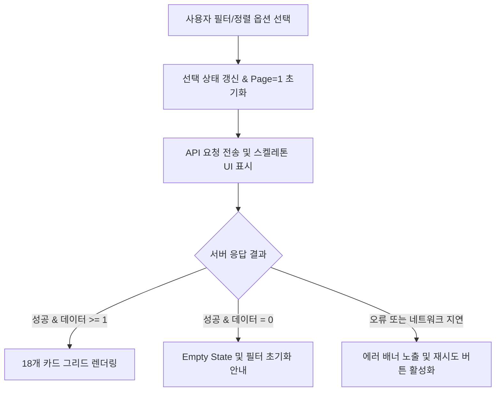
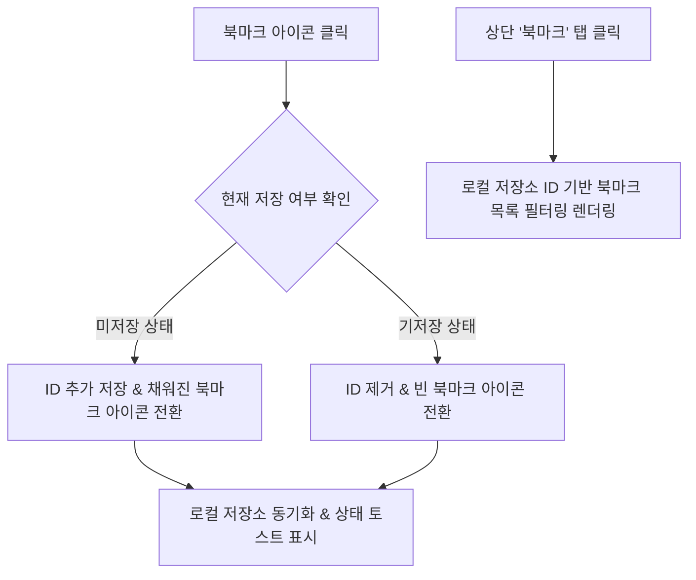
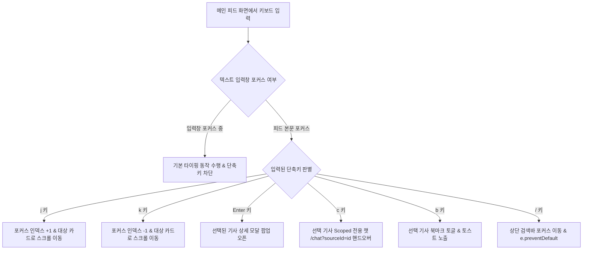

# 뉴스 피드, 큐레이션 및 Tech Radar 상세기능정의서 (News Feed & Tech Radar FSD)

- **도메인**: 뉴스 피드 브라우징, 검색, 상세 큐레이션, Ask AI, 북마크, Tech Radar
- **작성자**: 기획 명세 작성가 (`spec-writer`)
- **문서 버전**: v2.1
- **상태**: Approved

---

## 단위 기능 상세 명세 (단위기능별 7대 상세 명세 완비)

---

### [FUNC-FEED-001] 다차원 피드 필터링 및 카드 목록 조회

#### 1. 기본 정보
- **기능명**: 다차원 카테고리/출처/고신호 필터링 및 피드 카드 목록 조회
- **기능 ID**: `FUNC-FEED-001`
- **대응 요구사항 ID**: `REQ-FEED-001`
- **대상 화면 코드**: `SCR-FEED-001` (메인 피드 화면)
- **우선순위**: Must Have
- **관련 액터 (Actor)**: 일반 엔지니어 / AI 연구원

#### 2. 사전 조건 (Pre-conditions)
1. 사용자가 메인 웹 대시보드(`SCR-FEED-001`)에 정상 진입한 상태.
2. 백엔드 뉴스 조회 API가 정상 가동 중인 상태.

#### 3. 사용자 인터랙션 및 시스템 동작 흐름과 플로우차트 (Step-by-Step Flow & Flowchart)
1. 사용자가 상단 카테고리 버튼(`harness`, `mcp_plugins_skills`, `agent_tech`, `ai_news`, `all`), 출처 탭(GitHub, ArXiv, GeekNews 등), 또는 "⭐️ Must Read Only" 토글 스위치를 클릭한다.
2. 정렬 옵션 드롭다운에서 `hot`(추천순), `latest`(최신순), `quality`(품질점수순) 중 하나를 선택한다.
3. 클라이언트는 선택 상태를 갱신하고 현재 페이지를 1페이지로 초기화한다.
4. 클라이언트는 비동기 API 요청을 전송하고 카드 그리드 영역에 스켈레톤 로더를 노출한다.
5. 서버 응답 수신 시 스켈레톤을 해제하고 18개의 뉴스 카드를 그리드로 렌더링한다. 데이터가 0건인 경우 Empty State를 렌더링한다.



#### 4. 화면 표시 및 입력 데이터 항목 명세 (UI Data Elements - 8대 표준 컬럼)
| 항목명 | 화면 표시/입력 구분 | UI 컴포넌트 | 필수 여부 | 데이터 타입 / 제약 | 기본값 | 유효성 검증 규칙 (Validation) | 노출/수정 조건 |
| :--- | :---: | :--- | :---: | :--- | :---: | :--- | :--- |
| `category` | 사용자 선택 | Button Group | 선택 | Enum (`all`, `harness`, `mcp_plugins_skills`, `agent_tech`, `ai_news`) | `all` | 정의된 5개 카테고리 중 1개 선택 | 상시 활성화 |
| `source` | 사용자 선택 | Source Pill Tabs | 선택 | String / 영문 소문자 | `all` | 등록된 활성 소스 ID 매칭 | 상시 활성화 |
| `sort` | 사용자 선택 | Select Dropdown | 선택 | Enum (`hot`, `latest`, `quality`) | `hot` | 정의된 정렬 기준 매칭 | 상시 활성화 |
| `high_signal_only` | 사용자 선택 | Toggle Switch Button | 선택 | Boolean | `false` | true/false 불리언 | 상시 활성화 |
| `page` | 시스템 제어 | Pagination Bar | 필수 | Integer (>= 1) | 1 | 1 이상의 자연수 | 18건 초과 시 노출 |
| `title` | 노출 전용 | Card Heading Link | 필수 | String / 최대 500자 | - | XSS 살균 검증 완료 | 카드 렌더링 시 |
| `quality_score` | 노출 전용 | Number Badge | 필수 | Float (1.0 ~ 10.0) | 6.0 | 소수점 첫째 자리 표기 | 카드 렌더링 시 |
| `is_high_signal` | 노출 전용 | Star Icon Badge | - | Boolean | false | quality_score >= 7.8 시 true | 조건 충족 시 배지 노출 |
| `card_ask_ai_btn` | 사용자 조작 | Button with Bot Icon | 선택 | Button (`Ask AI`) | - | 클릭 시 `/chat?sourceId={id}` 직접 이동 | 카드 호버 시 또는 액션 영역 노출 |

#### 5. 비즈니스 규칙 (Business Rules)
- **BR-FEED-001-1 (하이 시그널 판정 기준)**: `is_high_signal` 플래그는 `quality_score >= 7.8` 조건을 만족하는 아티클에 부여되며, UI 카드 상단에 노란색 별표 배지로 강조 표시된다.
- **BR-FEED-001-2 (기본 정렬 공식)**: `sort=hot`인 경우 `hotness_score DESC, published_at DESC` 복합 정렬을 적용한다.
- **BR-FEED-001-3 (페이지네이션 단위)**: 1페이지당 노출 카드 수는 18개(`size=18`)로 고정하며, 총 아티클 수가 18개 이하일 경우 페이지네이션 바를 숨긴다.
- **BR-FEED-001-4 (카드 직접 챗 핸드오버)**: 카드 우측 하단 또는 호버 시 노출되는 'Ask AI' 버튼을 클릭하면 상세 모달 팝업 과정을 건너뛰고 대상 기사 컨텍스트(`sourceId`)를 장착한 채 독립 전용 AI 챗(`/chat?sourceId={id}`)으로 직접 전환된다.

#### 6. 예외 처리 및 엣지 케이스 (Edge Cases & Exception Handling)
| 발생 상황 (Edge Case Scenario) | 화면 반응 및 시스템 처리 방식 | 사용자 안내 메시지 |
| :--- | :--- | :--- |
| 선택한 복합 필터 조건의 아티클이 0건인 경우 | 카드 영역에 Empty State 일러스트 및 필터 초기화 버튼 노출 | "선택한 조건에 맞는 최신 소식이 없습니다. 필터를 재설정해보세요." |
| 네트워크 단절 또는 서버 응답 시간 초과 (5초 초과) | 스켈레톤 로더 종료 후 재시도 버튼이 포함된 Alert 카드 표시 | "데이터를 불러오지 못했습니다. 네트워크 상태를 확인한 후 다시 시도해주세요." |
| 모바일 화면 너비 진입 (너비 < 640px) | 3열 카드 그리드 레이아웃을 1열 카드 피드로 자동 반응형 전환 | (시각적 최적화) |

#### 7. 비즈니스 에러 코드 매핑
| 비즈니스 에러 코드 | 발생 사유 | HTTP 상태 코드 매핑 | 클라이언트 표시 형태 |
| :--- | :--- | :---: | :--- |
| `ERR_FEED_FETCH_FAILED` | 서버 내부 오류 또는 연결 지연 | 500 Internal Server Error | 피드 상단 경고 배너 및 "재시도" 버튼 |
| `ERR_INVALID_PAGE_PARAM` | 음수 또는 유효하지 않은 page/size 요청 | 400 Bad Request | 기본값(page=1)으로 자동 강제 보정 |

---

### [FUNC-FEED-002] 실시간 키워드 및 기술 태그 검색

#### 1. 기본 정보
- **기능명**: 실시간 키워드 및 기술 태그 검색
- **기능 ID**: `FUNC-FEED-002`
- **대응 요구사항 ID**: `REQ-FEED-001`
- **대상 화면 코드**: `SCR-FEED-001` (메인 피드 상단 검색바)
- **우선순위**: Must Have
- **관련 액터 (Actor)**: 일반 엔지니어 / AI 연구원

#### 2. 사전 조건 (Pre-conditions)
1. 메인 대시보드 검색창이 활성화된 상태.

#### 3. 사용자 인터랙션 및 시스템 동작 흐름과 플로우차트 (Step-by-Step Flow & Flowchart)
1. 사용자가 상단 검색창에 키워드(예: `LangGraph`, `SWE-bench`, `FastMCP`)를 입력한다.
2. 입력 이벤트 발생 시 300ms 디바운스(Debounce) 타이머가 작동한다.
3. 입력값이 2자 이상인 경우 시스템은 자동으로 검색 질의를 서버로 전송한다.
4. 사용자가 검색어 입력창 우측의 `X` 버튼을 클릭하거나 빈 문자열로 변경하면 검색 필터가 즉시 해제되고 전체 목록으로 복귀한다.

```mermaid
flowchart TD
    A[사용자 키워드 입력] --> B{입력 문자열 길이}
    B -- 0자 (초기화) --> C[검색 조건 해제 & 전체 피드 복귀]
    B -- 1자 --> D[입력 대기 (검색 미트리거)]
    B -- 2자 이상 --> E[300ms 디바운스 대기]
    E --> F[검색 API 호출 & 로딩 스피너 표시]
    F --> G[검색 결과 매칭 카드 렌더링]
```

#### 4. 화면 표시 및 입력 데이터 항목 명세 (UI Data Elements - 8대 표준 컬럼)
| 항목명 | 화면 표시/입력 구분 | UI 컴포넌트 | 필수 여부 | 데이터 타입 / 제약 | 기본값 | 유효성 검증 규칙 (Validation) | 노출/수정 조건 |
| :--- | :---: | :--- | :---: | :--- | :---: | :--- | :--- |
| `search_query` | 사용자 입력 | Search Input with Icon | 선택 | String / 최대 100자 | "" | 트림 처리 후 특수 기호 살균 | 상시 활성화 |
| `clear_search` | 사용자 조작 | Clear Button (X icon) | - | Button | - | 입력값 존재 시만 활성화 | `search_query.length > 0` |
| `tag_filter` | 사용자 선택 | Tag Chip | 선택 | String / 최대 50자 | "" | 클릭 시 검색창 바인딩 | 태그 클릭 시 활성화 |

#### 5. 비즈니스 규칙 (Business Rules)
- **BR-FEED-002-1 (검색 유효 길이)**: 의미 있는 검색 품질을 위해 최소 2자 이상 입력 시에만 자동 검색 쿼리를 실행한다.
- **BR-FEED-002-2 (검색 범위)**: 검색어는 아티클의 `title`, `summary`, `tech_stack` 태그 배열 전체를 대상으로 대소문자 구분 없이(Case-Insensitive) 부분 일치 매칭된다.

#### 6. 예외 처리 및 엣지 케이스 (Edge Cases & Exception Handling)
| 발생 상황 | 화면 반응 | 사용자 안내 메시지 |
| :--- | :--- | :--- |
| 검색 결과가 0건인 경우 | 검색어 유지 상태에서 빈 결과 일러스트 및 추천 검색어 칩 제공 | "'[검색어]'에 일치하는 소식이 없습니다. 추천 키워드로 검색해보세요." |
| 100자 초과 텍스트 복사 붙여넣기 | 100자에서 자동 잘림(Truncate) 처리 및 포커스 유지 | (시스템 자동 제한) |

#### 7. 비즈니스 에러 코드 매핑
| 비즈니스 에러 코드 | 발생 사유 | HTTP 상태 코드 매핑 | 클라이언트 표시 형태 |
| :--- | :--- | :---: | :--- |
| `ERR_INVALID_SEARCH_KEYWORD` | 금지된 특수문자 또는 빈 공백만 입력 | 400 Bad Request | 검색창 하단 툴팁 안내 |

---

### [FUNC-FEED-003] 아티클 3줄 요약, 시사점 상세 모달 및 전용 챗 연동

#### 1. 기본 정보
- **기능명**: 아티클 3-Bullet TL;DR, 개발자 시사점(Why It Matters) 상세 모달 조회 및 전용 챗 연동
- **기능 ID**: `FUNC-FEED-003`
- **대응 요구사항 ID**: `REQ-FEED-002`, `REQ-CHAT-002`
- **대상 화면 코드**: `SCR-FEED-002` (아티클 상세 모달)
- **우선순위**: Must Have
- **관련 액터 (Actor)**: 일반 엔지니어 / AI 연구원

#### 2. 사전 조건 (Pre-conditions)
1. 피드 카드 목록에서 특정 아티클 카드를 클릭한 상태.
2. 해당 아티클의 데이터가 유효한 고유 식별자를 보유한 상태.

#### 3. 사용자 인터랙션 및 시스템 동작 흐름과 플로우차트 (Step-by-Step Flow & Flowchart)
1. 사용자가 피드 카드를 클릭한다.
2. 화면 중앙에 `NewsDetailModal` 오버레이가 팝업되며 브라우저 배경 스크롤이 잠긴다.
3. 모달 상단에 제목, 출처 배지, 발행 시각, 북마크 토글 버튼과 함께 **"전용 AI 챗에서 분석"** 바로가기 버튼이 표시된다.
4. AI가 추출한 핵심 3줄 불릿 요약(`tldr_bullets`)과 개발자 시사점(`why_it_matters`) 하이라이트 박스가 렌더링된다.
5. 하단에는 원문 요약 텍스트, 추출된 기술 스택 태그 목록, 원문 링크 방문 버튼, 그리고 대화형 질의 패널(Ask AI)이 배치된다.
6. 사용자가 "전용 AI 챗에서 분석" 버튼을 누르면 기사 컨텍스트(`sourceId`)를 장착한 채 전용 AI 챗(`/chat?sourceId={id}`)으로 즉시 화면이 전환되고 모달이 닫힌다.
7. 모달 닫기 버튼, 배경 딤(Dim) 영역 클릭, 또는 `ESC` 키 입력 시 모달이 닫힌다.

```mermaid
flowchart TD
    A[뉴스 카드 클릭] --> B[상세 모달 오버레이 오픈 & 배경 스크롤 잠금]
    B --> C[3-Bullet TL;DR 파싱 & 체크 아이콘 불릿 렌더링]
    C --> D[Why It Matters 개발자 시사점 박스 표시]
    D --> E[기술 스택 태그, 원문 링크 및 전용 챗 CTA 렌더링]
    E --> F{사용자 인터랙션 선택}
    F -- 전용 AI 챗에서 분석 클릭 --> G[/chat?sourceId={id} 핸드오버 라우팅 & 모달 닫힘]
    F -- Ask AI 탭 클릭 --> H[FUNC-FEED-004 간이 질의 패널 활성화]
    F -- 닫기 액션 (ESC / 배경 클릭 / X 버튼) --> I[모달 닫힘 & 배경 스크롤 복원]
```

#### 4. 화면 표시 및 입력 데이터 항목 명세 (UI Data Elements - 8대 표준 컬럼)
| 항목명 | 화면 표시/입력 구분 | UI 컴포넌트 | 필수 여부 | 데이터 타입 / 제약 | 기본값 | 유효성 검증 규칙 (Validation) | 노출/수정 조건 |
| :--- | :---: | :--- | :---: | :--- | :---: | :--- | :--- |
| `tldr_bullets` | 노출 전용 | Bullet List with Checkmark | 필수 | Array[String] / 3개 요소 | [] | 요소별 1문장 요약 검증 | 모달 상단 배치 |
| `why_it_matters` | 노출 전용 | Indigo Highlight Box | - | String / 1~2문장 | "" | 비어있을 경우 박스 숨김 | 내용 존재 시 노출 |
| `summary` | 노출 전용 | Paragraph Text | - | String | "" | 줄바꿈 보존 렌더링 | 모달 중단 배치 |
| `tech_stack` | 노출 전용 | Pill Badge List | - | Array[String] | [] | 쉼표 기준 태그 분할 | 태그 존재 시 노출 |
| `url` | 노출 전용 | External Link Button | 필수 | String / Valid URL | - | `https://` 보안 프로토콜 검증 | 클릭 시 새 탭 오픈 |
| `source_name` | 노출 전용 | Source Badge | 필수 | String | - | 소스 이름 매핑 | 헤더 영역 노출 |
| `open_chat_cta_btn`| 사용자 조작| Action Button with Bot Icon| 필수 | Button (`전용 AI 챗에서 분석`)| - | 클릭 시 `/chat?sourceId={id}` 이동 | 모달 헤더 및 요약 하단 노출 |

#### 5. 비즈니스 규칙 (Business Rules)
- **BR-FEED-003-1 (3-Bullet 요약 원칙)**: `tldr_bullets`는 3개의 불릿 항목으로 구성되며, 각각 (1) 핵심 기술 혁신 (2) 구현 아키텍처/방법론 (3) 성능 벤치마크 결과를 포함해야 한다.
- **BR-FEED-003-2 (상세 모달 독립성)**: 다른 카드를 클릭하여 새 모달을 열 경우, 이전 모달의 탭 상태나 미완료 입력값은 초기 상태(Summary 탭)로 리셋된다.
- **BR-FEED-003-3 (전용 AI 챗 핸드오버)**: `open_chat_cta_btn`을 클릭하면 현재 기사의 메타데이터(ID, 제목, 카테고리, 3줄 요약)를 상태 스토어에 바인딩하고 `/chat?sourceId={id}`로 매끄럽게 핸드오버되어야 한다.

#### 6. 예외 처리 및 엣지 케이스 (Edge Cases & Exception Handling)
| 발생 상황 | 화면 반응 | 사용자 안내 메시지 |
| :--- | :--- | :--- |
| `tldr_bullets` 데이터가 누락된 구버전 소식인 경우 | `summary`의 상위 3개 문장을 자동 분할하여 임시 불릿으로 부드럽게 폴백(Fallback) | (시스템 내부 폴백) |
| 원본 아티클 URL이 외부에서 삭제/차단된 경우 | 새 탭 열기 유지하되 사용자 신고 링크 제공 | "원본 사이트의 정책에 따라 링크 접근이 제한될 수 있습니다." |
| 핸드오버 클릭 시 브라우저 라우터 오류 발생 시 | 대상 URL 전체 새로고침 링크로 폴백 | "채팅 화면으로 이동합니다..." |

#### 7. 비즈니스 에러 코드 매핑
| 비즈니스 에러 코드 | 발생 사유 | HTTP 상태 코드 매핑 | 클라이언트 표시 형태 |
| :--- | :--- | :---: | :--- |
| `ERR_NEWS_NOT_FOUND` | 존재하지 않거나 삭제된 아티클 ID 참조 | 404 Not Found | 모달 닫힘 및 경고 토스트 알림 |

---

### [FUNC-FEED-004] 특정 아티클 대상 대화형 Ask AI 질의 및 전용 챗 핸드오버

#### 1. 기본 정보
- **기능명**: 특정 아티클 대상 대화형 Ask AI 질의 및 전용 챗 핸드오버
- **기능 ID**: `FUNC-FEED-004`
- **대응 요구사항 ID**: `REQ-FEED-003`, `REQ-CHAT-002`
- **대상 화면 코드**: `SCR-FEED-002` (상세 모달 하단 질의 패널)
- **우선순위**: Must Have
- **관련 액터 (Actor)**: 일반 엔지니어 / AI 연구원

#### 2. 사전 조건 (Pre-conditions)
1. 아티클 상세 모달이 열려 있고 "Ask AI 질의응답" 탭이 선택된 상태.
2. 백엔드 AI 질의 API가 정상 가동 중인 상태.

#### 3. 사용자 인터랙션 및 시스템 동작 흐름과 플로우차트 (Step-by-Step Flow & Flowchart)
1. 사용자가 상세 모달 내 "Ask AI" 패널에 진입한다. 패널 상단에는 **"전용 AI 챗에서 이어하기 (Open in Dedicated Chat)"** 핸드오버 버튼이 상시 노출된다.
2. 사용자가 질문(예: "이 아키텍처의 평가 기준은 무엇인가요?")을 입력창에 타이핑한다.
3. 사용자의 액션에 따라 다음과 같이 분기한다:
   - **인라인 전송 시**: 모달 내에서 로딩 인디케이터와 함께 간이 스트리밍 답변을 수신한다.
   - **전용 AI 챗에서 이어하기 클릭 시**: 현재 입력창에 작성 중이던 질문 텍스트가 인코딩되어 `/chat?sourceId={id}&q={encodedQuestion}`으로 핸드오버되며, 모달이 닫히고 전용 챗 워크스페이스에서 답변이 자동 생성된다.
4. 이미 모달 내에서 질문/답변 턴이 1회 이상 진행된 상태에서 "전용 챗에서 이어하기"를 누르면, 이전 대화 내역 전체가 `/chat`의 활성 세션으로 안전하게 동기화된다.

```mermaid
flowchart TD
    A[상세 모달 내 Ask AI 패널 진입] --> B[사용자 질문 텍스트 입력]
    B --> C{사용자 전송 방식 선택}
    C -- 모달 내 인라인 전송 버튼 클릭 --> D[클라이언트 유효성 검증 후 AI 질의 API 요청]
    D --> E[모달 내 답변 스트리밍 버블 렌더링]
    E --> F{추가 심층 질의 필요?}
    F -- 전용 챗에서 이어하기 클릭 --> G[대화 히스토리 및 sourceId 보존 라우팅]
    C -- 질문 입력 후 '전용 챗에서 이어하기' 클릭 --> G
    G --> H[/chat?sourceId={id}&q={encoded} 이동 & 전용 챗에서 자동 스트리밍 개시]
```

#### 4. 화면 표시 및 입력 데이터 항목 명세 (UI Data Elements - 8대 표준 컬럼)
| 항목명 | 화면 표시/입력 구분 | UI 컴포넌트 | 필수 여부 | 데이터 타입 / 제약 | 기본값 | 유효성 검증 규칙 (Validation) | 노출/수정 조건 |
| :--- | :---: | :--- | :---: | :--- | :---: | :--- | :--- |
| `question` | 사용자 입력 | Textarea / Input | 필수 | String / 2~500자 | "" | 트림 후 2자 이상 500자 이하 | 답변 대기 중 비활성화 |
| `answer` | 노출 전용 | Markdown Message Bubble | 필수 | Text (Markdown) | - | XSS 살균 검증 완료 | 응답 수신 시 노출 |
| `model_tag` | 노출 전용 | Model Badge | 선택 | String | "AgentLens AI" | 모델 명칭 표기 | 답변 헤더 영역 |
| `send_button` | 사용자 조작 | Submit Button | 필수 | Button | - | 2자 이상 시 활성화 | 질문 작성 시 활성화 |
| `handover_chat_btn`| 사용자 조작| Action Button with Arrow | 필수 | Button (`전용 챗에서 이어하기`)| - | 클릭 시 `/chat` 화면으로 이동 | Ask AI 헤더 상단 상시 노출 |
| `clear_chat_btn` | 사용자 조작 | Text Button (`대화 초기화`)| 선택 | Button | - | 클릭 시 현재 모달 대화 리셋 | 대화 내역 1건 이상 시 |

#### 5. 비즈니스 규칙 (Business Rules)
- **BR-FEED-004-1 (환각 방지 컨텍스트 격리)**: 모달 내 인라인 AI 답변은 현재 열려 있는 아티클의 본문 및 3줄 요약 컨텍스트에 국한하여 답변을 생성하도록 프롬프트 정책을 강제한다.
- **BR-FEED-004-2 (중복 전송 차단)**: 답변 생성 중에는 추가 전송 요청을 원천 차단하여 비용 낭비 및 동시성 꼬임을 방지한다.
- **BR-FEED-004-3 (모달 탈출 및 대화 무손실 핸드오버)**: 사용자가 모달을 닫아 대화가 유실되는 불안(Modal Anxiety)을 제거하기 위해, '전용 챗에서 이어하기' 클릭 시 작성 중인 미전송 질문과 기존 대화 히스토리를 100% 온전하게 `/chat` 세션으로 이관한다.

#### 6. 예외 처리 및 엣지 케이스 (Edge Cases & Exception Handling)
| 발생 상황 | 화면 반응 | 사용자 안내 메시지 |
| :--- | :--- | :--- |
| 외부 AI 모델 API 호출 한도 초과(429) 또는 프로바이더 장애(503/502) | 재시도 버튼 및 에러 안내 카드 노출, 기존 입력 질문 보존 | "AI 모델 호출 한도가 초과되었거나 서비스를 일시적으로 이용할 수 없습니다. 잠시 후 다시 시도해주세요." |
| 빈 공백만 연속 입력 후 전송 시도 | 전송 트리거 무시 및 입력창 흔들림(Shake) 피드백 | "질문 내용을 2자 이상 입력해주세요." |
| 모달 실수 닫힘 발생 시 | 직전 대화 기록을 `sessionStorage`에 10분간 임시 보존하여 재오픈 시 자동 복원 | "이전 대화 내용이 복원되었습니다." |

#### 7. 비즈니스 에러 코드 매핑
| 비즈니스 에러 코드 | 발생 사유 | HTTP 상태 코드 매핑 | 클라이언트 표시 형태 |
| :--- | :--- | :---: | :--- |
| `ERR_ASK_EMPTY_QUESTION` | 질문 내용 부족 (2자 미만) | 400 Bad Request | 입력창 테두리 붉은색 강조 |
| `ERR_LLM_PROVIDER_UNAVAILABLE` | 가용한 AI 모델 프로바이더 API 키 미설정 | 503 Service Unavailable | 인라인 경고 카드 및 API 키 설정 안내 |
| `ERR_LLM_UPSTREAM_FAILED` | 외부 LLM 업스트림 장애 또는 타임아웃 | 502 Bad Gateway | 인라인 재시도 버튼 노출 |
| `ERR_LLM_QUOTA_EXCEEDED` | 외부 AI 모델 호출 한도 초과 | 429 Too Many Requests | 사용량 초과 경고 카드 |
| `ERR_HANDOVER_PAYLOAD_TOO_LARGE`| 전달 질문 길이 500자 초과 | 400 Bad Request | 500자 자동 잘림 처리 후 전용 챗 이동 |

---

### [FUNC-FEED-005] 브라우저 로컬 저장소 기반 개인 북마크 보관 및 열람

#### 1. 기본 정보
- **기능명**: 브라우저 로컬 저장소 기반 개인 북마크 보관 및 열람
- **기능 ID**: `FUNC-FEED-005`
- **대응 요구사항 ID**: `REQ-FEED-004`
- **대상 화면 코드**: `SCR-FEED-001` (피드 카드 및 북마크 탭)
- **우선순위**: Should Have
- **관련 액터 (Actor)**: 일반 엔지니어 / AI 연구원

#### 2. 사전 조건 (Pre-conditions)
1. 브라우저 로컬 저장소(`localStorage`) 접근이 가능한 환경.

#### 3. 사용자 인터랙션 및 시스템 동작 흐름과 플로우차트 (Step-by-Step Flow & Flowchart)
1. 사용자가 피드 카드 우측 상단 또는 상세 모달의 북마크 아이콘(북마크 리본)을 클릭한다.
2. 클라이언트는 브라우저 로컬 저장소의 `agentlens_bookmarks` 배열에 해당 아티클 ID의 추가/제거 상태를 토글한다.
3. 아이콘은 즉시 채워진 상태(Filled) 또는 빈 상태(Outline)로 변경되며 토스트 피드백이 노출된다.
4. 상단 출처/필터 바에서 "북마크" 탭을 선택하면 저장된 아티클 목록만 필터링되어 즉시 렌더링된다.



#### 4. 화면 표시 및 입력 데이터 항목 명세 (UI Data Elements - 8대 표준 컬럼)
| 항목명 | 화면 표시/입력 구분 | UI 컴포넌트 | 필수 여부 | 데이터 타입 / 제약 | 기본값 | 유효성 검증 규칙 (Validation) | 노출/수정 조건 |
| :--- | :---: | :--- | :---: | :--- | :---: | :--- | :--- |
| `is_bookmarked` | 사용자 토글 | Bookmark Icon Button | 필수 | Boolean | false | true/false 토글 | 카드 및 모달 상단 |
| `bookmark_count` | 노출 전용 | Badge on Tab | - | Integer (>= 0) | 0 | 0건일 때 배지 숨김 | 북마크 탭 상단 |

#### 5. 비즈니스 규칙 (Business Rules)
- **BR-FEED-005-1 (비로그인 로컬 영속성)**: 사용자 인증 없이도 브라우저 세션 간 유실되지 않도록 로컬 저장소에 영구 보관한다.
- **BR-FEED-005-2 (오프라인 지원)**: 네트워크 연결이 끊긴 상태에서도 이미 저장된 북마크 목록은 즉시 열람할 수 있어야 한다.

#### 6. 예외 처리 및 엣지 케이스 (Edge Cases & Exception Handling)
| 발생 상황 | 화면 반응 | 사용자 안내 메시지 |
| :--- | :--- | :--- |
| 북마크 탭 선택 시 저장된 아티클이 0건인 경우 | Empty State 일러스트 및 메인 피드 이동 버튼 표시 | "보관된 북마크가 없습니다. 관심 있는 소식을 북마크해보세요." |
| 브라우저 프라이빗 모드로 인한 로컬 저장소 용량 초과 | 인앱 알림 노출 및 세션 메모리 임시 유지 | "브라우저 저장소 용량이 부족하여 일부 북마크가 임시 저장됩니다." |

#### 7. 비즈니스 에러 코드 매핑
| 비즈니스 에러 코드 | 발생 사유 | HTTP 상태 코드 매핑 | 클라이언트 표시 형태 |
| :--- | :--- | :---: | :--- |
| `ERR_STORAGE_UNAVAILABLE` | 로컬 저장소 비활성화 환경 | 클라이언트 내부 오류 | 경고 토스트 메시지 |

---

### [FUNC-FEED-006] 에이전트 Tech Radar 실시간 트렌드 분석

#### 1. 기본 정보
- **기능명**: 에이전트 Tech Radar 실시간 트렌드 분석 및 태그 필터 연동
- **기능 ID**: `FUNC-FEED-006`
- **대응 요구사항 ID**: `REQ-RADAR-001`
- **대상 화면 코드**: `SCR-FEED-001` (메인 피드 상단 Tech Radar 영역)
- **우선순위**: Must Have
- **관련 액터 (Actor)**: AI 에이전트 개발자 / 시스템 아키텍트

#### 2. 사전 조건 (Pre-conditions)
1. 메인 대시보드에 진입한 상태.
2. 최근 24시간 내 수집된 기술 소식 기반의 트렌드 분석 데이터가 준비된 상태.

#### 3. 사용자 인터랙션 및 시스템 동작 흐름과 플로우차트 (Step-by-Step Flow & Flowchart)
1. 메인 피드 상단에 Tech Radar 바가 노출되며, 접힌 상태에서는 분석된 아티클 총 수와 상위 3개 급상승(Surging) 태그가 인라인으로 미리보여진다.
2. 사용자가 "자세히" 버튼을 클릭하면 아코디언이 펼쳐진다.
3. 펼쳐진 영역에는 다음 3가지 핵심 트렌드 뷰가 노출된다:
   - **급상승(Surging) 기술 스택**: 급상승 속도(Velocity, 예: `+85%`)와 최근 24시간 언급 횟수 배지.
   - **4대 도메인 카테고리 점유율**: Harness & Benchmark, Protocols & Tooling, Models & Reasoning, Multi-Agent 비율(%).
   - **전체 기술 태그 클라우드**: 출현 빈도순 태그 칩 목록.
4. 사용자가 특정 기술 태그 칩(예: `SWE-bench`, `FastMCP`)을 클릭하면 즉시 피드 필터가 해당 태그로 동기화되어 관련 아티클만 필터링된다.
5. "✕ 필터 초기화" 버튼을 클릭하면 태그 필터가 해제되고 전체 목록으로 복원된다.

```mermaid
flowchart TD
    A[Tech Radar 바 노출 (기본 접힘)] --> B{사용자 아코디언 조작}
    B -- 자세히 클릭 --> C[아코디언 펼침 & 상세 트렌드 뷰 표시]
    B -- 접기 클릭 --> D[아코디언 축소 & 상위 3개 태그 미리보기]
    C --> E[특정 기술 태그 클릭]
    E --> F[activeTag 상태 갱신 & 피드 목록 실시간 필터링]
    F --> G[필터 초기화 버튼 노출]
    G -- 클릭 --> H[activeTag 해제 & 전체 피드 복귀]
```

#### 4. 화면 표시 및 입력 데이터 항목 명세 (UI Data Elements - 8대 표준 컬럼)
| 항목명 | 화면 표시/입력 구분 | UI 컴포넌트 | 필수 여부 | 데이터 타입 / 제약 | 기본값 | 유효성 검증 규칙 (Validation) | 노출/수정 조건 |
| :--- | :---: | :--- | :---: | :--- | :---: | :--- | :--- |
| `total_analyzed` | 노출 전용 | Monospace Count Badge | 필수 | Integer (>= 0) | 0 | 수치 표기 | 상단 헤더 바 |
| `surging_tags` | 사용자 선택/노출 | Pill Button with Velocity | 필수 | Array[SurgingTag] | [] | 태그명, 증가율, 횟수 매핑 | 상단 및 펼침 뷰 |
| `categories` | 노출 전용 | 4-Grid Percent Card | 필수 | Array[CategoryRatio] | [] | 합계 100% 검증 | 펼침 뷰 |
| `tags` | 사용자 선택/노출 | Tag Cloud Button Group | 필수 | Array[TagItem] | [] | 빈도순 정렬 | 펼침 뷰 |
| `active_tag` | 사용자 선택 | Highlighted Tag Button | 선택 | String | "" | 선택된 태그 파란색 강조 | 클릭 시 활성화 |
| `toggle_accordion` | 사용자 조작 | Button with Chevron Icon | 필수 | Button ('자세히'/'접기') | '접기' | 클릭 시 높이 애니메이션 전환 | 상시 활성화 |

#### 5. 비즈니스 규칙 (Business Rules)
- **BR-FEED-006-1 (급상승 판정 공식)**: 직전 24시간 언급 빈도 대비 최근 24시간 언급 빈도의 증가율이 $+20\%$ 이상인 태그를 `Surging` 태그로 발탁하며, 최대 5개까지 속도(Velocity) 내림차순으로 표시한다.
- **BR-FEED-006-2 (클린 뷰 기본값)**: 정보 밀도를 유지하고 피드 탐색의 집중도를 높이기 위해 페이지 초기 진입 시 아코디언은 접힘(`isOpen=false`) 상태를 기본값으로 유지한다.
- **BR-FEED-006-3 (태그-피드 양방향 동기화)**: Tech Radar에서 태그를 클릭하면 메인 피드의 검색 쿼리 및 카드 목록이 즉각 동기화되며, 피드에서 태그를 해제하면 Tech Radar의 선택 상태도 함께 해제된다.

#### 6. 예외 처리 및 엣지 케이스 (Edge Cases & Exception Handling)
| 발생 상황 | 화면 반응 | 사용자 안내 메시지 |
| :--- | :--- | :--- |
| 초기 가동 시 24시간 내 수집 아티클이 극소수인 경우 | 데이터 부족 시 분석 대기 스켈레톤 대신 현재 수집된 소식 기준 비율 표기 | (기존 수집 데이터 기준 표시) |
| 특정 태그 클릭 시 일치 아티클이 없을 경우 | Empty State 표시 및 Tech Radar 태그 초기화 버튼 노출 | "해당 태그의 아티클이 없습니다." |

#### 7. 비즈니스 에러 코드 매핑
| 비즈니스 에러 코드 | 발생 사유 | HTTP 상태 코드 매핑 | 클라이언트 표시 형태 |
| :--- | :--- | :---: | :--- |
| `ERR_RADAR_FETCH_FAILED` | 트렌드 집계 데이터 연산 지연 | 500 Internal Server Error | Tech Radar 영역 숨김 처리 (피드 단독 노출) |

---

### [FUNC-FEED-007] 파워 유저 키보드 단축키(j/k 탐색, /, b, c) 및 피드 포커스 내비게이션

#### 1. 기본 정보
- **기능명**: 파워 유저 키보드 단축키(j/k 탐색, /, b 북마크, c 챗 핸드오버) 및 피드 포커스 내비게이션
- **기능 ID**: `FUNC-FEED-007`
- **대응 요구사항 ID**: `REQ-SHORTCUT-001`, `REQ-FEED-001`, `REQ-CHAT-002`
- **대상 화면 코드**: `SCR-FEED-001` (메인 피드 화면)
- **우선순위**: Must Have
- **관련 액터 (Actor)**: 파워 유저 엔지니어, AI 연구원

#### 2. 사전 조건 (Pre-conditions)
1. 메인 피드(`SCR-FEED-001`)에 1개 이상의 뉴스 카드 아이템이 렌더링된 상태.
2. 사용자의 포커스가 검색창 등 텍스트 입력 엘리먼트 외부에 위치한 상태.

#### 3. 사용자 인터랙션 및 시스템 동작 흐름과 플로우차트 (Step-by-Step Flow & Flowchart)
1. 사용자가 메인 피드 화면에서 `j` 키를 누르면 첫 번째 또는 다음 뉴스 카드로 포커스 인덱스가 1 증가하며 파란색 포커스 링(`ring-2 ring-blue-500`)이 활성화된다.
2. 사용자가 `k` 키를 누르면 이전 뉴스 카드로 포커스 인덱스가 1 감소한다.
3. 포커스된 카드가 브라우저 화면 밖으로 벗어난 경우, 시스템은 카드가 시야에 들어오도록 부드럽게 자동 스크롤(`scrollIntoView({ block: 'nearest' })`)한다.
4. 카드가 선택된 상태에서 사용자가 액션 키를 누르면 다음 동작이 수행된다:
   - `Enter` 또는 `Space`: 포커스된 카드의 상세 모달(`SCR-FEED-002`)을 즉시 오픈한다.
   - `c`: 대상 기사 컨텍스트를 장착한 채 전용 챗(`/chat?sourceId={id}`)으로 즉시 핸드오버한다.
   - `b`: 대상 기사의 북마크 보관 상태를 즉시 토글하고 토스트 메시지를 표시한다.
5. 화면 어느 곳에서든 `/` 키를 누르면 상단 검색창으로 포커스가 이동하며 검색어를 즉시 타이핑할 수 있도록 준비된다.



#### 4. 화면 표시 및 입력 데이터 항목 명세 (UI Data Elements - 8대 표준 컬럼)
| 항목명 | 화면 표시/입력 구분 | UI 컴포넌트 | 필수 여부 | 데이터 타입 / 제약 | 기본값 | 유효성 검증 규칙 (Validation) | 노출/수정 조건 |
| :--- | :---: | :--- | :---: | :--- | :---: | :--- | :--- |
| `focused_card_index` | 시스템 제어 | State Context | 필수 | Integer (-1 ~ N-1) | -1 | 0 이상 N 미만 범위 유지 | 피드 카드 존재 시 |
| `card_focus_ring` | 노출 전용 | CSS Focus Ring | 필수 | CSS (`ring-2 ring-blue-500 dark:ring-blue-400 shadow-md`) | - | `index === focused_card_index` | 대상 카드 포커스 시 |
| `shortcut_hint_footer`| 노출 전용 | Fixed Footer Bar | 선택 | UI Component (`j/k 탐색 • Enter 상세 • c 챗 • b 북마크 • / 검색`) | - | 데스크톱 환경에서만 노출 | 화면 하단 고정 |
| `bookmark_toggle_state`| 시스템 관리 | LocalStorage State | 필수 | Boolean | false | true/false 토글 | `b` 키 입력 시 |
| `search_input_focus` | 시스템 제어 | DOM Focus Action | 필수 | Element Ref Focus | - | `/` 입력 시 실행 | `/` 키 입력 시 |

#### 5. 비즈니스 규칙 (Business Rules)
- **BR-FEED-007-1 (경계값 인덱스 래핑 차단)**: `j` 키를 눌러 현재 페이지의 마지막 카드(18번째)에 도달했을 때 인덱스는 더 이상 증가하지 않고 마지막 카드를 유지하며, `k` 키를 눌러 첫 번째 카드에 도달했을 때도 0 이하로 내려가지 않는다.
- **BR-FEED-007-2 (브라우저 기본 스크롤 동작 방지 - preventDefault)**: `j`, `k`, `/` 키 입력 시 브라우저 기본 페이지 스크롤 및 브라우저 내장 빠른 검색 창이 뜨지 않도록 `e.preventDefault()`를 강제 적용한다.
- **BR-FEED-007-3 (선택 없는 상태에서의 액션 가드)**: 카드가 아무것도 포커스되지 않은 상태(`focused_card_index === -1`)에서 `Enter`, `c`, `b` 키가 입력되면 동작을 무시하고, `j` 키를 먼저 누르도록 시각적 포커스 힌트를 제공한다.

#### 6. 예외 처리 및 엣지 케이스 (Edge Cases & Exception Handling)
| 발생 상황 (Edge Case Scenario) | 화면 반응 및 시스템 처리 방식 | 사용자 안내 메시지 |
| :--- | :--- | :--- |
| 필터나 페이지네이션 변경으로 카드 목록이 새로고침된 경우 | `focused_card_index`를 -1로 리셋하여 잘못된 인덱스 참조 방지 | (포커스 초기화) |
| 사용자가 검색창에 텍스트를 입력하는 도중 `j`/`k`/`c`/`b` 타이핑 시 | 텍스트 입력창 내부에서는 일반 문자로 입력되며 피드 단축키 동작을 완전 차단 | (정상 문자 입력) |
| 모바일/터치 기기 환경 접근 시 | 하단 키보드 단축키 힌트 바를 숨기고 터치 제스처 중심 UX 유지 | (단축키 UI 숨김) |

#### 7. 비즈니스 에러 코드 매핑
| 비즈니스 에러 코드 | 발생 사유 | HTTP 상태 코드 매핑 | 클라이언트 표시 형태 |
| :--- | :--- | :---: | :--- |
| `ERR_FEED_CARD_NOT_FOUND` | 포커스된 인덱스의 카드 데이터가 존재하지 않음 | 클라이언트 예외 | 포커스 인덱스 리셋 |

