# 뉴스 피드 상세기능정의서 (Modular FSD)

Updated: 2026-11-10
기준: v0.4.2 (main)

- **도메인**: 뉴스 피드 (도메인 코드 `NEWS`) — 피드 목록·필터·검색·정렬·북마크·기사 카드·기사 상세·기사 단위 AI 질문·RSS·트렌드 레이더·통계·피드 단축키·데이터 초기화·브리핑 바로가기·AI 챗 핸드오버
- **작성자**: 기획 명세 작성가 (`spec-writer`)
- **문서 버전**: v1.0 (as-built: 지금 코드를 그대로 설명한다. 새 기능 설계가 아니다)
- **상태**: Draft
- **관련 문서**: UI 공통(헤더·테마·단축키·팔레트·오버레이·반응형·로딩 표시·마크다운·복사) `docs/spec-writer/fsd/07_UI_COMMON_SPECIFICATION.md`, 수집·분류·요약 `docs/spec-writer/fsd/03_COLLECTION_SPECIFICATION.md`, 브리핑 `docs/spec-writer/fsd/04_BRIEFING_AND_SHARING_SPECIFICATION.md`, AI 챗 `docs/spec-writer/fsd/02_AI_CHAT_SPECIFICATION.md`

---

## 개요

수집·선별된 AI 에이전트·하네스·MCP 소식(`news_items`)을 메인 화면(`/`)에 카드 그리드로 보여준다. 사용자는 카테고리·소스·Must-Read 필터, 키워드 검색, 4가지 정렬, 페이지 이동으로 목록을 좁히고, 카드를 열어 규칙 기반 핵심 정리·개발자 시사점(LLM 평가가 준 경우)·기술 스택을 보거나 기사 단위로 AI 에게 질문(SSE 스트리밍)한다. 북마크는 브라우저 localStorage 에만 저장한다. 같은 화면의 요약 바에 일일 브리핑과 트렌드 레이더(기술 태그 집계)가 붙고, 목록 머리줄 상태와 필터 칩에 통계 건수가 보이며, 헤더 더보기 메뉴와 커맨드 팔레트에서 RSS 출력과 데이터 초기화·재수집을 실행한다. 백엔드 인터페이스는 `/api/news*`, `/api/stats`, `/api/trends/radar` 다.

### 에러 코드 표기 규칙
v0.4.2 부터 모든 backend 오류 응답은 `{"error_code": "ERR_…", "message": "<한국어 문장>", "details": …}` 한 형식이다 (`backend/app/api/errors.py:1-83`, `docs/spec-writer/03_POLICIES_AND_EDGES.md` 2.3절). 라우터가 코드를 정하지 않으면 상태별 기본 코드(400 `ERR_INVALID_PAYLOAD`, 404 `ERR_NOT_FOUND`, 500 `ERR_SERVER_INTERNAL` 등)가 붙는다. 요청 검증 실패는 422 가 아니라 400 `ERR_INVALID_PAYLOAD`(`details` = `[{loc, msg}]`)다. 각 단위 기능의 '비즈니스 에러 코드 매핑' 표는 응답의 `error_code` 를 쓴다. 프론트는 실패 응답의 `message` 를 화면 문구로 쓰고, 본문이 그 모양이 아니면 함수별 기본 문구를 쓴다 (`frontend/src/lib/contract.ts:35-43`). 단, 피드 목록 조회는 `message` 를 읽지 않는다 (FUNC-NEWS-001).

### 화면 코드
| 화면 코드 | 화면 | 진입 |
|---|---|---|
| `SCR-NEWS-001` | 뉴스 피드 화면 `/` (요약 바, 검색 영역, 필터 영역, 목록 머리줄, 카드 그리드, 페이지 이동) | 앱 첫 화면, 헤더 브랜드·`피드` 링크, 챗의 `피드로 돌아가기` |
| `SCR-NEWS-002` | 기사 상세 대화상자 (탭 `AI 요약 & 시사점`, `AI 질의응답`) | 카드 클릭, 카드 제목 버튼, 포커스 카드 `Enter`/`Space` |
| `SCR-NEWS-003` | 트렌드 레이더 패널 (요약 바 아래 펼침) | 요약 바 `트렌드` 버튼 |
| `SCR-COLL-003` | 수집 데이터 전체 삭제 및 재수집 확인 창. 화면 코드는 수집 FSD(`docs/spec-writer/fsd/03_COLLECTION_SPECIFICATION.md`)의 것을 쓴다 (이 문서 초안의 SCR-NEWS-004 를 대체) | 헤더 더보기, 스케줄 대화상자, 커맨드 팔레트 |
| `SCR-BRF-001` | 요약 바의 브리핑 버튼 (`SCR-NEWS-001` 요약 바 안의 영역). 화면 코드는 브리핑 FSD 의 것을 쓴다 | 요약 바 |

### 기능 트리
- 뉴스 피드 (NEWS)
  - 피드 화면 `SCR-NEWS-001`
    - FUNC-NEWS-001 피드 목록 조회·페이지네이션
    - FUNC-NEWS-002 카테고리 필터
    - FUNC-NEWS-003 소스 필터
    - FUNC-NEWS-004 Must-Read 필터
    - FUNC-NEWS-005 키워드 검색
    - FUNC-NEWS-006 정렬
    - FUNC-NEWS-007 북마크
    - FUNC-NEWS-008 기사 카드
    - FUNC-NEWS-015 통계
    - FUNC-NEWS-016 피드 키보드 단축키
    - FUNC-NEWS-018 일일 브리핑 바로가기
    - FUNC-NEWS-019 AI 챗 핸드오버
  - 트렌드 레이더 `SCR-NEWS-003`
    - FUNC-NEWS-014 트렌드 레이더
  - 기사 상세 `SCR-NEWS-002`
    - FUNC-NEWS-009 기사 상세 대화상자
    - FUNC-NEWS-010 기사 단위 AI 질문 (스트리밍)
  - 데이터 관리 `SCR-COLL-003`
    - FUNC-NEWS-017 데이터 전체 삭제·초기화
  - API 전용 (화면 없음)
    - ~~FUNC-NEWS-011 기사 단위 AI 질문 (일괄 응답)~~ 삭제(v0.4.2)
    - ~~FUNC-NEWS-012 기사 단건 조회~~ 삭제(v0.4.2)
    - FUNC-NEWS-013 RSS 출력

### 우선순위 분류 기준
as-built 문서라 우선순위는 지금 제품에서의 역할로 분류했다 (제품 오너 확인 전, '열린 질문' Q-NEWS-1). Must = 소식 탐색·요약 읽기·기사 질문의 핵심 경로, Should = 탐색 편의·운영 기능, Could = 화면이 쓰지 않는 API·부가 출력.

| 기능 ID | 기능 | 우선순위 |
|---|---|---|
| FUNC-NEWS-001 | 피드 목록 조회·페이지네이션 | Must |
| FUNC-NEWS-002 | 카테고리 필터 | Must |
| FUNC-NEWS-003 | 소스 필터 | Should |
| FUNC-NEWS-004 | Must-Read 필터 | Should |
| FUNC-NEWS-005 | 키워드 검색 | Must |
| FUNC-NEWS-006 | 정렬 | Must |
| FUNC-NEWS-007 | 북마크 | Should |
| FUNC-NEWS-008 | 기사 카드 | Must |
| FUNC-NEWS-009 | 기사 상세 대화상자 | Must |
| FUNC-NEWS-010 | 기사 단위 AI 질문 (스트리밍) | Must |
| FUNC-NEWS-011 | 기사 단위 AI 질문 (일괄 응답) | 삭제(v0.4.2): `POST /api/news/{id}/ask` 를 지웠다 |
| FUNC-NEWS-012 | 기사 단건 조회 | 삭제(v0.4.2): `GET /api/news/{id}` 를 지웠다 |
| FUNC-NEWS-013 | RSS 출력 | Could |
| FUNC-NEWS-014 | 트렌드 레이더 | Should |
| FUNC-NEWS-015 | 통계 | Should |
| FUNC-NEWS-016 | 피드 키보드 단축키 | Should |
| FUNC-NEWS-017 | 데이터 전체 삭제·초기화 | Should |
| FUNC-NEWS-018 | 일일 브리핑 바로가기 | Must (`FUNC-BRF-002` 와 맞춤) |
| FUNC-NEWS-019 | AI 챗 핸드오버 | Must (`FUNC-CHAT-018` 과 맞춤) |

---

## 단위 기능 상세 명세 (단위기능별 7대 상세 명세 완비)

---

### [FUNC-NEWS-001] 피드 목록 조회·페이지네이션

#### 1. 기본 정보
- **기능명**: 필터·검색·정렬 조건으로 기사 목록을 페이지 단위로 조회해 카드 그리드로 표시
- **기능 ID**: `FUNC-NEWS-001`
- **대응 요구사항 ID**: `REQ-NEWS-001` (옛 기능명세 `NEWS-01`)
- **대상 화면 코드**: `SCR-NEWS-001`
- **우선순위**: Must Have
- **관련 액터 (Actor)**: 피드 사용자 (인증 없음)
- **진입점**: 메인 페이지 `/` 진입 시 자동 조회. 목록 아래 페이지 이동 줄(`nav aria-label="페이지 이동"`)의 `이전` / `다음` 버튼. API `GET /api/news`.

#### 2. 사전 조건 (Pre-conditions)
1. 사용자가 `/` 에 진입했다.
2. 소스 필터가 `bookmarks` 가 아니다 (북마크 보기는 요청하지 않는다, FUNC-NEWS-007).
3. 브라우저에서 상대 경로 `/api/news` 를 부르고 Next.js rewrites 가 backend 로 넘긴다.

#### 3. 사용자 인터랙션 및 시스템 동작 흐름과 플로우차트
1. 화면은 목록 키(`category, source, search, sort, highSignalOnly, page`)와 다시 읽기 번호(`newsReload`)를 따로 둔다. 둘 중 하나가 바뀌면 다시 조회한다. `loadNews()` 는 번호만 올린다 (헤더 새로고침, 검색 제출, 소스 대화상자의 변경 알림).
2. 지금 목록 키의 응답이 아직 없으면 카드 스켈레톤을 보이고, 같은 목록 키를 다시 읽는 동안에는 이전 카드·건수·페이지를 그대로 그린다.
3. `GET /api/news` 를 `size=18` 로 요청한다 (8000ms 뒤 abort, `cache: 'no-store'`).
4. backend 는 필터(FUNC-NEWS-002~005)를 AND 로 붙이고, 정렬·페이지 적용 전 건수로 `total` 을 구한 뒤 정렬(FUNC-NEWS-006)하고 `offset((page-1)*size).limit(size)` 로 자른다.
5. 응답에 따라 분기한다:
   - **성공, 1건 이상**: 카드 그리드를 그린다. 전체 페이지가 2 이상이면 페이지 이동 줄을 보인다.
   - **성공, 0건**: 빈 상태를 보인다.
   - **실패, 지금 목록 키의 목록이 없음** (첫 조회, 목록 키 변경, 오류 상태의 `다시 시도`): 오류 상태를 보인다.
   - **실패, 같은 목록 키 다시 읽기**: 목록을 지우지 않고 오류 메시지를 `danger` 알림으로 띄운다.
   - **목록 키가 이미 바뀐 뒤 도착한 앞 요청의 응답**: 버린다.
6. 사용자가 `이전`/`다음` 을 누르면 page 를 바꾸고 목록 머리줄의 상태로 스크롤(`scrollIntoView({ block: 'start' })`)한 뒤 포커스를 상태로 옮긴다.

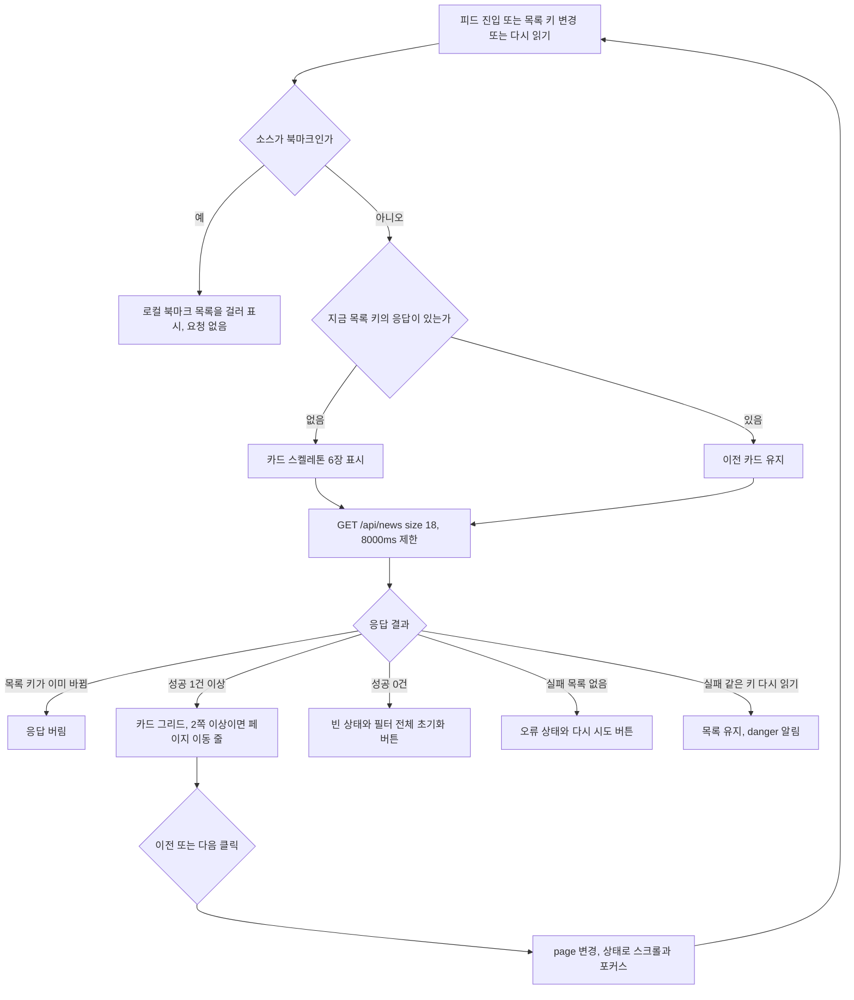

#### 4. 화면 표시 및 입력 데이터 항목 명세 (UI Data Elements - 8대 표준 컬럼)
| 항목명 | 화면 표시/입력 구분 | UI 컴포넌트 | 필수 여부 | 데이터 타입 / 제약 | 기본값 | 유효성 검증 규칙 (Validation) | 노출/수정 조건 |
| :--- | :---: | :--- | :---: | :--- | :---: | :--- | :--- |
| `page` | 시스템 제어 | 페이지 이동 줄 `이전`·`다음` | 필수 | Integer ≥ 1 (API) | 1 | 이전 `p-1`, 다음 `p+1` 을 `1~totalPages` 로 자른다. 같은 값이면 아무것도 안 함 | 이동 줄은 `!loading && totalPages > 1` 일 때만. `page <= 1` 이면 이전 비활성, `page >= totalPages` 면 다음 비활성 |
| `size` | 시스템 제어 | (없음) | 필수 | Integer, API 1~100 | 프론트 18, API 기본 20 | 범위 밖이면 400 `ERR_INVALID_PAYLOAD` | 프론트는 항상 18 |
| 페이지 표시 `p / T` | 노출 전용 | 텍스트 | - | `{page} / {totalPages}` | - | - | 페이지 이동 줄 가운데 |
| 목록 상태 `총 N건` | 노출 전용 | `role="status" aria-live="polite"` 영역 | - | Integer | - | 응답 `total` (북마크 보기는 북마크 길이) | 늘 표시 |
| `(전체 M건)` | 노출 전용 | 상태 뒤 보조 글자 | - | `stats.total_news` | - | 필터 중이고 통계가 있을 때 | 필터 중 = 카테고리≠`all` 또는 소스≠`all` 또는 `search.trim()` 비어 있지 않음 또는 Must-Read |
| `북마크 보기` 배지 | 노출 전용 | Badge (accent) | - | - | - | - | 소스 = `bookmarks` |
| `Must-Read` 배지 | 노출 전용 | Badge (warning) | - | - | - | - | Must-Read 켬 (북마크 보기여도 붙는다) |
| `페이지 p / totalPages` | 노출 전용 | 상태 오른쪽 끝 글자 | - | `totalPages` 없으면 1 | - | - | 늘 표시 |
| 카드 그리드 | 노출 전용 | 카드 목록 | - | `NewsItemResponse[]` | - | - | 로딩·오류 아님, 1건 이상 |
| 로딩 스켈레톤 | 노출 전용 | 카드 스켈레톤 6장 + 화면 읽기용 `소식을 불러오는 중...` | - | - | - | - | 지금 목록 키의 응답이 없을 때만. 그리드·오류·빈 상태·페이지 이동 줄 숨김 |
| 오류 상태 | 노출 전용 | 오류 블록 (`role="alert"`) | - | 제목 = 오류 메시지, 안내 `백엔드 서버 연결 상태를 확인해주세요.`, 버튼 `다시 시도` | 제목 대체 `데이터를 불러오지 못했습니다.` | - | 지금 목록 키의 목록이 없는 상태에서 실패 |
| 빈 상태 | 노출 전용 | 빈 상태 블록 | - | 제목 `조건에 일치하는 소식이 없습니다`, 설명 `다른 카테고리를 선택하거나 검색어 및 필터를 초기화해 보세요.`, 버튼 `필터 전체 초기화` | - | - | 로딩·오류 아님, 0건 |

#### 5. 비즈니스 규칙 (Business Rules)
- **BR-NEWS-001-1 (요청 파라미터)**: API 쿼리는 `category`(선택), `source`(선택), `search`(선택), `high_signal_only`(bool, 기본 false), `sort`(기본 `"hot"`), `page`(정수, 기본 1, ≥1), `size`(정수, 기본 20, 1~100). 프론트는 `category`/`source` 가 `'all'` 이면 빼고, `search` 가 빈 문자열이면 빼고, `high_signal_only` 는 true 일 때만 붙이고, `size=18` 을 늘 보낸다. `search` 로는 입력창 값이 아니라 디바운스를 거친 `appliedSearch` 를 보낸다 (FUNC-NEWS-005) (`frontend/src/lib/api.ts:91-113`, `frontend/src/hooks/useNewsFeed.ts`).
- **BR-NEWS-001-2 (건수와 페이지 수)**: `total` 은 필터를 적용한 쿼리를 서브쿼리로 감싸 센 값이다 (정렬·페이지 적용 전). `total_pages = ceil(total/size)`, `total == 0` 이면 1 (`backend/app/services/news_service.py:57-100`. 라우터는 `NewsService` 를 거친다, `backend/app/api/news.py:17-31`).
- **BR-NEWS-001-3 (응답 변환)**: 각 행은 `format_news_item` 으로 바꾼다. `tags`·`tech_stack` 은 콤마 문자열을 split·trim 해 배열로(빈 값 제외), `tldr_bullets` 는 JSON 파싱(실패 시 `[]`), `summary`·`why_it_matters` 는 null 이면 `""`, `quality_score` 는 falsy(0 포함)면 `6.0`, `is_high_signal` 은 null 이면 false (`backend/app/services/news_service.py:14-50`).
- **BR-NEWS-001-4 (응답 필드)**: `NewsListResponse { items: NewsItemResponse[], total, page, size, total_pages }`. `NewsItemResponse` 필드: `id, title, url, source, category, summary, author, tags[], tldr_bullets[], why_it_matters, tech_stack[], quality_score, is_high_signal, raw_score, comments_count, hotness_score, published_at, created_at, dedup_hash`. `full_content`, `scraped_at` 은 응답에 없다. v0.4.2 부터 `published_at`·`created_at` 은 UTC 오프셋을 붙여 보낸다(예: `…Z`, DB 의 오프셋 없는 값은 UTC 로 본다). 그래서 브라우저가 현지 시각으로 잘못 읽지 않는다 (`backend/app/schemas/news.py:26-36`).
- **BR-NEWS-001-5 (로딩 판정)**: `loading` 은 지금 목록 키의 응답이 아직 없을 때만 true 다. 같은 목록 키를 다시 읽는 동안에는 이전 `items`·`total`·`totalPages` 를 그대로 그리고, 목록 키가 바뀐 뒤에는 이전 목록을 보이지 않는다. 응답은 받은 목록 키와 함께 저장한다 (`frontend/src/hooks/useNewsFeed.ts:59-73`, `:153-170`).
- **BR-NEWS-001-6 (페이지 리셋)**: 필터·정렬·카테고리·소스·Must-Read 를 바꾸는 모든 핸들러는 `page` 를 1 로 되돌린다.
- **BR-NEWS-001-7 (필터 전체 초기화)**: 빈 상태 버튼은 category·source 를 `all`, search 를 `''`, highSignalOnly 를 false, page 를 1 로 되돌린다. 검색어 초기화는 기다리지 않고 바로 반영하고 page 1 도 이때 함께 돌린다. `sort` 와 트렌드 레이더의 `selectedTag` 는 초기화하지 않는다 (`frontend/src/hooks/useNewsFeed.ts:29-36`, `:190-195`).
- **BR-NEWS-001-8 (다시 읽기 실패 알림)**: 같은 목록 키 다시 읽기의 실패마다 번호가 바뀌어 실패할 때마다 한 번 `danger` 알림이 뜬다 (`frontend/src/app/page.tsx:74-81`).
- **BR-NEWS-001-9 (배치)**: 카드 그리드는 1열(<768px) / 2열(768~1023px) / 3열(≥1024px). 페이지 이동 줄은 `이전` · `p / T` · `다음` 이고 768px 미만에서 두 버튼이 반씩 차지한다. 목록 머리줄 배치는 FUNC-NEWS-006.

#### 6. 예외 처리 및 엣지 케이스 (Edge Cases & Exception Handling)
| 발생 상황 (Edge Case Scenario) | 화면 반응 및 시스템 처리 방식 | 사용자 안내 메시지 |
| :--- | :--- | :--- |
| HTTP 오류 응답 (`res.ok` 아님) | `API 오류 (status): statusText` 예외 (응답 `message` 는 읽지 않는다). 목록이 없으면 오류 상태, 같은 키 다시 읽기면 목록 유지 + `danger` 알림 | 제목 `API 오류 ({status}): {statusText}`, 안내 `백엔드 서버 연결 상태를 확인해주세요.` |
| 8000ms 타임아웃 (abort) 또는 네트워크 오류 | 같은 경로로 처리한다. 메시지는 브라우저가 주는 예외 문구이고, 비어 있으면 대체 문구 | 브라우저 예외 문구 (정확한 문구는 확인하지 못함) 또는 `데이터를 불러오지 못했습니다.` |
| 오류 상태에서 `다시 시도` | 오류를 지우고 다시 읽는다 | (없음) |
| 0건 | 빈 상태 | `조건에 일치하는 소식이 없습니다` / `다른 카테고리를 선택하거나 검색어 및 필터를 초기화해 보세요.` |
| 수집 중 새 소식 저장으로 같은 키 다시 읽기 | 스켈레톤으로 바뀌지 않고 이전 카드 유지 | (없음) |
| 필터를 연달아 바꿈 | 바뀐 뒤 도착한 앞 요청의 응답은 버린다 | (없음) |
| 응답 형식이 타입과 다름 | zod `safeParse` 로 검증한다. 실패해도 던지지 않고, 개발·테스트에서는 `console.warn` 으로 알린 뒤 받은 데이터를 그대로 쓴다 (`frontend/src/lib/contract.ts:11-29`) | (없음) |

#### 7. 비즈니스 에러 코드 매핑
| 비즈니스 에러 코드 | 발생 사유 | HTTP 상태 코드 매핑 | 클라이언트 표시 형태 |
| :--- | :--- | :---: | :--- |
| `ERR_INVALID_PAYLOAD` | `page < 1`, `size` 가 1~100 밖 (요청 검증, `details` 에 `[{loc, msg}]`) | 400 | 프론트는 범위 밖 값을 보내지 않는다. 보내면 오류 상태 `API 오류 (400): …` |
| `ERR_SERVER_INTERNAL` | 처리하지 못한 서버 예외 (예외 문자열은 응답에 싣지 않는다) | 500 | 오류 상태 또는 `danger` 알림 `API 오류 (500): …` |
| 없음 | 타임아웃·연결 실패 | - | 오류 상태 또는 `danger` 알림 (브라우저 예외 문구) |

- 근거: `backend/app/api/news.py:17-31`, `backend/app/services/news_service.py`, `backend/app/api/errors.py:20-77`, `backend/app/schemas/news.py:5-43`, `frontend/src/hooks/useNewsFeed.ts`, `frontend/src/lib/api.ts:74-113`, `frontend/src/app/page.tsx:74-81`, `:200-268`, `frontend/src/components/feed/FeedStatusBar.tsx:38-88`, `frontend/src/components/feed/FeedPagination.tsx:16-55`, `frontend/next.config.ts`, 동작 확인 테스트 `frontend/src/tests/hooks/useNewsFeed.test.tsx`

---

### [FUNC-NEWS-002] 카테고리 필터

#### 1. 기본 정보
- **기능명**: 4개 카테고리 + 전체 칩으로 목록을 거르고 칩별 건수 표시
- **기능 ID**: `FUNC-NEWS-002`
- **대응 요구사항 ID**: `REQ-NEWS-001` (옛 기능명세 `NEWS-02`)
- **대상 화면 코드**: `SCR-NEWS-001` (필터 영역 줄 1)
- **우선순위**: Must Have
- **관련 액터 (Actor)**: 피드 사용자
- **진입점**: 필터 영역(`data-feed-toolbar`)의 카테고리 칩 묶음(`role="group" aria-label="카테고리"`, 한 줄 가로 스크롤). API `GET /api/news?category=`.

#### 2. 사전 조건 (Pre-conditions)
1. `SCR-NEWS-001` 에 진입했다.
2. 칩 건수는 통계(FUNC-NEWS-015)를 받은 뒤 채워진다.

#### 3. 사용자 인터랙션 및 시스템 동작 흐름과 플로우차트
1. 사용자가 카테고리 칩을 누른다.
2. 화면은 카테고리를 바꾸고, 소스를 `all` 로(북마크 보기 포함 해제), page 를 1 로 바꾼다.
3. 목록 키가 바뀌어 FUNC-NEWS-001 조회가 다시 일어난다.
4. 선택 칩이 흐림 밖에 보이게 줄이 밀린다 (가로 스크롤 규칙, FUNC-UI-009).

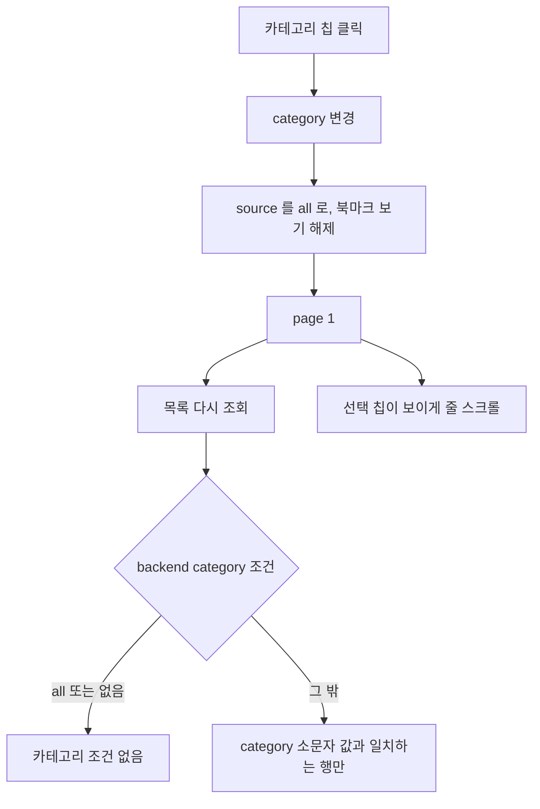

#### 4. 화면 표시 및 입력 데이터 항목 명세 (UI Data Elements - 8대 표준 컬럼)
| 항목명 | 화면 표시/입력 구분 | UI 컴포넌트 | 필수 여부 | 데이터 타입 / 제약 | 기본값 | 유효성 검증 규칙 (Validation) | 노출/수정 조건 |
| :--- | :---: | :--- | :---: | :--- | :---: | :--- | :--- |
| `category` | 사용자 선택 | 칩 5개 (`aria-pressed`) | 필수 | Enum `all`, `harness`, `mcp_plugins_skills`, `agent_tech`, `ai_news` | `all` | 정의된 5개 중 하나 | 상시. 선택 칩은 `aria-pressed="true"` 와 강조 배경 |
| 칩 라벨 | 노출 전용 | 칩 글자 | - | `all` `전체 소식`, `harness` `하네스 & 벤치마크`, `mcp_plugins_skills` `MCP & 생태계`, `agent_tech` `에이전트 아키텍처`, `ai_news` `최신 AI 동향` | - | `전체 소식` 밖은 `lib/labels.ts` 긴 라벨(`CATEGORY_LABELS`). 상세 대화상자 배지·소스 등록 선택지와 같은 문구 | 상시 |
| 칩 아이콘 | 노출 전용 | 아이콘 (`Compass`·`ShieldCheck`·`Cpu`·`Bot`·`Sparkles`) | - | - | - | - | 1280px 이상에서만 |
| 칩 건수 | 노출 전용 | 칩 글자 뒤 숫자 | - | Integer | 0 | 개별 칩 `stats.category_counts[id] ?? 0`, `all` 은 `category_counts` 값 전체 합 | 상시 (통계 없으면 0) |
| 스크롤 버튼 | 사용자 조작 | `카테고리 이전 항목 보기` / `카테고리 다음 항목 보기` | - | - | - | 누르면 줄 폭의 80% 이동 | 768px 이상, 넘친 쪽에만 |
| 넘침 표시 `‹` `›` | 노출 전용 | 장식 (`aria-hidden`) | - | - | - | - | 768px 미만, 넘친 쪽에만 |

#### 5. 비즈니스 규칙 (Business Rules)
- **BR-NEWS-002-1 (backend 조건)**: `category` 가 있고 소문자 변환 값이 `"all"` 이 아니면 `NewsItem.category == category.lower()` 조건을 붙인다 (`backend/app/services/news_service.py:57-75`).
- **BR-NEWS-002-2 (소스 해제)**: 칩 선택 시 `onCategoryChange(c)`, `onSourceChange('all')`, `onPageChange(1)` 을 함께 실행한다. 카테고리를 바꾸면 소스 필터(북마크 보기 포함)가 해제된다 (`frontend/src/components/feed/FeedToolbar.tsx:107-111`).
- **BR-NEWS-002-3 (피드 위쪽 배치, 참고)**: 피드 위쪽은 본문(`main`)의 형제 세 영역(검색 영역 `data-feed-search`, 필터 영역 `data-feed-toolbar`, 목록 머리줄 `data-feed-list-header`)이고, 모든 폭에서 같은 DOM 트리를 그리며 폭별 배치는 CSS 클래스로만 바꾼다.

  | 폭 | 검색 영역 | 필터 영역 줄 1 | 필터 영역 줄 2 | 목록 머리줄 |
  |---|---|---|---|---|
  | 1280px 이상 | 검색 입력, 콘텐츠 전체 폭, 36px | 카테고리(줄 전체, 칩 아이콘 있음) | 소스(남는 폭 전부) + Must-Read 토글(별 + 글자) | 상태 + 정렬(`w-32`, 36px) |
  | 768~1279px | 검색 입력, 콘텐츠 전체 폭, 36px | 카테고리(줄 전체, 칩 아이콘 숨김) | 소스(남는 폭 전부) + Must-Read 토글(별 + 글자) | 상태 + 정렬(`w-28`, 36px) |
  | 768px 미만 | 검색 입력, 콘텐츠 전체 폭, 44px | 카테고리(칩 아이콘 숨김, 페이지 좌우 여백 너머 화면 끝까지) | 소스(왼쪽만 페이지 여백 너머 화면 끝까지) + Must-Read 토글(별 아이콘만, 44×44) | 상태 + 정렬(`w-28`, 44px) |

  - 필터 영역은 두 줄(각각 독립된 가로 배치 `data-toolbar-row`, 줄 사이 8px)이고 안에 입력·선택 상자가 없다. 검색 입력, 카테고리 줄, 소스 줄 + 토글, 목록 머리줄의 왼쪽·오른쪽 끝은 모든 폭에서 콘텐츠 상자 끝과 같다. Must-Read 토글은 소스 줄의 마지막 자식이라 오른쪽 끝이 콘텐츠 오른쪽 끝이고, 정렬의 오른쪽 끝도 같다. 768px 미만에서도 토글은 소스 줄과 같은 줄에 있다 (360px 폭에서 소스 줄의 보이는 폭은 약 276px 이고 흐림 밖에 다 보이는 소스 칩은 2개다).
  - DOM 순서 = 화면 순서 = Tab 순서는 모든 폭에서 `검색 → 카테고리(768px 이상 스크롤 버튼 포함) → 소스 → Must-Read → 상태 → 정렬 → 카드` 다. `order`·`flex-*-reverse`·grid 영역으로 순서를 바꾸지 않는다.
  - 트리가 하나라 폭이 바뀌어도(창 크기 조절, 기기 회전) 검색 입력, 칩 줄, 정렬이 다시 마운트되지 않는다. 검색창 포커스·입력값·가상 키보드가 그대로 남는다. 칩 줄의 스크롤 위치는 사용자가 직접 민 줄만 남고, 그렇지 않은 줄은 줄 폭이 바뀌면 선택 칩이 보이게 다시 맞춘다. 서버 렌더와 하이드레이션 첫 렌더도 같은 트리라 하이드레이션 뒤 배치가 바뀌지 않는다. 필터 영역은 너비 판정(`useMediaQuery`)을 쓰지 않는다 (칩 줄 안 스크롤 버튼·넘침 표시 판정은 가로 스크롤 줄 부품이 한다).
  - 768px 이상에서 필터 영역만 헤더 아래에 붙는다(`sticky top-14 z-10`). 검색 영역과 목록 머리줄은 붙지 않고, 768px 미만은 어느 영역도 붙지 않는다. 필터 영역의 sticky 배경용 위아래 여백은 음수 마진으로 상쇄해, 요약 바 → 검색 영역 → 필터 영역 → 목록 머리줄 → 카드 사이 간격은 모두 본문 간격(12px, 768px 이상 16px) 하나로 정해진다 (`frontend/src/app/page.tsx:170`, `frontend/src/components/feed/FeedToolbar.tsx:211-229`).
- **BR-NEWS-002-4 (가로 스크롤, 카테고리·소스 줄 공통)**: 줄이 넘치면 넘친 쪽만 24px 흐린다. 768px 이상은 넘친 쪽에 스크롤 버튼(`카테고리 이전 항목 보기`/`카테고리 다음 항목 보기`, 소스 줄은 `소스 …`)이 줄 밖에 붙고, 누르면 줄 폭의 80% 만큼 민다. 키보드로 누르던 버튼이 끝에 닿아 사라지면 포커스는 반대쪽 버튼으로, 두 버튼이 다 사라지면(폭이 768px 미만이 됨) 선택 칩으로 옮겨진다. 768px 미만은 버튼 없이 손가락으로 밀고, 넘친 쪽마다 장식 표시가 붙는다: 왼쪽에 칩이 더 있으면 줄 앞에 `‹`, 오른쪽에 더 있으면 줄 뒤에 `›`, 양쪽이면 둘 다. 표시는 칩을 덮지 않고, 표시가 나타나고 사라져도 칩이 옆으로 움직이지 않는다. 처음 그릴 때와 선택 칩이 바뀔 때 선택 칩이 흐림 밖에 다 보이게 줄을 민다 (흐림 폭과 스냅 여백이 모두 24px). 칩 건수가 늦게 들어와 칩이 커지거나 넘침 표시·화면 폭 변화로 줄 폭이 달라져도, 사용자가 줄을 밀지 않았으면 다시 보이게 한다. '사용자가 밀었다' 는 줄에 대한 입력(누르기·휠·터치·키·스크롤 버튼·줄 안으로의 포커스 이동) 뒤에 온 스크롤만이고, 입력 없이 브라우저가 줄 범위를 자르거나 스냅 위치로 다시 맞춘 것은 밀지 않은 것으로 본다 (FUNC-UI-009).
- **BR-NEWS-002-5 (넘침 여부, 측정 기록)**: 1440px 폭에서는 카테고리·소스 줄이 넘치지 않는다 (건수가 있는 소스가 늘면 소스 줄은 넘칠 수 있고, 그때도 위 규칙을 따른다). 768~1279px 은 카테고리·소스 줄 모두 넘칠 수 있다 (768px 에서는 둘 다 넘쳐 스크롤 버튼이 붙는다).

#### 6. 예외 처리 및 엣지 케이스 (Edge Cases & Exception Handling)
| 발생 상황 (Edge Case Scenario) | 화면 반응 및 시스템 처리 방식 | 사용자 안내 메시지 |
| :--- | :--- | :--- |
| 통계 로딩 실패 | 칩 건수가 모두 0 으로 보인다 | (없음) |
| 북마크 보기 중 카테고리 칩 클릭 | 소스가 `all` 이 되어 북마크 보기가 해제되고 서버 목록으로 돌아간다 | (없음) |
| 사용자가 칩 줄을 손으로 민 뒤 화면 폭이 바뀜 | 민 위치를 유지한다 | (없음) |

#### 7. 비즈니스 에러 코드 매핑
| 비즈니스 에러 코드 | 발생 사유 | HTTP 상태 코드 매핑 | 클라이언트 표시 형태 |
| :--- | :--- | :---: | :--- |
| 없음 | 목록 조회 실패 | FUNC-NEWS-001 과 같음 | FUNC-NEWS-001 과 같음 |
| 없음 | 정의 밖 카테고리 값 (API 직접 호출) | 200 | 일치 행이 없으면 빈 목록 |

- 근거: `backend/app/services/news_service.py:57-75`, `frontend/src/components/feed/FeedToolbar.tsx:12-23`, `:55-86`, `:107-133`, `:211-229`, `frontend/src/components/feed/FeedStatusBar.tsx:29-37`, `frontend/src/app/page.tsx:170`, `frontend/src/lib/labels.ts:15-20`, `frontend/src/components/ui/Chip.tsx`, `frontend/src/components/ui/ScrollRow.tsx`, 동작 확인 테스트 `frontend/src/tests/feed/FeedToolbar.test.tsx`, `frontend/src/tests/ui/ChipGroup.test.tsx`

---

### [FUNC-NEWS-003] 소스 필터

#### 1. 기본 정보
- **기능명**: 수집 소스별 필터 칩 (건수 0 인 소스는 숨김), 북마크 보기 진입
- **기능 ID**: `FUNC-NEWS-003`
- **대응 요구사항 ID**: `REQ-NEWS-002` (옛 기능명세 `NEWS-03`)
- **대상 화면 코드**: `SCR-NEWS-001` (필터 영역 줄 2)
- **우선순위**: Should Have
- **관련 액터 (Actor)**: 피드 사용자
- **진입점**: 필터 영역 줄 2 의 소스 칩 묶음(`role="group" aria-label="소스"`, 한 줄 가로 스크롤). API `GET /api/news?source=`.

#### 2. 사전 조건 (Pre-conditions)
1. `SCR-NEWS-001` 에 진입했다.
2. 소스 칩(전체·북마크 밖)은 통계의 `source_counts` 에 건수가 있어야 보인다.

#### 3. 사용자 인터랙션 및 시스템 동작 흐름과 플로우차트
1. 사용자가 소스 칩을 누른다.
2. 화면은 source 를 바꾸고 page 를 1 로 바꾼다.
3. `bookmarks` 면 API 를 부르지 않고 로컬 북마크 목록을 보인다 (FUNC-NEWS-007). 그 밖이면 FUNC-NEWS-001 조회.
4. 소스 줄은 선택된 소스 칩이 보이게 민다.

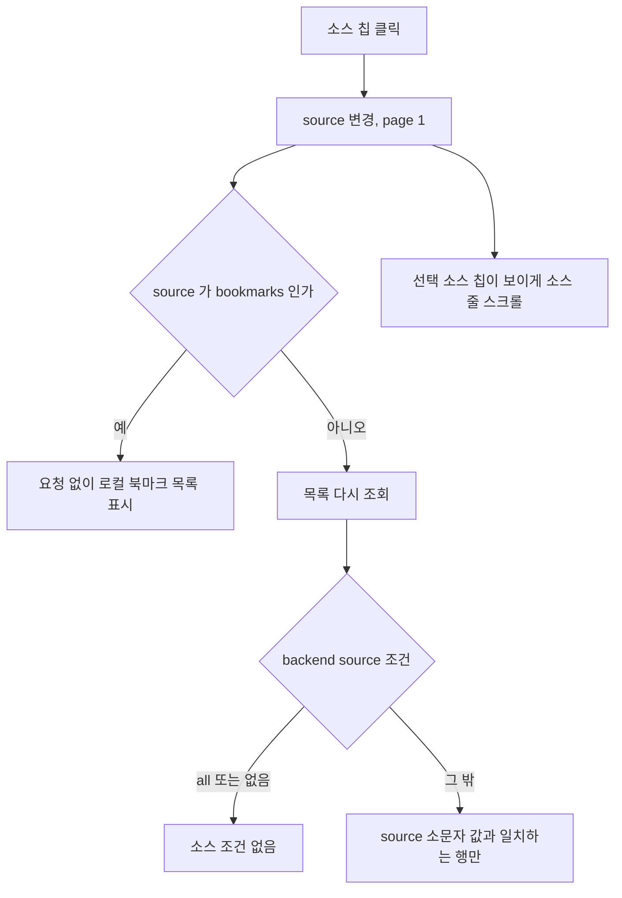

#### 4. 화면 표시 및 입력 데이터 항목 명세 (UI Data Elements - 8대 표준 컬럼)
| 항목명 | 화면 표시/입력 구분 | UI 컴포넌트 | 필수 여부 | 데이터 타입 / 제약 | 기본값 | 유효성 검증 규칙 (Validation) | 노출/수정 조건 |
| :--- | :---: | :--- | :---: | :--- | :---: | :--- | :--- |
| `source` | 사용자 선택 | 소스 칩 (`aria-pressed`, `data-source-chip`) | 필수 | String: `all`, `rss_kr`, `github`, `hackernews`, `arxiv`, `huggingface`, `reddit`, `rss`, `bookmarks` | `all` | 칩 목록 안의 값 | 선택 칩은 `aria-pressed="true"` 와 강조 배경 |
| 칩 순서·라벨 | 노출 전용 | 칩 글자 | - | `전체`, 건수가 있는 소스(`rss_kr` 국내 테크, `github` GitHub, `hackernews` HackerNews, `arxiv` arXiv, `huggingface` HuggingFace, `reddit` Reddit, `rss` Global Blogs 순), `북마크`(아이콘 `Bookmark`) | - | `lib/labels.ts` `SOURCE_LABELS`. 구분선 없음 | `all`·`bookmarks` 는 늘, 나머지는 `stats.source_counts[id] > 0` 일 때 |
| 칩 건수 | 노출 전용 | 칩 글자 뒤 숫자 | - | Integer | 0 | `all` = `source_counts` 합, `bookmarks` = 북마크 개수, 나머지 = 해당 소스 건수 | 0 이어도 숫자 표시 |
| 스크롤 버튼·넘침 표시 | 사용자 조작 / 노출 | `소스 이전 항목 보기`/`소스 다음 항목 보기`, `‹`·`›` | - | - | - | FUNC-NEWS-002 BR-4 와 같다 | 768px 미만은 왼쪽만 화면 끝까지 늘어나며, 왼쪽으로 넘치면 `‹` 가 화면 끝 여백 자리에, 오른쪽으로 넘치면 `›` 가 토글 앞에 온다 |

#### 5. 비즈니스 규칙 (Business Rules)
- **BR-NEWS-003-1 (backend 조건)**: `source` 가 있고 소문자 값이 `"all"` 이 아니면 `NewsItem.source == source.lower()` (`backend/app/services/news_service.py:57-75`).
- **BR-NEWS-003-2 (선택)**: 선택 시 `onSourceChange(s)`, `onPageChange(1)`.
- **BR-NEWS-003-3 (선택 칩 보이기)**: 소스 줄의 선택 칩은 선택된 소스 칩(`전체`·소스·`북마크` 가운데 `aria-pressed="true"` 인 것, 모두 `data-source-chip`)이다. 줄 밖 `Must-Read` 토글은 선택 칩과 상관이 없다 (`selectedSelector='[data-source-chip][aria-pressed="true"]'`). 그래서 `Must-Read` 와 줄 뒤쪽 소스(예: `GitHub`)를 함께 고르면 줄은 `GitHub` 칩이 보이게 밀리고, `Must-Read` 만 켜고 끄는 것으로는 줄이 움직이지 않는다. 첫 화면(360·390px 포함)에서 소스 줄은 밀리지 않고 첫 칩 `전체` 부터 보인다 (스크롤 0).
- **BR-NEWS-003-4 (배치)**: 모든 폭에서 `Must-Read` 토글(FUNC-NEWS-004) 왼쪽이고 같은 줄이다.

#### 6. 예외 처리 및 엣지 케이스 (Edge Cases & Exception Handling)
| 발생 상황 (Edge Case Scenario) | 화면 반응 및 시스템 처리 방식 | 사용자 안내 메시지 |
| :--- | :--- | :--- |
| 위 목록에 없는 source 값(예: `web`)이 DB 에 있음 | 그 소스의 칩이 없다 (전체 칩 건수 합에는 들어간다) | (없음) |
| 통계 실패 | 건수가 있는 소스 칩이 하나도 보이지 않고 `전체`·`북마크` 만 보인다 | (없음) |

#### 7. 비즈니스 에러 코드 매핑
| 비즈니스 에러 코드 | 발생 사유 | HTTP 상태 코드 매핑 | 클라이언트 표시 형태 |
| :--- | :--- | :---: | :--- |
| 없음 | 목록 조회 실패 | FUNC-NEWS-001 과 같음 | FUNC-NEWS-001 과 같음 (북마크 보기는 요청이 없어 오류가 없다) |

- 근거: `backend/app/services/news_service.py:57-75`, `frontend/src/components/feed/FeedToolbar.tsx:25-26`, `:113-116`, `:155-191`, `frontend/src/lib/labels.ts:36-44`, `:66-68`

---

### [FUNC-NEWS-004] Must-Read 필터

#### 1. 기본 정보
- **기능명**: `is_high_signal` 기사만 표시하는 토글
- **기능 ID**: `FUNC-NEWS-004`
- **대응 요구사항 ID**: `REQ-NEWS-002` (옛 기능명세 `NEWS-04`)
- **대상 화면 코드**: `SCR-NEWS-001` (필터 영역 줄 2 오른쪽 끝)
- **우선순위**: Should Have
- **관련 액터 (Actor)**: 피드 사용자
- **진입점**: 필터 영역 줄 2 의 `Must-Read` 토글(`button`, `aria-pressed`, `data-must-read-toggle`, 별 아이콘). API `GET /api/news?high_signal_only=true`.

#### 2. 사전 조건 (Pre-conditions)
1. `SCR-NEWS-001` 에 진입했다.
2. 기사의 `is_high_signal` 값은 수집 때 정해진다 (`docs/spec-writer/fsd/03_COLLECTION_SPECIFICATION.md`, 옛 COLL-08).

#### 3. 사용자 인터랙션 및 시스템 동작 흐름과 플로우차트
1. 사용자가 토글을 누른다.
2. 화면은 값을 반전하고 page 를 1 로 바꾼다.
3. true 면 목록 요청에 `high_signal_only=true` 를 붙인다.
4. 목록 머리줄 상태에 `Must-Read` 배지가 붙는다.

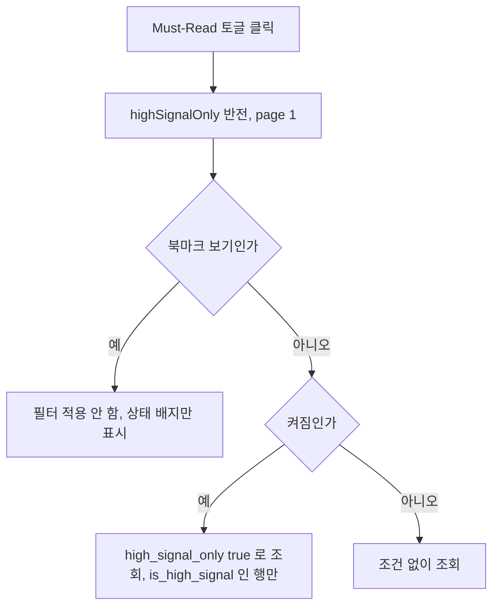

#### 4. 화면 표시 및 입력 데이터 항목 명세 (UI Data Elements - 8대 표준 컬럼)
| 항목명 | 화면 표시/입력 구분 | UI 컴포넌트 | 필수 여부 | 데이터 타입 / 제약 | 기본값 | 유효성 검증 규칙 (Validation) | 노출/수정 조건 |
| :--- | :---: | :--- | :---: | :--- | :---: | :--- | :--- |
| `high_signal_only` | 사용자 선택 | 토글 칩 (`aria-pressed`) | 선택 | Boolean | false | true/false | 상시. 소스 줄 밖, 소스 줄 오른쪽 끝(줄의 마지막 자식)에 고정되어 소스 줄을 밀어도 움직이지 않고, 모든 폭의 첫 화면에서 전체가 보인다 |
| 토글 모양 | 노출 전용 | 별 아이콘 + 글자 | - | 768px 이상 별 + `Must-Read`, 768px 미만 별 아이콘만 보이는 44×44px | - | 글자는 768px 미만에서 화면 읽기용으로 남아 접근 이름은 모든 폭에서 `Must-Read` | 높이는 같은 줄 소스 칩과 같다 (768px 미만 44px, 이상 32px) |
| 툴팁 | 노출 전용 | `title` | - | `기술 깊이와 실무 가치가 입증된 고품질 소식만 보기` | - | - | 호버 |
| 선택 상태 | 노출 전용 | 경고 톤 | - | 호박색 테두리·배경, 별 채움 | - | - | 켜짐 |
| 상태 배지 | 노출 전용 | Badge `Must-Read` | - | - | - | - | 켜짐 (목록 머리줄) |

#### 5. 비즈니스 규칙 (Business Rules)
- **BR-NEWS-004-1 (판정)**: true 이면 `NewsItem.is_high_signal == True` 조건만 붙인다. 품질 점수를 직접 비교하지 않는다 (`backend/app/services/news_service.py:72-73`).
- **BR-NEWS-004-2 (토글)**: 누르면 반전 후 page 1 (`frontend/src/components/feed/FeedToolbar.tsx:200-203`).
- **BR-NEWS-004-3 (Tab 순서)**: 소스 줄 다음, 목록 머리줄 앞. 폭이 바뀌어도 같은 요소라 다시 마운트되지 않는다.

#### 6. 예외 처리 및 엣지 케이스 (Edge Cases & Exception Handling)
| 발생 상황 (Edge Case Scenario) | 화면 반응 및 시스템 처리 방식 | 사용자 안내 메시지 |
| :--- | :--- | :--- |
| 북마크 보기에서 켬 | 필터가 적용되지 않지만 상태 배지 `Must-Read` 는 그대로 붙는다 | (없음) |
| Must-Read 기사가 0건 | 빈 상태 (FUNC-NEWS-001) | `조건에 일치하는 소식이 없습니다` |

#### 7. 비즈니스 에러 코드 매핑
| 비즈니스 에러 코드 | 발생 사유 | HTTP 상태 코드 매핑 | 클라이언트 표시 형태 |
| :--- | :--- | :---: | :--- |
| 없음 | 목록 조회 실패 | FUNC-NEWS-001 과 같음 | FUNC-NEWS-001 과 같음 |

- 근거: `backend/app/services/news_service.py:72-73`, `frontend/src/components/feed/FeedToolbar.tsx:193-209`, `:223-226`, `frontend/src/components/feed/FeedStatusBar.tsx:68-69`, 동작 확인 테스트 `frontend/src/tests/feed/FeedToolbar.test.tsx`

---

### [FUNC-NEWS-005] 키워드 검색

#### 1. 기본 정보
- **기능명**: 제목·요약·태그·기술 스택·시사점 부분 일치 검색
- **기능 ID**: `FUNC-NEWS-005`
- **대응 요구사항 ID**: `REQ-NEWS-001` (옛 기능명세 `NEWS-05`)
- **대상 화면 코드**: `SCR-NEWS-001` (검색 영역)
- **우선순위**: Must Have
- **관련 액터 (Actor)**: 피드 사용자
- **진입점**: 검색 영역(`data-feed-search`)의 검색창(`<form role="search">` 안 `type="search"` 입력), `/` 단축키(검색창 포커스), 트렌드 레이더 태그·요약 바 급상승 칩(FUNC-NEWS-014). API `GET /api/news?search=`.

#### 2. 사전 조건 (Pre-conditions)
1. `SCR-NEWS-001` 에 진입했다.
2. 검색 영역은 요약 바 아래, 필터 영역 위의 독립 영역이고 고정(sticky)되지 않는다.

#### 3. 사용자 인터랙션 및 시스템 동작 흐름과 플로우차트
1. 사용자가 검색창에 글자를 입력한다. 입력창 값(`search`)은 바로 바뀌지만, 목록 요청에 쓰는 값(`appliedSearch`)은 입력이 300ms(`SEARCH_DEBOUNCE_MS`) 멈춘 뒤에 바뀌고 그때 page 도 함께 1 로 돌아가 요청이 한 번 나간다. 입력을 지워 빈 값이 되면 기다리지 않고 바로 반영한다.
2. Enter 로 제출하면 page 를 1 로 바꾸고 `loadNews()` 를 부른다. `loadNews()` 는 기다리던 검색어가 있으면 먼저 바로 반영한 뒤 같은 목록 키를 다시 읽는다.
3. 값이 있을 때 보이는 `검색어 지우기` 를 누르면 `search` 를 `''`(바로 반영), page 를 1 로 바꾸고 검색창에 포커스를 둔다.
4. `/` 단축키는 입력에 스크롤 없이 포커스를 준 뒤 검색 영역을 `scrollIntoView({ block: 'nearest' })` 로 보이게 한다.

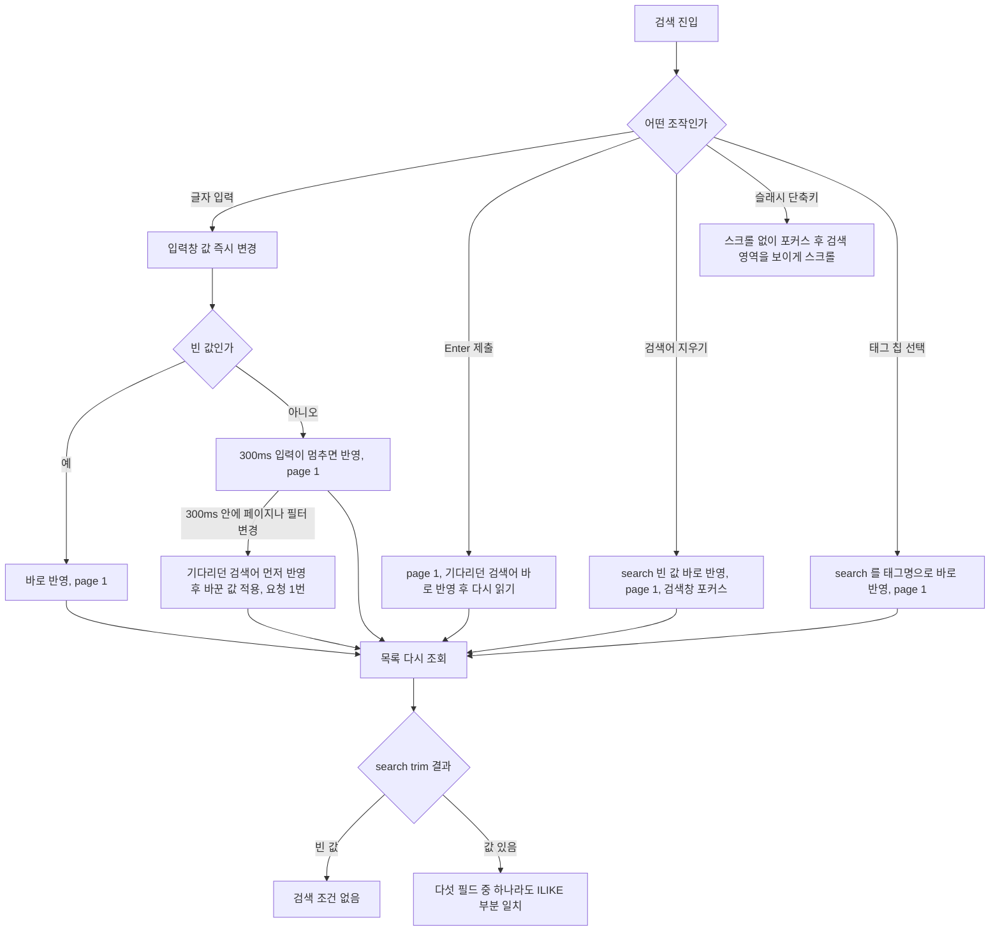

#### 4. 화면 표시 및 입력 데이터 항목 명세 (UI Data Elements - 8대 표준 컬럼)
| 항목명 | 화면 표시/입력 구분 | UI 컴포넌트 | 필수 여부 | 데이터 타입 / 제약 | 기본값 | 유효성 검증 규칙 (Validation) | 노출/수정 조건 |
| :--- | :---: | :--- | :---: | :--- | :---: | :--- | :--- |
| `search` | 사용자 입력 | 검색 입력 (`type="search"`, 숨긴 라벨 `키워드 검색`, 자리표시 `키워드 검색`) | 선택 | String, 길이 제한 없음 | `''` | 프론트는 trim 하지 않고 그대로 보낸다(빈 문자열만 생략). backend 가 trim | 상시. 모든 폭에서 콘텐츠 전체 폭, 높이 768px 미만 44px·이상 36px. 자리표시는 예시 없이 짧게 두어 360px 화면 입력 안에 들어간다 |
| `검색어 지우기` | 사용자 조작 | 아이콘 버튼 | - | Button | - | - | 입력값이 있을 때 |
| 제출 | 사용자 조작 | Enter (폼 제출) | - | - | - | - | 상시 |

#### 5. 비즈니스 규칙 (Business Rules)
- **BR-NEWS-005-1 (검색 범위)**: `search.strip()` 이 비어 있지 않으면 `%{trim 값}%` 로 `title`, `summary`, `tags`, `tech_stack`, `why_it_matters` 중 하나라도 `ILIKE` 일치하는 행을 고른다 (OR) (`backend/app/services/news_service.py:57-87`).
- **BR-NEWS-005-2 (디바운스)**: 입력창 값 `search` 와 요청 값 `appliedSearch` 를 나눈다. 목록 키에는 `appliedSearch` 가 들어간다. 빈 값이 아닌 입력은 300ms(`SEARCH_DEBOUNCE_MS`, 측정값이 아니다) 동안 새 입력이 없을 때 `appliedSearch` 와 page 1 을 같은 렌더에서 바꿔 요청을 한 번 보낸다. 빈 값, 태그 선택, 필터 전체 초기화는 기다리지 않고 바로 반영한다 (`frontend/src/hooks/useNewsFeed.ts:8-57`).
- **BR-NEWS-005-6 (기다리는 동안 페이지·필터 변경, v0.4.2)**: 300ms 를 기다리는 검색어가 있을 때 페이지·카테고리·소스·정렬·Must-Read 를 바꾸면 기다리던 검색어를 먼저 반영(`flushPendingSearch`)하고 그 다음 바꾼 값을 넣는다. 같은 렌더에서 바뀌므로 요청은 1번이고, 나중에 타이머가 page 를 1 로 되돌리지 않는다. 페이지 이동이면 고른 페이지가 유지된다 (`frontend/src/hooks/useNewsFeed.ts:59-90`). 인수 기준: 검색어 입력 직후 300ms 안에 `다음` 을 누르면 `GET /api/news` 가 `search=<입력값>&page=2` 로 1번만 나가고, 그 뒤 page 는 2 로 남는다.
- **BR-NEWS-005-3 (page 리셋 시점)**: 검색어가 반영될 때마다 page 가 1 로 돌아간다. 제출·지우기는 FeedToolbar 가 page 1 도 직접 요청한다 (`frontend/src/components/feed/FeedToolbar.tsx:135-153`). Enter 의 `loadNews()` 는 기다리던 검색어를 바로 반영한다 (`frontend/src/hooks/useNewsFeed.ts:184-188`).
- **BR-NEWS-005-4 (`/` 스크롤)**: 검색 영역의 `scroll-mt-20`(80px)이 적용돼, 아래로 스크롤한 화면에서 눌러도 입력이 sticky 헤더(56px) 아래에 다 보인다 (`frontend/src/app/page.tsx:145-151`).
- **BR-NEWS-005-5 (폭 변경)**: 폭이 바뀌어도 같은 입력 요소라 포커스와 입력값이 남는다.

#### 6. 예외 처리 및 엣지 케이스 (Edge Cases & Exception Handling)
| 발생 상황 (Edge Case Scenario) | 화면 반응 및 시스템 처리 방식 | 사용자 안내 메시지 |
| :--- | :--- | :--- |
| 공백만 입력 | backend 가 필터를 무시해 전체 목록 | (없음) |
| 북마크 보기에서 검색 | 서버 대신 `title`/`summary` 소문자 부분 일치. 입력창 값 `search` 를 바로 써서 기다리지 않는다 (FUNC-NEWS-007) | (없음) |
| 2페이지 이상에서 글자 입력 | 반영될 때 page 가 1 로 돌아간다 | (없음) |
| 입력 중 (300ms 안) | 목록 키가 바뀌지 않아 이전 목록이 그대로 보인다. 반영되면 새 키라 응답까지 스켈레톤 | (없음) |
| 기다리는 300ms 안에 페이지 이동·필터 변경 | 기다리던 검색어를 먼저 반영하고 바꾼 값을 넣어 요청 1번. 페이지는 고른 값으로 유지된다 (BR-NEWS-005-6, v0.4.2 해결) | (없음) |
| 검색창을 직접 고침 | 트렌드 레이더의 `selectedTag` 는 그대로 남는다 | (없음) |

#### 7. 비즈니스 에러 코드 매핑
| 비즈니스 에러 코드 | 발생 사유 | HTTP 상태 코드 매핑 | 클라이언트 표시 형태 |
| :--- | :--- | :---: | :--- |
| FUNC-NEWS-001 과 같음 | 목록 조회 실패 | FUNC-NEWS-001 과 같음 | FUNC-NEWS-001 과 같음 |

- 근거: `backend/app/services/news_service.py:57-87`, `frontend/src/components/feed/FeedToolbar.tsx:28-29`, `:135-153`, `:213-216`, `frontend/src/components/ui/SearchField.tsx:17-57`, `frontend/src/hooks/useNewsFeed.ts:8-57`, `:64`, `:103-106`, `:184-195`, `frontend/src/app/page.tsx:145-151`, 동작 확인 테스트 `frontend/src/tests/feed/FeedSearch.test.tsx`

---

### [FUNC-NEWS-006] 정렬

#### 1. 기본 정보
- **기능명**: 인기순·품질순·최신순·추천순 정렬
- **기능 ID**: `FUNC-NEWS-006`
- **대응 요구사항 ID**: `REQ-NEWS-001` (옛 기능명세 `NEWS-06`)
- **대상 화면 코드**: `SCR-NEWS-001` (목록 머리줄)
- **우선순위**: Must Have
- **관련 액터 (Actor)**: 피드 사용자
- **진입점**: 목록 머리줄의 정렬 선택 상자(네이티브 `<select>`, 숨긴 라벨 `정렬`). API `GET /api/news?sort=`.

#### 2. 사전 조건 (Pre-conditions)
1. `SCR-NEWS-001` 에 진입했다.

#### 3. 사용자 인터랙션 및 시스템 동작 흐름과 플로우차트
1. 사용자가 정렬 값을 고른다.
2. 화면은 `onSortChange` 후 page 를 1 로 바꾼다.
3. backend 가 값에 따라 정렬해 돌려준다.

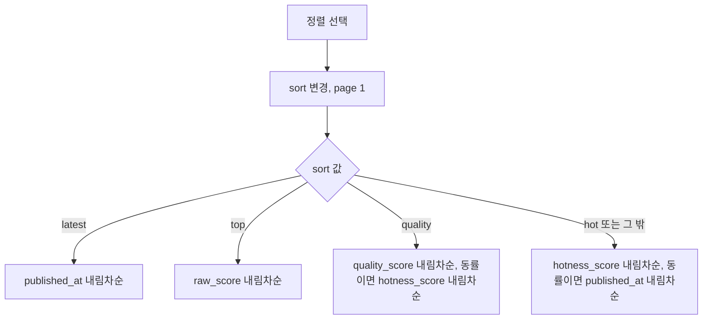

#### 4. 화면 표시 및 입력 데이터 항목 명세 (UI Data Elements - 8대 표준 컬럼)
| 항목명 | 화면 표시/입력 구분 | UI 컴포넌트 | 필수 여부 | 데이터 타입 / 제약 | 기본값 | 유효성 검증 규칙 (Validation) | 노출/수정 조건 |
| :--- | :---: | :--- | :---: | :--- | :---: | :--- | :--- |
| `sort` | 사용자 선택 | 선택 상자 (`<select>`, 숨긴 라벨 `정렬`) | 선택 | Enum `hot` 인기순, `quality` 품질순, `latest` 최신순, `top` 추천순 (표시 순서 그대로) | `hot` | backend 는 정의 밖 값을 `hot` 과 같게 정렬 | 모든 폭에서 목록 머리줄 오른쪽 끝, 상태 뒤, 카드 바로 위. 폭 `w-28`, 1280px 이상 `w-32`. 높이 768px 미만 44px, 이상 36px |

#### 5. 비즈니스 규칙 (Business Rules)
- **BR-NEWS-006-1 (정렬식)**: `latest` = `published_at` 내림차순. `top` = `raw_score` 내림차순. `quality` = `quality_score` 내림차순, 동률이면 `hotness_score` 내림차순. 그 밖의 모든 값(`hot` 포함) = `hotness_score` 내림차순, 동률이면 `published_at` 내림차순 (`backend/app/services/news_service.py:88-95`).
- **BR-NEWS-006-2 (page 리셋)**: 값을 바꾸면 `onSortChange` 후 page 1 (`FeedStatusBar` 가 둘 다 부른다).
- **BR-NEWS-006-3 (live 영역 밖)**: 정렬은 필터 영역 안에 없다. 상태 live 영역 밖의 뒤 형제라 정렬을 바꿔도 상태 알림으로 읽히지 않고, 페이지 이동 뒤 상태로 옮기는 포커스가 정렬 글자를 읽지 않는다.
- **BR-NEWS-006-4 (머리줄 맞춤)**: 머리줄은 위쪽 맞춤이고 상태의 최소 높이가 정렬 높이(768px 미만 44px, 이상 36px)와 같아, 한 줄일 때 상태 글자와 정렬의 세로 가운데가 같고, 필터 배지가 붙어 상태가 여러 줄이 되어도 정렬은 첫 줄 오른쪽에 남는다. 가로로 넘치지 않는다.

#### 6. 예외 처리 및 엣지 케이스 (Edge Cases & Exception Handling)
| 발생 상황 (Edge Case Scenario) | 화면 반응 및 시스템 처리 방식 | 사용자 안내 메시지 |
| :--- | :--- | :--- |
| `hot` 순위의 시간 경과 | `hotness_score` 는 수집·재수집 시점에만 계산·저장되고 다시 계산하지 않아 순위가 바뀌지 않는다 (옛 COLL-12) | (없음) |
| 북마크 보기 | 정렬이 적용되지 않고 북마크한 순서(최근 추가가 앞)로 보인다 | (없음) |
| 합성 점수 소스 | `top`·`hot` 정렬이 수집기가 넣은 합성 값에 좌우된다 (알려진 문제) | (없음) |

#### 7. 비즈니스 에러 코드 매핑
| 비즈니스 에러 코드 | 발생 사유 | HTTP 상태 코드 매핑 | 클라이언트 표시 형태 |
| :--- | :--- | :---: | :--- |
| 없음 | 목록 조회 실패 | FUNC-NEWS-001 과 같음 | FUNC-NEWS-001 과 같음 |

- 근거: `backend/app/services/news_service.py:88-95`, `frontend/src/components/feed/FeedStatusBar.tsx:5-10`, `:75-85`, `frontend/src/app/page.tsx:209-211`, `frontend/src/components/ui/Select.tsx`, 동작 확인 테스트 `frontend/src/tests/feed/FeedStatusBar.test.tsx`

---

### [FUNC-NEWS-007] 북마크

#### 1. 기본 정보
- **기능명**: 기사 스냅샷을 localStorage 에 보관하고 북마크 전용 보기로 본다
- **기능 ID**: `FUNC-NEWS-007`
- **대응 요구사항 ID**: `REQ-NEWS-005` (옛 기능명세 `NEWS-07`)
- **대상 화면 코드**: `SCR-NEWS-001`, `SCR-NEWS-002`
- **우선순위**: Should Have
- **관련 액터 (Actor)**: 피드 사용자 (브라우저 단위, 서버 계정 없음)
- **진입점**: 카드 머리줄 오른쪽 북마크 버튼, 상세 대화상자 머리줄 북마크 버튼, 포커스 카드에서 `b`, 소스 칩 `북마크`.

#### 2. 사전 조건 (Pre-conditions)
1. 브라우저 localStorage 를 쓸 수 있다 (못 쓰면 이 탭 메모리에만 둔다).

#### 3. 사용자 인터랙션 및 시스템 동작 흐름과 플로우차트
1. 사용자가 북마크 버튼을 누르거나 포커스 카드에서 `b` 를 누른다.
2. 이미 있으면 해당 id 를 빼고, 없으면 기사 객체 전체를 배열 맨 앞에 넣는다.
3. 즉시 localStorage `agentlens_bookmarks` 에 쓴다. 클릭 이벤트는 전파를 막아 카드가 열리지 않는다.
4. 소스 칩 `북마크` 를 고르면 요청 없이 저장 목록을 카테고리·검색어로 걸러 보인다.

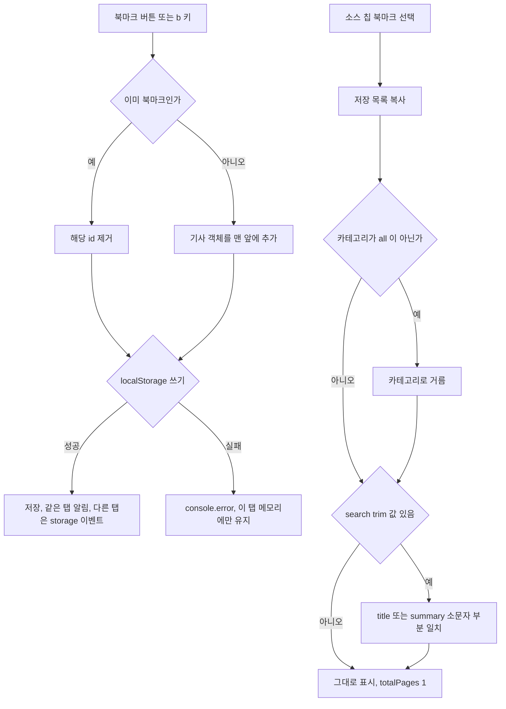

#### 4. 화면 표시 및 입력 데이터 항목 명세 (UI Data Elements - 8대 표준 컬럼)
| 항목명 | 화면 표시/입력 구분 | UI 컴포넌트 | 필수 여부 | 데이터 타입 / 제약 | 기본값 | 유효성 검증 규칙 (Validation) | 노출/수정 조건 |
| :--- | :---: | :--- | :---: | :--- | :---: | :--- | :--- |
| 카드 북마크 버튼 | 사용자 조작 | 아이콘 버튼 (접근 이름 `보관하기`, `aria-pressed`) | - | Button | 해제 | - | 카드 머리줄 오른쪽. 툴팁 `보관하기`/`보관됨`. 북마크면 아이콘이 호박색으로 채워진다 |
| 상세 북마크 버튼 | 사용자 조작 | 아이콘 버튼 (접근 이름 `보관하기`/`보관됨`) | - | Button | 해제 | - | 상세 머리줄. 북마크면 강조색으로 채워진다 |
| 저장값 | 시스템 저장 | localStorage `agentlens_bookmarks` | - | `NewsItem[]` JSON (최근 추가가 앞) | 빈 배열 | JSON 파싱 실패·배열 아님이면 빈 목록. 배열이면 숫자 `id` 와 문자열 `title` 을 가진 원소만 남긴다 (v0.4.2) | 서버에는 저장하지 않는다 |
| `북마크` 칩 건수 | 노출 전용 | 소스 칩 숫자 | - | Integer | 0 | 북마크 개수 | 상시 |
| `북마크 보기` 배지 | 노출 전용 | 목록 머리줄 Badge | - | - | - | - | 소스 = `bookmarks` |

#### 5. 비즈니스 규칙 (Business Rules)
- **BR-NEWS-007-1 (저장소)**: localStorage 키 `agentlens_bookmarks` 에 `NewsItem[]` JSON 을 저장한다. 서버에는 저장하지 않는다.
- **BR-NEWS-007-2 (읽기)**: 저장값을 외부 저장소로 두고 `useSyncExternalStore` 로 읽어 `bookmarkedItems` 와 `bookmarkedIds` 를 만든다. 서버 렌더·하이드레이션 중에는 빈 목록이고, 다른 탭의 변경은 `storage` 이벤트로 반영한다 (`frontend/src/hooks/useBookmarks.ts:6-88`).
- **BR-NEWS-007-6 (저장값 검증, v0.4.2)**: 저장값을 `JSON.parse` 한 결과가 배열이 아니면 북마크 0개로 보고, 배열이면 `id` 가 숫자이고 `title` 이 문자열인 원소만 북마크로 본다. 그래서 다른 탭·수동 편집·이전 형식의 값이 있어도 목록 렌더가 깨지지 않는다 (`frontend/src/hooks/useBookmarks.ts:44-60`). 인수 기준: 저장값이 `{}` 또는 `[1, {"id": "x"}, {"id": 3, "title": "t"}]` 이면 북마크는 각각 0개, 1개(id 3)다.
- **BR-NEWS-007-3 (토글)**: 이미 있으면 해당 id 를 제거, 없으면 배열 맨 앞에 추가하고 즉시 localStorage 에 쓴다. 이벤트가 넘어오면 `stopPropagation` 한다.
- **BR-NEWS-007-4 (북마크 보기)**: `source === 'bookmarks'` 면 API 호출 없이 `bookmarkedItems` 를 복사해 `category !== 'all'` 이면 카테고리로, `search.trim()` 이 있으면 `title`/`summary` 소문자 부분 일치로 거른다. `total = 길이`, `totalPages = 1`. 검색어는 디바운스 전 입력창 값을 바로 쓴다 (`frontend/src/hooks/useNewsFeed.ts:137-170`).
- **BR-NEWS-007-5 (스냅샷)**: 저장된 것은 추가 시점의 스냅샷이므로 DB 가 초기화되거나 기사 내용이 바뀌어도 그대로 남는다.

#### 6. 예외 처리 및 엣지 케이스 (Edge Cases & Exception Handling)
| 발생 상황 (Edge Case Scenario) | 화면 반응 및 시스템 처리 방식 | 사용자 안내 메시지 |
| :--- | :--- | :--- |
| localStorage 읽기 실패 | 빈 목록 | (없음) |
| 저장값 JSON 파싱 실패 | `console.error` 후 빈 목록 | (없음) |
| 저장값이 배열이 아니거나 형식이 다른 원소가 섞임 | 배열이 아니면 빈 목록, 형식이 맞지 않는 원소는 뺀다 (BR-NEWS-007-6) | (없음) |
| localStorage 쓰기 실패 | `console.error` 하고 이 탭 메모리에만 값을 둔다 | (없음) |
| 북마크 보기에서 정렬·Must-Read·페이지 | 적용되지 않는다 (Must-Read 배지는 붙는다) | (없음) |
| 북마크 보기 중 카테고리 칩 클릭 | source 가 `all` 로 바뀌어 북마크 보기가 해제된다 (FUNC-NEWS-002) | (없음) |
| 데이터 초기화 후 | 북마크는 지워지지 않고 서버 데이터와 어긋날 수 있다 | (없음) |

#### 7. 비즈니스 에러 코드 매핑
| 비즈니스 에러 코드 | 발생 사유 | HTTP 상태 코드 매핑 | 클라이언트 표시 형태 |
| :--- | :--- | :---: | :--- |
| 없음 | 서버 호출 없음 | - | 저장 실패도 화면에 알리지 않는다 (콘솔만) |

- 근거: `frontend/src/hooks/useBookmarks.ts:6-88`, `frontend/src/hooks/useNewsFeed.ts:137-170`, `frontend/src/components/NewsCard.tsx:128-138`, `frontend/src/components/NewsDetailModal.tsx:268-272`, `frontend/src/components/feed/FeedToolbar.tsx:181-189`

---

### [FUNC-NEWS-008] 기사 카드

#### 1. 기본 정보
- **기능명**: 고정 틀 카드 (머리줄, 제목 2줄, 시사점 또는 요약 2줄, 배지 줄, 바닥 통계·버튼)
- **기능 ID**: `FUNC-NEWS-008`
- **대응 요구사항 ID**: `REQ-NEWS-003` (옛 기능명세 `NEWS-08`)
- **대상 화면 코드**: `SCR-NEWS-001` (카드 그리드)
- **우선순위**: Must Have
- **관련 액터 (Actor)**: 피드 사용자
- **진입점**: 피드 그리드의 각 카드(`article`, `data-feed-card`). 카드 전체 클릭 또는 제목 버튼(`h3` 안 `<button>`, Tab 으로 닿고 Enter·Space 로 누른다)으로 상세 대화상자를 연다.

#### 2. 사전 조건 (Pre-conditions)
1. FUNC-NEWS-001 이 1건 이상을 돌려줬거나 북마크 보기에 항목이 있다.
2. 입력: `item`, `isBookmarked`, `isFocused`, `preferSummary`(기본 false).

#### 3. 사용자 인터랙션 및 시스템 동작 흐름과 플로우차트
1. 화면은 지금 목록에서 같은 시사점이 반복되는 기사를 찾아 그 카드에 `preferSummary` 를 넘긴다.
2. 카드는 다섯 칸을 위에서 아래로 그린다.
3. 사용자가 카드나 제목을 누르면 상세 대화상자(FUNC-NEWS-009)를 연다. 북마크 버튼·`AI 챗에서 분석`·`원문` 은 전파를 막아 상세가 열리지 않는다.

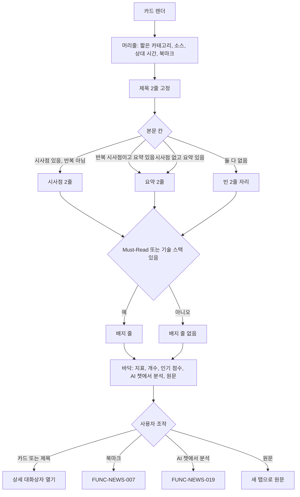

#### 4. 화면 표시 및 입력 데이터 항목 명세 (UI Data Elements - 8대 표준 컬럼)
| 항목명 | 화면 표시/입력 구분 | UI 컴포넌트 | 필수 여부 | 데이터 타입 / 제약 | 기본값 | 유효성 검증 규칙 (Validation) | 노출/수정 조건 |
| :--- | :---: | :--- | :---: | :--- | :---: | :--- | :--- |
| 짧은 카테고리 | 노출 전용 | 머리줄 굵은 글자 (`title` 에 긴 라벨) | 필수 | `harness`→`하네스`, `mcp_plugins_skills`→`MCP`, `agent_tech`→`에이전트`, `ai_news`→`AI 동향`, 그 외 원값 | - | `categoryShortLabel`. 짧은 라벨은 모두 긴 라벨의 일부 | 상시 (예: `에이전트` 의 `title` `에이전트 아키텍처`) |
| 소스 | 노출 전용 | 머리줄 글자 | 필수 | `rss_kr`→`국내 테크`, `github`→`GitHub`, `hackernews`→`HackerNews`, `arxiv`→`arXiv`, `huggingface`→`HuggingFace`, `reddit`→`Reddit`, `rss`→`Global Blogs`, 그 외 원값 | - | `sourceLabel` | 상시 |
| 상대 시간 | 노출 전용 | `<time>` | 필수 | `published_at` 기준. 3600초 미만 `N분 전`(최소 1), 86400초 미만 `N시간 전`, 그 외 `N일 전` | - | 날짜 파싱 예외 시 빈 문자열 | 현재 시각은 60초마다 갱신되는 공유 시계 |
| 제목 | 사용자 조작 | `h3 > button` | 필수 | String | - | 2줄 말줄임, 높이 2줄(48px) 고정. 한 줄 제목도 2줄 자리 | 상시 |
| 본문 | 노출 전용 | 2줄 문단 | - | 시사점(왼쪽 강조선 + 앞머리 굵은 `시사점`) 또는 요약 | 빈 2줄 자리 | 반복 시사점 규칙 (BR-3) | 2줄 말줄임, 높이 2줄 고정 |
| Must-Read 배지 | 노출 전용 | Badge (채운 별) | - | - | - | `is_high_signal` | 줄지 않는다 |
| 기술 배지 | 노출 전용 | Badge × 최대 3 | - | `tech_stack` 앞 3개 | - | 각 48px(`min-w-12`)~128px(`max-w-32`) 사이. 자리가 있으면 글자 폭 그대로(128px 넘는 이름은 128px 에서 말줄임), 모자라면 48px 까지 줄고 말줄임. 글자 폭이 48px 보다 좁은 짧은 이름도 `min-w-12` 때문에 배지는 48px 다. `title` 에 전체 이름 | 배지 줄은 Must-Read 이거나 기술 스택이 있을 때만, 한 줄 |
| 원천 지표 | 노출 전용 | 아이콘 + 천 단위 숫자 | - | `github` 스타(`Star`), `hackernews` 포인트·`reddit` 추천(`ArrowBigUp`) | - | `raw_score > 0` | 지표 소스만. 화면 읽기 `스타`·`포인트`·`추천`, 툴팁 `GitHub 스타`·`HackerNews 포인트`·`Reddit 추천` |
| 개수 | 노출 전용 | 아이콘 + 숫자 | - | `github` 포크(`GitFork`, 화면 읽기 `포크`, 툴팁 `GitHub 포크`), 그 밖 댓글(`MessageSquare`, 화면 읽기·툴팁 `댓글`) | - | `comments_count > 0` | 조건 충족 시 |
| 인기 점수 | 노출 전용 | 불꽃 아이콘 + 반올림 숫자 (화면 읽기 `인기 점수`) | - | `hotness_score` | - | 지표 소스(`scoreMetric(source) !== null`)이고 `hotness_score > 25` | 조건 충족 시 |
| `AI 챗에서 분석` | 사용자 조작 | 고스트 버튼 (접근 이름 = 보이는 글자, 툴팁 `AI 챗에서 이 기사를 단일 기사 모드로 분석`) | - | Button | - | FUNC-NEWS-019 | 모든 폭에서 글자 보임. 768px 미만 높이 44px |
| `원문` | 사용자 조작 | 링크 (새 탭, 화면 읽기 `(새 탭)`) | - | `url` | - | 클릭 전파 차단 | 768px 미만 높이 44px |
| 포커스 링 | 노출 전용 | 강조색 링, `data-focused="true"` | - | - | - | - | `isFocused` (j/k, FUNC-UI-006) |
| `quality_score` | (표시 안 함) | - | - | - | - | - | 카드에 숫자를 표시하지 않는다 |

#### 5. 비즈니스 규칙 (Business Rules)
- **BR-NEWS-008-1 (고정 틀)**: 카드는 위에서 아래로 다섯 칸의 고정 틀이다 (`h-full flex flex-col gap-3`). 그리드는 `items-stretch` 라 같은 줄의 카드는 가장 높은 카드에 맞춰 같은 높이가 되고, 칸 높이가 고정이라 같은 줄 카드의 제목·본문 위치가 맞는다.
- **BR-NEWS-008-2 (머리줄)**: `data-card-meta`, 한 줄, 높이 768px 미만 44px·이상 32px. 왼쪽에 `카테고리 짧은 라벨 · 소스 · 상대 시간` 을 한 줄로 쓰고 넘치면 말줄임한다. 오른쪽에 북마크 버튼(세로 가운데). 머리줄에는 배지를 두지 않는다. 챗 기사 칩·인용 팝오버·포커스 캡슐도 같은 짧은 라벨을 쓰고, 필터 칩·상세 대화상자도 같은 소스 라벨을 쓴다.
- **BR-NEWS-008-3 (반복 시사점)**: 피드 화면은 지금 목록(`news`)에서 같은 시사점이 반복되는 기사를 찾는다 (`lib/feed-insights.ts` `findRepeatedInsights`). `why_it_matters` 를 공백 정리(연속 공백을 하나로, 앞뒤 제거)한 문자열의 끝 40자(코드 포인트 단위)를 키로 세어, 정리한 길이가 20자 이상이고 같은 키가 2번 이상 나온 기사가 대상이다. 끝을 보는 이유: v0.4.1 까지 backend 가 기술 이름 접두를 붙인 같은 고정 문장을 저장했기 때문이다. v0.4.2 부터 backend 는 LLM 시사점이 없으면 `why_it_matters` 를 빈 값으로 저장해(FUNC-COLL-014) 새로 수집한 기사에는 고정 문장이 없지만, 기존 DB 행의 시사점은 마이그레이션이 고치지 않아 `make reset` 전까지 남는다. `preferSummary` 이고 `summary` 가 있으면 시사점 대신 요약을 보인다. 요약이 없으면 시사점을 그대로 보인다.
- **BR-NEWS-008-4 (배지 수)**: 카드당 배지는 최대 4개(Must-Read 1 + 기술 3). 자리가 모자라면 기술 배지끼리 줄어든다 (`Badge shrink` 는 `shrink-0` 대신 `shrink` 를 붙이고 폭 한계는 `min-w-12 max-w-32` 가 정한다, `frontend/src/components/ui/Badge.tsx:18-31`, `frontend/src/components/NewsCard.tsx:172-176`). "Must-Read" 배지는 줄지 않는다. 옛 기능명세는 '짧은 이름은 글자 폭 그대로다' 라고 적었으나, 글자 폭이 48px 보다 좁으면 `min-w-12` 로 48px 가 된다 (코드 읽기 기준, 화면 측정은 하지 않았다). 그래서 가장 좁은 카드(1024~1279px 3열, 안쪽 약 266px)에서도 Must-Read 와 긴 기술 3개가 글자 중간에서 잘리지 않고 한 줄에 든다. 줄의 `overflow-hidden` 은 계산이 어긋날 때 카드 밖으로 밀리지 않게 하는 안전장치다. 3개 넘는 기술과 잘린 이름 전체는 상세 대화상자의 기술 목록에서 본다 (카드에 `+N`·펼침 없음).
- **BR-NEWS-008-5 (원천 지표 소스 한정)**: 원천 지표는 소스가 실제 지표를 주는 `github`·`hackernews`·`reddit` 만 그린다. 그 밖 소스(`rss_kr`·`rss`·`arxiv`·`huggingface`, 모르는 소스)는 `raw_score` 가 0 보다 커도 그리지 않는다 (수집기가 넣는 고정·합성 값이라 정보가 아니다, 옛 COLL-03~07). 인기 점수도 `raw_score` 에서 계산되므로(옛 COLL-12) 지표 소스에서만 그린다. 그래서 지표 없는 소스의 카드 바닥 통계는 비거나 댓글 수만 남는다.
- **BR-NEWS-008-6 (지표 표)**: 지표 종류와 라벨은 `lib/labels.ts` 의 `scoreMetric(source)`(표에 없으면 `null`, 원천 지표와 인기 점수 둘 다의 표시 조건)·`countMetric(source)`·`SCORE_METRIC_LABELS`·`COUNT_METRIC_LABELS` 에서 나온다. 카드에 `data-source`, 통계마다 `data-card-stat`(`score`·`count`·`hotness`)과 `data-metric`(`stars`·`points`·`upvotes`·`forks`·`comments`, 인기 제외)을 둔다. 별 아이콘은 GitHub 스타와 Must-Read 배지(채운 별)에만 쓴다.
- **BR-NEWS-008-7 (바닥 줄바꿈)**: 바닥(구분선 위, 카드 맨 아래)은 왼쪽 통계 묶음(원천 지표, 개수, 인기 점수 순)과 오른쪽 버튼 묶음이다. 줄바꿈(`flex-wrap`)하고 버튼 묶음은 `ml-auto` 라, 한 줄에 다 들지 않으면(예: 통계가 긴 GitHub 카드) 버튼 묶음이 다음 줄 오른쪽 끝으로 내려간다. 같은 줄 카드는 높이가 같고 바닥이 카드 아래에 붙으므로, 한 줄 바닥 카드와 두 줄 바닥 카드가 같은 줄에 섞일 수 있다.
- **BR-NEWS-008-8 (스켈레톤)**: 로딩 중 스켈레톤은 같은 틀(머리줄, 제목 2줄, 본문 2줄, 바닥)과 같은 높이 클래스를 써서 카드로 바뀔 때 높이가 흔들리지 않는다.

#### 6. 예외 처리 및 엣지 케이스 (Edge Cases & Exception Handling)
| 발생 상황 (Edge Case Scenario) | 화면 반응 및 시스템 처리 방식 | 사용자 안내 메시지 |
| :--- | :--- | :--- |
| `published_at` 파싱 예외 | 상대 시간을 빈 문자열로 | (없음) |
| 북마크 보기 | 반복 시사점 판정은 지금 보이는 목록으로 한다 | (없음) |
| 지표 소스의 인기 점수 | v0.4.2 부터 `min(100, 20·log10(1+hotness))` 라 지표가 큰 기사만 100 에 닿는다 (FUNC-COLL-013). 기존 DB 행도 스키마 마이그레이션 3 이 새 식으로 다시 계산한다(기준 시각은 수집 시각) | (없음) |
| GitHub 원천 지표 | v0.4.2 부터 폴백 `stars_hint`·합성 포크 수를 쓰지 않는다. 감시 저장소는 API 실제 값이 있을 때만 저장하고 없으면 건너뛴다 (FUNC-COLL-006). 옛 폴백 행은 마이그레이션 3 이 지표를 0 으로 바꿔 카드에 스타가 보이지 않는다 | (없음) |

#### 7. 비즈니스 에러 코드 매핑
| 비즈니스 에러 코드 | 발생 사유 | HTTP 상태 코드 매핑 | 클라이언트 표시 형태 |
| :--- | :--- | :---: | :--- |
| 없음 | 카드는 서버를 부르지 않는다 | - | - |

- 근거: `frontend/src/components/NewsCard.tsx:32-78`, `:80-238`, `:89-100`, `:115-178`, `:180-235`, `frontend/src/components/ui/Badge.tsx`, `frontend/src/components/feed/NewsCardSkeleton.tsx`, `frontend/src/lib/feed-insights.ts:1-34`, `frontend/src/app/page.tsx:71-72`, `:235-250`, `frontend/src/components/chat/HandoverCtaButton.tsx:67-79`, `frontend/src/lib/labels.ts:15-27`, `:51-70`, `:84-119`, 동작 확인 테스트 `frontend/src/tests/NewsCard.test.tsx`, `frontend/src/tests/feed/FeedInsights.test.ts`

---

### [FUNC-NEWS-009] 기사 상세 대화상자

#### 1. 기본 정보
- **기능명**: `AI 요약 & 시사점` 탭(시사점, 규칙 기반 핵심 정리, 기술 스택, 본문 요약 마크다운)과 `AI 질의응답` 탭을 담은 대화상자
- **기능 ID**: `FUNC-NEWS-009`
- **대응 요구사항 ID**: `REQ-NEWS-003` (옛 기능명세 `NEWS-09`)
- **대상 화면 코드**: `SCR-NEWS-002`
- **우선순위**: Must Have
- **관련 액터 (Actor)**: 피드 사용자
- **진입점**: 카드 클릭, 카드 제목 버튼, 포커스 카드에서 `Enter`/`Space`(포커스가 `document.body` 에 있을 때, FUNC-NEWS-016).

#### 2. 사전 조건 (Pre-conditions)
1. 피드 목록(또는 북마크 목록)에 기사가 있다.
2. 입력은 선택된 `NewsItem` 이다. 피드 목록의 객체를 그대로 쓰고 상세 API 를 다시 부르지 않는다.

#### 3. 사용자 인터랙션 및 시스템 동작 흐름과 플로우차트
1. 사용자가 카드를 연다. 대화상자는 `key = news-modal-{id}` 로 렌더링되어 기사마다 새로 마운트된다.
2. 기본 탭 `AI 요약 & 시사점` 을 보인다.
3. 사용자는 탭을 바꾸거나, 북마크, `AI 챗에서 분석`, `원문 링크 방문`, 닫기를 한다.
4. 닫으면 진행 중 스트림을 abort 하고 탭·대화·입력·복사 표시(타이머 포함)·확인 창 상태를 초기화한다. 연 요소로 포커스가 돌아간다.

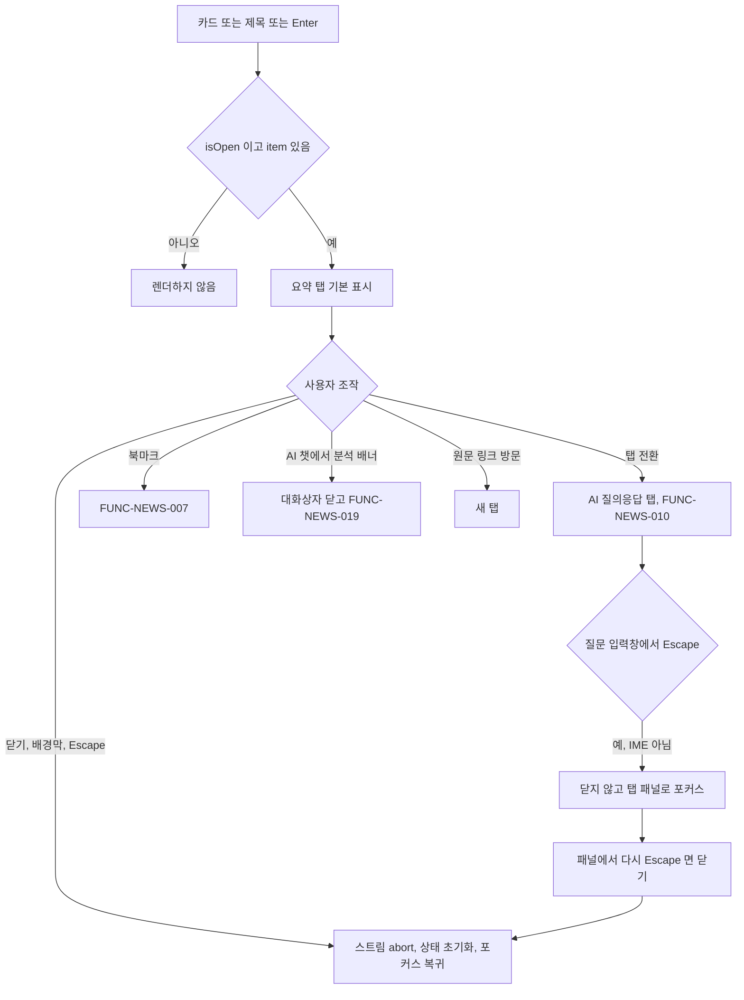

#### 4. 화면 표시 및 입력 데이터 항목 명세 (UI Data Elements - 8대 표준 컬럼)
| 항목명 | 화면 표시/입력 구분 | UI 컴포넌트 | 필수 여부 | 데이터 타입 / 제약 | 기본값 | 유효성 검증 규칙 (Validation) | 노출/수정 조건 |
| :--- | :---: | :--- | :---: | :--- | :---: | :--- | :--- |
| 카테고리 배지 | 노출 전용 | Badge | 필수 | 긴 라벨 (`categoryLabel`, 예: `하네스 & 벤치마크`, 필터 칩과 같은 문구) | - | - | 상시 |
| Must-Read 배지 | 노출 전용 | Badge (채운 별) | - | - | - | `is_high_signal` | 조건 충족 시 |
| 제목 | 노출 전용 | `h2` (대화상자의 `aria-labelledby`) | 필수 | String | - | 2줄 말줄임 | 상시 |
| 북마크 | 사용자 조작 | 아이콘 버튼 `보관하기`/`보관됨` | - | - | - | - | 상시 |
| 닫기 | 사용자 조작 | 아이콘 버튼 `닫기` | - | - | - | - | 상시 |
| 탭 | 사용자 선택 | 탭 목록 (`aria-label="기사 보기"`) | 필수 | `AI 요약 & 시사점`(기본), `AI 질의응답`(대화가 있으면 건수 배지) | `AI 요약 & 시사점` | - | 상시 |
| `개발자 시사점` | 노출 전용 | 제목 + 강조 문단 | - | `why_it_matters` | - | - | 값이 있을 때 |
| `AI 챗에서 분석` 배너 | 사용자 조작 | 배너 버튼 (보조 문구 `이 기사를 단일 기사 모드로 열어 질의응답`) | - | - | - | FUNC-NEWS-019 | 요약 탭, 시사점 다음 |
| `핵심 정리 (규칙 기반 자동 추출)` | 노출 전용 | 제목 + 목록 | - | `tldr_bullets[]` (수집 때 규칙으로 만든 최대 3줄, LLM 요약 아님) | - | - | 배열이 비어 있지 않을 때. 제목 문구는 v0.4.2 에서 `핵심 요약 3줄` 에서 바뀌었다 (`frontend/src/components/NewsDetailModal.tsx:338`) |
| `기술 스택` | 노출 전용 | Badge 목록 (전체) | - | `tech_stack[]` | - | - | 배열이 비어 있지 않을 때 |
| `상세 본문 요약` | 노출 전용 | 마크다운 (FUNC-UI-012) | - | `summary` | - | 빈 값이면 그리지 않음 | 값이 있을 때 |
| 출처 | 노출 전용 | 바닥 글자 `출처: {소스 라벨}` | 필수 | `sourceLabel` | - | - | 상시 |
| 작성자 | 노출 전용 | 바닥 글자 `by {author}` | - | `author` | - | - | 값이 있고 768px 이상 |
| `원문 링크 방문` | 사용자 조작 | 주 버튼 모양 링크 (새 탭) | 필수 | `url` | - | - | 상시 |

#### 5. 비즈니스 규칙 (Business Rules)
- **BR-NEWS-009-1 (요약 탭 순서)**: `개발자 시사점` → `AI 챗에서 분석` 배너 → `핵심 정리 (규칙 기반 자동 추출)` → `기술 스택` → `상세 본문 요약`.
- **BR-NEWS-009-2 (닫기 수단)**: 닫기 버튼, 배경막 클릭, `Escape`(오버레이 스택이 맨 위 레이어만 닫는다). 질의응답 탭 질문 입력창 안의 Escape 는 닫지 않는다 (FUNC-NEWS-010 BR-10).
- **BR-NEWS-009-3 (초기화)**: 닫을 때 진행 중 스트림을 abort 하고 탭·대화·입력·복사 표시(타이머 포함)·확인 창 상태를 초기화한다. 닫혀 있는 동안 `isOpen` 이나 기사 id 가 바뀔 때도 같은 초기화를 하고, 언마운트 때 스트림과 복사 타이머를 정리한다 (`frontend/src/components/NewsDetailModal.tsx:62-117`).
- **BR-NEWS-009-4 (대화상자 규격)**: 크기 `xl`: 768px 이상 너비 896px·높이 최대 85dvh, 768px 미만 전체 화면. `role="dialog"`, `aria-modal="true"`, 포커스 트랩, 닫으면 연 요소로 포커스 복귀 (FUNC-UI-008).

#### 6. 예외 처리 및 엣지 케이스 (Edge Cases & Exception Handling)
| 발생 상황 (Edge Case Scenario) | 화면 반응 및 시스템 처리 방식 | 사용자 안내 메시지 |
| :--- | :--- | :--- |
| `isOpen` 이 false 거나 `item` 이 null | 렌더링하지 않는다 | (없음) |
| 대화상자를 닫음 | 대화 내역은 메모리에만 있어 사라진다 | (없음) |
| 시사점·요약·기술 스택이 모두 없음 | 배너만 보인다 | (없음) |
| 시사점 없음 | v0.4.2 부터 LLM 시사점이 없는 새 기사는 `why_it_matters` 가 빈 값이라 `개발자 시사점` 칸을 그리지 않는다. v0.4.1 까지 저장된 고정 문장은 `make reset` 전까지 그대로 보인다 | (없음) |

#### 7. 비즈니스 에러 코드 매핑
| 비즈니스 에러 코드 | 발생 사유 | HTTP 상태 코드 매핑 | 클라이언트 표시 형태 |
| :--- | :--- | :---: | :--- |
| 없음 | 요약 탭은 서버를 부르지 않는다 | - | - |

- 근거: `frontend/src/components/NewsDetailModal.tsx:35-413`, `frontend/src/components/MarkdownViewer.tsx:27-134`, `frontend/src/components/ui/Dialog.tsx`, `frontend/src/app/page.tsx:102-105`, `:276-283`

---

### [FUNC-NEWS-010] 기사 단위 AI 질문 (스트리밍)

#### 1. 기본 정보
- **기능명**: 상세 대화상자 `AI 질의응답` 탭에서 기사 맥락으로 질문하고 SSE 로 토큰을 받는다
- **기능 ID**: `FUNC-NEWS-010`
- **대응 요구사항 ID**: `REQ-NEWS-004` (옛 기능명세 `NEWS-10`)
- **대상 화면 코드**: `SCR-NEWS-002` (`AI 질의응답` 탭)
- **우선순위**: Must Have
- **관련 액터 (Actor)**: 피드 사용자, LLM 프로바이더 (Anthropic, OpenAI), 휴리스틱 엔진
- **진입점**: 상세 대화상자 `AI 질의응답` 탭. 바닥 고정 입력창 + `전송`, 빠른 질문 칩 4개. API `POST /api/news/{news_id}/ask/stream`.

#### 2. 사전 조건 (Pre-conditions)
1. 기사 상세 대화상자가 열려 있다.
2. 질문이 trim 후 비어 있지 않고, 이미 질문 중이 아니다.
3. LLM 키가 없어도 동작한다 (휴리스틱 답).

#### 3. 사용자 인터랙션 및 시스템 동작 흐름과 플로우차트
1. 사용자가 질문을 입력해 전송하거나 빠른 질문을 누른다.
2. 이전 요청의 AbortController 가 있으면 abort 하고 새로 만든다. 입력을 비우고 `asking=true`, 탭을 `AI 질의응답` 으로 바꾼다.
3. 대화 내역에 `{ q, a: '', time: ko-KR 시:분, isStreaming: true }` 를 추가한다 (모델명은 비워 둔다. 엔진 이름을 지어내지 않는다).
4. `NEXT_PUBLIC_API_URL` 이 있으면 그 주소로, 없으면 같은 출처 `/api/...`(Next rewrite → `INTERNAL_API_URL`)로 POST 한다. 직접 주소가 같은 출처와 다를 때만, 네트워크 예외(중단·시간 초과 제외)면 같은 출처로 한 번 더 시도한다. 첫 응답은 30,000ms 까지 기다리고, 넘으면 "응답이 늦어 요청을 멈췄습니다. 다시 시도해 주세요." 로 실패하며 대체 경로로 다시 보내지 않는다. 연결 자체가 실패하면 브라우저 원문(`Failed to fetch` 등) 대신 "서버에 연결하지 못했습니다. 연결 상태를 확인하고 다시 시도해 주세요." 로 실패한다. 사용자 중단은 그대로 중단이다 (v0.4.2, `frontend/src/lib/api.ts:125-170`).
5. backend 는 캐시 → Anthropic → OpenAI → 휴리스틱 순으로 답을 만들어 `meta`·`token`·`done` 이벤트로 보낸다. 토큰을 보낸 뒤 실패하면 `done` 대신 `error` 이벤트로 끝낸다.
6. 화면은 `meta` 로 모델명을 바꾸고 `token` 을 이어붙인다. `done` 을 받아야 완료(`isStreaming=false`)다. `error` 이벤트를 받거나 `done` 없이 끝나면 받은 부분 답을 그대로 두고 그 아래에 오류 알림과 `다시 시도` 를 보인다. 어느 경우든 끝나면 `asking=false`.
7. `다시 시도` 를 누르면 실패한 대화 항목을 지우고 같은 질문을 새로 보낸다.

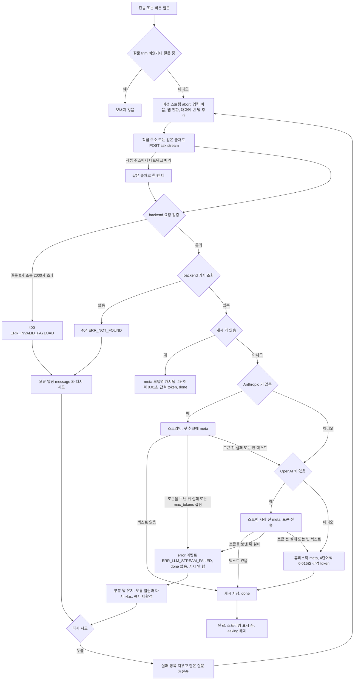

#### 4. 화면 표시 및 입력 데이터 항목 명세 (UI Data Elements - 8대 표준 컬럼)
| 항목명 | 화면 표시/입력 구분 | UI 컴포넌트 | 필수 여부 | 데이터 타입 / 제약 | 기본값 | 유효성 검증 규칙 (Validation) | 노출/수정 조건 |
| :--- | :---: | :--- | :---: | :--- | :---: | :--- | :--- |
| 탭 머리줄 | 노출 전용 | 제목 `Deep-Dive AI 대화형 질의응답` + 성공 톤 배지 | - | 배지: 대화 중 마지막으로 받은 `meta` 모델이 있으면 `응답 엔진: {모델}`, 없으면(질문 전 포함) `실시간 스트리밍` | `실시간 스트리밍` | - | 상시. v0.4.2 에서 `Gemini 실시간 스트리밍 가동` 고정 문구를 바꿨다 (`frontend/src/components/news-detail/AskAiPanel.tsx:90-91`, `:115`) |
| `대화 초기화` | 사용자 조작 | 고스트 버튼 → 확인 창 | - | - | - | 확인 창 제목 `대화 초기화`, 설명 `AI 대화 내역을 모두 초기화하시겠습니까?`, 버튼 `취소`/`초기화`, 위험 톤 | 대화가 있을 때만 |
| 빠른 질문 | 사용자 조작 | 버튼 4개 (`aria-label="빠른 질문"` 그룹, 한 줄 가로 스크롤) | - | `핵심 원리 및 구조`(`Cpu`), `실무 프로젝트 도입`(`Layers`), `차별점 및 한계`(`Sparkles`), `보안 및 샌드박스`(`ShieldCheck`). 아이콘은 `aria-hidden` | - | 누르면 각 고정 질문문을 보낸다 (BR-2) | 상시. 질문 중 비활성. 768px 미만 좌우 화면 끝까지, 넘침 표시는 FUNC-NEWS-002 BR-4 와 같다 |
| `question` | 사용자 입력 | 텍스트 입력 (숨긴 라벨 `질문 입력`, 자리표시 `이 기사에 대해 질문하세요`, `enterKeyHint="send"`) | 필수 | String. 화면 입력 길이 제한 없음, backend 1~2000자 | `''` | 전송 전 trim 후 비면 보내지 않음. 2000자 초과는 backend 가 400 `ERR_INVALID_PAYLOAD` | 질문 중 비활성 |
| `전송` | 사용자 조작 | 주 버튼 | - | Submit | - | `!question.trim()` 이면 비활성 | 질문 중에는 진행 표시 |
| 안내 (대화 없음) | 노출 전용 | 가운데 안내 | - | 제목 `이 소식에 대해 무엇이든 질문해보세요`, 설명 `단순 요약이 아닌, 실무 아키텍처 연동 방법, 다른 프레임워크와의 차이점, 하네스 격리 및 보안 주의사항까지 기사 맥락을 바탕으로 전문 분석을 제공합니다.` | - | - | 대화가 0건 |
| 질문 말풍선 | 노출 전용 | 오른쪽 말풍선 | - | `q`, `time` | - | - | 대화마다 |
| 답변 모델명 | 노출 전용 | 답변 머리줄 | - | `c.model`(받은 `meta`), 없으면 `AgentLens AI` | `AgentLens AI` | - | 대화마다 |
| 답변 본문 | 노출 전용 | 마크다운 + 깜빡이는 커서 | - | `a` | - | - | 스트리밍 중 내용이 없으면 스피너 + `AI가 실시간 스트리밍 답변을 생성하는 중입니다...`. 실패했고 받은 답이 없으면 본문 없이 오류 알림만 |
| 답변 오류 알림 | 노출 전용 | `InlineAlert`(danger) | - | `c.error`: backend `message`(예: `답변 생성이 중간에 끊겼습니다. 다시 시도해 주세요.`, `기사를 찾을 수 없습니다.`), 응답 본문이 오류 형식이 아니면 `AI 스트리밍 연결 실패 ({status})`, 연결 자체가 실패하면 `서버에 연결하지 못했습니다. 연결 상태를 확인하고 다시 시도해 주세요.`, 첫 응답 30초 초과면 `응답이 늦어 요청을 멈췄습니다. 다시 시도해 주세요.`, 예외 문구가 비면 `AI 응답 생성에 실패했습니다. 네트워크 상태를 확인해주세요.` | - | - | 그 답이 실패했을 때 부분 답 아래 (v0.4.2) |
| `다시 시도` | 사용자 조작 | 보조 버튼 (접근 이름 `답변 다시 시도`) | - | Button | - | 질문 중이면 비활성 | 오류 알림 안 (v0.4.2) |
| 답변 복사 | 사용자 조작 | 고스트 버튼 (`title="답변 복사"`) | - | `복사` / `복사됨` / `복사 실패` | `복사` | 스트리밍 중이거나 빈 답이거나 실패한 답이면 비활성 | 성공 2초 체크 + `복사됨`, 실패 2초 경고 아이콘 + `복사 실패`(위험 색), 실패 문구는 `aria-live="polite"` 영역에도 (FUNC-UI-013) |

#### 5. 비즈니스 규칙 (Business Rules)
- **BR-NEWS-010-1 (요청 본문)**: `{ "question": string }` (`AskQuestionRequest`). backend 는 길이 1~2000자를 검증하고(챗과 같은 한도), 위반이면 400 `ERR_INVALID_PAYLOAD` 다. 공백만 있는 질문은 막지 않는다 (`backend/app/schemas/news.py:45-47`).
- **BR-NEWS-010-2 (빠른 질문문)**: `핵심 원리 및 구조` → `이 기술의 핵심 동작 원리와 아키텍처 구조를 구체적으로 설명해줘`, `실무 프로젝트 도입` → `우리 개발 프로젝트와 워크플로우에 이 기술을 어떻게 도입/적용할 수 있어?`, `차별점 및 한계` → `기존의 유사 기술이나 방식과 비교했을 때 차별점, 장점, 한계점은 뭐야?`, `보안 및 샌드박스` → `자율 에이전트 도입 시 보안 격리나 샌드박스 관점에서 검토해야 할 점은?` (`frontend/src/components/news-detail/AskAiPanel.tsx:49-70`).
- **BR-NEWS-010-3 (캐시)**: 캐시 키 `"{title.strip()}:{question.strip().lower()}"`. 메모리 캐시(`_qa_cache`, 최대 1000개·6시간 만료, 가장 오래 안 쓴 것부터 버림, `reset-and-collect` 가 비움, `backend/app/services/llm_processor.py:172`, `:177-181`)에 있으면 `meta`(모델명 + ` (캐시됨)`) 후 답을 공백 기준 4단어씩 `token` 으로 0.01초 간격 전송, 마지막에 `done`.
- **BR-NEWS-010-4 (프롬프트)**: 캐시가 없으면 `수석 아키텍트` 역할의 한국어 마크다운 프롬프트를 만든다 (기사 제목·내용·분류·기술 스택(없으면 `AI / Agent Framework`)·질문, 작성 가이드 4개 항목).
- **BR-NEWS-010-5 (1순위 Anthropic)**: API 키가 있으면 `stream_chat` 으로 스트리밍. 첫 청크에서 `meta`(모델 id), 이후 `token`. 누적 텍스트가 비어 있지 않으면 성공. 토큰을 하나라도 보낸 뒤 예외가 나면(Anthropic 스트림 `error` 이벤트, `stop_reason == "max_tokens"` 잘림 포함) 다음 엔진으로 넘어가지 않고 마지막 이벤트로 `{"event": "error", "error_code": "ERR_LLM_STREAM_FAILED", "message": "답변 생성이 중간에 끊겼습니다. 다시 시도해 주세요.", "retryable": true}` 를 보낸다. `done` 은 보내지 않고 캐시하지 않는다. 예외 문자열은 싣지 않는다. 토큰 전 실패일 때만 다음 엔진으로 넘어간다 (`backend/app/services/llm_processor.py:135-141`, `:926-946`, `backend/app/services/llm_providers/anthropic_provider.py`).
- **BR-NEWS-010-6 (2순위 OpenAI)**: 1순위가 성공하지 않았고 OpenAI 키가 있으면 공식 SDK 스트리밍(`OPENAI_MODEL`, 기본 `gpt-4o-mini`, temperature 0.3, max_tokens 2048). 스트림 시작 전에 `meta`(`OpenAI {모델}`)를 보낸다. 누적 텍스트가 있는 상태에서 예외가 나면 1순위와 같이 `error` 이벤트로 끝낸다 (`llm_processor.py:950-979`). OpenAI 스트림은 잘림(`finish_reason`)을 보지 않는다.
- **BR-NEWS-010-7 (3순위 휴리스틱)**: 둘 다 토큰 전에 실패하거나 텍스트가 비면 고정 템플릿 답을 `meta`(`AgentLens Heuristic Engine`) 후 4단어씩 0.015초 간격 전송. 템플릿 답에는 그림 이모지가 없다(v0.4.2). 도입·비교·원리 템플릿과 일반 분석 템플릿은 카테고리별 고정 문장(`CATEGORY_INSIGHTS`)을 `기대 효과`·`시사점`·`핵심 요약`·`엔지니어링 가치` 줄에 넣는다 (`llm_processor.py:820-879`). 템플릿은 질문 소문자의 키워드로 순서대로 고른다: `적용/도입/사용/구현/어떻게/how/apply/build` → 도입 가이드, `차이/비교/장점/단점/한계/vs/difference/compare` → 비교, `원리/구조/아키텍처/동작/왜/why/architecture` → 원리, `보안/격리/안전/안정/security/sandbox/safety` → 보안, 그 외 → 일반 분석. 이 경로에는 Ollama·Gemini 가 없다.
- **BR-NEWS-010-8 (완료)**: 성공(또는 휴리스틱)으로 끝나 최종 텍스트가 있으면 캐시에 저장하고 `done`(`total_text`)을 보낸다. 모델명은 `sanitize_model_identifier` 를 거친다 (`llm_processor.py:1003-1005`).
- **BR-NEWS-010-9 (SSE 형식, v0.4.2)**: `text/event-stream`, 헤더 `Cache-Control: no-cache, no-transform`(프록시가 gzip 으로 묶어 토큰을 버퍼링하지 않게), `Connection: keep-alive`, `X-Accel-Buffering: no`. 각 이벤트는 `data: {json}\n\n` 한 줄이며 이벤트 종류는 SSE `event:` 필드가 아니라 JSON 의 `event` 키(`meta`/`token`/`done`/`error`)로 구분한다. 정상 종료는 `done` 1회, 토큰 뒤 실패는 `error` 1회로 끝나고 둘이 함께 오지 않는다 (`backend/app/api/news.py:33-64`). 인수 기준: Anthropic 이 토큰 1개 이상을 보낸 뒤 예외를 내면 응답의 마지막 이벤트는 `error_code: "ERR_LLM_STREAM_FAILED"`, `retryable: true` 인 `error` 이고 `done` 은 없으며, 같은 질문을 다시 보내면 캐시 답이 아니라 새로 생성한다.
- **BR-NEWS-010-10 (프론트 수신, v0.4.2)**: `NEXT_PUBLIC_API_URL` 이 있으면 그 주소로 직접, 없으면(기본 빈 값) 같은 출처로 POST 한다. 브라우저가 `:8000` 을 짐작하지 않는다 (`frontend/src/lib/api.ts:52-68`). 타임아웃은 없다. 응답 바디를 `\n\n` 단위로 나눠 `data: ` 줄을 JSON 파싱하고, 끝나면 디코더에 남은 바이트와 빈 줄 없이 끝난 마지막 이벤트까지 처리한다. `meta` → 마지막 메시지 `model` 교체, `token` → 마지막 메시지 `a` 에 이어붙임, `done` → 완료 표시(반환값만 `total_text` 로 교체, 화면 텍스트는 토큰 누적분 유지), `error` → 그 `message`(없으면 `답변 생성이 중간에 끊겼습니다. 다시 시도해 주세요.`)로 실패. `done` 없이 스트림이 끝나면 같은 문구로 실패(사용자 중단이면 중단). 파싱 실패 줄은 무시 (`frontend/src/lib/api.ts:123-222`).
- **BR-NEWS-010-13 (실패 표시와 다시 시도, v0.4.2)**: 실패한 답은 완료로 보이지 않는다. 받은 부분 답은 그대로 두고 그 아래에 오류 알림(`c.error`)과 `다시 시도` 를 보이며 그 답의 복사를 막는다. `다시 시도` 는 실패한 항목을 지우고 같은 질문으로 FUNC-NEWS-010 흐름을 다시 탄다 (`frontend/src/components/NewsDetailModal.tsx:187-208`, `frontend/src/components/news-detail/AskAiPanel.tsx:197`, `:237-258`).
- **BR-NEWS-010-11 (스크롤)**: 새 메시지·asking 변화마다 끝으로 스크롤한다 (`prefers-reduced-motion: reduce` 면 즉시, 아니면 부드럽게).
- **BR-NEWS-010-12 (Escape 예외)**: 질문 입력창에서 누른 Escape 는 대화상자를 닫지 않는다. IME 조합 중이 아니면 기본 동작을 막고 포커스를 질의응답 탭 패널로 옮긴다. 입력한 글자와 대화는 그대로이고, 패널에서 다시 누른 Escape 는 대화상자를 닫는다 (FUNC-UI-008).

#### 6. 예외 처리 및 엣지 케이스 (Edge Cases & Exception Handling)
| 발생 상황 (Edge Case Scenario) | 화면 반응 및 시스템 처리 방식 | 사용자 안내 메시지 |
| :--- | :--- | :--- |
| HTTP 오류 또는 바디 없음 | 응답 `message` 가 있으면 그 문구, 없으면 `AI 스트리밍 연결 실패 (status)` 로 예외. 그 답 자리에 오류 알림과 `다시 시도` | 응답 `message`. 예외 문구가 비면 `AI 응답 생성에 실패했습니다. 네트워크 상태를 확인해주세요.` |
| 대화상자를 닫거나 새 질문을 보내 abort | `AbortError` 를 조용히 무시 | (없음) |
| LLM 키가 하나도 없음 | 휴리스틱 답이 나와 HTTP 오류가 나지 않는다 | (없음, 모델명 `AgentLens Heuristic Engine`) |
| 질문 중 연타 | `asking` 이면 보내지 않고, 입력·빠른 질문 비활성 | (없음) |
| Anthropic·OpenAI 가 일부 토큰 뒤 실패, Anthropic `max_tokens` 잘림 | backend 는 대체 답을 이어 붙이지 않고 `error` 이벤트로 끝내며 캐시하지 않는다. 화면은 부분 답 + 오류 알림 + `다시 시도`, 복사 비활성 | `답변 생성이 중간에 끊겼습니다. 다시 시도해 주세요.` |
| `done` 도 `error` 도 없이 스트림이 끝남 (연결 끊김) | 위와 같이 실패로 표시. 사용자 중단(abort)이면 조용히 무시 | `답변 생성이 중간에 끊겼습니다. 다시 시도해 주세요.` |
| `NEXT_PUBLIC_API_URL` 주소에 닿지 않음 | 같은 출처(rewrite)로 한 번 더 시도. 이미 같은 출처였으면 다시 보내지 않는다 | (없음) |
| 연결 자체가 실패 (서버 꺼짐, 네트워크 끊김, v0.4.2) | 같은 출처 재시도까지 실패하면 그 답 자리에 오류 알림 + `다시 시도`. 예전에는 브라우저 원문 `Failed to fetch` 를 보였다 | `서버에 연결하지 못했습니다. 연결 상태를 확인하고 다시 시도해 주세요.` |
| 첫 응답이 30,000ms 안에 오지 않음 (v0.4.2) | 요청을 멈추고 오류 알림 + `다시 시도`. 대체 경로로 다시 보내지 않는다. 첫 응답 뒤 토큰 사이에는 시간 제한이 없다 | `응답이 늦어 요청을 멈췄습니다. 다시 시도해 주세요.` |
| 다시 시도 연타 | 질문 중이면 `다시 시도` 가 비활성이고 `handleRetry` 도 무시한다 | (없음) |

#### 7. 비즈니스 에러 코드 매핑
| 비즈니스 에러 코드 | 발생 사유 | HTTP 상태 코드 매핑 | 클라이언트 표시 형태 |
| :--- | :--- | :---: | :--- |
| `ERR_NOT_FOUND` | 기사 없음 (`message`: `기사를 찾을 수 없습니다.`) | 404 | 답 자리 오류 알림 `기사를 찾을 수 없습니다.` + `다시 시도` |
| `ERR_INVALID_PAYLOAD` | `news_id` 정수 아님, `question` 없음·빈 문자열·2000자 초과 (`details` = `[{loc, msg}]`) | 400 | 오류 알림 `요청 형식이 올바르지 않습니다.` + `다시 시도` |
| `ERR_SERVER_INTERNAL` | 처리하지 못한 서버 예외 | 500 | 오류 알림 `서버 내부 처리 중 오류가 발생했습니다.` |
| `ERR_LLM_STREAM_FAILED` (SSE `error` 이벤트, HTTP 는 200) | 토큰을 보낸 뒤 Anthropic·OpenAI 실패, Anthropic `max_tokens` 잘림. `retryable: true` | 200 (스트림 안) | 부분 답 + 오류 알림 `답변 생성이 중간에 끊겼습니다. 다시 시도해 주세요.` + `다시 시도` |
| 없음 | 바디 없음, 오류 형식이 아닌 응답(프록시 오류 등) | 상태 그대로 | 오류 알림 `AI 스트리밍 연결 실패 ({status})` |
| 없음 (클라이언트) | 연결 자체 실패 (v0.4.2) | - | 오류 알림 `서버에 연결하지 못했습니다. 연결 상태를 확인하고 다시 시도해 주세요.` |
| 없음 (클라이언트) | 첫 응답 30초 초과 (v0.4.2) | - | 오류 알림 `응답이 늦어 요청을 멈췄습니다. 다시 시도해 주세요.` |

- 근거: `backend/app/api/news.py:33-64`, `backend/app/api/errors.py:20-77`, `backend/app/schemas/news.py:45-47`, `backend/app/services/llm_processor.py:135-141`, `:820-1005`, `backend/app/services/llm_providers/anthropic_provider.py`, `frontend/src/lib/api.ts:52-68`, `:123-222`, `frontend/src/lib/contract.ts:35-43`, `frontend/src/components/NewsDetailModal.tsx:120-208`, `frontend/src/components/news-detail/AskAiPanel.tsx:85-266`, 동작 확인 테스트 `frontend/src/tests/AskAiPanel.test.tsx`, `frontend/src/tests/modals/NewsDetailModal.test.tsx`

---

### [FUNC-NEWS-011] 기사 단위 AI 질문 (일괄 응답) — 삭제(v0.4.2)

#### 1. 기본 정보
- **기능명**: 같은 질문을 한 번에 응답하는 API. **v0.4.2 에서 지웠다**
- **기능 ID**: `FUNC-NEWS-011` (ID 는 다시 쓰지 않는다)
- **대응 요구사항 ID**: `REQ-NEWS-007` (옛 기능명세 `NEWS-11`)
- **대상 화면 코드**: 없음
- **우선순위**: 삭제 (v0.4.1 까지 Could)
- **관련 액터 (Actor)**: 없음
- **진입점**: 없음. `POST /api/news/{news_id}/ask` 와 프론트 함수 `askQuestionAboutNews` 를 지웠다 (호출처가 없었다). 기사 질문은 FUNC-NEWS-010 스트림 하나다.

#### 2. 사전 조건 (Pre-conditions)
해당 없음 (기능 없음).

#### 3. 사용자 인터랙션 및 시스템 동작 흐름과 플로우차트
1. 지운 경로를 부르면 라우트가 없어 404 `ERR_NOT_FOUND` 다 (요청 방식에 따라 405 `ERR_METHOD_NOT_ALLOWED` 일 수 있다).

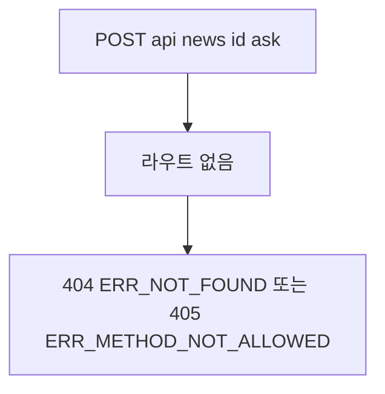

#### 4. 화면 표시 및 입력 데이터 항목 명세 (UI Data Elements - 8대 표준 컬럼)
| 항목명 | 화면 표시/입력 구분 | UI 컴포넌트 | 필수 여부 | 데이터 타입 / 제약 | 기본값 | 유효성 검증 규칙 (Validation) | 노출/수정 조건 |
| :--- | :---: | :--- | :---: | :--- | :---: | :--- | :--- |
| 해당 없음 | - | - | - | - | - | - | 기능을 지웠다 |

#### 5. 비즈니스 규칙 (Business Rules)
- **BR-NEWS-011-1 (삭제)**: 일괄 응답 API 는 없다. 기사 질문 캐시는 스트림 경로(FUNC-NEWS-010 BR-3)만 쓴다.

#### 6. 예외 처리 및 엣지 케이스 (Edge Cases & Exception Handling)
| 발생 상황 (Edge Case Scenario) | 화면 반응 및 시스템 처리 방식 | 사용자 안내 메시지 |
| :--- | :--- | :--- |
| 외부 도구가 옛 경로를 부름 | 라우트 없음 | 응답 `message` (`요청한 대상을 찾을 수 없습니다.` 등) |

#### 7. 비즈니스 에러 코드 매핑
| 비즈니스 에러 코드 | 발생 사유 | HTTP 상태 코드 매핑 | 클라이언트 표시 형태 |
| :--- | :--- | :---: | :--- |
| `ERR_NOT_FOUND` / `ERR_METHOD_NOT_ALLOWED` | 지운 경로 호출 | 404 / 405 | 화면 없음 |

- 근거: `backend/app/api/news.py` (남은 경로는 `GET ""`, `POST /{news_id}/ask/stream`, `GET /feed/rss.xml`), `backend/app/api/errors.py:20-28`

---

### [FUNC-NEWS-012] 기사 단건 조회 — 삭제(v0.4.2)

#### 1. 기본 정보
- **기능명**: ID 로 기사 1건 조회. **v0.4.2 에서 지웠다**
- **기능 ID**: `FUNC-NEWS-012` (ID 는 다시 쓰지 않는다)
- **대응 요구사항 ID**: `REQ-NEWS-007` (옛 기능명세 `NEWS-12`)
- **대상 화면 코드**: 없음
- **우선순위**: 삭제 (v0.4.1 까지 Could)
- **관련 액터 (Actor)**: 없음
- **진입점**: 없음. `GET /api/news/{news_id}` 를 지웠다 (화면은 목록 객체를 그대로 상세에 쓰고 이 API 를 부르지 않았다).

#### 2. 사전 조건 (Pre-conditions)
해당 없음 (기능 없음).

#### 3. 사용자 인터랙션 및 시스템 동작 흐름과 플로우차트
1. 지운 경로를 부르면 라우트가 없어 404 `ERR_NOT_FOUND` 다. 챗 핸드오버가 기사 1건을 읽는 경로는 챗 API `GET /api/chat/sources/{source_id}` 다 (FUNC-CHAT-018, `backend/app/api/chat.py:59`).

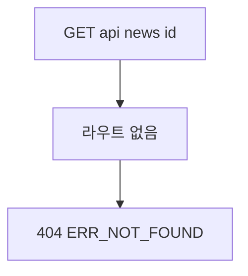

#### 4. 화면 표시 및 입력 데이터 항목 명세 (UI Data Elements - 8대 표준 컬럼)
| 항목명 | 화면 표시/입력 구분 | UI 컴포넌트 | 필수 여부 | 데이터 타입 / 제약 | 기본값 | 유효성 검증 규칙 (Validation) | 노출/수정 조건 |
| :--- | :---: | :--- | :---: | :--- | :---: | :--- | :--- |
| 해당 없음 | - | - | - | - | - | - | 기능을 지웠다 |

#### 5. 비즈니스 규칙 (Business Rules)
- **BR-NEWS-012-1 (삭제)**: 기사 단건 조회 API 는 없다. 응답 변환 `format_news_item` 은 목록(FUNC-NEWS-001)이 쓴다.

#### 6. 예외 처리 및 엣지 케이스 (Edge Cases & Exception Handling)
| 발생 상황 (Edge Case Scenario) | 화면 반응 및 시스템 처리 방식 | 사용자 안내 메시지 |
| :--- | :--- | :--- |
| 외부 도구가 옛 경로를 부름 | 라우트 없음 | `요청한 대상을 찾을 수 없습니다.` |

#### 7. 비즈니스 에러 코드 매핑
| 비즈니스 에러 코드 | 발생 사유 | HTTP 상태 코드 매핑 | 클라이언트 표시 형태 |
| :--- | :--- | :---: | :--- |
| `ERR_NOT_FOUND` | 지운 경로 호출 | 404 | 화면 없음 |

- 근거: `backend/app/api/news.py`, `backend/app/api/errors.py:20-28`

---

### [FUNC-NEWS-013] RSS 출력

#### 1. 기본 정보
- **기능명**: 최신 50건 RSS 2.0 XML
- **기능 ID**: `FUNC-NEWS-013`
- **대응 요구사항 ID**: `REQ-NEWS-007` (옛 기능명세 `NEWS-13`)
- **대상 화면 코드**: 없음 (새 탭 XML)
- **우선순위**: Could Have
- **관련 액터 (Actor)**: 피드 사용자, RSS 리더
- **진입점**: 헤더 더보기 메뉴 `RSS 피드`(새 탭, `/api/news/feed/rss.xml`), 커맨드 팔레트 `RSS 피드 열기`(새 탭), API `GET /api/news/feed/rss.xml`. 모든 폭에서 같다.

#### 2. 사전 조건 (Pre-conditions)
1. 없음 (인증 없음).

#### 3. 사용자 인터랙션 및 시스템 동작 흐름과 플로우차트
1. 사용자가 메뉴·팔레트에서 RSS 를 연다. 새 탭에 XML 이 열린다.
2. backend 는 `published_at` 내림차순 상위 50건으로 채널을 만든다.

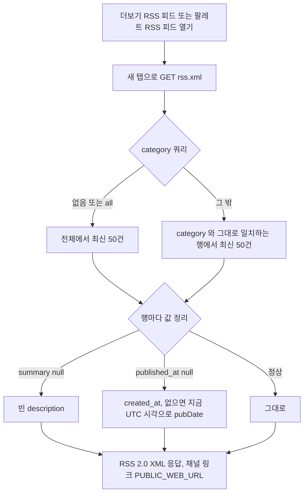

#### 4. 화면 표시 및 입력 데이터 항목 명세 (UI Data Elements - 8대 표준 컬럼)
| 항목명 | 화면 표시/입력 구분 | UI 컴포넌트 | 필수 여부 | 데이터 타입 / 제약 | 기본값 | 유효성 검증 규칙 (Validation) | 노출/수정 조건 |
| :--- | :---: | :--- | :---: | :--- | :---: | :--- | :--- |
| `RSS 피드` | 사용자 조작 | 더보기 메뉴 항목 (아이콘 `Rss`, 새 탭 링크) | - | `/api/news/feed/rss.xml` | - | - | 모든 폭 |
| `RSS 피드 열기` | 사용자 조작 | 팔레트 명령 (부제 `새 탭에서 RSS 피드 주소를 엽니다`) | - | `window.open(url, '_blank', 'noopener,noreferrer')` | - | - | 피드 팔레트 |
| `category` | API 입력 | (화면 없음) | 선택 | String | 없음 | `"all"` 이 아니면 그대로(소문자 변환 없이) 일치 | 화면은 보내지 않는다 |

#### 5. 비즈니스 규칙 (Business Rules)
- **BR-NEWS-013-1 (항목, v0.4.2)**: `published_at` 내림차순 상위 50건. 각 `<item>` 의 `title`, `link`, `description`(`summary`, null 이면 빈 값), `category`, `guid`(`url`) 를 모두 `xml.sax.saxutils.escape` 로 이스케이프한다. `pubDate` 는 `published_at` → 없으면 `created_at` → 없으면 지금 UTC 시각을 `"%a, %d %b %Y %H:%M:%S GMT"` 형식으로 쓴다 (저장 시각은 UTC). 그래서 NULL `summary`·`published_at` 행이 있어도 500 이 나지 않는다 (`backend/app/api/news.py:66-93`).
- **BR-NEWS-013-2 (채널, v0.4.2)**: 제목 `AgentLens RSS`, 링크 = 설정 `PUBLIC_WEB_URL`(`config.json` `app.public_web_url`, 기본 `http://localhost:3000`, docker compose 는 `http://localhost:${FRONTEND_PORT:-3001}`, 이스케이프함), 설명 `Global AI, Agent, Harness &amp; MCP News` (`backend/app/config.py:67`).
- **BR-NEWS-013-3 (응답)**: `application/xml`, RSS 2.0.

#### 6. 예외 처리 및 엣지 케이스 (Edge Cases & Exception Handling)
| 발생 상황 (Edge Case Scenario) | 화면 반응 및 시스템 처리 방식 | 사용자 안내 메시지 |
| :--- | :--- | :--- |
| 결과 0건 | item 없는 채널 | (없음) |
| `summary`·`published_at` 이 null 인 행 | 빈 설명, `created_at`(없으면 지금 UTC 시각)으로 pubDate. 500 이 나지 않는다 (v0.4.2 해결) | (없음) |
| `category` 에 `<`, `&` 같은 글자 | 이스케이프해 XML 이 깨지지 않는다 (v0.4.2) | (없음) |

#### 7. 비즈니스 에러 코드 매핑
| 비즈니스 에러 코드 | 발생 사유 | HTTP 상태 코드 매핑 | 클라이언트 표시 형태 |
| :--- | :--- | :---: | :--- |
| `ERR_SERVER_INTERNAL` | 처리하지 못한 서버 예외(DB 오류 등) | 500 | 새 탭에 JSON 오류 응답 `{"error_code","message","details"}` 그대로 |

- 근거: `backend/app/api/news.py:66-93`, `backend/app/services/news_service.py:105-109`, `backend/app/config.py:67`, `frontend/src/components/Header.tsx:35`, `:89`, `:217`, `frontend/src/components/CommandPalette.tsx:143-153`

---

### [FUNC-NEWS-014] 트렌드 레이더

#### 1. 기본 정보
- **기능명**: 최근 500건의 기술 스택 태그 집계, 급상승 태그·카테고리 분포·태그 구름, 태그 클릭 시 검색
- **기능 ID**: `FUNC-NEWS-014`
- **대응 요구사항 ID**: `REQ-NEWS-006` (옛 기능명세 `NEWS-14`)
- **대상 화면 코드**: `SCR-NEWS-001` (요약 바), `SCR-NEWS-003`
- **우선순위**: Should Have
- **관련 액터 (Actor)**: 피드 사용자
- **진입점**: 요약 바(48px 한 줄) 오른쪽 `트렌드` 펼침 버튼(`aria-expanded`, `aria-controls`). 1024px 이상은 버튼 왼쪽에 `급상승` + 상위 3개 태그 칩(`role="group" aria-label="급상승 태그"`, 가로 스크롤 줄, 누르면 검색)을 함께 보인다. API `GET /api/trends/radar`.

#### 2. 사전 조건 (Pre-conditions)
1. `SCR-NEWS-001` 에 진입했다. 레이더는 통계·브리핑과 함께 마운트 때 한 번(그리고 새로고침 때) 읽는다.
2. 레이더 `tags` 가 비어 있지 않아야 `트렌드` 버튼이 보인다.

#### 3. 사용자 인터랙션 및 시스템 동작 흐름과 플로우차트
1. 화면이 `Promise.allSettled` 로 통계·브리핑·레이더를 읽는다.
2. 사용자가 `트렌드` 를 누르면 요약 바 아래 12px 에 레이더 패널을 펼친다 (기본 접힘).
3. 사용자가 태그 칩을 누르면 그 태그로 검색하고, 같은 태그를 다시 누르거나 `필터 초기화` 를 누르면 검색을 비운다.

```mermaid
flowchart TD
    A["피드 마운트 또는 새로고침"] --> B["통계, 브리핑, 레이더를 allSettled 로 읽기"]
    B --> C{"첫 읽기 끝났고 보여 줄 것 있음"}
    C -->|첫 읽기 전, 보여 줄 것 없음| D["요약 바 자리 48px 스켈레톤"]
    C -->|브리핑도 레이더 태그도 없음| E["요약 바 그리지 않음"]
    C -->|레이더 태그 있음| F["트렌드 버튼, 1024px 이상 급상승 칩 3개"]
    F --> G{"트렌드 클릭"}
    G -->|펼침| H["레이더 패널: 분석 건수, 급상승 6, 카테고리 분포, 전체 태그"]
    H --> I{"태그 칩 클릭"}
    I -->|이미 선택된 태그| J["selectedTag 해제, search 빈 값, page 1"]
    I -->|새 태그| K["selectedTag 설정, search 를 태그명으로, page 1"]
    H --> L{"필터 초기화 클릭"}
    L --> J
```

#### 4. 화면 표시 및 입력 데이터 항목 명세 (UI Data Elements - 8대 표준 컬럼)
| 항목명 | 화면 표시/입력 구분 | UI 컴포넌트 | 필수 여부 | 데이터 타입 / 제약 | 기본값 | 유효성 검증 규칙 (Validation) | 노출/수정 조건 |
| :--- | :---: | :--- | :---: | :--- | :---: | :--- | :--- |
| `트렌드` 버튼 | 사용자 조작 | 펼침 버튼 (`aria-expanded`, `aria-controls`) | - | Boolean 펼침 | 접힘 | - | 레이더 `tags` 가 있을 때. 768~1023px 은 이 버튼만 (브리핑 헤드라인 자리를 남기려고) |
| 급상승 칩 (요약 바) | 사용자 선택 | 칩 3개 (가로 스크롤 줄) | - | `surging_tags` 앞 3개 | - | 선택된 태그면 `aria-pressed="true"` | 1024px 이상, `surging_tags` 가 있을 때 |
| 분석 건수 | 노출 전용 | 글자 `{total_analyzed}개 아티클 분석` | - | Integer | - | - | 패널 맨 위 |
| `최근 24시간 급상승 기술 스택` | 사용자 선택 | 칩 (태그명·velocity·건수) | - | `surging_tags` 최대 6 | - | - | `surging_tags` 가 있을 때 |
| `카테고리 분포` | 노출 전용 | 4칸 목록 (아이콘, 한국어 라벨, 백분율) | - | `categories[]` | - | 이름이 넘치면 말줄임, `title` 에 전체 이름 | 640px 미만 1열, 이상 2열, 1024px 이상 4열 |
| `전체 기술 태그 (누르면 검색)` | 사용자 선택 | 칩 구름 (건수) | - | `tags` 최대 25 | - | 선택 태그는 `aria-pressed="true"` | 패널 |
| `필터 초기화` | 사용자 조작 | 고스트 버튼 | - | - | - | 누르면 태그 해제 + 검색 비움 + page 1 | 선택 태그가 있을 때 |

#### 5. 비즈니스 규칙 (Business Rules)
- **BR-NEWS-014-1 (집계 대상)**: `published_at` 내림차순 최근 500건을 읽는다. 기사마다 `tech_stack` 을 콤마로 나눠 trim 하고 길이가 1 이하인 값은 버린 뒤 기사 내 중복을 제거한다.
- **BR-NEWS-014-2 (건수)**: 태그별 전체 건수(`count`)와 최근 24시간(`published_at >= now-24h`, naive 는 UTC 로 간주) 건수(`recent_count`)를 센다. `sample_news_id` 는 그 태그가 처음 나온(가장 최신) 기사 id.
- **BR-NEWS-014-3 (상위 태그와 분류)**: 전체 건수 상위 25개 태그를 만든다. 태그 분류(`classify_tag_category`)는 `CATEGORY_MAP` 4개 그룹(`Harness & Benchmark`, `Protocols & Tooling`, `Models & Reasoning`, `Infra & Runtime`)의 키워드와 대소문자 무시 정확 일치 또는 부분 포함으로, 그룹 순서대로 첫 일치를 쓴다. 일치 없으면 `Protocols & Tooling`.
- **BR-NEWS-014-4 (velocity)**: `recent_count >= 3` 이면 `"+{recent_count*20}%"`, `recent_count > 0` 이면 `"+25%"`, `count >= 8` 이면 `"HOT"`, 그 외 `"STEADY"`.
- **BR-NEWS-014-5 (급상승)**: 상위 25개 중 `recent_count > 0` 또는 `count >= 5` 인 것을 `(recent_count, count)` 내림차순 정렬해 6개.
- **BR-NEWS-014-6 (카테고리 분포)**: 상위 25개 태그의 `count` 를 그룹별로 합하고 전체 합(0 이면 1) 대비 백분율(소수 1자리). 4개 그룹을 늘 `CATEGORY_MAP` 순서로 돌려준다.
- **BR-NEWS-014-7 (캐시 없음)**: 요청마다 DB 를 읽어 계산한다.
- **BR-NEWS-014-8 (응답)**: `{ updated_at, total_analyzed, surging_tags: TrendingTag[], categories: [{name, count, percentage}], tags: TrendingTag[] }`. `TrendingTag = { name, count, category, recent_count, velocity, sample_news_id }`. 기사가 0건이면 `total_analyzed: 0` 과 빈 배열들.
- **BR-NEWS-014-9 (한국어 라벨)**: 카테고리 분포 라벨은 응답의 영문 그룹 이름을 한국어로 바꿔 보인다 (`radarCategoryLabel`): `Harness & Benchmark`→`하네스 & 벤치마크`, `Protocols & Tooling`→`프로토콜 & 도구`, `Models & Reasoning`→`모델 & 추론`, `Infra & Runtime`→`인프라 & 런타임`, 그 외 이름은 그대로. 그룹 아이콘과 목록 키는 영문 원값으로 고른다.
- **BR-NEWS-014-10 (태그 선택)**: 이미 선택된 태그면 `''`, 아니면 태그명으로 `handleSelectTag` → `selectedTag` 설정(빈 값이면 null), `search` 를 같은 값으로, page 1. 즉 태그 선택은 FUNC-NEWS-005 검색으로 동작한다.
- **BR-NEWS-014-11 (부분 실패)**: 셋 중 하나가 실패해도 나머지는 반영한다. 레이더 요청이 실패하면 이전 레이더 값(처음이면 없음)을 그대로 둔다.
- **BR-NEWS-014-12 (스켈레톤)**: 통계·브리핑·레이더 첫 읽기가 끝나기 전이고 보여 줄 브리핑·레이더가 없을 때만 요약 바 자리에 48px 스켈레톤을 그린다. 다시 읽는 동안(수집 중 새 소식 저장, 수집 끝, 소스 변경)에는 이전 브리핑·레이더를 그대로 그린다. 레이더 `tags` 가 비면 `트렌드` 버튼과 패널을 그리지 않고, 브리핑도 없으면 요약 바 전체를 그리지 않는다. 접힌 패널 자리는 `hidden` 이라 여백을 만들지 않는다.

#### 6. 예외 처리 및 엣지 케이스 (Edge Cases & Exception Handling)
| 발생 상황 (Edge Case Scenario) | 화면 반응 및 시스템 처리 방식 | 사용자 안내 메시지 |
| :--- | :--- | :--- |
| 세 요청 모두 실패 | 첫 읽기는 끝난 것으로 보아 스켈레톤을 거두고, 보여 줄 것이 없으면 요약 바를 그리지 않는다 | (없음, 실패를 화면에 표시하지 않는다) |
| 검색창을 직접 고침 | `selectedTag` 는 그대로 남는다 | (없음) |
| `sample_news_id` | 프론트에서 쓰지 않는다 | (없음) |
| 응답 스키마 | Pydantic response_model 이 없다 | (없음) |

#### 7. 비즈니스 에러 코드 매핑
| 비즈니스 에러 코드 | 발생 사유 | HTTP 상태 코드 매핑 | 클라이언트 표시 형태 |
| :--- | :--- | :---: | :--- |
| 없음 | 레이더 조회 실패 (`Tech Radar 데이터를 불러오지 못했습니다.` 예외) | 비 2xx 또는 타임아웃 | 표시 없음, 이전 값 유지 |

- 근거: `backend/app/api/trends.py:6-9`, `backend/app/services/trend_service.py:9-139`, `frontend/src/components/feed/InsightsBar.tsx:23-120`, `frontend/src/components/feed/TrendRadarPanel.tsx:35-103`, `frontend/src/lib/labels.ts:29-34`, `:60-63`, `frontend/src/hooks/useNewsFeed.ts:37-69`, `frontend/src/lib/api.ts:252-257`, `frontend/src/types/trends.ts`, 동작 확인 테스트 `frontend/src/tests/feed/InsightsBar.test.tsx`, `frontend/src/tests/feed/TrendRadarPanel.test.tsx`, `frontend/src/tests/hooks/useNewsFeed.test.tsx`

---

### [FUNC-NEWS-015] 통계

#### 1. 기본 정보
- **기능명**: 전체 건수, 카테고리별·소스별 건수
- **기능 ID**: `FUNC-NEWS-015`
- **대응 요구사항 ID**: `REQ-NEWS-006` (옛 기능명세 `NEWS-15`)
- **대상 화면 코드**: `SCR-NEWS-001` (목록 머리줄, 필터 칩)
- **우선순위**: Should Have
- **관련 액터 (Actor)**: 피드 사용자
- **진입점**: API `GET /api/stats`. 화면 목록 머리줄 상태의 ` (전체 N건)`(필터가 걸려 있을 때 `stats.total_news`), 카테고리 칩 건수, 소스 칩 건수.

#### 2. 사전 조건 (Pre-conditions)
1. `SCR-NEWS-001` 에 진입했다.

#### 3. 사용자 인터랙션 및 시스템 동작 흐름과 플로우차트
1. 화면은 첫 마운트, 헤더 `onRefresh`(수집 중 새 소식 저장, 수집 끝, 초기화), 소스 대화상자의 변경 알림 때 통계를 다시 읽는다.
2. backend 는 전체·카테고리별·소스별 건수를 센다.

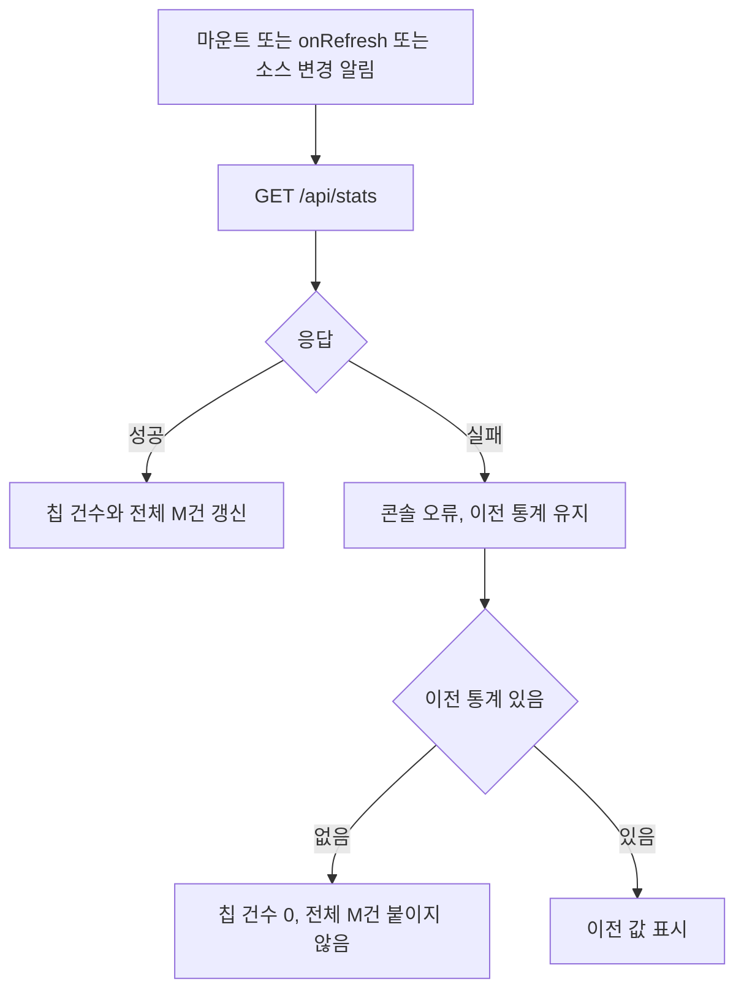

#### 4. 화면 표시 및 입력 데이터 항목 명세 (UI Data Elements - 8대 표준 컬럼)
| 항목명 | 화면 표시/입력 구분 | UI 컴포넌트 | 필수 여부 | 데이터 타입 / 제약 | 기본값 | 유효성 검증 규칙 (Validation) | 노출/수정 조건 |
| :--- | :---: | :--- | :---: | :--- | :---: | :--- | :--- |
| `total_news` | 노출 전용 | 목록 머리줄 ` (전체 N건)` | - | Integer | - | - | 필터 중이고 통계가 있을 때 |
| `category_counts` | 노출 전용 | 카테고리 칩 건수 | - | `{str: int}` | 없으면 0 | - | 상시 |
| `source_counts` | 노출 전용 | 소스 칩 건수·표시 여부 | - | `{str: int}` | 없으면 0 | 건수 > 0 인 소스만 칩 | 상시 |
| `last_updated` | (표시 안 함) | - | - | ISO 문자열 | - | - | 화면이 쓰지 않는다 |

#### 5. 비즈니스 규칙 (Business Rules)
- **BR-NEWS-015-1 (집계)**: `count(id)` 전체, `category` 별 group by 건수, `source` 별 group by 건수.
- **BR-NEWS-015-2 (시각)**: `last_updated` 는 응답 시점의 현재 UTC 시각(ISO)이다. 마지막 수집 시각이 아니다.
- **BR-NEWS-015-3 (응답)**: `StatsResponse { total_news, category_counts: {str: int}, source_counts: {str: int}, last_updated }`.

#### 6. 예외 처리 및 엣지 케이스 (Edge Cases & Exception Handling)
| 발생 상황 (Edge Case Scenario) | 화면 반응 및 시스템 처리 방식 | 사용자 안내 메시지 |
| :--- | :--- | :--- |
| 통계 요청 실패 | 콘솔 오류만 남기고 이전 통계(처음이면 없음)를 그대로 둔다. 브리핑·레이더는 따로 반영된다 | (없음) |
| 통계가 없음 | 목록 머리줄 상태는 목록 `total` 만 보이고 ` (전체 N건)` 을 붙이지 않으며, 칩 건수는 0 | (없음) |

#### 7. 비즈니스 에러 코드 매핑
| 비즈니스 에러 코드 | 발생 사유 | HTTP 상태 코드 매핑 | 클라이언트 표시 형태 |
| :--- | :--- | :---: | :--- |
| 없음 | 통계 조회 실패 (`통계 데이터를 불러오지 못했습니다.` 예외) | 비 2xx 또는 타임아웃 | 표시 없음 (콘솔만) |

- 근거: `backend/app/api/stats.py`, `backend/app/services/news_service.py:111-122`, `backend/app/schemas/news.py`, `frontend/src/hooks/useNewsFeed.ts:75-101`, `frontend/src/components/feed/FeedStatusBar.tsx:62-67`, `frontend/src/app/page.tsx:91`, `:155-164`, `:188-212`, `:293-300`

---

### [FUNC-NEWS-016] 피드 키보드 단축키

#### 1. 기본 정보
- **기능명**: j/k 이동, Enter/Space 열기, b 북마크, c 챗 이동, / 검색, t 테마 (Esc·⌘K 는 공통 처리)
- **기능 ID**: `FUNC-NEWS-016`
- **대응 요구사항 ID**: `REQ-UI-004` (옛 기능명세 `NEWS-16`)
- **대상 화면 코드**: `SCR-NEWS-001`
- **우선순위**: Should Have
- **관련 액터 (Actor)**: 키보드 사용자 (화면 폭과 관계없이 하드웨어 키보드가 있으면 같다)
- **진입점**: 메인 페이지의 전역 단축키 리스너 (window keydown). ⌘K 는 헤더, Escape 는 오버레이 스택이 처리한다. 판정 순서·연결 상세는 FUNC-UI-005, FUNC-UI-006.

#### 2. 사전 조건 (Pre-conditions)
1. `SCR-NEWS-001` 에 있다 (`/chat` 에는 이 리스너가 없다).
2. 대화상자·메뉴·팝오버가 열려 있지 않다.
3. 포커스가 입력 요소(INPUT/TEXTAREA/SELECT/contentEditable/`role="combobox"`) 안이 아니다.

#### 3. 사용자 인터랙션 및 시스템 동작 흐름과 플로우차트
1. 키를 누른다. IME 조합 중이면 무시한다.
2. 오버레이가 열려 있거나 입력 요소 안이거나 Meta/Ctrl/Alt 조합이면 단일 키를 무시한다.
3. 글자 키는 `e.key` 소문자로, 아니면 `e.code`(`KeyJ`, `KeyK`, `KeyB`, `KeyC`, `KeyT`, `Slash`)로 판정한다 (한글 입력 상태에서도 동작).
4. 키별 동작을 실행한다.

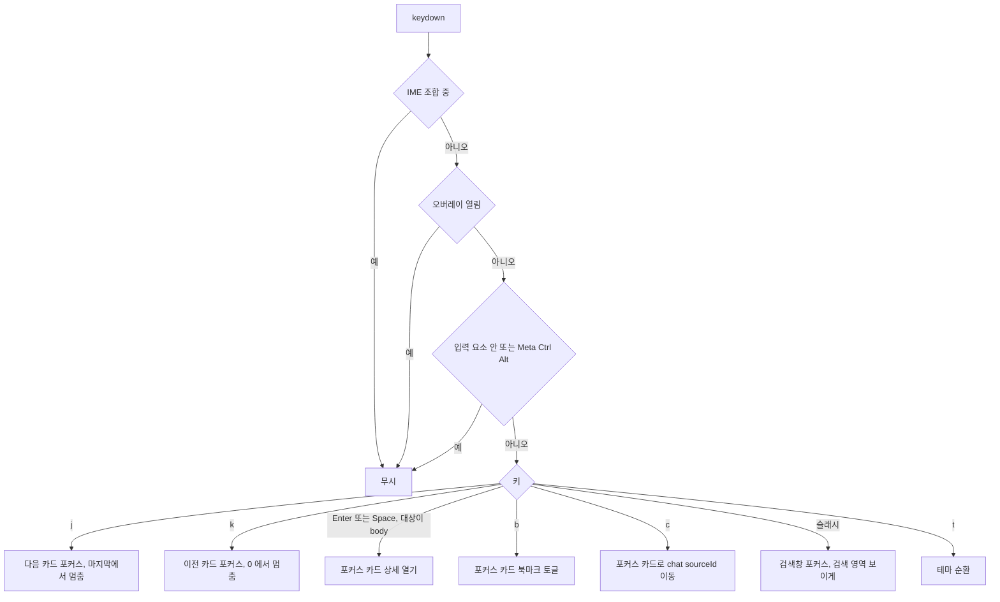

#### 4. 화면 표시 및 입력 데이터 항목 명세 (UI Data Elements - 8대 표준 컬럼)
| 항목명 | 화면 표시/입력 구분 | UI 컴포넌트 | 필수 여부 | 데이터 타입 / 제약 | 기본값 | 유효성 검증 규칙 (Validation) | 노출/수정 조건 |
| :--- | :---: | :--- | :---: | :--- | :---: | :--- | :--- |
| `focusedIndex` | 시스템 제어 | 카드 강조 링 | - | Integer, -1 ~ 목록 길이-1 | -1 | `j` +1, `k` -1, 0 과 마지막 사이로 고정 | 목록 키가 바뀌면 -1 |
| 단축키 | 사용자 입력 | 키보드 | - | `j`, `k`, `Enter`, `Space`, `b`, `c`, `/`, `t` | - | 위 조건 | 오버레이·입력 중 아님 |

#### 5. 비즈니스 규칙 (Business Rules)
- **BR-NEWS-016-1 (⌘K)**: 메인 페이지는 리스너에 팔레트 콜백을 넘기지 않는다. 헤더의 `useHotkey('mod+k')` 가 팔레트가 맨 위 레이어면 닫고, 다른 레이어가 열려 있으면 무시하고, 아니면 연다. 입력창 안에서도 동작 (FUNC-UI-007).
- **BR-NEWS-016-2 (Escape)**: 메인 페이지는 닫기 콜백을 넘기지 않는다. 오버레이 스택이 맨 위 레이어(대화상자·메뉴·팝오버) 하나만 닫는다 (FUNC-UI-008).
- **BR-NEWS-016-3 (j/k)**: 초기 포커스는 -1 이며 `j` 첫 입력 시 0. 그 카드의 제목 버튼으로 DOM 포커스를 옮기고(`preventScroll`) `scrollIntoView({ block: 'nearest' })` 한다.
- **BR-NEWS-016-4 (Enter/Space)**: 이벤트 대상이 `document.body` 일 때만 포커스 카드 상세 대화상자를 연다 (포커스 없으면 아무것도 안 함). 버튼·링크 등에서는 브라우저 기본 동작을 가로채지 않는다 (카드 제목 버튼은 기본 동작으로 상세를 연다).
- **BR-NEWS-016-5 (b, c, /, t)**: `b` 포커스 카드 북마크 토글. `c` `/chat?sourceId={id}` 로 이동. `/` 검색창 포커스(스크롤한 화면이면 검색 영역을 헤더 아래로 보이게 함, FUNC-NEWS-005). `t` 테마 순환 (FUNC-UI-003).

#### 6. 예외 처리 및 엣지 케이스 (Edge Cases & Exception Handling)
| 발생 상황 (Edge Case Scenario) | 화면 반응 및 시스템 처리 방식 | 사용자 안내 메시지 |
| :--- | :--- | :--- |
| 목록이 빔 | 이동하지 않는다 | (없음) |
| 목록(페이지·카테고리·소스·검색어·정렬·Must-Read) 변경 | `focusedIndex` 를 -1 로 | (없음) |
| 포커스 카드 없이 b/c/Enter | 아무것도 안 함 | (없음) |

#### 7. 비즈니스 에러 코드 매핑
| 비즈니스 에러 코드 | 발생 사유 | HTTP 상태 코드 매핑 | 클라이언트 표시 형태 |
| :--- | :--- | :---: | :--- |
| 없음 | 단축키는 서버를 부르지 않는다 | - | - |

- 근거: `frontend/src/components/HotkeyListener.tsx:47-191`, `frontend/src/app/page.tsx:83-154`, `frontend/src/components/Header.tsx:68-81`, `frontend/src/lib/overlay-stack.ts`

---

### [FUNC-NEWS-017] 데이터 전체 삭제·초기화

#### 1. 기본 정보
- **기능명**: `초기화 & 재수집` (v0.4.2 에서 기사 전체 삭제 API `DELETE /api/news/all` 은 지웠다)
- **기능 ID**: `FUNC-NEWS-017`
- **대응 요구사항 ID**: `REQ-COLL-007` (옛 기능명세 `NEWS-17`)
- **대상 화면 코드**: `SCR-COLL-003`
- **우선순위**: Should Have
- **관련 액터 (Actor)**: 피드 사용자 (인증 없음, 누구나 호출 가능)
- **진입점**: 헤더 더보기 메뉴 마지막 `초기화 & 재수집…`(구분선 뒤 위험 톤, 수집 중이면 비활성), 스케줄 대화상자 '위험 영역' 의 `초기화 & 재수집…` 버튼(수집 중이면 비활성), 커맨드 팔레트 `수집 데이터 초기화 & 재수집`. 셋 모두 확인 창을 거친다. API `POST /api/schedule/reset-and-collect` 하나.

#### 2. 사전 조건 (Pre-conditions)
1. 화면이 수집 중으로 알고 있지 않다 (`isCollecting` 이면 진입점이 비활성).

#### 3. 사용자 인터랙션 및 시스템 동작 흐름과 플로우차트
1. 사용자가 진입점을 눌러 확인 창을 연다.
2. `전체 삭제 후 다시 수집` 을 누르면 버튼이 `초기화 중...` 진행 표시로 바뀌고, Escape·배경막·취소가 무시된다.
3. backend 는 이 프로세스가 수집 중이거나 수집 잠금(`<db>.crawl.lock`)을 쥐지 못하면(다른 프로세스 MCP·`make collect` 가 수집 중) 지우지 않고 `already_running` 을 돌려준다. 잠금을 쥐면 LLM 캐시(평가·기사 질문·Ollama 판정)를 비우고 `news_items`·`crawl_logs` 를 한 트랜잭션으로 지워 커밋한 뒤 잠금을 풀고 백그라운드 재수집을 시작한다.
4. 성공하면 피드·통계를 새로고침하고 진행 줄에 `기존 {deleted_count}건 삭제 완료. 신규 수집 중...` 을 띄우며 진행 폴링(1200ms)을 시작하고, 확인 창을 닫는다.
5. 실패하거나 `already_running` 이거나 앞선 초기화 요청이 아직 끝나지 않았으면 창을 연 채 창 안 오류로 알린다.

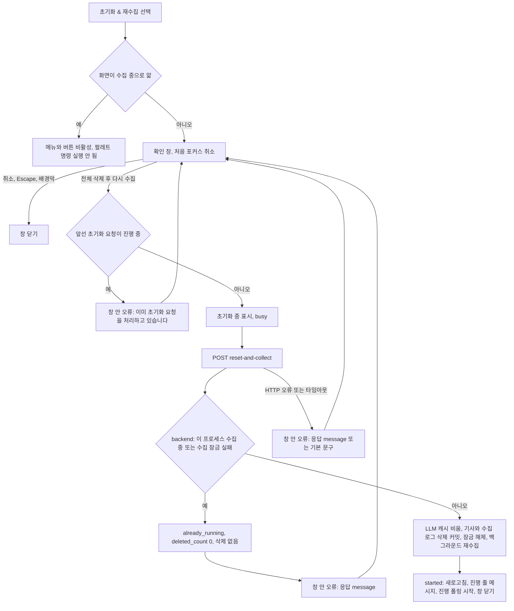

#### 4. 화면 표시 및 입력 데이터 항목 명세 (UI Data Elements - 8대 표준 컬럼)
| 항목명 | 화면 표시/입력 구분 | UI 컴포넌트 | 필수 여부 | 데이터 타입 / 제약 | 기본값 | 유효성 검증 규칙 (Validation) | 노출/수정 조건 |
| :--- | :---: | :--- | :---: | :--- | :---: | :--- | :--- |
| 더보기 `초기화 & 재수집…` | 사용자 조작 | 메뉴 항목 (위험 톤, 아이콘 `Trash2`) | - | - | - | - | 늘 마지막, 구분선 뒤. 수집 중 비활성 |
| 팔레트 `수집 데이터 초기화 & 재수집` | 사용자 조작 | 팔레트 명령 | - | 부제 `저장된 소식을 모두 지우고 처음부터 다시 수집 (확인 후 실행)` | - | 수집 중이면 `aria-disabled`, 부제 `수집 중에는 초기화할 수 없습니다`, 실행되지 않음 | 피드 팔레트 |
| 확인 창 제목 | 노출 전용 | `role="alertdialog"` 제목 | - | `수집 데이터 전체 삭제 및 재수집` | - | - | 768px 미만 바텀시트 |
| 확인 창 설명 | 노출 전용 | 설명 문단 | - | `현재 데이터베이스에 저장된 모든 뉴스 소식 및 수집 로그가 영구 삭제되며, 최신 크롤러 기준에 따라 처음부터 깨끗하게 실시간 재수집을 시작합니다. 계속하시겠습니까?` (가운데 구절 굵게) | - | - | 상시 |
| `취소` | 사용자 조작 | 버튼 | - | - | 처음 포커스 | - | 진행 중 비활성 |
| `전체 삭제 후 다시 수집` | 사용자 조작 | 위험 버튼 | - | 진행 중 `초기화 중...`(스피너) | - | 요청 중 플래그로 두 번 요청 차단. 앞선 요청이 끝나지 않았는데 다시 누르면 창 안 오류 `이미 초기화 요청을 처리하고 있습니다.` | 진행 중 비활성 |
| 창 안 오류 | 노출 전용 | 인라인 알림 | - | 오류 메시지 | `초기화 실패` | - | 실패 시. 창은 열린 채 |

#### 5. 비즈니스 규칙 (Business Rules)
- **BR-NEWS-017-1 (기사 전체 삭제 API 삭제, v0.4.2)**: `DELETE /api/news/all` 과 프론트 `deleteAllNews` 를 지웠다 (화면 진입점이 없었다). 기사를 지우는 경로는 BR-2 하나다. 옛 경로를 부르면 맞는 라우트가 없어 404 `ERR_NOT_FOUND` 다 (코드 읽기 기준).
- **BR-NEWS-017-2 (`POST /api/schedule/reset-and-collect`, v0.4.2)**: 이 프로세스가 수집 중이거나 수집 잠금(`<db>.crawl.lock`, 비차단, backend·MCP 서버·`make collect` 가 함께 씀)을 쥐지 못하면 삭제 없이 `{"status": "already_running", "message": "현재 수집이 진행 중이므로 초기화할 수 없습니다. 잠시 후 다시 시도해주세요.", "deleted_count": 0}`. 잠금을 쥐면 LLM 캐시를 비우고, `news_items`·`crawl_logs` 를 한 트랜잭션으로 지워 커밋하고, 수집기 메모리 카운터를 초기화(`step_message` `기존 데이터 삭제 완료. 재수집을 시작합니다.`)한 뒤 잠금을 풀고 백그라운드로 전체 수집을 시작해 `started` 와 `기존 데이터 {n}건이 삭제되었으며, 실시간 클린 재수집이 시작되었습니다.` 를 돌려준다 (`backend/app/api/schedule.py:61-92`, 상세는 FUNC-COLL-020).
- **BR-NEWS-017-3 (프론트 성공)**: 성공 시 새로고침 콜백(피드·통계·브리핑 다시 읽기)을 부르고 진행 줄에 `기존 {deleted_count}건 삭제 완료. 신규 수집 중...` 을 띄운 뒤 진행 폴링(1200ms)을 시작하고 확인 창을 닫는다 (FUNC-UI-002).
- **BR-NEWS-017-4 (already_running 은 실패)**: 응답이 `already_running` 이면 실패로 다뤄 응답 `message`(없으면 `현재 수집이 진행 중이므로 초기화할 수 없습니다.`)를 확인 창 안 오류로 보이고, 새로고침·진행 폴링을 하지 않는다.
- **BR-NEWS-017-5 (북마크 보존)**: localStorage 북마크는 지워지지 않는다.
- **BR-NEWS-017-6 (진행 중 재요청, v0.4.2)**: 앞선 초기화 요청이 아직 응답을 받지 않았는데 다시 요청하면(다른 진입점 포함) 서버를 부르지 않고 `이미 초기화 요청을 처리하고 있습니다.` 로 실패해 확인 창을 연 채 그 문구를 보인다 (`frontend/src/hooks/useCollector.ts:225-248`).

#### 6. 예외 처리 및 엣지 케이스 (Edge Cases & Exception Handling)
| 발생 상황 (Edge Case Scenario) | 화면 반응 및 시스템 처리 방식 | 사용자 안내 메시지 |
| :--- | :--- | :--- |
| 화면이 모르는 수집(다른 탭, MCP 서버, `make collect`) 진행 중 | backend 가 `already_running` 으로 막고(삭제 없음) 확인 창이 그 문구를 보인다 | `현재 수집이 진행 중이므로 초기화할 수 없습니다. 잠시 후 다시 시도해주세요.` |
| 앞선 초기화 요청이 아직 진행 중 | 서버를 부르지 않고 창 안 오류 | `이미 초기화 요청을 처리하고 있습니다.` |
| HTTP 오류 | 창을 연 채 창 안 오류 | 응답 `message`, 본문이 오류 형식이 아니면 `초기화 및 재수집 요청 실패` |
| 8000ms 타임아웃 | 창을 연 채 창 안 오류 | 브라우저 abort 예외 문구 (확인하지 못함), 비면 `초기화 실패` |
| 진행 중 Escape·배경막·취소 | 무시 | (없음) |
| 버튼 연타 | 요청 중 플래그로 차단 | (없음) |
| 인증 없음 | 누구나 호출할 수 있다 (알려진 문제) | (없음) |

#### 7. 비즈니스 에러 코드 매핑
| 비즈니스 에러 코드 | 발생 사유 | HTTP 상태 코드 매핑 | 클라이언트 표시 형태 |
| :--- | :--- | :---: | :--- |
| 없음 (`status: "already_running"`) | backend 수집 중 또는 다른 프로세스가 수집 잠금 보유 | 200 | 확인 창 안 오류 (응답 `message`) |
| `ERR_SERVER_INTERNAL` | 서버 오류 | 500 | 확인 창 안 오류 `서버 내부 처리 중 오류가 발생했습니다.` |

- 근거: `backend/app/api/schedule.py:61-92`, `backend/app/services/news_service.py:136-144`, `backend/app/collectors/manager.py` (`acquire_crawl_lock`), `frontend/src/lib/api.ts:270-277`, `frontend/src/components/ResetConfirmDialog.tsx`, `frontend/src/hooks/useCollector.ts:225-248`, `frontend/src/components/Header.tsx:111-119`, `:209-221`, `frontend/src/components/ScheduleModal.tsx:63-81`, `frontend/src/components/CommandPalette.tsx:154-165`, `backend/tests/test_reset_and_delete.py`

---

### [FUNC-NEWS-018] 일일 브리핑 바로가기

#### 1. 기본 정보
- **기능명**: 오늘 브리핑의 날짜·헤드라인을 요약 바에 표시, 누르면 브리핑 대화상자
- **기능 ID**: `FUNC-NEWS-018`
- **대응 요구사항 ID**: `REQ-BRF-002` (옛 기능명세 `NEWS-18`)
- **대상 화면 코드**: `SCR-NEWS-001` (요약 바), `SCR-BRF-001`
- **우선순위**: Must Have (브리핑 대화상자를 여는 유일한 진입점이다. 같은 기능을 브리핑 쪽에서 적은 `FUNC-BRF-002` 와 맞췄다)
- **관련 액터 (Actor)**: 피드 사용자
- **진입점**: 요약 바 왼쪽 브리핑 버튼. API `GET /api/briefing/today`. 브리핑 생성 규칙과 대화상자는 `docs/spec-writer/fsd/04_BRIEFING_AND_SHARING_SPECIFICATION.md`.

#### 2. 사전 조건 (Pre-conditions)
1. 브리핑 조회가 값을 돌려줬다.

#### 3. 사용자 인터랙션 및 시스템 동작 흐름과 플로우차트
1. 화면이 통계·레이더와 함께 브리핑을 읽는다.
2. 값이 있으면 요약 바에 브리핑 버튼을 그린다.
3. 사용자가 누르면 일일 브리핑 대화상자를 연다.

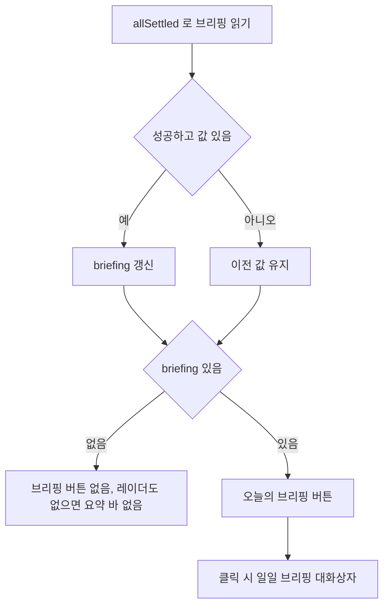

#### 4. 화면 표시 및 입력 데이터 항목 명세 (UI Data Elements - 8대 표준 컬럼)
| 항목명 | 화면 표시/입력 구분 | UI 컴포넌트 | 필수 여부 | 데이터 타입 / 제약 | 기본값 | 유효성 검증 규칙 (Validation) | 노출/수정 조건 |
| :--- | :---: | :--- | :---: | :--- | :---: | :--- | :--- |
| 브리핑 버튼 | 사용자 조작 | 버튼 (아이콘 `Sparkles`) | - | 768px 이상 `오늘의 브리핑 · {briefing.date} · {briefing.headline}`, 768px 미만 `오늘의 브리핑 · {briefing.headline}` | - | 한 줄 말줄임 | `briefing` 이 null 이 아닐 때. 요약 바의 남는 폭을 모두 쓴다 |

#### 5. 비즈니스 규칙 (Business Rules)
- **BR-NEWS-018-1 (갱신)**: 통계·레이더와 함께 `Promise.allSettled` 로 가져온다. 성공하고 값이 있을 때만 상태를 갱신하고, 실패하면 이전 값(처음이면 없음)을 그대로 둔다. 다시 읽는 동안에도 이전 브리핑을 그린다 (FUNC-NEWS-014 BR-12).
- **BR-NEWS-018-2 (같은 줄)**: 급상승 칩은 1024px 이상에서만 같은 줄에 온다 (FUNC-NEWS-014).

#### 6. 예외 처리 및 엣지 케이스 (Edge Cases & Exception Handling)
| 발생 상황 (Edge Case Scenario) | 화면 반응 및 시스템 처리 방식 | 사용자 안내 메시지 |
| :--- | :--- | :--- |
| 브리핑 조회 실패 | 표시 없이 이전 값 유지 | (없음) |
| 브리핑·레이더 모두 없음 | 요약 바 전체를 그리지 않는다 | (없음) |

#### 7. 비즈니스 에러 코드 매핑
| 비즈니스 에러 코드 | 발생 사유 | HTTP 상태 코드 매핑 | 클라이언트 표시 형태 |
| :--- | :--- | :---: | :--- |
| 없음 | 브리핑 조회 실패 (`일일 브리핑을 불러오지 못했습니다.` 예외) | 비 2xx 또는 타임아웃 | 표시 없음 |

- 근거: `frontend/src/components/feed/InsightsBar.tsx:54-76`, `frontend/src/hooks/useNewsFeed.ts`, `frontend/src/lib/api.ts:115-120`, `frontend/src/app/page.tsx:174-181`, `:284-289`, 동작 확인 테스트 `frontend/src/tests/feed/InsightsBar.test.tsx`

---

### [FUNC-NEWS-019] AI 챗 핸드오버

#### 1. 기본 정보
- **기능명**: 카드·상세 대화상자에서 기사를 단일 기사 범위로 `/chat` 에 열기
- **기능 ID**: `FUNC-NEWS-019`
- **대응 요구사항 ID**: `REQ-CHAT-006` (옛 기능명세 `NEWS-19`)
- **대상 화면 코드**: `SCR-NEWS-001`, `SCR-NEWS-002`
- **우선순위**: Must Have (단일 기사 챗(`FUNC-CHAT-013`, Must)을 화면에서 시작하는 진입점이다. 같은 기능을 챗 쪽에서 적은 `FUNC-CHAT-018` 과 맞췄다)
- **관련 액터 (Actor)**: 피드 사용자
- **진입점**: 카드 `AI 챗에서 분석` 버튼, 상세 대화상자 요약 탭의 `AI 챗에서 분석` 배너, 포커스 카드에서 `c`. 카드·배너·헤더 내비·챗 제목이 같은 이름 `AI 챗` 을 쓴다.

#### 2. 사전 조건 (Pre-conditions)
1. 대상 기사가 있다.

#### 3. 사용자 인터랙션 및 시스템 동작 흐름과 플로우차트
1. 사용자가 버튼·배너를 누르거나 `c` 를 누른다.
2. 클릭 전파를 막아 카드 클릭(상세 열기)이 일어나지 않는다. 상세 배너는 이동 전에 대화상자를 닫는다.
3. `/chat?sourceId={item.id}` 로 이동한다. 상세 배너는 `draftQuestion` 이 trim 후 비어 있지 않으면 `&q={encodeURIComponent}` 를 붙인다.
4. 챗은 그 기사의 단일 기사 범위로 시작한다 (이후 동작은 `docs/spec-writer/fsd/02_AI_CHAT_SPECIFICATION.md`).

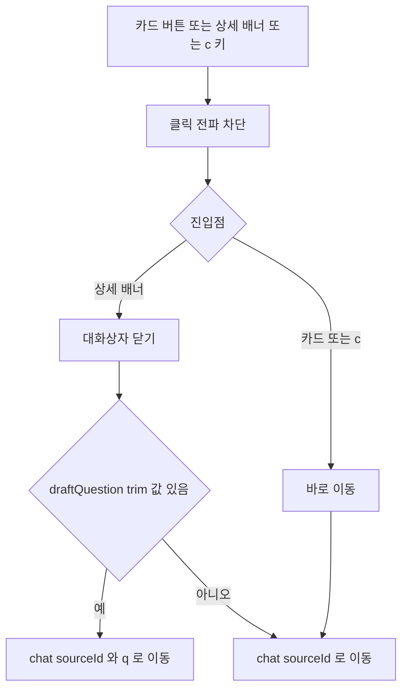

#### 4. 화면 표시 및 입력 데이터 항목 명세 (UI Data Elements - 8대 표준 컬럼)
| 항목명 | 화면 표시/입력 구분 | UI 컴포넌트 | 필수 여부 | 데이터 타입 / 제약 | 기본값 | 유효성 검증 규칙 (Validation) | 노출/수정 조건 |
| :--- | :---: | :--- | :---: | :--- | :---: | :--- | :--- |
| 카드 버튼 | 사용자 조작 | 고스트 버튼 (아이콘 `Sparkles`, 글자 `AI 챗에서 분석`, 툴팁 `AI 챗에서 이 기사를 단일 기사 모드로 분석`) | - | - | - | - | 모든 카드 바닥 |
| 상세 배너 | 사용자 조작 | 배너 버튼 (아이콘 `Bot`, 제목 `AI 챗에서 분석`, 보조 `이 기사를 단일 기사 모드로 열어 질의응답`, 화살표) | - | - | - | - | 요약 탭 |
| `sourceId` | 시스템 제어 | URL 쿼리 | 필수 | Integer 기사 id | - | - | - |
| `q` | 시스템 제어 | URL 쿼리 | 선택 | `encodeURIComponent(draftQuestion.trim())` | 없음 | trim 후 비어 있지 않을 때만 | 상세 배너만. 요약 탭에는 입력창이 없어 보통 비어 있다 |

#### 5. 비즈니스 규칙 (Business Rules)
- **BR-NEWS-019-1 (이동 경로)**: `router.push('/chat?sourceId={item.id}' + q)`.
- **BR-NEWS-019-2 (`c` 키)**: `focusedIndex >= 0` 이고 카드가 있을 때만 이동한다 (FUNC-UI-006).

#### 6. 예외 처리 및 엣지 케이스 (Edge Cases & Exception Handling)
| 발생 상황 (Edge Case Scenario) | 화면 반응 및 시스템 처리 방식 | 사용자 안내 메시지 |
| :--- | :--- | :--- |
| 챗에서 기사를 찾지 못함 | 챗이 경고 알림 후 전체 소식 범위로 시작 (FUNC-UI-011) | `요청하신 기사를 찾을 수 없어 전체 소식 모드로 시작합니다.` |
| 북마크 스냅샷 기사 (DB 초기화 후) | 같은 경로로 이동, 챗에서 못 찾을 수 있다 | 위와 같음 |

#### 7. 비즈니스 에러 코드 매핑
| 비즈니스 에러 코드 | 발생 사유 | HTTP 상태 코드 매핑 | 클라이언트 표시 형태 |
| :--- | :--- | :---: | :--- |
| 없음 | 핸드오버 자체는 서버를 부르지 않는다 | - | - |

- 근거: `frontend/src/components/chat/HandoverCtaButton.tsx:18-80`, `frontend/src/components/NewsCard.tsx:218-222`, `frontend/src/components/NewsDetailModal.tsx:336-344`, `frontend/src/app/page.tsx:126-130`, 동작 확인 테스트 `frontend/src/tests/chat/HandoverIntegration.test.tsx`

---

## 상수·설정값
| 이름 | 값 | 위치 | 의미 |
|---|---|---|---|
| `size` 기본/범위 | 20 / 1~100 | `backend/app/api/news.py:25` | 페이지 크기 |
| 프론트 페이지 크기 | 18 | `frontend/src/hooks/useNewsFeed.ts` | 피드 요청 size |
| `sort` 기본 | `"hot"` | `backend/app/api/news.py:23`, `frontend/src/hooks/useNewsFeed.ts:21` | 인기순 |
| 검색 디바운스 | 300ms (`SEARCH_DEBOUNCE_MS`, 측정값 아님) | `frontend/src/hooks/useNewsFeed.ts:9` | 입력이 멈춘 뒤 목록 요청 |
| `quality_score` 대체값 | 6.0 | `backend/app/services/news_service.py:27-50`, `backend/app/schemas/news.py:18` | 값이 falsy 일 때 응답값 |
| fetch 타임아웃 | 8000ms | `frontend/src/lib/api.ts:74` | 일반 API 호출 (응답 머리까지) |
| Ask 질문 길이 | 1~2000자 | `backend/app/schemas/news.py:47` | 위반이면 400 `ERR_INVALID_PAYLOAD` |
| Ask 스트림 연결 주소 | `NEXT_PUBLIC_API_URL`, 비면 같은 출처 | `frontend/src/lib/api.ts:52-68` | 포트를 짐작하지 않는다 (v0.4.2, 옛 값 `:8000` 직접 연결) |
| Ask 스트림 첫 응답 한도 | 30000ms (`ASK_STREAM_FIRST_BYTE_TIMEOUT_MS`) | `frontend/src/lib/api.ts:126` | 챗 스트림과 같다 (v0.4.2) |
| Ask 스트림 끊김 문구 | `답변 생성이 중간에 끊겼습니다. 다시 시도해 주세요.` | `frontend/src/lib/api.ts:124`, `backend/app/services/llm_processor.py:139` | `error` 이벤트 기본 문구와 같다 |
| Ask 질문 캐시 | 1000개, 6시간 | `backend/app/services/llm_processor.py:172` | `reset-and-collect` 가 비움 |
| 북마크 키 | `agentlens_bookmarks` | `frontend/src/hooks/useBookmarks.ts:6` | localStorage 키 |
| 상대 시각 갱신 주기 | 60000ms | `frontend/src/components/NewsCard.tsx:34` | 카드 공유 시계 |
| 인기 점수 표시 조건 | 원천 지표 소스(`scoreMetric(source) !== null`)이고 `hotness_score > 25` | `frontend/src/components/NewsCard.tsx:93` | 카드 바닥 인기 점수 표시 |
| 카드 원천 지표 소스 | `github` 스타, `hackernews` 포인트, `reddit` 추천 | `frontend/src/lib/labels.ts:88-92` | 이 밖의 소스는 `raw_score` 를 그리지 않음 |
| 카드 개수 지표 | `github` 포크, 그 밖 댓글 | `frontend/src/lib/labels.ts:116-118` | `comments_count` 의 화면 라벨 |
| 카드 기술 스택 표시 수 | 3 | `frontend/src/components/NewsCard.tsx:99` | 배지 개수 (Must-Read 포함 최대 4) |
| 반복 시사점 판정 | 끝 40자 키, 20자 이상, 2번 이상 | `frontend/src/lib/feed-insights.ts:4`, `:6` | 카드가 요약을 대신 보이는 기준 |
| 검색 자리표시 | `키워드 검색` | `frontend/src/components/feed/FeedToolbar.tsx:29` | 검색 영역 검색창 |
| 카드 기술 배지 폭 | 48~128px (`min-w-12 max-w-32`) | `frontend/src/components/NewsCard.tsx:173` | 자리가 모자라면 이 사이에서 줄고 말줄임. 48px 보다 좁은 이름도 48px |
| 소스 줄 선택 칩 선택자 | `[data-source-chip][aria-pressed="true"]` | `frontend/src/components/feed/FeedToolbar.tsx:165` | 선택된 소스 칩 (`전체`·소스·`북마크`) |
| 복사 피드백 | 2000ms | `frontend/src/components/NewsDetailModal.tsx:24` | Ask AI 답변 복사 결과 표시 |
| 휴리스틱 스트림 청크 | 4단어, 0.015초 (캐시 재생 0.01초) | `backend/app/services/llm_processor.py:894-901`, `:994-1001` | 가짜 스트리밍 속도 |
| Ask 스트림 OpenAI max_tokens | 2048 | `backend/app/services/llm_processor.py:962` | 2순위 프로바이더 |
| OpenAI 기본 모델 | `gpt-4o-mini` | `backend/app/services/llm_processor.py:195-202` | `OPENAI_MODEL` 없을 때 |
| RSS 항목 수 | 50 | `backend/app/api/news.py:68` | 최신순 |
| RSS 채널 링크 | `PUBLIC_WEB_URL` (기본 `http://localhost:3000`, compose `http://localhost:${FRONTEND_PORT:-3001}`) | `backend/app/api/news.py:88`, `backend/app/config.py:67`, `docker-compose.yml:22` | 설정값 (v0.4.2) |
| 레이더 분석 대상 | 최근 500건 | `backend/app/services/trend_service.py:42` | `published_at` 내림차순 |
| 레이더 태그 수 / 급상승 수 | 25 / 6 | `backend/app/services/trend_service.py:87`, `:114` | 상위 N |
| 급상승 판정 | 24시간, `recent_count>0` 또는 `count>=5` | `backend/app/services/trend_service.py:56`, `:111` | |
| velocity 규칙 | ≥3: `+{n*20}%`, >0: `+25%`, count≥8: `HOT`, 그 외 `STEADY` | `backend/app/services/trend_service.py:91-98` | |
| 헤더 스케줄 폴링 | 30000ms | `frontend/src/hooks/useCollector.ts:23` | `/api/schedule/status` |
| 수집 진행 폴링 | 1200ms | `frontend/src/hooks/useCollector.ts:24` | `/api/schedule/progress` |

## 알려진 불일치·위험
1. **(v0.4.1 해결) 키 입력마다 피드 재조회**: 예전에는 입력 한 글자마다 `GET /api/news` 가 나가고 page 가 1 로 돌아가지 않았다. 지금은 입력이 300ms 멈춘 뒤 검색어와 page 1 을 함께 반영해 요청을 한 번 보낸다 (FUNC-NEWS-005 BR-2, `frontend/src/hooks/useNewsFeed.ts:8-57`).
2. **(v0.4.2 해결) Gemini 표기 잔존**: 예전에는 배지 `Gemini 실시간 스트리밍 가동`, 초기 모델명 `Gemini 실시간 스트리밍...`, 기본 `modelUsed = 'Gemini 3.5 Flash'` 를 보였다. 지금은 배지가 받은 `meta` 엔진(`응답 엔진: {모델}`, 질문 전 `실시간 스트리밍`)을 보이고 초기 모델명을 짓지 않는다 (FUNC-NEWS-010 4절, `frontend/src/components/news-detail/AskAiPanel.tsx:90-115`, `frontend/src/lib/api.ts:170-171`).
3. **(v0.4.2 해결) 스트림 중간 실패를 알리지 않음**: v0.4.1 은 토큰 뒤 실패를 `done` 없이 끝낼 뿐 `error` 이벤트가 없어 프론트가 부분 답을 정상 답처럼 보였다. 지금은 backend 가 `error` 이벤트(`ERR_LLM_STREAM_FAILED`, `retryable: true`)를 보내고, 프론트는 `error` 또는 `done` 없는 종료를 실패로 보아 부분 답 + 오류 알림 + `다시 시도` 를 보이고 복사를 막는다 (FUNC-NEWS-010 BR-9·10·13).
4. **(v0.4.2 해결) 스트림 요청 타임아웃 없음**: `askQuestionAboutNewsStream` 은 첫 응답을 30,000ms(`ASK_STREAM_FIRST_BYTE_TIMEOUT_MS`)까지 기다리고, 넘으면 "응답이 늦어 요청을 멈췄습니다. 다시 시도해 주세요." 로 실패하며 같은 출처 대체 경로로 다시 보내지 않는다. 첫 응답 뒤 본문(토큰)에는 시간 제한이 없다 (`frontend/src/lib/api.ts:125-167`).
5. **(v0.4.2 해결) Must-Read·오류 형식의 목 불일치**: MSW 목은 이제 `is_high_signal` 만으로 거르고, 오류는 backend 와 같은 `{error_code, message, details}` 다 (`frontend/src/mocks/handlers.ts:9`, `:217`).
6. **(v0.4.2 해결) 프론트 타입과 응답 차이**: 뉴스 zod 스키마에서 응답에 없는 `full_content`·`scraped_at` 을 뺐고, 응답을 받는 경계에서 zod `safeParse` 를 한다(실패해도 던지지 않고 개발 중 경고 후 원본 사용, `frontend/src/lib/contract.ts:11-29`).
7. **(v0.4.2 해결) 고정 시사점 반복**: 예전에는 LLM 시사점이 없으면 카테고리별 고정 문장을 `why_it_matters` 에 저장했다. 지금은 빈 값으로 저장한다 (FUNC-COLL-014, `backend/app/services/llm_processor.py:783-818`). 기존 DB 행의 시사점은 마이그레이션이 고치지 않아 `make reset` 으로 다시 수집하기 전까지 옛 문장이 남는다. 카드의 반복 시사점 완화(FUNC-NEWS-008 BR-3)는 그대로 둔다.
8. **`StatsResponse.last_updated` 는 현재 시각**이라 '마지막 갱신' 의미가 없다 (`backend/app/services/news_service.py:121`).
9. **북마크 보기와 배지**: 북마크 보기에서 정렬·Must-Read 가 무시되지만 목록 머리줄 상태는 `Must-Read` 배지를 그대로 표시한다. 북마크는 스냅샷이라 초기화 후에도 남고 서버 데이터와 어긋날 수 있다 (`frontend/src/hooks/useNewsFeed.ts`, `frontend/src/components/feed/FeedStatusBar.tsx`).
10. **(v0.4.2 해결) RSS**: 채널 링크는 설정 `PUBLIC_WEB_URL`, `category` 도 이스케이프하고, NULL `summary`·`published_at` 에도 500 이 나지 않는다 (FUNC-NEWS-013). `category` 쿼리를 소문자로 바꾸지 않는 것은 그대로다 (`backend/app/services/news_service.py:105-109`).
11. **파괴적 API 무인증**: `POST /api/schedule/reset-and-collect` 는 인증 없이 호출된다 (`DELETE /api/news/all` 은 v0.4.2 에서 지웠다). 인증 없음은 제품 오너가 검사 범위 밖(수용된 위험)으로 정했다 (`docs/spec-writer/03_POLICIES_AND_EDGES.md` 2.2절).
12. **(v0.4.2 해결) 합성 점수에 좌우되는 정렬**: 수집기가 원천 지표가 없으면 값을 지어내지 않는다(RSS·arXiv 고정값, HF `numComments + 40`, GitHub `stars_hint`·합성 포크 제거). 인기 점수는 `min(100, 20·log10(1+hotness))` 로 바뀌어 포화가 줄었다 (FUNC-COLL-004~008, 013). 기존 DB 행은 서버·MCP·`make collect` 가 스키마를 준비할 때 마이그레이션 3(`_m003_fix_legacy_news_rows`)이 옛 합성 지표(RSS 180·150, arXiv 120, HF `댓글+40`, GitHub 폴백 포크, 시드 2건)를 0 으로 바꾸고 인기 점수를 새 식으로 다시 계산한다 (`backend/app/database.py`).
13. **정렬 `hot` 의 점수 노후화**: `hotness_score` 는 수집(또는 같은 기사 갱신) 시점 값이라 시간이 지나도 순위가 바뀌지 않는다 (`backend/app/collectors/manager.py:181`, `:207`).
14. **(v0.4.2 해결) 화면이 쓰지 않는 API**: FUNC-NEWS-011 일괄 응답 API, FUNC-NEWS-012 단건 조회 API, `DELETE /api/news/all` 을 지웠다.
15. **(v0.4.2 해결) 디바운스 중 페이지 이동 (리뷰 FE-35)**: 기다리던 검색어를 먼저 반영하고 고른 페이지를 유지한다 (FUNC-NEWS-005 BR-6).
16. **(v0.4.2 해결) 북마크 localStorage 형식 검사 없음 (리뷰 FE-17·18)**: 배열이 아니면 0개, 형식이 다른 원소는 뺀다 (FUNC-NEWS-007 BR-6).
17. **피드 날짜와 기존 데이터 (동작, 결함 아님)**: 날짜가 없는 피드 항목은 수집 시각(UTC)을 `published_at` 으로 받는다. v0.4.2 부터 수집 저장과 응답이 UTC(`Z`)라 KST 피드가 미래 시각으로 보이던 원인은 고쳤다. 이미 저장된 행은 마이그레이션 3 이 국내 RSS(`rss_kr`) 가운데 발행 시각이 수집 시각보다 늦은 행이 하나라도 있는 피드의 행을 모두 9시간 당겨 고친다. 그 조건으로 가려낼 수 없는 피드(9시간보다 오래된 글만 있는 피드)의 행은 그대로라 `make reset` 전까지 카드 상대 시간이 어긋날 수 있다 (FUNC-COLL-004, `backend/app/database.py` `_m003_fix_legacy_news_rows`).

## 열린 질문
- **Q-NEWS-1**: 우선순위(Must/Should/Could)는 as-built 역할로 분류했다. 제품 오너가 확정해야 한다.
- **Q-NEWS-2**: (해결) 대응 요구사항 ID 는 `docs/spec-writer/01_PRD.md` 의 `REQ-NEWS-001`~`007`, `REQ-UI-004`, `REQ-COLL-007`, `REQ-BRF-002`, `REQ-CHAT-006` 으로 맞췄다. 같은 기능을 다른 FSD 가 함께 적은 FUNC-NEWS-018(`FUNC-BRF-002`)·019(`FUNC-CHAT-018`)는 우선순위를 Must 로 맞췄다.
- **Q-NEWS-3**: (해결, v0.4.1) 검색은 300ms 디바운스와 page 1 리셋으로 바뀌었다 (FUNC-NEWS-005). v0.4.2 에서 기다리는 동안의 페이지 이동도 유지된다.
- **Q-NEWS-4**: (해결, v0.4.2) Ask AI 배지는 받은 응답 엔진 이름을 보인다 (알려진 문제 2).
- **Q-NEWS-5**: (해결, v0.4.2) 스트림 중간 실패는 backend `error` 이벤트와 화면의 부분 답 + 오류 알림 + `다시 시도` 로 정했다 (알려진 문제 3).
- **Q-NEWS-6**: (해결) 인증 없음은 검사 범위 밖(수용된 위험)이다 (제품 오너 결정 2026-11-09, `docs/spec-writer/03_POLICIES_AND_EDGES.md` 2.2절).
- **Q-NEWS-7**: (해결, v0.4.2) 422 는 없어졌다. 요청 검증 실패는 400 `ERR_INVALID_PAYLOAD` 이고 화면은 응답 `message` 를 보인다. 실제 브라우저에서 문구를 실행해 확인하지는 않았다.
- **Q-NEWS-8**: (해결, v0.4.2) Ask AI 스트림도 챗 스트림처럼 첫 응답 30초 제한을 둔다 (알려진 문제 4).

## 변경 이력
| 버전 | 날짜 | 변경 |
|---|---|---|
| v0.4.1 | 2026-11-10 | as-built 재작성, 리뷰 수정 반영 |
| v0.4.2 | 2026-11-10 | FUNC-NEWS-011·012 삭제(API 지움). FUNC-NEWS-017 에서 `DELETE /api/news/all` 제거, 수집 잠금·진행 중 재요청 문구. FUNC-NEWS-010 `error` 이벤트·실패 표시·`다시 시도`·응답 엔진 배지·질문 1~2000자·`no-transform`·같은 출처 연결·첫 응답 30초 제한·연결 실패 문구. FUNC-NEWS-013 `PUBLIC_WEB_URL`·이스케이프·NULL 처리. FUNC-NEWS-005 기다리는 검색어 먼저 반영. FUNC-NEWS-007 저장값 검증. FUNC-NEWS-009 `핵심 정리 (규칙 기반 자동 추출)`. 오류 형식 `{error_code, message, details}`·400 통일. 날짜 UTC `Z` |

## 옛 기능명세 ID 대응표
| 옛 ID (`docs/functional-spec/01-news-feed.md`) | 새 ID |
|---|---|
| NEWS-01 | FUNC-NEWS-001 |
| NEWS-02 | FUNC-NEWS-002 |
| NEWS-03 | FUNC-NEWS-003 |
| NEWS-04 | FUNC-NEWS-004 |
| NEWS-05 | FUNC-NEWS-005 |
| NEWS-06 | FUNC-NEWS-006 |
| NEWS-07 | FUNC-NEWS-007 |
| NEWS-08 | FUNC-NEWS-008 |
| NEWS-09 | FUNC-NEWS-009 |
| NEWS-10 | FUNC-NEWS-010 |
| NEWS-11 | FUNC-NEWS-011 |
| NEWS-12 | FUNC-NEWS-012 |
| NEWS-13 | FUNC-NEWS-013 |
| NEWS-14 | FUNC-NEWS-014 |
| NEWS-15 | FUNC-NEWS-015 |
| NEWS-16 | FUNC-NEWS-016 |
| NEWS-17 | FUNC-NEWS-017 |
| NEWS-18 | FUNC-NEWS-018 |
| NEWS-19 | FUNC-NEWS-019 |

옛 문서가 가리키던 다른 영역 ID: `03-collection.md` COLL-03~08·12·18·20 → `docs/spec-writer/fsd/03_COLLECTION_SPECIFICATION.md`, `07-ui-common.md` UI-xx → `docs/spec-writer/fsd/07_UI_COMMON_SPECIFICATION.md` 의 `FUNC-UI-0xx` (같은 번호).
