# AI 챗 상세기능정의서 (Modular FSD)

- **도메인**: AI 챗 (`CHAT`) — 대화 세션, 질문 전송과 SSE 스트리밍, ReAct 검색 계획, RAG 코퍼스 검색, 단일 기사 질의, 인용 출처, 모델 선택, LLM 공급자 선택·가용성 판정, 포커스 필터, 핸드오버, 내보내기, 오류·중단, 반응형
- **작성자**: 기획 명세 작성가 (`spec-writer`)
- **문서 버전**: v1.0 (as-built)
- **상태**: Draft
- Updated: 2026-11-10
- 기준: v0.4.2 (main)
- **성격**: 지금 코드가 하는 일을 그대로 적는다. 새 기능 설계가 아니다. 코드 사실의 근거는 `path:line` 이다. 버그로 보이는 동작도 고치지 않고 '지금 동작' 으로 적고, 문서 끝 '알려진 불일치·위험' 에 모았다.
- **관련 산출물**: 기능 인덱스 `docs/spec-writer/02_FUNCTIONAL_SPECIFICATION.md`, 전역 정책 `docs/spec-writer/03_POLICIES_AND_EDGES.md`, 뉴스 피드 `docs/spec-writer/fsd/01_NEWS_FEED_SPECIFICATION.md`, UI 공통 `docs/spec-writer/fsd/07_UI_COMMON_SPECIFICATION.md`

---

## 개요

AI 챗은 수집한 기술 소식(`news_items`)을 근거로 질문에 답하는 대화 화면이다. 사용자는 `/chat` 페이지에서 질문을 입력하고, 백엔드 `POST /api/chat/stream` 이 SSE 로 진행 단계(`status`), 출처(`sources`), 답변 토큰(`token`), 완료(`done`) 또는 오류(`error`)를 보낸다. 모드는 두 가지다.

- 전체 소식(global): ReAct 방식의 플래너가 검색 여부를 정한다. 검색하면 SQLite FTS5(BM25) + 품질 + 최신성 점수로 기사를 고르고, 답변을 다 받은 뒤 실제로 인용된 출처만 보낸다.
- 단일 기사(scoped): 뉴스 피드에서 넘겨받은 기사 1건만 근거로 4단 구조 리포트를 만든다. 본문이 없으면 원문을 스크래핑한다.

세션은 이중으로 저장한다. 브라우저 localStorage 와 서버 DB(`chat_sessions`, `chat_messages`)다. 서버는 `done` 을 보내기 직전에 한 턴(질문+답변)을 프론트가 보낸 클라이언트 메시지 id 로 스스로 저장하고, 프론트도 완료·중단된 턴을 `POST /api/chat/sessions` 로 한 번 보낸다. 서버는 이미 있는 메시지 id 를 건너뛰므로 한 턴은 메시지 2개로 남는다 (v0.4.1, '알려진 불일치·위험' 1번 해결).

v0.4.2 에서 바뀐 큰 줄기: 모든 오류 응답이 `{error_code, message, details}` 한 형식이 됐고, 챗 REST 호출은 `frontend/src/lib/chatApi.ts` 로 모여 시간 제한(조회·저장·삭제 8초, 스트림 첫 응답 30초)이 생겼으며 화면 오류 문구는 backend `message` 를 쓴다. 스트림 앞 단계(플래너·검색) 예외도 SSE `error` 로 끝나고, 진행 라벨에서 이모지를 뺐다. 세션 POST 가 메시지의 `model_tier`·`usage`·`created_at` 을 저장한다. 동기 단건 질의 API(`POST /api/chat/query`)·검색 미리보기 API(`GET /api/chat/search`)·보충 웹 검색 코드(`AgenticSearchService`)를 지웠다(FUNC-CHAT-023·024 삭제). 모바일에서 답이 길어져도 입력창이 하단에 남도록 메시지 목록만 스크롤한다(FUNC-CHAT-025).

### 화면 구성 (`frontend/src/components/chat/ChatWorkspace.tsx`)
- 왼쪽: 대화 기록 사이드바 (`ChatSidebar`, 1024px 이상에서만 보임, 접을 수 있다). 머리 영역은 두 줄(새 대화 줄 56px + 검색 줄 44px)이라 아래 경계가 오른쪽의 헤더 + 맥락 줄 아래 경계와 같다. 1024px 미만은 왼쪽 드로어 (`ChatHistoryDrawer`).
- 위: 헤더 (`ChatHeader`, 56px 한 줄) — 왼쪽부터 피드로 돌아가기(맨 왼쪽), 기록 버튼, 제목 `AI 챗`, 새 대화, 커맨드 팔레트(768px 이상), 더보기 메뉴(테마, `뉴스 피드로 이동`, 768px 미만은 `커맨드 팔레트`).
- 헤더 아래: 맥락 줄 (`ChatContextBar`) — 스코프 토글(`단일 기사`/`전체 소식`)과 기사 칩(`ActiveSourceChip`). 넘치면 가로로 스크롤하는 한 줄(`ScrollRow`)이다.
- 가운데: 메시지 타임라인 (`ChatMessageList`) — 빈 상태면 환영 화면과 추천 질문 4개, 메시지가 있으면 메시지와 모델 변경 구분선.
- 아래: 포커스 캡슐(`FocusCapsule`)과 입력창(`ChatPromptInput`, 모든 폭에서 화면의 유일한 모델 선택기 포함). 캡슐을 누르면 포커스 필터 대화상자(`FocusBottomSheet`, 768px 미만은 바텀시트)가 열린다.
- 겹치는 층: 챗 커맨드 팔레트(`CommandPalette`, 명령 4개), 알림(입력 영역 바로 위의 `composer` 알림 영역, FUNC-CHAT-018).
- 열 맞춤: 맥락 줄 안쪽, 메시지 열(빈 화면 포함), 입력 영역은 같은 열 규칙(바깥 여백 768px 미만 16px·이상 24px, 안쪽 가운데 최대 폭 `max-w-3xl`)을 써서 왼쪽 끝이 맞는다.

### 화면 코드
| 화면 코드 | 화면·층 | 컴포넌트 |
|---|---|---|
| `SCR-CHAT-001` | AI 챗 워크스페이스 `/chat` (헤더, 맥락 줄, 메시지 타임라인, 포커스 캡슐, 입력창) | `ChatWorkspace`, `ChatHeader`, `ChatContextBar`, `ChatMessageList`, `ChatPromptInput` |
| `SCR-CHAT-002` | 대화 기록 사이드바(1024px 이상)·드로어(1024px 미만) | `ChatSidebar`, `ChatHistoryDrawer`, `ChatSidebarHeader`, `SessionList`, `SessionItemCard` |
| `SCR-CHAT-003` | 세션 삭제 확인 팝오버 | `DeleteConfirmPopover` |
| `SCR-CHAT-004` | 모델 선택 드롭다운 | `ChatModelSelector` |
| `SCR-CHAT-005` | 포커스 필터 대화상자(768px 이상)·바텀시트(768px 미만) | `FocusBottomSheet` |
| `SCR-CHAT-006` | 인용 출처 팝오버 | `CitationBadge`, `CitationPopover` |
| `SCR-UI-002` | 커맨드 팔레트 (챗 명령 4개). 피드와 같은 부품이라 화면 코드는 UI 공통 FSD 의 `SCR-UI-002` 를 쓴다 (이 문서 초안의 SCR-CHAT-007 을 대체) | `CommandPalette` |
| `API` | 화면 없음 (백엔드 내부 동작) | — |

뉴스 피드 화면과 기사 상세 모달의 화면 코드는 `docs/spec-writer/fsd/01_NEWS_FEED_SPECIFICATION.md` 를 따른다.

### 우선순위 판정 기준
as-built 문서이므로 MoSCoW 는 '지금 제품에서 이 기능이 빠지면 AI 챗이 성립하는가' 로 판정했다. Must: 질문·답변·근거 제시의 핵심 경로. Should: 있으면 쓰기 좋은 보조 기능. Could: UI 가 부르지 않는 API. Won't: 코드는 있으나 어떤 경로에도 연결되지 않은 기능. 요구사항 ID 와 요구사항 단위 우선순위는 PRD(`docs/spec-writer/01_PRD.md`) 3절에 있다.

---

## 기능 트리

| 1Depth (도메인) | 2Depth (화면·모듈) | 3Depth (단위 기능) | 옛 ID | 우선순위 |
|---|---|---|---|---|
| AI 챗 | 대화 세션 (`SCR-CHAT-002`) | FUNC-CHAT-001 세션 목록 조회·검색 | CHAT-01 | Should |
| | | FUNC-CHAT-002 새 대화 | CHAT-02 | Should |
| | | FUNC-CHAT-003 세션 선택·복원 | CHAT-03 | Should |
| | | FUNC-CHAT-004 세션 제목(이름) | CHAT-04 | Should |
| | | FUNC-CHAT-005 세션 삭제 | CHAT-05 | Should |
| | | FUNC-CHAT-006 세션 저장·동기화 | CHAT-06 | Should |
| | | FUNC-CHAT-007 히스토리 사이드바·드로어 | CHAT-07 | Should |
| | 질의응답 (`SCR-CHAT-001`) | FUNC-CHAT-008 메시지 입력·전송 | CHAT-08 | Must |
| | | FUNC-CHAT-009 SSE 스트리밍 수신 | CHAT-09 | Must |
| | | FUNC-CHAT-010 ReAct 검색 계획 (global) | CHAT-10 | Must |
| | | FUNC-CHAT-011 워크플로 단계 표시 | CHAT-11 | Should |
| | | FUNC-CHAT-012 RAG 코퍼스 검색 | CHAT-12 | Must |
| | | FUNC-CHAT-013 단일 기사(scoped) 질의 | CHAT-13 | Must |
| | | FUNC-CHAT-014 인용 출처 | CHAT-14 | Must |
| | 모델·공급자 (`SCR-CHAT-004`, 백엔드) | FUNC-CHAT-015 모델 선택 | CHAT-15 | Must |
| | | FUNC-CHAT-021 토큰 한도·출력 완료 | CHAT-21 | Must |
| | | FUNC-CHAT-022 LLM 공급자 선택 순서·가용성 판정·폴백 | CHAT-22 | Must |
| | 검색 범위 (`SCR-CHAT-001`, `SCR-CHAT-005`) | FUNC-CHAT-016 포커스 필터 | CHAT-16 | Should |
| | | FUNC-CHAT-017 스코프 전환·기사 칩 | CHAT-17 | Should |
| | | FUNC-CHAT-018 핸드오버 (뉴스 기사 → 챗) | CHAT-18 | Must |
| | 답변 활용·복구 | FUNC-CHAT-019 내보내기 | CHAT-19 | Should |
| | | FUNC-CHAT-020 오류·중단·재시도 | CHAT-20 | Must |
| | API·미연결 코드 | ~~FUNC-CHAT-023 동기 단건 질의 API~~ | CHAT-23 | 삭제(v0.4.2) |
| | | ~~FUNC-CHAT-024 보충 웹 검색 엔진 (미연결)~~ | CHAT-24 | 삭제(v0.4.2) |
| | 화면 공통 | FUNC-CHAT-025 반응형·모바일 | CHAT-25 | Should |

집계: 살아 있는 기능 23개. Must 11, Should 12. 삭제 2개(FUNC-CHAT-023 Could, FUNC-CHAT-024 Won't, ID 는 다시 쓰지 않는다). v0.4.1 은 25개(Must 11, Should 12, Could 1, Won't 1)였다.

---

## 단위 기능 상세 명세 (단위기능별 7대 상세 명세 완비)

---

### [FUNC-CHAT-001] 세션 목록 조회·검색

#### 1. 기본 정보
- **기능명**: 대화 세션 목록 조회와 제목 검색
- **기능 ID**: `FUNC-CHAT-001`
- **대응 요구사항**: `REQ-CHAT-007` (옛 기능명세 `CHAT-01`)
- **대상 화면 코드**: `SCR-CHAT-002`
- **우선순위**: Should Have
- **관련 액터**: 사용자 (인증 없음, 단일 사용자)
- **API**: `GET /api/chat/sessions?limit=&offset=`

#### 2. 사전 조건
1. `/chat` 화면이 마운트되었다 (`useChatSessions` 마운트 시 바로 조회한다).
2. 서버가 없어도 localStorage 인덱스 캐시(`agentlens_chat_sessions_index`)가 있으면 그 목록으로 시작한다.

#### 3. 인터랙션 흐름과 플로우차트
1. 화면 진입 시 초기 상태를 localStorage 인덱스 캐시로 채운다(서버 응답 전). 첫 상태는 로딩 중(`isLoading = true`)이다.
2. 프론트가 `GET /api/chat/sessions?limit=30` 을 보낸다 (`MAX_SESSIONS = 30`, `offset` 은 보내지 않는다).
3. 백엔드는 `updated_at DESC` 로 정렬해 offset/limit 을 적용한다. 각 세션의 메시지를 모두 불러와(`selectinload`) `message_count` 와 마지막 메시지 앞 100자(`last_message_preview`)를 만든다. `active_filters_json` 파싱에 실패하면 `active_filters` 를 null 로 둔다.
4. 프론트는 응답을 `summaryToSessionMeta` 로 바꿔 상태에 넣고 localStorage 인덱스에 저장한다.
5. 사용자가 `대화 검색...` 입력에 글자를 넣으면 서버를 부르지 않고, 앞뒤 공백을 지우고 소문자로 바꾼 검색어가 제목에 포함된 세션만 보인다 (`ChatSidebar`, `ChatHistoryDrawer` 가 각각 같은 필터를 쓴다).
6. 조회 실패 시 캐시가 있으면 캐시를 보이고 오류는 숨긴다. 캐시가 없으면 오류 상태와 `다시 시도` 를 보인다. `다시 시도` 는 로딩·오류 상태를 초기화한 뒤 다시 조회한다(`fetchSessions`).

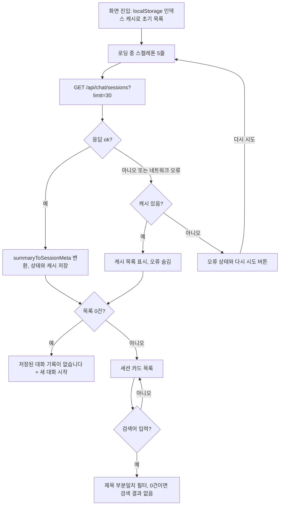

#### 4. 화면 표시 및 입력 데이터 항목 명세
| 항목명 | 화면 표시/입력 구분 | UI 컴포넌트 | 필수 여부 | 데이터 타입 / 제약 | 기본값 | 유효성 검증 규칙 (Validation) | 노출/수정 조건 |
| :--- | :---: | :--- | :---: | :--- | :---: | :--- | :--- |
| 대화 검색 | 사용자 입력 | Text Input (`대화 검색...`) | 선택 | String | 빈 값 | 없음. trim·소문자 후 제목 부분일치 | 사이드바·드로어 머리 2줄째 상시 |
| 검색어 지우기 | 사용자 조작 | Icon Button (`검색어 지우기`) | - | Action | - | - | 검색어가 있을 때만 |
| 세션 제목 | 노출 전용 | 카드 제목 (말줄임, `title` 툴팁) | - | String / DB `String(100)` | `새 대화` | 서버 값 바인딩 | 카드마다 |
| 범위 배지 | 노출 전용 | Badge (`Target`/`Globe` 아이콘) | - | Enum `scoped`→`단일 기사`(강조 톤), `global`→`전체 소식`(중립 톤) | - | `lib/labels.ts` `scopeLabel` | 카드마다 |
| 상대 시각 | 노출 전용 | Label | - | `방금 전` / `N분 전` / `N시간 전` / `어제` / `N일 전` / `M월 D일` | - | `updated_at` 기준 계산 | 카드마다 |
| 활성 표시 | 노출 전용 | 카드 배경 `bg-accent-soft` + 왼쪽 강조색 2px 테두리 | - | `aria-current="true"`, `data-active="true"` | - | 현재 `sessionId` 와 같을 때 | 활성 세션만 |
| 카드 접근 이름 | 노출 전용 | aria-label | - | `대화: <제목>, <상대 시각>, 단일 기사 모드` (global 은 `… 전체 소식 모드`) | - | - | 카드마다 |
| 로딩 스켈레톤 | 노출 전용 | Skeleton 5줄 (`role="status"`) | - | 문구 `대화 기록을 불러오는 중...` | - | - | `isLoading` 일 때 |
| `limit` (API) | 시스템 | Query | 선택 | int 1~50 | 30 | `Query(30, ge=1, le=50)` | 프론트는 30 만 보냄 |
| `offset` (API) | 시스템 | Query | 선택 | int ≥ 0 | 0 | `Query(0, ge=0)` | 프론트는 보내지 않음 |

#### 5. 비즈니스 규칙
- **BR-CHAT-001-1**: 정렬은 `updated_at DESC` 다. 미리보기는 서버 100자(`last_message_preview`), 프론트가 직접 만든 메타는 60자다 (FUNC-CHAT-006).
- **BR-CHAT-001-2**: 검색은 클라이언트 필터다. 서버 검색 API 는 없다.
- **BR-CHAT-001-3**: 서버 조회 실패라도 캐시가 있으면 오류를 보이지 않는다.

#### 6. 예외 처리 및 엣지 케이스
| 발생 상황 | 화면 반응 및 시스템 처리 방식 | 사용자 안내 메시지 |
| :--- | :--- | :--- |
| 로딩 중 | 스켈레톤 5줄 | `대화 기록을 불러오는 중...` (보조기술) |
| 조회 실패, 캐시 있음 | 캐시 목록 표시, 오류 숨김 | 없음 |
| 조회 실패(HTTP), 캐시 없음 | `ErrorState` + `다시 시도` | 제목 `대화 기록을 불러오지 못했습니다`, 문구 = 응답 `message`(500 이면 `대화 목록을 불러오지 못했습니다.`). 응답이 오류 형식이 아니면 `대화 목록을 불러오지 못했습니다.` |
| 네트워크 오류·8초 시간 초과, 캐시 없음 | `ErrorState` + `다시 시도` | `대화 목록을 불러오지 못했습니다.` (브라우저 예외 문구를 보이지 않는다, v0.4.2) |
| 캐시 값이 배열이 아니거나 형식이 다른 항목 | 배열이 아니면 빈 목록, 문자열 `id`·`title` 이 없는 항목은 버린다 (v0.4.2, 위험 42 해결) | - |
| 목록 0건 | 빈 상태 | `저장된 대화 기록이 없습니다` + `새 대화 시작` |
| 검색 결과 0건 | 빈 검색 상태 | `검색 결과가 없습니다` + `검색어 초기화` |
| 서버 시각 형식 | v0.4.2 부터 세션·메시지 시각은 `+00:00` 오프셋이 붙은 UTC ISO 문자열이라 브라우저가 현지 시각으로 바르게 바꾼다 (위험 12번 해결, `backend/app/time_utils.py` `iso_utc`) | - |

#### 7. 비즈니스 에러 코드 매핑
| 비즈니스 에러 코드 | 발생 사유 | HTTP 상태 코드 매핑 | 클라이언트 표시 형태 |
| :--- | :--- | :---: | :--- |
| `ERR_SERVER_INTERNAL` | 목록 조회 중 예외 (`message`: `대화 목록을 불러오지 못했습니다.`, 예외 문자열은 로그에만) | 500 | 캐시 없으면 `ErrorState` 에 `message` |
| `ERR_INVALID_PAYLOAD` | `limit` 1~50 밖, `offset` 음수 (요청 검증, `details` = `[{loc, msg}]`) | 400 | 프론트는 보내지 않음 |

근거: `backend/app/api/chat.py:133-146`, `backend/app/api/errors.py:68-71`, `backend/app/services/chat_session_service.py:81-121`, `frontend/src/lib/chatApi.ts:20-56`, `frontend/src/components/chat/useChatSessions.ts:21-36`, `:99-147`, `frontend/src/components/chat/ChatSidebar.tsx:42-46`, `frontend/src/components/chat/ChatHistoryDrawer.tsx:48-52`, `frontend/src/components/chat/SessionList.tsx:35-76`, `frontend/src/components/chat/SessionItemCard.tsx:18-34,75-109`, `frontend/src/components/chat/SessionListSkeleton.tsx`, `frontend/src/components/chat/SessionEmptyState.tsx`, `frontend/src/types/chat.ts:740-752`

---

### [FUNC-CHAT-002] 새 대화

#### 1. 기본 정보
- **기능명**: 새 대화 시작 (화면 상태 초기화)
- **기능 ID**: `FUNC-CHAT-002`
- **대응 요구사항**: `REQ-CHAT-007` (옛 기능명세 `CHAT-02`)
- **대상 화면 코드**: `SCR-CHAT-001`, `SCR-CHAT-002`, `SCR-UI-002`
- **우선순위**: Should Have
- **관련 액터**: 사용자
- **API**: 없음 (세션은 첫 턴이 끝날 때 서버에 생긴다)

#### 2. 사전 조건
1. `/chat` 화면에 있다.

#### 3. 인터랙션 흐름과 플로우차트
1. 사용자가 다음 중 하나를 누른다: 사이드바/드로어 헤더 `새 대화` 버튼(접근 이름 `+ 새 대화`), 헤더 `새 대화 시작` 아이콘 버튼, 빈 목록의 `새 대화 시작`, 커맨드 팔레트 `새 대화 시작`.
2. 진행 중인 스트림을 중단한다 (`handleStopGenerating`).
3. `crypto.randomUUID()`(없으면 수동 v4 생성)로 새 세션 ID 를 만든다.
4. 메시지, 모델 변경 이벤트, 입력값을 비우고 모델 티어를 `sonnet`, 기사 컨텍스트를 null, 스코프를 `global`, 포커스 필터를 기본값으로 되돌린다.
5. 환영 화면과 추천 질문 4개를 보인다 (FUNC-CHAT-008 BR-CHAT-008-8). 드로어에서 눌렀으면 드로어도 닫힌다.

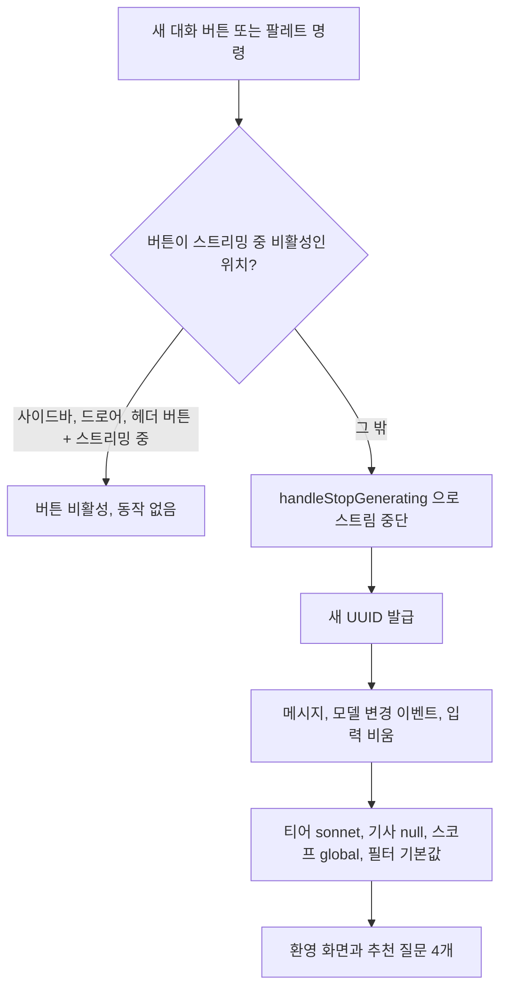

#### 4. 화면 표시 및 입력 데이터 항목 명세
| 항목명 | 화면 표시/입력 구분 | UI 컴포넌트 | 필수 여부 | 데이터 타입 / 제약 | 기본값 | 유효성 검증 규칙 (Validation) | 노출/수정 조건 |
| :--- | :---: | :--- | :---: | :--- | :---: | :--- | :--- |
| `+ 새 대화` | 사용자 조작 | Button (사이드바·드로어 머리 1줄째) | - | Action | - | - | 항상 보임, `disabled={isStreaming}` |
| `새 대화 시작` (헤더) | 사용자 조작 | Icon Button | - | Action | - | - | `!isDesktop \|\| !isSidebarOpen` (1024px 이상은 사이드바를 접었을 때만, 미만은 항상), `disabled={isStreaming}` |
| `새 대화 시작` (빈 목록) | 사용자 조작 | Button | - | Action | - | - | 목록 0건일 때, 스트리밍 중에도 활성 |
| `새 대화 시작` (팔레트) | 사용자 조작 | Palette Command | - | Action | - | - | 팔레트 열림 시, 스트리밍 중에도 활성 |
| `sessionId` | 시스템 관리 | Hidden State | 필수 | UUID v4 문자열 | 화면 진입 시 생성 | `crypto.randomUUID()` 또는 수동 v4 | 새 대화마다 교체 |

#### 5. 비즈니스 규칙
- **BR-CHAT-002-1**: 새 대화는 서버를 부르지 않는다. 세션 행은 첫 턴의 done 직전 서버 자동 저장(또는 중단된 첫 턴이면 프론트 업서트)으로 생긴다.
- **BR-CHAT-002-2**: 초기화 대상: 메시지, 모델 변경 이벤트, 입력값, 티어(`sonnet`), 기사 컨텍스트(null), 스코프(`global`), 포커스 필터(all/all/hot/false).

#### 6. 예외 처리 및 엣지 케이스
| 발생 상황 | 화면 반응 및 시스템 처리 방식 | 사용자 안내 메시지 |
| :--- | :--- | :--- |
| 스트리밍 중 사이드바·드로어·헤더 버튼 | 비활성 | - |
| 스트리밍 중 빈 목록 버튼·팔레트 명령 | 스트림을 중단한 뒤 초기화 | - |
| 드로어 안에서 누름 | 초기화 후 드로어 닫힘 | - |

#### 7. 비즈니스 에러 코드 매핑
| 비즈니스 에러 코드 | 발생 사유 | HTTP 상태 코드 매핑 | 클라이언트 표시 형태 |
| :--- | :--- | :---: | :--- |
| (없음) | 서버 호출 없음 | - | - |

근거: `frontend/src/components/chat/ChatWorkspace.tsx:45-54,193-204,564-570`, `frontend/src/components/chat/ChatSidebarHeader.tsx:29-38`, `frontend/src/components/chat/ChatHeader.tsx:77,125-127`, `frontend/src/components/chat/SessionEmptyState.tsx:43-57`

---

### [FUNC-CHAT-003] 세션 선택·복원

#### 1. 기본 정보
- **기능명**: 과거 세션 선택과 메시지·스코프·기사·필터 복원
- **기능 ID**: `FUNC-CHAT-003`
- **대응 요구사항**: `REQ-CHAT-007` (옛 기능명세 `CHAT-03`)
- **대상 화면 코드**: `SCR-CHAT-002`, `SCR-CHAT-001`
- **우선순위**: Should Have
- **관련 액터**: 사용자
- **API**: `GET /api/chat/sessions/{session_id}`

#### 2. 사전 조건
1. 세션 카드가 목록에 있거나, URL 에 `/chat?session_id=<id>` 가 있다(첫 진입 1회만 처리).

#### 3. 인터랙션 흐름과 플로우차트
1. 사용자가 세션 카드를 클릭하거나 Enter/Space 를 누른다. 또는 첫 렌더에서 `session_id` 파라미터를 읽는다 (이 경우 핸드오버 처리는 하지 않는다, FUNC-CHAT-018).
2. 스트리밍 중이면 먼저 중단한다.
3. `sessionId` 를 대상 ID 로 바꾼다.
4. `loadSessionDetail`: localStorage `agentlens_chat_session_<id>` 를 먼저 읽어 두고 서버를 부른다. 200 이면 응답을 localStorage 에 저장하고 쓴다. 404·네트워크 오류·그 밖의 상태면 캐시를 쓴다(없으면 null).
5. 상세가 있으면 `scope_mode`, `active_source`(서버가 `news_items` 에서 채운 기사 상세), `active_filters`(없으면 기본값), 메시지를 복원한다. 메시지는 `chatMessageItemToUiMessage` 로 바꾸며 상태는 pending→sending, 나머지는 그대로 대응한다.
6. 백엔드는 메시지를 `created_at ASC` 로 돌려준다(관계 `order_by`). 메시지별 `sources_json`, `usage_json` 파싱에 실패하면 null 로 둔다. 메시지 `status` 가 비면 `completed`.
7. 드로어를 닫는다.

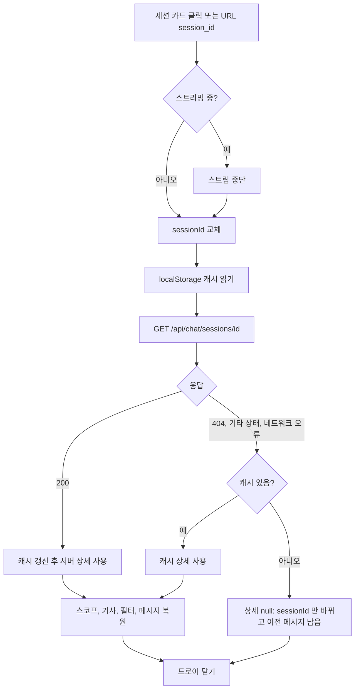

#### 4. 화면 표시 및 입력 데이터 항목 명세
| 항목명 | 화면 표시/입력 구분 | UI 컴포넌트 | 필수 여부 | 데이터 타입 / 제약 | 기본값 | 유효성 검증 규칙 (Validation) | 노출/수정 조건 |
| :--- | :---: | :--- | :---: | :--- | :---: | :--- | :--- |
| 세션 카드 | 사용자 조작 | 선택 버튼 (클릭, Enter/Space). 삭제 버튼은 선택 버튼 밖의 형제 요소 (v0.4.2) | - | 세션 ID 문자열 | - | 백엔드 상세 조회는 형식 검사 안 함 | 목록 항목마다 |
| `session_id` (URL) | 시스템 입력 | Query Param | 선택 | UUID 문자열 (`8-4-4-4-12` 16진수, 대소문자 무시) | - | UUID 형식이 아니면 무시하고 세션을 열지 않는다(다음 분기 `sourceId`·`q` 처리로 넘어감, v0.4.2) | 첫 렌더 1회 |
| 복원 메시지 | 노출 전용 | Message List | - | `ChatMessageItem[]` → UI 메시지 | [] | `created_at ASC` | 상세가 있을 때 |
| 복원 기사 칩 | 노출 전용 | `ActiveSourceChip` | - | `ChatSourceDetailResponse` | null | 서버가 `news_items` 에서 채움, 기사 없으면 null | `active_source` 가 있을 때 |
| 복원 필터 | 시스템 | State | - | `ChatFocusFilter` | 기본값 | 파싱 실패 시 null → 기본값 | 항상 |

#### 5. 비즈니스 규칙
- **BR-CHAT-003-1**: 서버 우선, 실패 시 캐시. 서버 200 응답은 캐시를 덮어쓴다.
- **BR-CHAT-003-2**: 복원 메시지에는 `step_history` 가 없으므로 워크플로 트래커는 보이지 않는다.
- **BR-CHAT-003-3**: 선택해도 모델 티어와 모델 변경 이벤트는 초기화하지 않는다.
- **BR-CHAT-003-4**: localStorage 에 저장한 세션 상세에는 `active_source`(기사 상세)가 없다 (`active_source_id` 만 있다). 캐시로만 복원하면 기사 칩이 없다.

#### 6. 예외 처리 및 엣지 케이스
| 발생 상황 | 화면 반응 및 시스템 처리 방식 | 사용자 안내 메시지 |
| :--- | :--- | :--- |
| 서버·캐시 모두 없음 (상세 null) | `sessionId` 만 바뀌고 이전 화면 메시지가 그대로 남는다 (위험 3번) | 없음 |
| 이전 세션의 모델 변경 구분선 | 지우지 않아 복원 타임라인에 섞인다 (위험 4번) | - |
| 캐시로만 복원된 scoped 세션 | 스코프는 `scoped`, 기사 컨텍스트는 null 이 되어 다음 전송이 `source_id` 없는 scoped 요청 → 404 오류 카드 (코드 경로 판단, 위험 37번) | `지정된 기사를 찾을 수 없습니다.` |
| 서버 기사가 지워짐 | `active_source` null, `active_source_id` 는 남음 | - |

#### 7. 비즈니스 에러 코드 매핑
| 비즈니스 에러 코드 | 발생 사유 | HTTP 상태 코드 매핑 | 클라이언트 표시 형태 |
| :--- | :--- | :---: | :--- |
| `ERR_SESSION_NOT_FOUND` | 세션 없음 (`ID {id}에 해당하는 대화 세션을 찾을 수 없습니다.`) | 404 | 표시 없음, 캐시로 대체 |
| `ERR_SERVER_INTERNAL` | 그 밖의 예외 (`message`: `대화 내용을 불러오지 못했습니다.`, 예외 문자열은 로그에만) | 500 | 표시 없음, 캐시로 대체 |
| (클라이언트) | 8초 시간 초과·네트워크 오류 | - | 표시 없음, 캐시로 대체 |

- 캐시 상세는 객체이고 문자열 `id` 와 메시지 배열이 있을 때만 쓴다. 아니면 없음(null)으로 본다 (v0.4.2, `frontend/src/components/chat/useChatSessions.ts:38-54`).
- 인수 기준: `/chat?session_id=abc` 로 들어오면 `GET /api/chat/sessions/abc` 를 부르지 않는다. `/chat?session_id=<UUID>` 면 1번 부른다.

근거: `backend/app/api/chat.py:179-193`, `backend/app/services/chat_session_service.py:123-228`, `frontend/src/lib/chatApi.ts:58-62`, `frontend/src/components/chat/useChatSessions.ts:149-165`, `frontend/src/components/chat/ChatWorkspace.tsx:45-46`, `:212-239`, `:478-488`, `frontend/src/types/chat.ts`

---

### [FUNC-CHAT-004] 세션 제목(이름)

#### 1. 기본 정보
- **기능명**: 첫 질문으로 세션 제목 자동 생성
- **기능 ID**: `FUNC-CHAT-004`
- **대응 요구사항**: `REQ-CHAT-007` (옛 기능명세 `CHAT-04`)
- **대상 화면 코드**: `SCR-CHAT-002`
- **우선순위**: Should Have
- **관련 액터**: 시스템
- **API**: 전용 API 없음. `POST /api/chat/sessions` 의 `title` 필드와 서버 메시지 덧붙이기에서만 바뀐다.

#### 2. 사전 조건
1. 세션에 사용자 메시지가 1개 이상 생긴다.

#### 3. 인터랙션 흐름과 플로우차트
1. 백엔드 `generate_auto_title`: ``#*_~` `` 문자와 HTML 태그를 공백으로 바꾸고, 줄바꿈·탭을 공백으로, 연속 공백을 하나로 줄인 뒤 trim. 비면 `새 대화`, 30자 이하면 그대로, 넘으면 앞 30자 + `...`.
2. 백엔드는 메시지를 덧붙일 때 세션 제목이 `새 대화` 이거나 비어 있으면 그 사용자 메시지로 제목을 만든다.
3. 프론트 `generateAutoTitle` 도 같은 규칙이다(줄바꿈은 `\s+` 처리로 함께 정리). `createOrUpdateSession` 은 제목이 없거나 `새 대화` 면 첫 사용자 메시지로 만든다.
4. 서버 업서트는 `title` 이 null 이 아니면 덮어쓴다.

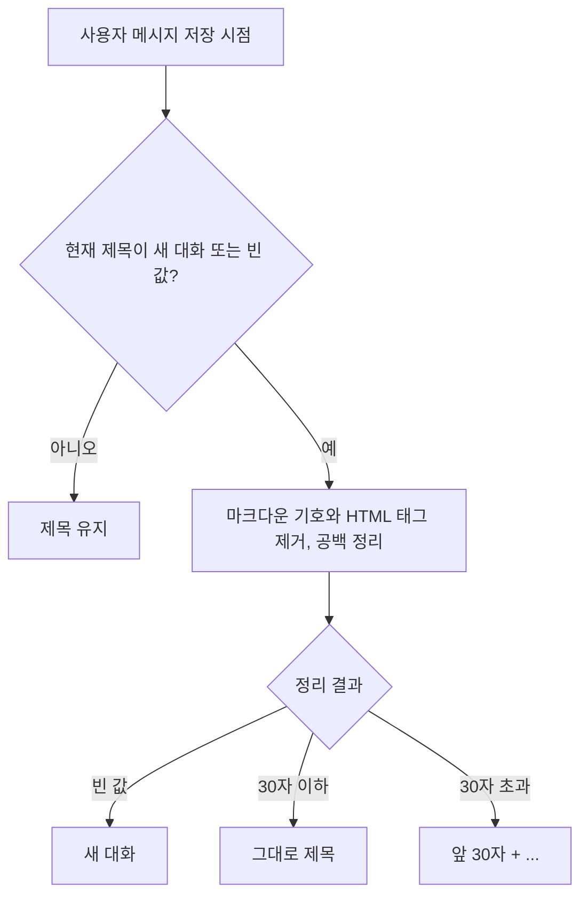

#### 4. 화면 표시 및 입력 데이터 항목 명세
| 항목명 | 화면 표시/입력 구분 | UI 컴포넌트 | 필수 여부 | 데이터 타입 / 제약 | 기본값 | 유효성 검증 규칙 (Validation) | 노출/수정 조건 |
| :--- | :---: | :--- | :---: | :--- | :---: | :--- | :--- |
| 세션 제목 | 노출 전용 | 카드 제목, `title` 속성 툴팁 | - | String / DB `String(100)`, 백엔드 요청 스키마와 프론트 zod 모두 길이 제한 없음 (v0.4.2) | `새 대화` | 자동 제목 규칙 | 수정 UI 없음 |

#### 5. 비즈니스 규칙
- **BR-CHAT-004-1**: 자동 제목 최대 길이는 30자 + `...` 이다.
- **BR-CHAT-004-2**: 제목 수동 변경(rename) 화면과 전용 API 는 없다.

#### 6. 예외 처리 및 엣지 케이스
| 발생 상황 | 화면 반응 및 시스템 처리 방식 | 사용자 안내 메시지 |
| :--- | :--- | :--- |
| 질문이 기호·태그만 | 제목 `새 대화` | - |
| 빈 제목 업서트 | 백엔드는 막지 않는다. zod 도 v0.4.2 부터 제목 길이를 제한하지 않아 계약이 같다 (위험 21번 해결) | - |

#### 7. 비즈니스 에러 코드 매핑
| 비즈니스 에러 코드 | 발생 사유 | HTTP 상태 코드 매핑 | 클라이언트 표시 형태 |
| :--- | :--- | :---: | :--- |
| (없음) | 자동 처리 | - | - |

근거: `backend/app/services/chat_session_service.py:38-49,341-343`, `backend/app/models/chat_session.py:11`, `frontend/src/types/chat.ts:763-771`, `frontend/src/components/chat/useChatSessions.ts:179-186`

---

### [FUNC-CHAT-005] 세션 삭제

#### 1. 기본 정보
- **기능명**: 확인 팝오버 후 세션과 메시지 삭제
- **기능 ID**: `FUNC-CHAT-005`
- **대응 요구사항**: `REQ-CHAT-007` (옛 기능명세 `CHAT-05`)
- **대상 화면 코드**: `SCR-CHAT-002`, `SCR-CHAT-003`
- **우선순위**: Should Have
- **관련 액터**: 사용자
- **API**: `DELETE /api/chat/sessions/{session_id}`

#### 2. 사전 조건
1. 목록에 세션 카드가 있다.

#### 3. 인터랙션 흐름과 플로우차트
1. 사용자가 카드 휴지통 버튼(접근 이름 `대화 '{제목}' 삭제`)을 누른다. 768px 이상은 호버·포커스 때 보이고, 그 미만은 항상 보인다.
2. `DeleteConfirmPopover` 가 열리고 `취소` 버튼에 포커스를 둔다.
3. `삭제` 를 누르면 버튼이 `삭제 중...` 으로 바뀐다. 프론트는 목록과 localStorage(인덱스와 세션 상세)에서 먼저 지운다(낙관적 삭제).
4. 서버에서 세션을 삭제한다. ORM `cascade="all, delete-orphan"` 과 FK `ondelete="CASCADE"` 로 메시지도 지운다.
5. 지운 세션이 현재 세션이면 새 대화로 초기화한다(FUNC-CHAT-002).
6. 끝나면 팝오버가 닫힌다.
7. 서버 실패(HTTP 오류, 8초 시간 초과, 네트워크 오류) 시 프론트는 목록을 다시 불러오고 오류를 다시 던진다. 카드가 오류를 잡아 위험 톤 알림(응답 `message`, 없으면 `대화를 삭제하지 못했습니다.`)을 띄우고 팝오버를 닫는다. 현재 세션 초기화는 하지 않는다 (v0.4.2, 위험 10 해결).

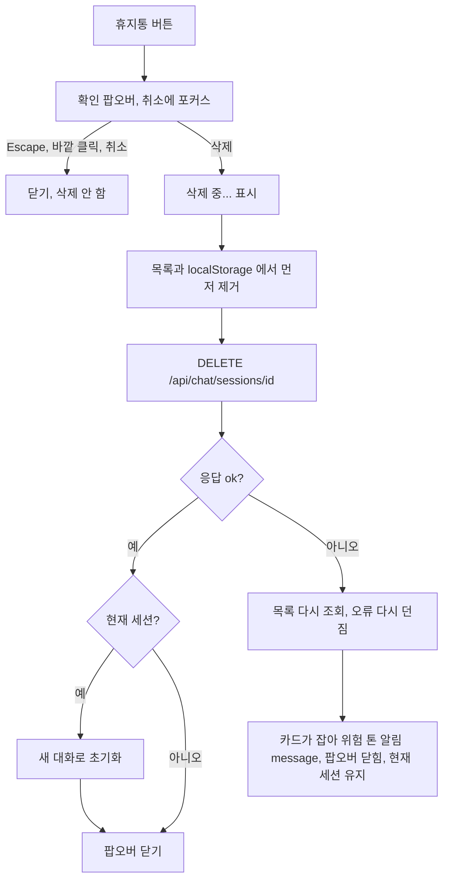

#### 4. 화면 표시 및 입력 데이터 항목 명세
| 항목명 | 화면 표시/입력 구분 | UI 컴포넌트 | 필수 여부 | 데이터 타입 / 제약 | 기본값 | 유효성 검증 규칙 (Validation) | 노출/수정 조건 |
| :--- | :---: | :--- | :---: | :--- | :---: | :--- | :--- |
| 삭제 버튼 | 사용자 조작 | Icon Button (휴지통) | - | 접근 이름 `대화 '{제목}' 삭제` | - | - | 768px 이상 호버·포커스, 미만 항상 |
| 확인 팝오버 | 노출 전용 | Popover `role="dialog"` | - | 이름 `이 대화를 삭제하시겠습니까?`, 안내 `삭제된 대화 기록과 모든 메시지는 영구 복구할 수 없습니다.` | 닫힘 | - | 삭제 버튼 클릭 시 |
| `취소` | 사용자 조작 | Button | - | Action | 열릴 때 포커스 | - | 팝오버 안 |
| `삭제` | 사용자 조작 | Danger Button | - | Action, 진행 중 `삭제 중...` | - | - | 팝오버 안 |

#### 5. 비즈니스 규칙
- **BR-CHAT-005-1**: 낙관적 삭제다. 서버 응답 전에 목록과 캐시에서 지운다.
- **BR-CHAT-005-2**: 팝오버는 Escape(오버레이 스택의 맨 위일 때만, 드로어 안에서 열어도 드로어는 남는다) 또는 바깥 pointerdown 으로 닫히고, 삭제 중에는 닫히지 않는다.
- **BR-CHAT-005-3**: 성공 응답은 `{status: "success", message: "대화 세션 및 하위 메시지가 원자적으로 영구 삭제되었습니다.", deleted_count: 1}` 이다.

#### 6. 예외 처리 및 엣지 케이스
| 발생 상황 | 화면 반응 및 시스템 처리 방식 | 사용자 안내 메시지 |
| :--- | :--- | :--- |
| 서버 삭제 실패 | 목록 재조회(지운 카드가 다시 나타남), 위험 톤 알림, 현재 세션 초기화 안 함 (v0.4.2) | 응답 `message`(404 `ID {id}에 해당하는 대화 세션을 찾을 수 없습니다.`, 500 `대화를 삭제하지 못했습니다.`), 시간 초과면 `대화를 삭제하지 못했습니다.`, 연결 자체가 실패하면 `서버에 연결하지 못했습니다. 연결 상태를 확인하고 다시 시도해 주세요.` |
| 삭제 중 Escape·바깥 클릭 | 닫히지 않음 | - |

#### 7. 비즈니스 에러 코드 매핑
| 비즈니스 에러 코드 | 발생 사유 | HTTP 상태 코드 매핑 | 클라이언트 표시 형태 |
| :--- | :--- | :---: | :--- |
| `ERR_SESSION_NOT_FOUND` | 없는 세션 | 404 | 위험 톤 알림 `message`, 목록 재조회 |
| `ERR_SESSION_DELETE_FAILED` | 커밋 실패(롤백 후) 또는 그 밖 예외 (`message`: `대화를 삭제하지 못했습니다.`, DB 예외 문장은 로그에만) | 500 | 위험 톤 알림, 목록 재조회 |

근거: `backend/app/api/chat.py:195-209`, `backend/app/services/chat_session_service.py:306-323`, `frontend/src/lib/chatApi.ts:72-74`, `frontend/src/components/chat/useChatSessions.ts:262-282`, `frontend/src/components/chat/SessionItemCard.tsx:64-78`, `:119-134`, `frontend/src/components/chat/DeleteConfirmPopover.tsx`, `frontend/src/components/chat/ChatWorkspace.tsx:236-244`

---

### [FUNC-CHAT-006] 세션 저장·동기화

#### 1. 기본 정보
- **기능명**: 서버 자동 영속화, 프론트 업서트, localStorage 캐시, 최대 `CHAT_SESSION_MAX_LIMIT`(기본 30)개 FIFO
- **기능 ID**: `FUNC-CHAT-006`
- **대응 요구사항**: `REQ-CHAT-007` (옛 기능명세 `CHAT-06`)
- **대상 화면 코드**: `SCR-CHAT-002` (목록 즉시 갱신), `API`
- **우선순위**: Should Have
- **관련 액터**: 시스템
- **API**: `POST /api/chat/sessions` (`ChatSessionCreateRequest`), 스트림 내부 `persist_turn`

#### 2. 사전 조건
1. 서버 자동 영속화: `stream_chat` 이 토큰 스트림을 오류 없이 마쳤다 (done 을 보내기 직전).
2. 프론트 업서트: 스트림이 `done` 을 받고 끝났거나 사용자가 중단했고, 메시지가 1개 이상이다. 오류·끊김이면 저장하지 않는다.

#### 3. 인터랙션 흐름과 플로우차트
1. 서버 자동 영속화: `stream_chat` 이 `event: done` 을 보내기 **앞에** `persist_turn` 으로 사용자 메시지(상태 `completed`)와 어시스턴트 메시지(출처, 모델, 티어, usage, latency 포함)를 한 번에 덧붙인다. 메시지 id 는 요청의 `user_message_id`·`assistant_message_id`(프론트 클라이언트 id)이고, 없으면 uuid4 다. 세션이 없으면 `새 대화` 제목으로 만든 뒤 덧붙인다. 실패하면 로그만 남기고 done 은 그대로 보낸다 (`backend/app/services/chat_service.py:668-689`).
2. 프론트 저장 `saveTurn()`: 턴마다 한 번, 상태 갱신 함수 밖에서 부른다 (StrictMode 에서도 한 번). 그 턴의 원래 세션 id 로 '이번 턴 앞의 대화 + 사용자 메시지 + 최종 어시스턴트 메시지' 를 `createOrUpdateSession` 에 넘긴다 (`frontend/src/components/chat/ChatWorkspace.tsx:298-324`).
3. 프론트 `createOrUpdateSession`: 메시지가 0개면 아무것도 하지 않는다. 목록 메타(제목, 메시지 수, 마지막 메시지 앞 60자)를 맨 앞에 넣고 30개로 자른 뒤 localStorage 인덱스와 세션 상세를 저장한다. 목록에서 밀려난 세션의 상세 캐시(`agentlens_chat_session_<id>`)도 지운다 (v0.4.2). 그다음 메시지 전체를 `uiMessageToChatMessageItem`(`id, session_id, role, content, created_at`(메시지 시각), `sources, status, model, model_tier, latency_ms, usage`)으로 바꿔 `POST /api/chat/sessions` 로 보낸다(8초 제한). 응답과 오류는 무시한다.
4. 업서트(백엔드): 본문이 JSON 이 아니거나 객체가 아니면 400 `ERR_INVALID_PAYLOAD`, 필드 스키마 위반도 400 `ERR_INVALID_PAYLOAD`(`details` = `[{loc, msg}]`). `id` 가 있으면 UUID 형식을 검사해 아니면 400 `ERR_SESSION_INVALID_UUID`. 받은 메시지 id 가 **다른 세션**에 이미 있으면 아무것도 바꾸기 전에 400 `ERR_INVALID_PAYLOAD`(`message` `다른 대화에서 이미 쓰는 메시지 id 입니다: …`, `details.message_ids` = 겹친 id 목록)로 거절한다. 통과하면 있는 세션은 null 이 아닌 `title`, `scope_mode`, `active_source_id`, `active_filters` 만 덮어쓰고 `updated_at` 을 갱신한다. 없으면 새로 만든다(제목 기본 `새 대화`, 스코프 기본 `global`).
5. `messages` 가 있으면 `append_messages_batch` 로 덧붙인다(교체가 아니다). 이 세션에 이미 있는 메시지 id(같은 요청 안에서 앞서 넣은 id 포함)는 건너뛴다. 새로 넣는 메시지는 `id, role, content, sources, status, model, model_tier, usage, latency_ms, created_at` 을 저장한다 (v0.4.2). `created_at` 은 받은 ISO 시각을 UTC 로 쓰고, 없거나 해석할 수 없으면 서버 시각에 배치 안 순서대로 1µs 씩 더해 순서를 지킨다.
6. 세션 행·메시지·FIFO 정리를 한 트랜잭션으로 묶어 끝에서 한 번 커밋한다. 세션 수가 `CHAT_SESSION_MAX_LIMIT`(`config.json` `chat.max_session_limit`, 기본 30)를 넘으면 `updated_at` 이 오래된 순으로 넘는 만큼 지운다.
7. 응답은 201 과 세션 상세(`ChatSessionDetail`, 메시지마다 `model_tier`·`usage`·`created_at` 포함). 상세 조회는 `populate_existing` 으로 방금 바뀐 상태를 다시 읽는다.
8. 결과: 완료된 턴은 서버가 먼저 클라이언트 id 로 저장하고 프론트 POST 는 그 id 를 건너뛰어, 한 턴이 메시지 2개로 남는다. 중단된 턴은 서버 저장이 없어 프론트 POST 가 상태 `aborted` 로 저장하고, 이때도 `model_tier`·`usage` 가 함께 저장된다.

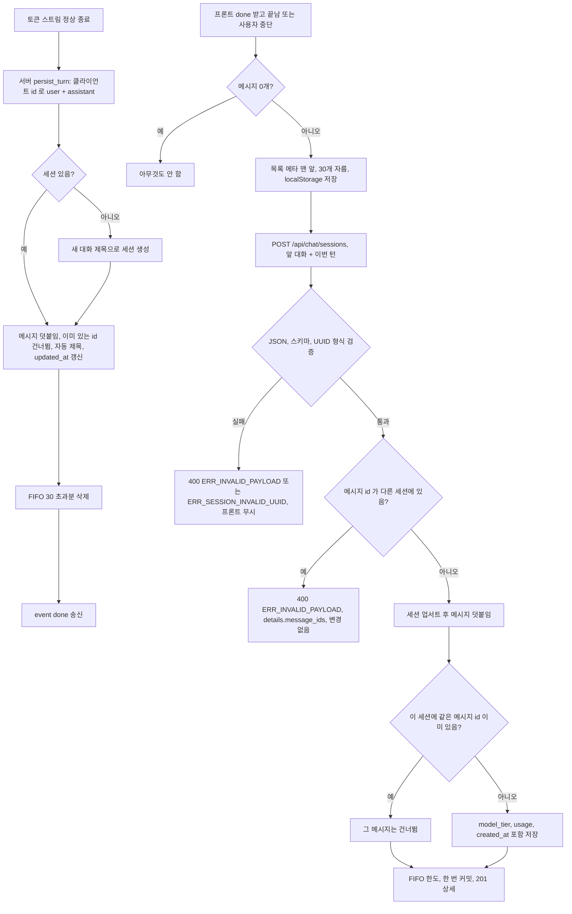

#### 4. 화면 표시 및 입력 데이터 항목 명세
| 항목명 | 화면 표시/입력 구분 | UI 컴포넌트 | 필수 여부 | 데이터 타입 / 제약 | 기본값 | 유효성 검증 규칙 (Validation) | 노출/수정 조건 |
| :--- | :---: | :--- | :---: | :--- | :---: | :--- | :--- |
| `id` | 시스템 | 요청 본문 | 선택 | UUID 문자열 | 서버가 새 UUID | `uuid.UUID(id)` 실패 시 400 `ERR_SESSION_INVALID_UUID` | - |
| `title` | 시스템 | 요청 본문 | 선택 | String, 길이 제한 없음 | `새 대화` | null 이 아니면 덮어씀 | - |
| `scope_mode` | 시스템 | 요청 본문 | 선택 | `scoped` \| `global` | `global` | Literal 검증 | - |
| `active_source_id` | 시스템 | 요청 본문 | 선택 | int | null | null 이면 기존 값 유지 | - |
| `active_filters` | 시스템 | 요청 본문 | 선택 | `ChatFocusFilter` | null | Literal 검증 | - |
| `messages` | 시스템 | 요청 본문 | 선택 | `ChatMessageItem[]` (`id, role, content, created_at, sources, status, model, model_tier, latency_ms, usage`) | [] | 덧붙임. 이 세션에 이미 있는 id 는 건너뜀, 다른 세션의 id 가 있으면 요청 전체 400. `model_tier`·`usage`·`created_at` 저장 (v0.4.2) | - |
| `messages[].created_at` | 시스템 | 요청 본문 | 필수(스키마) | ISO 문자열 | - | 해석 실패면 서버 시각 + 순서 µs | 저장 순서·복원 순서 기준 |
| 사이드바 목록 | 노출 전용 | Session List | - | 메타 최대 30 | - | 맨 앞 삽입, 밀려난 세션의 상세 캐시 삭제 | 저장 직후 즉시 갱신 |

#### 5. 비즈니스 규칙
- **BR-CHAT-006-1**: 세션 보존 한도는 서버 `CHAT_SESSION_MAX_LIMIT`(기본 30, v0.4.2 부터 설정이 실제로 쓰인다)와 프론트 목록 30개(코드 고정 `MAX_SESSIONS`)이고 `updated_at` 오래된 순으로 지운다. 서버 설정을 30 밖으로 바꾸면 프론트 목록 한도와 달라진다.
- **BR-CHAT-006-2**: 업서트는 메시지를 교체하지 않고 덧붙이며, 이 세션에 이미 있는 메시지 id 는 건너뛴다. 다른 세션에 있는 id 는 건너뛰지 않고 요청 전체를 400 으로 거절한다 (v0.4.2, `backend/app/services/chat_session_service.py:230-304`, `:412-422`). 인수 기준: 세션 A 에 저장된 메시지 id `m1` 을 세션 B 의 POST 에 넣으면 400, `error_code` `ERR_INVALID_PAYLOAD`, `details.message_ids == ["m1"]`, 세션 B 는 만들어지거나 바뀌지 않는다.
- **BR-CHAT-006-6 (v0.4.2)**: 메시지의 `model_tier`·`usage`·`created_at` 을 저장하고 상세 조회에서 돌려준다. `created_at` 이 없으면 서버 시각 + 배치 순서 µs 라 같은 배치의 메시지 순서가 보장된다 (위험 11·14 해결).
- **BR-CHAT-006-3**: 서버 업서트는 `active_source_id` 가 null 이면 기존 값을 지우지 않는다.
- **BR-CHAT-006-4**: 프론트는 한 턴에 POST 를 최대 한 번 보낸다(완료 또는 중단). 오류·끊긴 턴은 보내지 않는다 (v0.4.1, 리뷰 FE-02).
- **BR-CHAT-006-5**: 서버와 프론트가 같은 클라이언트 메시지 id 로 저장하므로 완료된 턴은 메시지 2개로 남는다 (v0.4.1, 리뷰 BUG-02·BUG-02R).

#### 6. 예외 처리 및 엣지 케이스
| 발생 상황 | 화면 반응 및 시스템 처리 방식 | 사용자 안내 메시지 |
| :--- | :--- | :--- |
| 서버 자동 저장 실패 | 서버 로그만 (`Failed to auto-persist turn to DB for session …`), done 은 보낸다. 이어 오는 프론트 POST 가 그 턴을 저장한다(`model_tier`·`usage` 포함) | 없음 |
| 같은 턴 다시 저장 | 이미 있는 id 라 건너뛴다. 중복·PK 충돌 없음 (위험 1번 해결) | 없음 |
| 클라이언트 메시지 id 가 다른 세션에 이미 있음 | 업서트는 400 `ERR_INVALID_PAYLOAD`(`details.message_ids`)로 거절하고 아무것도 바꾸지 않는다. 서버 자동 저장(`persist_turn`)도 같은 검사로 실패해 로그만 남긴다 (v0.4.2, 위험 41 해결) | 없음 (프론트는 응답을 무시) |
| 스트림 중 오류·끊김 | done·서버 저장 없음, 프론트 저장 없음 | 오류 표시 (FUNC-CHAT-020) |
| localStorage 쓰기 실패 | `try/catch` 로 무시 | 없음 |
| 프론트 업서트로만 저장된 메시지 (중단된 턴 등) | `model_tier`, `usage`, `created_at` 도 저장된다 (v0.4.2, 위험 14번 해결). 중단된 턴의 `usage` 는 `done` 을 못 받아 비어 있다 | - |
| 개발 모드 StrictMode | 저장을 상태 갱신 함수 밖에서 하므로 POST 는 한 번이다 (위험 38번 해결). localStorage 쓰기는 `setSessions` 갱신 함수 안이라 두 번 실행될 수 있으나 같은 값이다 | - |

#### 7. 비즈니스 에러 코드 매핑
| 비즈니스 에러 코드 | 발생 사유 | HTTP 상태 코드 매핑 | 클라이언트 표시 형태 |
| :--- | :--- | :---: | :--- |
| `ERR_INVALID_PAYLOAD` | 본문 JSON 오류(`요청 본문이 올바른 JSON 이 아닙니다.`), JSON 객체 아님(`요청 본문은 JSON 객체여야 합니다.`), 필드 스키마 위반(`요청 필드 형식이 올바르지 않습니다.`, `details` = `[{loc, msg}]`), 다른 세션의 메시지 id(`다른 대화에서 이미 쓰는 메시지 id 입니다: …`, `details.message_ids`) | 400 | 표시 없음 (응답 무시) |
| `ERR_SESSION_INVALID_UUID` | 세션 `id` UUID 형식 오류만 (`유효하지 않은 세션 UUID 형식이거나 파라미터 규격 오류입니다.`) | 400 | 표시 없음 (응답 무시) |
| `ERR_SESSION_CREATE_FAILED` | 그 밖 예외 (`message`: `대화 세션을 저장하지 못했습니다.`, 예외 문자열은 로그에만) | 500 | 표시 없음 |

근거: `backend/app/api/chat.py:148-177`, `backend/app/services/chat_session_service.py:35-58`, `:230-304`, `:325-422`, `backend/app/services/chat_service.py:668-689`, `frontend/src/lib/chatApi.ts:64-70`, `frontend/src/components/chat/useChatSessions.ts:167-260`, `frontend/src/components/chat/ChatWorkspace.tsx:314-324`, `frontend/src/types/chat.ts:744-769`, 동작 확인 테스트 `backend/tests/test_code_review_fixes.py`, `frontend/src/tests/chat/ChatStreamTurn.test.tsx`

---

### [FUNC-CHAT-007] 히스토리 사이드바·드로어

#### 1. 기본 정보
- **기능명**: 데스크톱 사이드바 접기, 1024px 미만 드로어
- **기능 ID**: `FUNC-CHAT-007`
- **대응 요구사항**: `REQ-CHAT-007` (옛 기능명세 `CHAT-07`)
- **대상 화면 코드**: `SCR-CHAT-002`
- **우선순위**: Should Have
- **관련 액터**: 사용자

#### 2. 사전 조건
1. `/chat` 화면에 있다.

#### 3. 인터랙션 흐름과 플로우차트
1. 사이드바는 처음에 열린 상태(`isSidebarOpen = true`)이고 CSS 로 1024px 이상에서만 보인다 (`hidden lg:flex`, 폭 `w-72`). `<aside id="chat-history-sidebar" role="navigation" aria-label="대화 기록 목록">` 이다. 닫으면 렌더링하지 않는다.
2. 헤더 기록 버튼(`대화 기록 보기`)은 `isDesktop`(`useMediaQuery('(min-width: 1024px)')`)이면 사이드바를, 아니면 드로어를 토글한다.
3. 팔레트 `대화 기록 열기` 는 같은 기준으로 사이드바나 드로어를 연다(토글이 아니다).
4. 드로어는 공통 `Drawer side="left"` 다. 세션 선택·새 대화 후 닫힌다. `대화 기록 드로어 닫기` 버튼, 배경막 클릭, Escape 로도 닫힌다.
5. 드로어는 `isDrawerOpen && !isDesktop` 일 때만 그린다. 열린 채로 1024px 이상이 되면 드로어가 사라지고 사이드바가 보인다.

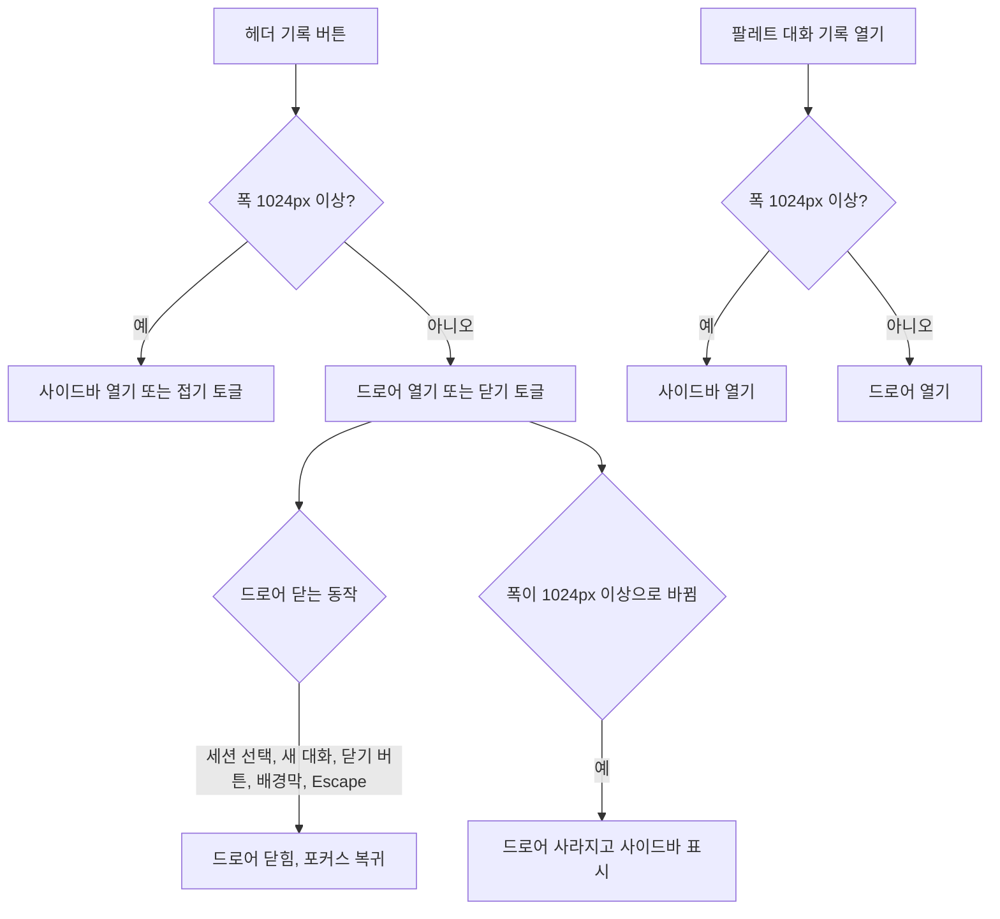

#### 4. 화면 표시 및 입력 데이터 항목 명세
| 항목명 | 화면 표시/입력 구분 | UI 컴포넌트 | 필수 여부 | 데이터 타입 / 제약 | 기본값 | 유효성 검증 규칙 (Validation) | 노출/수정 조건 |
| :--- | :---: | :--- | :---: | :--- | :---: | :--- | :--- |
| 기록 버튼 `대화 기록 보기` | 사용자 조작 | Icon Button | - | `aria-expanded` = 그 폭의 열림 상태. `aria-controls` 는 열려 있을 때만 (1024px 이상 `chat-history-sidebar`, 미만 `chat-history-drawer`) | - | - | 헤더 상시 |
| `사이드바 접기` | 사용자 조작 | Icon Button | - | Action | - | - | 사이드바에서만 (`사이드바 펼치기` 분기는 그려질 일이 없음) |
| 사이드바 | 노출 전용 | `aside` `w-72` | - | `role="navigation"`, `aria-label="대화 기록 목록"` | 열림 | - | 1024px 이상 + `isSidebarOpen` |
| 드로어 | 노출 전용 | `Drawer side="left"` | - | `role="dialog"`, `aria-modal="true"`, 제목 `대화 기록`(`aria-labelledby`), 패널 `id="chat-history-drawer"`, 폭 `min(320px, 85vw)`, 안에 `nav aria-label="대화 기록 목록"` | 닫힘 | - | `isDrawerOpen && !isDesktop` |
| 드로어 닫기 | 사용자 조작 | Icon Button `대화 기록 드로어 닫기` | - | Action | - | - | 드로어 안 |
| 머리 1줄 | 노출 전용 | `ChatSidebarHeader` | - | 56px (챗 헤더 높이), 새 대화 + `사이드바 접기` | - | - | 사이드바·드로어 공통 |
| 머리 2줄 | 노출 전용 | `ChatSidebarHeader` | - | 768px 이상 44px, 미만 최소 44px (맥락 줄 높이), `대화 검색` 입력, 아래 테두리 | - | - | 사이드바·드로어 공통 |

#### 5. 비즈니스 규칙
- **BR-CHAT-007-1**: 사이드바/드로어 기준 폭은 1024px 이다. 태블릿(768~1023px)도 드로어다.
- **BR-CHAT-007-2**: 드로어는 배경막, 포커스 트랩과 닫을 때 포커스 복귀, `body` 스크롤 잠금을 쓴다. Escape 는 오버레이 스택의 맨 위 레이어 하나만 닫는다.
- **BR-CHAT-007-3**: 1024px 이상에서 사이드바 머리 영역 아래 경계(100px)가 챗 헤더 + 맥락 줄 아래 경계와 같다.
- **BR-CHAT-007-4**: 사이드바와 드로어는 같은 `ChatSidebarHeader`(새 대화 + `대화 검색` 입력 + 검색어가 있으면 `검색어 지우기`)와 `SessionList` 를 쓴다.

#### 6. 예외 처리 및 엣지 케이스
| 발생 상황 | 화면 반응 및 시스템 처리 방식 | 사용자 안내 메시지 |
| :--- | :--- | :--- |
| 드로어 열린 채 1024px 이상으로 리사이즈 | 드로어 사라지고 사이드바 표시 | - |
| 드로어 위에 삭제 팝오버 | Escape 는 팝오버만 닫음 | - |

#### 7. 비즈니스 에러 코드 매핑
| 비즈니스 에러 코드 | 발생 사유 | HTTP 상태 코드 매핑 | 클라이언트 표시 형태 |
| :--- | :--- | :---: | :--- |
| (없음) | 클라이언트 전용 | - | - |

근거: `frontend/src/components/chat/ChatSidebar.tsx:48-82`, `frontend/src/components/chat/ChatHistoryDrawer.tsx:54-108`, `frontend/src/components/chat/ChatSidebarHeader.tsx`, `frontend/src/components/ui/Drawer.tsx`, `frontend/src/components/ui/Dialog.tsx:146-166`, `frontend/src/components/chat/ChatWorkspace.tsx:64,91-92,571-580,608-623,634-641,701-715`, `frontend/src/components/chat/ChatHeader.tsx:58,111-120`

---

### [FUNC-CHAT-008] 메시지 입력·전송

#### 1. 기본 정보
- **기능명**: 질문 입력과 스트림 요청 전송 (멀티턴 history 포함)
- **기능 ID**: `FUNC-CHAT-008`
- **대응 요구사항**: `REQ-CHAT-001` (옛 기능명세 `CHAT-08`)
- **대상 화면 코드**: `SCR-CHAT-001`
- **우선순위**: Must Have
- **관련 액터**: 사용자
- **API**: `POST /api/chat/stream` (`ChatStreamRequest`)

#### 2. 사전 조건
1. 스트리밍 중이 아니다.
2. 입력값이 공백만이 아니고 2,000자 이하다.
3. 진입점: 입력창(`질문 입력`, 숨긴 라벨), Enter(Shift+Enter 는 줄바꿈), `질문 전송` 아이콘 버튼, 환영 화면 추천 질문 클릭, 핸드오버 `q` 파라미터.

#### 3. 인터랙션 흐름과 플로우차트
1. 사용자가 입력하고 Enter 또는 `질문 전송` 을 누른다. IME 조합 중 Enter 는 무시한다(`nativeEvent.isComposing`, 한글 이중 전송 방지).
2. `handleSendMessage`: 앞뒤 공백을 지운다. 비었거나 스트리밍 중이면 끝낸다.
3. 스코프 결정: 옵션 값이 있으면 그 값, 없으면 기사 컨텍스트(ID 또는 상세)가 있을 때 `scoped`, 없으면 현재 스코프 상태다.
4. 사용자 메시지(`msg-user-<랜덤7자>`, 상태 `sent`, 적용 필터 포함)와 빈 어시스턴트 메시지(`msg-asst-<랜덤7자>`, 상태 `streaming`, 선택 티어와 모델 ID)를 추가하고 입력창을 비운다.
5. history: 이번 턴 앞의 메시지 중 **완료된 턴**만 넣는다. 어시스턴트 메시지는 상태 `completed` 일 때, 사용자 메시지는 바로 다음 어시스턴트 메시지가 `completed` 일 때만 `{role, content}` 로 만든다. 그래서 실패·중단 턴의 질문과 다시 시도 대상 질문은 빠진다 (v0.4.2, 위험 35 해결). 그 뒤 `applySlidingWindow` 를 적용한다 — 최근 20개(10턴)를 남기고, 전체 글자 수 / 2.5 가 3,000 을 넘으면 남은 메시지가 2개가 될 때까지 앞에서 2개씩 지운다.
6. 요청 본문: `question, scope, source_id, session_id, history, filters(toChatFocusFilter), model(TIER_TO_MODEL[티어]), model_tier, user_message_id, assistant_message_id`. 티어는 전송 시점의 선택 값이다 (`handleSendMessage` 의존성에 `selectedTier` 가 있다). 두 메시지 id 는 화면에 넣은 사용자·어시스턴트 메시지의 클라이언트 id 그대로이고, 서버가 이 id 로 턴을 저장한다 (FUNC-CHAT-006). `top_k` 는 보내지 않는다(서버 기본 5). URL 은 상대 경로 `/api/chat/stream` 이라 Next.js rewrite 를 거친다. 호출은 `openChatStream`(`frontend/src/lib/chatApi.ts`)이 하고, 응답 머리가 30초 안에 오지 않으면 요청을 멈춘다(본문 토큰은 제한하지 않는다).
7. 백엔드 사전 검사(스트림 열기 전, 순서대로): JSON 파싱 → 본문이 JSON 객체인가 → 빈 질문 → 2,000자 초과 → scope 값 → `ChatStreamRequest(**body)` 스키마 검증(`model_tier` 위반은 `ERR_INVALID_MODEL_TIER`, 그 밖 필드 위반은 `ERR_INVALID_PAYLOAD`, 모두 400) → scoped 인데 `source_id` 가 없거나 기사가 없음 → LLM 공급자 가용성(`check_provider_available`, FUNC-CHAT-022). 실패하면 JSON 오류로 끝난다.
8. 통과하면 SSE 응답을 연다 (`text/event-stream; charset=utf-8`, `Cache-Control: no-cache, no-transform`, `Connection: keep-alive`, `X-Accel-Buffering: no`).
9. 백엔드 프롬프트의 history 는 마지막 4개 메시지만 쓴다 (`history[-4:]`, `- {role}: {content}` 형식).

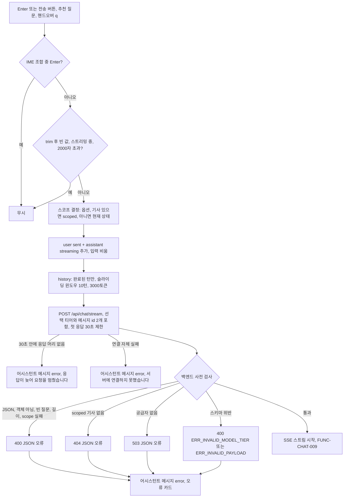

#### 4. 화면 표시 및 입력 데이터 항목 명세
| 항목명 | 화면 표시/입력 구분 | UI 컴포넌트 | 필수 여부 | 데이터 타입 / 제약 | 기본값 | 유효성 검증 규칙 (Validation) | 노출/수정 조건 |
| :--- | :---: | :--- | :---: | :--- | :---: | :--- | :--- |
| 질문 입력 | 사용자 입력 | Auto-expanding Textarea (숨긴 라벨 `질문 입력`) | 필수 | String / 1~2,000자 | 빈 값 | trim 후 1자 이상, 2,000자 초과 시 `aria-invalid` 와 위험색, 전송 막음 | 스트리밍 중 비활성. 높이 내용에 맞춰 최대 180px |
| placeholder | 노출 전용 | Textarea placeholder | - | scoped `선택한 기사 본문을 바탕으로 질문하세요`, global `수집된 AI 에이전트 소식 전체에 대해 질문하세요` | global 문구 | - | 스코프에 따라 |
| 글자 수 | 노출 전용 | Counter `N / 2000` | - | int | 0 | 2,000 초과 시 위험색 | 상시 |
| `질문 전송` | 사용자 조작 | Icon Button | - | Submit | - | 공백만, 스트리밍 중, 2,000자 초과면 비활성 | 비스트리밍 시 (스트리밍 중에는 중단 버튼으로 바뀜, FUNC-CHAT-020) |
| 단축키 안내 | 노출 전용 | Label `Enter: 전송, Shift+Enter: 줄바꿈` | - | - | - | - | 1024px 이상 |
| 추천 질문 | 사용자 선택 | Button 4개 (640px 미만 1열, 이상 2열, 글자 두 줄까지 왼쪽 정렬) | - | 아래 BR-CHAT-008-8 | 4개 고정 | 클릭 시 아이콘 없는 글자 그대로 전송 | 메시지 0개일 때 환영 화면 |
| `question` (API) | 시스템 | 요청 본문 | 필수 | String 1~2,000 | - | 400 검사 | - |
| `model` (API) | 시스템 | 요청 본문 | 선택 | String | null (v0.4.2. 비면 `model_tier`, 그것도 비면 `ANTHROPIC_DEFAULT_CHAT_MODEL` `claude-sonnet-5-5`) | 검증 없음 | 우선순위 `model` > `model_tier` > 기본 |
| `model_tier` (API) | 시스템 | 요청 본문 | 선택 | `haiku` \| `sonnet` \| `opus` | null | Literal (위반 시 400 `ERR_INVALID_MODEL_TIER`) | 전송 시점의 선택 티어 |
| `scope` (API) | 시스템 | 요청 본문 | 선택 | `scoped` \| `global` | `global` | 400 `ERR_INVALID_SCOPE_PARAM` | - |
| `source_id` (API) | 시스템 | 요청 본문 | 조건부 필수 | int | null | scoped 면 필수, 기사 존재 | - |
| `session_id` (API) | 시스템 | 요청 본문 | 선택 | String | 없으면 서버가 새 UUID | 없음 | - |
| `history` (API) | 시스템 | 요청 본문 | 선택 | `{role: user\|assistant\|system, content}[]` | null | role Literal (위반 시 400 `ERR_INVALID_PAYLOAD`) | - |
| `top_k` (API) | 시스템 | 요청 본문 | 선택 | int 1~10 | 5 | 위반 시 400 `ERR_INVALID_PAYLOAD` | 프론트는 보내지 않음 |
| `filters` (API) | 시스템 | 요청 본문 | 선택 | `ChatFocusFilter` | null | Literal (위반 시 400 `ERR_INVALID_PAYLOAD`) | 매 요청 |
| `user_message_id` (API) | 시스템 | 요청 본문 | 선택 | String 1~36자 | null | 길이 위반·`assistant_message_id` 와 같으면 400 `ERR_INVALID_PAYLOAD` | 프론트는 사용자 메시지 id(`msg-user-<랜덤7자>`)를 보낸다. 없으면 서버가 uuid4 |
| `assistant_message_id` (API) | 시스템 | 요청 본문 | 선택 | String 1~36자 | null | 위와 같음 | 프론트는 어시스턴트 메시지 id(`msg-asst-<랜덤7자>`)를 보낸다. 다시 시도는 새 id |

#### 5. 비즈니스 규칙
- **BR-CHAT-008-1**: 질문 최대 길이는 2,000자다 (프론트 `maxLength = 2000`, 백엔드 라우터 검사, 스키마 `max_length=2000`).
- **BR-CHAT-008-2**: 프론트 history 는 최근 20개(10턴), 추정 토큰(글자 수/2.5) 3,000 을 넘으면 앞에서 2개씩 지워 최소 2개까지 줄인다.
- **BR-CHAT-008-3**: 백엔드 프롬프트에는 history 마지막 4개 메시지만 들어간다.
- **BR-CHAT-008-4 (v0.4.2)**: history 에는 완료된 턴(사용자 메시지 + 바로 뒤 `completed` 어시스턴트 메시지)만 들어간다. 오류·중단·스트리밍 중인 어시스턴트 메시지와 그 앞 사용자 메시지는 빠진다 (`frontend/src/components/chat/ChatWorkspace.tsx:330-342`). 인수 기준: [질문1→완료, 질문2→오류] 상태에서 질문2를 다시 시도하면 요청 `history` 는 질문1과 그 답 2개뿐이다.
- **BR-CHAT-008-5**: 기사 컨텍스트가 있으면 스코프 토글과 무관하게 `scoped` 로 보낸다.
- **BR-CHAT-008-6**: 사전 검사 순서는 JSON → 객체 여부 → 빈 질문 → 길이 → scope → 스키마 → scoped 기사 → 공급자 가용성이다. `/query`·`/search` 는 v0.4.2 에서 지웠다 (위험 8번 해결).
- **BR-CHAT-008-7**: 프론트가 보내는 모델 ID 는 `TIER_TO_MODEL` 고정값(`claude-haiku-5-5`, `claude-sonnet-5-5`, `claude-opus-5-5`)이다. 서버는 `model` 이 있으면 그 값을, 없으면 `model_tier`, 둘 다 없으면 기본 챗 모델을 쓴다 (v0.4.2, `backend/app/schemas/chat.py:31-32`).
- **BR-CHAT-008-8**: 추천 질문 4개(아이콘·글자): `Server` `FastMCP로 파이썬 기반 경량 MCP 서버 구축하는 방법`, `GitBranch` `LangGraph v0.2의 분기 제어 및 시간 여행 디버깅 원리`, `ChartColumn` `SWE-bench Multimodal 하네스의 주요 평가 지표`, `TrendingUp` `최근 24시간 내 가장 주목받은 에이전트 오픈소스 동향`. 카드마다 글자 앞에 lucide 아이콘(`aria-hidden`, 강조색)을 그린다. 글자에 이모지가 없다.

#### 6. 예외 처리 및 엣지 케이스
| 발생 상황 | 화면 반응 및 시스템 처리 방식 | 사용자 안내 메시지 |
| :--- | :--- | :--- |
| 공백만 입력 | 전송 안 함, 버튼 비활성 | 없음 |
| 2,000자 초과 | 전송 막음, 카운터 위험색, `aria-invalid` | 없음 (카운터 색으로만) |
| 한글 IME 조합 중 Enter | 무시 | - |
| `model_tier` 위반 | 400 `ERR_INVALID_MODEL_TIER` | `유효하지 않은 모델 티어입니다: {값}` 오류 카드 |
| 그 밖 스키마 위반 (`top_k` 11, 잘못된 카테고리, `history.role`, 메시지 id 길이·같은 id) | 400 `ERR_INVALID_PAYLOAD` | `요청 필드 형식이 올바르지 않습니다.` 오류 카드 |
| 본문이 JSON 객체가 아님 (배열 등) | 400 `ERR_INVALID_PAYLOAD` | `요청 본문은 JSON 객체여야 합니다.` |
| 기사 없이 `단일 기사` 를 골라 전송 | `source_id` 없이 scoped 요청 → 404 | `지정된 기사를 찾을 수 없습니다.` 오류 카드 |
| 모델을 바꾼 직후 전송 | 바뀐 티어가 요청에 실린다 (v0.4.1 에서 해결, 위험 2번) | - |
| `model` 문자열 | 서버가 검증하지 않는다. 프론트는 `TIER_TO_MODEL` 고정값만 보낸다 | - |
| 응답 머리가 30초 안에 오지 않음 | 요청을 멈추고 어시스턴트 메시지를 오류로 (v0.4.2) | `응답이 늦어 요청을 멈췄습니다. 다시 시도해 주세요.` 오류 카드 |
| 연결 자체가 실패 (서버 꺼짐, 네트워크 끊김) | 어시스턴트 메시지를 오류로 (v0.4.2. 예전에는 시간 초과 문구를 보였다) | `서버에 연결하지 못했습니다. 연결 상태를 확인하고 다시 시도해 주세요.` 오류 카드 |

#### 7. 비즈니스 에러 코드 매핑
| 비즈니스 에러 코드 | 발생 사유 | HTTP 상태 코드 매핑 | 클라이언트 표시 형태 |
| :--- | :--- | :---: | :--- |
| `ERR_INVALID_PAYLOAD` | 본문 JSON 파싱 실패 (`요청 본문 형식이 올바르지 않습니다.`), JSON 객체 아님 (`요청 본문은 JSON 객체여야 합니다.`), `model_tier` 밖 필드 스키마 위반 (`요청 필드 형식이 올바르지 않습니다.`) | 400 | 오류 카드에 `message` |
| `ERR_INVALID_MODEL_TIER` | `model_tier` 가 `haiku`·`sonnet`·`opus` 밖 (`유효하지 않은 모델 티어입니다: {값}`) | 400 | 오류 카드 |
| `ERR_CHAT_PAYLOAD_EMPTY` | 빈 질문 (`질문 본문이 비어있습니다.`) | 400 | 오류 카드 (프론트가 먼저 막음) |
| `ERR_CHAT_PAYLOAD_TOO_LARGE` | 2,000자 초과 (`질문은 최대 2,000자까지 입력 가능합니다.`) | 400 | 오류 카드 (프론트가 먼저 막음) |
| `ERR_INVALID_SCOPE_PARAM` | scope 값 오류 (`유효하지 않은 검색 스코프 모드입니다.`) | 400 | 오류 카드 |
| `ERR_HANDOVER_SOURCE_NOT_FOUND` | scoped 인데 `source_id` 없음 (`지정된 기사를 찾을 수 없습니다.`) 또는 기사 없음 (`기사 ID {id}를 데이터베이스에서 찾을 수 없습니다.`) | 404 | 오류 카드 |
| `ERR_LLM_PROVIDER_UNAVAILABLE` | 쓸 수 있는 공급자 없음 (`가용한 LLM 프로바이더 엔진 미설정 (API 키 미등록)`) | 503 | 오류 카드 |
| `ERR_CLAUDE_API_KEY_MISSING` / `ERR_CLAUDE_QUOTA_EXCEEDED` / `ERR_CLAUDE_OVERLOADED` / `ERR_LLM_UPSTREAM_FAILED` / `ERR_LLM_QUOTA_EXCEEDED` | 라우터 사전 검사 표(`LLM_ERROR_MAP`)에 있으나 `check_provider_available` 이 `LLMProviderUnavailableException` 만 던져 실행되지 않는다 (위험 9번) | 401 / 429 / 529 / 502 / 429 | (도달 불가) |
| `ERR_SERVER_INTERNAL` | 처리하지 못한 서버 예외 (전역 처리기, 예외 문자열·경로를 싣지 않는다) | 500 | 오류 카드 `서버 내부 처리 중 오류가 발생했습니다.` |
| (클라이언트) | 응답 머리 30초 초과 | - | 오류 카드 `응답이 늦어 요청을 멈췄습니다. 다시 시도해 주세요.` |
| (클라이언트) | 연결 자체 실패 | - | 오류 카드 `서버에 연결하지 못했습니다. 연결 상태를 확인하고 다시 시도해 주세요.` |
| (클라이언트) | 오류 응답에 `message` 가 없음(프록시 오류 등) | 4xx/5xx | 오류 카드 `답변을 받지 못했습니다. 다시 시도해 주세요.` |

근거: `backend/app/api/chat.py:49-127`, `backend/app/api/errors.py:74-77`, `backend/app/schemas/chat.py:28-46`, `backend/app/services/chat_service.py:248-253`, `frontend/src/lib/chatApi.ts:20-51`, `:81-92`, `frontend/src/components/chat/ChatPromptInput.tsx`, `frontend/src/components/chat/ChatWorkspace.tsx:252-365`, `frontend/src/components/chat/ChatMessageList.tsx:21-27,66-83`, `frontend/src/types/chat.ts:778-791`

---

### [FUNC-CHAT-009] SSE 스트리밍 수신

#### 1. 기본 정보
- **기능명**: SSE 이벤트 파싱과 화면 반영
- **기능 ID**: `FUNC-CHAT-009`
- **대응 요구사항**: `REQ-CHAT-001` (옛 기능명세 `CHAT-09`)
- **대상 화면 코드**: `SCR-CHAT-001`
- **우선순위**: Must Have
- **관련 액터**: 시스템
- **API**: `POST /api/chat/stream` 응답 본문

#### 2. 사전 조건
1. FUNC-CHAT-008 의 요청을 보냈다.

#### 3. 인터랙션 흐름과 플로우차트
1. 응답이 ok 가 아니면 공통 오류 응답의 `message`(본문이 그 모양이 아니면 `답변을 받지 못했습니다. 다시 시도해 주세요.`)로 오류를 던진다. 응답 머리가 30초 안에 오지 않으면 `응답이 늦어 요청을 멈췄습니다. 다시 시도해 주세요.`, 연결 자체가 실패하면 `서버에 연결하지 못했습니다. 연결 상태를 확인하고 다시 시도해 주세요.`(`CONNECT_FAILED_MESSAGE`, 기사 질문과 같은 문구). 사용자 중단은 그대로 중단이다. 본문이 없으면 `응답 스트림을 찾을 수 없습니다.`.
2. `ReadableStream` 리더로 읽어 `TextDecoder(stream: true)` 로 누적하고 `\n\n` 으로 나눈다. 마지막 조각은 다음 청크까지 버퍼에 둔다. 스트림이 끝나면 디코더를 비우고 남은 버퍼를 trim 해 마저 처리한다(끝에 빈 줄이 없어도 처리).
3. 블록 안에서 `event: ` 줄과 `data: ` 줄을 읽는다. data 줄이 여러 개면 마지막 줄만 남는다. data 가 없으면 건너뛴다.
4. 이벤트별 처리:
   - `status`(`step` 필수) → `current_status` 갱신, `step_history` 에 추가.
   - `sources`(`sources` 필수) → 출처, `applied_filters`, `is_relaxed`(없으면 false), `primary_count`, `supplementary_count` 갱신.
   - `token`(문자열) → 내용에 이어 붙임.
   - `done` → 상태 `completed`, 모델(`data.model`, 없으면 선택 티어 모델, 그것도 없으면 `claude-sonnet-5-5`), 티어(`data.model_tier`, 없으면 선택 티어), `latency_ms`, `usage` 기록. `done` 을 받았다고 표시해 둔다.
   - `error` → `data.message`(없으면 `스트리밍 에러가 발생했습니다.`)로 오류를 던진다 (FUNC-CHAT-020).
   - 그 밖의 이벤트와 JSON 파싱 오류는 무시한다.
5. 어시스턴트 메시지는 지역 변수에 누적하고 화면에는 그 값을 그대로 반영한다 (`updateAssistant`).
6. 루프가 끝나면 판정한다:
   - 사용자가 중단했으면(`controller.signal.aborted`, 본문이 오류 없이 끝났어도) 상태 `aborted` 로 두고 세션을 한 번 저장한다 (FUNC-CHAT-020).
   - `done` 을 받지 못했고 중단도 아니면 끊긴 스트림이다. 완료로 표시·저장하지 않고 오류 `응답이 중간에 끊겼습니다. 다시 시도해 주세요.` 로 바꾼다 (FUNC-CHAT-020).
   - `done` 을 받았으면 세션을 한 번 저장한다 (`saveTurn`, FUNC-CHAT-006).
7. 이벤트 payload 는 `parseChatSsePayload` 로 zod `safeParse` 한다(v0.4.2). 실패해도 던지지 않고, 개발·테스트에서는 `console.warn` 으로 계약 위반을 알린 뒤 받은 값을 그대로 쓴다 (`frontend/src/lib/contract.ts:45-57`).
8. 접근성: 메시지 목록(`role="log"`, `aria-live="polite"`)은 `aria-relevant="additions"` 와 스트리밍 중 `aria-busy="true"` 로 토큰마다 읽지 않는다. 답이 `completed` 로 끝나면 목록 밖 `role="status"` 화면 읽기 전용 영역에 `답변이 완료되었습니다.` 를 한 번 넣는다 (v0.4.2, `frontend/src/components/chat/ChatMessageList.tsx:64-69`, `:118-161`).

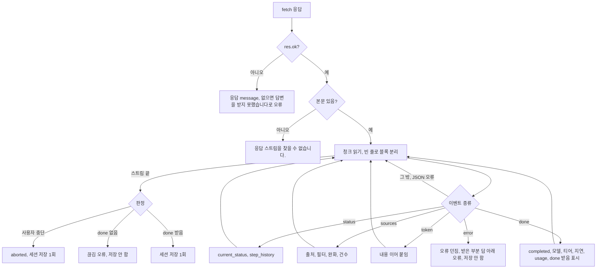

#### 4. 화면 표시 및 입력 데이터 항목 명세
| 항목명 | 화면 표시/입력 구분 | UI 컴포넌트 | 필수 여부 | 데이터 타입 / 제약 | 기본값 | 유효성 검증 규칙 (Validation) | 노출/수정 조건 |
| :--- | :---: | :--- | :---: | :--- | :---: | :--- | :--- |
| 답변 본문 | 노출 전용 | Markdown Renderer | - | String (토큰 누적) | 빈 값 | 없음 | 어시스턴트 메시지 |
| 커서 막대 | 노출 전용 | 깜빡이는 막대 | - | - | - | - | 스트리밍 중, `motion-safe` 일 때 깜빡임 |
| 메시지 목록 | 노출 전용 | `role="log"`, `aria-live="polite"`, `aria-relevant="additions"`, 스트리밍 중 `aria-busy="true"` | - | - | - | - | 상시. 이 상자만 세로로 스크롤한다 (FUNC-CHAT-025 BR-4) |
| 완료 알림 | 노출 전용 | `role="status"` 화면 읽기 전용 글자 | - | `답변이 완료되었습니다.` | 빈 값 | - | 스트리밍이 끝났고 마지막 메시지가 `completed` 인 어시스턴트 메시지일 때 (v0.4.2) |
| `원문 N건`·`보충 N건` 배지 | 노출 전용 | Badge | - | int | - | - | `completed` 이고 내용과 출처가 있을 때 |
| 자동 스크롤 | 시스템 | 목록 상자의 `scrollTop = scrollHeight` (부드러운 스크롤 없음) | - | - | 따라감 | 맨 아래에서 24px 안을 보고 있을 때만 따라감. 메시지 수가 바뀌면(새 질문·세션 열기) 늘 맨 아래 | 메시지·타임라인·스트리밍 상태가 바뀔 때 (v0.4.2, FUNC-CHAT-025 BR-4) |

#### 5. 비즈니스 규칙
- **BR-CHAT-009-1**: 이벤트 순서와 필드는 문서 뒤 'SSE 이벤트 목록' 을 따른다.
- **BR-CHAT-009-2**: done 없이 스트림이 닫히면(사용자 중단이 아니면) 완료가 아니라 오류다. 받은 부분 답은 그대로 보이고 그 아래에 `응답이 중간에 끊겼습니다. 다시 시도해 주세요.` 와 `답변 다시 시도` 버튼이 나온다. 저장하지 않는다 (v0.4.1, 리뷰 FE-03).
- **BR-CHAT-009-3**: 프론트는 한 턴에 세션을 최대 한 번 저장한다(완료 또는 중단일 때). 저장은 상태 갱신 함수 밖 `saveTurn()` 한 곳에서 해 StrictMode 에서도 한 번이다 (v0.4.1, 리뷰 FE-02).

#### 6. 예외 처리 및 엣지 케이스
| 발생 상황 | 화면 반응 및 시스템 처리 방식 | 사용자 안내 메시지 |
| :--- | :--- | :--- |
| global 검색 모드의 스트리밍 중 `[1]` | 출처가 토큰 뒤에 오므로 회색 '출처 없음' 텍스트로 보이다가 sources 이벤트 뒤 강조색 배지로 바뀐다. 스트리밍 중에는 `[1]` 을 눌러 출처를 볼 수 없다. 인용된 출처만 보이려는 의도된 동작이다 (결함 아님) | - |
| 사용자가 위로 올려 앞 답을 읽는 중 토큰 도착 | 맨 아래 24px 밖이면 따라 내려가지 않는다. 다시 맨 아래로 내리면 이어서 따라간다 | - |
| data 줄 여러 개 | 마지막 줄만 사용 | - |
| 알 수 없는 이벤트·JSON 파싱 오류 | 무시 | - |
| 스트림 끝에 빈 줄 없음 | 남은 버퍼를 trim 해 처리 | - |

#### 7. 비즈니스 에러 코드 매핑
| 비즈니스 에러 코드 | 발생 사유 | HTTP 상태 코드 매핑 | 클라이언트 표시 형태 |
| :--- | :--- | :---: | :--- |
| `ERR_LLM_STREAM_FAILED` | 토큰 생성 중 예외 (`event: error`) | 스트림 안 `status_code: 502` (HTTP 는 200) | 오류 카드에 `LLM 스트리밍 도중 외부 프로바이더 오류가 발생했습니다.` |
| (클라이언트) | 본문 없음 | - | `응답 스트림을 찾을 수 없습니다.` |
| `ERR_LLM_UPSTREAM_FAILED` | global 플래너 단계 예외 (`event: error`, `step: thinking`, `질문 분석 중 오류가 발생했습니다. 다시 시도해 주세요.`) (v0.4.2) | 스트림 안 `status_code: 502` | 오류 카드 |
| `ERR_RETRIEVER_INDEX_ERROR` | global 검색 단계 예외 (`event: error`, `step: tool_calling`, `기사 검색 중 오류가 발생했습니다. 다시 시도해 주세요.`) (v0.4.2) | 스트림 안 `status_code: 500` | 오류 카드 |
| (클라이언트) | ok 아닌 응답에 `message` 없음 | 4xx/5xx | `답변을 받지 못했습니다. 다시 시도해 주세요.` |
| (클라이언트) | 응답 머리 30초 초과 | - | `응답이 늦어 요청을 멈췄습니다. 다시 시도해 주세요.` |
| (클라이언트) | 연결 자체 실패 (v0.4.2) | - | `서버에 연결하지 못했습니다. 연결 상태를 확인하고 다시 시도해 주세요.` |
| (클라이언트) | `done` 없이 스트림이 끝남 (사용자 중단 아님) | - | 받은 부분 답 아래 `응답이 중간에 끊겼습니다. 다시 시도해 주세요.` |

근거: `backend/app/services/chat_service.py:429-438`, `:549-581`, `:621-633`, `frontend/src/lib/chatApi.ts:81-92`, `frontend/src/lib/contract.ts:45-57`, `frontend/src/components/chat/ChatWorkspace.tsx:44`, `:347-473`, `frontend/src/components/chat/ChatMessageItem.tsx`, `frontend/src/components/chat/ChatMessageList.tsx:39-69`, `frontend/src/types/chat.ts`

---

### [FUNC-CHAT-010] ReAct 검색 계획 (global)

#### 1. 기본 정보
- **기능명**: global 모드에서 검색 도구 호출 여부와 검색어 결정
- **기능 ID**: `FUNC-CHAT-010`
- **대응 요구사항**: `REQ-CHAT-001` (옛 기능명세 `CHAT-10`)
- **대상 화면 코드**: `API` (결과는 `SCR-CHAT-001` 의 단계 표시에 반영)
- **우선순위**: Must Have
- **관련 액터**: 시스템
- **구현**: `ChatService._plan_react_action`

#### 2. 사전 조건
1. 요청 스코프가 `global` 이다. scoped 는 항상 `{action: "none", thought: "단일 기사 컨텍스트 고정"}` 이다.
2. 입력은 질문과 스코프다. history, model, model_tier 인자는 받지만 쓰지 않는다 (플래너 모델은 Haiku 고정).

#### 3. 인터랙션 흐름과 플로우차트
위에서부터 처음 걸리는 규칙으로 정한다.
1. 질문을 trim, 소문자, 끝의 `?!.~` 제거한 값(`q_clean`)이 비었거나 인사말 집합과 정확히 같으면 `none`. 인사말 집합은 29개다: `안녕`, `안녕하세요`, `반가워`, `반갑습니다`, `고마워`, `고맙습니다`, `감사`, `감사합니다`, `ㅎㅎ`, `ㅋㅋ`, `테스트`, `하이`, `헬로`, `hello`, `hi`, `hey`, `thanks`, `thank you`, `누구야`, `너는 누구야`, `뭐해`, `질문`, `응`, `네`, `그래`, `알겠어`, `오케이`, `ok`, `okay`.
2. 메타 불만 패턴 13개(`인사했는데`, `왜 뉴스`, `왜 기사`, `검색하지 마`, `검색하지마`, `찾지 마`, `찾지마`, `왜 자꾸`, `왜 무조건`, `오늘 날씨`, `점심 메뉴`, `저녁 메뉴`, `스트리밍 도중 끊김`)이 `q_clean` 에 포함되면 `none`.
3. 도메인 신호(`KNOWN_TECH_STACK` 키 + `claude`, `gpt`, `openai`, `anthropic`, `deepseek`, `gemini`, `llama`, `mistral`, `qwen`, `mcp`, `fastmcp`, `langgraph`, `crewai`, `autogen`, `langchain`, `llamaindex`, `swe-bench`, `gaia`, `webarena`, `agentbench`, `vllm`, `ollama`, `docker`, `fastapi`, `python`, `typescript`, `stategraph`, `windbg`, `sonnet`, `haiku`, `opus`, `agent`, `agents`, `llm`, `rag`, `benchmark`, `harness`, `archived`, `deep dive`, `에이전트`, `멀티에이전트`, `워크플로우`, `아키텍처`, `벤치마크`, `하네스`, `프롬프트`, `강화학습`, `추론`, `프로토콜`, `릴리즈`, `오픈소스`, `논문`, `뉴스`, `기사`, `소식`, `동향`, `트렌드`, `변경점`, `업데이트`, `프레임워크`)가 `q_clean` 에 부분 문자열로 하나도 없으면 `none`.
4. `extract_keywords`(FUNC-CHAT-012 BR-CHAT-012-2) 결과에서 인사말을 뺀 키워드가 없으면 `none`.
5. 기본 검색어는 키워드를 공백으로 이은 문자열이다.
6. 라이브 공급자가 있으면(`has_live_provider()`) 테스트·CI 여부와 관계없이(v0.4.2 에서 테스트 환경 분기를 지웠다) Haiku(`ANTHROPIC_HAIKU_MODEL`, 기본 `claude-haiku-5-5`, `model_tier="haiku"`)에 플래너 프롬프트를 `generate_live_answer` 로 보내 JSON `{thought, action, search_query}` 를 받는다. 코드 펜스를 떼고 첫 `{…}` 를 파싱한다.
   - `none` 이면 검색 안 함. `search_news_corpus` 면 그 검색어(비면 기본 검색어).
   - JSON 이 없거나 action 이 둘 다 아니면 `ACTION: NONE` / `ACTION: SEARCH <키워드>` 텍스트를 찾는다.
   - 예외가 나면 경고 로그(`ReAct LLM planner fallback to heuristic keywords: …`) 후 휴리스틱으로 간다.
7. 위에서 정하지 못하면 `search_news_corpus` 와 기본 검색어 (`thought: 기술 키워드 기반 코퍼스 검색 수행`).
8. 플래너 함수 밖으로 예외가 새면(키워드 추출·가용성 판정 등 위 6번이 잡지 못한 예외) `stream_chat` 이 잡아 SSE `error`(`ERR_LLM_UPSTREAM_FAILED`, `status_code: 502`, `step: thinking`, `질문 분석 중 오류가 발생했습니다. 다시 시도해 주세요.`, `retryable: true`)를 보내고 스트림을 끝낸다. `done`·서버 저장은 없다 (v0.4.2, `backend/app/services/chat_service.py:549-556`).

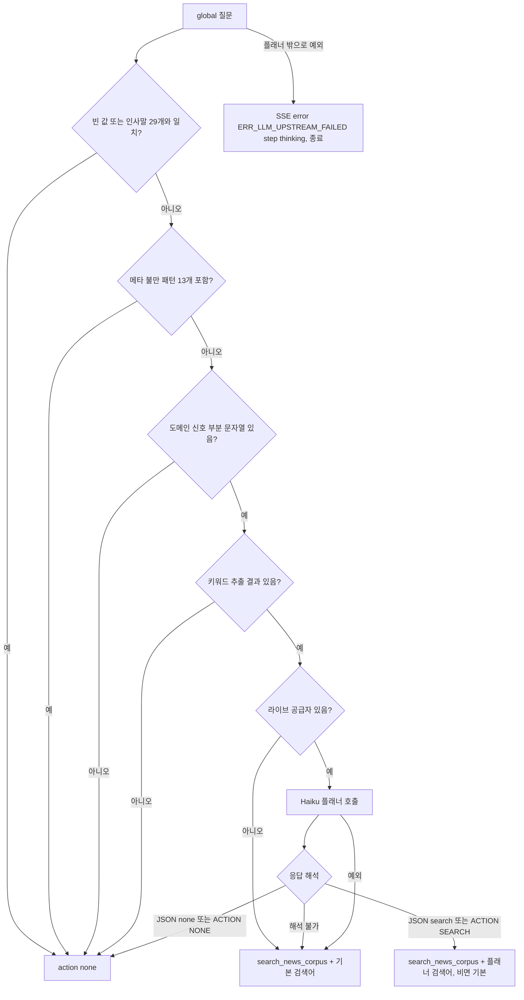

#### 4. 화면 표시 및 입력 데이터 항목 명세
| 항목명 | 화면 표시/입력 구분 | UI 컴포넌트 | 필수 여부 | 데이터 타입 / 제약 | 기본값 | 유효성 검증 규칙 (Validation) | 노출/수정 조건 |
| :--- | :---: | :--- | :---: | :--- | :---: | :--- | :--- |
| `action` | 시스템 | 내부 값 | 필수 | `none` \| `search_news_corpus` | `search_news_corpus` | 규칙 순서 | 화면에 직접 보이지 않음 |
| `search_query` | 노출 전용 | 단계 표시 `검색어: "<query>"` (FUNC-CHAT-011) | 조건부 | String | 키워드 공백 연결 | - | `tool_calling` 단계에서만 |
| `thought` | 시스템 | 내부 값 | - | String | - | - | 화면에 보내지 않음 |

#### 5. 비즈니스 규칙
- **BR-CHAT-010-1**: scoped 는 플래너를 거치지 않는다.
- **BR-CHAT-010-2**: 플래너 LLM 은 Haiku 고정이다. 요청 티어와 무관하다.
- **BR-CHAT-010-3**: 플래너 프롬프트는 검색 시 조사·어미를 뗀 핵심 키워드 1~4개 단어를 요구한다.

#### 6. 예외 처리 및 엣지 케이스
| 발생 상황 | 화면 반응 및 시스템 처리 방식 | 사용자 안내 메시지 |
| :--- | :--- | :--- |
| 짧은 신호(`o1`, `o3`, `rag`, `agent`)가 다른 단어 안에 들어 있음 | 부분 문자열 비교라 검색 경로로 갈 수 있다 (위험 34번) | - |
| 플래너 호출 실패 | 휴리스틱 검색 | 없음 (서버 경고 로그) |
| 플래너 호출 시 공급자 판정 | `has_live_provider()` 와 `generate_live_answer` 안의 `check_provider_available()` 이 다시 실행된다. Ollama 판정은 v0.4.2 부터 비동기이고 30초 기억해 이벤트 루프를 막지 않는다 (위험 7번 해결) | - |
| 플래너 usage | 요청마다 따로 담아 done `usage` 에 섞이지 않는다 (v0.4.2, 위험 6번 해결) | - |
| 플래너 Anthropic 답이 `max_tokens` 에서 잘림 | 비스트림도 잘림을 실패로 보아 다음 공급자로 넘어가고, 모두 실패하면 휴리스틱 검색 (v0.4.2) | 없음 |
| 플래너 밖으로 새는 예외 | SSE `error` `ERR_LLM_UPSTREAM_FAILED` 로 끝남 | 오류 카드 `질문 분석 중 오류가 발생했습니다. 다시 시도해 주세요.` |

#### 7. 비즈니스 에러 코드 매핑
| 비즈니스 에러 코드 | 발생 사유 | HTTP 상태 코드 매핑 | 클라이언트 표시 형태 |
| :--- | :--- | :---: | :--- |
| (없음) | 플래너 LLM 호출 예외는 함수 안에서 잡아 휴리스틱으로 대체 | - | - |
| `ERR_LLM_UPSTREAM_FAILED` (SSE `error`) | 플래너 함수 밖으로 새는 예외 (v0.4.2) | 스트림 안 `status_code: 502` (HTTP 200) | 오류 카드 + `답변 다시 시도` |

근거: `backend/app/services/chat_service.py:258-395`, `:549-556`, `backend/app/services/llm_processor.py:225-257`, `:351-459`, `backend/app/services/llm_providers/anthropic_provider.py:205-244`

---

### [FUNC-CHAT-011] 워크플로 단계 표시 (WorkflowStepTracker)

#### 1. 기본 정보
- **기능명**: 진행률 바와 완료 후 접는 단계 목록
- **기능 ID**: `FUNC-CHAT-011`
- **대응 요구사항**: `REQ-CHAT-009` (옛 기능명세 `CHAT-11`)
- **대상 화면 코드**: `SCR-CHAT-001` (어시스턴트 말풍선 상단)
- **우선순위**: Should Have
- **관련 액터**: 사용자

#### 2. 사전 조건
1. 어시스턴트 메시지에 `current_status` 나 `step_history` 가 있다 (복원 메시지에는 없다).

#### 3. 인터랙션 흐름과 플로우차트
1. 입력: `currentStatus`, `stepHistory`, `isStreaming`(해당 메시지가 스트리밍 중이고 상태가 `streaming`), `isDone`(상태 `completed`).
2. 스트리밍 중이고 완료 전: 현재 단계 아이콘, `label`, 진행률(`progress`, 없으면 50)% 와 진행 바. `query` 가 있으면 `검색어: "<query>"`.
3. 그 밖의 경우: 접이식 헤더 `[✓] 심층 분석 과정 {N}단계 완료`(N = `step_history` 길이, 없으면 현재 상태 1)와 `펼치기`/`접기`, `aria-expanded`. 펼치면 단계별 라벨, 검색어 칩, `progress%`(없으면 `완료`)를 보인다.

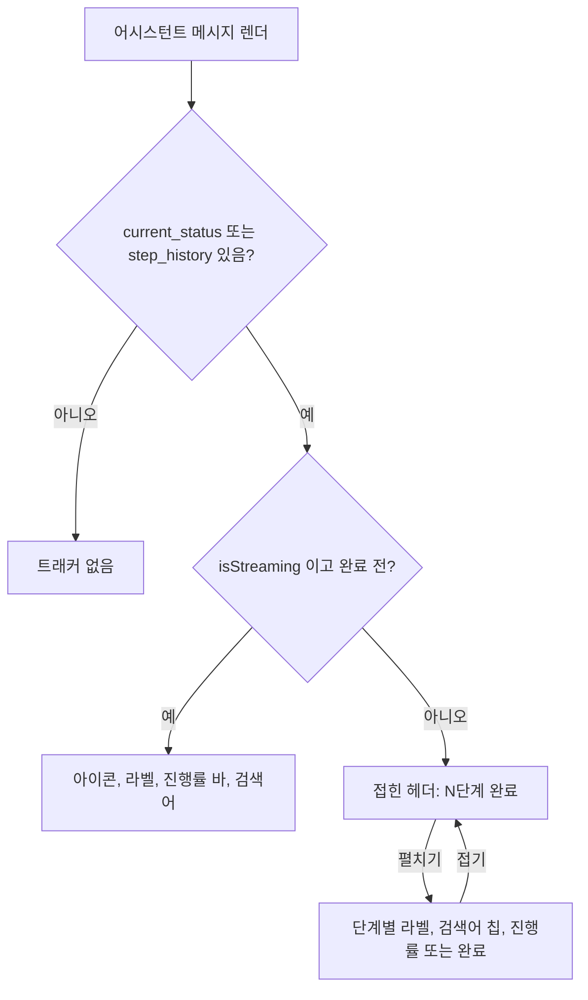

#### 4. 화면 표시 및 입력 데이터 항목 명세
| 항목명 | 화면 표시/입력 구분 | UI 컴포넌트 | 필수 여부 | 데이터 타입 / 제약 | 기본값 | 유효성 검증 규칙 (Validation) | 노출/수정 조건 |
| :--- | :---: | :--- | :---: | :--- | :---: | :--- | :--- |
| 진행 영역 | 노출 전용 | `role="region"` + `progressbar` | - | `progress` 정수 % | 50 | - | 스트리밍 중 |
| 단계 라벨 | 노출 전용 | Label | - | 백엔드 `label` 문자열 (아래 BR) | - | - | 스트리밍 중·펼침 |
| 검색어 | 노출 전용 | Chip / `검색어: "<query>"` | - | String | - | - | `query` 가 있을 때 (`tool_calling`) |
| 접이식 헤더 | 사용자 조작 | Accordion Button `펼치기`/`접기`, `aria-expanded` | - | `[✓] 심층 분석 과정 {N}단계 완료` | 접힘 | - | 스트리밍이 아닐 때. 높이 768px 이상 28px(`md:min-h-7`), 미만 44px |
| 단계 아이콘 | 노출 전용 | Icon | - | thinking 강조색 반짝임, tool_calling·agentic_searching 돋보기, observing 체크, extracting_source 지구, evaluating_sufficiency 저울, synthesizing 문서 | - | - | 깜빡임은 `motion-safe` 일 때만 |

#### 5. 비즈니스 규칙
- **BR-CHAT-011-1 (v0.4.2, 라벨에 그림 이모지 없음)**: 백엔드가 실제로 보내는 단계와 라벨:
  - scoped: `extracting_source`(30, `지정된 단일 뉴스 기사 컨텍스트 로드 중...`) → `synthesizing`(85, `Senior Staff Architect 단일 기사 심층 리포트 프롬프트 조립...`).
  - global 검색: `thinking`(25, `ReAct 추론: 질문 의도 및 도구 필요성 분석 중...`) → `tool_calling`(50, `Action: search_news_corpus('<검색어>') 실행 중...`, `query`) → `synthesizing`(80, `검증된 컨텍스트를 바탕으로 답변 생성 중...`).
  - global 직접 답변: `thinking`(25) → `synthesizing`(75, `도구 호출 없이 직접 답변 생성 중...`).
  - 인수 기준: 어떤 `status` 이벤트의 `label` 에도 그림 이모지(유니코드 Extended_Pictographic)가 없다 (`backend/app/services/chat_service.py:474-612`).
- **BR-CHAT-011-2**: `observing`, `evaluating_sufficiency`, `agentic_searching` 은 스키마(`ChatStatusStep`)에만 있고 백엔드가 보내지 않는다 (보충 검색 코드는 v0.4.2 에서 지웠다).

#### 6. 예외 처리 및 엣지 케이스
| 발생 상황 | 화면 반응 및 시스템 처리 방식 | 사용자 안내 메시지 |
| :--- | :--- | :--- |
| 오류·중단으로 끝난 메시지 | `isStreaming` 이 거짓이므로 '단계 완료' 아코디언으로 보인다 (위험 29번) | `[✓] 심층 분석 과정 N단계 완료` |
| `fallbackNotice` prop | 컴포넌트에 있으나 워크스페이스가 넘기지 않음 | - |
| 복원 메시지 | 트래커 없음 | - |

#### 7. 비즈니스 에러 코드 매핑
| 비즈니스 에러 코드 | 발생 사유 | HTTP 상태 코드 매핑 | 클라이언트 표시 형태 |
| :--- | :--- | :---: | :--- |
| (없음) | 표시 전용 | - | - |

근거: `frontend/src/components/chat/WorkflowStepTracker.tsx`, `frontend/src/components/chat/ChatMessageItem.tsx`, `backend/app/services/chat_service.py:467-615`, `backend/app/schemas/chat.py`

---

### [FUNC-CHAT-012] RAG 코퍼스 검색 (retriever)

#### 1. 기본 정보
- **기능명**: FTS5 BM25 + 품질 + 최신성 하이브리드 점수, 관련도 게이트, 상위 N
- **기능 ID**: `FUNC-CHAT-012`
- **대응 요구사항**: `REQ-CHAT-001` (옛 기능명세 `CHAT-12`)
- **대상 화면 코드**: `API`
- **우선순위**: Must Have
- **관련 액터**: 시스템
- **진입점**: global 모드에서 플래너가 `search_news_corpus` 를 고를 때 (`_resolve_sources` → `KnowledgeRetrieverFacade.search_knowledge_with_meta`). 미리보기 API `GET /api/chat/search` 는 v0.4.2 에서 지웠다.

#### 2. 사전 조건
1. 입력: 검색어(플래너 결과), `top_k`(요청 값, 기본 5), `min_quality` 5.0 고정(챗), `filters`.

#### 3. 인터랙션 흐름과 플로우차트
1. FTS 준비: `news_fts` 가상 테이블(FTS5; title, summary, why_it_matters, tech_stack, tags; content=`news_items`)과 INSERT/DELETE/UPDATE 동기화 트리거는 DB 스키마 준비(`backend/app/database.py`) 한 곳에서 만든다. 스키마 준비 때 `news_fts_docsize` 행 수가 `news_items` 행 수와 다르면 `rebuild` 한다. 검색은 테이블을 만들거나 커밋하지 않는다 (v0.4.2, `backend/app/database.py` `FTS_DDL`·`_ensure_fts`).
2. 키워드 추출(`extract_keywords`, BR-CHAT-012-2).
3. FTS 질의: 키워드를 `"k1" OR "k2"` 로 만든다(따옴표 제거). 키워드가 없으면 `""`.
4. 후보 조회: `bm25(news_fts, 5.0, 3.0, 2.0, 2.0, 1.0)` 오름차순, `quality_score >= min_quality`, 카테고리(`all` 이 아니면), 소스(`all` 이 아니면), 기간 컷오프(24h/7d/30d), `high_signal_only` 면 `is_high_signal = 1`, 최대 30건.
5. FTS 오류이거나 0건이면 LIKE 폴백: 같은 조건에 title/tech_stack/summary/tags 중 하나라도 키워드를 포함하는 기사. 키워드가 제목에 있으면 +5, tech_stack +3, summary +2, tags +1 점, 의사 BM25 = `-1 - 점수` 로 정렬해 30건.
6. 관련도 점수와 게이트(BR-CHAT-012-3, -4)로 후보를 거른다.
7. 최종 점수(BR-CHAT-012-5) 후 정렬: `latest` = 발행일 내림차순, `quality` = 품질 내림차순, 그 밖(`hot`) = `rag_score` 내림차순.
8. 자동 완화: 결과 0건이고 기간이 `all` 이 아니면 기간만 `all` 로 바꿔 다시 조회한다. 결과가 생기면 그 결과를 쓰고 `is_relaxed = true`, `applied_filters` 는 완화된 필터.
9. 상위 `top_k` 개에 1부터 `index` 를 매긴다. 결과 수는 `top_k` 보다 적을 수 있다(관련 없는 기사로 채우지 않는다).
10. 출력: `(chunks, is_relaxed, applied_filters)`. 챗 출처 항목은 `index, type: "primary", id, title, url, source, category, quality_score, snippet`(summary → why_it_matters → title), `published_at`.

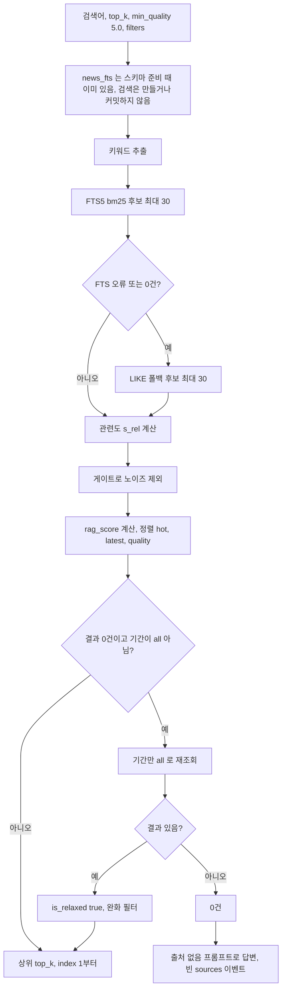

#### 4. 화면 표시 및 입력 데이터 항목 명세
| 항목명 | 화면 표시/입력 구분 | UI 컴포넌트 | 필수 여부 | 데이터 타입 / 제약 | 기본값 | 유효성 검증 규칙 (Validation) | 노출/수정 조건 |
| :--- | :---: | :--- | :---: | :--- | :---: | :--- | :--- |
| `top_k` | API 입력 | 요청 본문 | 선택 | int 1~10 | 5 | Pydantic 범위 (위반 400 `ERR_INVALID_PAYLOAD`) | 프론트는 보내지 않음 |
| `min_quality` | 시스템 | 내부 값 | - | 5.0 고정 | 5.0 | - | - |
| `category` | API 입력 | filters | 선택 | `all` \| `harness` \| `mcp_plugins_skills` \| `agent_tech` \| `ai_news` | `all` | Literal | - |
| `time_range` | API 입력 | filters | 선택 | `all` \| `24h` \| `7d` \| `30d` | `all` | Literal | - |
| `sort` | API 입력 | filters | 선택 | `hot` \| `latest` \| `quality` | `hot` | Literal | - |
| `high_signal_only` | API 입력 | filters | 선택 | bool | false | - | - |
| 검색 결과 | 노출 전용 | sources 이벤트 (FUNC-CHAT-014) | - | `ChatSourceItem[]` | - | - | 인용된 출처만 화면에 |

#### 5. 비즈니스 규칙
- **BR-CHAT-012-1**: 후보 상한 30, BM25 열 가중치 title 5.0, summary 3.0, why_it_matters 2.0, tech_stack 2.0, tags 1.0.
- **BR-CHAT-012-2 (키워드 추출)**: 영문·숫자·`_-.` 묶음과 한글 묶음으로 토큰화한다. 한국어 불용어(조사, `알려줘` 류 어미, `최신`, `뉴스`, `소식`, `기사`, `서버`, `기능`, `구현` 등)와 영어 불용어(`what`, `latest`, `news`, `explain` 등)를 뺀다. 2자 이상 한글 토큰은 끝 조사(`에서`, `으로`, `의`, `를` 등)를 한 번 떼되 남는 길이가 2자 이상일 때만 뗀다. 2자 이상만 남긴다. 다 빠지면 1글자 조사를 뺀 원 토큰을 쓴다.
- **BR-CHAT-012-3 (관련도)**: `bm_rel` = 최고 BM25 가 음수면 `|score| / |best|`, 아니면 최고·최저 간 정규화. `cov` = 맞은 키워드 수 / 전체, `core_cov` = 제목·tech_stack 에 맞은 키워드 수 / max(1, min(키워드 수, 2)). `s_rel = 0.45·bm_rel + 0.35·cov + 0.20·min(1, core_cov)`.
- **BR-CHAT-012-4 (게이트, 하나라도 걸리면 제외)**:
  - 키워드 1개: `cov < 1.0`.
  - 키워드 2개: `cov < 0.5`, 또는 `cov == 0.5` 이고 핵심 일치 0개이고 `bm_rel < 0.70`.
  - 키워드 3개 이상: 맞은 키워드 < 2, 또는 < max(2, ceil(키워드 수 × 0.35)).
  - 제목 고유성: 1위 후보 `cov >= 0.8` 이고 이 후보 `cov` 가 더 낮은데 1위의 제목 일치 키워드 중 빠진 것이 있음.
  - 노이즈 낙차: 키워드 2개 이상, `bm_rel < 0.55`, 맞은 키워드 수가 1위보다 적음.
  - 최저선: `s_rel < 0.48`.
- **BR-CHAT-012-5 (최종 점수)**: 하이브리드 `base = 0.50·bm_rel + 0.30·(quality/10) + 0.20·exp(-Δt/τ)` (0~1 로 자르고 소수 4자리), `rag_score = 0.60·s_rel + 0.40·base` (0~1 로 자르고 소수 4자리). τ 는 기간별 `24h` 86400초, `7d` 259200초, `30d` 604800초, `all` 1209600초 (`TAU_MAP`, 모르는 값은 1209600).
- **BR-CHAT-012-6**: 자동 완화는 기간만 바꾼다. 카테고리·고신호·정렬은 유지한다.

#### 6. 예외 처리 및 엣지 케이스
| 발생 상황 | 화면 반응 및 시스템 처리 방식 | 사용자 안내 메시지 |
| :--- | :--- | :--- |
| FTS 질의 오류 | LIKE 폴백으로 진행 | - |
| 검색 중 예외(폴백도 실패) | SSE `error` `ERR_RETRIEVER_INDEX_ERROR`(`status_code: 500`, `step: tool_calling`)로 끝난다. `done`·저장 없음 (v0.4.2) | 오류 카드 `기사 검색 중 오류가 발생했습니다. 다시 시도해 주세요.` |
| 검색 결과 0건 | `_build_grounding_prompt` 가 global '출처 없음' 프롬프트(일반 어시스턴트 역할, 가짜 인용 금지)로 바꾼다. 토큰 뒤에 빈 `sources: []` 이벤트를 보낸다 | - |
| 완화 후 결과 있음 | `is_relaxed: true` → 답변 위 안내 (FUNC-CHAT-016) | `[안내: 선택 조건에 부합하는 소식이 없어 전체 기간으로 확장 검색했습니다]` |
| 고신호 필터 | 품질 점수가 아니라 `is_high_signal` 열로 거른다 | - |

#### 7. 비즈니스 에러 코드 매핑
| 비즈니스 에러 코드 | 발생 사유 | HTTP 상태 코드 매핑 | 클라이언트 표시 형태 |
| :--- | :--- | :---: | :--- |
| `ERR_RETRIEVER_INDEX_ERROR` (SSE `error`) | 챗 스트림의 검색 단계 예외 (`기사 검색 중 오류가 발생했습니다. 다시 시도해 주세요.`) | 스트림 안 `status_code: 500` (HTTP 200) | 오류 카드 + `답변 다시 시도` |
| `ERR_INVALID_PAYLOAD` | 요청 `top_k`·`filters` 값 위반 | 400 | 오류 카드 `요청 필드 형식이 올바르지 않습니다.` |

- `ERR_SEARCH_QUERY_TOO_SHORT` 와 `/search` 의 422 는 경로를 지워 없어졌다 (v0.4.2).

근거: `backend/app/services/retriever.py`, `backend/app/database.py`, `backend/app/services/chat_service.py:112-164`, `:570-581`

---

### [FUNC-CHAT-013] 단일 기사(scoped) 질의

#### 1. 기본 정보
- **기능명**: 기사 1건 근거, 본문 스크래핑, 4단 리포트 프롬프트
- **기능 ID**: `FUNC-CHAT-013`
- **대응 요구사항**: `REQ-CHAT-002` (옛 기능명세 `CHAT-13`)
- **대상 화면 코드**: `SCR-CHAT-001`
- **우선순위**: Must Have
- **관련 액터**: 사용자, 시스템
- **진입점**: 기사 컨텍스트가 있는 상태에서 전송(핸드오버 또는 복원된 세션). 요청 `scope: "scoped"`, `source_id`.

#### 2. 사전 조건
1. `source_id` 가 있고 `news_items` 에 그 기사가 있다 (없으면 스트림을 열기 전에 404).

#### 3. 인터랙션 흐름과 플로우차트
1. status `extracting_source`(30%)를 보낸다.
2. 본문: `news_items.full_content` 가 공백이 아닌 값이면 쓴다. 없으면 `ArticleScraperService.get_article_content` — L1 메모리 LRU(500건) → L2 DB(본문 100자 이상) → URL 단위 잠금(single-flight) 후 httpx GET(타임아웃 5.0초, 리다이렉트 허용) → trafilatura 추출 → 500자 미만이면 readability-lxml + BeautifulSoup 폴백 → 그래도 500자 미만이면 예외. 성공하면 DB `full_content`, `scraped_at` 과 L1 에 저장한다. 401/403/429/503 이나 200 이 아니면 차단 예외. 어떤 예외든 경고(`Scraper fallback: …`) 후 본문 없이 진행한다.
3. status `synthesizing`(85%)를 보낸다.
4. 출처 1건(`index: 1`, primary, `snippet` = summary → why_it_matters → 본문 앞 400자 → title, `full_content` 포함, `quality_score` 없으면 6.0)으로 sources 이벤트를 토큰보다 먼저 보낸다. `applied_filters: null`, `is_relaxed: false`, `primary_count: 1`, `supplementary_count: 0`.
5. 프롬프트를 조립하고(BR-CHAT-013-2) 토큰을 스트리밍한 뒤 done 을 보내고 서버에 턴을 저장한다.

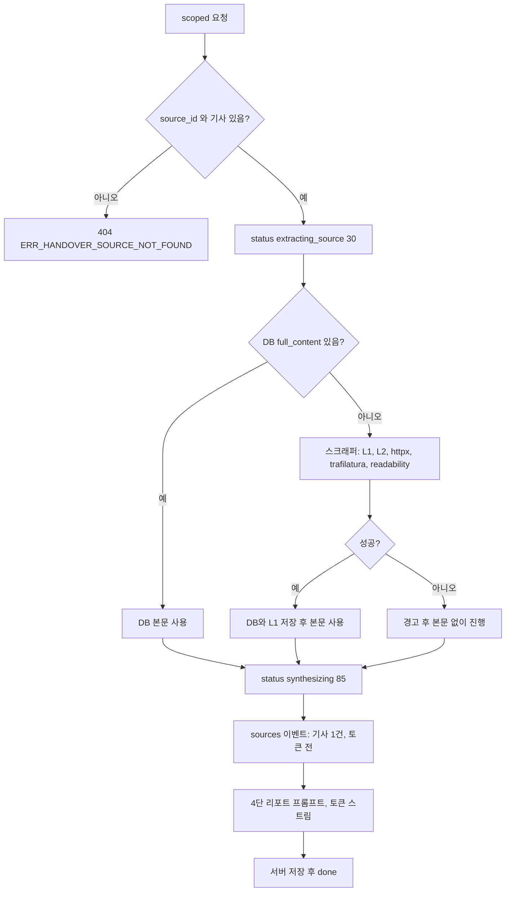

#### 4. 화면 표시 및 입력 데이터 항목 명세
| 항목명 | 화면 표시/입력 구분 | UI 컴포넌트 | 필수 여부 | 데이터 타입 / 제약 | 기본값 | 유효성 검증 규칙 (Validation) | 노출/수정 조건 |
| :--- | :---: | :--- | :---: | :--- | :---: | :--- | :--- |
| `source_id` | 시스템 | 요청 본문 | 필수 | int | - | 기사 존재 | 기사 컨텍스트가 있을 때 |
| 출처 `[1]` | 노출 전용 | Citation Badge | - | `ChatSourceItem` 1건 (`full_content` 포함) | - | - | 토큰 전에 도착 |
| 4단 리포트 | 노출 전용 | Markdown (`##` 헤딩 4개) | - | 프롬프트 지시 | - | LLM 준수 여부는 보장하지 않음 | 답변 |

#### 5. 비즈니스 규칙
- **BR-CHAT-013-1**: scoped 는 플래너, 인용 출처 필터링(FUNC-CHAT-014), 포커스 필터를 쓰지 않는다.
- **BR-CHAT-013-2 (프롬프트)**: Senior Staff Architect 역할, 응답 분량 규칙, 인라인 인용 규칙에 더해 4개 헤딩(`## 1. 핵심 아키텍처 및 동작 원리`, `## 2. 주요 기능 및 코드 구현 예시`, `## 3. 기존 기술 대비 차별점 및 벤치마크`, `## 4. 실무 도입 시 고려사항 및 튜닝 파라미터`)을 강제하고 각 섹션을 불릿 2~3개와 15줄 이내 스니펫으로 압축하라고 지시한다. 기사 제목·출처·카테고리·요약(snippet)을 넣고, 본문이 snippet 과 다르면 본문 앞 5,000자를 넣는다. 기사와 무관한 일반 설명(예: AgentLens 자체 설명) 반복을 금지하는 지침을 붙인다.
- **BR-CHAT-013-3**: 스크래퍼 상수 — 타임아웃 5.0초, 최소 본문 500자, L1 500건, L2 재사용 100자 이상.

#### 6. 예외 처리 및 엣지 케이스
| 발생 상황 | 화면 반응 및 시스템 처리 방식 | 사용자 안내 메시지 |
| :--- | :--- | :--- |
| 스크래핑 실패(차단, 타임아웃, 짧은 본문) | 요약만으로 답한다 | 없음 |
| 보충 출처 자리 | 프롬프트에 `[S1]` 절이 있지만 scoped 스트림은 보충 출처를 만들지 않는다 | - |
| 기사 `full_content` 전문 | SSE 와 `chat_messages.sources_json` 에 그대로 실린다 (위험 15번) | - |

#### 7. 비즈니스 에러 코드 매핑
| 비즈니스 에러 코드 | 발생 사유 | HTTP 상태 코드 매핑 | 클라이언트 표시 형태 |
| :--- | :--- | :---: | :--- |
| `ERR_HANDOVER_SOURCE_NOT_FOUND` | `source_id` 없음 (`지정된 기사를 찾을 수 없습니다.`) 또는 기사 없음 (`기사 ID {id}를 데이터베이스에서 찾을 수 없습니다.`) | 404 | 오류 카드 |
| `ERR_LLM_STREAM_FAILED` | 토큰 생성 중 예외 | 스트림 안 502 | 오류 카드 |

- 스크래퍼 타임아웃은 v0.4.2 부터 설정 `SCRAPER_TIMEOUT_SECONDS`(기본 5.0초)를 읽는다. 본문 추출은 이벤트 루프를 막지 않게 별도 스레드(`to_thread`)에서 한다.

근거: `backend/app/api/chat.py:100-108`, `backend/app/services/chat_service.py:175-256`, `:467-535`, `backend/app/services/scraper.py`, `backend/app/config.py:93`

---

### [FUNC-CHAT-014] 인용 출처

#### 1. 기본 정보
- **기능명**: 답변에서 인용된 출처만 남기기, 인용 배지와 팝오버
- **기능 ID**: `FUNC-CHAT-014`
- **대응 요구사항**: `REQ-CHAT-003` (옛 기능명세 `CHAT-14`)
- **대상 화면 코드**: `SCR-CHAT-001`, `SCR-CHAT-006`
- **우선순위**: Must Have
- **관련 액터**: 사용자, 시스템

#### 2. 사전 조건
1. 답변 텍스트와 메시지의 `sources` 가 있다.

#### 3. 인터랙션 흐름과 플로우차트
백엔드 (global 검색 모드만, `_filter_cited_sources`):
1. 스트림이 끝난 뒤 답변 전체에서 `[숫자]` 를 모아 그 `index` 를 가진 출처만 남긴다.
2. `[숫자]` 가 없거나 맞는 출처가 없으면, 출처 제목에서 뽑은 토큰(영숫자·`_-.` 3자 이상 또는 한글 2자 이상) 앞 4개 중 하나라도 답변(소문자)에 들어 있는 출처를 남긴다.
3. 그것도 없으면 첫 번째 후보 1건을 남긴다.
4. 남긴 출처로 sources 이벤트를 토큰 뒤에 보내고, `primary_count` = 남긴 수, `supplementary_count` = 0.

프론트:
5. `p`, `li`, `blockquote`, `h1~h4`, `strong` 의 직계 문자열 자식에서 `[S숫자]` 또는 `[숫자]` 를 찾아 `CitationBadge` 로 바꾼다.
6. 출처가 없으면 회색 `[n]` 텍스트(클릭 불가)로 둔다.
7. 출처가 있으면 버튼 배지를 그리고, 클릭하면 팝오버를 연다. 팝오버는 `document.body` 에 포털로 `fixed` 위치에 그린다(답변 `<p>` 안에 `div` 를 넣지 않고, 메시지 목록 스크롤 상자에 잘리지 않는다, v0.4.2). Escape(오버레이 스택의 맨 위일 때만)·바깥 pointerdown·`팝오버 닫기` 아이콘 버튼으로 닫는다.

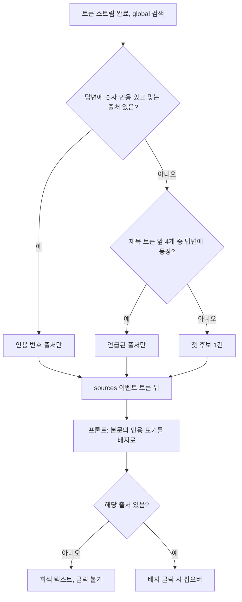

#### 4. 화면 표시 및 입력 데이터 항목 명세
| 항목명 | 화면 표시/입력 구분 | UI 컴포넌트 | 필수 여부 | 데이터 타입 / 제약 | 기본값 | 유효성 검증 규칙 (Validation) | 노출/수정 조건 |
| :--- | :---: | :--- | :---: | :--- | :---: | :--- | :--- |
| 인용 배지 (원문) | 사용자 조작 | `CitationBadge` 버튼, `accent-soft` 배경, `data-tone="primary"` | - | 접근 이름 `출처 {n}번: {제목}`, `aria-haspopup="dialog"`, `aria-expanded` | - | 출처 `index` 일치 | 768px 미만 터치 영역 44px |
| 인용 배지 (보충) | 사용자 조작 | `CitationBadge`, `success-soft` 배경 + `text-success`, `data-tone="supplementary"` | - | 접근 이름 `보충 웹 검색 출처 [Sn]: {제목}` | - | `type: supplementary` 또는 `S` 로 시작 | 실제 백엔드는 보내지 않음 |
| 출처 없는 인용 | 노출 전용 | 회색 `[n]` 텍스트 | - | - | - | - | 출처 미일치 |
| 팝오버 | 노출 전용 | `Popover role="dialog"`, body 포털 (배지 위, 폭 320px, 최대 `100vw - 2rem`) | - | 이름 `출처 기사 상세 프리뷰` / `보충 검색 출처 상세 프리뷰` | 닫힘 | - | 배지 클릭 |
| `팝오버 닫기` | 사용자 조작 | `IconButton` `sm` (768px 미만 44px·아이콘 20px, 이상 32px·아이콘 16px) | - | Action | - | - | 팝오버 머리 오른쪽 (v0.4.2) |
| 팝오버 라벨 | 노출 전용 | Label | - | `출처 [n]` / `보충 검색 [Sn]` | - | - | 팝오버 안 |
| 카테고리·도메인 | 노출 전용 | Badge | - | 원문: `categoryShortLabel` (`하네스`, `MCP`, `에이전트`, `AI 동향`, 모르는 값은 원값). 보충: `domain` 또는 URL 호스트 | - | - | 팝오버 안 |
| 제목·스니펫 | 노출 전용 | Text | - | 제목 2줄, 스니펫 3줄 말줄임 | - | - | 팝오버 안 |
| `원문 보기` / `웹 문서 보기` | 사용자 조작 | Link (새 탭) | - | URL | - | - | 팝오버 안 |
| `원문 N건` / `보충 N건` | 노출 전용 | Badge (말풍선 헤더) | - | `primary_count`/`supplementary_count`, 없으면 출처 type 으로 셈 | - | - | 완료 후, 내용과 출처가 있을 때 |

#### 5. 비즈니스 규칙
- **BR-CHAT-014-1**: 인용 필터링은 global 검색 모드에만 한다. scoped 는 하지 않는다.
- **BR-CHAT-014-4 (v0.4.2)**: 팝오버의 `기사 상세` 버튼과 `onOpenSourceDetail` prop 을 지웠다. 팝오버에서 갈 수 있는 곳은 `원문 보기`(새 탭)뿐이다.
- **BR-CHAT-014-2**: 프롬프트는 실제로 쓴 출처만 `[1]`, `[2]` 로 인용하고 없는 번호를 만들지 말라고 지시한다. 출처 없이 답하는 경우 가짜 인용 번호를 붙이지 말라고 지시한다.
- **BR-CHAT-014-3**: 출처가 1건 이상 후보로 있으면 sources 이벤트는 최소 1건을 담는다(첫 후보 폴백).

#### 6. 예외 처리 및 엣지 케이스
| 발생 상황 | 화면 반응 및 시스템 처리 방식 | 사용자 안내 메시지 |
| :--- | :--- | :--- |
| 표 셀(`td`, `th`), `em`, 링크 안의 `[n]` | 배지로 바뀌지 않음 | - |
| 스트리밍 중 `[1]` (global) | 회색 텍스트 → sources 도착 후 배지. 스트리밍 중에는 누를 수 없다. 인용된 출처만 보이려는 의도된 동작이다 (결함 아님) | - |
| 메시지 목록을 스크롤해 배지가 화면 밖으로 감 | 팝오버는 body 포털이라 목록 상자에 잘리지 않는다 | - |

#### 7. 비즈니스 에러 코드 매핑
| 비즈니스 에러 코드 | 발생 사유 | HTTP 상태 코드 매핑 | 클라이언트 표시 형태 |
| :--- | :--- | :---: | :--- |
| (없음) | 표시 전용 | - | - |

근거: `backend/app/services/chat_service.py:229-239`, `:397-428`, `:637-650`, `frontend/src/components/chat/ChatMessageItem.tsx`, `frontend/src/components/chat/CitationBadge.tsx`, `frontend/src/components/chat/CitationPopover.tsx:40-64`, `frontend/src/components/ui/Popover.tsx:60-63`, `:177`, `frontend/src/components/ui/IconButton.tsx:5-9`, `frontend/src/lib/labels.ts`

---

### [FUNC-CHAT-015] 모델 선택

#### 1. 기본 정보
- **기능명**: Haiku/Sonnet/Opus 티어 선택, 티어 배지, 모델 변경 구분선, 백엔드 모델·티어 해석
- **기능 ID**: `FUNC-CHAT-015`
- **대응 요구사항**: `REQ-CHAT-004` (옛 기능명세 `CHAT-15`)
- **대상 화면 코드**: `SCR-CHAT-001`, `SCR-CHAT-004`
- **우선순위**: Must Have
- **관련 액터**: 사용자

#### 2. 사전 조건
1. 입력창 왼쪽 아래 모델 칩(`inline-chip`)이 보인다. 모든 폭에서 화면의 모델 선택은 이 하나뿐이고 챗 헤더에는 없다. 모델 선택은 다음에 보낼 질문에 적용되므로 전송 버튼과 같은 줄에 둔다.

#### 3. 인터랙션 흐름과 플로우차트
1. 사용자가 트리거(접근 이름 `Claude 모델 선택: {이름}`)를 누른다. 스트리밍 중에는 비활성이다.
2. 드롭다운(`Popover role="radiogroup"`, 이름 `Claude AI 모델 선택`)이 입력창 칩에서 위·왼쪽 정렬로 열린다.
3. 화살표 위/아래/좌/우로 포커스 이동(순환), Home/End 처음·끝, Enter/Space 선택, Escape(오버레이 스택의 맨 위일 때만) 닫기, 바깥 pointerdown 닫기. 선택하면 닫고 트리거로 포커스를 돌린다.
4. 티어를 바꾸고 메시지가 1개 이상이면 `ModelSwitchEvent`(이전 티어, 새 티어, 시각)를 추가한다. 같은 티어를 다시 고르면 아무 일도 없다.
5. 타임라인은 메시지와 이벤트를 시각순으로 섞어 `ModelChangeDivider` 를 보인다.
6. 전송 시 `model = TIER_TO_MODEL[티어]` 와 `model_tier` 를 보낸다. 값은 전송 시점의 선택 티어다 (`handleSendMessage` 의존성 배열에 `selectedTier` 가 있다, `frontend/src/components/chat/ChatWorkspace.tsx:470`).
7. 백엔드 `resolve_model_and_tier`(BR-CHAT-015-4)로 Anthropic 모델 ID 와 티어를 정한다. 입력 우선순위는 `model` > `model_tier` > 기본 챗 모델이다(`ChatStreamRequest.model` 기본값은 v0.4.2 부터 null). done 의 `model_tier` 는 `resolve_model_and_tier(req.model or req.model_tier or 실제 모델)` 의 티어다.
8. 답변 말풍선 헤더는 `formatModelDisplayName(model_used || model_tier)`, 하단 `ModelTierBadge`(footer)는 티어 아이콘·이름과 `· {latency_ms}ms`. `latency_ms` 는 서버가 그 요청에서 잰 실제 값이다(고정 문구가 아니다).

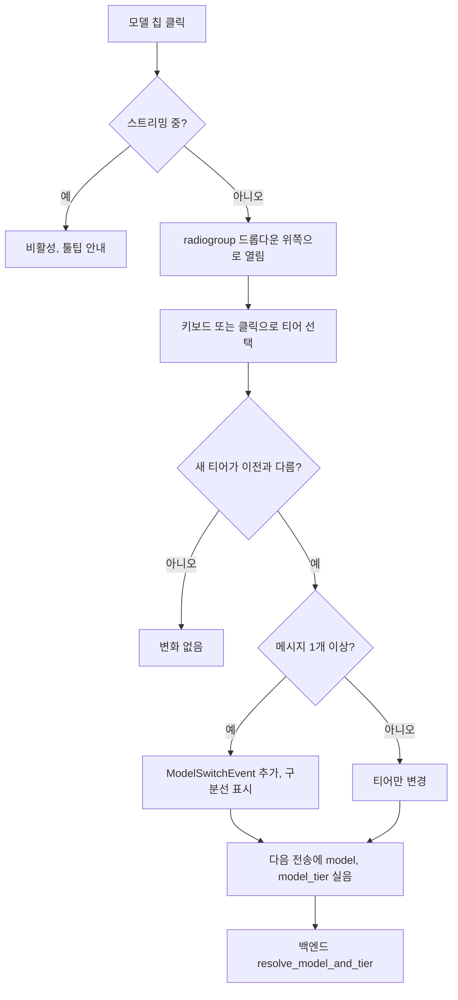

#### 4. 화면 표시 및 입력 데이터 항목 명세
| 항목명 | 화면 표시/입력 구분 | UI 컴포넌트 | 필수 여부 | 데이터 타입 / 제약 | 기본값 | 유효성 검증 규칙 (Validation) | 노출/수정 조건 |
| :--- | :---: | :--- | :---: | :--- | :---: | :--- | :--- |
| 모델 칩 트리거 | 사용자 조작 | `ChatModelSelector` (입력창 칩 하나, 이름 앞 `TierIcon`, 변형 prop 없음) | 필수 | 툴팁 `<이름> · 상대 비용 <$~$$$>`, 스트리밍 중 `답변 생성 중에는 모델을 변경할 수 없습니다` | Sonnet 5.5 | - | 스트리밍 중 비활성. 768px 미만 높이 44px, 이상 32px. `추천` 표시는 640px 이상 |
| 티어 항목 | 선택 | Radio (드롭다운 항목) | 필수 | `haiku` \| `sonnet` \| `opus` | `sonnet` | 세 값만 | 드롭다운 열림 |
| 티어 정보 | 노출 전용 | 항목 설명 | - | Haiku 5.5 `Zap` `$` `초고속 탐색 & 간결 질의` / Sonnet 5.5 `Target` `$$` `심층 분석 & RAG 최적화`(추천) / Opus 5.5 `Brain` `$$$` `최대 추론 & 복합 아키텍처`. `$`~`$$$` 앞에 화면 읽기 전용 `상대 비용` | - | `$` 표시는 측정값이 아닌 상대 순서다. 지연 수치(`~0.3s` 등)는 근거가 없어 v0.4.2 에서 지웠다 | 드롭다운 열림 |
| 모델 변경 구분선 | 노출 전용 | `ModelChangeDivider` `role="separator"` | - | `이전 ➔ Claude <새 이름>로 모델 변경됨 · HH:MM` | - | - | 이벤트가 있을 때. 저장하지 않음, 새 대화 때 지움 |
| 답변 모델 표시 | 노출 전용 | 말풍선 헤더 텍스트 | - | `formatModelDisplayName` (Claude 는 `Claude Sonnet 5.5` 형식, Gemini·GPT 이력은 원래 이름 보존) | - | - | 어시스턴트 메시지 |
| 티어 배지 | 노출 전용 | `ModelTierBadge` footer | - | 티어 아이콘·이름 + `· {latency_ms}ms` | - | - | 어시스턴트 메시지 |
| 티어 아이콘 | 노출 전용 | `TierIcon` (`aria-hidden="true"`, `data-tier-icon="<티어>"`) | - | lucide 컴포넌트. Claude 밖 이름: `gemini` 포함 `Sparkles`, `gpt` 포함 `Bot`, 그 밖 `Target` | - | - | 트리거, 항목, 답변 배지 공통 |

#### 5. 비즈니스 규칙
- **BR-CHAT-015-1**: `TIER_TO_MODEL` = `claude-haiku-5-5`, `claude-sonnet-5-5`, `claude-opus-5-5`. 기본 티어 `sonnet`.
- **BR-CHAT-015-2 (v0.4.2)**: 헤더용 `header-chip`·`header-compact` 변형과 `ModelTierBadge.variant` prop 을 지웠다. 모델 선택 부품은 입력창 칩 한 가지 모양뿐이다.
- **BR-CHAT-015-3 (설정 티어 매핑, `get_configured_model`)**: haiku = `ANTHROPIC_HAIKU_MODEL` → 환경 변수 → `claude-haiku-5-5`. opus = `ANTHROPIC_OPUS_MODEL` → 환경 변수 → `claude-opus-5-5`. sonnet = `ANTHROPIC_SONNET_MODEL` → 환경 변수 → `ANTHROPIC_DEFAULT_CHAT_MODEL` → `ANTHROPIC_MODEL` → `claude-sonnet-5-5`. default = `ANTHROPIC_DEFAULT_CHAT_MODEL` → 환경 변수 → `ANTHROPIC_MODEL` → `claude-sonnet-5-5`. 매핑 키는 티어 이름과 설정 모델 ID 소문자, `default` 다.
- **BR-CHAT-015-4 (`resolve_model_and_tier`)**: 값이 없으면 기본 모델·`sonnet`. `gemini`/`google` 이 들어 있으면 기본 모델·`sonnet` 으로 바꾼다. 설정 매핑에 있으면 그 값. 없으면 `haiku`/`opus`/`sonnet` 단어 포함 여부로 티어를 정하되 `claude-` 로 시작하면 요청 문자열을 그대로 모델 ID 로 쓰고, 아니면 설정 매핑 모델을 쓴다. `claude-` 로 시작하는 그 밖 문자열은 그대로·`sonnet`. 나머지는 요청 문자열과 `sonnet`.

#### 6. 예외 처리 및 엣지 케이스
| 발생 상황 | 화면 반응 및 시스템 처리 방식 | 사용자 안내 메시지 |
| :--- | :--- | :--- |
| OpenAI/Ollama 폴백 | done `model` 은 실제 모델 문자열(예 `OpenAI gpt-4o-mini`), `model_tier` 는 요청 값으로 계산한 티어. 티어 배지는 요청 티어를 보인다 | - |
| 설정에서 티어 모델 ID 변경 | 프론트가 고정 `claude-*-5-5` 를 보내므로 요청 문자열이 그대로 쓰인다 (위험 13번) | - |
| 모델 변경 직후 전송 | 바뀐 티어가 실린다 (v0.4.1 해결, 위험 2번) | - |
| 세션 선택 | 모델 변경 이벤트를 지우지 않음 (위험 4번) | - |

#### 7. 비즈니스 에러 코드 매핑
| 비즈니스 에러 코드 | 발생 사유 | HTTP 상태 코드 매핑 | 클라이언트 표시 형태 |
| :--- | :--- | :---: | :--- |
| `ERR_INVALID_MODEL_TIER` | `/stream` 의 `model_tier` 가 세 값이 아님 (`유효하지 않은 모델 티어입니다: {값}`). MSW 목도 같은 코드를 쓴다 | 400 | 오류 카드 |

근거: `frontend/src/components/chat/ChatModelSelector.tsx:10-13`, `:102`, `:160-175`, `frontend/src/components/chat/ModelTierBadge.tsx:14-43`, `:77`, `frontend/src/components/chat/ModelChangeDivider.tsx`, `frontend/src/components/chat/ChatWorkspace.tsx:177-196`, `:357-358`, `frontend/src/components/chat/ChatPromptInput.tsx`, `frontend/src/components/chat/ChatMessageItem.tsx`, `frontend/src/types/chat.ts`, `backend/app/api/chat.py:91-98`, `backend/app/schemas/chat.py:28-46`, `backend/app/services/llm_providers/anthropic_provider.py:33-127`, `backend/app/services/chat_service.py:652-667`

---

### [FUNC-CHAT-016] 포커스 필터

#### 1. 기본 정보
- **기능명**: 카테고리·기간·정렬·고신호 필터, 0건 시 기간 자동 완화 안내
- **기능 ID**: `FUNC-CHAT-016`
- **대응 요구사항**: `REQ-CHAT-008` (옛 기능명세 `CHAT-16`)
- **대상 화면 코드**: `SCR-CHAT-001` (캡슐), `SCR-CHAT-005`
- **우선순위**: Should Have
- **관련 액터**: 사용자

#### 2. 사전 조건
1. 입력창 위 포커스 캡슐 버튼이 보인다.

#### 3. 인터랙션 흐름과 플로우차트
1. 사용자가 캡슐(`포커스: <요약>`, 접근 이름 `지식 검색 포커스 필터 설정 열기. 현재 설정: <요약>`, `aria-haspopup="dialog"`, `aria-expanded`)을 누른다.
2. 필터 창(`Dialog size="sm" mobile="sheet"`, 제목 `수집 소식 타깃팅 포커스 필터`, 설명 `RAG 지식 검색 대상 소식을 고릅니다.`)이 열린다. 768px 미만은 아래에 붙는 바텀시트(손잡이 표시), 이상은 가운데 작은 대화상자다.
3. 초안(draft) 상태로 `도메인 카테고리`·`수집 기간`·`정렬 기준` 칩 묶음과 `신호 품질 필터` 스위치(`Must-Read 고신호 전용 토글`)를 고른다.
4. `적용하기` 를 눌러야 반영된다. `초기화` 는 초안과 실제 필터를 함께 기본값으로 돌린다. Escape(오버레이 스택의 맨 위일 때만), 배경막, `필터 닫기` 버튼, 바텀시트에서 아래로 100px 이상 스와이프하면 닫힌다(적용 안 함).
5. 필터는 매 요청 `filters` 로 보낸다. 백엔드는 global 검색에만 적용한다(FUNC-CHAT-012). 0건이고 기간이 `all` 이 아니면 기간을 `all` 로 완화하고 `is_relaxed: true` 를 보낸다.
6. `is_relaxed` 면 답변 위에 경고 알림(`InlineAlert`)을 보인다.
7. 필터가 기본값이 아니거나 기사 컨텍스트가 있으면 캡슐 옆에 형제 버튼 `포커스 필터 초기화`(X)가 보인다. 누르면 필터만 초기화하고 기사는 해제하지 않는다.

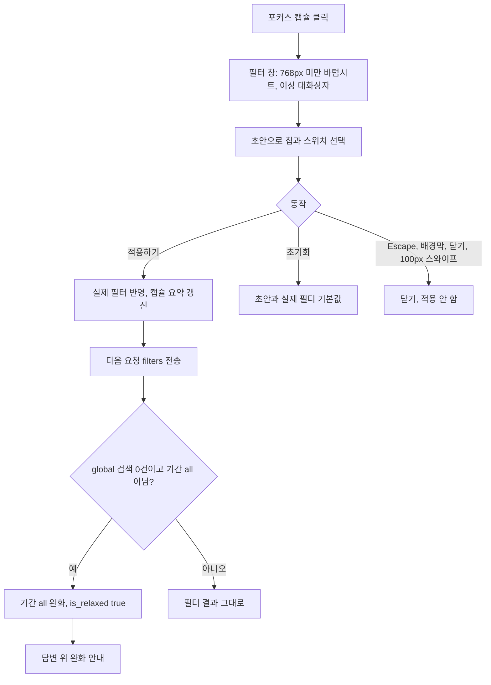

#### 4. 화면 표시 및 입력 데이터 항목 명세
| 항목명 | 화면 표시/입력 구분 | UI 컴포넌트 | 필수 여부 | 데이터 타입 / 제약 | 기본값 | 유효성 검증 규칙 (Validation) | 노출/수정 조건 |
| :--- | :---: | :--- | :---: | :--- | :---: | :--- | :--- |
| 포커스 캡슐 | 사용자 조작 | Button `포커스: <요약>` | - | 요약 규칙 BR-CHAT-016-2 | `전체 소식` | - | 상시. 768px 미만 44px, 이상 32px |
| `포커스 필터 초기화` | 사용자 조작 | Icon Button (X) | - | Action | - | - | 필터가 기본값이 아니거나 기사 컨텍스트가 있을 때. 768px 미만 44px, 이상 32px |
| 도메인 카테고리 | 선택 | Chip Group (줄바꿈 묶음) | 필수 | `all`(`전체 소식`) \| `harness`(`하네스 & 벤치마크`) \| `mcp_plugins_skills`(`MCP & 생태계`) \| `agent_tech`(`에이전트 아키텍처`) \| `ai_news`(`최신 AI 동향`) | `all` | Literal | 필터 창. 긴 라벨(`categoryLabel`), 360px 시트에서 여러 줄로 감김 |
| 수집 기간 | 선택 | Chip Group | 필수 | `all` \| `24h` \| `7d` \| `30d` | `all` | Literal | 필터 창 |
| 정렬 기준 | 선택 | Chip Group | 필수 | `hot`(화제순) \| `latest`(최신순) \| `quality`(품질순) | `hot` | Literal | 필터 창 |
| 고신호 | 사용자 조작 | Switch `Must-Read 고신호만` (`Must-Read 고신호 전용 토글`). 숫자 없음 (v0.4.2) | 선택 | bool | false | - | 필터 창 |
| 매칭 건수 | 노출 전용 | Badge `약 N건 매칭 소식` | - | int = 마지막 어시스턴트 메시지의 출처 수(`actualSourceCount`) | 없음 | - | 값이 있을 때 |
| 0건 경고 | 노출 전용 | Warning | - | `선택 조건의 소식이 없습니다. 기간을 [최근 30일] 또는 [전체 기간]으로 넓혀보세요.` | - | - | 값이 0 일 때 (워크스페이스에서는 나오지 않음) |
| 완화 안내 | 노출 전용 | `InlineAlert` (경고) | - | `[안내: 선택 조건에 부합하는 소식이 없어 전체 기간으로 확장 검색했습니다]` | - | - | `is_relaxed` 인 답변 위 |

#### 5. 비즈니스 규칙
- **BR-CHAT-016-1**: 기본값 all/all/hot/false. 프론트 `FocusFilters` ↔ API `ChatFocusFilter` 는 `toChatFocusFilter`/`fromChatFocusFilter` 로 바꾼다.
- **BR-CHAT-016-2 (캡슐 요약)**: 기사 컨텍스트가 있으면 기사 제목 앞 25자. 필터가 기본값이 아니면 카테고리 짧은 라벨(`categoryShortLabel`: `하네스`, `MCP`, `에이전트`, `AI 동향`)·기간·`고신호` 를 ` · ` 로 이은 문자열(비면 `맞춤 필터`, 정렬만 바꾼 경우 `맞춤 필터`). 그 밖에는 `전체 소식`(`ALL_CATEGORY_LABEL`, 피드 `전체 소식` 칩·필터 창 `전체 소식` 칩과 같은 말).
- **BR-CHAT-016-3**: scoped 요청은 필터를 무시한다.
- **BR-CHAT-016-4**: 고신호는 백엔드에서 품질 점수가 아니라 `is_high_signal` 열로 거른다 (라벨은 숫자 없이 `Must-Read 고신호만`, v0.4.2).

#### 6. 예외 처리 및 엣지 케이스
| 발생 상황 | 화면 반응 및 시스템 처리 방식 | 사용자 안내 메시지 |
| :--- | :--- | :--- |
| 출처 있는 답변이 없음 | 매칭 건수 표시 없음 | - |
| 0건 경고 | `actualSourceCount` 는 출처 1건 이상 메시지만 세므로 0 이 되지 않아 나오지 않는다 (위험 30번) | - |
| 캡슐 `matchedCount` prop | 받지만 그리지 않음 | - |
| 적용 없이 닫기 | 초안 버림 | - |

#### 7. 비즈니스 에러 코드 매핑
| 비즈니스 에러 코드 | 발생 사유 | HTTP 상태 코드 매핑 | 클라이언트 표시 형태 |
| :--- | :--- | :---: | :--- |
| `ERR_INVALID_PAYLOAD` | 필터 값이 Literal 밖 (프론트에서는 생기지 않음) | 400 | 오류 카드 `요청 필드 형식이 올바르지 않습니다.` |

근거: `frontend/src/components/chat/FocusCapsule.tsx`, `frontend/src/components/chat/FocusBottomSheet.tsx`, `frontend/src/components/ui/Dialog.tsx:25,179-191,214-218`, `frontend/src/components/chat/ChatWorkspace.tsx:104-112,715-722,757-765`, `frontend/src/lib/labels.ts:15-20,50-58,71`, `frontend/src/components/chat/ChatMessageItem.tsx:253-258`, `frontend/src/types/chat.ts:246-296`, `backend/app/schemas/chat.py:22-26`, `backend/app/services/retriever.py:569-586`

---

### [FUNC-CHAT-017] 스코프 전환·기사 칩

#### 1. 기본 정보
- **기능명**: `단일 기사`/`전체 소식` 토글, 기사 컨텍스트 해제
- **기능 ID**: `FUNC-CHAT-017`
- **대응 요구사항**: `REQ-CHAT-008` (옛 기능명세 `CHAT-17`)
- **대상 화면 코드**: `SCR-CHAT-001` (맥락 줄)
- **우선순위**: Should Have
- **관련 액터**: 사용자

#### 2. 사전 조건
1. 헤더 아래 맥락 줄(`ChatContextBar`)이 보인다. 모든 폭에서 같은 자리다.

#### 3. 인터랙션 흐름과 플로우차트
1. 사용자가 토글(`SegmentedControl`, 그룹 이름 `검색 스코프 모드`)에서 `단일 기사`(scoped) / `전체 소식`(global) 을 누른다. 토글은 `scopeMode` 상태만 바꾼다.
2. 기사 컨텍스트가 있으면 토글 오른쪽에 기사 칩이 보인다.
3. 칩의 X(`기사 컨텍스트 해제`)를 누르면 기사 컨텍스트를 null, 스코프를 `global` 로 바꾼다. 스트리밍 중 X 는 비활성이다.
4. 전송 시 스코프는 FUNC-CHAT-008 의 3번 규칙으로 정한다(기사 컨텍스트가 있으면 토글과 무관하게 `scoped`).
5. 입력창 placeholder 가 스코프에 따라 바뀐다(FUNC-CHAT-008). 입력창 아래의 별도 스코프 표시는 없다.

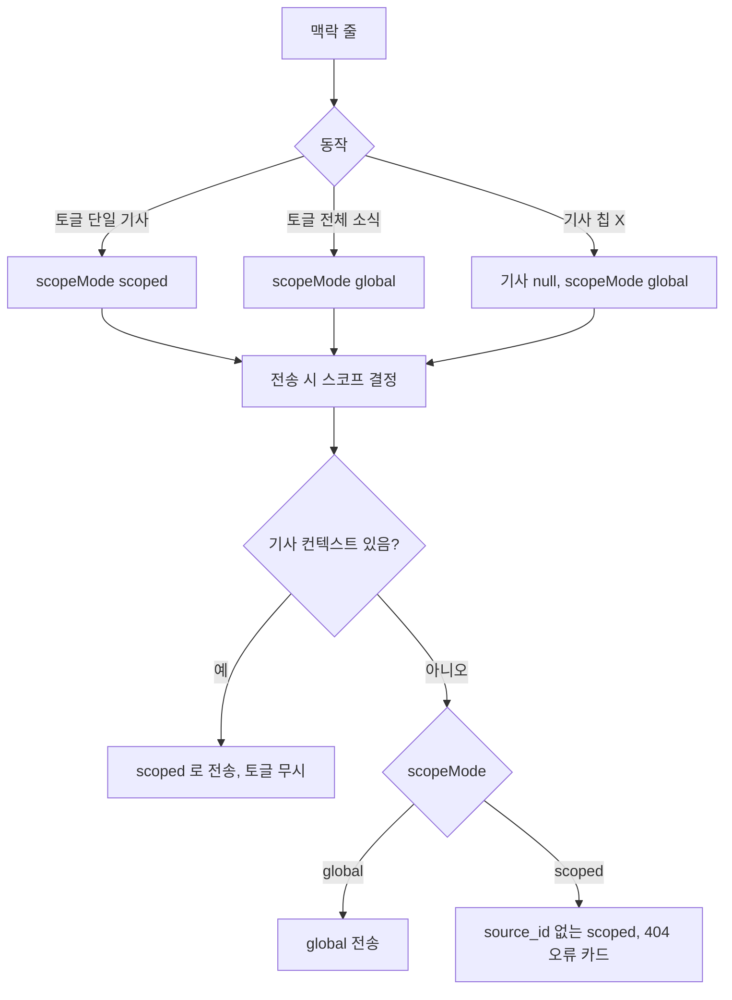

#### 4. 화면 표시 및 입력 데이터 항목 명세
| 항목명 | 화면 표시/입력 구분 | UI 컴포넌트 | 필수 여부 | 데이터 타입 / 제약 | 기본값 | 유효성 검증 규칙 (Validation) | 노출/수정 조건 |
| :--- | :---: | :--- | :---: | :--- | :---: | :--- | :--- |
| 스코프 토글 | 선택 | `SegmentedControl` (버튼 `aria-pressed`, 접근 이름 = 글자) | 필수 | `scoped`→`단일 기사`, `global`→`전체 소식` (`SCOPE_LABELS`·`scopeLabel`) | `global` | - | 상시 |
| 맥락 줄 | 노출 전용 | `ScrollRow` (줄 이름 `검색 스코프`) | - | 한 줄, 768px 이상 높이 44px(아래 테두리 포함), 미만 최소 44px | - | - | 상시 |
| 스크롤 버튼 | 사용자 조작 | `검색 스코프 이전 항목 보기`/`검색 스코프 다음 항목 보기` | - | Action | - | - | 768px 이상, 넘친 쪽에만 |
| 넘침 표시 | 노출 전용 | 장식 화살표(보조기술에서 숨김) + 끝 흐림 | - | - | - | - | 768px 미만, 오른쪽으로 넘칠 때 |
| 기사 칩 | 노출 전용 | `ActiveSourceChip` | - | 카테고리 짧은 라벨(예 `MCP`, 모르는 값은 원값) + 제목 앞 35자(넘으면 `...`, 전체 제목 `title` 툴팁) | - | - | 기사 컨텍스트가 있을 때 |
| `기사 컨텍스트 해제` | 사용자 조작 | Icon Button (X) | - | Action | - | - | 칩 안, 스트리밍 중 비활성 |

#### 5. 비즈니스 규칙
- **BR-CHAT-017-1**: 화면의 검색 범위 용어는 모드 탭, 대화 목록 배지, 대화 항목 접근 이름, 없는 기사 알림, 빈 화면 안내(`수집된 소식 기반의`)가 모두 `단일 기사`·`전체 소식` 하나로 같고 영어(`Scoped`, `Global`)나 `코퍼스` 를 쓰지 않는다.
- **BR-CHAT-017-2**: 두 탭은 360px 폭에서도 기사 칩이 없으면 줄이 넘치지 않는다.
- **BR-CHAT-017-3**: 줄 안 요소가 포커스를 받으면 보이게 스크롤한다.

#### 6. 예외 처리 및 엣지 케이스
| 발생 상황 | 화면 반응 및 시스템 처리 방식 | 사용자 안내 메시지 |
| :--- | :--- | :--- |
| 기사 없이 `단일 기사` 를 누르고 전송 | `source_id` 없이 scoped 요청 → 404 오류 카드 (위험 31번) | `지정된 기사를 찾을 수 없습니다.` |
| 기사가 있는 상태에서 `전체 소식` 토글 | 요청은 scoped 로 간다 (위험 31번) | - |

#### 7. 비즈니스 에러 코드 매핑
| 비즈니스 에러 코드 | 발생 사유 | HTTP 상태 코드 매핑 | 클라이언트 표시 형태 |
| :--- | :--- | :---: | :--- |
| `ERR_HANDOVER_SOURCE_NOT_FOUND` | scoped 인데 `source_id` 없음 | 404 | 오류 카드 `지정된 기사를 찾을 수 없습니다.` |

근거: `frontend/src/components/chat/ChatContextBar.tsx`, `frontend/src/components/chat/ActiveSourceChip.tsx`, `frontend/src/components/ui/ScrollRow.tsx`, `frontend/src/lib/labels.ts:15-20,49-51,71-82`, `frontend/src/components/chat/ChatHeader.tsx:143-149`, `frontend/src/components/chat/ChatWorkspace.tsx:259-261,623-626,666-670`, `frontend/src/components/chat/ChatPromptInput.tsx:43-47`

---

### [FUNC-CHAT-018] 핸드오버 (뉴스 기사 → 챗)

#### 1. 기본 정보
- **기능명**: 뉴스 기사에서 챗으로 기사 컨텍스트와 질문 넘기기
- **기능 ID**: `FUNC-CHAT-018`
- **대응 요구사항**: `REQ-CHAT-006` (옛 기능명세 `CHAT-18`. 같은 기능을 피드 쪽에서 적은 `FUNC-NEWS-019` 도 같은 요구사항)
- **대상 화면 코드**: 뉴스 피드·기사 상세 모달(화면 코드는 `docs/spec-writer/fsd/01_NEWS_FEED_SPECIFICATION.md`), `SCR-CHAT-001`
- **우선순위**: Must Have
- **관련 액터**: 사용자
- **API**: `GET /api/chat/sources/{source_id}`

#### 2. 사전 조건
1. 진입점 중 하나:
   - 뉴스 카드 `AI 챗에서 분석` 버튼(`HandoverCtaButton` `card-compact`, 접근 이름 = 보이는 글자).
   - 기사 상세 모달 배너 `AI 챗에서 분석`(`modal-banner`, 보조 문구 `이 기사를 단일 기사 모드로 열어 질의응답`, 모달의 질문 입력값을 `draftQuestion` 으로 넘김).
   - 피드에서 포커스된 기사에 `c` 키(`HotkeyListener`, `e.key` 소문자 또는 `e.code` `KeyC` 로 판정해 한글 입력 상태에서도 동작, 열린 오버레이가 없을 때만).
   - 피드 커맨드 팔레트 `AI 챗 워크스페이스 이동`(단축키 표시 없음)과 피드 헤더 `AI 챗` 링크는 기사 없이 `/chat` 으로 간다.

#### 3. 인터랙션 흐름과 플로우차트
1. 버튼 클릭은 이벤트 전파를 막고 `onHandoverComplete` 를 부른 뒤 `router.push('/chat?sourceId=<id>&q=<인코딩된 질문>')`. `q` 는 질문이 공백이 아닐 때만 붙는다.
2. 챗 첫 렌더 1회: `session_id` 파라미터가 UUID 형식이면 세션 복원만 하고 끝낸다(FUNC-CHAT-003). UUID 가 아니면 무시하고 다음으로 간다.
3. `sourceId` 가 숫자면 `GET /api/chat/sources/{id}`(8초 제한)로 기사 상세를 받아 기사 컨텍스트로 넣고 스코프를 `scoped` 로 바꾼다. `q` 가 있으면 그 기사로 바로 전송한다. 기사·질문은 URL 로만 받는다. `ChatWorkspace` 의 `initialSourceId`·`initialQuestion` prop 은 v0.4.2 에서 지웠다(넘기는 곳이 없었다).
4. 응답이 ok 가 아니거나 시간 초과·네트워크 오류면 경고 알림을 보이고 global 로 시작한다. `q` 가 있으면 global 로 전송한다.
5. `sourceId` 가 없거나 숫자가 아니고 `q` 만 있으면 현재 상태로 전송한다(`queueMicrotask` 로 effect 본문 밖에서 시작). 숫자가 아닌 `sourceId` 는 알림 없이 무시된다.
6. 백엔드 기사 상세: `tldr_bullets` 는 JSON 배열 파싱(배열이 아니면 문자열 1개 배열, 실패 시 빈 배열), `tech_stack`·`tags` 는 쉼표 분리, `quality_score` 없으면 6.0, `hotness_score` 없으면 0.0, `full_content`, `scraped_at` 포함.

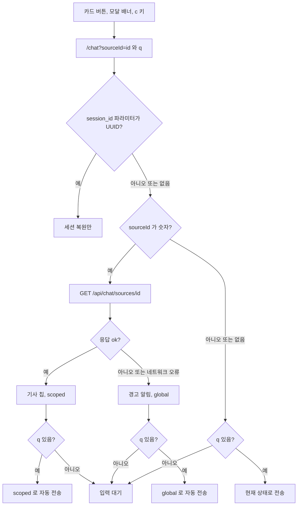

#### 4. 화면 표시 및 입력 데이터 항목 명세
| 항목명 | 화면 표시/입력 구분 | UI 컴포넌트 | 필수 여부 | 데이터 타입 / 제약 | 기본값 | 유효성 검증 규칙 (Validation) | 노출/수정 조건 |
| :--- | :---: | :--- | :---: | :--- | :---: | :--- | :--- |
| `AI 챗에서 분석` (카드) | 사용자 조작 | `HandoverCtaButton` `card-compact` | - | Action | - | - | 뉴스 카드마다 |
| `AI 챗에서 분석` (모달) | 사용자 조작 | `HandoverCtaButton` `modal-banner` | - | 보조 문구 `이 기사를 단일 기사 모드로 열어 질의응답` | - | - | 기사 상세 모달 |
| `sourceId` | 시스템 입력 | URL Query | 선택 | 숫자 문자열 | - | `parseInt` 성공 시만 | 첫 렌더 1회 |
| `q` | 시스템 입력 | URL Query | 선택 | 인코딩된 문자열 | - | 공백이 아닐 때만 붙음 | 첫 렌더 1회 |
| 경고 알림 | 노출 전용 | Toast (`warning` 톤) | - | `요청하신 기사를 찾을 수 없어 전체 소식 모드로 시작합니다.` | - | - | 기사 조회 실패 시. 3.5초 뒤 저절로 닫히거나 `알림 닫기` |

#### 5. 비즈니스 규칙
- **BR-CHAT-018-1**: URL 처리는 첫 렌더 1회뿐이다 (`initialHandoverDoneRef`).
- **BR-CHAT-018-2**: 우선순위 `session_id`(UUID 일 때만) > `sourceId` > `q` 단독.
- **BR-CHAT-018-4 (v0.4.2)**: 카드·상세 대화상자의 핸드오버는 `HandoverCtaButton`(`card-compact`, `modal-banner` 두 변형. 쓰지 않던 `modal-icon` 변형은 지웠다)이 직접 이동한다. `NewsCard`·`NewsDetailModal` 의 `onHandoverToChat` prop 은 지웠다.
- **BR-CHAT-018-3**: 알림은 입력 영역 바로 위(8px 위)의 `composer` 알림 영역에 뜨고, 폭은 메시지 열과 같은 `max-w-3xl` 열 안이다. 루트 레이아웃의 전역 알림 영역도 마운트돼 있지만 한 번에 한 영역만 그린다: 모달 대화상자가 없고 `composer` 영역이 있으면 `composer`, 모달 대화상자가 열려 있으면 전역 영역(768px 미만 화면 아래, 이상 오른쪽 위)이다.

#### 6. 예외 처리 및 엣지 케이스
| 발생 상황 | 화면 반응 및 시스템 처리 방식 | 사용자 안내 메시지 |
| :--- | :--- | :--- |
| 기사 없음(404)·네트워크 오류 | 경고 알림, global 시작, `q` 있으면 global 전송 | `요청하신 기사를 찾을 수 없어 전체 소식 모드로 시작합니다.` |
| `sourceId` 가 숫자가 아님 | 알림 없이 무시, `q` 있으면 현재 상태로 전송 | 없음 |
| `session_id`(UUID)와 `sourceId` 가 함께 있음 | 세션 복원만, 기사·질문 무시 | 없음 |
| `session_id` 가 UUID 가 아님 | 세션을 열지 않고 `sourceId`·`q` 처리로 넘어간다 (v0.4.2) | 없음 |

#### 7. 비즈니스 에러 코드 매핑
| 비즈니스 에러 코드 | 발생 사유 | HTTP 상태 코드 매핑 | 클라이언트 표시 형태 |
| :--- | :--- | :---: | :--- |
| `ERR_HANDOVER_SOURCE_NOT_FOUND` | 기사 없음 (`기사 ID {id}를 데이터베이스에서 찾을 수 없습니다.`) | 404 | 경고 알림(고정 문구), global 시작 |
| `ERR_INVALID_PAYLOAD` | 경로 `source_id` 가 정수 아님 (요청 검증) | 400 | 프론트는 숫자만 보냄 |

근거: `frontend/src/components/chat/HandoverCtaButton.tsx`, `frontend/src/components/NewsCard.tsx`, `frontend/src/components/NewsDetailModal.tsx`, `frontend/src/app/page.tsx`, `frontend/src/components/HotkeyListener.tsx`, `frontend/src/components/CommandPalette.tsx`, `frontend/src/components/chat/ChatWorkspace.tsx:38-46`, `:478-531`, `frontend/src/lib/chatApi.ts:76-79`, `frontend/src/components/ui/Toast.tsx`, `backend/app/api/chat.py:59-67`, `backend/app/services/chat_service.py:77-110`

---

### [FUNC-CHAT-019] 내보내기 (ExportToolbar)

#### 1. 기본 정보
- **기능명**: 답변 복사, 마크다운 복사, .md 다운로드
- **기능 ID**: `FUNC-CHAT-019`
- **대응 요구사항**: `REQ-CHAT-010` (옛 기능명세 `CHAT-19`)
- **대상 화면 코드**: `SCR-CHAT-001` (답변 하단)
- **우선순위**: Should Have
- **관련 액터**: 사용자

#### 2. 사전 조건
1. 오류가 아니고 내용이 있는 어시스턴트 답변이다. 끊긴 스트림·스트림 오류로 상태가 `error` 인 답에는 받은 부분 답이 보여도 모델 배지와 도구줄이 나오지 않는다 (FUNC-CHAT-020).

#### 3. 인터랙션 흐름과 플로우차트
1. 머리줄 `복사`(접근 이름 `답변 복사`)와 도구줄 `마크다운 복사` 는 같은 `useCopyToClipboard` 를 쓴다: `navigator.clipboard.writeText`, 없거나 실패하면 숨긴 textarea + `document.execCommand('copy')`. 결과에 따라 2초간 `복사됨` 또는 `복사 실패` 를 보이고(`aria-live="polite"`) `복사`/`마크다운 복사` 로 돌아간다.
2. `.md 다운로드`: Blob(`text/markdown;charset=utf-8`), 파일명 = 첫 출처 제목(없으면 `AgentLens_Engineering_Report`)에서 영숫자·한글·`_-` 외 문자를 `_` 로 바꾸고 50자로 자른 값 + `_YYYY-MM-DD.md`. 누른 뒤 500ms 동안 버튼이 비활성이다.
3. 스트리밍 중에는 툴바가 반투명·클릭 불가이고 버튼이 비활성화된다.
4. 예전에 있던 `Notion 동기화` 버튼(서버를 부르지 않는 모의 동작)은 v0.4.1 에서 지웠다. 챗 답 Notion 내보내기 API 가 없어 그리지 않는다 (리뷰 FE-22, `frontend/src/components/chat/ExportToolbar.tsx:22-27`).

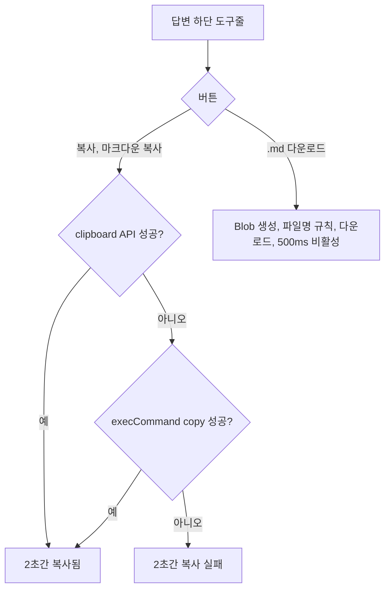

#### 4. 화면 표시 및 입력 데이터 항목 명세
| 항목명 | 화면 표시/입력 구분 | UI 컴포넌트 | 필수 여부 | 데이터 타입 / 제약 | 기본값 | 유효성 검증 규칙 (Validation) | 노출/수정 조건 |
| :--- | :---: | :--- | :---: | :--- | :---: | :--- | :--- |
| 도구줄 | 노출 전용 | `role="group"`, 이름 `리포트 익스포트 툴바` | - | 768px 이상은 앞에 `리포트 내보내기` 표시 | - | - | 오류 아님 + 내용 있음 |
| `복사` (머리줄) | 사용자 조작 | Button (접근 이름 `답변 복사`) | - | 마크다운 본문 | - | - | 오류 아님 + 내용 있음 |
| `마크다운 복사` | 사용자 조작 | Button | - | 마크다운 본문 | - | - | 스트리밍 중 비활성 |
| `.md 다운로드` | 사용자 조작 | Button | - | 파일명 50자 + `_YYYY-MM-DD.md` | `AgentLens_Engineering_Report` | 허용 문자 외 `_` 치환 | 스트리밍 중·다운로드 직후 500ms 비활성 |
| 결과 문구 | 노출 전용 | `aria-live="polite"` | - | `복사됨` / `복사 실패` (2초) | - | - | 동작 후 |

#### 5. 비즈니스 규칙
- **BR-CHAT-019-1**: 768px 미만은 모든 버튼이 글자를 숨긴 44px 아이콘 버튼이고 접근 이름(`답변 복사`, `마크다운 복사`, `.md 다운로드`)은 같다.
- **BR-CHAT-019-2**: 오류 메시지에는 복사·모델 배지·내보내기를 보이지 않는다 (받은 부분 답 본문은 보인다).
- **BR-CHAT-019-3**: 도구줄 버튼은 `마크다운 복사`, `.md 다운로드` 둘뿐이다.

#### 6. 예외 처리 및 엣지 케이스
| 발생 상황 | 화면 반응 및 시스템 처리 방식 | 사용자 안내 메시지 |
| :--- | :--- | :--- |
| 클립보드 API 없음·거부 | textarea 폴백 | 실패 시 `복사 실패` |
| 워크스페이스 `onCopyMessage` | 빈 함수 | - |

#### 7. 비즈니스 에러 코드 매핑
| 비즈니스 에러 코드 | 발생 사유 | HTTP 상태 코드 매핑 | 클라이언트 표시 형태 |
| :--- | :--- | :---: | :--- |
| (없음) | 서버 호출 없음 | - | - |

근거: `frontend/src/components/chat/ExportToolbar.tsx:9-136`, `frontend/src/hooks/useCopyToClipboard.ts`, `frontend/src/components/chat/ChatMessageItem.tsx:46-49,223-242,276-294`, `frontend/src/components/chat/ChatWorkspace.tsx:659`, 동작 확인 테스트 `frontend/src/tests/chat/ExportToolbar.test.tsx`

---

### [FUNC-CHAT-020] 오류·중단·재시도

#### 1. 기본 정보
- **기능명**: HTTP 오류, 스트림 중 오류, 끊긴 스트림, 사용자 중단, 다시 시도
- **기능 ID**: `FUNC-CHAT-020`
- **대응 요구사항**: `REQ-CHAT-005` (옛 기능명세 `CHAT-20`)
- **대상 화면 코드**: `SCR-CHAT-001`
- **우선순위**: Must Have
- **관련 액터**: 사용자, 시스템

#### 2. 사전 조건
1. 중단: 스트리밍 중이다. 다시 시도: 상태가 `error` 인 어시스턴트 메시지가 있고 바로 앞이 사용자 메시지다.

#### 3. 인터랙션 흐름과 플로우차트
1. 중단: 스트리밍 중 전송 자리에 나오는 위험 톤 중단 아이콘 버튼(접근 이름 `답변 생성 중단`)을 누르면 `AbortController.abort()`, 스트리밍 상태 해제, `streaming` 인 메시지를 `aborted` 로 바꾼다. fetch 가 `AbortError` 를 던지거나, 중단 뒤 본문이 오류 없이 끝나도(`controller.signal.aborted`) 그 어시스턴트 메시지를 `aborted` 로 두고 세션을 한 번 저장한다. 저장 내용은 그 턴의 원래 세션 id 로 '앞의 대화 + 질문 + 중단된 답' 이다 (`saveTurn`, 리뷰 FE-02·FE-34).
2. HTTP 오류(스트림 시작 전): 공통 오류 응답의 `message` 를 오류 문구로 쓴다(본문이 그 모양이 아니면 `답변을 받지 못했습니다. 다시 시도해 주세요.`). 응답 머리가 30초 안에 오지 않으면 `응답이 늦어 요청을 멈췄습니다. 다시 시도해 주세요.`, 연결 자체가 실패하면 `서버에 연결하지 못했습니다. 연결 상태를 확인하고 다시 시도해 주세요.` (v0.4.2). 사용자 중단 문구는 그대로다. 메시지 상태 `error`, `errorMessage` 저장. 세션 저장은 하지 않는다.
3. 스트림 중 오류: 백엔드는 단계별 예외를 잡아 `event: error`(`error_code`, `message`, `status_code`, `step`, `retryable: true`) 하나를 보내고 끝낸다. 토큰 생성 단계는 `ERR_LLM_STREAM_FAILED`(`LLM 스트리밍 도중 외부 프로바이더 오류가 발생했습니다.`, 502, `synthesizing`, 서버 로그 `Mid-stream LLM exception: …`), v0.4.2 부터 global 플래너 단계는 `ERR_LLM_UPSTREAM_FAILED`(`질문 분석 중 오류가 발생했습니다. 다시 시도해 주세요.`, 502, `thinking`), 검색 단계는 `ERR_RETRIEVER_INDEX_ERROR`(`기사 검색 중 오류가 발생했습니다. 다시 시도해 주세요.`, 500, `tool_calling`)다. Anthropic 스트림의 `error` 이벤트와 `stop_reason == "max_tokens"`(4096 토큰에서 잘림)도 토큰 생성 단계 오류에 포함된다 (FUNC-CHAT-021). done 과 서버 저장은 하지 않는다. 프론트는 `message` 로 오류 상태를 만든다.
4. 끊긴 스트림: `done` 없이 본문이 끝났고 사용자 중단이 아니면 오류 `응답이 중간에 끊겼습니다. 다시 시도해 주세요.` 로 바꾸고 저장하지 않는다 (리뷰 FE-03).
5. 기타 예외: `err.message`, `Error` 가 아니면 `네트워크 지연으로 응답이 중단되었습니다.`.
6. 오류 표시: `danger-soft` 배경 카드. 받은 부분 답이 있으면 본문을 그대로 그리고, 그 아래에 경고 아이콘과 오류 문구, `다시 시도` 버튼(접근 이름 `답변 다시 시도`)을 둔다. 모델 배지·도구줄은 그리지 않는다 (리뷰 FE-33).
7. 다시 시도: 해당 어시스턴트 메시지와 바로 앞 사용자 메시지를 지우고 같은 질문을 새 메시지 id 로 다시 보낸다(옵션 없이 현재 상태 기준). 요청 `history` 는 완료된 턴만 담으므로 지운 질문이 들어가지 않는다 (v0.4.2, FUNC-CHAT-008 BR-4).

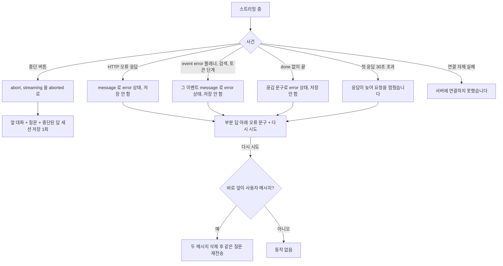

#### 4. 화면 표시 및 입력 데이터 항목 명세
| 항목명 | 화면 표시/입력 구분 | UI 컴포넌트 | 필수 여부 | 데이터 타입 / 제약 | 기본값 | 유효성 검증 규칙 (Validation) | 노출/수정 조건 |
| :--- | :---: | :--- | :---: | :--- | :---: | :--- | :--- |
| `답변 생성 중단` | 사용자 조작 | Danger Icon Button | - | Action | - | - | 스트리밍 중 (전송 버튼 자리) |
| 오류 카드 | 노출 전용 | Card `danger-soft`. 부분 답 본문(있으면) + 경고 아이콘과 `errorMessage` | - | `errorMessage` | `네트워크 지연으로 응답이 중단되었습니다.` | - | 상태 `error` |
| `다시 시도` | 사용자 조작 | Button (`답변 다시 시도`) | - | Action | - | - | 오류 카드 안 |
| 메시지 상태 | 시스템 | State | - | `sending` \| `sent` \| `streaming` \| `completed` \| `aborted` \| `error` | - | - | 아래 상태 전이 |

#### 5. 비즈니스 규칙
- **BR-CHAT-020-1**: 중단된 턴은 프론트 POST 로만 저장된다(서버 생성기는 done 전에 멈추므로 서버 자동 영속화가 없다). 저장되는 어시스턴트 메시지 상태는 `aborted` 다.
- **BR-CHAT-020-2**: HTTP 오류, 스트림 오류, 끊긴 스트림은 세션을 저장하지 않는다.
- **BR-CHAT-020-3**: 다시 시도는 현재 상태(스코프·기사·필터·티어) 기준이고 메시지 id 는 새로 만든다.

```mermaid
stateDiagram-v2
    [*] --> streaming: 전송
    streaming --> completed: done 수신
    streaming --> aborted: 사용자 중단 (중단 뒤 정상 종료 포함)
    streaming --> error: HTTP 오류, error 이벤트, done 없이 끝남, 네트워크 오류
    error --> [*]: 다시 시도 시 삭제 후 새 메시지
    completed --> [*]
    aborted --> [*]
```

#### 6. 예외 처리 및 엣지 케이스
| 발생 상황 | 화면 반응 및 시스템 처리 방식 | 사용자 안내 메시지 |
| :--- | :--- | :--- |
| `aborted` 메시지 | 별도 표시나 재시도 버튼 없음. 내용이 비면 빈 말풍선(트래커만) | 없음 |
| 오류 이벤트 `retryable` | 프론트가 쓰지 않는다 | - |
| 전역 예외 처리기 응답 (500 `ERR_SERVER_INTERNAL`) | 공통 형식이라 `message` 를 그대로 보인다 (v0.4.2) | `서버 내부 처리 중 오류가 발생했습니다.` |
| 다시 시도 history | 완료된 턴만 보내 지운 질문이 들어가지 않는다 (v0.4.2, 위험 35번 해결) | - |
| 응답이 30초 안에 시작하지 않음 | 요청을 멈추고 오류 카드. `다시 시도` 로 새로 보낸다 (v0.4.2) | `응답이 늦어 요청을 멈췄습니다. 다시 시도해 주세요.` |
| 토큰이 오가는 중 멈춤 | 본문 읽기에는 시간 제한이 없어 사용자가 `답변 생성 중단` 을 눌러야 끝난다 | - |
| 끊긴 스트림의 부분 답 | 본문은 보이지만 저장하지 않으므로 다시 열면 사라진다 | `응답이 중간에 끊겼습니다. 다시 시도해 주세요.` |
| 키 오류·한도·과부하 | 모두 스트림 중 `ERR_LLM_STREAM_FAILED` 로 합쳐져 구분되지 않는다 (위험 9번) | 같은 문구 |

#### 7. 비즈니스 에러 코드 매핑
| 비즈니스 에러 코드 | 발생 사유 | HTTP 상태 코드 매핑 | 클라이언트 표시 형태 |
| :--- | :--- | :---: | :--- |
| `ERR_LLM_STREAM_FAILED` | 토큰 생성 중 예외 (Anthropic 401/429/529/503, Anthropic 스트림 `error` 이벤트, `stop_reason` max_tokens, 업스트림 실패, Gemini 키 없음 포함) | 스트림 안 502 | 부분 답 아래 `LLM 스트리밍 도중 외부 프로바이더 오류가 발생했습니다.` |
| `ERR_LLM_UPSTREAM_FAILED` | global 플래너 단계 예외 (v0.4.2) | 스트림 안 502 | `질문 분석 중 오류가 발생했습니다. 다시 시도해 주세요.` |
| `ERR_RETRIEVER_INDEX_ERROR` | global 검색 단계 예외 (v0.4.2) | 스트림 안 500 | `기사 검색 중 오류가 발생했습니다. 다시 시도해 주세요.` |
| 사전 검사 코드 | FUNC-CHAT-008 표 | 400/404/503 | 오류 카드에 `message` |
| `ERR_SERVER_INTERNAL` | 처리하지 못한 서버 예외 | 500 | `서버 내부 처리 중 오류가 발생했습니다.` |
| (클라이언트) | `done` 없이 끝남 | - | `응답이 중간에 끊겼습니다. 다시 시도해 주세요.` |
| (클라이언트) | 응답 머리 30초 초과 | - | `응답이 늦어 요청을 멈췄습니다. 다시 시도해 주세요.` |
| (클라이언트) | 연결 자체 실패 (v0.4.2) | - | `서버에 연결하지 못했습니다. 연결 상태를 확인하고 다시 시도해 주세요.` |
| (클라이언트) | `Error` 가 아닌 예외 | - | `네트워크 지연으로 응답이 중단되었습니다.` |

근거: `backend/app/services/chat_service.py:429-438`, `:549-581`, `:617-633`, `backend/app/services/llm_providers/anthropic_provider.py:318-334`, `frontend/src/lib/chatApi.ts:20-25`, `:81-92`, `frontend/src/components/chat/ChatWorkspace.tsx:44`, `:140-152`, `:314-324`, `:330-342`, `:449-473`, `frontend/src/components/chat/ChatMessageItem.tsx:260-318`, `frontend/src/components/chat/ChatPromptInput.tsx:116-131`, 동작 확인 테스트 `frontend/src/tests/chat/ChatStreamTurn.test.tsx`

---

### [FUNC-CHAT-021] 토큰 한도·출력 완료

#### 1. 기본 정보
- **기능명**: 프롬프트 분량 지시, max_tokens, usage 집계, 완료 판정
- **기능 ID**: `FUNC-CHAT-021`
- **대응 요구사항**: `REQ-CHAT-004` (옛 기능명세 `CHAT-21`)
- **대상 화면 코드**: `API`, `SCR-CHAT-001` (완료 상태·지연 표시)
- **우선순위**: Must Have
- **관련 액터**: 시스템

#### 2. 사전 조건
1. 프롬프트 조립과 공급자 호출 단계다.

#### 3. 인터랙션 흐름과 플로우차트
1. 프롬프트는 `최대 1,500~2,000 토큰 / 공백 포함 1,500~2,500자 이내` 안에서 결론 문장과 닫힌 코드 블록으로 끝맺으라고 지시하고, 코드 예시는 15줄 이내로 제한한다. scoped 는 각 섹션을 불릿 2~3개로 압축하라고 덧붙인다. 출처 없는 global 직접 답변은 인사·일상 대화에 짧게 답하라고 지시한다. 출처 있는 global 은 단순 인사나 짧은 질문에 장문 리포트 없이 답하라고 지시한다.
2. 공급자에 출력 상한을 넣어 호출한다(BR-CHAT-021-1).
3. Anthropic 스트림은 `message_start` 의 input/cache 토큰과 `message_delta` 의 `output_tokens` 를 모아 **그 요청의** 사용량 객체(`usage_out`)에 채운다. done 의 `usage` 는 그 값이고, 비어 있으면(OpenAI·Ollama 로 답한 경우) null 이다. 요청끼리 공유하는 `last_usage` 는 v0.4.2 에서 지웠다 (위험 6번 해결).
4. Anthropic 스트림은 `message_delta` 의 `stop_reason` 을 읽는다. `max_tokens` 면 토큰을 다 보낸 뒤 `AnthropicStreamError` 를 올리고, 토큰을 보낸 뒤라 `LLMStreamFailedException` 이 되어 챗은 `event: error`(`ERR_LLM_STREAM_FAILED`)로 끝난다. done·저장은 없다. Anthropic 스트림의 `error` 이벤트도 같다(`overloaded_error` 면 `AnthropicOverloadedException`). v0.4.2 부터 Anthropic **비스트림**(`generate_text_with_usage`, 플래너·수집 게이트)도 `stop_reason == "max_tokens"` 면 `AnthropicStreamError` 로 실패해 다음 공급자로 넘어간다 (`backend/app/services/llm_providers/anthropic_provider.py:236-238`, `:333-334`). OpenAI·Ollama(스트림·비스트림)는 잘림을 보지 않는다 (위험 40번 일부 남음).
5. 완료 판정: done 이벤트를 받으면 `completed`. done 없이 스트림이 닫히면(사용자 중단이 아니면) 오류로 바꾼다 (FUNC-CHAT-020).
6. 백엔드 `latency_ms` 는 요청 처리(`stream_chat` 시작)부터 done 직전까지의 시간이다. 서버 턴 저장은 done 을 보내기 전에 한다.

```mermaid
flowchart TD
    A["프롬프트 조립: 분량, 코드 15줄 지시"] --> B["공급자 호출, 출력 상한 4096 또는 2048"]
    B --> C["토큰 스트림"]
    C --> D{"공급자"}
    D -->|Anthropic| E["message_start, message_delta 로 이 요청의 usage 와 stop_reason 집계"]
    D -->|OpenAI, Ollama| F["usage 없음 null, 잘림 판정 없음"]
    E --> E1{"stop_reason max_tokens 또는 error 이벤트?"}
    E1 -->|예| X["event error ERR_LLM_STREAM_FAILED, done 없음"]
    E1 -->|아니오| G["done usage = 이 요청의 usage"]
    F --> G
    G --> H{"done 수신?"}
    H -->|예| I["completed"]
    H -->|아니오, 스트림 종료| J["끊김 오류"]
    X --> J2["오류 표시, 저장 안 함"]
```

#### 4. 화면 표시 및 입력 데이터 항목 명세
| 항목명 | 화면 표시/입력 구분 | UI 컴포넌트 | 필수 여부 | 데이터 타입 / 제약 | 기본값 | 유효성 검증 규칙 (Validation) | 노출/수정 조건 |
| :--- | :---: | :--- | :---: | :--- | :---: | :--- | :--- |
| `latency_ms` | 노출 전용 | `ModelTierBadge` `· {ms}ms` | - | int | - | - | 완료된 어시스턴트 메시지 |
| `usage` | 시스템 | done payload | - | `{input_tokens, output_tokens, cache_read_input_tokens, cache_creation_input_tokens}` 또는 null | - | - | 화면 표시 없음, 서버 저장(`usage_json`) |

#### 5. 비즈니스 규칙
- **BR-CHAT-021-1 (출력 상한)**: Anthropic `max_tokens` 4096(스트림·비스트림), OpenAI `max_tokens` 4096, Ollama `num_predict` 4096, Gemini(명시 요청 시) `maxOutputTokens` 2048.
- **BR-CHAT-021-2**: 프롬프트 분량 지시는 실제 상한(4096)보다 작다. 잘림 감지는 Anthropic(스트림·비스트림)에만 있다.
- **BR-CHAT-021-3 (v0.4.2)**: 토큰 사용량은 요청마다 따로 담는다. 인수 기준: 두 챗 요청을 동시에 보내면 각 `done.usage` 는 자기 요청의 Anthropic 사용량이고, OpenAI·Ollama 로 답한 요청의 `done.usage` 는 null 이다.

#### 6. 예외 처리 및 엣지 케이스
| 발생 상황 | 화면 반응 및 시스템 처리 방식 | 사용자 안내 메시지 |
| :--- | :--- | :--- |
| Anthropic 스트림이 4096 토큰에서 잘림 | 받은 부분 답 아래 오류, 저장 안 함 (v0.4.1, 위험 5번 해결) | `LLM 스트리밍 도중 외부 프로바이더 오류가 발생했습니다.` |
| OpenAI·Ollama 가 상한에서 잘림 | `finish_reason`·`done_reason` 을 보지 않아 완료로 보인다 (위험 40번 남은 부분) | 없음 |
| Anthropic 비스트림(플래너)이 상한에서 잘림 | 실패로 보아 다음 공급자, 모두 실패하면 휴리스틱 검색 (v0.4.2) | 없음 |
| OpenAI·Ollama 로 답함 | done `usage` 는 null (다른 호출 값이 섞이지 않는다, v0.4.2) | - |

#### 7. 비즈니스 에러 코드 매핑
| 비즈니스 에러 코드 | 발생 사유 | HTTP 상태 코드 매핑 | 클라이언트 표시 형태 |
| :--- | :--- | :---: | :--- |
| `ERR_LLM_STREAM_FAILED` | Anthropic 스트림 `stop_reason` max_tokens | 스트림 안 502 | FUNC-CHAT-020 오류 표시 |

근거: `backend/app/services/chat_service.py:188-246`, `:617-689`, `backend/app/services/llm_providers/anthropic_provider.py:205-334`, `backend/app/services/llm_processor.py:390-564`, `frontend/src/components/chat/ChatWorkspace.tsx:449-458`

---

### [FUNC-CHAT-022] LLM 공급자 선택 순서·가용성 판정·폴백

#### 1. 기본 정보
- **기능명**: Anthropic 우선, OpenAI, Ollama 폴백, 명시적 Gemini/GPT 라우팅, 사전 가용성 판정
- **기능 ID**: `FUNC-CHAT-022`
- **대응 요구사항**: `REQ-COLL-005` (옛 기능명세 `CHAT-22`. 공급자 선택은 수집·Ask AI 와 같은 모듈이라 `FUNC-COLL-023` 과 같은 요구사항)
- **대상 화면 코드**: `API`
- **우선순위**: Must Have
- **관련 액터**: 시스템, 운영자(키·주소 설정)
- **진입점**: `llm_processor.check_provider_available`(라우터 사전 검사), `llm_processor.stream_tokens`(스트림), `llm_processor.generate_live_answer`(플래너, 수집 게이트)

#### 2. 사전 조건
1. 입력: 프롬프트, `model`, `model_tier`.
2. 설정 원천: `backend/app/config.py` `Settings`(값 기본은 `config.json` `llm.*`, 환경 변수·`.env` 가 덮음), 일부는 `config.json` 과 환경 변수를 직접 다시 읽는다 (BR-CHAT-022-1).

#### 3. 인터랙션 흐름과 플로우차트
1. 사전 가용성(`check_provider_available` → `has_live_provider`), 위에서부터 처음 참인 것으로 판정:
   1. Anthropic 키가 있으면 가능.
   2. 없으면 OpenAI 키가 있으면 가능.
   3. 없으면 Ollama: 주소가 비었으면 불가(`Ollama 주소 없음`). 있으면 비동기 `httpx.AsyncClient` 로 `GET {주소}/api/tags`(타임아웃 1.0초, 한 번)를 부르고, (주소, 모델)별 결과를 30초 기억한다(v0.4.2, 이벤트 루프를 막지 않는다). 연결 실패(`Ollama 연결 실패`), 200 아님(`Ollama /api/tags 응답 <상태>`), 응답 해석 실패(`Ollama 응답 해석 실패`), 응답 `models[].name` 또는 `model` 에 설정 모델이 없음(`Ollama 설정 모델 미설치 (<모델>)`)이면 불가. 설정 모델에 태그가 없으면 `:latest` 를 붙여 비교한다.
   4. 모두 아니면 `LLMProviderUnavailableException`(`가용한 LLM 프로바이더 엔진 미설정 (API 키 미등록)`). 라우터는 스트림 전 503 으로 답한다 (Ollama 만 떠 있고 설정 모델이 없어도 503).
   5. 판정 이유(`Anthropic 키 없음 · OpenAI 키 없음 · <Ollama 이유>`)는 서버 로그에만 남는다: `has_live_provider` 는 DEBUG, `check_provider_available` 이 예외를 낼 때 WARNING(`가용한 LLM 프로바이더 없음: …`). 응답 본문은 바뀌지 않는다.
2. 요청 모델 문자열(`model` 또는 `model_tier`, 소문자)에 `gemini` 가 있으면 Gemini 를 직접 부른다. 먼저 `check_provider_available(target_provider="gemini")`(Gemini 키 유무만 본다), 키가 없으면 `LLMProviderUnavailableException`. 스트림에서도 전체 응답을 한 번에 토큰 1개로 보낸다. 응답이 없으면 `LLMUpstreamException`.
3. 비스트림(`generate_live_answer`)에서만 `gpt`/`openai` 가 있으면 OpenAI 를 직접 부른다(사전 가용성 확인 후). 응답이 없으면 `LLMUpstreamException`.
4. 기본 순서 (스트림 `stream_tokens`): `check_provider_available()` 후
   1. Anthropic(키가 있을 때): 429 → `LLMQuotaExceededException`(폴백 안 함). 529/503 과부하, 401 키 오류 → 그대로 올림(폴백 안 함). 스트림 본문의 `error` 이벤트는 `overloaded_error` 면 `AnthropicOverloadedException`(그대로 올림), 그 밖이면 `AnthropicStreamError` 다. `stop_reason == "max_tokens"` 로 끝나도 토큰을 다 보낸 뒤 `AnthropicStreamError` 를 올린다 (`backend/app/services/llm_providers/anthropic_provider.py:318-334`). `AnthropicStreamError` 를 포함한 그 밖의 예외는 토큰을 하나도 안 보냈을 때만 다음 공급자로 넘어가고, 보낸 뒤면 `LLMStreamFailedException`. 예외 없이 토큰 0개로 끝나도 다음 공급자로 넘어간다. 토큰을 보냈으면 그 요청의 `usage_out` 에 Anthropic 사용량을 채우고 끝낸다.
   2. OpenAI(키가 있을 때, SDK `openai.AsyncOpenAI`, 모델 BR-CHAT-022-1, temperature 0.3, max_tokens 4096): 예외 문자열에 `rate`/`429`/`quota` 가 있으면 `LLMQuotaExceededException`(토큰을 보낸 뒤여도 같다). 그 밖 예외는 토큰을 보낸 뒤면 `LLMStreamFailedException`, 아니면 다음.
   3. Ollama(주소가 있을 때, `/api/generate` 스트림, 타임아웃 120초, `num_predict` 4096): 200 이 아니면 조용히 넘어간다. 예외는 토큰을 보낸 뒤면 `LLMStreamFailedException`.
   4. 모두 실패하면 토큰을 보냈으면 `LLMStreamFailedException`, 아니면 `LLMUpstreamException`. 챗 스트림에서는 어느 경우든 `event: error` `ERR_LLM_STREAM_FAILED` 로 바뀐다.
5. 기본 순서 (비스트림 `generate_live_answer`): `check_provider_available()` 후 Anthropic(429 → `LLMQuotaExceededException`, 과부하·키 오류 → 그대로, `stop_reason == "max_tokens"` 잘림(v0.4.2)과 그 밖 → 경고 후 다음) → OpenAI(`_call_openai`, httpx `https://api.openai.com/v1/chat/completions`, 타임아웃 60초) → Ollama(`_call_ollama`, `/api/generate` 비스트림, 타임아웃 90초) → 모두 실패 시 `LLMUpstreamException`.
6. Anthropic 호출: httpx 로 `https://api.anthropic.com/v1/messages`, 헤더 `x-api-key`, `anthropic-version: 2023-06-01`, `anthropic-beta: prompt-caching-2024-07-31`. 사용자 메시지 1개로 보낸다. `claude-` 모델에는 temperature 를 넣지 않는다. 타임아웃 비스트림 45초, 스트림 120초. 상태 401/429/503·529 를 각각 키 오류/한도/과부하 예외로, 그 밖의 비200 은 `RuntimeError` 로 바꾼다. 챗 경로는 `system` 블록·캐시를 쓰지 않는다.
7. 모델 ID 표기는 `sanitize_model_identifier` 가 앞뒤 공백만 지우고 보존한다(비면 `ANTHROPIC_DEFAULT_CHAT_MODEL`, 그것도 없으면 `ANTHROPIC_MODEL` 또는 `claude-sonnet-5-5`). 출력은 `(토큰, 모델 ID)` 스트림이며 모델 ID 는 Anthropic 이면 해석된 모델 ID, OpenAI 면 `OpenAI <모델>`, Ollama 면 `Ollama <모델>`, Gemini 면 `Google <모델>` 이다.

```mermaid
flowchart TD
    A["POST /api/chat/stream 사전 검사"] --> B{"Anthropic 키?"}
    B -->|있음| OK["가용"]
    B -->|없음| C{"OpenAI 키?"}
    C -->|있음| OK
    C -->|없음| D{"Ollama 주소?"}
    D -->|없음| NG["503 ERR_LLM_PROVIDER_UNAVAILABLE"]
    D -->|있음| E["GET api/tags 1초 비동기, 결과 30초 기억"]
    E --> F{"200 이고 설정 모델 설치?"}
    F -->|예| OK
    F -->|아니오| NG
    OK --> G{"요청 모델에 gemini?"}
    G -->|예| H{"Gemini 키?"}
    H -->|없음| ERR["error 이벤트 ERR_LLM_STREAM_FAILED"]
    H -->|있음| I["Gemini 전체 응답을 토큰 1개로"]
    G -->|아니오| J["Anthropic 스트림"]
    J -->|토큰 보냄| DONE["done"]
    J -->|429, 401, 529, 503| ERR
    J -->|그 밖 예외 또는 토큰 0개, 토큰 전| K["OpenAI SDK 스트림"]
    J -->|토큰 보낸 뒤 예외| ERR
    K -->|토큰 보냄| DONE
    K -->|rate, 429, quota| ERR
    K -->|실패, 토큰 전| L["Ollama 스트림"]
    L -->|토큰 보냄| DONE
    L -->|실패| ERR
    I --> DONE
```

#### 4. 화면 표시 및 입력 데이터 항목 명세
| 항목명 | 화면 표시/입력 구분 | UI 컴포넌트 | 필수 여부 | 데이터 타입 / 제약 | 기본값 | 유효성 검증 규칙 (Validation) | 노출/수정 조건 |
| :--- | :---: | :--- | :---: | :--- | :---: | :--- | :--- |
| Anthropic 키 | 설정 | 환경 변수·`config.json` | 선택 | String | 빈 값 | trim 후 비어 있지 않으면 가용 | 운영 설정 (챗 화면에서는 바꾸지 않는다) |
| OpenAI 키 | 설정 | 환경 변수·`config.json` | 선택 | String | 빈 값 | 비어 있지 않으면 가용 | 운영 설정 |
| OpenAI 모델 | 설정 | `OPENAI_MODEL`·`llm.openai_model` | 선택 | String | `gpt-4o-mini` | - | 운영 설정 |
| Ollama 주소 | 설정 | `OLLAMA_BASE_URL`·`llm.ollama_base_url` | 선택 | URL (끝 `/` 제거) | `http://localhost:11434` | 비면 Ollama 불가 | 운영 설정 |
| Ollama 모델 | 설정 | `OLLAMA_MODEL`·`llm.ollama_model` | 선택 | String | `llama3.2:latest` | 태그 없으면 `:latest` 붙여 설치 목록 비교 | 운영 설정 |
| Gemini 키·모델 | 설정 | `GEMINI_API_KEY`·`GEMINI_MODEL` | 선택 | String | 키 빈 값, 모델 `gemini-3.5-flash-lite` | 명시 요청 시만 | 운영 설정 |
| done `model` | 노출 전용 | 말풍선 헤더 | - | 실제 사용 모델 문자열 | - | - | FUNC-CHAT-015 |

#### 5. 비즈니스 규칙
- **BR-CHAT-022-1 (설정 해석 순서)**:
  - Anthropic 키(`AnthropicLLMProvider._get_api_key`): 명시 키 → `settings.ANTHROPIC_API_KEY` → 환경 변수 `ANTHROPIC_API_KEY` → `config.json` `llm.anthropic_api_key`.
  - OpenAI 키(`_resolve_openai_key`): 덮어쓰기 `llm_processor.openai_key`(None 이 아니면 그 값만) → `settings.OPENAI_API_KEY` → `config.json` `llm.openai_api_key` → 환경 변수 `OPENAI_API_KEY`.
  - OpenAI 모델(`_resolve_openai_chat_model`): `settings.OPENAI_MODEL` → `config.json` `llm.openai_model` → `gpt-4o-mini`.
  - Ollama 주소(`_resolve_ollama_url`): 덮어쓰기 `llm_processor.ollama_url` → `settings.OLLAMA_BASE_URL` → `config.json` `llm.ollama_base_url` → 빈 값.
  - Ollama 모델(`_resolve_ollama_generate_model`): `settings.OLLAMA_MODEL` → `config.json` `llm.ollama_model` → `llama3.2:latest`.
  - Gemini 키: `settings.GEMINI_API_KEY` → `config.json` `llm.gemini_api_key` → 환경 변수 → 생성 시점 키. Gemini 모델: 요청 모델 → `settings.GEMINI_MODEL` → `config.json` `llm.gemini_model` → `gemini-3.5-flash-lite`.
- **BR-CHAT-022-2**: 공급자 순서는 Anthropic → OpenAI → Ollama 고정이다. 순서를 바꾸는 설정은 없다(쓰이지 않던 `LLM_PROVIDER`·`llm.provider` 는 v0.4.2 에서 지웠다).
- **BR-CHAT-022-3**: Anthropic 429·401·529/503 은 폴백하지 않는다.
- **BR-CHAT-022-4**: 토큰을 하나라도 보낸 뒤에는 다른 공급자로 넘어가지 않는다.
- **BR-CHAT-022-5**: Gemini 스트리밍은 쓰지 않는다(코드 주석 `POL-LLM-005`, `REQ-LLM-002`, `ADR-012`). 명시 요청 시 비스트림 결과를 토큰 1개로 보낸다. Gemini 호출: temperature 0.3, `maxOutputTokens` 2048, 타임아웃 20초, `thought` 파트 제외.

#### 6. 예외 처리 및 엣지 케이스
| 발생 상황 | 화면 반응 및 시스템 처리 방식 | 사용자 안내 메시지 |
| :--- | :--- | :--- |
| 쓸 수 있는 공급자 없음 | 스트림 전 503 | `가용한 LLM 프로바이더 엔진 미설정 (API 키 미등록)` 오류 카드 |
| 키가 틀림·한도 초과·과부하 | 사전 검사를 통과하고(키가 있으므로) 스트림 중 `ERR_LLM_STREAM_FAILED` 로 나타난다 (위험 9번) | `LLM 스트리밍 도중 외부 프로바이더 오류가 발생했습니다.` |
| Anthropic·OpenAI 키 없음 + Ollama 확인 | 비동기로 확인하고 결과를 30초 기억해, 한 요청 안의 여러 검사(라우터, 플래너, 스트림)가 `/api/tags` 를 다시 부르지 않는다 (v0.4.2, 위험 7번 해결) | - |
| Gemini 명시 요청 + Gemini 키 없음 | 스트림은 error 이벤트(라우터 사전 검사는 Gemini 키를 보지 않는다) | `LLM 스트리밍 도중 외부 프로바이더 오류가 발생했습니다.` |
| 비스트림 OpenAI 429 | `_call_openai` 가 예외를 삼키고 (None, None) 을 돌려주므로 한도 초과로 올라가지 않고 Ollama 로 넘어간다 (위험 36번) | - |
| Ollama 스트림 비200 | 조용히 넘어가 `LLMUpstreamException` | 스트림 오류 문구 |

#### 7. 비즈니스 에러 코드 매핑
| 비즈니스 에러 코드 | 발생 사유 | HTTP 상태 코드 매핑 | 클라이언트 표시 형태 |
| :--- | :--- | :---: | :--- |
| `ERR_LLM_PROVIDER_UNAVAILABLE` | `LLMProviderUnavailableException` (사전 검사) | 503 | 오류 카드 |
| `ERR_LLM_STREAM_FAILED` | 스트림 중 모든 공급자 예외 | 스트림 안 502 | 오류 카드 |
| `ERR_CLAUDE_API_KEY_MISSING` / `ERR_CLAUDE_QUOTA_EXCEEDED` / `ERR_CLAUDE_OVERLOADED` / `ERR_LLM_QUOTA_EXCEEDED` | 사전 검사 표(`LLM_ERROR_MAP`)에만 있고 실제로 나가지 않는다. 이 코드를 내던 `/query` 는 v0.4.2 에서 지웠다 (위험 9번) | 401 / 429 / 529 / 429 | (도달 불가) |

근거: `backend/app/services/llm_processor.py:166-564`, `backend/app/services/llm_providers/anthropic_provider.py:130-334`, `backend/app/api/chat.py:49-57`, `:110-115`, `backend/app/config.py`

---

### [FUNC-CHAT-023] 동기 단건 질의 API — 삭제(v0.4.2)

#### 1. 기본 정보
- **기능명**: 스트림 없이 한 번에 답을 돌려주는 API. **v0.4.2 에서 지웠다**
- **기능 ID**: `FUNC-CHAT-023` (ID 는 다시 쓰지 않는다)
- **대응 요구사항**: `REQ-CHAT-011` (옛 기능명세 `CHAT-23`, PRD 에서 삭제 표시)
- **대상 화면 코드**: 없음
- **우선순위**: 삭제 (v0.4.1 까지 Could)
- **관련 액터**: 없음
- **API**: 없음. `POST /api/chat/query`·`GET /api/chat/search` 와 `ChatQueryRequest`·`ChatQueryResponse` 를 지웠다 (호출처가 없었다).

#### 2. 사전 조건
해당 없음 (기능 없음).

#### 3. 인터랙션 흐름과 플로우차트
1. 지운 경로를 부르면 라우트가 없어 404 `ERR_NOT_FOUND`(요청 방식에 따라 405 `ERR_METHOD_NOT_ALLOWED`)다. 챗 질문은 `POST /api/chat/stream`(FUNC-CHAT-008~009) 하나다.

```mermaid
flowchart TD
    A["POST api chat query 또는 GET api chat search"] --> B["라우트 없음"]
    B --> C["404 ERR_NOT_FOUND 또는 405 ERR_METHOD_NOT_ALLOWED"]
```

#### 4. 화면 표시 및 입력 데이터 항목 명세
| 항목명 | 화면 표시/입력 구분 | UI 컴포넌트 | 필수 여부 | 데이터 타입 / 제약 | 기본값 | 유효성 검증 규칙 (Validation) | 노출/수정 조건 |
| :--- | :---: | :--- | :---: | :--- | :---: | :--- | :--- |
| 해당 없음 | - | - | - | - | - | - | 기능을 지웠다 |

#### 5. 비즈니스 규칙
- **BR-CHAT-023-1 (삭제)**: 동기 질의·검색 미리보기 API 는 없다. 이 경로만 내던 오류 코드(`ERR_SEARCH_QUERY_TOO_SHORT`, 비스트림 401/429/529/502 응답)도 없어졌다.

#### 6. 예외 처리 및 엣지 케이스
| 발생 상황 | 화면 반응 및 시스템 처리 방식 | 사용자 안내 메시지 |
| :--- | :--- | :--- |
| 외부 도구가 옛 경로를 부름 | 라우트 없음 | 응답 `message` |

#### 7. 비즈니스 에러 코드 매핑
| 비즈니스 에러 코드 | 발생 사유 | HTTP 상태 코드 매핑 | 클라이언트 표시 형태 |
| :--- | :--- | :---: | :--- |
| `ERR_NOT_FOUND` / `ERR_METHOD_NOT_ALLOWED` | 지운 경로 호출 | 404 / 405 | 화면 없음 |

근거: `backend/app/api/chat.py` (남은 경로: `GET /sources/{id}`, `POST /stream`, 세션 4개), `backend/app/api/errors.py:20-28`

---

### [FUNC-CHAT-024] 보충 웹 검색 엔진 (AgenticSearchService) — 삭제(v0.4.2)

#### 1. 기본 정보
- **기능명**: 충실도 평가와 DuckDuckGo 보충 검색 `[S1]`. **v0.4.2 에서 코드를 지웠다**
- **기능 ID**: `FUNC-CHAT-024` (ID 는 다시 쓰지 않는다)
- **대응 요구사항**: `REQ-CHAT-012` (옛 기능명세 `CHAT-24`, PRD 에서 삭제 표시)
- **대상 화면 코드**: 없음
- **우선순위**: 삭제 (v0.4.1 까지 Won't, 미연결)
- **관련 액터**: 없음
- **진입점**: 없음. `backend/app/services/agentic_search.py` 와 `ChatService` 의 인스턴스 생성, 설정 `AGENTIC_SEARCH_MAX_QUERIES` 를 지웠다.

#### 2. 사전 조건
해당 없음 (기능 없음).

#### 3. 인터랙션 흐름과 플로우차트
1. 챗 스트림은 보충 출처를 만들지 않는다. `sources` 의 출처는 모두 `type: "primary"` 이고 `supplementary_count` 는 늘 0 이다.

```mermaid
flowchart TD
    A["챗 스트림"] --> B["원문 출처만, supplementary_count 0"]
```

#### 4. 화면 표시 및 입력 데이터 항목 명세
| 항목명 | 화면 표시/입력 구분 | UI 컴포넌트 | 필수 여부 | 데이터 타입 / 제약 | 기본값 | 유효성 검증 규칙 (Validation) | 노출/수정 조건 |
| :--- | :---: | :--- | :---: | :--- | :---: | :--- | :--- |
| 해당 없음 | - | - | - | - | - | - | 기능을 지웠다. 프론트의 보충 인용 배지 모양(FUNC-CHAT-014)은 남아 있으나 실제 응답에 나오지 않는다 |

#### 5. 비즈니스 규칙
- **BR-CHAT-024-1 (삭제)**: 보충 웹 검색은 없다. 스키마의 `evaluating_sufficiency`·`agentic_searching`·`observing` 단계 값과 프롬프트의 `[S1]` 절은 남아 있으나 쓰이지 않는다.

#### 6. 예외 처리 및 엣지 케이스
| 발생 상황 | 화면 반응 및 시스템 처리 방식 | 사용자 안내 메시지 |
| :--- | :--- | :--- |
| 해당 없음 | - | - |

#### 7. 비즈니스 에러 코드 매핑
| 비즈니스 에러 코드 | 발생 사유 | HTTP 상태 코드 매핑 | 클라이언트 표시 형태 |
| :--- | :--- | :---: | :--- |
| (없음) | 기능 없음 | - | - |

근거: `backend/app/services/chat_service.py:61-75` (보충 검색 인스턴스 없음), `:195`, `:217-221` (프롬프트의 남은 `[S1]` 절)

---

### [FUNC-CHAT-025] 반응형·모바일

#### 1. 기본 정보
- **기능명**: 가상 키보드 대응 높이, 메시지 목록만 스크롤하고 입력창은 하단 고정, 드로어, 바텀시트, 폭별 헤더·도구줄 배치, 챗 커맨드 팔레트
- **기능 ID**: `FUNC-CHAT-025`
- **대응 요구사항**: `REQ-UI-007` (옛 기능명세 `CHAT-25`)
- **대상 화면 코드**: `SCR-CHAT-001`, `SCR-UI-002`
- **우선순위**: Should Have
- **관련 액터**: 사용자 (모바일·태블릿·데스크톱)

#### 2. 사전 조건
1. 화면 크기 변경 또는 가상 키보드 표시.

#### 3. 인터랙션 흐름과 플로우차트
1. 페이지 높이 `100dvh`. `window.visualViewport` 의 resize/scroll 마다 워크스페이스 높이를 `visualViewport.height px` 로 맞춘다(가상 키보드).
2. 세로 배치(위에서 아래): 헤더 → 맥락 줄 → 메시지 목록 → 포커스 캡슐·입력 영역. 워크스페이스와 오른쪽 열은 `overflow-hidden` 이고, 세로로 스크롤하는 것은 메시지 목록 상자(`role="log"`, `flex-1 min-h-0 overflow-y-auto`) 하나뿐이다. 입력 영역은 `shrink-0` 이라 늘 열의 맨 아래에 붙어 있다 (v0.4.2, FE-36).
3. 자동 스크롤: 메시지·타임라인·스트리밍 상태가 바뀔 때 목록 상자의 `scrollTop` 만 `scrollHeight` 로 바꾼다. `scrollIntoView` 를 쓰지 않는다(그것은 `overflow-hidden` 조상까지 스크롤해 입력창을 화면 위로 밀어 올렸다). 사용자가 맨 아래에서 24px 안을 보고 있을 때만 따라 내려가고, 위로 올려 읽는 중이면 그대로 둔다. 메시지 수가 바뀌면(새 질문 전송, 세션 열기) 늘 맨 아래로 간다. 토큰마다 부드러운 스크롤을 걸지 않는다.
4. 목록 상자는 `relative` 다. 768px 미만에서 화면 읽기 전용으로 숨긴 라벨(`position: absolute`)의 기준 상자를 목록 안으로 묶어, 그 라벨이 `overflow-hidden` 바깥 열을 넘치게 하지 않는다.
5. 입력창 포커스 100ms 뒤 입력창을 `scrollIntoView({block: 'end'})` 한다(가상 키보드가 올라올 때 입력창을 보이게).
6. 1024px 기준: 이상은 사이드바, 미만은 드로어(FUNC-CHAT-007).
7. 챗 커맨드 팔레트: ⌘K / Ctrl+K(입력창 안에서도) 또는 헤더 버튼·더보기 메뉴로 연다. 팔레트가 맨 위 레이어면 ⌘K 가 닫고, 다른 레이어가 열려 있으면 무시한다.

```mermaid
flowchart TD
    A["화면 폭 또는 가상 키보드 변화"] --> B["visualViewport 높이로 워크스페이스 높이"]
    S["토큰 도착, 새 메시지"] --> S1{"메시지 수가 바뀜?"}
    S1 -->|예| S3["목록 scrollTop 을 맨 아래로"]
    S1 -->|아니오| S2{"맨 아래 24px 안을 보고 있음?"}
    S2 -->|예| S3
    S2 -->|아니오| S4["스크롤 그대로, 사용자가 읽던 위치 유지"]
    S3 --> S5["입력 영역은 열 맨 아래에 고정, 밀려 올라가지 않음"]
    S4 --> S5
    A --> C{"폭"}
    C -->|1024px 이상| D["사이드바, 헤더 피드 글자, 팔레트 버튼"]
    C -->|768 에서 1023px| E["드로어, 팔레트 버튼"]
    C -->|768px 미만| F["드로어, 바텀시트, 팔레트는 더보기 메뉴, 44px 터치 영역"]
    G["Cmd K 또는 Ctrl K"] --> H{"맨 위 레이어"}
    H -->|팔레트| I["팔레트 닫기"]
    H -->|다른 레이어| J["무시"]
    H -->|없음| K["팔레트 열기"]
```

#### 4. 화면 표시 및 입력 데이터 항목 명세
| 항목명 | 화면 표시/입력 구분 | UI 컴포넌트 | 필수 여부 | 데이터 타입 / 제약 | 기본값 | 유효성 검증 규칙 (Validation) | 노출/수정 조건 |
| :--- | :---: | :--- | :---: | :--- | :---: | :--- | :--- |
| `피드로 돌아가기` | 사용자 조작 | Link (맨 왼쪽) | - | 1024px 이상·768~1023px 화살표 + `피드`, 768px 미만 화살표만 | - | - | 헤더 상시 |
| `대화 기록 보기` | 사용자 조작 | Icon Button | - | 1024px 이상 사이드바 토글, 미만 드로어 토글 | - | - | 헤더 상시 |
| 제목 `AI 챗` | 노출 전용 | Heading | - | 768px 미만 말줄임 | - | - | 헤더 상시 |
| `새 대화 시작` | 사용자 조작 | Icon Button | - | 1024px 이상 사이드바를 접었을 때만, 미만 항상 | - | - | FUNC-CHAT-002 |
| `커맨드 팔레트 열기` | 사용자 조작 | Icon Button | - | - | - | - | 768px 이상 (미만은 더보기 메뉴 `커맨드 팔레트`) |
| `더보기` 메뉴 | 사용자 조작 | Menu | - | 테마 라디오(`라이트`/`다크`/`시스템`), `뉴스 피드로 이동`, 768px 미만 `커맨드 팔레트` 추가 | - | - | 헤더 상시 |
| 팔레트 명령 | 사용자 조작 | Command List | - | `뉴스 피드로 이동`, 테마 순환(제목 `다크 모드로 전환` / `시스템 모드로 전환` / `라이트 모드로 전환 (현재 시스템)`), `새 대화 시작`, `대화 기록 열기` | - | - | 팔레트 열림 |
| 입력창 글자 크기 | 노출 전용 | Textarea | - | 640px 미만 `text-base`(16px, iOS 입력 확대 방지), 이상 `text-sm` | - | - | 상시 |
| 하단 바 여백 | 노출 전용 | Container | - | `env(safe-area-inset-bottom)` | - | - | 상시 |
| 메시지 목록 스크롤 상자 | 노출 전용 | `role="log"` 상자 (`relative min-h-0 flex-1 overflow-y-auto overflow-x-hidden`) | - | 이 화면에서 세로로 스크롤하는 유일한 상자 | - | - | 메시지가 1개 이상일 때 (빈 화면은 같은 규칙의 별도 상자) |
| 입력 영역 | 노출 전용 | 하단 영역 (`shrink-0`) | - | 포커스 캡슐 + 입력창 | - | - | 모든 폭에서 오른쪽 열 맨 아래 고정. 답 길이와 관계없이 위치가 바뀌지 않는다 (v0.4.2) |
| 자동 스크롤 따라가기 기준 | 시스템 | 상수 `STICK_THRESHOLD_PX` | - | 24px | 따라감 | `scrollHeight - scrollTop - clientHeight <= 24` 면 따라감 | 스크롤 이벤트마다 다시 판정 (v0.4.2) |

#### 5. 비즈니스 규칙
- **BR-CHAT-025-1**: 루트 viewport: `width=device-width`, `initialScale 1`, `interactiveWidget: resizes-content`, `colorScheme: 'light dark'`, 테마별 `themeColor`. 확대 제한(`maximumScale`, `userScalable`)은 두지 않는다.
- **BR-CHAT-025-2**: 768px 미만 터치 영역 44px 이상: 헤더 버튼, 맥락 줄 토글·기사 칩 X, 포커스 캡슐, 모델 칩, 전송·중단 버튼, 인용 배지, 답변 복사·내보내기 버튼, 세션 카드·삭제 버튼, 드로어 검색창.
- **BR-CHAT-025-3**: 가로 스크롤 방지: 레이아웃 `overflow-x-hidden`, `max-w-full`. 답변은 말풍선 없이 바탕 위 마크다운이고 `[overflow-wrap:anywhere]`, 인라인 코드 `break-all`, 표는 자체 가로 스크롤 래퍼(최소 폭 320px). 맥락 줄은 넘치면 줄 안에서 가로로 스크롤한다.
- **BR-CHAT-025-4**: 작은 화면에서 숨기는 요소: 답변 왼쪽 봇 아바타(640px 미만), 모델 칩의 `추천` 표시(640px 미만), 내보내기 버튼 글자와 `리포트 내보내기` 표시(768px 미만), 단축키 안내 `Enter: 전송, Shift+Enter: 줄바꿈`(1024px 미만).
- **BR-CHAT-025-5**: 열 맞춤: 맥락 줄 안쪽, 메시지 열(빈 화면 포함), 입력 영역은 바깥 여백(768px 미만 16px, 이상 24px)과 가운데 최대 폭(`max-w-3xl`)이 같아 모든 폭에서 왼쪽 끝이 맞는다. 1024px 이상에서 사이드바 머리 영역(56px + 44px)의 아래 경계가 챗 헤더 + 맥락 줄의 아래 경계와 같다.
- **BR-CHAT-025-6**: 포커스 필터는 768px 미만에서 아래에 붙는 바텀시트(손잡이, 아래 100px 스와이프 닫기), 이상에서 가운데 작은 대화상자(FUNC-CHAT-016).
- **BR-CHAT-025-7 (모바일 챗 스크롤, v0.4.2, FE-36 사용자 보고)**: 답이 길어져도 입력 영역은 오른쪽 열 맨 아래에 남고 화면 위로 밀려 올라가지 않는다. 스크롤은 메시지 목록 상자 안에서만 일어난다. 자동 스크롤은 목록 상자의 `scrollTop` 만 바꾸고 `scrollIntoView` 를 쓰지 않는다. 맨 아래 24px 안을 보고 있을 때만 새 토큰을 따라가고, 새 질문을 보내거나 세션을 열면 맨 아래로 간다 (`frontend/src/components/chat/ChatMessageList.tsx:20`, `:40-62`, `:118-126`, `frontend/src/components/chat/ChatWorkspace.tsx:600-668`).
  - 인수 기준 1: 360×640 화면에서 답이 목록 높이의 3배 넘게 길어지는 동안 입력 영역의 화면상 위치(`getBoundingClientRect().bottom`)가 바뀌지 않고, 문서(`document.scrollingElement`)의 `scrollTop` 은 0 이다.
  - 인수 기준 2: 스트리밍 중 사용자가 목록을 맨 아래에서 24px 넘게 위로 올리면 이후 토큰이 와도 목록 `scrollTop` 이 바뀌지 않는다. 다시 맨 아래로 내리면 이어서 따라간다.
  - 인수 기준 3: 새 질문을 보내면 목록 `scrollTop + clientHeight == scrollHeight` 가 된다.

#### 6. 예외 처리 및 엣지 케이스
| 발생 상황 | 화면 반응 및 시스템 처리 방식 | 사용자 안내 메시지 |
| :--- | :--- | :--- |
| 하드웨어 키보드 없음 | ⌘K 대신 버튼·메뉴로 팔레트를 연다 | - |
| `visualViewport` 없음 | `100dvh` 유지 | - |
| 테마 변경 | `/chat` 의 더보기 메뉴와 팔레트로 바꿀 수 있다 | - |
| 긴 답 스트리밍 중 (모바일) | 목록만 스크롤되고 입력 영역은 하단에 남는다. 예전(v0.4.1)에는 `scrollIntoView` 가 바깥 상자까지 스크롤해 입력창이 위로 밀려 올라갔다 (v0.4.2 해결) | - |
| 위로 올려 앞 답을 읽는 중 토큰 도착 | 읽던 위치를 유지한다 | - |
| 가상 키보드가 열린 채 답이 길어짐 | 워크스페이스 높이가 `visualViewport` 높이라 입력창은 키보드 바로 위에 남고, 목록이 그 위 남은 높이에서 스크롤한다 | - |

#### 7. 비즈니스 에러 코드 매핑
| 비즈니스 에러 코드 | 발생 사유 | HTTP 상태 코드 매핑 | 클라이언트 표시 형태 |
| :--- | :--- | :---: | :--- |
| (없음) | 클라이언트 전용 | - | - |

근거: `frontend/src/app/chat/page.tsx`, `frontend/src/app/layout.tsx:6-15`, `frontend/src/components/chat/ChatHeader.tsx:58-59,77,97-150`, `frontend/src/components/chat/ChatContextBar.tsx:30-58`, `frontend/src/components/chat/ChatSidebarHeader.tsx:26-77`, `frontend/src/components/chat/ChatMessageList.tsx:20`, `:39-62`, `:113-163`, `frontend/src/components/chat/ChatWorkspace.tsx:98`, `:120-138`, `:600-680`, `frontend/src/components/chat/ChatPromptInput.tsx:71-76,80-94,107`, `frontend/src/components/ui/TextField.tsx:5-6`, `frontend/src/components/chat/FocusBottomSheet.tsx:84-92`, `frontend/src/components/chat/ChatMessageItem.tsx:98-133,189-195`, `frontend/src/components/chat/ExportToolbar.tsx:28-29,101-133`

---

## 처리 흐름 (전체)

global 모드, 검색이 필요한 질문 한 건 기준이다. scoped 모드 차이는 끝에 적는다.

```mermaid
sequenceDiagram
    participant U as 사용자
    participant W as ChatWorkspace
    participant N as Next.js rewrite
    participant A as /api/chat/stream
    participant S as ChatService
    participant R as SqliteFtsRetriever
    participant L as llm_processor
    participant DB as SQLite

    U->>W: 질문 입력, Enter
    W->>W: user(sent) + assistant(streaming) 추가, history 슬라이딩 윈도우
    W->>N: POST /api/chat/stream (question, scope, session_id, history, filters, model, model_tier, user_message_id, assistant_message_id)
    N->>A: 프록시
    A->>A: 본문·객체·길이·scope·스키마 검사, scoped 면 기사 존재 확인
    A->>L: check_provider_available()
    A-->>W: 200 text/event-stream 시작
    S-->>W: status thinking 25%
    S->>L: (라이브 공급자 있으면) Haiku 플래너 호출
    S-->>W: status tool_calling 50% (query)
    S->>R: search_knowledge_with_meta(query, top_k=5, min_quality=5.0, filters)
    R->>DB: FTS5 bm25 (실패·0건 시 LIKE)
    R-->>S: 게이트 통과 후보 상위 N, is_relaxed, applied_filters
    S-->>W: status synthesizing 80%
    S->>L: stream_tokens(prompt, model, model_tier)
    loop 토큰
        L-->>S: (chunk, model)
        S-->>W: token
    end
    S->>S: _filter_cited_sources(답변, 후보)
    S-->>W: sources (인용된 출처만)
    S->>DB: persist_turn (클라이언트 id 로 user+assistant, model_tier·usage, 자동 제목, FIFO 한도)
    S-->>W: done (session_id, model, model_tier, counts, latency_ms, usage)
    W->>W: assistant completed, 루프 종료 뒤 saveTurn
    W->>N: POST /api/chat/sessions 1회 (이미 있는 id 는 서버가 건너뜀)
```

텍스트 순서:
1. 프론트가 메시지 2개를 화면에 넣고 그 두 메시지 id 와 함께 `POST /api/chat/stream` 을 보낸다.
2. 라우터가 사전 검사를 하고 실패하면 JSON 오류(400/404/503)로 끝난다.
3. `stream_chat` 이 `thinking` 을 보내고 플래너를 돌린다. 검색이 필요 없으면 `synthesizing`(75%) 후 출처 없는 프롬프트로 바로 토큰을 보내고, sources 이벤트 없이 저장 후 done 을 보낸다.
4. 검색이면 `tool_calling` → 검색 → `synthesizing`(80%) → 토큰 → 인용 출처 정리 → sources → 저장 → done.
5. 서버는 done 을 보내기 전에 턴을 클라이언트 id 로 DB 에 저장한다(실패해도 로그만 남기고 done). 프론트는 스트림 루프가 끝난 뒤 한 번 세션을 localStorage 와 서버에 저장하고, 서버는 이미 있는 id 를 건너뛴다.
6. 플래너·검색·토큰 생성 단계에서 예외가 나면 그 단계의 `error` 이벤트로 끝나고 done·서버 저장·프론트 저장은 없다 (플래너·검색 단계는 v0.4.2). done 없이 끊겨도 프론트는 저장하지 않는다.
7. global 검색 모드에서 출처(`sources`)는 토큰 뒤에 온다. 그래서 스트리밍 중에는 `[1]` 을 눌러 출처를 볼 수 없다. 답에서 실제로 인용된 출처만 보이려는 의도된 동작이다 (결함 아님).

scoped 모드: 사전 검사에서 기사를 확인하고, `extracting_source`(30%) → 본문 확보(DB 또는 스크래핑) → `synthesizing`(85%) → sources(기사 1건, 토큰 전) → token → 서버 저장 → done 순서다. 플래너와 인용 정리는 하지 않는다.

---

## SSE 이벤트 목록

| 이벤트 | 필드 | 언제 | 프론트 처리 |
|---|---|---|---|
| `status` | `step`(`thinking`, `tool_calling`, `extracting_source`, `synthesizing` 만 실제 사용), `label`(그림 이모지 없음, v0.4.2), `progress`(정수 %), `timestamp`(UTC ISO), `query`(tool_calling 에만) | scoped: extracting_source(30) → synthesizing(85). global 검색: thinking(25) → tool_calling(50) → synthesizing(80). global 직접: thinking(25) → synthesizing(75) | `step` 이 있으면 `current_status` 교체, `step_history` 에 추가 → `WorkflowStepTracker` |
| `sources` | `sources[]`(`ChatSourceItem`: `index, type, id, title, url, source, category, quality_score, score, snippet, full_content, domain, relevance_score, published_at, publisher`), `applied_filters`(global: 필터 dict, scoped: null), `is_relaxed`, `primary_count`, `supplementary_count`(항상 0) | scoped: 토큰 전 1회(기사 1건, `full_content` 포함). global 검색: 토큰 후 1회(인용된 출처만, 검색 0건이면 빈 배열). global 직접 답변: 보내지 않음 | `sources` 가 있으면 메시지에 출처·필터·완화·건수 저장 → 인용 배지, 완화 안내 |
| `token` | `token`(문자열) | 공급자가 텍스트 조각을 낼 때마다 | 문자열이면 내용에 이어 붙임 |
| `done` | `done: true`, `session_id`, `model`(실제 모델 ID), `model_tier`, `sources_count`, `primary_count`, `supplementary_count`, `latency_ms`, `usage`(`input_tokens, output_tokens, cache_read_input_tokens, cache_creation_input_tokens` 또는 null) | 토큰과 (global 검색이면) sources 뒤, 서버 턴 저장 뒤 마지막 | 상태 `completed`, 모델·티어·지연·usage 저장. 루프가 끝나면 세션 저장(POST) 1회 |
| `error` | `error_code`, `message`, `status_code`, `step`, `retryable`(true). 단계별: 플래너 `ERR_LLM_UPSTREAM_FAILED`·502·`thinking`·`질문 분석 중 오류가 발생했습니다. 다시 시도해 주세요.` (v0.4.2) / 검색 `ERR_RETRIEVER_INDEX_ERROR`·500·`tool_calling`·`기사 검색 중 오류가 발생했습니다. 다시 시도해 주세요.` (v0.4.2) / 토큰 생성 `ERR_LLM_STREAM_FAILED`·502·`synthesizing`·`LLM 스트리밍 도중 외부 프로바이더 오류가 발생했습니다.` | 그 단계에서 예외가 나면(토큰 생성 단계는 Anthropic 스트림 `error` 이벤트·`stop_reason` max_tokens 포함) 1회, 그 뒤 스트림 종료. 예외 문자열은 싣지 않는다 | 오류를 던져 메시지 상태 `error`. 받은 부분 답 아래 오류 문구, 저장 안 함 |
| (없음, done 없이 끝) | - | 연결 끊김 등 | 사용자 중단이 아니면 상태 `error`, `응답이 중간에 끊겼습니다. 다시 시도해 주세요.`, 저장 안 함 |

---

## 상수·설정값

| 이름 | 값 | 위치 | 의미 |
|---|---|---|---|
| 질문 최대 길이 | 2000자 | `backend/app/api/chat.py:84-85`, `backend/app/schemas/chat.py`, `frontend/src/components/chat/ChatPromptInput.tsx` | 초과 시 400 / 전송 막음 |
| `top_k` (챗) | 기본 5, 1~10 | `backend/app/schemas/chat.py` | global 검색 상위 N |
| 턴 메시지 id | `user_message_id`·`assistant_message_id` 1~36자, 둘 다 있으면 달라야 함. 프론트 형식 `msg-user-`/`msg-asst-` + 랜덤 7자 | `backend/app/schemas/chat.py:40-46`, `frontend/src/components/chat/ChatWorkspace.tsx:270-271` | 서버·프론트가 같은 id 로 저장 |
| 끊김 문구 | `응답이 중간에 끊겼습니다. 다시 시도해 주세요.` | `frontend/src/components/chat/ChatWorkspace.tsx:44` | done 없이 끝난 스트림 |
| 챗 REST 시간 제한 | 조회·저장·삭제 8,000ms, 스트림 첫 응답 30,000ms (본문 제한 없음) | `frontend/src/lib/chatApi.ts:20-23` | v0.4.2 |
| 스트림 시간 초과 문구 | `응답이 늦어 요청을 멈췄습니다. 다시 시도해 주세요.` | `frontend/src/lib/chatApi.ts:25` | 첫 응답 30초 초과 |
| 연결 실패 문구 | `서버에 연결하지 못했습니다. 연결 상태를 확인하고 다시 시도해 주세요.` | `frontend/src/lib/api.ts:129` (`CONNECT_FAILED_MESSAGE`) | 챗 REST·스트림, 기사 질문 공통 (v0.4.2) |
| 자동 스크롤 따라가기 기준 | 24px | `frontend/src/components/chat/ChatMessageList.tsx:20` | 맨 아래에서 이 안이면 따라감 (FUNC-CHAT-025) |
| URL `session_id` 형식 | UUID (`8-4-4-4-12` 16진수) | `frontend/src/components/chat/ChatWorkspace.tsx:46` | 아니면 무시 |
| `min_quality` | 5.0 (챗 고정) | `backend/app/services/chat_service.py:146` | 품질 하한 |
| 플래너 인사말 집합 | 29개 | `backend/app/services/chat_service.py:321-326` | 검색 안 함 |
| 플래너 메타 불만 패턴 | 13개 | `backend/app/services/chat_service.py:336-340` | 검색 안 함 |
| FTS 후보 수 | 30 | `backend/app/services/retriever.py:299,372` | BM25/LIKE 후보 상한 |
| BM25 열 가중치 | title 5.0, summary 3.0, why_it_matters 2.0, tech_stack 2.0, tags 1.0 | `backend/app/services/retriever.py:279` | FTS5 bm25 |
| LIKE 점수 | 제목 5, tech_stack 3, summary 2, tags 1 | `backend/app/services/retriever.py:358-365` | 폴백 정렬 |
| 관련도 가중치 | 0.45 bm_rel + 0.35 cov + 0.20 core_cov | `backend/app/services/retriever.py:430` | `s_rel` |
| 관련도 최저선 | 0.48 | `backend/app/services/retriever.py:488` | 미만 제외 |
| 게이트 임계값 | 2키워드 bm_rel 0.70, 낙차 0.55, 3키워드 이상 35%, 제목 고유성 cov 0.8 | `backend/app/services/retriever.py:455-485` | 노이즈 제거 |
| 하이브리드 가중치 | 0.50 BM25 + 0.30 품질 + 0.20 최신성 | `backend/app/services/retriever.py:242` | `base` |
| 최종 점수 | 0.60 s_rel + 0.40 base (0~1, 소수 4자리) | `backend/app/services/retriever.py:501` | `rag_score` |
| `TAU_MAP` | 24h 86400, 7d 259200, 30d 604800, all 1209600 (초) | `backend/app/services/retriever.py:15-20` | 최신성 감쇠 상수 |
| history (프롬프트) | 마지막 4개 메시지 | `backend/app/services/chat_service.py:297` | 백엔드 멀티턴 |
| history (프론트) | 10턴(20개), 3,000 토큰(글자/2.5) | `frontend/src/types/chat.ts:778-791` | 요청에 담는 양 |
| scoped 본문 길이 | 5000자 | `backend/app/services/chat_service.py:262` | 프롬프트에 넣는 본문 |
| scoped snippet 폴백 | 본문 앞 400자 | `backend/app/services/chat_service.py:514,653` | 요약 없을 때 |
| 스크래퍼 | 타임아웃 `SCRAPER_TIMEOUT_SECONDS`(기본 5.0초, v0.4.2 부터 설정을 읽음), 최소 본문 500자, L1 500건, L2 재사용 100자 이상 | `backend/app/services/scraper.py:116`, `backend/app/config.py:93` | scoped 본문 확보 |
| 세션 보존 한도 | 서버 `CHAT_SESSION_MAX_LIMIT`(`chat.max_session_limit`, 기본 30, v0.4.2 부터 설정을 읽음), 프론트 목록 30 고정 | `backend/app/services/chat_session_service.py:302`, `:409`, `backend/app/config.py:92`, `frontend/src/components/chat/useChatSessions.ts:19` | 오래된 세션 삭제 |
| 세션 목록 limit | 기본 30, 1~50 | `backend/app/api/chat.py:135` | `GET /sessions` |
| 자동 제목 길이 | 30자 + `...` | `backend/app/services/chat_session_service.py:61-72`, `frontend/src/types/chat.ts` | 세션 이름 |
| 목록 미리보기 | 서버 100자, 프론트 캐시 60자 | `backend/app/services/chat_session_service.py`, `frontend/src/components/chat/useChatSessions.ts:211` | `last_message_preview` |
| localStorage 키 | `agentlens_chat_sessions_index`, `agentlens_chat_session_<id>` | `frontend/src/components/chat/useChatSessions.ts:17-18` | 이중 저장. 읽을 때 형식 검사 (v0.4.2) |
| 기본 티어·모델 | `sonnet`, `claude-sonnet-5-5` | `frontend/src/types/chat.ts:117-130` | 프론트 기본값 |
| `ANTHROPIC_DEFAULT_CHAT_MODEL` | `claude-sonnet-5-5` | `backend/app/config.py:77` | 서버 기본 챗 모델 |
| `ANTHROPIC_HAIKU_MODEL` / `SONNET` / `OPUS` | `claude-haiku-5-5` / `claude-sonnet-5-5` / `claude-opus-5-5` | `backend/app/config.py:78-80` | 티어 매핑, 플래너는 Haiku |
| Anthropic `max_tokens` | 4096 | `backend/app/services/llm_providers/anthropic_provider.py:218,256` | 출력 상한. 스트림이 `stop_reason` max_tokens 로 끝나면 `AnthropicStreamError` (`:333-334`) |
| Anthropic 타임아웃 | 비스트림 45초, 스트림 120초 | `backend/app/services/llm_providers/anthropic_provider.py:238,285` | |
| Anthropic 헤더 | `anthropic-version: 2023-06-01`, `anthropic-beta: prompt-caching-2024-07-31` | `backend/app/services/llm_providers/anthropic_provider.py:140-142` | |
| OpenAI | 모델 `OPENAI_MODEL` → `llm.openai_model` → `gpt-4o-mini`, temperature 0.3, max_tokens 4096, 타임아웃 60초(비스트림) | `backend/app/services/llm_processor.py:195-202`, `:311-332`, `:511-538` | 폴백 2순위 |
| Ollama | `http://localhost:11434`, `llama3.2:latest`(설정, 설정·`config.json` 이 모두 비면 같은 값), num_predict 4096, 타임아웃 90/120초, 가용성 확인 1.0초 비동기(`/api/tags` 200 + 설정 모델 설치), 판정 결과 30초 기억 | `backend/app/services/llm_processor.py:174`, `:204-257`, `:334-349`, `:540-560` | 폴백 3순위 |
| Gemini | `gemini-3.5-flash-lite`, maxOutputTokens 2048, temperature 0.3, 타임아웃 20초 | `backend/app/services/llm_processor.py:259-309` | 명시 요청 시만 |
| 지운 설정 (v0.4.2) | `LLM_PROVIDER`(`llm.provider`), `CHAT_HISTORY_MAX_TURNS`, `CHAT_HISTORY_MAX_TOKENS`, `AGENTIC_SEARCH_MAX_QUERIES` | - | 읽는 코드가 없어 지웠다. 프론트 history 10턴·3,000 토큰과 서버 프롬프트 4개는 코드 고정값이다 |
| 입력창 최대 높이 | 180px | `frontend/src/components/chat/ChatPromptInput.tsx:27` | 자동 높이 |
| 드로어/사이드바 기준 | 1024px | `frontend/src/components/chat/ChatWorkspace.tsx:65`, `frontend/src/components/chat/ChatHeader.tsx:58` | `useMediaQuery('(min-width: 1024px)')` |
| 헤더 폭 기준 | 768px | `frontend/src/components/chat/ChatHeader.tsx:59,92,134` | 팔레트 버튼 표시, 더보기 `커맨드 팔레트` |
| 검색 범위 라벨 | `단일 기사`, `전체 소식` | `frontend/src/lib/labels.ts:71-82` | 모드 탭, 세션 배지·접근 이름, 없는 기사 알림, 포커스 캡슐 기본값 |
| 바텀시트 전환 기준 | 768px | `frontend/src/components/ui/Dialog.tsx:92` | 포커스 필터 |
| 바텀시트 스와이프 | 100px | `frontend/src/components/ui/Dialog.tsx:25` | 닫기 |
| 알림 자동 닫힘 | 3500ms | `frontend/src/components/ui/Toast.tsx:25` | 핸드오버 실패 경고 |
| 알림 위치 | 입력 영역 위 8px(`composer`), 모달이 열려 있으면 전역 영역 | `frontend/src/components/ui/Toast.tsx:126-135,207-216` | 핸드오버 실패 경고 |
| 카테고리 짧은 라벨 | `하네스`, `MCP`, `에이전트`, `AI 동향` | `frontend/src/lib/labels.ts:15-20` | 기사 칩, 인용 팝오버, 포커스 캡슐 |

---

## 알려진 불일치·위험

v0.4.1 코드 수정(리뷰 FE-01·02·03·22·33·34, BUG-02·02R·06·08)으로 1·2·5·24·38번이 해결되고 8·18번이 일부 해결됐다. v0.4.2 코드 수정으로 6·7·8·10·11·14·16~23·25·26·28·35·41·42번이 해결되고 40번이 일부 해결됐다. 번호는 그대로 두고 '(해결)'·'(일부 해결)' 로 표시한다. 지금 열린 항목은 3·4·9·12·13·15·27·29~34·36·37·39·40(남은 부분)번이고, 결함이 아닌 동작으로 정리한 관찰은 43번이다.

버그 의심 (코드 경로로 판단했고 실행으로 확인하지 않았다):
1. (해결, v0.4.1) 예전에는 서버가 done 뒤 서버 UUID 로 턴을 덧붙이고 프론트가 같은 턴을 클라이언트 id 로 두 번 POST 해 중복 저장·PK 충돌 500 이 났다. 지금은 프론트가 스트림 요청에 클라이언트 메시지 id 2개를 실어 보내고, 서버가 done 앞에서 그 id 로 저장하며, 업서트는 이미 있는 id 를 건너뛴다. 프론트 POST 는 한 턴에 한 번이다. 한 턴 = 메시지 2개. 근거: `backend/app/services/chat_service.py:804-825`, `backend/app/services/chat_session_service.py:327-338,384-425`, `frontend/src/components/chat/ChatWorkspace.tsx:308-318,350-353`.
2. (해결, v0.4.1) 예전에는 `handleSendMessage` 의존성 배열에 `selectedTier` 가 없어 모델을 바꾼 직후 이전 티어가 실릴 수 있었다. 지금은 들어 있다. 근거: `frontend/src/components/chat/ChatWorkspace.tsx:470`.
3. 세션 상세를 서버와 캐시 어디서도 못 얻으면(`loadSessionDetail` → null) `sessionId` 만 바뀌고 이전 세션 메시지가 화면에 남는다. 그 상태로 보내면 다른 세션 ID 에 이전 대화 history 가 실린다. 근거: `frontend/src/components/chat/ChatWorkspace.tsx:212-239`.
4. 세션을 고를 때 모델 변경 이벤트를 지우지 않아 이전 세션의 구분선이 복원된 타임라인에 섞인다. 근거: `frontend/src/components/chat/ChatWorkspace.tsx:212-239`.
5. (해결, v0.4.1) 예전에는 done 없이 끊긴 스트림과 4096 토큰에서 잘린 답이 완료로 보였다. 지금은 프론트가 done 없는 끝을 오류(`응답이 중간에 끊겼습니다. 다시 시도해 주세요.`)로 보이고 저장하지 않으며, Anthropic 스트림은 `stop_reason == "max_tokens"` 와 `error` 이벤트를 예외로 올려 `event: error` 가 된다. 근거: `frontend/src/components/chat/ChatWorkspace.tsx:444-449`, `backend/app/services/llm_providers/anthropic_provider.py:318-334`. 남은 부분은 40번.
6. (해결, v0.4.2) 예전에는 `llm_processor.last_usage` 를 요청 간에 공유해 done·저장 `usage` 가 다른 호출 값일 수 있었다. 지금은 요청마다 `usage_out` 에 따로 담는다 (`backend/app/services/chat_service.py:620-624`, `backend/app/services/llm_processor.py:390-400`, `:462-472`).
7. (해결, v0.4.2) 예전에는 `has_live_provider` 가 동기 `httpx.Client` 로 Ollama 를 확인해 이벤트 루프를 최대 1.0초 막고 한 요청에서 최대 4회 불렀다. 지금은 비동기로 확인하고 (주소, 모델)별 결과를 30초 기억한다 (`backend/app/services/llm_processor.py:174`, `:225-257`).
8. (해결, v0.4.2) `/stream` 스키마 위반은 v0.4.1 에서 400 이 됐고, `/query`·`/search` 는 v0.4.2 에서 지웠다. 전역 처리기도 요청 검증 실패를 400 `ERR_INVALID_PAYLOAD`, 처리 못 한 예외를 500 `ERR_SERVER_INTERNAL`(예외 문자열 없음)로 답한다 (`backend/app/api/errors.py:68-77`).
9. 사전 검사의 401/429/529/502 분기(`LLM_ERROR_MAP`)는 실행될 수 없다(`check_provider_available` 은 `LLMProviderUnavailableException` 만 던진다). 키 오류·한도 초과·과부하는 모두 스트림 중 `ERR_LLM_STREAM_FAILED` 로 합쳐져 구분되지 않는다. 근거: `backend/app/api/chat.py:49-57`, `:110-115`, `backend/app/services/llm_processor.py:377-387`, `backend/app/services/chat_service.py:630-633`.
10. (해결, v0.4.2) 세션 삭제 실패를 카드가 잡아 위험 톤 알림으로 보인다 (FUNC-CHAT-005, `frontend/src/components/chat/SessionItemCard.tsx:64-78`).
11. (해결, v0.4.2) 메시지 `created_at` 은 클라이언트 시각을 쓰고, 없으면 서버 시각에 배치 순서대로 1µs 를 더해 순서가 보장된다 (`backend/app/services/chat_session_service.py:397`).
12. (해결, v0.4.2) 챗 세션·메시지 시각: DB 는 UTC 를 오프셋 없이 저장하지만, 세션 목록·상세·기사 출처 응답은 `iso_utc` 로 `+00:00` 오프셋을 붙여 보낸다. 오프셋 없는 값은 UTC 로 본다. 근거: `backend/app/time_utils.py:6-21`, `backend/app/services/chat_session_service.py:106-107`, `:159`, `:184-186`, `:216-217`, `backend/app/services/chat_service.py:88-90`.
13. 프론트가 고정 모델 ID(`claude-*-5-5`)를 `model` 로 보내므로, 백엔드 설정에서 티어 모델 ID 를 바꿔도 `claude-` 로 시작하는 요청 문자열이 그대로 쓰인다(`model` 이 `model_tier` 보다 우선). 근거: `frontend/src/types/chat.ts`, `frontend/src/components/chat/ChatWorkspace.tsx:357-358`, `backend/app/services/llm_providers/anthropic_provider.py:94-127`.
14. (해결, v0.4.2) 프론트 업서트로 저장한 메시지도 `model_tier`·`usage`·`created_at` 이 저장된다 (CT-004, FUNC-CHAT-006).
15. scoped 출처는 기사 `full_content` 전문을 SSE 와 `chat_messages.sources_json` 에 그대로 싣는다. 근거: `backend/app/services/chat_service.py:508-532`, `:677`.

백엔드 스키마 ↔ 프론트 zod ↔ MSW 목 불일치 (16~22번은 v0.4.2 계약 v1.3 에서 모두 해결, `docs/contract-integrator/01_CONTRACT_AND_MSW_SPEC.md` 7절):

16. (해결, v0.4.2, CT-011) MSW 스트림이 backend 와 같은 단계·순서(global 은 `sources` 가 토큰 뒤)이고 보충 출처·MSW 전용 단계가 없다.
17. (해결, v0.4.2, CT-024) MSW 세션 업서트도 덧붙이고 이미 있는 id 는 건너뛰며, 다른 세션의 id 는 400 이다.
18. (해결, v0.4.2) MSW 도 `model` 문자열을 검사하지 않는다(backend 와 같음). 잘못된 `model_tier` 는 양쪽 400 `ERR_INVALID_MODEL_TIER`.
19. (해결, v0.4.2, CT-007) zod 오류 코드 카탈로그(`ApiErrorCodeSchema`)가 backend 가 내는 코드 집합과 같다. `ERR_CLAUDE_API_KEY_MISSING` 은 401, backend 가 내지 않는 코드는 지웠다.
20. (해결, v0.4.2, CT-011) MSW 오류 이벤트에서 `provider` 키를 지웠다.
21. (해결, v0.4.2, CT-003·CT-018·CT-020·CT-026) zod 에 `full_content`·`scraped_at` 을 넣고, 제목·URL·품질 범위 제약을 backend 와 같게 풀었다. 런타임에서 zod `safeParse` 를 하되 실패해도 던지지 않는다 (`frontend/src/lib/contract.ts`).
22. (해결, v0.4.2) MSW 404 문구가 backend 와 같다 (`기사 ID {id}를 데이터베이스에서 찾을 수 없습니다.`).

죽은 코드·미구현 UI:

23. (해결, v0.4.2) `AgenticSearchService` 를 지웠다 (FUNC-CHAT-024 삭제). 스키마의 `observing`·`evaluating_sufficiency`·`agentic_searching` 단계 값과 프롬프트의 `[S1]` 절은 남아 있으나 실제 응답에 나오지 않는다.
24. (해결, v0.4.1) 서버를 부르지 않고 `Notion 연동됨` 을 보이던 모의 `Notion 동기화` 버튼을 지웠다. 근거: `frontend/src/components/chat/ExportToolbar.tsx:22-27`.
25. (해결, v0.4.2) `POST /api/chat/query`, `GET /api/chat/search` 를 지웠다 (FUNC-CHAT-023 삭제).
26. (해결, v0.4.2) 보이지 않던 인용 팝오버 `기사 상세` 버튼과 `onOpenSourceDetail` prop 을 지웠다 (FUNC-CHAT-014 BR-4).
27. 세션 이름 수동 변경 UI, 중단된 답변 재시도, 오류 `retryable` 활용, `FocusCapsule.matchedCount` 표시, `WorkflowStepTracker.fallbackNotice` 는 없거나 연결되지 않았다.
28. (해결, v0.4.2) `CHAT_SESSION_MAX_LIMIT`·`SCRAPER_TIMEOUT_SECONDS` 는 이제 코드가 읽고, `CHAT_HISTORY_MAX_TURNS`·`CHAT_HISTORY_MAX_TOKENS`·`AGENTIC_SEARCH_MAX_QUERIES` 는 지웠다. 프론트 history 한도(10턴·3,000 토큰)는 코드 고정값이다.

동작상 혼동 요소:

29. 오류·중단 메시지도 워크플로 트래커가 `[✓] 심층 분석 과정 N단계 완료` 로 보인다. 근거: `frontend/src/components/chat/WorkflowStepTracker.tsx:64,113-131`.
30. 포커스 시트의 `약 N건 매칭 소식` 은 실시간 매칭 수가 아니라 마지막 답변의 인용 출처 수다. 0건 경고는 워크스페이스에서 나오지 않는다. (v0.4.2 해결) 고신호 라벨은 숫자 없이 `Must-Read 고신호만` 이고, 서버는 `is_high_signal` 열(임계값 기본 7.0, `backend/app/config.py:88`)로 거른다. 근거: `frontend/src/components/chat/ChatWorkspace.tsx:104-112`, `frontend/src/components/chat/FocusBottomSheet.tsx:153,163-173`, `backend/app/services/retriever.py:296-297`.
31. 기사 컨텍스트가 있으면 `전체 소식` 토글이 무시되고, 기사 없이 `단일 기사` 를 고르면 404 로 실패한다. 근거: `frontend/src/components/chat/ChatWorkspace.tsx:259-261`, `backend/app/api/chat.py:348-357`.
32. 챗 SSE 는 상대 경로(`/api/chat/stream`)로 Next.js rewrite 를 거친다. 옛 기술 스펙은 챗 SSE 도 `getDirectApiBase` 로 backend 에 직접 붙는다고 적고 있었으나, 그 함수를 쓰는 곳은 뉴스 질문 스트림뿐이다. 근거: `frontend/src/components/chat/ChatWorkspace.tsx:338`, `frontend/src/lib/api.ts:12-23,88-112`.
33. 프론트는 history 를 10턴까지 보내지만 백엔드 프롬프트는 마지막 4개 메시지만 쓴다. 근거: `frontend/src/types/chat.ts:778-791`, `backend/app/services/chat_service.py:297`.
34. 플래너 도메인 신호가 부분 문자열 비교라 `o1`, `o3`, `rag` 같은 짧은 키가 무관한 단어 안에서 걸려 검색 경로로 갈 수 있다. 근거: `backend/app/services/chat_service.py:349-359`, `backend/app/services/llm_processor.py:40-84`.
35. (해결, v0.4.2, 리뷰 FE-04) history 에 완료된 턴만 넣어 다시 시도한 질문이 history 에 들어가지 않는다 (FUNC-CHAT-008 BR-4, `frontend/src/components/chat/ChatWorkspace.tsx:330-342`).

이번 재작성에서 코드 대조로 새로 찾은 것 (코드 경로 판단, 실행 확인 못함):

36. 비스트림 `generate_live_answer` 의 OpenAI 한도 초과 분기(`429`/`quota`/`rate` → `LLMQuotaExceededException`)는 실행될 수 없다. `_call_openai` 가 예외를 잡아 로그만 남기고 비200 도 `(None, None)` 으로 돌려주므로, OpenAI 429 는 Ollama 폴백으로 넘어간다. 스트림 경로(SDK)만 한도 초과를 올린다. 근거: `backend/app/services/llm_processor.py:311-332`, `:438-449`, `:532-538`.
37. localStorage 캐시에만 있는 scoped 세션을 복원하면(서버 404·네트워크 오류) 캐시 상세에 `active_source` 가 없어 기사 칩이 비고 스코프는 `scoped` 로 남는다. 다음 전송은 `source_id` 없는 scoped 요청이 되어 404 오류 카드가 된다. 근거: `frontend/src/components/chat/useChatSessions.ts:226-240`, `frontend/src/components/chat/ChatWorkspace.tsx:221-235`, `:265-267`, `backend/app/api/chat.py:100-104`.
38. (해결, v0.4.1) 예전에는 `createOrUpdateSession`(localStorage 쓰기 + POST)을 `setMessages` 갱신 함수 안에서 불러 StrictMode 에서 POST 가 더 나갈 수 있었다. 지금은 저장을 갱신 함수 밖 `saveTurn()` 한 곳에서 한다. 근거: `frontend/src/components/chat/ChatWorkspace.tsx:292-318`.
39. 핸드오버 URL 의 `sourceId` 가 숫자가 아니면 알림 없이 무시되고 `q` 만 현재 상태로 전송된다. UUID 가 아닌 `session_id` 도 알림 없이 무시된다(v0.4.2). 근거: `frontend/src/components/chat/ChatWorkspace.tsx:478-531`.

v0.4.1 리뷰에서 남은 권장 지적:

40. (일부 해결, v0.4.2, 리뷰 N-05) Anthropic 은 스트림·비스트림 모두 `stop_reason == "max_tokens"` 를 실패로 본다. (남은 부분) OpenAI·Ollama(스트림·비스트림)는 `finish_reason`·`done_reason` 을 보지 않아 상한에서 잘린 답이 완료로 남는다. 근거: `backend/app/services/llm_providers/anthropic_provider.py:236-238`, `:333-334`, `backend/app/services/llm_processor.py:311-349`, `:511-560`.
41. (해결, v0.4.2) 다른 세션에 이미 있는 메시지 id 는 업서트에서 400(`details.message_ids`), `persist_turn` 에서 저장 실패 로그로 드러난다. 조용히 건너뛰지 않는다.
42. (해결, v0.4.2, 리뷰 FE-17·18) localStorage 세션 인덱스는 배열이 아니면 빈 목록, 문자열 `id`·`title` 이 없는 항목은 버린다. 상세는 문자열 `id` 와 메시지 배열이 있을 때만 쓴다 (`frontend/src/components/chat/useChatSessions.ts:21-54`).

결함이 아닌 동작 (v0.4.2 에서 관찰로 정리):

43. global 검색 모드의 출처(`sources`)는 토큰 뒤에 온다. 그래서 스트리밍 중에는 본문의 `[1]` 이 회색 글자이고 누를 수 없다. 답에서 실제로 인용된 출처만 보이려는 의도된 동작이다 (계약 3.1절 D-29). 바꿀지는 열린 질문 7번.

---

## 옛 기능명세 ID 대응표

| 옛 ID (`docs/functional-spec/02-ai-chat.md`, 삭제 예정) | 새 ID |
|---|---|
| CHAT-01 세션 목록 조회·검색 | FUNC-CHAT-001 |
| CHAT-02 새 대화 | FUNC-CHAT-002 |
| CHAT-03 세션 선택·복원 | FUNC-CHAT-003 |
| CHAT-04 세션 제목(이름) | FUNC-CHAT-004 |
| CHAT-05 세션 삭제 | FUNC-CHAT-005 |
| CHAT-06 세션 저장·동기화 | FUNC-CHAT-006 |
| CHAT-07 히스토리 사이드바·드로어 | FUNC-CHAT-007 |
| CHAT-08 메시지 입력·전송 | FUNC-CHAT-008 |
| CHAT-09 SSE 스트리밍 수신 | FUNC-CHAT-009 |
| CHAT-10 ReAct 검색 계획 | FUNC-CHAT-010 |
| CHAT-11 워크플로 단계 표시 | FUNC-CHAT-011 |
| CHAT-12 RAG 코퍼스 검색 | FUNC-CHAT-012 |
| CHAT-13 단일 기사(scoped) 질의 | FUNC-CHAT-013 |
| CHAT-14 인용 출처 | FUNC-CHAT-014 |
| CHAT-15 모델 선택 | FUNC-CHAT-015 |
| CHAT-16 포커스 필터 | FUNC-CHAT-016 |
| CHAT-17 스코프 전환·기사 칩 | FUNC-CHAT-017 |
| CHAT-18 핸드오버 | FUNC-CHAT-018 |
| CHAT-19 내보내기 | FUNC-CHAT-019 |
| CHAT-20 오류·중단·재시도 | FUNC-CHAT-020 |
| CHAT-21 토큰 한도·출력 완료 | FUNC-CHAT-021 |
| CHAT-22 LLM 프로바이더·폴백 | FUNC-CHAT-022 |
| CHAT-23 동기 단건 질의 API | FUNC-CHAT-023 |
| CHAT-24 보충 웹 검색 엔진 | FUNC-CHAT-024 |
| CHAT-25 반응형·모바일 | FUNC-CHAT-025 |

v0.3.1 산출물(`05_AI_CHAT_SPECIFICATION.md`, `07_CLAUDE_INTEGRATION_AND_MODEL_SELECTOR_SPECIFICATION.md`)의 `FUNC-CHAT-0NN` 번호와는 대응하지 않는다. 이 문서의 번호는 지금 코드 기준으로 새로 매겼다.

---

## 열린 질문

1. (해결) '대응 요구사항' 을 `docs/spec-writer/01_PRD.md` 의 `REQ-CHAT-001`~`012`, `REQ-COLL-005`, `REQ-UI-007` 로 맞췄다. 우선순위는 as-built 판정 그대로이며 제품 오너 확정은 PRD 열린 질문으로 옮겼다.
2. (해결) 화면 코드 `SCR-CHAT-001`~`006` 은 기능 인덱스(`docs/spec-writer/02_FUNCTIONAL_SPECIFICATION.md` 3절)에 올렸다. 챗 커맨드 팔레트는 피드와 같은 부품이라 `SCR-UI-002` 로 합쳤다.
3. (해결, v0.4.1) 턴 저장은 '서버와 프론트가 같은 클라이언트 id 로 저장하고 서버가 이미 있는 id 를 건너뛴다' 로 정해졌다 (위험 1번).
4. 위험 9번처럼 키 오류·한도·과부하를 사용자에게 구분해 보여야 하는가? 지금은 모두 같은 스트림 오류 문구다.
5. (해결, v0.4.2) 모의 `Notion 동기화`(v0.4.1)와 `AgenticSearchService`·`/query`·`/search`(v0.4.2)를 지웠다.
6. (해결, v0.4.2) 위험 12번(챗 세션 시각 오프셋): 챗 응답도 UTC 오프셋(`+00:00`)을 붙인다. 뉴스 목록 응답은 `Z` 표기라 표기는 다르지만 둘 다 같은 UTC 시각이다.
7. global 모드에서 스트리밍 중에도 인용 출처를 보여 줄지(위험 43번). 지금은 인용된 출처만 보이려고 토큰 뒤에 보낸다. 바꾸면 쓰지 않은 후보가 먼저 보인다.
8. (해결, v0.4.2) 포커스 필터 라벨에서 숫자를 뺐다 (`Must-Read 고신호만`, 위험 30번).

---

## 변경 이력

| 버전 | 날짜 | 변경 |
|---|---|---|
| v0.4.1 | 2026-11-10 | as-built 재작성, 리뷰 수정 반영 |
| v0.4.2 | 2026-11-10 | FUNC-CHAT-023·024 삭제(`/query`·`/search`·`AgenticSearchService` 지움). 오류 형식 통일(422·`detail`·`서버 에러 (n)` 없음, `message` 표시). `chatApi.ts` 시간 제한(8초, 스트림 첫 응답 30초). 플래너·검색 단계 SSE `error`. 진행 라벨 이모지 제거. `model` 기본 null·우선순위. 세션 POST `model_tier`·`usage`·`created_at` 저장, 다른 세션 id 400, UUID 오류만 `ERR_SESSION_INVALID_UUID`. 삭제 실패 알림. URL `session_id` UUID 만. history 는 완료된 턴만. 저장값 검증. 인용 팝오버 body 포털·`기사 상세` 버튼 제거. 모델 선택 지연 수치 제거·상대 비용. 요청별 usage. 모바일 챗 스크롤(FE-36): 목록만 스크롤, 입력창 하단 고정, 24px 따라가기. 완료 sr-only 알림·`aria-busy`. 세션·메시지 시각 UTC 오프셋(`iso_utc`). 포커스 필터 라벨 `Must-Read 고신호만`. 연결 자체 실패 문구 `서버에 연결하지 못했습니다. …` (예전 시간 초과·작업 실패 문구) |
