# 수집·분류·요약 상세기능정의서 (Modular FSD)

Updated: 2026-11-10
기준: v0.4.1 (main)

- **도메인**: 수집·분류·요약 파이프라인 (도메인 코드 `COLL`)
- **작성자**: 기획 명세 작성가 (`spec-writer`)
- **문서 버전**: v1.0
- **상태**: Draft (지금 코드를 그대로 적은 as-built 명세)

---

## 문서 범위와 읽는 법
- 이 문서는 새 기능 설계가 아니라 지금 코드(v0.4.1, main)의 동작을 적는다. 코드 사실의 근거는 `path:line` 이다.
- 화면이 없는 기능(수집기, 게이트, 스케줄, CLI)은 4번 표를 **입력·출력 데이터 항목 표**로 쓴다. 컬럼은 8대 컬럼 그대로이며, '화면 표시/입력 구분' 칸에 `모듈 입력`, `모듈 출력`, `API 출력`, `CLI 입력`, `CLI 출력` 등을 적는다.
- **대응 요구사항 ID** 는 `docs/spec-writer/01_PRD.md` 3절의 `REQ-<코드>-NNN` 이다. 다른 도메인 요구사항에 대응하는 기능도 있다 (`FUNC-COLL-022` → `REQ-MCP-002`, `FUNC-COLL-025` → `REQ-CHAT-002`).
- **우선순위** 는 지금 동작에서 기능이 맡는 역할로 spec-writer 가 분류한 값이다 (열린 질문 2).
- 이 도메인에는 `ERR_*` 같은 비즈니스 에러 코드가 없다 (`error_code` 를 응답하는 것은 AI 챗 API 뿐이다. 전역 오류 형식은 `docs/spec-writer/03_POLICIES_AND_EDGES.md` 3절). 7번 표의 '비즈니스 에러 코드' 칸에는 코드가 실제로 돌려주는 `status` 값, 예외 이름, 메시지를 그대로 적는다.
- 헤더·커맨드 팔레트의 공통 모양은 `docs/spec-writer/fsd/07_UI_COMMON_SPECIFICATION.md`, 초기화 뒤 피드 화면의 후속 동작은 `docs/spec-writer/fsd/01_NEWS_FEED_SPECIFICATION.md`, `sources.json` 파일 구조·편집은 `docs/spec-writer/fsd/05_SOURCES_AND_RESEARCH_SPECIFICATION.md`(`FUNC-SRC-001`), MCP 서버는 `docs/spec-writer/fsd/06_MCP_SERVER_SPECIFICATION.md` 가 다룬다. LLM 프로바이더 선택(`FUNC-COLL-023`)은 챗·Ask AI 도 함께 쓴다.

## 개요
6종 외부 소스(RSS, HackerNews, GitHub, arXiv, Hugging Face Daily Papers, Reddit)에서 AI 에이전트·하네스·MCP 관련 글을 가져와, 관련성·품질 게이트(LLM 우선, 실패 시 휴리스틱)로 거르고, 키워드 규칙으로 4개 카테고리를 정하고, 중복을 합친 뒤 `news_items` 에 저장한다. 저장 시 인기도(hotness), 3줄 요약, 개발자 시사점, 기술 스택을 붙인다. 수집은 APScheduler 로 하루 4번(UTC 0·6·12·18시), 서버 시작 시 DB 가 비어 있으면 1번, 그리고 헤더·스케줄 대화상자·커맨드 팔레트의 "즉시 수집"·"초기화 & 재수집", `make collect`·`make reset`, MCP 도구로 실행된다. 진행 상황은 `/api/schedule/progress`, `/api/schedule/status` 로 본다. 기사 원문 본문 스크래퍼는 수집 파이프라인이 아니라 챗에서 필요할 때 호출된다.

## 기능 트리
- 1Depth: 수집·분류·요약 (`COLL`)
  - 2Depth: 수집 실행 (화면 없음)
    - `FUNC-COLL-001` 수집 실행 오케스트레이션
    - `FUNC-COLL-002` `make collect` (CLI)
    - `FUNC-COLL-003` 소스 설정 로딩
  - 2Depth: 소스 수집기 (화면 없음)
    - `FUNC-COLL-004` RSS 수집기
    - `FUNC-COLL-005` HackerNews 수집기
    - `FUNC-COLL-006` GitHub 수집기
    - `FUNC-COLL-007` arXiv 수집기
    - `FUNC-COLL-008` Hugging Face 수집기
    - `FUNC-COLL-009` Reddit 수집기
  - 2Depth: 평가·분류·저장 (화면 없음)
    - `FUNC-COLL-010` 관련성·품질 게이트
    - `FUNC-COLL-011` 휴리스틱 품질 점수
    - `FUNC-COLL-012` AI 도메인 판정·카테고리 분류·태그
    - `FUNC-COLL-013` 인기도(hotness) 점수
    - `FUNC-COLL-014` 핵심 요약·시사점·기술 스택 합성
    - `FUNC-COLL-015` 중복 제거·저장·갱신
    - `FUNC-COLL-016` 시드 데이터
  - 2Depth: 수집 상태와 트리거 (`SCR-UI-001`, `SCR-COLL-002`, `SCR-COLL-003`)
    - `FUNC-COLL-017` 진행 상태·크롤 로그·스케줄 상태
    - `FUNC-COLL-018` 정기 스케줄
    - `FUNC-COLL-019` 수동 트리거 (즉시 수집)
    - `FUNC-COLL-020` 초기화 후 재수집 (`make reset` 포함)
    - `FUNC-COLL-021` 시작 시 초기 수집
    - `FUNC-COLL-022` MCP 수집 트리거
  - 2Depth: LLM·보조 모듈 (화면 없음)
    - `FUNC-COLL-023` LLM 프로바이더 선택·폴백
    - `FUNC-COLL-024` 테스트 환경 판정
    - `FUNC-COLL-025` 기사 본문 스크래퍼

| 화면 코드 | 화면 | 컴포넌트 |
|---|---|---|
| `SCR-UI-001` | 헤더 수집 컨트롤(수집 상태 버튼, 즉시 수집 버튼, 더보기 메뉴의 수집 항목)과 수집 진행 줄. 피드 헤더 전체의 화면 코드는 UI 공통 FSD 의 `SCR-UI-001` 이고 이 문서도 그것을 쓴다 (이 문서 초안의 SCR-COLL-001 을 대체) | `frontend/src/components/Header.tsx` (`Header`, `CollectorStatusLine`), 상태 저장소 `frontend/src/hooks/useCollector.ts` |
| `SCR-COLL-002` | 자동 수집 스케줄 대화상자 | `frontend/src/components/ScheduleModal.tsx` |
| `SCR-COLL-003` | 초기화 확인 창 | `frontend/src/components/ResetConfirmDialog.tsx` |

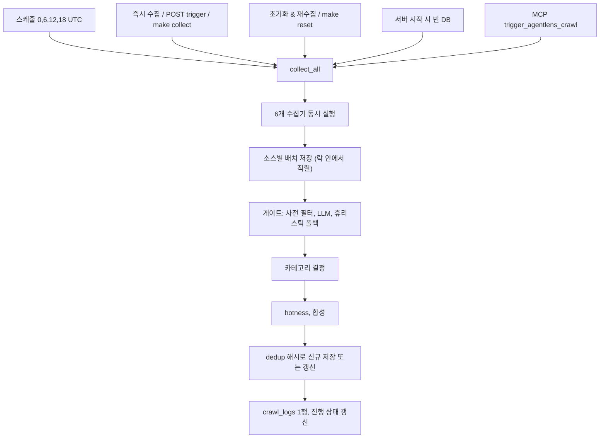

---

## 단위 기능 상세 명세 (단위기능별 7대 상세 명세 완비)

---

### [FUNC-COLL-001] 수집 실행 오케스트레이션

#### 1. 기본 정보
- **기능명**: 6개 수집기를 동시에 실행하고 소스별 배치를 순차 저장, 시드·크롤 로그 처리 (`collector_manager.collect_all()`)
- **기능 ID**: `FUNC-COLL-001`
- **대응 요구사항 ID**: `REQ-COLL-001`
- **대상 화면 코드**: 없음 (백엔드 모듈. 진행 상태는 `SCR-UI-001` 에 보인다)
- **우선순위**: Must Have
- **관련 액터 (Actor)**: 스케줄러, 웹 사용자(수동 트리거·초기화), 서버 시작 루틴, MCP 클라이언트, `make collect` 실행자

#### 2. 사전 조건 (Pre-conditions)
1. 진입점 중 하나가 호출했다: 정기 스케줄(`FUNC-COLL-018`), 수동 트리거(`FUNC-COLL-019`), 초기화(`FUNC-COLL-020`), 시작 시(`FUNC-COLL-021`), MCP(`FUNC-COLL-022`), `make collect`(`FUNC-COLL-002`).
2. DB 스키마가 있다.

#### 3. 사용자 인터랙션 및 시스템 동작 흐름과 플로우차트 (Step-by-Step Flow & Flowchart)
1. 이미 실행 중(`is_running`)이면 `{"status": "already_running", "message": "Collector is currently running"}` 를 돌려주고 끝낸다.
2. `is_running=True`, `current_source="시작 중"`, `step_message="전세계 소스 실시간 수집을 시작합니다..."`, 카운터(`items_collected`, `items_saved`, `items_filtered`, `completed_sources`)를 0 으로 초기화한다.
3. 작업 목록(이름, 코루틴) 6개를 만든다: "국내 & 글로벌 RSS 피드"(`fetch_rss`), "HackerNews", "GitHub Releases", "arXiv Papers", "Hugging Face", "Reddit". `total_sources = 6`.
4. `asyncio.gather(..., return_exceptions=True)` 로 6개 워커를 동시에 실행한다. 각 워커는 `current_source=이름`, `step_message="⚡️ {이름} 수집 중..."` 으로 바꾸고, 수집기 결과를 받아 `source_results[이름] = {"count": n}` 을 기록한 뒤 `_process_and_save_batch` 로 저장한다(`FUNC-COLL-015`). 끝나면 `completed_sources += 1`, `step_message="✅ {이름} 완료 (+{saved}건 선별 저장)"`.
5. 워커 예외는 로그를 남기고 `source_results[이름] = {"error": str(e), "count": 0}`, `completed_sources += 1` 로 처리한다. 다른 소스는 계속된다.
6. 저장 배치는 `asyncio.Lock`(`_db_lock`) 안에서 실행되므로 소스별 배치는 한 번에 하나씩 처리된다. 락 안에서 기사별 LLM 평가 호출도 함께 일어난다.
7. 모든 워커가 끝나고 `items_collected == 0` 이면 시드를 저장한다(`FUNC-COLL-016`).
8. `crawl_logs` 에 실행당 1행을 쓴다(`FUNC-COLL-017`).
9. `last_crawl_time`, `last_crawl_stats`(`total_collected`, `total_saved`, `total_filtered_low_quality`, `source_results`)를 갱신하고 `step_message="🎉 수집 완료! 총 {items_saved}건 신규 선별 저장"`.
10. `finally` 에서 `is_running=False`.

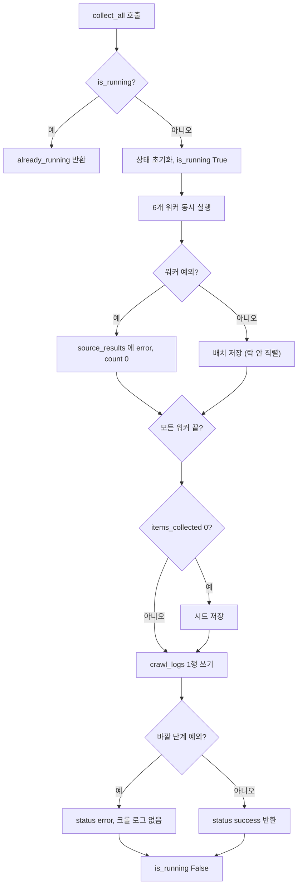

#### 4. 화면 표시 및 입력 데이터 항목 명세 (입력·출력 데이터 항목 - 8대 표준 컬럼)
| 항목명 | 화면 표시/입력 구분 | UI 컴포넌트 | 필수 여부 | 데이터 타입 / 제약 | 기본값 | 유효성 검증 규칙 (Validation) | 노출/수정 조건 |
| :--- | :---: | :--- | :---: | :--- | :---: | :--- | :--- |
| `session` | 모듈 입력 | - | 선택 | AsyncSession | None | 받지만 쓰지 않는다 | - |
| `status` | 모듈 출력 | dict | 필수 | `success` / `already_running` / `error` | - | - | 항상 |
| `total_collected` | 모듈 출력 | dict | - | int (제목·URL 이 있는 항목 수) | - | - | `success` |
| `total_saved` | 모듈 출력 | dict | - | int (신규 저장 수, 갱신 제외) | - | - | `success` |
| `total_filtered_low_quality` | 모듈 출력 | dict | - | int (게이트·카테고리로 버린 수) | - | - | `success` |
| `source_results` | 모듈 출력 | dict | - | `{이름: {"count"}}` 또는 `{이름: {"error", "count": 0}}` | - | - | `success` |
| `error` | 모듈 출력 | dict | - | 예외 메시지 | - | - | `error` |
| `step_message` | 메모리 상태 | 진행 줄(`SCR-UI-001`) | - | 문자열(이모지 포함) | "대기 중" | - | 진행 조회 시 |

#### 5. 비즈니스 규칙 (Business Rules)
- **BR-COLL-001-1 (중복 실행 방지)**: 같은 프로세스에서는 한 번에 하나만 돈다. 플래그는 프로세스 메모리 값이라 다른 프로세스(MCP 서버, 직접 모드 `make collect`)와는 공유되지 않는다.
- **BR-COLL-001-2 (부분 실패 허용)**: 소스 하나가 실패해도 나머지는 계속되고 전체 `status` 는 `success` 다.
- **BR-COLL-001-3 (직렬 저장)**: 가져오기는 동시, 평가·저장은 락 안에서 소스 단위 직렬이다.
- **BR-COLL-001-4 (시드)**: 6개 소스에서 유효 항목이 하나도 없을 때만 시드를 넣는다.

#### 6. 예외 처리 및 엣지 케이스 (Edge Cases & Exception Handling)
| 발생 상황 (Edge Case Scenario) | 화면 반응 및 시스템 처리 방식 | 사용자 안내 메시지 |
| :--- | :--- | :--- |
| 이미 수집 중 | `already_running` | "Collector is currently running" |
| 크롤 로그 쓰기 등 바깥 단계 예외 | `{"status": "error", "error"}`, 크롤 로그 없음 | 진행 줄 "수집 오류: {e}" |
| 6개 워커가 동시에 시작 | `current_source`/`step_message` 는 마지막으로 쓴 워커 값으로 계속 덮어써진다 | 진행 줄이 소스 사이를 오간다 |
| 네트워크 단절 | 모든 수집기가 0건, 시드 2건을 게이트에 통과시켜 저장 시도 | 진행 줄 "🎉 수집 완료! 총 N건 신규 선별 저장" |

#### 7. 비즈니스 에러 코드 매핑
| 비즈니스 에러 코드 | 발생 사유 | HTTP 상태 코드 매핑 | 클라이언트 표시 형태 |
| :--- | :--- | :---: | :--- |
| `status="already_running"` | 같은 프로세스에서 실행 중 | 해당 없음 (모듈 반환) | 호출자에 따라 다름 (`FUNC-COLL-019` 참고) |
| `status="error"` | 바깥 단계 예외 | 해당 없음 | 진행 줄 "수집 오류: {e}" |
| `source_results.<이름>.error` | 수집기 예외 | 해당 없음 | API 로 노출되지 않음 (`last_crawl_stats` 메모리에만) |

- 관련 코드: `backend/app/collectors/manager.py:45-70`, `backend/app/collectors/manager.py:176-259`

---

### [FUNC-COLL-002] `make collect` (CLI)

#### 1. 기본 정보
- **기능명**: 실행 중인 backend 에 수집을 시키거나(API 모드), 로컬 DB 에 직접 수집(직접 모드)
- **기능 ID**: `FUNC-COLL-002`
- **대응 요구사항 ID**: `REQ-COLL-006`
- **대상 화면 코드**: 없음 (터미널)
- **우선순위**: Should Have
- **관련 액터 (Actor)**: 개발자·운영자

#### 2. 사전 조건 (Pre-conditions)
1. `make setup` 으로 `.venv` 가 있다. `make collect` 는 `cd backend && PYTHONPATH=. ../.venv/bin/python ../scripts/collect.py` 를 실행한다.
2. 외부 소스·LLM 을 실제로 호출한다.

#### 3. 사용자 인터랙션 및 시스템 동작 흐름과 플로우차트 (Step-by-Step Flow & Flowchart)
1. 환경 변수를 읽는다: `AGENTLENS_API_URL`(기본 `http://localhost:8000`, 끝 `/` 제거), `COLLECT_MODE`(`auto`|`api`|`direct`, 기본 `auto`), `COLLECT_TIMEOUT`(정수 초, 기본 1800). Makefile 이 세 값을 기본값과 함께 export 한다.
2. 값 검사: `COLLECT_MODE` 가 세 값이 아니거나 `COLLECT_TIMEOUT` 이 정수가 아니거나 0 이하면 오류 출력 후 종료 1.
3. `GET {URL}/health` 를 2초 타임아웃으로 부른다. 200 이고 `status == "healthy"` 면 backend 가 있다고 본다.
4. 모드 결정: `api` 인데 backend 가 없으면 "make collect: {URL} 에 backend 가 없다" 종료 1. `api` 이거나 `auto` 이면서 backend 가 있으면 API 모드. 그 밖(`direct`, 또는 `auto` 인데 backend 없음)은 직접 모드.
5. **API 모드**: 첫 줄 `API 모드: <URL>`. `GET /api/schedule/progress` 로 이전 `last_crawl_time` 을 기억하고 `POST /api/schedule/trigger` 를 보낸다(요청 타임아웃 10초).
   - 응답이 `already_running` 이면 "이미 진행 중인 수집이 있다. 그 수집이 끝날 때까지 기다린다" 를 내고 기다린다. `started` 도 아니고 `already_running` 도 아니면 종료 1.
   - 2초마다 `GET /api/schedule/progress` 를 불러 `step_message` 가 바뀔 때마다 출력한다.
   - `is_running` 이 false 이고 `last_crawl_time` 이 바뀌었으면 "수집 완료: 수집 {items_collected}건, 저장 {items_saved}건" 종료 0. 수집 중이었다가 `last_crawl_time` 이 그대로 끝나면 "수집이 오류로 끝났다: {마지막 메시지}" 종료 1. `COLLECT_TIMEOUT` 안에 끝나지 않으면 종료 1.
6. **직접 모드**: 첫 줄 `직접 모드: <DB 절대 경로>`. backend 가 떠 있으면 "경고: {URL} 에 backend 가 떠 있다. 같은 DB 라면 동시에 수집할 수 있다" 를 낸다. `ensure_db_schema()` 뒤 `collect_all()` 을 직접 부른다. 소스별로 `{이름}: {count}건` 또는 `{이름}: 실패 - {error}` 를 낸다. 실패한 소스가 있으면 "실패한 소스: …". 마지막에 "수집 완료: 수집 N건, 저장 N건".

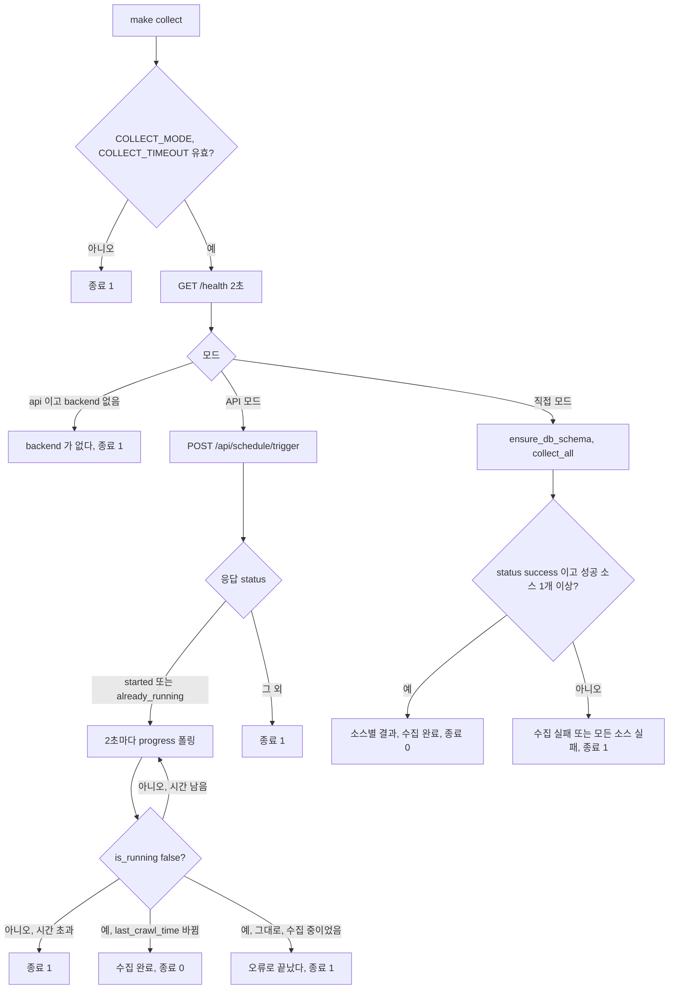

#### 4. 화면 표시 및 입력 데이터 항목 명세 (입력·출력 데이터 항목 - 8대 표준 컬럼)
| 항목명 | 화면 표시/입력 구분 | UI 컴포넌트 | 필수 여부 | 데이터 타입 / 제약 | 기본값 | 유효성 검증 규칙 (Validation) | 노출/수정 조건 |
| :--- | :---: | :--- | :---: | :--- | :---: | :--- | :--- |
| `AGENTLENS_API_URL` | CLI 입력 | 환경 변수 | 선택 | URL | `http://localhost:8000` | 끝 `/` 제거 | 항상 |
| `COLLECT_MODE` | CLI 입력 | 환경 변수 | 선택 | `auto` / `api` / `direct` | `auto` | 그 밖이면 종료 1 | 항상 |
| `COLLECT_TIMEOUT` | CLI 입력 | 환경 변수 | 선택 | 정수 초 | 1800 | 정수 아니거나 0 이하면 종료 1 | API 모드 대기 상한 |
| 첫 줄 | CLI 출력 | 표준 출력 | - | `API 모드: <URL>` 또는 `직접 모드: <DB 절대 경로>` | - | - | 항상 |
| 진행 메시지 | CLI 출력 | 표준 출력 | - | `step_message` (바뀔 때만) | - | - | API 모드 |
| 소스별 결과 | CLI 출력 | 표준 출력 | - | `{이름}: N건` / `{이름}: 실패 - …` | - | - | 직접 모드 |
| 종료 코드 | CLI 출력 | 프로세스 | - | 0 / 1 | - | - | 항상 |

#### 5. 비즈니스 규칙 (Business Rules)
- **BR-COLL-002-1**: API 모드 성공 판정은 `last_crawl_time` 변화다.
- **BR-COLL-002-2**: 직접 모드는 `status` 가 `success` 가 아니거나, `source_results` 가 비었거나, 모든 소스가 실패하면 종료 1 이다.
- **BR-COLL-002-3**: 직접 모드 DB 는 `backend/` 를 cwd 로 한 `DATABASE_URL`(기본 `backend/agentlens.db`)이다.
- **BR-COLL-002-4**: HTTP 는 표준 라이브러리 `urllib` 만 쓴다.

#### 6. 예외 처리 및 엣지 케이스 (Edge Cases & Exception Handling)
| 발생 상황 (Edge Case Scenario) | 화면 반응 및 시스템 처리 방식 | 사용자 안내 메시지 |
| :--- | :--- | :--- |
| backend 요청 실패 | 종료 1 | "backend 요청 실패: …" (표준 오류) |
| 이미 수집 중 (API 모드) | 진행 중인 수집이 끝날 때까지 기다린다 | "이미 진행 중인 수집이 있다. 그 수집이 끝날 때까지 기다린다" |
| `app` import 실패 (직접 모드) | 종료 1 | "app 패키지를 불러오지 못했다 (backend/ 에서 PYTHONPATH=. 로 실행): …" |
| 직접 모드인데 backend 도 떠 있음 | 경고 후 그대로 수집 (같은 DB 면 동시 수집 가능) | "경고: … 같은 DB 라면 동시에 수집할 수 있다" |
| 모든 소스 실패 (직접 모드) | 종료 1 | "모든 소스가 실패했다 (네트워크 확인)" |

#### 7. 비즈니스 에러 코드 매핑
| 비즈니스 에러 코드 | 발생 사유 | HTTP 상태 코드 매핑 | 클라이언트 표시 형태 |
| :--- | :--- | :---: | :--- |
| 종료 1 "COLLECT_MODE 는 auto, api, direct 중 하나여야 한다" | 잘못된 모드 | 해당 없음 | 표준 오류 |
| 종료 1 "수집을 시작하지 못했다: status=…" | trigger 응답이 예상 밖 | 해당 없음 | 표준 오류 |
| 종료 1 "수집이 {N}초 안에 끝나지 않았다" | 타임아웃 | 해당 없음 | 표준 오류 |
| 종료 1 "수집 실패: status=… …" | 직접 모드 `collect_all` 비성공 | 해당 없음 | 표준 오류 |

- 관련 코드: `scripts/collect.py:1-209`, `Makefile:6-13`, `Makefile:54-55`

---

### [FUNC-COLL-003] 소스 설정 로딩

#### 1. 기본 정보
- **기능명**: `sources.json` 을 찾아 읽고 소스별 설정·활성 여부를 수집기에 제공
- **기능 ID**: `FUNC-COLL-003`
- **대응 요구사항 ID**: `REQ-COLL-001`
- **대상 화면 코드**: 없음 (`sources_service` getter)
- **우선순위**: Must Have
- **관련 액터 (Actor)**: 수집기

#### 2. 사전 조건 (Pre-conditions)
1. 수집기가 실행될 때마다 getter 를 호출한다 (파일을 새로 읽는다).

#### 3. 사용자 인터랙션 및 시스템 동작 흐름과 플로우차트 (Step-by-Step Flow & Flowchart)
1. 탐색 순서: cwd 의 `sources.json`, cwd 부모의 `sources.json`, 저장소 루트 `sources.json`, `backend/app/config/sources.json`. 없으면 `backend/app/config/sources.json` 경로를 기본으로 쓴다.
2. 읽기 실패 시 오류 로그 후 내장 기본값(`_default_sources`: GeekNews RSS 1개, GitHub `topic:mcp-server`, Reddit `LocalLLaMA`/`agent`·`mcp`, HN `AI agent`, arXiv `all:"agent harness"`, HF 활성)을 쓴다.
3. 정규화: `rss_feeds` 가 없으면 옛 키(`korean_sources`, `harness_and_mcp_releases`, `global_research_and_blogs`)에서 만든다. `github_sources`, `reddit_sources`, `hackernews_sources`, `arxiv_sources`, `huggingface_sources` 가 없으면 기본 블록을 넣는다.
4. getter:
   - RSS(`get_active_rss_feeds`): `enabled` 가 true(기본)인 피드만.
   - GitHub(`get_github_config`): 비활성이면 `enabled: False` 와 빈 목록, 활성이면 `search_queries` 와 `enabled` 인 `monitored_repos` 만.
   - Reddit/HN/arXiv: 블록 그대로. HF(`is_huggingface_enabled`): `enabled` 값(기본 true).

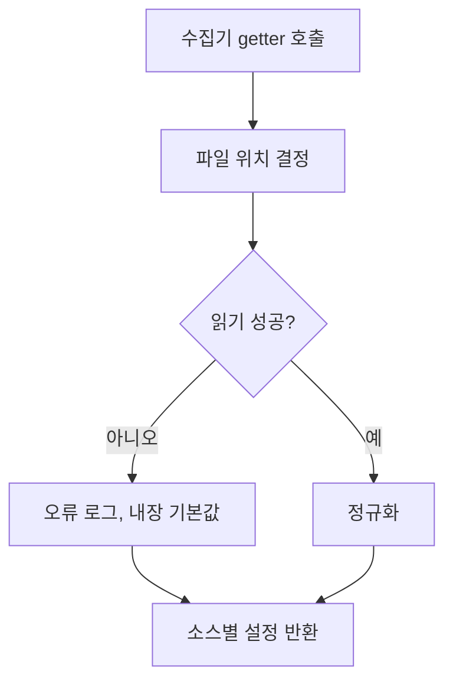

#### 4. 화면 표시 및 입력 데이터 항목 명세 (입력·출력 데이터 항목 - 8대 표준 컬럼)
| 항목명 | 화면 표시/입력 구분 | UI 컴포넌트 | 필수 여부 | 데이터 타입 / 제약 | 기본값 | 유효성 검증 규칙 (Validation) | 노출/수정 조건 |
| :--- | :---: | :--- | :---: | :--- | :---: | :--- | :--- |
| `sources.json` | 모듈 입력 | 파일 | 선택 | JSON (`FUNC-SRC-001` 구조) | 내장 기본값 | JSON 파싱 실패 시 기본값 | 파일 편집, 소스 관리 화면 |
| 활성 RSS 피드 | 모듈 출력 | list | - | `enabled` 인 피드 | - | - | RSS 수집기 |
| GitHub 설정 | 모듈 출력 | dict | - | `{enabled, search_queries, monitored_repos(활성만)}` | - | - | GitHub 수집기 |
| Reddit/HN/arXiv 설정 | 모듈 출력 | dict | - | 블록 그대로 | - | - | 각 수집기 |
| HF 활성 | 모듈 출력 | bool | - | `enabled` | true | - | HF 수집기 |

#### 5. 비즈니스 규칙 (Business Rules)
- **BR-COLL-003-1 (현재 활성 소스)**: 저장소 루트 `sources.json` 기준 활성 소스: RSS 17개(국내 `country: KR` 5개, 글로벌 12개), GitHub 검색 쿼리 5개·모니터링 저장소 8개, Reddit 서브레딧 4개(`LocalLLaMA`, `MachineLearning`, `OpenAI`, `ArtificialInteligence`)·키워드 7개(`agent`, `harness`, `mcp`, `eval`, `tool`, `benchmark`, `reasoning`), HN 쿼리 6개, arXiv 쿼리 3개, HF 활성. `backend/app/config/sources.json` 과 내용이 같았다.
- **BR-COLL-003-2**: 매 수집마다 파일을 다시 읽으므로 편집은 다음 수집부터 반영된다.

#### 6. 예외 처리 및 엣지 케이스 (Edge Cases & Exception Handling)
| 발생 상황 (Edge Case Scenario) | 화면 반응 및 시스템 처리 방식 | 사용자 안내 메시지 |
| :--- | :--- | :--- |
| JSON 오류 | 내장 기본값으로 수집 (대상이 크게 줄어든다) | 서버 로그만 |
| cwd 에 따라 다른 파일 | 루트와 `backend/app/config/` 두 벌 중 탐색 순서상 먼저 보이는 파일을 쓴다 | 없음 |

#### 7. 비즈니스 에러 코드 매핑
| 비즈니스 에러 코드 | 발생 사유 | HTTP 상태 코드 매핑 | 클라이언트 표시 형태 |
| :--- | :--- | :---: | :--- |
| (로그 "Failed to read sources file from …") | 파일 읽기 실패 | 해당 없음 | 없음 |

- 관련 코드: `backend/app/services/sources_service.py:11-167`, `sources.json`, `backend/app/config/sources.json`. 소스 관리(추가·토글·삭제) UI·API 는 `docs/spec-writer/fsd/05_SOURCES_AND_RESEARCH_SPECIFICATION.md`.

---

### [FUNC-COLL-004] RSS 수집기

#### 1. 기본 정보
- **기능명**: 활성 RSS/Atom 피드에서 피드당 최대 8건 수집 (`fetch_rss()`)
- **기능 ID**: `FUNC-COLL-004`
- **대응 요구사항 ID**: `REQ-COLL-001`
- **대상 화면 코드**: 없음
- **우선순위**: Must Have
- **관련 액터 (Actor)**: 시스템

#### 2. 사전 조건 (Pre-conditions)
1. `FUNC-COLL-001` 이 워커 "국내 & 글로벌 RSS 피드" 로 호출했다.

#### 3. 사용자 인터랙션 및 시스템 동작 흐름과 플로우차트 (Step-by-Step Flow & Flowchart)
1. 활성 RSS 피드 목록을 읽는다. 비어 있으면 코드 내장 5개(GeekNews(KR), AI타임스(KR), Simon Willison, OpenAI News, LangChain Blog)를 쓴다.
2. 공용 `httpx.AsyncClient`(timeout 8.0, `follow_redirects=True`, User-Agent `Mozilla/5.0 (compatible; AgentLens/1.0; +https://github.com/agentlens)`)로 모든 피드를 동시에 요청하되 `Semaphore(6)` 으로 동시 6개까지. 피드별 요청 timeout 6.0초.
3. HTTP 200 이 아니면 그 피드는 0건.
4. `feedparser` 로 파싱해 앞 8개 entry 만 쓴다. `link` 없으면 건너뛴다.
5. 요약: `summary` → `description` → `content[0].value` 순으로 고르고 HTML 태그 제거, 공백 정리 후 320자 초과 시 잘라 `...` 를 붙인다.
6. 발행 시각: `published` 가 있으면 그것만, 없으면 `updated` 를 dateutil 로 파싱(naive 면 UTC). 파싱에 실패하거나 둘 다 없으면 현재 시각.
7. 필드: `title = "[{피드 이름}] {entry 제목}"`, `source = "rss_kr"`(피드 `country == "KR"`) 또는 `"rss"`, `author = entry.author 또는 피드 이름`, `raw_score = 180`(KR) / `150`, `comments_count = 0`.

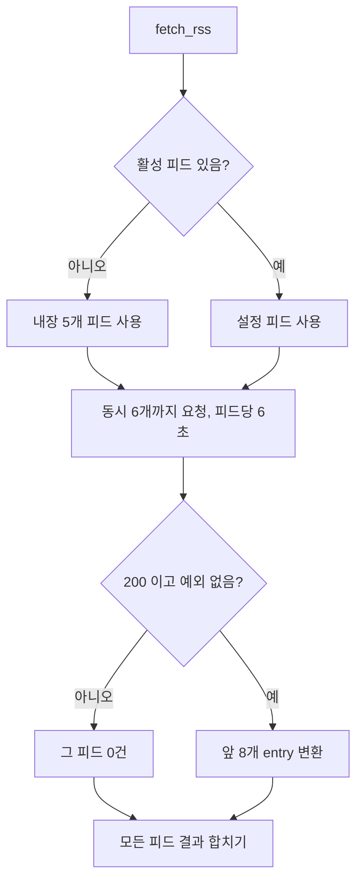

#### 4. 화면 표시 및 입력 데이터 항목 명세 (입력·출력 데이터 항목 - 8대 표준 컬럼)
| 항목명 | 화면 표시/입력 구분 | UI 컴포넌트 | 필수 여부 | 데이터 타입 / 제약 | 기본값 | 유효성 검증 규칙 (Validation) | 노출/수정 조건 |
| :--- | :---: | :--- | :---: | :--- | :---: | :--- | :--- |
| 피드 `name`, `url`, `country` | 모듈 입력 | `sources.json` | 필수 | 문자열 | 내장 5개 | - | 활성 피드 |
| `title` | 모듈 출력 | 원시 항목 | 필수 | `[{피드 이름}] {제목}` | - | - | 항목마다 |
| `url` | 모듈 출력 | 원시 항목 | 필수 | entry `link` | - | 없으면 건너뜀 | 항목마다 |
| `source` | 모듈 출력 | 원시 항목 | 필수 | `rss_kr` / `rss` | - | - | 항목마다 |
| `summary` | 모듈 출력 | 원시 항목 | - | 최대 320자 + `...` | `""` | HTML 제거 | 항목마다 |
| `author` | 모듈 출력 | 원시 항목 | - | entry author 또는 피드 이름 | - | - | 항목마다 |
| `published_at` | 모듈 출력 | 원시 항목 | - | datetime (UTC) | 현재 시각 | - | 항목마다 |
| `raw_score`, `comments_count` | 모듈 출력 | 원시 항목 | - | 180(KR)/150, 0 | - | - | 항목마다 |

#### 5. 비즈니스 규칙 (Business Rules)
- **BR-COLL-004-1**: 피드당 상한 8건, 동시 요청 6개.
- **BR-COLL-004-2**: 피드 설정의 `category_hint` 는 항목에 담지 않는다.
- **BR-COLL-004-3**: 제목에 피드 이름 접두사가 붙어 같은 글이라도 다른 소스와 dedup 해시가 다르다.

#### 6. 예외 처리 및 엣지 케이스 (Edge Cases & Exception Handling)
| 발생 상황 (Edge Case Scenario) | 화면 반응 및 시스템 처리 방식 | 사용자 안내 메시지 |
| :--- | :--- | :--- |
| 피드 단위 예외, 비 200 | 조용히 무시하고 0건 | 없음 |
| 모든 피드를 끔 | 내장 5개로 수집 | 없음 |
| `published` 파싱 실패 | `updated` 로 넘어가지 않고 현재 시각 | 없음 |

#### 7. 비즈니스 에러 코드 매핑
| 비즈니스 에러 코드 | 발생 사유 | HTTP 상태 코드 매핑 | 클라이언트 표시 형태 |
| :--- | :--- | :---: | :--- |
| (없음) | 피드 단위 오류를 삼킨다 | 해당 없음 | 없음 |

- 관련 코드: `backend/app/collectors/sources/rss.py:12-89`

---

### [FUNC-COLL-005] HackerNews 수집기

#### 1. 기본 정보
- **기능명**: Algolia 검색 API 로 쿼리당 12건 수집 (`fetch_hackernews()`)
- **기능 ID**: `FUNC-COLL-005`
- **대응 요구사항 ID**: `REQ-COLL-001`
- **대상 화면 코드**: 없음
- **우선순위**: Must Have
- **관련 액터 (Actor)**: 시스템

#### 2. 사전 조건 (Pre-conditions)
1. `hackernews_sources.enabled` 가 true (false 면 빈 목록).

#### 3. 사용자 인터랙션 및 시스템 동작 흐름과 플로우차트 (Step-by-Step Flow & Flowchart)
1. 쿼리 목록: `hackernews_sources.queries` (블록에 키가 없으면 코드 기본 `["AI agent", "Model Context Protocol", "agent harness"]`).
2. 쿼리마다 `GET https://hn.algolia.com/api/v1/search_by_date` (`query`, `tags=story`, `hitsPerPage=12`), timeout 10.0.
3. URL 은 `hit.url`, 없으면 `https://news.ycombinator.com/item?id={objectID}`. 한 실행 안에서 URL 로 중복 제거.
4. `title = hit.title`(접두사 없음), `summary = story_text` 또는 `"Hacker News discussion ({points} pts, {num_comments} comments)"`, `author` 기본 `hn_user`, `raw_score = points`, `comments_count = num_comments`, 발행 시각 `created_at`(실패 시 현재).

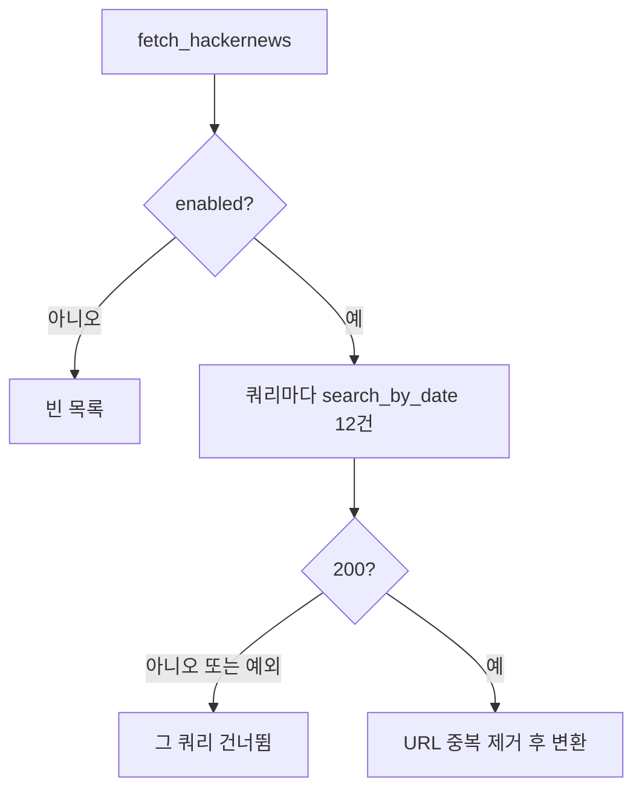

#### 4. 화면 표시 및 입력 데이터 항목 명세 (입력·출력 데이터 항목 - 8대 표준 컬럼)
| 항목명 | 화면 표시/입력 구분 | UI 컴포넌트 | 필수 여부 | 데이터 타입 / 제약 | 기본값 | 유효성 검증 규칙 (Validation) | 노출/수정 조건 |
| :--- | :---: | :--- | :---: | :--- | :---: | :--- | :--- |
| `queries` | 모듈 입력 | `sources.json` | 선택 | list[str] | 코드 기본 3개 | - | enabled 일 때 |
| `title`, `url`, `source="hackernews"` | 모듈 출력 | 원시 항목 | 필수 | 문자열 | - | URL 중복 제거 | 항목마다 |
| `summary` | 모듈 출력 | 원시 항목 | - | story_text 또는 고정 문구 | - | - | 항목마다 |
| `raw_score`, `comments_count` | 모듈 출력 | 원시 항목 | - | points, num_comments | 0 | - | 항목마다 |

#### 5. 비즈니스 규칙 (Business Rules)
- **BR-COLL-005-1**: 쿼리당 12건, 실행 내 URL 중복 제거.
- **BR-COLL-005-2**: `hackernews` 는 혼합 소스라 AI 사전 필터를 받는다 (`FUNC-COLL-010`).

#### 6. 예외 처리 및 엣지 케이스 (Edge Cases & Exception Handling)
| 발생 상황 (Edge Case Scenario) | 화면 반응 및 시스템 처리 방식 | 사용자 안내 메시지 |
| :--- | :--- | :--- |
| 200 이 아니거나 예외 | 그 쿼리 건너뜀 | 없음 |
| `hit.title` 이 null | 저장 단계 `.strip()` 에서 예외가 나 그 소스 배치 전체가 롤백될 수 있다 (`FUNC-COLL-015`) | 없음 |

#### 7. 비즈니스 에러 코드 매핑
| 비즈니스 에러 코드 | 발생 사유 | HTTP 상태 코드 매핑 | 클라이언트 표시 형태 |
| :--- | :--- | :---: | :--- |
| (없음) | 쿼리 단위 오류를 삼킨다 | 해당 없음 | 없음 |

- 관련 코드: `backend/app/collectors/sources/hackernews.py:9-44`

---

### [FUNC-COLL-006] GitHub 수집기

#### 1. 기본 정보
- **기능명**: 저장소 검색 API 쿼리당 8건, 결과가 적으면 모니터링 저장소로 보충 (`fetch_github()`)
- **기능 ID**: `FUNC-COLL-006`
- **대응 요구사항 ID**: `REQ-COLL-001`
- **대상 화면 코드**: 없음
- **우선순위**: Must Have
- **관련 액터 (Actor)**: 시스템

#### 2. 사전 조건 (Pre-conditions)
1. `github_sources.enabled` 가 true (false 면 빈 목록).

#### 3. 사용자 인터랙션 및 시스템 동작 흐름과 플로우차트 (Step-by-Step Flow & Flowchart)
1. 입력: `search_queries`, 활성 `monitored_repos`.
2. 쿼리마다 `GET https://api.github.com/search/repositories` (`q`, `sort=updated`, `order=desc`, `per_page=8`), timeout 10.0, 헤더 `Accept: application/vnd.github.v3+json`, `User-Agent: AgentLens-Collector/1.0`. 인증 토큰은 쓰지 않는다.
3. `html_url` 로 중복 제거. 설명이 없으면 `"Open-source agent repository"` 를 설명으로 쓴다. `title = "{full_name}: {설명[:100]}"`, `summary = 설명`, `author = owner.login`(없으면 `github`), `raw_score = stargazers_count`, `comments_count = forks_count`, 발행 시각 `updated_at`(실패 시 현재).
4. 검색 결과가 5건 미만이고 모니터링 저장소가 있으면, 아직 없는 저장소를 `https://github.com/{repo}` 로 추가한다: 설명 기본 `"Open-source repository"`, `title = "{repo}: {설명[:110]}"`, `author` = `repo` 의 owner 부분, 발행 시각 현재, `raw_score = stars_hint`(기본 5000), `comments_count = int(stars_hint * 0.12)`.

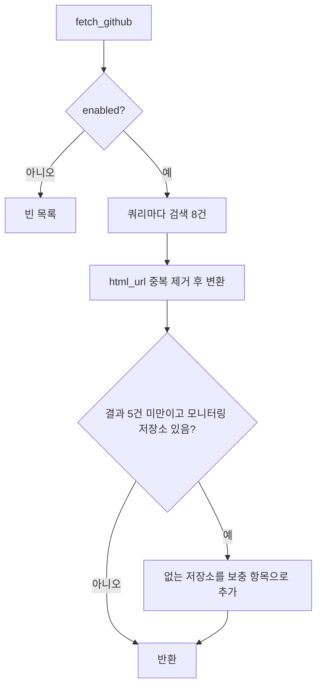

#### 4. 화면 표시 및 입력 데이터 항목 명세 (입력·출력 데이터 항목 - 8대 표준 컬럼)
| 항목명 | 화면 표시/입력 구분 | UI 컴포넌트 | 필수 여부 | 데이터 타입 / 제약 | 기본값 | 유효성 검증 규칙 (Validation) | 노출/수정 조건 |
| :--- | :---: | :--- | :---: | :--- | :---: | :--- | :--- |
| `search_queries` | 모듈 입력 | `sources.json` | 선택 | list[str] | `[]` | - | enabled |
| `monitored_repos` | 모듈 입력 | `sources.json` | 선택 | 활성 항목만 | `[]` | `repo` 빈 값은 건너뜀 | 보충 시 |
| `title`, `url`, `source="github"` | 모듈 출력 | 원시 항목 | 필수 | 문자열 | - | URL 중복 제거 | 항목마다 |
| `raw_score`, `comments_count` | 모듈 출력 | 원시 항목 | - | 별·포크, 보충은 `stars_hint`·×0.12 | 0 / 5000 | - | 항목마다 |

#### 5. 비즈니스 규칙 (Business Rules)
- **BR-COLL-006-1**: 보충 조건은 검색 결과 5건 미만이다 (`github.py:51`).
- **BR-COLL-006-2**: 보충 항목의 발행 시각은 수집 시각이라 hotness 가 높게 나온다.

#### 6. 예외 처리 및 엣지 케이스 (Edge Cases & Exception Handling)
| 발생 상황 (Edge Case Scenario) | 화면 반응 및 시스템 처리 방식 | 사용자 안내 메시지 |
| :--- | :--- | :--- |
| 쿼리 실패, 비 200 (레이트 리밋 포함) | 그 쿼리 건너뜀. 결과가 적으면 보충으로 채워진다 | 없음 |

#### 7. 비즈니스 에러 코드 매핑
| 비즈니스 에러 코드 | 발생 사유 | HTTP 상태 코드 매핑 | 클라이언트 표시 형태 |
| :--- | :--- | :---: | :--- |
| (없음) | 쿼리 단위 오류를 삼킨다 | 해당 없음 | 없음 |

- 관련 코드: `backend/app/collectors/sources/github.py:9-73`

---

### [FUNC-COLL-007] arXiv 수집기

#### 1. 기본 정보
- **기능명**: arXiv Atom API 쿼리당 8건 수집 (`fetch_arxiv()`)
- **기능 ID**: `FUNC-COLL-007`
- **대응 요구사항 ID**: `REQ-COLL-001`
- **대상 화면 코드**: 없음
- **우선순위**: Must Have
- **관련 액터 (Actor)**: 시스템

#### 2. 사전 조건 (Pre-conditions)
1. `arxiv_sources.enabled` 가 true (false 면 빈 목록).

#### 3. 사용자 인터랙션 및 시스템 동작 흐름과 플로우차트 (Step-by-Step Flow & Flowchart)
1. 쿼리 목록: `arxiv_sources.queries` (블록에 키가 없으면 `['all:"agent harness" OR all:"agent evaluation"']`).
2. 쿼리마다 `GET http://export.arxiv.org/api/query` (`search_query`, `start=0`, `max_results=8`, `sortBy=submittedDate`, `sortOrder=descending`), timeout 12.0.
3. Atom `entry` 를 파싱. URL 은 `id`, 실행 내 중복 제거. 제목은 공백 정규화 후 `"[arXiv] "` 접두사(제목 요소가 없으면 "Untitled Paper"). 요약은 공백 정규화 후 350자 초과 시 잘라 `...`.
4. `author = "arXiv Researcher"`, `raw_score = 120`, `comments_count = 0`, 발행 시각 `published`(실패 시 현재).

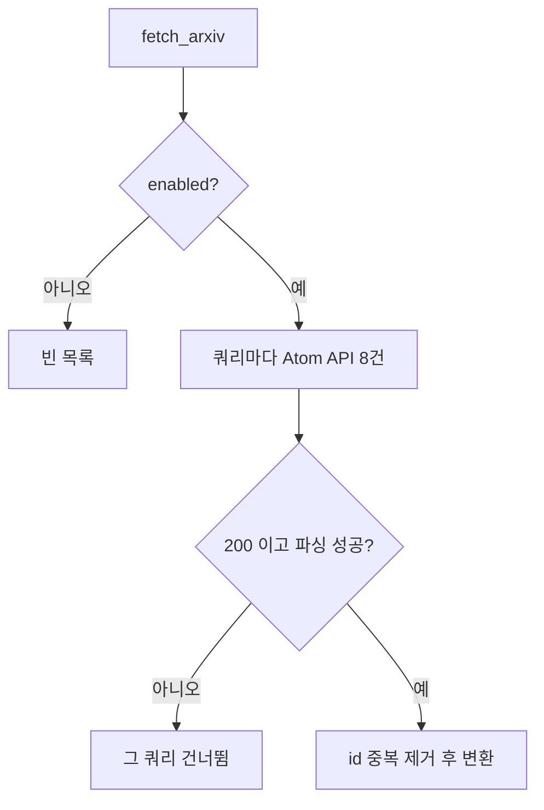

#### 4. 화면 표시 및 입력 데이터 항목 명세 (입력·출력 데이터 항목 - 8대 표준 컬럼)
| 항목명 | 화면 표시/입력 구분 | UI 컴포넌트 | 필수 여부 | 데이터 타입 / 제약 | 기본값 | 유효성 검증 규칙 (Validation) | 노출/수정 조건 |
| :--- | :---: | :--- | :---: | :--- | :---: | :--- | :--- |
| `queries` | 모듈 입력 | `sources.json` | 선택 | arXiv 검색식 | 코드 기본 1개 | - | enabled |
| `title` | 모듈 출력 | 원시 항목 | 필수 | `[arXiv] {제목}` | "Untitled Paper" | - | 항목마다 |
| `url`, `source="arxiv"` | 모듈 출력 | 원시 항목 | 필수 | entry `id` | - | 중복 제거 | 항목마다 |
| `summary` | 모듈 출력 | 원시 항목 | - | 최대 350자 + `...` | `""` | - | 항목마다 |
| `raw_score`, `comments_count` | 모듈 출력 | 원시 항목 | - | 120, 0 | 고정 | - | 항목마다 |

#### 5. 비즈니스 규칙 (Business Rules)
- **BR-COLL-007-1**: 쿼리당 8건, 최신 제출순.
- **BR-COLL-007-2**: 인기도 입력이 고정 120 이라 hotness 는 경과 시간으로만 달라진다.

#### 6. 예외 처리 및 엣지 케이스 (Edge Cases & Exception Handling)
| 발생 상황 (Edge Case Scenario) | 화면 반응 및 시스템 처리 방식 | 사용자 안내 메시지 |
| :--- | :--- | :--- |
| 200 아님, 파싱 예외 | 그 쿼리 건너뜀 | 없음 |

#### 7. 비즈니스 에러 코드 매핑
| 비즈니스 에러 코드 | 발생 사유 | HTTP 상태 코드 매핑 | 클라이언트 표시 형태 |
| :--- | :--- | :---: | :--- |
| (없음) | 쿼리 단위 오류를 삼킨다 | 해당 없음 | 없음 |

- 관련 코드: `backend/app/collectors/sources/arxiv.py:8-53`

---

### [FUNC-COLL-008] Hugging Face 수집기

#### 1. 기본 정보
- **기능명**: Daily Papers 상위 12건 수집 (`fetch_huggingface()`)
- **기능 ID**: `FUNC-COLL-008`
- **대응 요구사항 ID**: `REQ-COLL-001`
- **대상 화면 코드**: 없음
- **우선순위**: Must Have
- **관련 액터 (Actor)**: 시스템

#### 2. 사전 조건 (Pre-conditions)
1. `huggingface_sources.enabled` 가 true (false 면 빈 목록).

#### 3. 사용자 인터랙션 및 시스템 동작 흐름과 플로우차트 (Step-by-Step Flow & Flowchart)
1. `GET https://huggingface.co/api/daily_papers`, timeout 10.0. 응답 배열 앞 12개.
2. `paper.id` 없으면 건너뛴다. `title = "[HF Daily] {title}"`, `url = https://huggingface.co/papers/{id}`, 요약 앞 300자, `author = "Hugging Face Daily Papers"`, `raw_score = numComments + 40`, `comments_count = numComments`, 발행 시각 `publishedAt`(실패 시 현재).

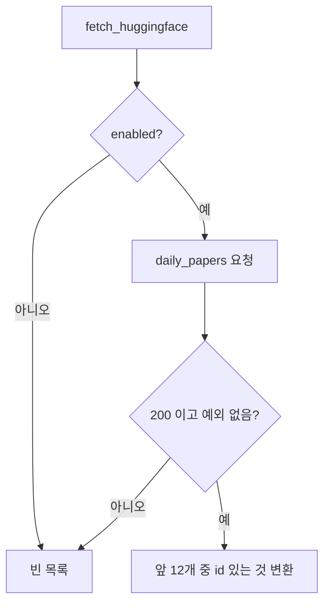

#### 4. 화면 표시 및 입력 데이터 항목 명세 (입력·출력 데이터 항목 - 8대 표준 컬럼)
| 항목명 | 화면 표시/입력 구분 | UI 컴포넌트 | 필수 여부 | 데이터 타입 / 제약 | 기본값 | 유효성 검증 규칙 (Validation) | 노출/수정 조건 |
| :--- | :---: | :--- | :---: | :--- | :---: | :--- | :--- |
| `enabled` | 모듈 입력 | `sources.json` | 선택 | bool | true | - | 항상 |
| `title`, `url`, `source="huggingface"` | 모듈 출력 | 원시 항목 | 필수 | 문자열 | - | id 없으면 건너뜀 | 항목마다 |
| `summary` | 모듈 출력 | 원시 항목 | - | 앞 300자 | `""` | - | 항목마다 |
| `raw_score`, `comments_count` | 모듈 출력 | 원시 항목 | - | 댓글+40, 댓글 | - | - | 항목마다 |

#### 5. 비즈니스 규칙 (Business Rules)
- **BR-COLL-008-1**: 상한 12건, 쿼리 설정 없음.

#### 6. 예외 처리 및 엣지 케이스 (Edge Cases & Exception Handling)
| 발생 상황 (Edge Case Scenario) | 화면 반응 및 시스템 처리 방식 | 사용자 안내 메시지 |
| :--- | :--- | :--- |
| 예외, 비 200 | 빈 목록 | 없음 |

#### 7. 비즈니스 에러 코드 매핑
| 비즈니스 에러 코드 | 발생 사유 | HTTP 상태 코드 매핑 | 클라이언트 표시 형태 |
| :--- | :--- | :---: | :--- |
| (없음) | 오류를 삼킨다 | 해당 없음 | 없음 |

- 관련 코드: `backend/app/collectors/sources/huggingface.py:7-38`

---

### [FUNC-COLL-009] Reddit 수집기

#### 1. 기본 정보
- **기능명**: 서브레딧 hot 12건 중 제목 키워드 일치 글 수집 (`fetch_reddit()`)
- **기능 ID**: `FUNC-COLL-009`
- **대응 요구사항 ID**: `REQ-COLL-001`
- **대상 화면 코드**: 없음
- **우선순위**: Must Have
- **관련 액터 (Actor)**: 시스템

#### 2. 사전 조건 (Pre-conditions)
1. `reddit_sources.enabled` 가 true (false 면 빈 목록).

#### 3. 사용자 인터랙션 및 시스템 동작 흐름과 플로우차트 (Step-by-Step Flow & Flowchart)
1. 입력: `subreddits`, `keywords` (블록에 키가 없으면 코드 기본 `["LocalLLaMA", "MachineLearning"]`, `["agent", "harness", "mcp", "eval", "tool", "llm"]`).
2. 서브레딧마다 `GET https://www.reddit.com/r/{sub}/hot.json?limit=12`, timeout 10.0, `User-Agent: AgentLens-Collector/1.0`.
3. 제목 소문자에 키워드 중 하나가 부분 문자열로 들어 있는 글만 남긴다.
4. `title = "[r/{sub}] {title}"`, `url = https://www.reddit.com{permalink}`, `summary = selftext[:300]` 또는 `"Reddit discussion on r/{sub}"`, `author = "u/{author}"`, `raw_score = score`, `comments_count = num_comments`, 발행 시각 `created_utc`.

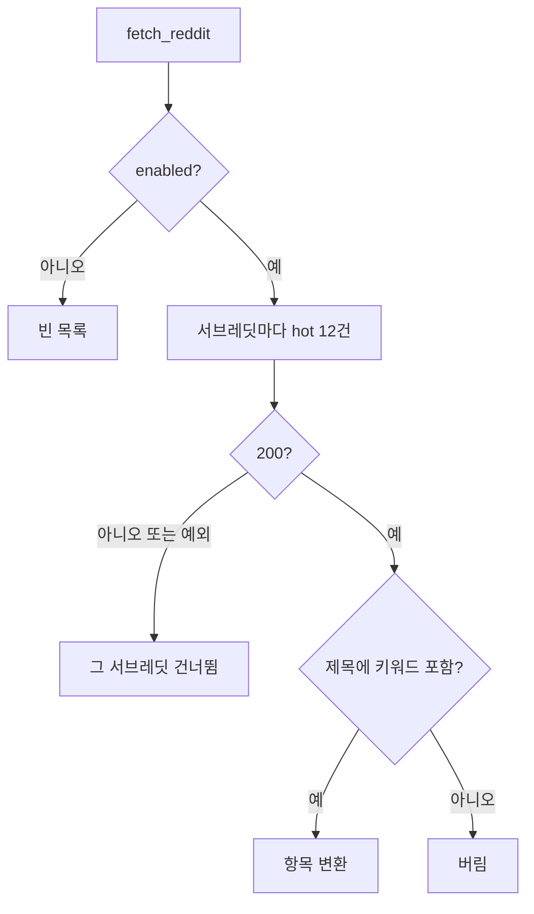

#### 4. 화면 표시 및 입력 데이터 항목 명세 (입력·출력 데이터 항목 - 8대 표준 컬럼)
| 항목명 | 화면 표시/입력 구분 | UI 컴포넌트 | 필수 여부 | 데이터 타입 / 제약 | 기본값 | 유효성 검증 규칙 (Validation) | 노출/수정 조건 |
| :--- | :---: | :--- | :---: | :--- | :---: | :--- | :--- |
| `subreddits`, `keywords` | 모듈 입력 | `sources.json` | 선택 | list[str] | 코드 기본 | 키워드는 소문자 부분 문자열 비교 | enabled |
| `title`, `url`, `source="reddit"` | 모듈 출력 | 원시 항목 | 필수 | 문자열 | - | - | 항목마다 |
| `summary` | 모듈 출력 | 원시 항목 | - | selftext 앞 300자 또는 고정 문구 | - | - | 항목마다 |
| `raw_score`, `comments_count` | 모듈 출력 | 원시 항목 | - | score, num_comments | 0 | - | 항목마다 |

#### 5. 비즈니스 규칙 (Business Rules)
- **BR-COLL-009-1**: 서브레딧 사이 URL 중복 제거는 하지 않는다 (저장 단계 dedup 해시로 합쳐진다).
- **BR-COLL-009-2**: `reddit` 은 혼합 소스가 아니라 AI 사전 필터를 받지 않는다 (`FUNC-COLL-011`).

#### 6. 예외 처리 및 엣지 케이스 (Edge Cases & Exception Handling)
| 발생 상황 (Edge Case Scenario) | 화면 반응 및 시스템 처리 방식 | 사용자 안내 메시지 |
| :--- | :--- | :--- |
| 비 200 (차단 포함), 예외 | 그 서브레딧 건너뜀 | 없음 |

#### 7. 비즈니스 에러 코드 매핑
| 비즈니스 에러 코드 | 발생 사유 | HTTP 상태 코드 매핑 | 클라이언트 표시 형태 |
| :--- | :--- | :---: | :--- |
| (없음) | 오류를 삼킨다 | 해당 없음 | 없음 |

- 관련 코드: `backend/app/collectors/sources/reddit.py:7-41`

---

### [FUNC-COLL-010] 관련성·품질 게이트

#### 1. 기본 정보
- **기능명**: 사전 필터 → LLM 평가 → 휴리스틱 폴백으로 저장 여부·품질 점수·하이시그널 결정 (`llm_processor.evaluate_content_with_llm()`)
- **기능 ID**: `FUNC-COLL-010`
- **대응 요구사항 ID**: `REQ-COLL-002`
- **대상 화면 코드**: 없음
- **우선순위**: Must Have
- **관련 액터 (Actor)**: 시스템, LLM 프로바이더

#### 2. 사전 조건 (Pre-conditions)
1. `_process_and_save_batch` 가 제목·URL 이 있는 항목마다 `evaluate_content_with_llm(title, summary, source, category_hint)` 를 호출했다.

#### 3. 사용자 인터랙션 및 시스템 동작 흐름과 플로우차트 (Step-by-Step Flow & Flowchart)
1. 캐시: 키 `"{title.strip().lower()}::{source}"` 가 프로세스 메모리 캐시(`_eval_cache`, 크기 제한·만료 없음)에 있으면 그 결과를 그대로 쓴다. 거부 결과도 캐시된다.
2. 혼합 소스 판정: `source` 가 `rss_kr`, `rss`, `hackernews`, `web` 중 하나면 혼합 소스다.
3. 사전 필터: 혼합 소스이고 `is_strictly_ai_related(title, summary)` 가 false 면 LLM 호출 없이 거부한다 (`quality_score 1.0`, `relevance_score 0.0`, `category "unrelated"`, `rejection_reason "Pre-filter: No AI/Agent/MCP domain relevance found in mixed feed"`, `evaluated_by "pre_filter_gate"`).
4. LLM 평가: `has_live_provider()` 가 true(Anthropic 키, OpenAI 키, 또는 Ollama `/api/tags` 가 1초 내 200 이고 설정 모델이 설치돼 있음 중 하나)면 큐레이터 프롬프트로 `_generate_live_answer` 를 호출한다. 프롬프트는 4개 주제(하네스·벤치마크·평가·샌드박스 / MCP·도구·스킬·플러그인 / 에이전트 프레임워크·멀티에이전트·코딩 에이전트 / 프런티어 모델·LLM·추론)만 색인하고 일반 프로그래밍·비즈니스·커리어·비 AI 소프트웨어는 거부하라고 지시하며, JSON(`is_relevant_to_ai_agent`, `category`, `relevance_score`, `quality_score`, `is_worthwhile`, `is_high_signal`, `rejection_reason`, `why_it_matters`(한국어 1~2문장))만 요구한다.
5. 응답 처리: 앞뒤 코드펜스 제거 후 첫 `{`~마지막 `}` 를 JSON 파싱해 결과를 만든다 (5번 비즈니스 규칙). `why_it_matters` 는 LLM 값, `evaluated_by` 는 모델 id.
6. 휴리스틱 폴백: LLM 프로바이더가 없거나, 호출이 실패해 답이 없거나(모든 예외는 `_generate_live_answer` 가 삼킨다), JSON 을 찾지 못하거나, 파싱 예외가 나면 `evaluate_quality_and_signal`(`FUNC-COLL-011`)과 `classify_and_tag`(`FUNC-COLL-012`)를 쓴다. 저장 가치 없음이거나 카테고리가 `unrelated` 면 거부(`relevance_score 0.0`, 사유는 휴리스틱 사유 또는 `"Strict heuristic rejection: Low signal or unrelated"`). 아니면 통과(`relevance_score 7.0`, 휴리스틱 `is_high_signal`, 휴리스틱 카테고리, `why_it_matters None`). `evaluated_by "heuristic_fallback"`.
7. 결과를 캐시에 넣고 돌려준다. 거부면 매니저는 `items_filtered += 1` 후 다음 항목으로 넘어간다.

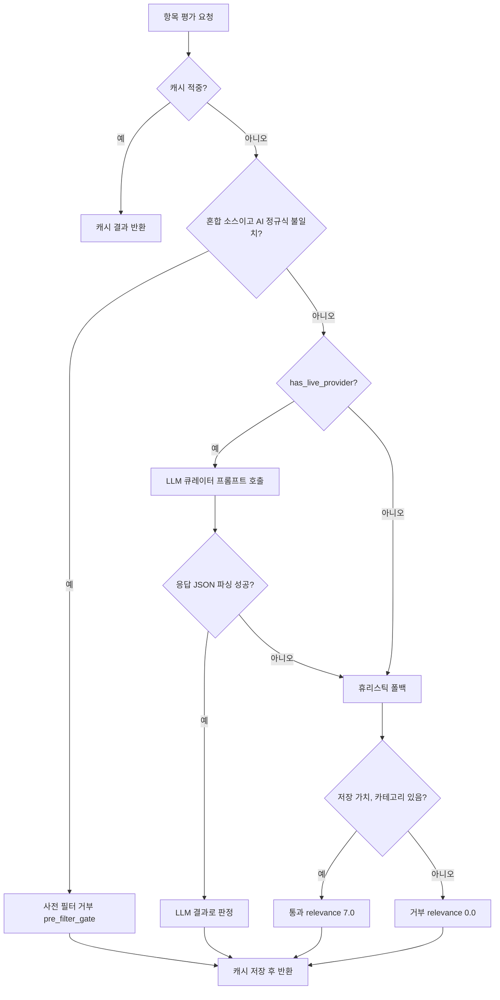

#### 4. 화면 표시 및 입력 데이터 항목 명세 (입력·출력 데이터 항목 - 8대 표준 컬럼)
| 항목명 | 화면 표시/입력 구분 | UI 컴포넌트 | 필수 여부 | 데이터 타입 / 제약 | 기본값 | 유효성 검증 규칙 (Validation) | 노출/수정 조건 |
| :--- | :---: | :--- | :---: | :--- | :---: | :--- | :--- |
| `title`, `summary`, `source` | 모듈 입력 | - | 필수 | 문자열 | `summary` `""` | - | 항목마다 |
| `category_hint` | 모듈 입력 | - | 선택 | 문자열 | None | 받지만 쓰지 않는다 (수집기들이 값을 넣지 않아 항상 None) | - |
| `quality_score` | 모듈 출력 | dict | 필수 | float, 소수 1자리 (LLM 경로는 범위 보정 없음) | - | - | 항상 |
| `relevance_score` | 모듈 출력 | dict | 필수 | float | - | - | 항상 |
| `is_worthwhile` | 모듈 출력 | dict | 필수 | bool | - | - | 항상 |
| `is_high_signal` | 모듈 출력 | dict | 필수 | bool | - | - | 항상 |
| `category` | 모듈 출력 | dict | 필수 | 4개 카테고리 또는 `unrelated` | - | - | 항상 |
| `rejection_reason`, `why_it_matters`, `evaluated_by` | 모듈 출력 | dict | - | 문자열 또는 None | - | - | 항상 |

#### 5. 비즈니스 규칙 (Business Rules)
- **BR-COLL-010-1 (LLM 경로 저장 조건)**: `is_worthwhile = LLM is_worthwhile AND is_relevant_to_ai_agent AND category != "irrelevant" AND relevance_score >= 5.0 AND quality_score >= QUALITY_CUTOFF_SCORE`.
- **BR-COLL-010-2 (하이시그널)**: `is_high_signal = is_worthwhile AND (quality_score >= HIGH_SIGNAL_THRESHOLD OR LLM is_high_signal)`.
- **BR-COLL-010-3 (카테고리)**: 저장 가치가 있고 4개 카테고리 중 하나일 때만 그 값, 아니면 `"unrelated"`.
- **BR-COLL-010-4 (점수)**: LLM 점수는 소수 1자리 반올림만 하고 범위 보정은 하지 않는다.
- **BR-COLL-010-5 (모델)**: 평가 모델을 지정하지 않으므로 Anthropic 이면 기본 챗 모델(`ANTHROPIC_DEFAULT_CHAT_MODEL`)을 쓴다 (`FUNC-COLL-023`).
- **BR-COLL-010-6 (캐시)**: 같은 제목+소스는 프로세스가 살아 있는 동안 다시 평가하지 않는다.

#### 6. 예외 처리 및 엣지 케이스 (Edge Cases & Exception Handling)
| 발생 상황 (Edge Case Scenario) | 화면 반응 및 시스템 처리 방식 | 사용자 안내 메시지 |
| :--- | :--- | :--- |
| LLM 미가용 (키 없음, Ollama 없음) | 휴리스틱 폴백. 키가 없으면 기사마다(캐시 미스 시) 동기 Ollama 확인(1초)을 해 이벤트 루프를 막는다 | 없음 |
| LLM 응답이 JSON 아님 | 휴리스틱 폴백 | 없음 |
| LLM 쿼터·과부하 예외 | `_generate_live_answer` 가 삼켜 휴리스틱 폴백 | 없음 |
| 한 번 거부된 제목 | 초기화 후 재수집에서도 캐시된 거부를 그대로 쓴다 | 없음 |

#### 7. 비즈니스 에러 코드 매핑
| 비즈니스 에러 코드 | 발생 사유 | HTTP 상태 코드 매핑 | 클라이언트 표시 형태 |
| :--- | :--- | :---: | :--- |
| `evaluated_by="pre_filter_gate"` | 혼합 소스 비 AI | 해당 없음 | 진행 상태 `items_filtered` 증가 |
| `evaluated_by="heuristic_fallback"` | LLM 미가용·실패 | 해당 없음 | 없음 |

- 관련 코드: `backend/app/services/llm_processor.py:582-709`, `backend/app/collectors/manager.py:91-102`, `backend/tests/test_collectors.py:52-72`

---

### [FUNC-COLL-011] 휴리스틱 품질 점수

#### 1. 기본 정보
- **기능명**: 키워드·소스 가중치로 1.0~10.0 품질 점수 (`llm_processor.evaluate_quality_and_signal()`)
- **기능 ID**: `FUNC-COLL-011`
- **대응 요구사항 ID**: `REQ-COLL-002`
- **대상 화면 코드**: 없음
- **우선순위**: Must Have
- **관련 액터 (Actor)**: 시스템 (게이트 폴백, 소스 리서처, 딥 리서처)

#### 2. 사전 조건 (Pre-conditions)
1. `FUNC-COLL-010` 폴백, `FUNC-SRC-008`, `FUNC-SRC-012` 에서 호출했다.

#### 3. 사용자 인터랙션 및 시스템 동작 흐름과 플로우차트 (Step-by-Step Flow & Flowchart)
텍스트는 `"{title} {summary}"` 소문자, 키워드는 부분 문자열 일치.
1. 혼합 소스(`rss_kr`, `rss`, `hackernews`, `web`)이고 AI 도메인이 아니면 즉시 `quality_score 1.0`, 저장 가치 없음, 사유 `"Non-AI domain topic in mixed feed"`.
2. 기본 점수: 혼합 소스 5.0, 그 외 6.0.
3. 고신호 키워드(benchmark, swe-bench, protocol, architecture, evaluation, sandbox, multi-agent, reasoning, open-source, 하네스, 벤치마크, 평가 프레임워크, 아키텍처, 프로토콜, mcp, langgraph, fastmcp, agent, 에이전트, 모델, 도구 호출, 스킬, framework, coding agent, 추론 모델, claude, anthropic, openai, gpt-4, deepseek, gemini, sonnet, r1, 코딩 에이전트) 일치 개수 × 0.5, 최대 +2.5.
4. 소스 신뢰도: `github`, `arxiv`, `huggingface` +1.0, `rss`/`rss_kr` 이면서 AI 도메인 +0.5.
5. 스팸 키워드(sale, discount, crypto price, airdrop, coupon, 광고, 특가, 할인, 해고 통보, 취업, 연봉, 부동산, 사고방식, 파푸아뉴기니, 전자책, 줄무늬) 하나마다 −3.5.
6. trim 한 제목이 10자 미만이면 −2.0.
7. 소수 1자리 반올림 후 1.0~10.0 으로 자른다.
8. `is_worthwhile = score >= QUALITY_CUTOFF_SCORE`(혼합·비 AI 면 false), `is_high_signal = score >= HIGH_SIGNAL_THRESHOLD AND is_worthwhile`.

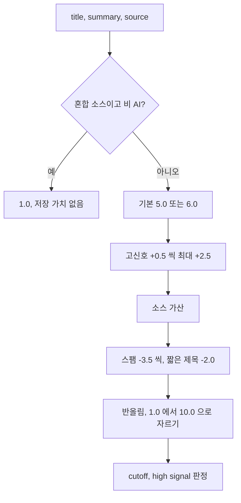

#### 4. 화면 표시 및 입력 데이터 항목 명세 (입력·출력 데이터 항목 - 8대 표준 컬럼)
| 항목명 | 화면 표시/입력 구분 | UI 컴포넌트 | 필수 여부 | 데이터 타입 / 제약 | 기본값 | 유효성 검증 규칙 (Validation) | 노출/수정 조건 |
| :--- | :---: | :--- | :---: | :--- | :---: | :--- | :--- |
| `title`, `summary`, `source` | 모듈 입력 | - | 필수 | 문자열 | - | - | 호출마다 |
| `quality_score` | 모듈 출력 | dict | 필수 | float 1.0~10.0 | - | - | 항상 |
| `is_worthwhile`, `is_high_signal` | 모듈 출력 | dict | 필수 | bool | - | - | 항상 |
| `rejection_reason` | 모듈 출력 | dict | - | "Non-AI domain topic in mixed feed" | - | - | 1단계 거부 시 |

#### 5. 비즈니스 규칙 (Business Rules)
- **BR-COLL-011-1 (점수식)**: `clamp(1.0, 10.0, round(기본 + min(2.5, 고신호 수 × 0.5) + 소스 가산 − 3.5 × 스팸 수 − (제목 10자 미만 ? 2.0 : 0), 1))`.
- **BR-COLL-011-2 (임계값)**: `QUALITY_CUTOFF_SCORE`(config.json 5.0), `HIGH_SIGNAL_THRESHOLD`(getattr 폴백 7.0, config.json 7.0).
- **BR-COLL-011-3 (reddit)**: `reddit` 은 혼합 소스가 아니라서 AI 사전 판정 없이 기본 6.0 에서 시작하고 신뢰도 가산이 없다.

#### 6. 예외 처리 및 엣지 케이스 (Edge Cases & Exception Handling)
| 발생 상황 (Edge Case Scenario) | 화면 반응 및 시스템 처리 방식 | 사용자 안내 메시지 |
| :--- | :--- | :--- |
| 키워드가 단어 안에 포함 (예: `r1` 이 다른 단어 일부) | 부분 문자열이라 가산된다 | 없음 |

#### 7. 비즈니스 에러 코드 매핑
| 비즈니스 에러 코드 | 발생 사유 | HTTP 상태 코드 매핑 | 클라이언트 표시 형태 |
| :--- | :--- | :---: | :--- |
| (없음) | 순수 함수 | 해당 없음 | 없음 |

- 관련 코드: `backend/app/services/llm_processor.py:516-580`, `backend/tests/test_llm_processor.py:14-23`

---

### [FUNC-COLL-012] AI 도메인 판정·카테고리 분류·태그

#### 1. 기본 정보
- **기능명**: 정규식 AI 판정, 키워드 점수로 4개 카테고리와 태그 결정 (`categorizer.is_strictly_ai_related()`, `classify_and_tag()`)
- **기능 ID**: `FUNC-COLL-012`
- **대응 요구사항 ID**: `REQ-COLL-002`
- **대상 화면 코드**: 없음
- **우선순위**: Must Have
- **관련 액터 (Actor)**: 시스템

#### 2. 사전 조건 (Pre-conditions)
1. 매니저 저장 단계, `FUNC-COLL-010` 폴백, 소스 리서처·딥 리서처에서 호출했다.

#### 3. 사용자 인터랙션 및 시스템 동작 흐름과 플로우차트 (Step-by-Step Flow & Flowchart)
1. AI 도메인 판정: `AI_CORE_PATTERNS`(영문 단어경계 정규식 예: `\bai\b`, `\bllm\b`, `\bagents?\b`, `\bmcp\b`, `\bevals?\b`, `\bgpt-[0-9a-z.-]+\b`, `\brag\b`, `\binference\b`, `\bweights?\b`, `\battention\b`, `\bollama\b` 등과 한국어 패턴 인공지능, 에이전트, 거대언어모델, 하네스, 벤치마크, 언어 모델, 멀티모달, 강화학습, 양자화 등)를 OR 로 묶은 대소문자 무시 정규식이 `"{title} {summary}"` 에서 한 번이라도 일치하면 true.
2. 카테고리 4개: `harness`(Agent Harness & Evaluation), `mcp_plugins_skills`(Skills, Plugins & MCP), `agent_tech`(Agent Technology & Workflows), `ai_news`(General AI & Foundation Models). 분류 불가 시 `unrelated`.
3. 키워드 점수: 카테고리별 `KEYWORDS` 목록(영문·한국어)의 각 키워드가 소문자 본문에 들어 있으면, 5자 이하 영숫자 키워드는 단어경계 정규식으로 다시 확인한다. 제목에도 있으면 3.5, 본문에만 있으면 1.5 를 더하고 그 키워드를 태그로 모은다.
4. 우선순위 가중치: `harness ×1.3`, `mcp_plugins_skills ×1.2`, `agent_tech ×1.1`, `ai_news ×1.0`. 가장 높은 점수의 카테고리를 고른다(동점이면 먼저 나온 카테고리, 순서는 harness → mcp → agent_tech → ai_news).
5. 제목 강제 규칙 (위에서부터 첫 일치):
   - 제목에 harness, swe-bench, benchmark, 하네스, 벤치마크 중 하나 또는 `\bevals?\b` → `harness` (점수 0 이었으면 3.0).
   - 아니고 제목에 mcp, model context protocol, fastmcp, 도구 호출, 함수 호출, tool calling → `mcp_plugins_skills` (점수 0 이면 3.0).
   - 아니고 제목에 multi-agent, crewai, langgraph, 에이전트, 자율 에이전트 또는 `\bagents?\b` → 현재 최고가 harness/mcp 가 아니면 `agent_tech` (점수 0 이면 3.0).
6. 최종 점수가 0 이면 `("unrelated", [], 0.0)`.
7. 매니저에서의 최종 카테고리: 게이트 통과 후 `classify_and_tag` 결과를 1차 카테고리로 쓴다. 게이트 결과 카테고리가 4개 중 하나이고 1차가 `unrelated` 또는 `ai_news` 면 게이트(LLM 또는 휴리스틱) 카테고리로 바꾼다. 최종이 `unrelated` 면 `items_filtered += 1` 하고 버린다.

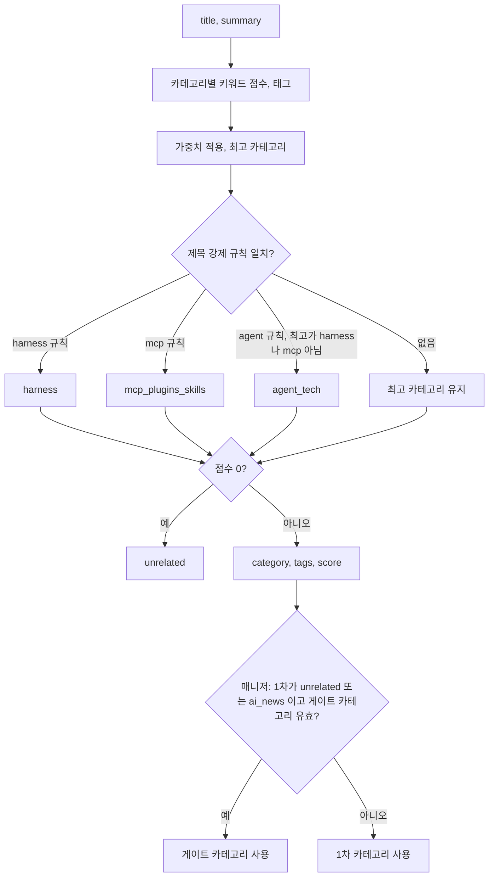

#### 4. 화면 표시 및 입력 데이터 항목 명세 (입력·출력 데이터 항목 - 8대 표준 컬럼)
| 항목명 | 화면 표시/입력 구분 | UI 컴포넌트 | 필수 여부 | 데이터 타입 / 제약 | 기본값 | 유효성 검증 규칙 (Validation) | 노출/수정 조건 |
| :--- | :---: | :--- | :---: | :--- | :---: | :--- | :--- |
| `title`, `summary` | 모듈 입력 | - | 필수 | 문자열 | `summary` `""` | - | 호출마다 |
| `category` | 모듈 출력 | tuple | 필수 | `harness` / `mcp_plugins_skills` / `agent_tech` / `ai_news` / `unrelated` | - | - | 항상 |
| `tags` | 모듈 출력 | tuple | 필수 | 정렬된 일치 키워드 원문 목록 | `[]` | - | 항상 (저장 시 콤마 문자열) |
| `score` | 모듈 출력 | tuple | 필수 | float | 0.0 | - | 항상 |
| AI 판정 | 모듈 출력 | bool | - | `is_strictly_ai_related` | - | - | 게이트 사전 필터 |

#### 5. 비즈니스 규칙 (Business Rules)
- **BR-COLL-012-1**: 키워드 규칙이 harness/mcp/agent_tech 를 냈으면 LLM 판단보다 우선한다.
- **BR-COLL-012-2**: 키워드 가중치 제목 3.5 / 본문 1.5, 카테고리 가중치 harness 1.3, mcp 1.2, agent_tech 1.1.

#### 6. 예외 처리 및 엣지 케이스 (Edge Cases & Exception Handling)
| 발생 상황 (Edge Case Scenario) | 화면 반응 및 시스템 처리 방식 | 사용자 안내 메시지 |
| :--- | :--- | :--- |
| 6자 이상 영문 키워드·한국어 키워드가 다른 단어 안에 포함 | 서브스트링이라 일치한다 ("mcp" 같은 5자 이하만 단어경계 재검사) | 없음 |
| 키워드 일치 없음 | `unrelated` → 저장 안 됨 (게이트 카테고리가 유효하면 그 값) | 없음 |

#### 7. 비즈니스 에러 코드 매핑
| 비즈니스 에러 코드 | 발생 사유 | HTTP 상태 코드 매핑 | 클라이언트 표시 형태 |
| :--- | :--- | :---: | :--- |
| `category="unrelated"` | 분류 불가 | 해당 없음 | 진행 상태 `items_filtered` 증가 |

- 관련 코드: `backend/app/collectors/categorizer.py:6-137`, `backend/app/collectors/manager.py:104-115`, `backend/tests/test_collectors.py:5-50`

---

### [FUNC-COLL-013] 인기도(hotness) 점수

#### 1. 기본 정보
- **기능명**: 점수·댓글·경과 시간으로 0~100 인기도 (`categorizer.calculate_hotness()`)
- **기능 ID**: `FUNC-COLL-013`
- **대응 요구사항 ID**: `REQ-COLL-003`
- **대상 화면 코드**: 없음 (값은 피드 `hot` 정렬과 카드 Hot 배지에 쓰인다)
- **우선순위**: Must Have
- **관련 액터 (Actor)**: 시스템

#### 2. 사전 조건 (Pre-conditions)
1. 매니저 저장 단계에서 게이트·카테고리를 통과한 항목이다.

#### 3. 사용자 인터랙션 및 시스템 동작 흐름과 플로우차트 (Step-by-Step Flow & Flowchart)
1. `published_at` 이 naive 면 UTC 로 간주.
2. `hours_ago = max(0.1, (now - published_at) 시간)`.
3. `engagement = raw_score + comments × 2.5 + 5.0` (None 은 0).
4. `hotness = engagement / (hours_ago + 2.0)^1.3`.
5. 결과 `round(min(100.0, hotness × 8.0), 2)`.

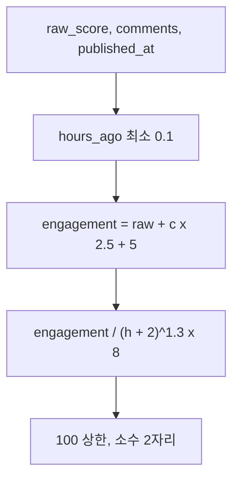

#### 4. 화면 표시 및 입력 데이터 항목 명세 (입력·출력 데이터 항목 - 8대 표준 컬럼)
| 항목명 | 화면 표시/입력 구분 | UI 컴포넌트 | 필수 여부 | 데이터 타입 / 제약 | 기본값 | 유효성 검증 규칙 (Validation) | 노출/수정 조건 |
| :--- | :---: | :--- | :---: | :--- | :---: | :--- | :--- |
| `raw_score`, `comments_count` | 모듈 입력 | - | - | int | 0 | None 은 0 | 항목마다 |
| `published_at` | 모듈 입력 | - | - | datetime | 현재 시각 | naive 면 UTC | 항목마다 |
| `hotness_score` | 모듈 출력 | float | 필수 | 0~100, 소수 2자리 | - | - | 저장·갱신 시 |

#### 5. 비즈니스 규칙 (Business Rules)
- **BR-COLL-013-1 (식)**: `min(100, (raw + c×2.5 + 5) / (h+2)^1.3 × 8)`.
- **BR-COLL-013-2 (계산 시점)**: 저장·갱신 시점에만 계산한다. 시간 경과로 다시 계산하는 작업은 없다. 같은 기사가 다시 수집되면 그때 값으로 덮어쓴다.

#### 6. 예외 처리 및 엣지 케이스 (Edge Cases & Exception Handling)
| 발생 상황 (Edge Case Scenario) | 화면 반응 및 시스템 처리 방식 | 사용자 안내 메시지 |
| :--- | :--- | :--- |
| 오래된 기사가 다시 수집되지 않음 | 저장 당시 hotness 가 그대로 남는다 | 없음 |
| 미래 발행 시각 | `hours_ago` 가 0.1 로 고정 | 없음 |

#### 7. 비즈니스 에러 코드 매핑
| 비즈니스 에러 코드 | 발생 사유 | HTTP 상태 코드 매핑 | 클라이언트 표시 형태 |
| :--- | :--- | :---: | :--- |
| (없음) | 순수 함수 | 해당 없음 | 없음 |

- 관련 코드: `backend/app/collectors/categorizer.py:139-147`, `backend/app/collectors/manager.py:117-120,138`, `backend/tests/test_collectors.py:31-35`

---

### [FUNC-COLL-014] 핵심 요약·시사점·기술 스택 합성

#### 1. 기본 정보
- **기능명**: 3줄 TL;DR, why_it_matters, tech_stack 생성 (규칙 기반, `llm_processor.generate_synthesis()`)
- **기능 ID**: `FUNC-COLL-014`
- **대응 요구사항 ID**: `REQ-COLL-003`
- **대상 화면 코드**: 없음 (결과는 피드 카드·상세에 보인다)
- **우선순위**: Must Have
- **관련 액터 (Actor)**: 시스템

#### 2. 사전 조건 (Pre-conditions)
1. 매니저 저장 단계에서 최종 카테고리가 정해졌다. LLM 을 호출하지 않는다.

#### 3. 사용자 인터랙션 및 시스템 동작 흐름과 플로우차트 (Step-by-Step Flow & Flowchart)
1. 기술 스택: `KNOWN_TECH_STACK` 사전의 키(예: `claude 5.5`, `claude-sonnet-5-5`, `gpt-4o`, `o1`, `o3`, `deepseek-r1`, `swe-bench`, `gaia`, `sandbox`, `evals`, `mcp`, `fastmcp`, `langgraph`, `crewai`, `vllm`, `ollama`, `docker`, `fastapi`, `python`, `typescript` 등 40개)를 소문자 본문에서 단어경계 정규식으로 찾아 표시명(예: `mcp` → "Model Context Protocol", `sandbox` → "Docker Sandbox", `evals` → "Eval Harness")으로 바꾸고 정렬한다.
2. TL;DR 3줄: ① `"핵심 주제: {title}"` ② 기술 스택이 있으면 `"관련 기술/모델: {앞 4개} 적용 및 생태계 연계"`, 없으면 `"AI 에이전트 및 하네스 최신 개발 워크플로우 분석"` ③ 요약이 있으면 `[.!?]` + 공백으로 나눈 문장 중 15자 초과 첫 문장으로 `"주요 내용: {문장}"`, 그런 문장이 없으면 `"주요 내용: {요약 앞 120자}..."`, 요약이 없으면 `"공식 레포지토리 및 기술 문서 릴리즈"`.
3. 시사점: override(게이트의 `why_it_matters`)가 trim 후 10자 초과면 그 값. 아니면 카테고리별 고정 문구(`CATEGORY_INSIGHTS`, 없는 카테고리는 `ai_news` 문구)를 쓰되, 기술 스택이 있으면 `"{첫 기술} 기반 구현에서 {문구}"`.

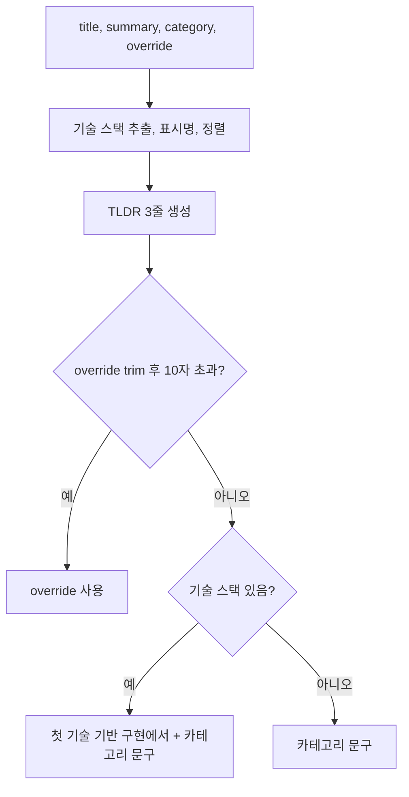

#### 4. 화면 표시 및 입력 데이터 항목 명세 (입력·출력 데이터 항목 - 8대 표준 컬럼)
| 항목명 | 화면 표시/입력 구분 | UI 컴포넌트 | 필수 여부 | 데이터 타입 / 제약 | 기본값 | 유효성 검증 규칙 (Validation) | 노출/수정 조건 |
| :--- | :---: | :--- | :---: | :--- | :---: | :--- | :--- |
| `title`, `summary`, `category` | 모듈 입력 | - | 필수 | 문자열 | - | - | 항목마다 |
| `why_it_matters_override` | 모듈 입력 | - | 선택 | 문자열 또는 None | None | 10자 초과일 때만 사용 | LLM 게이트 통과 시 |
| `tldr_bullets` | 모듈 출력 | dict | 필수 | 문자열 3개 (저장 시 JSON, `ensure_ascii=False`) | - | - | 항상 |
| `why_it_matters` | 모듈 출력 | dict | 필수 | 문자열 | - | - | 항상 |
| `tech_stack` | 모듈 출력 | dict | 필수 | 표시명 정렬 목록 (저장 시 콤마 문자열) | `[]` | - | 항상 |

#### 5. 비즈니스 규칙 (Business Rules)
- **BR-COLL-014-1**: 합성은 규칙 기반이다. LLM 기반 구조화 요약(`generate_structured_summary`)은 파이프라인에서 호출되지 않는다.
- **BR-COLL-014-2**: 휴리스틱 폴백 경로에서는 시사점이 항상 고정 문구 기반이다.

#### 6. 예외 처리 및 엣지 케이스 (Edge Cases & Exception Handling)
| 발생 상황 (Edge Case Scenario) | 화면 반응 및 시스템 처리 방식 | 사용자 안내 메시지 |
| :--- | :--- | :--- |
| 요약 없음 | 3번째 줄 "공식 레포지토리 및 기술 문서 릴리즈" | 없음 |
| LLM 미가용 | 시사점은 카테고리 고정 문구 | 없음 |

#### 7. 비즈니스 에러 코드 매핑
| 비즈니스 에러 코드 | 발생 사유 | HTTP 상태 코드 매핑 | 클라이언트 표시 형태 |
| :--- | :--- | :---: | :--- |
| (없음) | 순수 함수 | 해당 없음 | 없음 |

- 관련 코드: `backend/app/services/llm_processor.py:40-89`, `backend/app/services/llm_processor.py:508-514`, `backend/app/services/llm_processor.py:711-754`, `backend/tests/test_llm_processor.py:5-31`

---

### [FUNC-COLL-015] 중복 제거·저장·갱신

#### 1. 기본 정보
- **기능명**: dedup 해시로 신규 저장 또는 기존 행 갱신 (`CollectorManager._process_and_save_batch()`)
- **기능 ID**: `FUNC-COLL-015`
- **대응 요구사항 ID**: `REQ-COLL-003`
- **대상 화면 코드**: 없음
- **우선순위**: Must Have
- **관련 액터 (Actor)**: 시스템

#### 2. 사전 조건 (Pre-conditions)
1. 수집기 워커 또는 시드 단계가 원시 항목 목록을 넘겼다.

#### 3. 사용자 인터랙션 및 시스템 동작 흐름과 플로우차트 (Step-by-Step Flow & Flowchart)
1. 빈 목록이면 0 을 돌려준다.
2. `_db_lock` 을 잡고 새 세션 하나로 배치 전체를 처리한다.
3. 항목마다 `title`, `url` 을 trim, `summary` 는 None 이면 `""`, `source` 기본 `"web"`. 제목이나 URL 이 비면 건너뛴다(카운트 안 함). 아니면 `items_collected += 1`.
4. 게이트(`FUNC-COLL-010`) → 카테고리 결정(`FUNC-COLL-012`) → hotness(`FUNC-COLL-013`) → 합성(`FUNC-COLL-014`). `published_at` 없으면 현재 시각, `raw_score`·`comments_count` 기본 0.
5. dedup 해시: URL 은 trim·끝 `/` 제거 후 `?utm_...(&utm_...)*` 패턴 제거, 제목은 소문자·trim 후 영숫자·한글 외 문자 제거, `sha256("{제목}::{URL}")`.
6. 같은 해시 행이 있으면 갱신: `raw_score`·`comments_count` 는 기존과 새 값 중 큰 값, `hotness_score`·`quality_score`·`is_high_signal` 은 새 값으로 덮어쓴다. 기존 `why_it_matters` 가 비어 있을 때만 `why_it_matters`, `tldr_bullets`, `tech_stack` 을 채운다. 제목·요약·카테고리·태그·발행 시각은 바꾸지 않는다. 갱신은 저장 건수에 들어가지 않는다.
7. 없으면 신규 `NewsItem` 을 추가한다: `tags` 콤마 문자열, `tldr_bullets` JSON(`ensure_ascii=False`), `tech_stack` 콤마 문자열 등. `saved_count += 1`.
8. 배치 끝에 한 번 커밋하고 `items_saved += saved_count`.

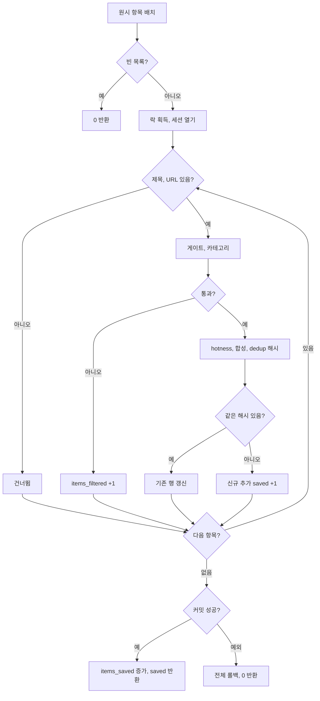

#### 4. 화면 표시 및 입력 데이터 항목 명세 (입력·출력 데이터 항목 - 8대 표준 컬럼)
| 항목명 | 화면 표시/입력 구분 | UI 컴포넌트 | 필수 여부 | 데이터 타입 / 제약 | 기본값 | 유효성 검증 규칙 (Validation) | 노출/수정 조건 |
| :--- | :---: | :--- | :---: | :--- | :---: | :--- | :--- |
| `raw_items` | 모듈 입력 | list[dict] | 필수 | 수집기 원시 항목 | - | 제목·URL 빈 항목 건너뜀 | - |
| `source_name` | 모듈 입력 | str | 필수 | 로그용 이름 | - | - | - |
| `dedup_hash` | 저장 항목 | `news_items` | 필수 | sha256 hex | - | 정규화 규칙 5번 | 신규 저장 시 |
| 저장 필드 | 저장 항목 | `news_items` | - | `title`, `url`, `source`, `category`, `summary`, `author`, `tags`, `tldr_bullets`, `why_it_matters`, `tech_stack`, `quality_score`, `is_high_signal`, `raw_score`, `comments_count`, `hotness_score`, `published_at` | - | - | 신규 저장 시 |
| 반환값 | 모듈 출력 | int | 필수 | 신규 저장 건수 | 0 | - | 항상 |

#### 5. 비즈니스 규칙 (Business Rules)
- **BR-COLL-015-1 (해시)**: `sha256(정규화 제목 + "::" + 정규화 URL)`. 수집기가 붙인 접두사(`[arXiv]`, `[r/sub]`, `[피드명]`)가 제목에 포함되므로 같은 글이라도 소스가 다르면 해시가 다르다.
- **BR-COLL-015-2 (갱신 범위)**: 인기 지표는 최댓값, 점수·하이시그널은 덮어쓰기, 합성 결과는 비어 있을 때만 채운다. 제목·요약·카테고리·태그·발행 시각은 바꾸지 않는다.
- **BR-COLL-015-3 (배치 내 중복)**: 같은 배치 안 중복은 세션 autoflush(기본값) 덕에 두 번째 조회에서 앞 항목이 보여 갱신으로 처리된다.

#### 6. 예외 처리 및 엣지 케이스 (Edge Cases & Exception Handling)
| 발생 상황 (Edge Case Scenario) | 화면 반응 및 시스템 처리 방식 | 사용자 안내 메시지 |
| :--- | :--- | :--- |
| 배치 중 어떤 예외든 (예: 항목 `title` 이 None 이라 `.strip()` 에서 AttributeError) | 그 소스 배치 전체 롤백 후 오류 로그, 0 반환. 이미 증가한 `items_collected`·`items_filtered` 는 되돌리지 않는다 | 진행 줄 "✅ {이름} 완료 (+0건 선별 저장)" |
| 수집 도중 서버 종료 | 진행 중 배치가 롤백될 수 있다 | 없음 |

#### 7. 비즈니스 에러 코드 매핑
| 비즈니스 에러 코드 | 발생 사유 | HTTP 상태 코드 매핑 | 클라이언트 표시 형태 |
| :--- | :--- | :---: | :--- |
| (로그 "Error saving batch for {source_name}: {e}") | 배치 예외 | 해당 없음 | 진행 줄 +0건 |

- 관련 코드: `backend/app/collectors/manager.py:72-174`, `backend/app/collectors/categorizer.py:83-87`, `backend/app/models/news.py:5-39`

---

### [FUNC-COLL-016] 시드 데이터

#### 1. 기본 정보
- **기능명**: 전체 수집 결과가 0건이면 고정 2건 투입 (`SEED_ITEMS`)
- **기능 ID**: `FUNC-COLL-016`
- **대응 요구사항 ID**: `REQ-COLL-006`
- **대상 화면 코드**: 없음
- **우선순위**: Should Have
- **관련 액터 (Actor)**: 시스템

#### 2. 사전 조건 (Pre-conditions)
1. `collect_all` 에서 모든 워커가 끝났고 `items_collected == 0` 이다.

#### 3. 사용자 인터랙션 및 시스템 동작 흐름과 플로우차트 (Step-by-Step Flow & Flowchart)
1. `SEED_ITEMS` 2건을 `"Seeds"` 이름으로 일반 배치와 같은 경로(게이트·분류·dedup)로 저장한다.
   - "SWE-bench 2.0: Next-Gen Evaluation Harness for Autonomous Coding Agents" / github / raw 2400 / 댓글 310
   - "Anthropic Model Context Protocol (MCP) Server Specifications" / rss / raw 3950 / 댓글 820

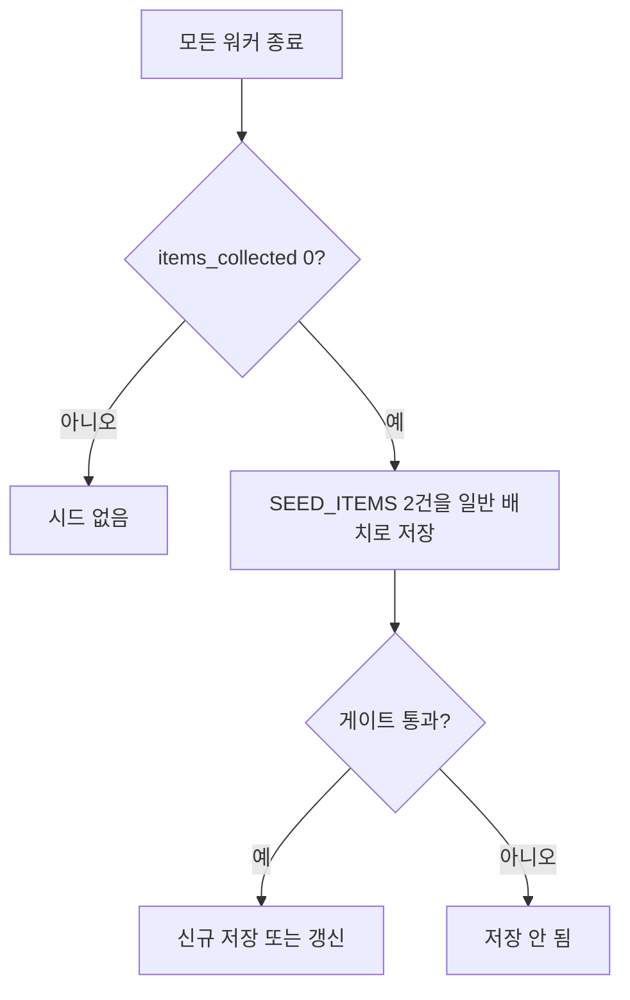

#### 4. 화면 표시 및 입력 데이터 항목 명세 (입력·출력 데이터 항목 - 8대 표준 컬럼)
| 항목명 | 화면 표시/입력 구분 | UI 컴포넌트 | 필수 여부 | 데이터 타입 / 제약 | 기본값 | 유효성 검증 규칙 (Validation) | 노출/수정 조건 |
| :--- | :---: | :--- | :---: | :--- | :---: | :--- | :--- |
| 시드 항목 | 모듈 입력 | 상수 | - | 2건 (`title`, `url`, `source`, `summary`, `author`, `published_at`, `raw_score`, `comments_count`) | 고정 | 일반 게이트 | 수집 0건일 때 |

#### 5. 비즈니스 규칙 (Business Rules)
- **BR-COLL-016-1**: 시드도 게이트를 거친다. 거부되면 저장되지 않는다. 이미 같은 해시가 있으면 갱신된다.

#### 6. 예외 처리 및 엣지 케이스 (Edge Cases & Exception Handling)
| 발생 상황 (Edge Case Scenario) | 화면 반응 및 시스템 처리 방식 | 사용자 안내 메시지 |
| :--- | :--- | :--- |
| 서버가 오래 떠 있음 | 시드의 `published_at` 이 모듈 import 시각으로 고정되어 hotness 가 낮게 계산된다 | 없음 |

#### 7. 비즈니스 에러 코드 매핑
| 비즈니스 에러 코드 | 발생 사유 | HTTP 상태 코드 매핑 | 클라이언트 표시 형태 |
| :--- | :--- | :---: | :--- |
| (없음) | - | 해당 없음 | 없음 |

- 관련 코드: `backend/app/collectors/manager.py:22-43,219-221`

---

### [FUNC-COLL-017] 진행 상태·크롤 로그·스케줄 상태

#### 1. 기본 정보
- **기능명**: 메모리 진행 상태, 실행당 1행 크롤 로그, 스케줄 상태 조회와 헤더·스케줄 대화상자 표시
- **기능 ID**: `FUNC-COLL-017`
- **대응 요구사항 ID**: `REQ-COLL-004`
- **대상 화면 코드**: `SCR-UI-001`, `SCR-COLL-002`
- **우선순위**: Must Have
- **관련 액터 (Actor)**: 웹 사용자, `make collect`

#### 2. 사전 조건 (Pre-conditions)
1. 웹 서버가 떠 있다. 화면은 헤더(또는 스케줄 대화상자·커맨드 팔레트)가 수집 상태 저장소를 구독하고 있다.

#### 3. 사용자 인터랙션 및 시스템 동작 흐름과 플로우차트 (Step-by-Step Flow & Flowchart)
1. **progress** `GET /api/schedule/progress`: 메모리 값 `{is_running, current_source, step_message, items_collected, items_saved, items_filtered, total_sources, completed_sources, last_crawl_time}` 를 그대로 돌려준다. `last_crawl_stats`(소스별 결과)는 노출하지 않는다.
2. **크롤 로그**: 실행당 1행, `source="all_sources_stream_ingestion"`, `items_crawled = items_collected`, `items_saved`, `status="success"`(고정), `started_at`, `completed_at`. `error_message` 는 쓰지 않는다. 소스별 행은 없다.
3. **status** `GET /api/schedule/status`: 현재 UTC, `schedule_hours = SCHEDULED_HOURS`(설정 `scheduler.crawl_hours`, 기본 `[0,6,12,18]`), `timezone = CRAWL_TIMEZONE`(기본 UTC), `next_run`(APScheduler `daily_crawl` 작업의 다음 실행 시각, 없으면 `SCHEDULED_HOURS` 중 오늘 남은 첫 시각, 없으면 내일 첫 시각, 모두 UTC), `minutes_until_next_run`(0 이상, 소수 1자리), `is_running`, `last_crawl_time`(최근 로그의 `completed_at`), `last_crawl_status`(`"running"`/`"idle"`, 메모리 기준), `recent_logs`(id 내림차순 5개).
4. **화면 상태 저장소**(`useCollector`, 모듈 단위 외부 저장소 + `useSyncExternalStore`): 구독자가 하나 이상일 때만 status 를 30초마다 다시 읽는다. 마지막 구독자가 빠지면 모든 interval·timeout 을 정리하고 상태를 처음으로 되돌린다. status 가 `is_running: true` 인데 진행 폴링이 없으면(다른 화면에 있다가 돌아온 경우) "실시간 소식 수집 중..." 으로 진행 폴링을 이어 붙인다. 오래된 status 응답(더 나중 요청이 이미 반영됐거나, 진행 폴링이 끝나기 전에 보낸 요청)은 버린다.
5. **헤더**(`SCR-UI-001`): 768px 이상에 수집 상태 버튼(시계 아이콘, 수집 중이면 스피너). 1024px 이상은 "다음 수집 {남은 시간} 후"(상태를 아직 모르면 "다음 수집 확인 중"), 768~1023px 은 남은 시간만(모르면 "…"), 수집 중이면 "수집 중". 남은 시간 형식은 `formatTimeLeft`: `"{h}h {m}m"`, 시간이 0 이면 `"{m}m"`. 접근 이름 "수집 스케줄 · {문구}". 누르면 스케줄 대화상자를 연다. 768px 미만은 더보기 메뉴 "수집 스케줄 (다음 {남은 시간} 후)"(모르면 "수집 스케줄").
6. **수집 진행 줄**(`CollectorStatusLine`, 헤더 바로 아래, `role="status"` `aria-live="polite"`, 항상 DOM 에 있음): 메시지가 있을 때만 보인다. 수집 중이면 스피너와 메시지, 640px 이상에서 오른쪽에 "피드 실시간 반영 중". 끝나면 체크 아이콘과 완료 메시지.
7. **스케줄 대화상자**(`SCR-COLL-002`, `Dialog size="md"`, 제목 "자동 수집 스케줄", 설명 "매일 4회(0, 6, 12, 18시 UTC) 전세계 소식을 자동 수집합니다."): "수집 주기 (UTC)" 카드에 고정 문구 "00:00 · 06:00 · 12:00 · 18:00" 와 "(KST: 09:00, 15:00, 21:00, 03:00)", "다음 예정 수집" 카드에 `"{반올림 분}분 후"`(상태를 모르면 "계산 중...")와 `next_run` 의 ko-KR 표기. 바닥 "즉시 수집"(`FUNC-COLL-019`), "위험 영역" 의 "초기화 & 재수집…"(`FUNC-COLL-020`).

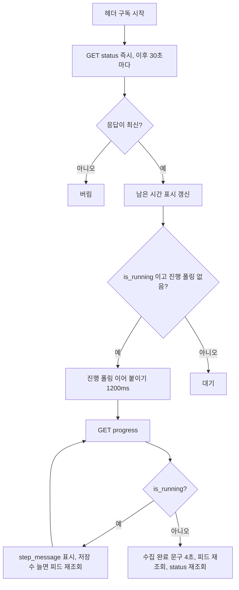

#### 4. 화면 표시 및 입력 데이터 항목 명세 (UI Data Elements - 8대 표준 컬럼)
| 항목명 | 화면 표시/입력 구분 | UI 컴포넌트 | 필수 여부 | 데이터 타입 / 제약 | 기본값 | 유효성 검증 규칙 (Validation) | 노출/수정 조건 |
| :--- | :---: | :--- | :---: | :--- | :---: | :--- | :--- |
| 수집 상태 버튼 | 노출 + 조작 | 헤더 버튼 | - | "다음 수집 {h}h {m}m 후" / 남은 시간 / "수집 중" | "다음 수집 확인 중" / "…" | - | 768px 이상. 누르면 스케줄 대화상자 |
| 더보기 "수집 스케줄" | 사용자 조작 | `MenuButton` 항목 | - | "수집 스케줄 (다음 {남은 시간} 후)" | "수집 스케줄" | - | 768px 미만 |
| 수집 진행 줄 | 노출 전용 | `CollectorStatusLine` | - | `step_message` 또는 완료·오류 문구 | 숨김 | - | 메시지가 있을 때 |
| 수집 주기 | 노출 전용 | 스케줄 대화상자 카드 | - | 고정 "00:00 · 06:00 · 12:00 · 18:00", "(KST: 09:00, 15:00, 21:00, 03:00)" | 고정 | 설정과 연결 안 됨 | 대화상자 |
| 다음 예정 수집 | 노출 전용 | 스케줄 대화상자 카드 | - | `{Math.round(minutes_until_next_run)}분 후`, `next_run` ko-KR | "계산 중..." | - | 대화상자 |
| progress 응답 | API 출력 | JSON | - | 9개 필드 (`last_crawl_time` ISO 또는 null) | - | - | 항상 |
| status 응답 | API 출력 | `ScheduleStatusResponse` | - | `current_time`, `schedule_hours`, `timezone`, `next_run`, `minutes_until_next_run`, `is_running`, `last_crawl_time`, `last_crawl_status`, `recent_logs[5]` | - | - | 항상 |

#### 5. 비즈니스 규칙 (Business Rules)
- **BR-COLL-017-1 (폴링 주기)**: status 30000ms(구독자가 있을 때만), progress 1200ms(수집 중일 때만, 앞 요청이 끝나지 않았으면 그 회차를 건너뛴다).
- **BR-COLL-017-2 (상태 위치)**: 진행 상태는 프로세스 메모리라 재시작하면 초기화된다. 다른 프로세스(MCP 서버, 직접 모드 `make collect`)의 수집은 보이지 않는다.
- **BR-COLL-017-3 (크롤 로그)**: 항상 `status="success"` 이고 소스별 오류는 메모리 `last_crawl_stats` 에만 남아 API 로 볼 수 없다.
- **BR-COLL-017-4 (다음 실행)**: `next_run` 은 실제 크론 작업 기준이고, 작업이 없을 때만 설정 `crawl_hours` 로 계산한다.

#### 6. 예외 처리 및 엣지 케이스 (Edge Cases & Exception Handling)
| 발생 상황 (Edge Case Scenario) | 화면 반응 및 시스템 처리 방식 | 사용자 안내 메시지 |
| :--- | :--- | :--- |
| status 요청 실패 | 조용히 무시, 다음 30초에 다시 시도 | 이전 표시 유지 |
| 진행 폴링 요청 실패 | 폴링을 멈추고 메시지를 지운다. 바로 status 를 다시 읽지 않는다 (다음 30초 갱신이 수집 중이라고 하면 이어 붙인다) | 진행 줄 사라짐 |
| 6개 워커가 동시에 메시지를 씀 | 진행 줄이 소스 사이를 오간다 | 이모지 포함 단계 메시지 |
| 서버 재시작 | 진행 상태 초기화, `last_crawl_time` 은 progress 에서 null (status 는 크롤 로그 기준) | 없음 |

#### 7. 비즈니스 에러 코드 매핑
| 비즈니스 에러 코드 | 발생 사유 | HTTP 상태 코드 매핑 | 클라이언트 표시 형태 |
| :--- | :--- | :---: | :--- |
| (없음) | 두 엔드포인트에 실패 분기 없음 | 200 | - |
| (네트워크 오류) | 요청 실패 | - | status 는 무시, progress 는 진행 줄 숨김 |

- 관련 코드: `backend/app/api/schedule.py:14-46`, `backend/app/collectors/manager.py:59-70,223-234`, `backend/app/scheduler.py:25-35`, `backend/app/schemas/news.py:131-140`, `frontend/src/hooks/useCollector.ts:23-29,104-204,246-291`, `frontend/src/components/Header.tsx:83,90-97,158-168,226-251`, `frontend/src/components/ScheduleModal.tsx:14-84`

---

### [FUNC-COLL-018] 정기 스케줄

#### 1. 기본 정보
- **기능명**: UTC 0·6·12·18시 수집 (딥 리서치·브리핑 작업도 같은 스케줄러, `start_scheduler()`)
- **기능 ID**: `FUNC-COLL-018`
- **대응 요구사항 ID**: `REQ-COLL-004`
- **대상 화면 코드**: 없음
- **우선순위**: Must Have
- **관련 액터 (Actor)**: 스케줄러

#### 2. 사전 조건 (Pre-conditions)
1. FastAPI 시작 시 lifespan 이 `start_scheduler()` 를 불렀다.

#### 3. 사용자 인터랙션 및 시스템 동작 흐름과 플로우차트 (Step-by-Step Flow & Flowchart)
1. `AsyncIOScheduler` 에 작업 3개를 `replace_existing=True` 로 등록한다:
   - `daily_crawl`: `CronTrigger(hour="0,6,12,18", minute="0", timezone="UTC")` → `collect_all()`.
   - `deep_research`: `hour="3,15"`, `minute="0"`, UTC → `deep_researcher.run_deep_research()` (`FUNC-SRC-011`).
   - `daily_briefing_dispatch`: `hour="0", minute="15"`, UTC → `briefing_service.auto_dispatch_all()` (`docs/spec-writer/fsd/04_BRIEFING_AND_SHARING_SPECIFICATION.md`).
2. 이미 실행 중이면 다시 등록하지 않는다. 종료 시 `stop_scheduler()` 가 shutdown 한다.
3. 실행 시각에 수집이 이미 돌고 있으면 `collect_all` 이 `already_running` 으로 바로 끝난다.
4. 각 작업은 시작 때 `[Scheduler] … triggered at {UTC ISO}` 를 표준 출력에 낸다. 시작 시 "[Scheduler] Started for Crawl (0,6,12,18 UTC), Briefing (0:15 UTC) and Deep Research (3,15 UTC)".

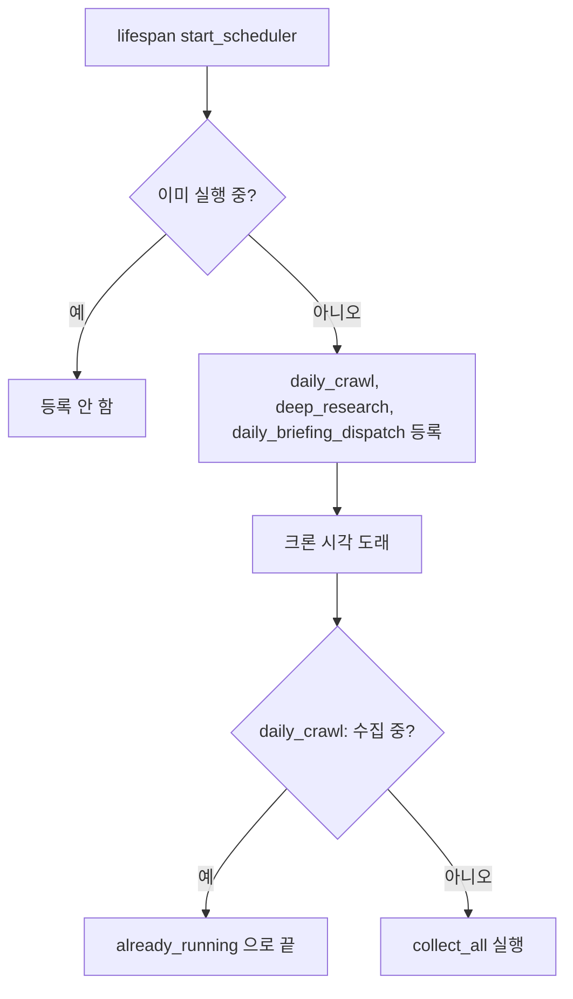

#### 4. 화면 표시 및 입력 데이터 항목 명세 (입력·출력 데이터 항목 - 8대 표준 컬럼)
| 항목명 | 화면 표시/입력 구분 | UI 컴포넌트 | 필수 여부 | 데이터 타입 / 제약 | 기본값 | 유효성 검증 규칙 (Validation) | 노출/수정 조건 |
| :--- | :---: | :--- | :---: | :--- | :---: | :--- | :--- |
| `daily_crawl` 크론 | 설정 (코드) | - | - | `hour="0,6,12,18"`, `minute="0"`, UTC | 코드 고정 | - | 코드 수정으로만 |
| `deep_research` 크론 | 설정 (코드) | - | - | `hour="3,15"`, UTC | 코드 고정 | - | 코드 수정으로만 |
| `daily_briefing_dispatch` 크론 | 설정 (코드) | - | - | `hour="0"`, `minute="15"`, UTC | 코드 고정 | - | 코드 수정으로만 |
| `scheduler.crawl_hours`, `scheduler.timezone` | 설정 입력 | `config.json` | 선택 | 정수 목록 / 문자열 | `[0,6,12,18]` / `UTC` | - | 상태 표시에만 쓰인다 |
| 실행 로그 | 출력 | 표준 출력 | - | `[Scheduler] …` | - | - | 작업마다 |

#### 5. 비즈니스 규칙 (Business Rules)
- **BR-COLL-018-1**: 크론 시각·타임존은 코드에 고정되어 있다. `config.json` 의 `scheduler.crawl_hours`, `scheduler.timezone` 은 상태 표시(`SCHEDULED_HOURS`, `timezone`)에만 쓰이고, `scheduler.enabled`, `scheduler.auto_briefing_hour` 는 읽는 코드가 없다.
- **BR-COLL-018-2**: 스케줄러는 웹 서버 프로세스 안에서만 돈다. MCP 서버는 스케줄러를 띄우지 않는다.

#### 6. 예외 처리 및 엣지 케이스 (Edge Cases & Exception Handling)
| 발생 상황 (Edge Case Scenario) | 화면 반응 및 시스템 처리 방식 | 사용자 안내 메시지 |
| :--- | :--- | :--- |
| 크론 시각에 수동 수집이 돌고 있음 | `already_running` 으로 그 회차를 건너뛴다 | 없음 |
| 서버가 꺼져 있던 시각 | 놓친 회차를 다시 돌리는 코드는 없다 (APScheduler 기본 동작은 확인하지 못함) | 없음 |
| `crawl_hours` 를 바꿈 | 실제 실행 시각은 그대로, 상태 API 의 `schedule_hours`·`timezone`·폴백 `next_run` 만 바뀐다 | 없음 |

#### 7. 비즈니스 에러 코드 매핑
| 비즈니스 에러 코드 | 발생 사유 | HTTP 상태 코드 매핑 | 클라이언트 표시 형태 |
| :--- | :--- | :---: | :--- |
| (없음) | 작업 결과는 로그로만 남는다 | 해당 없음 | 없음 |

- 관련 코드: `backend/app/scheduler.py:1-68`, `backend/app/main.py:26,46`, `backend/tests/test_scheduler.py`

---

### [FUNC-COLL-019] 수동 트리거 (즉시 수집)

#### 1. 기본 정보
- **기능명**: 백그라운드 수집 시작과 진행 폴링
- **기능 ID**: `FUNC-COLL-019`
- **대응 요구사항 ID**: `REQ-COLL-004`
- **대상 화면 코드**: `SCR-UI-001`, `SCR-COLL-002`
- **우선순위**: Must Have
- **관련 액터 (Actor)**: 웹 사용자, `make collect`(API 모드)

#### 2. 사전 조건 (Pre-conditions)
1. 진입점: 헤더 "즉시 수집" 버튼(768px 이상. 768~1023px 은 아이콘만, 글자는 스크린리더 전용), 768px 미만 더보기 메뉴 "즉시 수집", 스케줄 대화상자 바닥 "즉시 수집", 커맨드 팔레트 "최신 소식 즉시 수집 트리거"(부제 "등록된 모든 소스에서 즉시 신규 기술 소식 크롤링"), API `POST /api/schedule/trigger`.
2. 화면: 수집 중이 아니고 즉시 수집 요청 중이 아니다 (아니면 아무것도 하지 않는다).

#### 3. 사용자 인터랙션 및 시스템 동작 흐름과 플로우차트 (Step-by-Step Flow & Flowchart)
1. 사용자가 "즉시 수집" 을 누른다. 버튼은 수집 중 로딩 표시와 "수집 중" 글자, 더보기 메뉴 항목은 "수집 중" 으로 비활성.
2. 서버: 수집 중이면 `{"status": "already_running", "message": "이미 수집이 진행 중입니다.", "total_collected", "total_saved", "source_results": {}}`. 아니면 `BackgroundTasks` 에 `collect_all` 을 넣고 즉시 `{"status": "started", "message": "실시간 점진적 수집이 시작되었습니다. 소식이 화면에 순차적으로 반영됩니다.", "total_collected": 0, "total_saved": 0, "source_results": {}}`.
3. 화면: 응답이 `already_running` 이면 다시 요청하지 않고 그 응답 `message` 로, 그 밖이면 "실시간 소식 수집 중..." 으로 진행 폴링(1200ms)을 시작한다.
4. 폴링마다 `step_message` 를 진행 줄에 표시하고, `items_saved` 가 이전보다 늘면 피드·통계를 다시 불러온다.
5. `is_running` 이 false 가 되면 폴링을 멈추고 `"수집 완료 (+{items_saved}건 신규 반영)"` 을 4초간 보여 준 뒤 지우고, 피드·통계를 다시 불러오고, 스케줄 상태를 다시 읽는다. 수집 한 번에 완료는 한 번만 알린다.

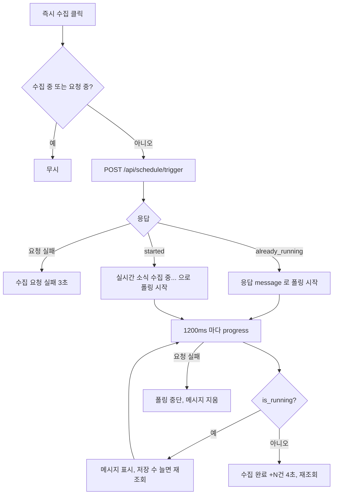

#### 4. 화면 표시 및 입력 데이터 항목 명세 (UI Data Elements - 8대 표준 컬럼)
| 항목명 | 화면 표시/입력 구분 | UI 컴포넌트 | 필수 여부 | 데이터 타입 / 제약 | 기본값 | 유효성 검증 규칙 (Validation) | 노출/수정 조건 |
| :--- | :---: | :--- | :---: | :--- | :---: | :--- | :--- |
| 즉시 수집 (헤더) | 사용자 조작 | `Button` (secondary, `loading`) | - | "즉시 수집" / "수집 중" | "즉시 수집" | - | 768px 이상. 1024px 미만은 아이콘만 |
| 즉시 수집 (더보기) | 사용자 조작 | 메뉴 항목 | - | "즉시 수집" / "수집 중" | - | - | 768px 미만, 수집 중 비활성 |
| 즉시 수집 (스케줄 대화상자) | 사용자 조작 | `Button` (`loading`) | - | "즉시 수집" / "수집 중" | - | - | 대화상자 바닥 |
| 팔레트 명령 | 사용자 조작 | 커맨드 팔레트 항목 | - | "최신 소식 즉시 수집 트리거" | - | - | 팔레트 |
| 진행 줄 문구 | 노출 전용 | `CollectorStatusLine` | - | 시작 문구 → `step_message` → "수집 완료 (+N건 신규 반영)" | - | - | 수집 중, 완료 후 4초 |
| `status` | API 출력 | JSON | 필수 | `started` / `already_running` | - | - | 항상 |
| `message`, `total_collected`, `total_saved`, `source_results` | API 출력 | JSON | - | 문자열, int, int, `{}` | - | - | 항상 |

#### 5. 비즈니스 규칙 (Business Rules)
- **BR-COLL-019-1 (중복 방지)**: 화면은 수집 중이거나 요청 중이면 요청하지 않는다. 서버는 수집 중이면 `already_running` 을 돌려준다.
- **BR-COLL-019-2 (점진 반영)**: 저장 건수가 늘 때마다 피드를 다시 읽는다.
- **BR-COLL-019-3 (공유 상태)**: 헤더·스케줄 대화상자·커맨드 팔레트가 같은 수집 상태를 본다.

#### 6. 예외 처리 및 엣지 케이스 (Edge Cases & Exception Handling)
| 발생 상황 (Edge Case Scenario) | 화면 반응 및 시스템 처리 방식 | 사용자 안내 메시지 |
| :--- | :--- | :--- |
| 트리거 요청 실패 | 3초간 문구 후 지움 | "수집 요청 실패" |
| 이미 수집 중 (다른 탭·스케줄) | 다시 요청하지 않고 진행 중인 수집을 폴링 | "이미 수집이 진행 중입니다." 후 단계 메시지 |
| 폴링 중 요청 실패 | 폴링 중단, 메시지 지움 | 진행 줄 사라짐 |
| 연타 | 요청 중 플래그로 두 번째 요청을 막는다 | 없음 |

#### 7. 비즈니스 에러 코드 매핑
| 비즈니스 에러 코드 | 발생 사유 | HTTP 상태 코드 매핑 | 클라이언트 표시 형태 |
| :--- | :--- | :---: | :--- |
| `status="already_running"` | 이미 수집 중 | 200 | 진행 줄에 응답 `message` 후 폴링 |
| (요청 실패) | 네트워크, 비 2xx | - | 진행 줄 "수집 요청 실패" 3초 |

- 관련 코드: `backend/app/api/schedule.py:48-67`, `frontend/src/hooks/useCollector.ts:121-165,206-223`, `frontend/src/components/Header.tsx:98-104,170-182,214`, `frontend/src/components/ScheduleModal.tsx:31-40`, `frontend/src/components/CommandPalette.tsx:117-123`, `frontend/src/lib/api.ts:190-202`. 응답 스키마 `ManualCollectResponse` 는 정의만 있고 `response_model` 로 쓰지 않는다.

---

### [FUNC-COLL-020] 초기화 후 재수집 (`make reset` 포함)

#### 1. 기본 정보
- **기능명**: 기사·크롤 로그 전체 삭제 후 백그라운드 재수집
- **기능 ID**: `FUNC-COLL-020`
- **대응 요구사항 ID**: `REQ-COLL-007`
- **대상 화면 코드**: `SCR-UI-001`, `SCR-COLL-002`, `SCR-COLL-003`
- **우선순위**: Should Have
- **관련 액터 (Actor)**: 웹 사용자, 운영자(`make reset`)

#### 2. 사전 조건 (Pre-conditions)
1. 진입점: 헤더 더보기 메뉴 "초기화 & 재수집…"(위험 톤, 수집 중 비활성), 스케줄 대화상자 "위험 영역" 의 "초기화 & 재수집…"(수집 중 비활성), 커맨드 팔레트 "수집 데이터 초기화 & 재수집"(수집 중 비활성, 부제 "수집 중에는 초기화할 수 없습니다" / "저장된 소식을 모두 지우고 처음부터 다시 수집 (확인 후 실행)"). 모두 확인 창(`SCR-COLL-003`)을 거친다.
2. API `POST /api/schedule/reset-and-collect`. `make reset` 은 `AGENTLENS_API_URL` 의 backend 에 보낸다.

#### 3. 사용자 인터랙션 및 시스템 동작 흐름과 플로우차트 (Step-by-Step Flow & Flowchart)
1. 확인 창(`ConfirmDialog` 위험 톤): 제목 "수집 데이터 전체 삭제 및 재수집", 설명 "현재 데이터베이스에 저장된 **모든 뉴스 소식 및 수집 로그가 영구 삭제**되며, 최신 크롤러 기준에 따라 처음부터 깨끗하게 실시간 재수집을 시작합니다. 계속하시겠습니까?", 버튼 "취소" / "전체 삭제 후 다시 수집"(요청 중 "초기화 중...").
2. 사용자가 확인하면 `POST /api/schedule/reset-and-collect`. 요청 중에는 Escape·배경막·취소가 무시된다. 이미 요청 중이면 아무것도 하지 않는다.
3. 서버: 수집 중이면 삭제 없이 `{"status": "already_running", "message": "현재 수집이 진행 중이므로 초기화할 수 없습니다. 잠시 후 다시 시도해주세요.", "deleted_count": 0}`.
4. 아니면 `news_items`, `crawl_logs` 를 전부 삭제·커밋한다.
5. 메모리 상태 초기화: `items_collected`, `items_saved`, `items_filtered` 0, `current_source ""`, `step_message "🧹 기존 데이터 삭제 완료. 실시간 재수집을 시작합니다."`.
6. 백그라운드로 `collect_all` 을 시작하고 `{"status": "started", "message": "기존 데이터 {n}건이 삭제되었으며, 실시간 클린 재수집이 시작되었습니다.", "deleted_count": n}` (rowcount 가 없거나 0 이하이면 0).
7. 화면: `already_running` 이면 확인 창 안 오류 알림에 응답 `message`(없으면 "현재 수집이 진행 중이므로 초기화할 수 없습니다.")를 보이고 창을 연 채 둔다. 성공이면 창을 닫고 피드를 다시 불러오고(빈 목록), `"기존 {deleted_count}건 삭제 완료. 신규 수집 중..."` 으로 진행 폴링을 시작한다 (이후는 `FUNC-COLL-019` 4~5번과 같다). 피드 화면 쪽 후속 동작은 `docs/spec-writer/fsd/01_NEWS_FEED_SPECIFICATION.md` 가 다룬다.
8. `make reset`: `curl` 로 `{URL}/health` 를 5초 안에 확인하고, 없으면 "make reset: {URL} 에 backend 가 없다. make dev 또는 make docker-up 으로 먼저 띄운다" 종료 1. `POST /api/schedule/reset-and-collect`(30초)의 JSON 을 출력하고, JSON 이 아니면 종료 1, `status` 가 `started` 가 아니면 `message`(없으면 `status`)를 표준 오류에 내고 종료 1. 재수집이 끝날 때까지 기다리지 않는다.

```mermaid
flowchart TD
    A["초기화 & 재수집 선택"] --> B["확인 창"]
    B -->|취소| C["닫힘, 요청 없음"]
    B -->|전체 삭제 후 다시 수집| D["POST reset-and-collect"]
    M["make reset"] --> M1{"health 응답?"}
    M1 -->|아니오| M2["backend 가 없다, 종료 1"]
    M1 -->|예| D
    D --> E{"수집 중?"}
    E -->|예| F["already_running, 삭제 없음"]
    E -->|아니오| G["news_items, crawl_logs 전부 삭제"]
    G --> H["메모리 상태 초기화"]
    H --> I["백그라운드 collect_all, started, deleted_count"]
    F --> J["창 안 오류 알림, 창 유지 (make reset 은 종료 1)"]
    I --> K["창 닫힘, 피드 재조회, 진행 폴링 (make reset 은 JSON 출력 후 종료 0)"]
```

#### 4. 화면 표시 및 입력 데이터 항목 명세 (UI Data Elements - 8대 표준 컬럼)
| 항목명 | 화면 표시/입력 구분 | UI 컴포넌트 | 필수 여부 | 데이터 타입 / 제약 | 기본값 | 유효성 검증 규칙 (Validation) | 노출/수정 조건 |
| :--- | :---: | :--- | :---: | :--- | :---: | :--- | :--- |
| 더보기 "초기화 & 재수집…" | 사용자 조작 | 메뉴 항목 (danger) | - | 항목 | - | - | 수집 중 비활성 |
| 위험 영역 버튼 | 사용자 조작 | `Button` (danger) | - | "초기화 & 재수집…" | - | - | 스케줄 대화상자, 수집 중 비활성 |
| 팔레트 명령 | 사용자 조작 | 팔레트 항목 | - | "수집 데이터 초기화 & 재수집" | - | - | 수집 중 비활성 |
| 확인 창 | 노출 + 조작 | `ConfirmDialog` (danger) | - | 제목·설명·"취소"·"전체 삭제 후 다시 수집" | - | - | 요청 중 "초기화 중...", 닫기 동작 무시 |
| 오류 알림 | 노출 전용 | 창 안 `InlineAlert` | - | 오류 메시지 | - | - | 실패 시 |
| `status` | API 출력 | JSON | 필수 | `started` / `already_running` | - | - | 항상 |
| `message` | API 출력 | JSON | 필수 | 고정 문구 (삭제 건수 포함) | - | - | 항상 |
| `deleted_count` | API 출력 | JSON | 필수 | int ≥ 0 | 0 | - | 항상 |

#### 5. 비즈니스 규칙 (Business Rules)
- **BR-COLL-020-1 (삭제 범위)**: `news_items`, `crawl_logs` 만 지운다. `source_research_logs`, 설정 파일, `sources.json` 은 그대로다.
- **BR-COLL-020-2 (캐시 유지)**: `llm_processor._eval_cache`, `_qa_cache` 는 비우지 않으므로 재수집 시 같은 제목·소스는 이전 평가 결과(거부 포함)를 그대로 쓴다.
- **BR-COLL-020-3 (실행 게이트)**: 하네스 정책상 `make reset` 과 `curl … reset-and-collect` 는 `RELEASE_APPROVAL` 이 있는 세션에서만 실행된다 (`CLAUDE.md`). 제품 코드의 제약은 아니다.
- **BR-COLL-020-4 (인증 없음)**: 이 엔드포인트는 누구나 호출할 수 있다.

#### 6. 예외 처리 및 엣지 케이스 (Edge Cases & Exception Handling)
| 발생 상황 (Edge Case Scenario) | 화면 반응 및 시스템 처리 방식 | 사용자 안내 메시지 |
| :--- | :--- | :--- |
| 수집 중 | 삭제하지 않는다. 화면 진입점도 수집 중 비활성 | "현재 수집이 진행 중이므로 초기화할 수 없습니다. 잠시 후 다시 시도해주세요." |
| 응답 직후 두 번째 요청 | `is_running` 은 백그라운드 작업이 실제로 시작될 때 true 가 되므로 두 번째 요청도 삭제를 수행할 수 있다 (이때 두 번째 `collect_all` 은 `already_running` 으로 끝난다) | 없음 |
| 요청 실패 | 창 안 오류 알림 | 오류 메시지 또는 "초기화 실패" |
| 연타 | 요청 중 플래그·`busy` 로 막는다 | 없음 |

#### 7. 비즈니스 에러 코드 매핑
| 비즈니스 에러 코드 | 발생 사유 | HTTP 상태 코드 매핑 | 클라이언트 표시 형태 |
| :--- | :--- | :---: | :--- |
| `status="already_running"` | 수집 중 | 200 | 확인 창 안 오류 알림 (`make reset` 은 종료 1) |
| (요청 실패) | 네트워크, 비 2xx | - | 확인 창 안 오류 알림 "초기화 실패" 또는 오류 메시지 |

- 관련 코드: `backend/app/api/schedule.py:69-99`, `backend/tests/test_reset_and_delete.py`, `frontend/src/hooks/useCollector.ts:225-244`, `frontend/src/components/ResetConfirmDialog.tsx:18-62`, `frontend/src/components/Header.tsx:111-119,218-221`, `frontend/src/components/ScheduleModal.tsx:63-81`, `frontend/src/components/CommandPalette.tsx:154-165`, `Makefile:57-73`

---

### [FUNC-COLL-021] 시작 시 초기 수집

#### 1. 기본 정보
- **기능명**: 서버 시작 시 기사 0건이면 수집을 백그라운드로 시작, 요청은 바로 받음 (FastAPI lifespan)
- **기능 ID**: `FUNC-COLL-021`
- **대응 요구사항 ID**: `REQ-COLL-006`
- **대상 화면 코드**: 없음
- **우선순위**: Should Have
- **관련 액터 (Actor)**: 서버 시작 루틴

#### 2. 사전 조건 (Pre-conditions)
1. 웹 서버가 시작된다.

#### 3. 사용자 인터랙션 및 시스템 동작 흐름과 플로우차트 (Step-by-Step Flow & Flowchart)
1. `ensure_db_schema()` → `start_scheduler()` → 세션을 열어 기사 수를 세고 닫는다.
2. 0 이면 "[AgentLens] Initial database seed collection (백그라운드로)..." 출력 후 `collect_all()` 을 `asyncio.create_task` 로 띄우고 바로 요청을 받기 시작한다 (`GET /health` 의 `running` 이 `true`).
3. 종료 때 태스크가 끝나지 않았으면 `cancel()` 하고 `CancelledError` 를 삼켜 기다린 뒤 스케줄러를 멈추고 엔진을 dispose 한다.

```mermaid
flowchart TD
    A["lifespan 시작"] --> B["ensure_db_schema, start_scheduler"]
    B --> C{"기사 수 0?"}
    C -->|예| D["collect_all 백그라운드 태스크"]
    C -->|아니오| E["요청 받기 시작"]
    D --> E
    E --> F["서버 종료"]
    F --> G{"태스크 미완료?"}
    G -->|예| H["cancel 후 대기"]
    G -->|아니오| I["스케줄러 정지, 엔진 dispose"]
    H --> I
```

#### 4. 화면 표시 및 입력 데이터 항목 명세 (입력·출력 데이터 항목 - 8대 표준 컬럼)
| 항목명 | 화면 표시/입력 구분 | UI 컴포넌트 | 필수 여부 | 데이터 타입 / 제약 | 기본값 | 유효성 검증 규칙 (Validation) | 노출/수정 조건 |
| :--- | :---: | :--- | :---: | :--- | :---: | :--- | :--- |
| 기사 수 | 모듈 입력 | DB 조회 | - | int | - | 0 일 때만 수집 | 시작 시 |
| `GET /health` | API 출력 | JSON | - | `{"status": "healthy", "version", "running"}` | - | - | 항상 |
| 시작 로그 | 출력 | 표준 출력 | - | "[AgentLens] Initial database seed collection (백그라운드로)..." | - | - | 빈 DB 일 때 |

#### 5. 비즈니스 규칙 (Business Rules)
- **BR-COLL-021-1**: 첫 수집이 시작(healthcheck, 준비 대기)을 막지 않는다.
- **BR-COLL-021-2**: 스케줄러나 수동 트리거가 같은 때 수집을 띄우면 `is_running` 으로 `already_running` 이 된다.

#### 6. 예외 처리 및 엣지 케이스 (Edge Cases & Exception Handling)
| 발생 상황 (Edge Case Scenario) | 화면 반응 및 시스템 처리 방식 | 사용자 안내 메시지 |
| :--- | :--- | :--- |
| 태스크가 취소가 아닌 예외로 끝남 | 한 줄 로그 | "[AgentLens] 첫 수집 백그라운드 태스크 오류: …" |
| 첫 수집 도중 서버 종료 | 태스크를 취소해 진행 중이던 배치 저장이 롤백될 수 있다 | 없음 |

#### 7. 비즈니스 에러 코드 매핑
| 비즈니스 에러 코드 | 발생 사유 | HTTP 상태 코드 매핑 | 클라이언트 표시 형태 |
| :--- | :--- | :---: | :--- |
| (로그만) | 태스크 예외 | 해당 없음 | 없음 |

- 관련 코드: `backend/app/main.py:15-47`, `backend/app/main.py:75-77`, `backend/tests/test_startup_seed.py`

---

### [FUNC-COLL-022] MCP 수집 트리거

#### 1. 기본 정보
- **기능명**: MCP 도구로 동기 수집
- **기능 ID**: `FUNC-COLL-022`
- **대응 요구사항 ID**: `REQ-MCP-002`
- **대상 화면 코드**: 없음 (MCP 서버 `python -m app.mcp.server`, stdio, 도구 `trigger_agentlens_crawl`)
- **우선순위**: Should Have
- **관련 액터 (Actor)**: MCP 클라이언트

#### 2. 사전 조건 (Pre-conditions)
1. MCP 서버가 떠 있다 (`docs/spec-writer/fsd/06_MCP_SERVER_SPECIFICATION.md` 의 `FUNC-MCP-001`).

#### 3. 사용자 인터랙션 및 시스템 동작 흐름과 플로우차트 (Step-by-Step Flow & Flowchart)
1. 도구 호출 시 `collector_manager.collect_all()` 을 await 한다.
2. 결과 dict 를 JSON 문자열(들여쓰기 2, `ensure_ascii=False`)로 돌려준다. 세부는 `FUNC-MCP-005`.

```mermaid
flowchart TD
    A["trigger_agentlens_crawl"] --> B["MCP 프로세스의 collect_all 대기"]
    B --> C["결과 JSON 문자열 반환"]
```

#### 4. 화면 표시 및 입력 데이터 항목 명세 (입력·출력 데이터 항목 - 8대 표준 컬럼)
| 항목명 | 화면 표시/입력 구분 | UI 컴포넌트 | 필수 여부 | 데이터 타입 / 제약 | 기본값 | 유효성 검증 규칙 (Validation) | 노출/수정 조건 |
| :--- | :---: | :--- | :---: | :--- | :---: | :--- | :--- |
| (입력 없음) | 도구 입력 | - | - | - | - | - | - |
| 결과 | 도구 출력 | JSON 문자열 | 필수 | `FUNC-COLL-001` 반환값 | - | - | 항상 |

#### 5. 비즈니스 규칙 (Business Rules)
- **BR-COLL-022-1**: MCP 서버는 별도 프로세스라 API 서버의 `collector_manager`(실행 중 여부, 진행 상태)와 상태를 공유하지 않는다. 두 프로세스가 동시에 수집할 수 있다.

#### 6. 예외 처리 및 엣지 케이스 (Edge Cases & Exception Handling)
| 발생 상황 (Edge Case Scenario) | 화면 반응 및 시스템 처리 방식 | 사용자 안내 메시지 |
| :--- | :--- | :--- |
| 웹 서버 수집과 겹침 | 막지 않는다 | 없음 |
| 웹 화면 진행 표시 | MCP 수집은 나타나지 않는다 | 없음 |

#### 7. 비즈니스 에러 코드 매핑
| 비즈니스 에러 코드 | 발생 사유 | HTTP 상태 코드 매핑 | 클라이언트 표시 형태 |
| :--- | :--- | :---: | :--- |
| `status="already_running"` / `"error"` | `FUNC-COLL-001` 와 같다 | 해당 없음 | 도구 결과 JSON |

- 관련 코드: `backend/app/mcp/server.py:43-47`

---

### [FUNC-COLL-023] LLM 프로바이더 선택·폴백

#### 1. 기본 정보
- **기능명**: Anthropic → OpenAI → Ollama 순 폴백, Gemini 는 명시 요청 시만
- **기능 ID**: `FUNC-COLL-023`
- **대응 요구사항 ID**: `REQ-COLL-005`
- **대상 화면 코드**: 없음
- **우선순위**: Must Have
- **관련 액터 (Actor)**: 시스템 (수집 게이트, 기사 Ask AI, 챗), 외부 LLM

#### 2. 사전 조건 (Pre-conditions)
1. 진입점: `generate_live_answer(prompt, model, model_tier)`(일괄), `stream_tokens(...)`(스트리밍, 챗에서 사용), `_generate_live_answer(prompt)`(예외를 삼키는 래퍼, 수집 게이트·기사 Ask AI 일괄 응답 `FUNC-NEWS-011` 이 사용). 기사 Ask AI 스트리밍(`FUNC-NEWS-010`, `stream_question_answer`)은 이 함수들을 쓰지 않고 자체 순서(Anthropic → OpenAI → 휴리스틱, 가용성 사전 검사 없음, Ollama·Gemini 없음)로 동작한다 (`backend/app/services/llm_processor.py:855-977`).

#### 3. 사용자 인터랙션 및 시스템 동작 흐름과 플로우차트 (Step-by-Step Flow & Flowchart)
1. 키 해석: Anthropic 은 생성자 인자 → `settings.ANTHROPIC_API_KEY` → 환경변수 `ANTHROPIC_API_KEY` → `config.json` `llm.anthropic_api_key`. OpenAI 는 `_resolve_openai_key`: 덮어쓰기 `llm_processor.openai_key`(`None` 이 아니면 그 값만) → settings → `config.json` → 환경변수. Gemini 는 settings → `config.json` → 환경변수 → 인스턴스 생성 시 값.
2. 요청 모델 문자열에 `gemini` 가 있으면 Gemini 키 확인 후 `_call_gemini`(REST `generateContent`, temperature 0.3, maxOutputTokens 2048, timeout 20초, thought 파트 제외). 실패 시 `LLMUpstreamException`. 다른 프로바이더로 넘어가지 않는다. 스트리밍도 Gemini 는 한 번에 전체 텍스트를 1청크로 낸다.
3. (일괄만) 모델 문자열에 `gpt` 또는 `openai` 가 있으면 OpenAI 만 시도, 실패 시 `LLMUpstreamException`.
4. 그 외: `check_provider_available()` 이 `has_live_provider()` 를 확인하고 없으면 `LLMProviderUnavailableException("가용한 LLM 프로바이더 엔진 미설정 (API 키 미등록)")`.
5. 1순위 Anthropic(키 있을 때): `resolve_model_and_tier` 로 모델 결정. 빈 값이면 기본 모델(`ANTHROPIC_DEFAULT_CHAT_MODEL` → `ANTHROPIC_MODEL` → `claude-sonnet-5-5`), `haiku`/`sonnet`/`opus` 티어명은 설정 모델로, `gemini`/`google` 이 들어간 값은 기본 모델로 바꾼다. REST `/v1/messages`, `anthropic-version 2023-06-01`, `anthropic-beta prompt-caching-2024-07-31`, max_tokens 4096, timeout 45초(스트리밍 120초). `claude-` 로 시작하는 모델에는 temperature 를 보내지 않는다. 오류 매핑: 401 → `AnthropicKeyMissingException`(즉시 전파), 429 → `AnthropicQuotaExceededException`(상위에서 `LLMQuotaExceededException` 으로 바꿔 즉시 전파), 503/529 → `AnthropicOverloadedException`(즉시 전파), 그 외 비 200 → `RuntimeError`(다음 순위로 폴백) (`backend/app/services/llm_processor.py:373-379`, `:435-442`). 스트리밍 본문의 `error` 이벤트는 `overloaded_error` 면 `AnthropicOverloadedException`(즉시 전파), 그 밖이면 `AnthropicStreamError` 이고, `stop_reason == "max_tokens"` 로 끝나도 `AnthropicStreamError` 다. `AnthropicStreamError` 는 토큰 전이면 다음 순위로, 토큰 뒤면 `LLMStreamFailedException` 이 된다 (v0.4.1, `backend/app/services/llm_providers/anthropic_provider.py:29-31`, `:318-334`). 수집 게이트는 비스트림이라 이 판정을 쓰지 않는다.
6. 2순위 OpenAI(키 있을 때): Chat Completions, 모델 `_resolve_openai_chat_model`(`OPENAI_MODEL` → `config.json` `llm.openai_model` → `gpt-4o-mini`), temperature 0.3, max_tokens 4096, timeout 60초(일괄은 httpx REST, 스트리밍은 공식 SDK). 스트리밍은 오류 문자열에 429/quota/rate 가 있으면 `LLMQuotaExceededException`. 일괄은 `_call_openai` 가 예외를 잡아 로그만 남기고 비 200 도 `(None, None)` 으로 돌려주므로 한도 초과 분기가 실행되지 않고 Ollama 로 넘어간다 (`backend/app/services/llm_processor.py:248-269`, `:380-391`, `:467-473`).
7. 3순위 Ollama: `{주소}/api/generate`, 주소 `_resolve_ollama_url`(덮어쓰기 `llm_processor.ollama_url` → `OLLAMA_BASE_URL` → `config.json` `llm.ollama_base_url`, 끝 `/` 제거), 모델 `_resolve_ollama_generate_model`(`OLLAMA_MODEL` → `config.json` `llm.ollama_model` → `llama3.2:latest`. 일괄·스트리밍 같은 값), `num_predict 4096`, timeout 90초(스트리밍 120초).
8. 모두 실패하면 `LLMUpstreamException("외부 LLM 업스트림 통신 실패 / API 장애")`. 스트리밍에서 이미 토큰을 낸 뒤 실패하면 `LLMStreamFailedException`.
9. `has_live_provider()`: Anthropic 키 → OpenAI 키 → Ollama(`_ollama_status`): 주소가 있으면 동기 `httpx.Client` 로 `{url}/api/tags` 를 1초 timeout 으로 한 번 호출해, 200 이고 `models[].name` 또는 `model` 에 설정 모델(태그를 생략하면 `:latest` 를 붙여 비교)이 있으면 true. false 면 이유(`Anthropic 키 없음 · OpenAI 키 없음 · <Ollama 이유>`. Ollama 이유는 `Ollama 주소 없음`, `Ollama 연결 실패`, `Ollama /api/tags 응답 <코드>`, `Ollama 응답 해석 실패`, `Ollama 설정 모델 미설치 (<모델>)`)를 DEBUG 로그로 남기고, `check_provider_available()` 이 예외를 낼 때 같은 이유를 WARNING 으로 남긴다. `target_provider="gemini"` 면 Gemini 키 유무만 본다.
10. 반환 모델 식별자는 `sanitize_model_identifier` 로 trim 하고, 비어 있으면 기본 챗 모델명을 쓴다.

```mermaid
flowchart TD
    A["LLM 요청 prompt, model"] --> B{"model 에 gemini?"}
    B -->|예| C["Gemini 호출, 실패 시 LLMUpstreamException"]
    B -->|아니오| D{"일괄이고 model 에 gpt 또는 openai?"}
    D -->|예| E["OpenAI 만, 실패 시 LLMUpstreamException"]
    D -->|아니오| F{"has_live_provider?"}
    F -->|아니오| G["LLMProviderUnavailableException"]
    F -->|예| H{"Anthropic 키?"}
    H -->|예| I["Anthropic 호출"]
    I --> J{"결과"}
    J -->|성공| OK["텍스트, 모델 반환"]
    J -->|401, 429, 503, 529| K["즉시 예외 전파"]
    J -->|그 외 실패| L{"OpenAI 키?"}
    H -->|아니오| L
    L -->|예| M["OpenAI 호출"]
    M -->|성공| OK
    M -->|실패| N["Ollama 호출"]
    L -->|아니오| N
    N -->|성공| OK
    N -->|실패| P["LLMUpstreamException"]
```

#### 4. 화면 표시 및 입력 데이터 항목 명세 (입력·출력 데이터 항목 - 8대 표준 컬럼)
| 항목명 | 화면 표시/입력 구분 | UI 컴포넌트 | 필수 여부 | 데이터 타입 / 제약 | 기본값 | 유효성 검증 규칙 (Validation) | 노출/수정 조건 |
| :--- | :---: | :--- | :---: | :--- | :---: | :--- | :--- |
| `prompt` | 모듈 입력 | - | 필수 | 문자열 | - | - | 호출마다 |
| `model` / `model_tier` | 모듈 입력 | - | 선택 | 모델명 또는 `haiku`/`sonnet`/`opus` | 기본 챗 모델 | gemini·google 이름은 Anthropic 경로에서 기본 모델로 | 호출마다 |
| Anthropic 키 | 설정 입력 | settings, 환경, `config.json` | 선택 | 문자열 | 없음 | - | 키 해석 순서 1번 |
| OpenAI 키·모델 | 설정 입력 | 덮어쓰기, settings, `config.json`, 환경 | 선택 | 문자열 | 모델 `gpt-4o-mini` | - | 키 있을 때 |
| Ollama 주소·모델 | 설정 입력 | 덮어쓰기, 환경, `config.json` | 선택 | URL, 모델명 | `http://localhost:11434`, `llama3.2:latest` | 설치 모델 확인 | 항상 시도 |
| 출력 | 모듈 출력 | tuple / 스트림 | 필수 | `(텍스트, 모델 식별자)` 또는 `(토큰, 모델)` | - | - | 성공 시 |

#### 5. 비즈니스 규칙 (Business Rules)
- **BR-COLL-023-1 (폴백 순서)**: Anthropic → OpenAI → Ollama. Gemini 는 모델명에 `gemini` 가 있을 때만.
- **BR-COLL-023-2 (즉시 전파)**: Anthropic 401·429·503·529 는 다음 순위로 넘어가지 않고 즉시 전파한다 (챗 FSD `FUNC-CHAT-022` BR-CHAT-022-3 과 같다).
- **BR-COLL-023-3 (게이트 모델)**: 수집 게이트는 모델을 지정하지 않으므로 기본 챗 모델(`claude-sonnet-5-5`)을 쓴다.

#### 6. 예외 처리 및 엣지 케이스 (Edge Cases & Exception Handling)
| 발생 상황 (Edge Case Scenario) | 화면 반응 및 시스템 처리 방식 | 사용자 안내 메시지 |
| :--- | :--- | :--- |
| 키가 하나도 없음 | Ollama 연결 확인은 기본 주소 `http://localhost:11434` 로 매번 시도한다 | 수집은 휴리스틱 폴백, 챗은 `docs/spec-writer/fsd/02_AI_CHAT_SPECIFICATION.md` |
| 스트리밍 중 실패 | 토큰을 낸 뒤면 `LLMStreamFailedException` | 챗 쪽 처리 |
| `config.json` `llm.provider` 설정 | 읽는 `LLM_PROVIDER` 설정을 어디서도 쓰지 않는다 | 없음 |

#### 7. 비즈니스 에러 코드 매핑
| 비즈니스 에러 코드 | 발생 사유 | HTTP 상태 코드 매핑 | 클라이언트 표시 형태 |
| :--- | :--- | :---: | :--- |
| `LLMProviderUnavailableException` | 가용 프로바이더 없음 | 호출 API 에 따름 (챗 FSD) | 수집에서는 휴리스틱 폴백 |
| `LLMQuotaExceededException` | Anthropic 429, OpenAI quota/rate (OpenAI 는 스트리밍만) | 호출 API 에 따름 | 수집에서는 휴리스틱 폴백 |
| `AnthropicKeyMissingException` | Anthropic 401 | 호출 API 에 따름 | 수집에서는 휴리스틱 폴백 |
| `AnthropicOverloadedException` | Anthropic 503/529 | 호출 API 에 따름 | 수집에서는 휴리스틱 폴백 |
| `LLMUpstreamException` | 모든 프로바이더 실패 | 호출 API 에 따름 | 수집에서는 휴리스틱 폴백 |
| `LLMStreamFailedException` | 스트리밍 도중 실패 | SSE 오류 이벤트 (챗 FSD) | 챗 화면 |

- 관련 코드: `backend/app/services/llm_processor.py:91-506`, `backend/app/services/llm_providers/anthropic_provider.py:29-128`, `:157-334`, `:336-384`, `backend/app/services/llm_providers/base.py`, `backend/app/config.py:48-65,108-132`

---

### [FUNC-COLL-024] 테스트 환경 판정

#### 1. 기본 정보
- **기능명**: TESTING/CI 환경변수, pytest 로드 여부로 테스트 환경 판정 (`llm_processor.is_test_environment()`)
- **기능 ID**: `FUNC-COLL-024`
- **대응 요구사항 ID**: `REQ-COLL-006`
- **대상 화면 코드**: 없음
- **우선순위**: Should Have
- **관련 액터 (Actor)**: 시스템

#### 2. 사전 조건 (Pre-conditions)
1. 챗 서비스의 ReAct 플래너 분기가 호출했다.

#### 3. 사용자 인터랙션 및 시스템 동작 흐름과 플로우차트 (Step-by-Step Flow & Flowchart)
1. 다음 중 하나면 true: ① `settings.TESTING` true(환경변수 `TESTING` 이 있으면 `true`/`1`/`yes` 여부로 덮어씀) ② 환경변수 `TESTING` 이 `true`/`1`/`yes` ③ 환경변수 `CI` 가 `true`/`1`/`yes` ④ `sys.modules` 에 `pytest` 가 있음.

```mermaid
flowchart TD
    A["is_test_environment"] --> B{"settings.TESTING?"}
    B -->|예| T["true"]
    B -->|아니오| C{"TESTING 환경변수 참?"}
    C -->|예| T
    C -->|아니오| D{"CI 환경변수 참?"}
    D -->|예| T
    D -->|아니오| E{"pytest 로드됨?"}
    E -->|예| T
    E -->|아니오| F["false"]
```

#### 4. 화면 표시 및 입력 데이터 항목 명세 (입력·출력 데이터 항목 - 8대 표준 컬럼)
| 항목명 | 화면 표시/입력 구분 | UI 컴포넌트 | 필수 여부 | 데이터 타입 / 제약 | 기본값 | 유효성 검증 규칙 (Validation) | 노출/수정 조건 |
| :--- | :---: | :--- | :---: | :--- | :---: | :--- | :--- |
| `TESTING`, `CI` | 설정 입력 | 환경 변수 | 선택 | `true`/`1`/`yes` (대소문자 무시) | 없음 | - | 항상 |
| 결과 | 모듈 출력 | bool | 필수 | bool | false | - | 항상 |

#### 5. 비즈니스 규칙 (Business Rules)
- **BR-COLL-024-1**: 이 판정을 쓰는 곳은 챗 서비스의 ReAct 플래너 분기 한 곳뿐이다. 수집 게이트(`FUNC-COLL-010`)는 판정을 보지 않고 `has_live_provider()` 만 본다 (`backend/app/services/llm_processor.py:619`). 기사 Ask AI 일괄 응답(`FUNC-NEWS-011`)은 `generate_live_answer` 안의 `check_provider_available()` 을, 기사 Ask AI 스트리밍(`FUNC-NEWS-010`)은 공급자별 키 유무만 본다 (`:787`, `:901`, `:924-926`).
- **BR-COLL-024-2**: 테스트에서 실제 LLM 호출을 막는 것은 이 판정이 아니라 `backend/tests/conftest.py` 의 하네스다: LLM 설정 원천을 비우고 흉내 Claude 키를 두며, `httpx`·`httpx2` 전송 계층에서 LLM 호스트 요청을 흉내로 답하거나 막는다. `conftest.py` 는 `DATABASE_URL` 을 `backend/tests/test_agentlens.db` 로 바꾸고 id 1 샘플 기사를 넣는다. `TESTING` 은 설정하지 않는다.

#### 6. 예외 처리 및 엣지 케이스 (Edge Cases & Exception Handling)
| 발생 상황 (Edge Case Scenario) | 화면 반응 및 시스템 처리 방식 | 사용자 안내 메시지 |
| :--- | :--- | :--- |
| CI 환경에서 서버 실행 | 챗 플래너가 테스트 분기로 동작한다 | 없음 |

#### 7. 비즈니스 에러 코드 매핑
| 비즈니스 에러 코드 | 발생 사유 | HTTP 상태 코드 매핑 | 클라이언트 표시 형태 |
| :--- | :--- | :---: | :--- |
| (없음) | 순수 함수 | 해당 없음 | 없음 |

- 관련 코드: `backend/app/services/llm_processor.py:288-299`, `backend/app/services/chat_service.py:381`, `backend/app/config.py:63,131-132`, `backend/tests/conftest.py`

---

### [FUNC-COLL-025] 기사 본문 스크래퍼

#### 1. 기본 정보
- **기능명**: URL 원문을 받아 본문 추출, 2단 캐시 (챗에서 사용, `ArticleScraperService.get_article_content()`)
- **기능 ID**: `FUNC-COLL-025`
- **대응 요구사항 ID**: `REQ-CHAT-002`
- **대상 화면 코드**: 없음
- **우선순위**: Should Have
- **관련 액터 (Actor)**: 챗 서비스

#### 2. 사전 조건 (Pre-conditions)
1. 챗 서비스가 기사 원문이 필요할 때 `ArticleScraperService(session).get_article_content(article)` 를 호출했다. 수집 파이프라인에서는 호출하지 않는다.

#### 3. 사용자 인터랙션 및 시스템 동작 흐름과 플로우차트 (Step-by-Step Flow & Flowchart)
1. L1: 클래스 공용 `OrderedDict` LRU(용량 500). 적중 시 반환.
2. L2: 기사 `full_content` 가 trim 후 100자 이상이면 L1 에 넣고 반환.
3. URL 별 `asyncio.Lock` 으로 같은 URL 동시 스크랩을 하나로 묶는다(락 획득 후 L1 재확인).
4. `fetch_and_parse`: User-Agent `AgentLens/2.4 (+https://agentlens.dev; AI Research Bot)`, `Accept-Language: ko,en-US,en;q=0.9`, timeout 5.0초, 리다이렉트 허용.
5. 추출: trafilatura(`include_links`, `include_formatting`, `favor_precision`) → 결과가 500자 미만이면 readability-lxml + BeautifulSoup(script/style/nav/footer/iframe 제거, 줄바꿈 텍스트) → 그래도 500자 미만이면 `ScrapeEmptyContentException`.
6. 성공 시 세션이 있으면 `full_content`, `scraped_at` 을 DB 에 갱신·커밋(실패는 debug 로그만), 객체에도 반영, L1 저장.

```mermaid
flowchart TD
    A["get_article_content"] --> B{"L1 적중?"}
    B -->|예| R["본문 반환"]
    B -->|아니오| C{"full_content 100자 이상?"}
    C -->|예| D["L1 저장 후 반환"]
    C -->|아니오| E["URL 락 획득, L1 재확인"]
    E --> F["GET 5초"]
    F --> G{"응답"}
    G -->|타임아웃| X1["ScrapeTimeoutException"]
    G -->|네트워크 오류, 401/403/429/503, 비 200| X2["ScrapeBlockedException"]
    G -->|200| H["trafilatura 추출"]
    H --> I{"500자 이상?"}
    I -->|아니오| J["readability + BeautifulSoup"]
    J --> K{"500자 이상?"}
    K -->|아니오| X3["ScrapeEmptyContentException"]
    I -->|예| L["DB 갱신, L1 저장"]
    K -->|예| L
    L --> R
```

#### 4. 화면 표시 및 입력 데이터 항목 명세 (입력·출력 데이터 항목 - 8대 표준 컬럼)
| 항목명 | 화면 표시/입력 구분 | UI 컴포넌트 | 필수 여부 | 데이터 타입 / 제약 | 기본값 | 유효성 검증 규칙 (Validation) | 노출/수정 조건 |
| :--- | :---: | :--- | :---: | :--- | :---: | :--- | :--- |
| `article` | 모듈 입력 | `NewsItem` | 필수 | `url`, `full_content` | - | - | 호출마다 |
| 본문 | 모듈 출력 | 문자열 | 필수 | 500자 이상 | - | 500자 미만이면 예외 | 성공 시 |
| `full_content`, `scraped_at` | 저장 항목 | `news_items` | - | 텍스트, 시각 | - | - | 성공 시 갱신 |

#### 5. 비즈니스 규칙 (Business Rules)
- **BR-COLL-025-1**: 최소 본문 500자, L2 재사용 기준 100자, L1 용량 500개, timeout 5.0초.
- **BR-COLL-025-2**: 같은 URL 동시 요청은 한 번만 스크랩한다.

#### 6. 예외 처리 및 엣지 케이스 (Edge Cases & Exception Handling)
| 발생 상황 (Edge Case Scenario) | 화면 반응 및 시스템 처리 방식 | 사용자 안내 메시지 |
| :--- | :--- | :--- |
| 타임아웃·차단·빈 본문 | 예외를 호출자(챗)로 전파 | 챗 FSD 의 처리 |
| DB 갱신 실패 | debug 로그만, 본문은 반환 | 없음 |
| URL 락 dict | 지우지 않는다 (URL 수만큼 쌓인다) | 없음 |
| 설정 `SCRAPER_TIMEOUT_SECONDS`(`scraper.timeout_seconds`, 기본 5.0) | 읽지 않고 5.0 이 코드에 고정 | 없음 |

#### 7. 비즈니스 에러 코드 매핑
| 비즈니스 에러 코드 | 발생 사유 | HTTP 상태 코드 매핑 | 클라이언트 표시 형태 |
| :--- | :--- | :---: | :--- |
| `ScrapeTimeoutException` | 5초 타임아웃 | 챗 FSD 에 따름 | 챗 화면 |
| `ScrapeBlockedException` ("Access denied" / "Unexpected HTTP") | 네트워크 오류, 401/403/429/503, 그 밖의 비 200 | 챗 FSD 에 따름 | 챗 화면 |
| `ScrapeEmptyContentException` | 추출 본문 500자 미만 | 챗 FSD 에 따름 | 챗 화면 |

- 관련 코드: `backend/app/services/scraper.py:13-174`, `backend/app/services/chat_service.py:82,499,626`

---

## 상수·설정값
| 이름 | 값 | 위치 | 의미 |
|---|---|---|---|
| `QUALITY_CUTOFF_SCORE` | `config.json` 5.0 (키 없으면 5.0) | `config.json` `llm.quality_cutoff_score`, `backend/app/config.py:64` | 저장 최소 품질 점수 |
| `HIGH_SIGNAL_THRESHOLD` | `config.json` 7.0 (키 없으면 7.8, getattr 폴백 7.0) | `config.json` `llm.high_signal_threshold`, `backend/app/config.py:65`, `backend/app/services/llm_processor.py:568,661` | 하이시그널(Must-Read) 기준 |
| LLM 관련성 하한 | `relevance_score >= 5.0` | `backend/app/services/llm_processor.py:663` | LLM 경로 저장 조건 |
| 휴리스틱 폴백 관련성 | 7.0 | `backend/app/services/llm_processor.py:699` | 통과 시 기록값 |
| 혼합 소스 | `rss_kr`, `rss`, `hackernews`, `web` | `backend/app/services/llm_processor.py:520,599` | AI 사전 필터 대상 |
| 휴리스틱 기본 점수 | 혼합 5.0 / 그 외 6.0 | `backend/app/services/llm_processor.py:531` | |
| 고신호 가산 | 키워드당 0.5, 최대 2.5 | `backend/app/services/llm_processor.py:546` | |
| 소스 가산 | github/arxiv/huggingface +1.0, rss(_kr)+AI +0.5 | `backend/app/services/llm_processor.py:549-552` | |
| 스팸 감점 / 짧은 제목 감점 | −3.5 / 제목 10자 미만 −2.0 | `backend/app/services/llm_processor.py:559-564` | |
| 카테고리 가중치 | harness 1.3, mcp 1.2, agent_tech 1.1 | `backend/app/collectors/categorizer.py:109-111` | |
| 키워드 가중치 | 제목 3.5 / 본문 1.5 | `backend/app/collectors/categorizer.py:100,104` | |
| hotness 식 | `min(100, (raw + c×2.5 + 5)/(h+2)^1.3 × 8)` | `backend/app/collectors/categorizer.py:144-147` | |
| 크론: 수집 | UTC 0,6,12,18시 0분 | `backend/app/scheduler.py:39` | 코드 고정 |
| 크론: 딥 리서치 | UTC 3,15시 | `backend/app/scheduler.py:47` | |
| 크론: 브리핑 발송 | UTC 0시 15분 | `backend/app/scheduler.py:55` | |
| 수집기 timeout | RSS 클라이언트 8.0 / 피드 6.0, HN·GitHub·HF·Reddit 10.0, arXiv 12.0 | 각 수집기 | 초 |
| 수집기 건수 | RSS 피드당 8, HN 쿼리당 12, GitHub 쿼리당 8, arXiv 쿼리당 8, HF 12, Reddit 서브레딧당 12 | 각 수집기 | 1회 실행 상한 |
| RSS 동시 요청 | 6 | `backend/app/collectors/sources/rss.py:29` | Semaphore |
| 소스별 기본 raw_score | RSS KR 180 / 글로벌 150, arXiv 120, HF 댓글+40, GitHub 보충 stars_hint 기본 5000 | 각 수집기 | 인기도 입력 |
| 요약 자르기 | RSS 320, arXiv 350, HF 300, Reddit 300 | 각 수집기 | 문자 수 |
| GitHub 보충 조건 | 검색 결과 < 5 | `backend/app/collectors/sources/github.py:51` | |
| 크롤 로그 source | `all_sources_stream_ingestion` | `backend/app/collectors/manager.py:226` | |
| 진행 폴링 / 상태 폴링 | 1200ms / 30000ms | `frontend/src/hooks/useCollector.ts:23-24` | |
| 완료 문구 / 요청 실패 문구 표시 | 4000ms / 3000ms | `frontend/src/hooks/useCollector.ts:25,29` | |
| `make collect` 기본값 | API URL `http://localhost:8000`, 모드 `auto`, 타임아웃 1800초, 폴링 2초, health 2초, 요청 10초 | `scripts/collect.py:23-29`, `Makefile:6-8` | |
| `make reset` 타임아웃 | health 5초, reset 요청 30초 | `Makefile:60`, `:64` | |
| Anthropic 기본 모델 | `claude-sonnet-5-5` | `config.json`, `backend/app/services/llm_providers/anthropic_provider.py:34-53` | 기본 챗 모델 = 게이트 모델 |
| Anthropic timeout / max_tokens | 45초(스트림 120초) / 4096 | `backend/app/services/llm_providers/anthropic_provider.py:213-238,251-285` | |
| OpenAI 모델 / timeout | `gpt-4o-mini` / 60초 | `backend/app/services/llm_processor.py:252-262` | |
| Ollama 주소 / 모델 / timeout | `http://localhost:11434` / `llama3.2:latest` / 90초 | `backend/app/config.py:61-62`, `backend/app/services/llm_processor.py:150-169,271-286` | |
| Gemini 모델 / timeout | `gemini-3.5-flash-lite` / 20초 | `backend/app/config.py:58`, `backend/app/services/llm_processor.py:210-223` | 명시 요청 시만 |
| Ollama 가용성 확인 | 동기 1초, `/api/tags` 200 + 설정 모델 설치 | `backend/app/services/llm_processor.py:171-194` | |
| 스크래퍼 | timeout 5.0초, 최소 본문 500자, L2 재사용 100자, L1 500개 | `backend/app/services/scraper.py:36,74,106,121,141` | |

## 알려진 불일치·위험
- **스케줄 설정 무시**: 크론이 `"0,6,12,18"`·UTC 로 고정되어 `config.json` `scheduler.crawl_hours`/`timezone` 을 바꿔도 실제 실행 시각은 그대로이고, 상태 API 의 `schedule_hours`·`timezone`·폴백 `next_run` 만 바뀐다. `scheduler.enabled`, `auto_briefing_hour`, `briefing.auto_dispatch_hour` 를 읽는 코드가 없다. 스케줄 대화상자의 수집 주기 문구도 고정이다 (`backend/app/scheduler.py:9,39,55`, `backend/app/config.py:43-44`, `frontend/src/components/ScheduleModal.tsx:30,47-48`).
- **쓰이지 않는 설정**: `LLM_PROVIDER`(`llm.provider`), `USER_AGENT`(`crawler.user_agent`), `crawler.request_timeout_seconds`, `crawler.max_concurrent_requests`, `crawler.items_per_source_limit`, `SCRAPER_TIMEOUT_SECONDS` 는 읽는 곳이 없다. 수집기 timeout·건수·User-Agent 는 코드에 고정되어 있다.
- **하이시그널 임계값 4곳 불일치**: `config.json` 7.0, `config.py` 키 없을 때 기본 7.8, `llm_processor` getattr 폴백 7.0, Anthropic 시스템 프롬프트 문구 7.8, 프론트 목 7.8 (`backend/app/config.py:65`, `backend/app/services/llm_processor.py:568`, `backend/app/services/llm_providers/anthropic_provider.py:399-400`, `frontend/src/mocks/handlers.ts`).
- **수집용 모델 미사용**: `ANTHROPIC_COLLECTION_MODEL` 과 `generate_structured_summary`(LLM 기반 TL;DR·기술 스택 생성, 캐시된 시스템 프롬프트, max_tokens 1500, 본문 4000자 포함)는 파이프라인에서 호출되지 않고 테스트에서만 호출된다. 게이트는 기본 챗 모델을 쓰고, TL;DR·기술 스택은 규칙 기반이다 (`backend/app/services/llm_providers/anthropic_provider.py:336-384`, `backend/app/services/llm_processor.py:649,711-754`).
- **`category_hint` 미사용**: 소스 설정마다 `category_hint` 가 있지만 RSS 수집기가 항목에 넣지 않고, `evaluate_content_with_llm` 도 인자를 쓰지 않는다 (`backend/app/collectors/sources/rss.py:68-77`, `backend/app/services/llm_processor.py:582-588`).
- **평가 캐시 무기한**: `_eval_cache` 는 크기·만료가 없고 초기화 API 도 비우지 않는다. 한 번 거부된 제목+소스는 프로세스 재시작 전까지 다시 평가되지 않는다 (`backend/app/services/llm_processor.py:120,595-597`).
- **이벤트 루프 블로킹**: `has_live_provider()` 가 키가 없을 때 동기 `httpx.Client` 로 Ollama 를 1초 timeout 호출한다. 수집 게이트는 기사마다(캐시 미스 시) 이를 호출한다 (`backend/app/services/llm_processor.py:176-178,319,619`).
- **락 안 LLM 호출**: 배치 저장 락 안에서 기사별 LLM 평가가 순차로 일어나 6개 소스를 동시에 가져와도 평가·저장은 직렬이다 (`backend/app/collectors/manager.py:77-99`).
- **진행 상태 부정확**: 6개 워커가 동시에 시작해 `current_source`/`step_message` 를 덮어쓴다 (`backend/app/collectors/manager.py:203-209`). 크롤 로그는 항상 `status="success"` 이고 소스별 오류는 메모리 `last_crawl_stats` 에만 남아 API 로 볼 수 없다 (`backend/app/collectors/manager.py:224-242`).
- **배치 전체 롤백**: 한 항목에서 예외(예: 수집기 항목의 `title` 값이 None 이면 `.strip()` 에서 AttributeError)가 나면 그 소스 배치 전체가 롤백되어 0건이 된다 (`backend/app/collectors/manager.py:81,171-174`).
- **LLM 점수 범위 미보정**: LLM 경로의 `quality_score` 는 1~10 으로 자르지 않는다 (`backend/app/services/llm_processor.py:659,667`). 휴리스틱 경로만 1.0~10.0 으로 자른다.
- **빈 DB 첫 수집 중 종료**: 백그라운드 첫 수집 도중 서버를 내리면 태스크를 취소해 그 시점까지의 배치 저장이 롤백될 수 있다 (`backend/app/main.py:40-45`).
- **MCP 프로세스 상태 분리**: MCP `trigger_agentlens_crawl` 은 별도 프로세스의 `collector_manager` 로 실행되어 API 서버의 중복 실행 방지가 통하지 않는다 (`backend/app/mcp/server.py:43-47`). 직접 모드 `make collect` 도 같다 (`scripts/collect.py:134-135` 가 경고만 낸다).
- **Gemini 정책 흔적**: 코드 주석은 Gemini 스트리밍이 폐기됐다고 하지만 `generate_live_answer`/`stream_tokens` 는 모델명에 `gemini` 가 있으면 여전히 Gemini 를 호출한다. 반면 `resolve_model_and_tier` 는 Anthropic 경로에서 gemini 이름을 기본 모델로 바꾼다 (`backend/app/services/llm_processor.py:346-352,410-417,444`, `backend/app/services/llm_providers/anthropic_provider.py:103-108`).
- **시드 시각 고정**: `SEED_ITEMS` 의 `published_at` 이 모듈 import 시각이라 서버가 오래 떠 있으면 시드의 hotness 가 낮게 계산된다 (`backend/app/collectors/manager.py:29,39`).
- **인증 없음**: `POST /api/schedule/trigger`, `POST /api/schedule/reset-and-collect` 는 누구나 호출할 수 있다.
- **`sources.json` 2벌**: 저장소 루트와 `backend/app/config/sources.json` 이 함께 있고, 탐색 순서상 cwd 에 따라 다른 파일을 읽을 수 있다. 저장 시에는 두 번째 위치에도 복사한다 (`backend/app/services/sources_service.py:11-24,102-132`).

## 열린 질문
1. (해결) 대응 요구사항 ID 는 `docs/spec-writer/01_PRD.md` 의 `REQ-COLL-001`~`007`, `REQ-MCP-002`, `REQ-CHAT-002` 로 맞췄다.
2. 우선순위(Must/Should)는 spec-writer 의 분류다. 제품 오너가 확인해야 한다.
3. 서버가 꺼져 있던 크론 시각의 수집을 다시 돌려야 하는가 (지금은 다시 돌리는 코드가 없고 APScheduler 의 놓친 실행 처리 기본값은 확인하지 못했다).
4. 초기화 시 평가 캐시(`_eval_cache`)도 비워야 하는가. 지금은 비우지 않아 "최신 크롤러 기준에 따라 처음부터" 라는 확인 창 문구와 다르게 동작할 수 있다.

## 옛 기능명세 대응표
| 옛 ID (`03-collection.md`) | 새 ID |
|---|---|
| COLL-01 수집 실행 오케스트레이션 | `FUNC-COLL-001` (`make collect` 부분은 `FUNC-COLL-002`) |
| COLL-02 소스 설정 로딩 | `FUNC-COLL-003` |
| COLL-03 RSS 수집기 | `FUNC-COLL-004` |
| COLL-04 HackerNews 수집기 | `FUNC-COLL-005` |
| COLL-05 GitHub 수집기 | `FUNC-COLL-006` |
| COLL-06 arXiv 수집기 | `FUNC-COLL-007` |
| COLL-07 Hugging Face 수집기 | `FUNC-COLL-008` |
| COLL-08 Reddit 수집기 | `FUNC-COLL-009` |
| COLL-09 관련성·품질 게이트 | `FUNC-COLL-010` |
| COLL-10 휴리스틱 품질 점수 | `FUNC-COLL-011` |
| COLL-11 AI 도메인 판정·카테고리 분류·태그 | `FUNC-COLL-012` |
| COLL-12 인기도(hotness) 점수 | `FUNC-COLL-013` |
| COLL-13 핵심 요약·시사점·기술 스택 합성 | `FUNC-COLL-014` |
| COLL-14 중복 제거·저장·갱신 | `FUNC-COLL-015` |
| COLL-15 시드 데이터 | `FUNC-COLL-016` |
| COLL-16 진행 상태·크롤 로그 | `FUNC-COLL-017` |
| COLL-17 정기 스케줄 | `FUNC-COLL-018` |
| COLL-18 수동 트리거 | `FUNC-COLL-019` |
| COLL-19 초기화 후 재수집 (`make reset` 포함) | `FUNC-COLL-020` |
| COLL-20 시작 시 초기 수집 | `FUNC-COLL-021` |
| COLL-21 MCP 수집 트리거 | `FUNC-COLL-022` |
| COLL-22 LLM 프로바이더 선택·폴백 | `FUNC-COLL-023` |
| COLL-23 테스트 환경 판정 | `FUNC-COLL-024` |
| COLL-24 기사 본문 스크래퍼 | `FUNC-COLL-025` |
| 상수·설정값, 알려진 불일치·위험 | 같은 이름의 절 |
