# 브리핑·공유 상세기능정의서 (Modular FSD)

Updated: 2026-11-10
기준: v0.4.1 (main)

- **도메인**: 브리핑·공유 (`BRF`) — 일일 브리핑 생성, 브리핑 바로가기·대화상자, Notion 발행, 이메일(SMTP) 발송, Slack·Discord·일반 웹훅, 공유 & 알림 설정 화면과 저장, 자동 발송 스케줄
- **작성자**: 기획 명세 작성가 (`spec-writer`)
- **문서 버전**: v1.0
- **상태**: Draft
- **성격**: as-built. 지금 코드(v0.4.1, main)의 동작을 그대로 적는다. 새 설계는 없다. 근거는 `path:line` 이다. 실행해 보지 않고 코드를 읽어 판단한 동작은 '코드 읽기 기준' 이라고 적는다.

---

## 개요

AgentLens 는 DB 에 쌓인 뉴스 중 카테고리별 상위 항목을 골라 "오늘의 AI 브리핑"을 만든다. 브리핑은 요청할 때마다 새로 만들며 따로 저장하지 않는다. 메인 화면(`/`) 요약 바의 브리핑 버튼을 누르면 브리핑 대화상자가 열리고, 대화상자에서 카테고리별 요약 보기, 마크다운 전문 보기, 복사, `.md` 다운로드, Notion 페이지 발행, 이메일 발송을 할 수 있다. Notion·SMTP·Slack/Discord 웹훅 연동값은 "공유 & 알림 설정" 대화상자에서 입력하고, 백엔드가 루트 `config.json` 에 평문으로 저장한다. 매일 00:15 UTC 에 스케줄러가 브리핑을 만들어 켜져 있는 채널(Notion, 이메일, 웹훅)로 자동 발송한다. 브리핑 생성은 LLM 을 부르지 않는다.

## 기능 트리

```mermaid
flowchart TD
    D["BRF 브리핑·공유"] --> M1["브리핑 엔진 (서버)"]
    D --> M2["메인 요약 바 SCR-BRF-001"]
    D --> M3["브리핑 대화상자 SCR-BRF-002"]
    D --> M4["공유 & 알림 설정 대화상자 SCR-BRF-003"]
    D --> M5["외부 채널 발송 (서버)"]
    D --> M6["스케줄러 (서버)"]
    D --> M7["미사용 컴포넌트 SCR-BRF-004"]
    M1 --> F1["FUNC-BRF-001 브리핑 생성"]
    M2 --> F2["FUNC-BRF-002 브리핑 바로가기"]
    M3 --> F3["FUNC-BRF-003 브리핑 대화상자"]
    M3 --> F4["FUNC-BRF-004 Notion 발행 (수동)"]
    M3 --> F6["FUNC-BRF-006 이메일 발송 (수동)"]
    M4 --> F5["FUNC-BRF-005 Notion 연결 테스트"]
    M4 --> F7["FUNC-BRF-007 SMTP 연결 테스트"]
    M4 --> F9["FUNC-BRF-009 웹훅 테스트 전송"]
    M4 --> F11["FUNC-BRF-011 연동 설정 조회·저장"]
    M5 --> F8["FUNC-BRF-008 이메일 템플릿"]
    M5 --> F10["FUNC-BRF-010 웹훅 브리핑 발송"]
    M6 --> F13["FUNC-BRF-013 자동 발송 스케줄"]
    M7 --> F12["FUNC-BRF-012 웹훅 설정 모달 (미사용)"]
```

## 기능 목록

| 기능 ID | 기능 | 설명 | 진입점 (화면 / API) | 화면 코드 | 우선순위 |
|---|---|---|---|---|---|
| FUNC-BRF-001 | 브리핑 생성 | 4개 카테고리마다 최대 3건을 골라 헤드라인·개요·마크다운 보고서를 만든다 | `GET /api/briefing/today`, `POST /api/briefing/generate` | — (서버) | Must Have |
| FUNC-BRF-002 | 브리핑 바로가기 | 메인 화면 요약 바에 날짜·헤드라인을 보여 주고, 누르면 대화상자를 연다 | `/` 요약 바(`InsightsBar`) 브리핑 버튼 | SCR-BRF-001 | Must Have |
| FUNC-BRF-003 | 브리핑 대화상자 | 카테고리별 요약과 마크다운 전문 탭, 복사, 다운로드, 연동 설정 진입 | `DailyBriefingModal` | SCR-BRF-002 | Must Have |
| FUNC-BRF-004 | Notion 발행 (수동) | 브리핑을 새로 만들어 Notion 부모 페이지(또는 DB) 아래에 페이지로 만든다 | "Notion 내보내기", `POST /api/briefing/export/notion` | SCR-BRF-002 | Must Have |
| FUNC-BRF-005 | Notion 연결 테스트 | 토큰 인증과 부모 페이지 접근 권한을 확인한다 | 설정 Notion 탭 "연결 테스트", `POST /api/briefing/test/notion` | SCR-BRF-003 | Should Have |
| FUNC-BRF-006 | 이메일 발송 (수동) | 브리핑을 새로 만들어 SMTP 로 보낸다 | "이메일 발송"(768px 미만 "브리핑 작업" 메뉴), `POST /api/briefing/send/email` | SCR-BRF-002 | Must Have |
| FUNC-BRF-007 | SMTP 연결 테스트 | 입력한 SMTP 값으로 테스트 메일을 보낸다 | 설정 이메일 탭 "연결 테스트", `POST /api/briefing/test/email` | SCR-BRF-003 | Should Have |
| FUNC-BRF-008 | 이메일 템플릿 | 브리핑을 HTML 본문과 텍스트(마크다운) 본문으로 만든다 | `EmailService._build_html` (내부) | — (메일 본문) | Should Have |
| FUNC-BRF-009 | 웹훅 테스트 전송 | Slack/Discord/일반 웹훅으로 연동 확인 메시지를 보낸다 | 설정 웹훅 탭 "연결 테스트", `POST /api/webhook/test` | SCR-BRF-003 | Should Have |
| FUNC-BRF-010 | 웹훅 브리핑 발송 | 브리핑을 제공자 형식(Slack Block Kit, Discord Embed, 일반 JSON)으로 보낸다 | `POST /api/webhook/send-briefing`, 자동 발송 | — (서버) | Should Have |
| FUNC-BRF-011 | 연동 설정 조회·저장 | Notion·SMTP·웹훅 설정을 읽고 `config.json` 에 저장한다 | 헤더 더보기 "공유 & 알림", 커맨드 팔레트, 브리핑 대화상자 "연동 설정", `GET/POST /api/briefing/settings` | SCR-BRF-003 | Must Have |
| FUNC-BRF-012 | 웹훅 설정 모달 (미사용) | localStorage 에 웹훅 URL 을 두고 테스트·브리핑 전송을 하는 컴포넌트. 어느 화면에도 붙어 있지 않다 | `WebhookSettingsModal` | SCR-BRF-004 | Won't Have (현재 미사용) |
| FUNC-BRF-013 | 자동 발송 스케줄 | 매일 00:15 UTC 에 브리핑을 만들어 켜진 채널로 보낸다 | APScheduler job `daily_briefing_dispatch` | — (서버) | Should Have |

우선순위는 지금 제품에서 기능이 차지하는 비중을 기획 관점에서 매긴 것이다 (코드에는 우선순위 개념이 없다). Must Have 6, Should Have 6, Won't Have 1.

## 화면 코드

| 화면 코드 | 화면 | 컴포넌트 | 위치 |
|---|---|---|---|
| SCR-BRF-001 | 메인 요약 바의 브리핑 버튼 | `InsightsBar` | `frontend/src/components/feed/InsightsBar.tsx`, `frontend/src/app/page.tsx:174-181` |
| SCR-BRF-002 | 브리핑 대화상자 | `DailyBriefingModal` (`Dialog size="xl"`) | `frontend/src/components/DailyBriefingModal.tsx`, `frontend/src/app/page.tsx:284-289` |
| SCR-BRF-003 | 공유 & 알림 설정 대화상자 | `BriefingSettingsModal` (`Dialog size="md"`) | `frontend/src/components/BriefingSettingsModal.tsx`, `frontend/src/app/page.tsx:292` |
| SCR-BRF-004 | 웹훅 알림 설정 모달 (미사용) | `WebhookSettingsModal` | `frontend/src/components/WebhookSettingsModal.tsx` |

## 공통 표기와 오류 표시 규칙

- **비즈니스 에러 코드**: backend 는 에러 코드를 보내지 않는다. 실패는 HTTP 상태(대부분 400)와 `detail` 문자열뿐이다. 이 문서의 `BRF_*` 코드는 테스트·문서에서 경우를 가리키려고 붙인 문서용 식별자다. 테스트는 `detail` 문자열로 판별한다.
- **프론트 오류 메시지 결정 규칙**: `frontend/src/lib/api.ts` 의 함수는 응답이 `ok` 가 아니면 `data.detail` (없으면 함수별 기본 문구)로 `Error` 를 던진다. 화면은 `errorMessage(e, fallback)` 로 `Error.message` 가 있으면 그것을, 없으면 화면별 기본 문구를 보인다 (`DailyBriefingModal.tsx:54-56`, `BriefingSettingsModal.tsx:23-25`). 그래서 네트워크 실패·타임아웃(`AbortController` 중단)·JSON 이 아닌 응답(`res.json()` 의 `SyntaxError`)이면 브라우저 예외 메시지가 그대로 보인다. 브라우저별 문구는 확인하지 못함.
- **프론트 타임아웃**: `fetchWithTimeout` 기본 8000ms (`frontend/src/lib/api.ts:25-37`). 함수별 값은 각 기능에 적는다.
- **진행 중 버튼**: 공통 `Button` 은 `loading` 이면 `disabled` 와 `aria-busy` 가 된다 (`frontend/src/components/ui/Button.tsx:59-60`). 연타로 같은 요청이 겹치지 않는 근거다.
- **인증**: 이 도메인의 API 는 모두 인증이 없다.

---

## 단위 기능 상세 명세 (단위기능별 7대 상세 명세)

---

### [FUNC-BRF-001] 브리핑 생성

#### 1. 기본 정보
- **기능명**: 일일 브리핑 생성 (조회·재생성 공용)
- **기능 ID**: `FUNC-BRF-001`
- **대응 요구사항 ID**: `REQ-BRF-001` (`docs/spec-writer/01_PRD.md` 3절)
- **대상 화면 코드**: 없음 (서버). 결과를 쓰는 화면은 SCR-BRF-001, SCR-BRF-002
- **우선순위**: Must Have
- **관련 액터**: 사용자(브라우저가 `/today` 호출), 스케줄러(FUNC-BRF-013), 수동 발송 API(FUNC-BRF-004, 006, 010)
- **관련 코드**: `backend/app/api/briefing.py:25-53`, `backend/app/services/briefing_service.py:13-42`(카테고리 정의), `:45-77`(선정·보충), `:79-89`(요약), `:91-104`(헤드라인), `:106-208`(조립), `backend/app/schemas/news.py:48-85`, `frontend/src/hooks/useNewsFeed.ts:83-101`, `frontend/src/lib/api.ts:63-68`

#### 2. 사전 조건
1. backend 가 떠 있고 DB(`news_items`)에 접근할 수 있다.
2. 뉴스가 0건이어도 된다 (빈 브리핑을 만든다).
3. LLM 키·외부 연동 설정은 필요 없다.

#### 3. 사용자 인터랙션 및 시스템 동작 흐름
1. `GET /api/briefing/today` 와 `POST /api/briefing/generate` 는 같은 동작이다 (둘 다 `generate_daily_briefing` 을 부른다). 프론트는 메인 화면을 열 때, 헤더 새로고침 때(`page.tsx:155-159`), 소스 대화상자에서 소스가 바뀐 뒤(`page.tsx:296-299`) `/today` 를 부른다 (`useNewsFeed.loadStatsAndBriefing`). `/generate` 를 부르는 프론트 코드는 없다. 수동 Notion·이메일·웹훅 발송과 자동 발송도 내부에서 같은 함수로 브리핑을 새로 만든다.
2. 입력은 없다. 요청 본문·쿼리 파라미터를 받지 않는다.
3. 날짜 문자열은 현재 UTC 시각을 `"%Y년 %m월 %d일"` 로 만든다 (예: `2026년 11월 06일`).
4. 고정 4개 카테고리를 이 순서로 처리한다: `harness`(🎯 하네스 & 벤치마크), `mcp_plugins_skills`(🔌 MCP & 도구·스킬 생태계), `agent_tech`(🤖 에이전트 아키텍처 & 런타임), `ai_news`(💡 최신 AI 소식 & 프론티어 모델).
5. 카테고리별 선정: `category == id` 인 항목을 `is_high_signal` 내림차순, `hotness_score` 내림차순, `id` 내림차순으로 정렬해 최대 3건.
6. 보충: 5번 결과가 2건 미만이면, 카테고리와 상관없이 같은 정렬로 상위 15건을 가져와 키워드가 `제목 + 요약 + 태그` 소문자 문자열에 들어 있는 항목을 3건이 될 때까지 덧붙인다.
7. 카테고리 요약, 헤드라인, 개요, Action Items, 마크다운 보고서를 만든다 (비즈니스 규칙).
8. 응답 `DailyBriefingResponse` 를 돌려준다. 세션 없이 불렸으면(자동 발송) 자체 세션을 열고 끝에 닫는다.

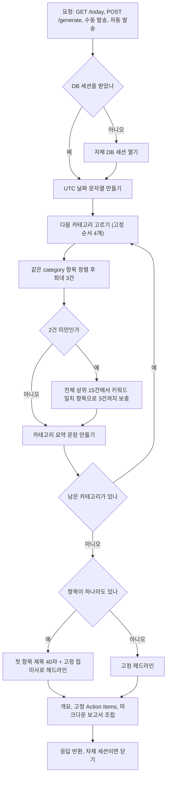

#### 4. 화면 표시 및 입력 데이터 항목 명세 (응답 필드)
| 항목명 | 화면 표시/입력 구분 | UI 컴포넌트 | 필수 여부 | 데이터 타입 / 제약 | 기본값 | 유효성 검증 규칙 (생성 규칙) | 노출/수정 조건 |
| :--- | :---: | :--- | :---: | :--- | :---: | :--- | :--- |
| `title` | 노출 전용 (API) | 화면 미사용 (대화상자 제목은 코드에 박힌 "오늘의 AI 브리핑") | 선택 | String | "오늘의 AI 브리핑" | 항상 고정값. `config.json` `briefing.title` 을 읽지 않는다 | 항상 응답에 있음. 수정 불가 |
| `date` | 노출 전용 | SCR-BRF-001 텍스트(768px 이상), SCR-BRF-002 제목 옆 | 필수 | String `YYYY년 MM월 DD일` (UTC) | 요청 시각 | `strftime("%Y년 %m월 %d일")` | 항상 |
| `headline` | 노출 전용 | SCR-BRF-001 텍스트, SCR-BRF-002 대화상자 설명 | 필수 | String | 고정 문장(항목 0건) | BR-BRF-001-4 | 항상 |
| `overview` | 노출 전용 | SCR-BRF-002 "오늘의 핵심 요약" | 선택 | String, 카테고리당 1줄(4줄), `\n` 구분 | "" | 줄마다 `• **{카테고리명}**: {카테고리 요약}` | 비어 있지 않을 때만 절을 그린다 |
| `categories[]` | 노출 전용 | SCR-BRF-002 카테고리 절 | 선택(스키마) / backend 는 항상 4개 | Array 길이 4, 순서 고정 | `[]`(스키마) | `id` ∈ {`harness`, `mcp_plugins_skills`, `agent_tech`, `ai_news`} | 비면 마크다운을 줄 단위로 그린다 |
| `categories[].name` | 노출 전용 | SCR-BRF-002 (긴 라벨이 있으면 대체) | 필수 | String | `CATEGORY_DEFS.name` | backend 이름 고정 | 마크다운·Notion·이메일·웹훅에는 그대로 |
| `categories[].icon` | 노출 전용 | 화면 미사용 (마크다운·Notion·이메일에서 사용) | 필수 | String 이모지 | 🎯 / 🔌 / 🤖 / 💡 | `CATEGORY_DEFS.icon` 고정 | 화면은 lucide 아이콘으로 대체 |
| `categories[].summary` | 노출 전용 | SCR-BRF-002 "동향:" 문단 | 필수 | String | `default_summary` | BR-BRF-001-3 | 비어 있지 않을 때 |
| `categories[].items[]` | 노출 전용 | SCR-BRF-002 항목 목록 | 필수 | Array 0~3건 | `[]` | BR-BRF-001-1, 2 | 항목 수 배지 `N건` |
| `items[].id` | 노출 전용 | 화면 미사용 | 선택 | Integer | — | `news_items.id` | — |
| `items[].title` | 노출 전용 | 제목 링크 | 필수 | String | — | DB 값 그대로 (자르지 않음) | 항상 |
| `items[].url` | 노출 전용 | 제목 링크 `href` (새 탭) | 필수 | String | — | DB 값 그대로. 서버·프론트 모두 URL 검증 안 함 | 항상 |
| `items[].source` | 노출 전용 | 소스 라벨 배지 (`sourceLabel`) | 선택 | String | "" | DB 값 그대로 | 값이 있을 때 |
| `items[].why_it_matters` | 노출 전용 | "시사점:" 상자 | 선택 | String | ""(`None` 이면 "") | — | 값이 있을 때 |
| `items[].summary` | 노출 전용 | 두 줄 말줄임 문단 | 선택 | String | "" | — | `why_it_matters` 가 비었을 때만 |
| `items[].tags` | 노출 전용 | 화면 미사용 | 선택 | Array[String] | `[]` | DB 쉼표 문자열을 잘라 공백 제거 | — |
| `items[].category` / `category_name` / `hotness_score` | 노출 전용 | 화면 미사용 | 선택 | String / String / Float | "" / "" / 0.0 | `category_name` 은 선정된 카테고리의 backend 이름 (보충 항목은 원래 category 와 다를 수 있다) | — |
| `action_items[]` | 노출 전용 | SCR-BRF-002 "오늘의 추천 Action Items" | 선택 | Array[String], 3개 | 고정 3문장 | 뉴스 내용과 무관한 고정값 | 길이 > 0 일 때 |
| `markdown_report` | 노출 전용 | SCR-BRF-002 마크다운 전문 탭, 복사·다운로드 원문 | 필수 | String (Markdown) | — | BR-BRF-001-6 | 항상 |
| `featured_items_count` | 노출 전용 | 화면 미사용 | 필수 | Integer 0~12 | 0 | 카테고리별 항목 수의 합 (중복 기사도 센다) | — |
| `generated_at` | 노출 전용 | 화면 미사용 | 필수 | String ISO 8601 (UTC, `+00:00`) | 생성 시각 | `datetime.now(timezone.utc).isoformat()` | — |

#### 5. 비즈니스 규칙
- **BR-BRF-001-1 (선정)**: 카테고리마다 `category == id` 항목을 `is_high_signal` 내림차순 → `hotness_score` 내림차순 → `id` 내림차순으로 최대 3건. 발행일·수집일 기간 필터가 없다. `quality_score` 나 기준 통과 여부로도 거르지 않는다 (`briefing_service.py:47-51`).
- **BR-BRF-001-2 (보충)**: 선정 결과가 2건 미만이면 전체 상위 15건(같은 정렬)을 차례로 보며, 아직 목록에 없고 키워드가 맞는 항목을 3건까지 덧붙인다. 키워드: `harness` = `bench, eval, test, harness, sandbox` / `mcp_plugins_skills` = `mcp, protocol, tool, plugin, skill` / `agent_tech` = `agent, graph, crew, memory, state` / `ai_news` = `model, llm, reasoning, paper, deepseek, openai`. 카테고리 사이 중복 제거는 없어서 같은 기사가 두 카테고리에 나올 수 있다 (`briefing_service.py:57-76`).
- **BR-BRF-001-3 (카테고리 요약)**: 항목이 없으면 `default_summary`. 첫 항목에 `why_it_matters` 가 있으면 `'{제목 앞 45자}...' 등이 주목받으며, {why_it_matters}`, 없고 `summary` 가 있으면 `'{제목 앞 45자}...' 관련 소식으로, {요약 앞 90자}...`, 둘 다 없으면 `default_summary`. 제목이 45자보다 짧아도 `...` 를 붙인다 (`briefing_service.py:79-89`).
- **BR-BRF-001-4 (헤드라인)**: 카테고리 순서대로 항목을 이었을 때 첫 항목(대개 `harness` 1위)의 제목이 40자를 넘으면 앞 40자 + `...`, 그 뒤에 `" 및 분야별 핵심 에이전트 기술 동향"`. 항목이 하나도 없으면 `SWE-bench 평가 하네스 및 Model Context Protocol 생태계 동향` (`briefing_service.py:91-104`).
- **BR-BRF-001-5 (Action Items)**: 고정 3문장 — "사내 에이전트 워크플로우에 단위 평가 및 샌드박스 격리 테스트베드 도입 검토", "사내 API 및 외부 연동 도구 인터페이스를 FastMCP 규격으로 표준화", "복합 워크플로우를 단일 프롬프트에서 단계별 상태 영속성(State) 구조로 리팩토링" (`briefing_service.py:155-159`).
- **BR-BRF-001-6 (마크다운 보고서)**: 순서대로 `# 🌅 오늘의 AI 브리핑`, `**발행 일자**: {date} (UTC) | **핵심 토픽**: {headline}`, `## 📌 오늘의 핵심 테이크어웨이 (Overview)` + 개요, 카테고리마다 `## {아이콘} {이름}` + `> 💡 **동향 요약**: {요약}` + 항목 목록(``- **[제목](url)** `[source]` `` — source 가 없으면 생략, 다음 줄에 `  *↳ 💡 시사점: …*` 또는 `  *↳ 📝 요약: …*`), 항목이 없으면 `- 현재 해당 카테고리의 새로운 주요 소식을 수집 분석 중입니다.`, 마지막에 `## ✅ 오늘의 추천 Action Items` 번호 목록 (`briefing_service.py:162-191`).
- **BR-BRF-001-7 (저장 없음)**: 브리핑을 DB·파일·메모리에 저장하지 않는다. 같은 날 여러 번 부르면 그 사이 수집 결과에 따라 내용이 바뀐다.
- **BR-BRF-001-8 (LLM 없음)**: DB 조회와 문자열 조합만 한다.
- **BR-BRF-001-9 (태그 변환)**: 응답의 `tags` 는 DB 쉼표 구분 문자열을 잘라 공백을 지운 목록이다 (`briefing_service.py:132`, 스키마 `parse_tags` `schemas/news.py:60-67`).

#### 6. 예외 처리 및 엣지 케이스
| 발생 상황 | 화면 반응 및 시스템 처리 방식 | 사용자 안내 메시지 |
| :--- | :--- | :--- |
| DB 에 뉴스가 0건 | 4개 카테고리 모두 항목 0건, `default_summary`, 고정 헤드라인, 마크다운에 "수집 분석 중" 줄. `featured_items_count` 0 | (정상 응답) |
| 한 카테고리가 1건 이하 | 전체 상위 15건에서 키워드 보충. 다른 카테고리 기사가 들어올 수 있다 | (정상 응답) |
| 같은 기사가 두 카테고리에 선정 | 그대로 두 번 나온다. `featured_items_count` 도 두 번 센다 | — |
| 오래된 고신호 기사 | 기간 필터가 없어 계속 상위에 남을 수 있다 | — |
| 보충 키워드의 태그 매칭 | `' '.join(it.tags)` 가 문자열을 글자 단위로 이어 붙여(`"a, b"` → `"a ,   b"`) 태그로는 거의 맞지 않고 제목·요약으로만 맞는다 (`briefing_service.py:68`, `backend/app/models/news.py:15`) | — |
| DB 오류 | 잡는 코드가 없다. 처리되지 않은 예외로 응답 실패 (FastAPI 기본 500, 실행 확인하지 않음) | 프론트는 FUNC-BRF-002 규칙대로 오류를 삼킨다 |

#### 7. 비즈니스 에러 코드 매핑
| 비즈니스 에러 코드 | 발생 사유 | HTTP 상태 코드 매핑 | 클라이언트 표시 형태 |
| :--- | :--- | :---: | :--- |
| (없음) | 이 API 는 업무 오류를 정의하지 않는다. 데이터가 없어도 200 | 200 | — |
| `BRF_BRIEFING_FETCH_FAILED` | `/today` 응답이 `ok` 가 아님. 프론트가 `'일일 브리핑을 불러오지 못했습니다.'` 로 `Error` 를 던진다 (`api.ts:66`) | 비 2xx | 화면 표시 없음. `useNewsFeed` 가 `Promise.allSettled` 로 삼키고 브리핑 버튼이 나타나지 않는다 |

---

### [FUNC-BRF-002] 브리핑 바로가기

#### 1. 기본 정보
- **기능명**: 메인 요약 바의 오늘의 브리핑 버튼
- **기능 ID**: `FUNC-BRF-002`
- **대응 요구사항 ID**: `REQ-BRF-002` (같은 기능을 피드 쪽에서 적은 `FUNC-NEWS-018` 도 같은 요구사항)
- **대상 화면 코드**: `SCR-BRF-001`
- **우선순위**: Must Have
- **관련 액터**: 사용자
- **관련 코드**: `frontend/src/components/feed/InsightsBar.tsx:30-75`, `frontend/src/hooks/useNewsFeed.ts:75-101`, `frontend/src/app/page.tsx:174-181`, `frontend/src/lib/api.ts:25-37`, `:63-68`

#### 2. 사전 조건
1. 사용자가 메인 화면(`/`)에 있다.
2. `useNewsFeed` 가 통계·브리핑·트렌드 레이더를 `Promise.allSettled` 로 한 번에 읽는다 (`useNewsFeed.ts:83-97`).

#### 3. 사용자 인터랙션 및 시스템 동작 흐름
1. 메인 화면이 열리면 `fetchStats`, `fetchDailyBriefing`, `fetchTechRadar` 를 동시에 부른다. 하나가 실패해도 나머지는 반영한다.
2. 처음 읽기가 끝나기 전이고 보여 줄 브리핑·레이더가 없으면 요약 바 자리에 높이 48px 스켈레톤을 그린다.
3. 브리핑을 받으면 `main` 맨 위 요약 바(`Card`, 높이 48px 한 줄) 왼쪽에 버튼을 그린다. 버튼 위치는 모든 폭에서 같다.
4. 버튼 글자: `오늘의 브리핑 · {date} · {headline}` 한 줄, 넘치면 말줄임. 768px 미만은 `· {date}` 를 숨겨 `오늘의 브리핑 · {headline}` 이 된다.
5. 버튼을 누르면 브리핑 대화상자(SCR-BRF-002)를 연다.
6. 헤더 새로고침이나 소스 변경 뒤에는 다시 읽는다. 다시 읽는 동안에는 이전 브리핑을 그대로 그린다 (스켈레톤 없음).

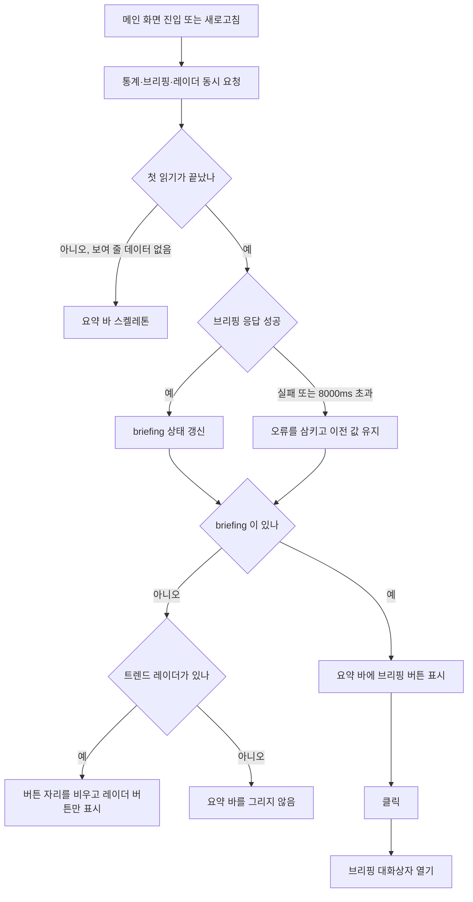

#### 4. 화면 표시 및 입력 데이터 항목 명세
| 항목명 | 화면 표시/입력 구분 | UI 컴포넌트 | 필수 여부 | 데이터 타입 / 제약 | 기본값 | 유효성 검증 규칙 | 노출/수정 조건 |
| :--- | :---: | :--- | :---: | :--- | :---: | :--- | :--- |
| 브리핑 버튼 | 사용자 조작 | `<button type="button">` (높이 768px 미만 44px, 이상 40px) | - | Button | - | 클릭 시 `onOpenBriefing` | `briefing` 이 null 이 아닐 때 |
| 아이콘 | 노출 전용 | lucide `Sparkles` (`aria-hidden`) | - | Icon | - | - | 버튼과 함께 |
| "오늘의 브리핑" | 노출 전용 | 굵은 텍스트 | - | 고정 문구 | "오늘의 브리핑" | - | 버튼과 함께 |
| 날짜 | 노출 전용 | 텍스트 `· {date}` | - | String | - | `briefing.date` 그대로 | 768px 이상에서만 (`max-md:hidden`) |
| 헤드라인 | 노출 전용 | 텍스트 (한 줄 말줄임 `truncate`) | - | String | - | `briefing.headline` 그대로 (프론트는 자르지 않는다) | 버튼과 함께 |
| 요약 바 스켈레톤 | 노출 전용 | `Skeleton` (h-12) | - | - | - | - | 첫 읽기 전이고 브리핑·레이더 모두 없을 때 |

#### 5. 비즈니스 규칙
- **BR-BRF-002-1**: 브리핑이 `null` 이면 버튼 대신 빈 자리를 둔다. 트렌드 레이더(`radar.tags` 1개 이상)도 없으면 요약 바 전체를 그리지 않는다 (`InsightsBar.tsx:41-52`).
- **BR-BRF-002-2**: 스켈레톤은 `loadingRadar`(= 첫 읽기 완료 전)이고 데이터가 없을 때만 보인다. 첫 읽기가 끝나면 `statsLoaded` 는 다시 false 가 되지 않는다 (`useNewsFeed.ts:79-81`, `:92`).
- **BR-BRF-002-3**: 브리핑 응답이 실패하면 상태를 바꾸지 않는다. 그래서 다시 읽기 실패 때는 이전 브리핑이 남는다 (`useNewsFeed.ts:90`).
- **BR-BRF-002-4**: 커맨드 팔레트(⌘K)에는 브리핑을 여는 항목이 없다. 진입점은 이 버튼 하나다.

#### 6. 예외 처리 및 엣지 케이스
| 발생 상황 | 화면 반응 및 시스템 처리 방식 | 사용자 안내 메시지 |
| :--- | :--- | :--- |
| `/api/briefing/today` 실패 또는 8000ms 초과 | 오류를 삼키고 `null` 유지. 버튼이 안 보이고 오류 표시도 없다. 콘솔 로그도 남기지 않는다 (통계 실패만 `console.error`) | 없음 |
| 이미 받은 뒤 재조회 실패 | 이전 브리핑을 그대로 보여 준다 | 없음 |
| 헤드라인이 길다 | 한 줄 말줄임. backend 가 이미 40자에서 잘라 `...` 를 붙인다 | — |

#### 7. 비즈니스 에러 코드 매핑
| 비즈니스 에러 코드 | 발생 사유 | HTTP 상태 코드 매핑 | 클라이언트 표시 형태 |
| :--- | :--- | :---: | :--- |
| `BRF_BRIEFING_FETCH_FAILED` | 브리핑 조회 실패 | 비 2xx | 표시 없음 (버튼 미노출) |
| `BRF_BRIEFING_TIMEOUT` | 8000ms 안에 응답 없음 (`AbortController`) | — | 표시 없음 (버튼 미노출) |

---

### [FUNC-BRF-003] 브리핑 대화상자

#### 1. 기본 정보
- **기능명**: 오늘의 AI 브리핑 대화상자 (보기, 복사, 다운로드, 연동 설정 진입)
- **기능 ID**: `FUNC-BRF-003`
- **대응 요구사항 ID**: `REQ-BRF-002`
- **대상 화면 코드**: `SCR-BRF-002`
- **우선순위**: Must Have
- **관련 액터**: 사용자
- **관련 코드**: `frontend/src/components/DailyBriefingModal.tsx:44-52`(분야 이름·아이콘), `:58-416`, `:121-125`(개요 이름), `:130-135`(모바일 메뉴), `:193-208`(바닥), `frontend/src/lib/labels.ts:15-20`, `frontend/src/components/feed/FeedToolbar.tsx:12-18`, `frontend/src/app/page.tsx:284-289`, `frontend/src/hooks/useCopyToClipboard.ts:70`, `frontend/src/components/ui/Dialog.tsx:69-74`, `frontend/src/components/ui/Tabs.tsx`, `frontend/src/components/ui/ScrollRow.tsx`

#### 2. 사전 조건
1. 페이지가 브리핑 객체를 들고 있다 (FUNC-BRF-002). 대화상자를 열 때 다시 조회하지 않는다.
2. 사용자가 요약 바 브리핑 버튼을 눌렀다.

#### 3. 사용자 인터랙션 및 시스템 동작 흐름
1. 대화상자가 열린다 (`Dialog size="xl"`: 768px 이상 너비 896px, 768px 미만 전체 화면).
2. 머리줄: 제목 "오늘의 AI 브리핑" + 날짜, 설명(`aria-describedby`)으로 헤드라인. 헤드라인은 대화상자 안에서 이 한 곳에만 보이고 두 탭 모두에서 보인다.
3. 도구줄: 주 버튼 "Notion 내보내기"(FUNC-BRF-004), "이메일 발송"(FUNC-BRF-006), 아이콘 버튼 "마크다운 복사"·".md 다운로드". 768px 미만은 주 버튼과 "브리핑 작업" 메뉴(이메일 발송, 마크다운 복사, .md 다운로드)만 보인다. 도구줄에는 설정 버튼이 없다.
4. 복사를 누르면 `markdown_report` 를 클립보드에 쓰고 버튼 이름(모바일은 메뉴 항목 이름)을 2000ms 동안 "복사됨"(실패하면 "복사 실패")으로 바꾼다.
5. 다운로드를 누르면 `markdown_report` 를 `text/markdown` Blob 으로 만들어 `AgentLens_Daily_Briefing_{date 에서 숫자만}.md` 로 내려받는다 (예: `AgentLens_Daily_Briefing_20261106.md`).
6. 탭 두 개(`Tabs`, `aria-label="브리핑 보기"`): "카테고리별 요약"(기본)과 "마크다운 전문". 탭을 바꾸면 해당 패널만 그린다.
7. 바닥: 768px 이상에서 왼쪽에 "AgentLens · AI & Agent 기술 큐레이션 및 정기 브리핑" 문구, 오른쪽에 "연동 설정"(톱니 아이콘, 모든 폭), "닫기".
8. "연동 설정"을 누르면 설정 대화상자(SCR-BRF-003)가 브리핑 대화상자 위에 쌓인다.
9. Escape·닫기 버튼·바닥 "닫기"·배경막으로 닫힌다. Escape 는 오버레이 스택의 맨 위 레이어만 닫는다.

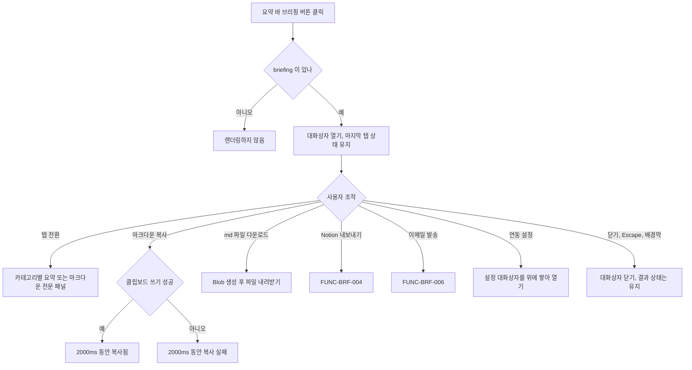

#### 4. 화면 표시 및 입력 데이터 항목 명세
| 항목명 | 화면 표시/입력 구분 | UI 컴포넌트 | 필수 여부 | 데이터 타입 / 제약 | 기본값 | 유효성 검증 규칙 | 노출/수정 조건 |
| :--- | :---: | :--- | :---: | :--- | :---: | :--- | :--- |
| 제목 | 노출 전용 | `Dialog` title | - | 고정 문구 + `date` | "오늘의 AI 브리핑" | - | 항상 |
| 헤드라인 | 노출 전용 | `Dialog` description (`aria-describedby`) | - | String | - | backend 값 그대로 | 항상, 두 탭 공통 |
| Notion 내보내기 | 사용자 조작 | `Button variant="primary"`, `FileText` 아이콘, title "Notion 페이지로 즉시 발행" | - | Button | - | 진행 중 `loading`(비활성) | Notion 발행 성공 전, 모든 폭 |
| Notion에서 열기 | 사용자 조작 | `<a target="_blank">` 주 버튼 모양 | - | Link | - | 응답 `url` | Notion 발행 성공 뒤 (페이지 새로고침 전까지) |
| 이메일 발송 | 사용자 조작 | `Button variant="secondary"`, `Mail` 아이콘, `aria-expanded`, 폼이 열려 있을 때만 `aria-controls="daily-briefing-email-form"` | - | Toggle Button | 닫힘 | 발송 중 `loading`(비활성) | 768px 이상 |
| 마크다운 복사 | 사용자 조작 | `IconButton` (이름 "마크다운 복사"/"복사됨"/"복사 실패") | - | Button | "마크다운 복사" | 2000ms 뒤 원래 이름 | 768px 이상 |
| .md 다운로드 | 사용자 조작 | `IconButton`, `Download` 아이콘 | - | Button | - | - | 768px 이상 |
| 브리핑 작업 | 사용자 조작 | `MenuButton` (`MoreHorizontal`): 이메일 발송 / 복사 / .md 다운로드 | - | Menu | - | 메뉴의 "이메일 발송"은 폼을 연다 (토글 아님) | 768px 미만 |
| 보기 탭 | 선택 | `Tabs` (`aria-label="브리핑 보기"`), 공통 가로 스크롤 줄 | 필수 | Enum (`categorized`, `markdown`) | `categorized` | `aria-controls` 는 그려진 패널(선택된 탭)에만 | 항상. 넘치면 흐림, 768px 이상 스크롤 버튼 `브리핑 보기 이전 항목 보기`/`… 다음 항목 보기`, 미만 장식 넘침 표시 |
| 오늘의 핵심 요약 | 노출 전용 | `section` + `Sparkles` 아이콘 | - | `overview` 줄 목록 | - | 줄이 `^•\s*\*\*(.*?)\*\*:\s*(.*)$` 에 맞으면 이름을 굵게, 이름이 어떤 `categories[].name` 과 같으면 긴 라벨로 대체. 안 맞으면 줄 그대로 | `overview` 가 비어 있지 않을 때, 카테고리별 요약 탭 |
| 카테고리 머리글 | 노출 전용 | `h3` + lucide 아이콘 + 분야 이름 | - | String | - | 이름: `id` 가 `CATEGORY_LABELS` 에 있으면 긴 라벨(`하네스 & 벤치마크`, `MCP & 생태계`, `에이전트 아키텍처`, `최신 AI 동향`), 없으면 backend `name`. 아이콘: `harness` `ShieldCheck`, `mcp_plugins_skills` `Cpu`, `agent_tech` `Bot`, `ai_news` `Sparkles` (`FEED_CATEGORIES` 공유), 표에 없는 id 는 아이콘 없음 | 카테고리마다 |
| 항목 수 | 노출 전용 | `Badge` `N건` | - | Integer | - | `items.length` | 카테고리마다 |
| 동향 | 노출 전용 | 문단 "동향: {summary}" | - | String | - | - | `summary` 가 비어 있지 않을 때 |
| 항목 제목 | 사용자 조작 | `<a target="_blank" rel="noreferrer">` + `ExternalLink` 아이콘 | - | Link | - | - | 항목마다 |
| 소스 배지 | 노출 전용 | `Badge` (`sourceLabel(source)`) | - | String | - | `lib/labels.ts` 표 | `source` 가 있을 때 |
| 시사점 | 노출 전용 | 상자 + `Lightbulb`(`aria-hidden`) + "시사점:" | - | String | - | - | `why_it_matters` 가 있을 때 |
| 요약 | 노출 전용 | 두 줄 말줄임(`line-clamp-2`) 문단 | - | String | - | - | `why_it_matters` 가 없고 `summary` 가 있을 때 |
| 마크다운 줄 대체 | 노출 전용 | 줄 단위 `
` | - | String | - | `markdown_report.split('\n')` | `categories` 가 없거나 비었을 때 |
| Action Items | 노출 전용 | `section` + `Check` 아이콘 + 번호 목록 | - | Array[String] | - | - | 길이 > 0 일 때 |
| 마크다운 전문 | 노출 전용 | `MarkdownViewer` | - | Markdown | - | backend 원문 (backend 분야 이름·이모지 그대로) | 마크다운 전문 탭 |
| 바닥 문구 | 노출 전용 | 텍스트 | - | 고정 문구 | "AgentLens · AI & Agent 기술 큐레이션 및 정기 브리핑" | - | 768px 이상 |
| 연동 설정 | 사용자 조작 | `Button variant="ghost"` + `Settings` 아이콘 | - | Button | - | - | `onOpenSettings` 가 있을 때 (페이지는 항상 넘긴다), 모든 폭 |
| 닫기 | 사용자 조작 | `Button variant="secondary"` | - | Button | - | - | 항상 |

#### 5. 비즈니스 규칙
- **BR-BRF-003-1**: 브리핑이 `null` 이면 아무것도 그리지 않는다 (`DailyBriefingModal.tsx:77`).
- **BR-BRF-003-2**: 설정 진입은 바닥 "연동 설정" 한 곳이다. Notion/이메일 실패 알림 안의 "Notion 설정 열기"/"이메일 설정 열기"는 그 실패의 바로가기다. 셋 다 같은 `BriefingSettingsModal` 을 연다. 브리핑 작업 메뉴에는 연동 설정 항목이 없다.
- **BR-BRF-003-3**: 페이지가 `initialTab` 을 넘기지 않아(`page.tsx:288`, `:292`) 설정 대화상자는 처음에는 Notion 탭으로, 그 뒤에는 마지막으로 본 탭으로 열린다. "이메일 설정 열기"도 이메일 탭으로 열지 않는다.
- **BR-BRF-003-4**: 컴포넌트가 페이지에 계속 마운트되어 있어 닫아도 상태(선택한 탭, Notion·이메일 결과, 이메일 입력 줄 열림 여부, 입력한 주소)를 초기화하지 않는다. 그래서 Notion 발행에 한 번 성공하면 페이지를 새로고침할 때까지 주 버튼이 "Notion에서 열기" 링크로 남는다.
- **BR-BRF-003-5**: 헤드라인 글자는 backend 가 만든 그대로 그린다. 프론트는 자르지 않는다.
- **BR-BRF-003-6**: backend `categories[].icon`(이모지)은 화면에서 쓰지 않는다. 카테고리별 요약 탭만 긴 라벨·lucide 아이콘으로 바꾸고, 마크다운 전문 탭은 backend 원문 그대로다.
- **BR-BRF-003-7**: 다운로드 파일 이름은 `date` 에서 숫자가 아닌 글자를 모두 지운 값을 쓴다 (`replace(/[^0-9]/g, '')`).

#### 6. 예외 처리 및 엣지 케이스
| 발생 상황 | 화면 반응 및 시스템 처리 방식 | 사용자 안내 메시지 |
| :--- | :--- | :--- |
| 클립보드 쓰기 실패 | 버튼(메뉴 항목) 이름을 2000ms 동안 "복사 실패", 아이콘 `TriangleAlert` | "복사 실패" |
| `categories` 가 비었거나 없음 | 카테고리 절 대신 `markdown_report` 를 줄 단위 문단으로 | — |
| `overview` 가 비었음 | "오늘의 핵심 요약" 절을 그리지 않음 | — |
| 설정 대화상자가 위에 열린 상태에서 Escape | 설정 대화상자만 닫힘 | — |
| 대화상자를 연 뒤 페이지 브리핑이 갱신됨 | 새 브리핑 객체로 다시 그린다 (대화상자가 따로 조회하지 않음) | — |

#### 7. 비즈니스 에러 코드 매핑
| 비즈니스 에러 코드 | 발생 사유 | HTTP 상태 코드 매핑 | 클라이언트 표시 형태 |
| :--- | :--- | :---: | :--- |
| `BRF_CLIPBOARD_FAILED` | 브라우저 클립보드 쓰기 실패 | - | 복사 버튼 이름 "복사 실패" 2000ms |
| (API 오류) | 대화상자 자체는 API 를 부르지 않는다. Notion·이메일 오류는 FUNC-BRF-004, 006 | - | - |

---

### [FUNC-BRF-004] Notion 발행 (수동)

#### 1. 기본 정보
- **기능명**: 브리핑 Notion 페이지 발행
- **기능 ID**: `FUNC-BRF-004`
- **대응 요구사항 ID**: `REQ-BRF-003`
- **대상 화면 코드**: `SCR-BRF-002`
- **우선순위**: Must Have
- **관련 액터**: 사용자, Notion API
- **관련 코드**: `backend/app/api/briefing.py:55-73`, `backend/app/services/notion_service.py:13-31`(ID 정리·헤더), `:72-206`(블록), `:208-294`(페이지 생성), `frontend/src/components/DailyBriefingModal.tsx:93-104`, `:139-160`, `:255-268`, `frontend/src/lib/api.ts:502-517`

#### 2. 사전 조건
1. 브리핑 대화상자가 열려 있다.
2. 서버 `settings.NOTION_API_KEY`, `settings.NOTION_PAGE_ID` 가 있다 (화면은 둘 다 요청에 넣지 않는다). 프로세스 시작 뒤 설정 화면에서 저장한 값은 재시작 전까지 반영되지 않는다 (알려진 불일치·위험 R1).
3. Notion 통합이 부모 페이지(또는 DB)에 초대되어 있다.

#### 3. 사용자 인터랙션 및 시스템 동작 흐름
1. 사용자가 "Notion 내보내기"(툴팁 "Notion 페이지로 즉시 발행", 모든 폭)를 누른다. 이전 결과를 지우고 버튼을 진행 표시로 바꾼다.
2. 프론트가 `exportBriefingToNotion()` 를 인자 없이 불러 `POST /api/briefing/export/notion` 에 본문 `{}` 를 보낸다. 타임아웃 20000ms.
3. 서버가 브리핑을 새로 만든다 (FUNC-BRF-001).
4. 토큰 = 요청 `api_key`, 없으면 `settings.NOTION_API_KEY`. 부모 ID = 요청 `page_id`, 없으면 `settings.NOTION_PAGE_ID`. 둘 다 앞뒤 공백을 지운다. 부모 ID 는 `clean_id` 로 정리한다.
5. 토큰이 비면, 부모 ID 가 비면 실패한다.
6. 부모 판별: `GET https://api.notion.com/v1/databases/{id}` (타임아웃 10.0초)가 200 이면 DB 로 보고 `parent = {database_id}`, 속성 `Name` 제목. 그 밖(오류·예외 포함)은 페이지로 보고 `parent = {page_id}`, `title` 속성.
7. 블록을 만들어 처음 100블록을 `POST /v1/pages`(타임아웃 15.0초)의 `children` 으로 보낸다. 남은 블록은 100개씩 `PATCH /v1/blocks/{page_id}/children` 로 붙인다.
8. 성공(200/201)이면 응답 `url`, 없으면 `https://notion.so/{하이픈 뺀 id}` 를 돌려준다.
9. 화면: 성공이면 성공 알림 "Notion 페이지 생성 완료!" 와 함께 주 버튼이 "Notion에서 열기"(새 탭) 링크로 바뀐다. 실패면 오류 알림에 서버 `detail`(없으면 api.ts 기본 "Notion 페이지 생성에 실패했습니다.")과 "Notion 설정 열기" 버튼을 보여 준다.

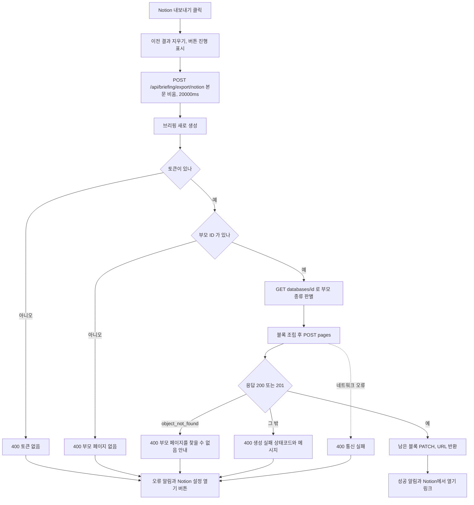

#### 4. 화면 표시 및 입력 데이터 항목 명세
| 항목명 | 화면 표시/입력 구분 | UI 컴포넌트 | 필수 여부 | 데이터 타입 / 제약 | 기본값 | 유효성 검증 규칙 | 노출/수정 조건 |
| :--- | :---: | :--- | :---: | :--- | :---: | :--- | :--- |
| `api_key` (요청) | API 입력 | 화면 입력 없음 | 선택 | String | 없음 → `settings.NOTION_API_KEY` | 앞뒤 공백 제거 후 비면 실패 | 화면은 보내지 않는다 |
| `page_id` (요청) | API 입력 | 화면 입력 없음 | 선택 | String (ID 또는 Notion URL) | 없음 → `settings.NOTION_PAGE_ID` | `clean_id`: 32자리 hex 또는 8-4-4-4-12 UUID 를 모두 찾아 마지막 것을 8-4-4-4-12 로. 못 찾으면 공백만 지운 원문 | 화면은 보내지 않는다 |
| Notion 내보내기 | 사용자 조작 | `Button` primary | - | Button | - | 진행 중 비활성 | 성공 전 |
| 성공 알림 | 노출 전용 | `InlineAlert tone="success"` | - | String | "Notion 페이지 생성 완료!" | - | 성공 뒤 (자동으로 지우지 않음) |
| Notion에서 열기 | 사용자 조작 | `<a target="_blank" rel="noreferrer">` | - | URL | - | 응답 `url` | 성공 뒤 |
| 오류 알림 | 노출 전용 | `InlineAlert tone="danger"` | - | String | "Notion 페이지 생성 실패"(Error 메시지가 없을 때) | 서버 `detail` 우선 | 실패 뒤 |
| Notion 설정 열기 | 사용자 조작 | `Button size="sm" variant="secondary"` | - | Button | - | - | 실패 알림 안 |
| 응답 `url` | 노출 전용 | 링크 대상 | 선택 | String URL | `https://notion.so/{id}` | - | 성공 시 |

#### 5. 비즈니스 규칙
- **BR-BRF-004-1 (페이지 구성)**: 제목 `오늘의 AI 브리핑 - {date}`, 페이지 아이콘 🌅, 헤더 `Notion-Version: 2022-06-28`, `Authorization: Bearer {토큰}`.
- **BR-BRF-004-2 (블록 순서)**: ① callout(`📌 {headline}` + 빈 줄 + `overview`, 1900자에서 자름, `blue_background`, 🌅) ② divider ③ 카테고리마다 heading_2(`{아이콘} {이름}`), 요약이 있으면 paragraph(굵은 "💡 동향: " + 요약 1900자, gray), 항목마다 bulleted_list_item(굵은 제목 100자, URL 이 `http` 로 시작할 때만 링크, 회색 ` [source]`(source 가 있을 때), `\n↳ 💡 시사점: ` + why 250자 또는 `\n↳ 📝 요약: ` + summary 250자), divider ④ Action Items 가 있으면 green heading_2 "✅ 오늘의 실무 Action Items" 와 to_do(`{번호}. {문장}` 1900자, 체크 안 됨) ⑤ 기울임 회색 paragraph `AgentLens AI Curation Platform • 발행 일시: {date}`.
- **BR-BRF-004-3 (블록 수)**: 지금 구성은 최대 31블록(callout 1 + divider 1 + 카테고리 4 × 최대 6 + Action 제목 1 + to_do 3 + footer 1)이라 100블록을 넘는 PATCH 는 실제로 일어나지 않는다.
- **BR-BRF-004-4 (중복 방지 없음)**: 누를 때마다 새 페이지를 만든다. 같은 날짜 페이지가 여러 개 생길 수 있다 (화면은 성공 뒤 버튼을 링크로 바꿔 같은 세션 안의 재발행만 막는다). 자동 발송(FUNC-BRF-013)과도 따로 만든다.
- **BR-BRF-004-5 (연타)**: 진행 중에는 주 버튼이 비활성이다.

#### 6. 예외 처리 및 엣지 케이스
| 발생 상황 | 화면 반응 및 시스템 처리 방식 | 사용자 안내 메시지 |
| :--- | :--- | :--- |
| 토큰 없음 | 400 | "Notion API 토큰(Internal Integration Token)이 설정되지 않았습니다." |
| 부모 ID 없음 | 400 | "Notion 부모 페이지(Parent Page ID)가 설정되지 않았습니다." |
| Notion `code == "object_not_found"` | 400 | "노션 부모 페이지를 찾을 수 없습니다. 해당 노션 페이지의 우측 상단 '...' > '연결' 메뉴에서 통합(Integration)을 초대했는지 확인해주세요." |
| 그 밖의 비 200/201 | 400 | `Notion 페이지 생성 실패 ({상태코드}): {message}` |
| 네트워크 오류 (`httpx.RequestError`) | 400 | `Notion API 통신 실패: …` |
| 그 밖의 예외 (예: 응답이 JSON 이 아님) | 400 | `Notion 페이지 생성 중 예외 발생: …` |
| 부모 종류 판별 요청 실패 | 예외를 무시하고 페이지로 간주 | — |
| 남은 블록 PATCH 실패 | 응답을 확인하지 않는다 (지금 구성에선 PATCH 가 일어나지 않음) | — |
| 서버 소요가 20000ms 를 넘음 (판별 10초 + 생성 15초 타임아웃 합이 더 길다) | 프론트는 중단 메시지를 보이지만 서버는 계속 진행해 페이지가 실제로 만들어질 수 있다 (코드 읽기 기준) | 브라우저 중단 메시지 |
| 대화상자를 닫은 채 요청이 끝남 | 상태가 남아 다시 열면 결과가 보인다 | — |

#### 7. 비즈니스 에러 코드 매핑
| 비즈니스 에러 코드 | 발생 사유 | HTTP 상태 코드 매핑 | 클라이언트 표시 형태 |
| :--- | :--- | :---: | :--- |
| `BRF_NOTION_TOKEN_MISSING` | 토큰 없음 | 400 | 대화상자 안 오류 알림 + "Notion 설정 열기" |
| `BRF_NOTION_PARENT_MISSING` | 부모 ID 없음 | 400 | 같음 |
| `BRF_NOTION_PARENT_NOT_FOUND` | `object_not_found` | 400 | 같음 |
| `BRF_NOTION_CREATE_FAILED` | 그 밖의 비 200/201 | 400 | 같음 |
| `BRF_NOTION_NETWORK` | 통신 실패 | 400 | 같음 |
| `BRF_NOTION_EXCEPTION` | 그 밖의 예외 | 400 | 같음 |
| `BRF_CLIENT_TIMEOUT` | 20000ms 초과 | - | 같음 (브라우저 중단 메시지) |

---

### [FUNC-BRF-005] Notion 연결 테스트

#### 1. 기본 정보
- **기능명**: Notion 토큰·부모 페이지 접근 확인
- **기능 ID**: `FUNC-BRF-005`
- **대응 요구사항 ID**: `REQ-BRF-005`
- **대상 화면 코드**: `SCR-BRF-003` (Notion 탭)
- **우선순위**: Should Have
- **관련 액터**: 사용자, Notion API
- **관련 코드**: `backend/app/api/briefing.py:95-100`, `backend/app/services/notion_service.py:33-70`, `frontend/src/components/BriefingSettingsModal.tsx:230-242`, `:288-293`, `:311-319`, `frontend/src/lib/api.ts:536-551`

#### 2. 사전 조건
1. 설정 대화상자에서 Notion 탭을 고른 상태다.
2. 설정을 다 불러왔고(`isLoading` false), 토큰 입력란이 비어 있지 않거나 저장된 토큰이 있다.

#### 3. 사용자 인터랙션 및 시스템 동작 흐름
1. 사용자가 바닥 "연결 테스트"를 누른다. 결과 알림을 지우고 버튼을 진행 표시로 바꾼다.
2. 화면은 토큰 입력란 값이 `***` 면 토큰을 보내지 않고(빈 값도 보내지 않음), 페이지 ID 는 입력란 값이 비어 있지 않으면 보낸다. `POST /api/briefing/test/notion`, 타임아웃 12000ms.
3. 서버: 토큰 = 요청값, 없으면 `settings.NOTION_API_KEY`. 비면 실패.
4. `GET /v1/users/me` (httpx 타임아웃 10.0초). 200 이 아니면 인증 실패. 성공하면 봇 이름(`name`, 없으면 "AgentLens Integration").
5. 페이지 ID(요청값, 없으면 `settings.NOTION_PAGE_ID`)를 `clean_id` 로 정리해 값이 있으면 `GET /v1/pages/{id}`. 404 면 `GET /v1/databases/{id}` 를 다시 시도하고, 그것도 200 이 아니면 접근 불가 안내. 404 가 아닌 비 200 이면 "대상 페이지 접근 권한 오류".
6. 성공하면 `{"success": true, "message": "Notion 연동 성공! (연결된 통합: {봇 이름})"}`. 화면은 대화상자 안 성공 알림에 메시지를 보인다.

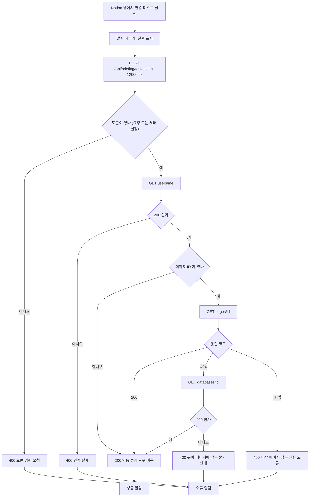

#### 4. 화면 표시 및 입력 데이터 항목 명세
| 항목명 | 화면 표시/입력 구분 | UI 컴포넌트 | 필수 여부 | 데이터 타입 / 제약 | 기본값 | 유효성 검증 규칙 | 노출/수정 조건 |
| :--- | :---: | :--- | :---: | :--- | :---: | :--- | :--- |
| Notion API 시크릿 토큰 | 사용자 입력 | `SecretField` (`type=password`, 보기 토글) — FUNC-BRF-011 과 같은 입력란 | 조건부 (저장된 토큰이 없으면 필수) | String | 저장된 토큰이 있으면 `***`, 없으면 "" | 클라이언트 검증 없음. `***` 또는 빈 값이면 보내지 않음 | Notion 탭 |
| Notion 부모 페이지 ID 또는 전체 URL | 사용자 입력 | `TextField` — FUNC-BRF-011 과 같은 입력란 | 선택 | String | 저장된 `page_id` | 클라이언트 검증 없음. 서버 `clean_id` | Notion 탭 |
| 연결 테스트 | 사용자 조작 | `Button variant="secondary"` + `ShieldCheck` | - | Button | - | 비활성: 불러오는 중, 또는 토큰 입력란이 비고 저장된 토큰도 없음, 또는 진행 중 | 바닥, Notion 탭이 선택됐을 때 이 기능을 실행 |
| 결과 알림 | 노출 전용 | `InlineAlert` success / danger | - | String | 실패 기본 "Notion 연결 테스트 실패" | 서버 메시지 우선 | 테스트 뒤, 탭 전환·대화상자 닫기 때 지움 |

#### 5. 비즈니스 규칙
- **BR-BRF-005-1**: 토큰 입력란이 `***`(저장된 값 표시) 그대로면 서버의 `settings.NOTION_API_KEY` 로 테스트한다. 이 값은 프로세스 시작 시점 값이라, 설정 화면에서 새 토큰을 저장한 뒤 재시작하지 않으면 이전 토큰으로 테스트된다 (R1).
- **BR-BRF-005-2**: 페이지 ID 를 비워 두면 서버 설정값으로 접근을 확인한다. 서버 설정값도 비면 토큰 인증만 확인하고 성공한다.
- **BR-BRF-005-3**: 연결 테스트는 설정을 저장하지 않는다.

#### 6. 예외 처리 및 엣지 케이스
| 발생 상황 | 화면 반응 및 시스템 처리 방식 | 사용자 안내 메시지 |
| :--- | :--- | :--- |
| 토큰 없음 | 400 | "Notion API 토큰(Internal Integration Token)을 입력해주세요." |
| `users/me` 비 200 | 400 | `Notion 인증 실패: {message}` |
| 페이지·DB 모두 접근 불가 | 400 | `봇({봇 이름})이 대상 페이지에 접근할 수 없습니다. 노션 페이지 우측 상단 '...' > '연결(Connections)' 메뉴에서 해당 통합(Integration)을 페이지에 초대해주세요.` |
| 페이지 조회가 404 가 아닌 비 200 | 400 | `대상 페이지 접근 권한 오류: {message}` |
| 네트워크 오류 | 400 | `Notion API 네트워크 오류: …` |
| 그 밖의 예외 (예: 오류 응답이 JSON 이 아님) | 400 | `Notion 검증 중 오류: …` |
| 서버 소요가 12000ms 를 넘음 (최대 3회 호출 × 10.0초) | 프론트 중단 메시지 (코드 읽기 기준) | 브라우저 중단 메시지 |

#### 7. 비즈니스 에러 코드 매핑
| 비즈니스 에러 코드 | 발생 사유 | HTTP 상태 코드 매핑 | 클라이언트 표시 형태 |
| :--- | :--- | :---: | :--- |
| `BRF_NOTION_TEST_TOKEN_MISSING` | 토큰 없음 | 400 | 설정 대화상자 오류 알림 |
| `BRF_NOTION_AUTH_FAILED` | 인증 실패 | 400 | 같음 |
| `BRF_NOTION_PAGE_INACCESSIBLE` | 페이지·DB 접근 불가 | 400 | 같음 |
| `BRF_NOTION_PAGE_PERMISSION` | 404 가 아닌 페이지 조회 오류 | 400 | 같음 |
| `BRF_NOTION_TEST_NETWORK` | 네트워크 오류 | 400 | 같음 |
| `BRF_NOTION_TEST_EXCEPTION` | 그 밖의 예외 | 400 | 같음 |

---

### [FUNC-BRF-006] 이메일 발송 (수동)

#### 1. 기본 정보
- **기능명**: 브리핑 이메일 발송
- **기능 ID**: `FUNC-BRF-006`
- **대응 요구사항 ID**: `REQ-BRF-004`
- **대상 화면 코드**: `SCR-BRF-002`
- **우선순위**: Must Have
- **관련 액터**: 사용자, SMTP 서버
- **관련 코드**: `backend/app/api/briefing.py:75-93`, `backend/app/services/email_service.py:12-16`(수신자 파싱), `:146-178`(전송), `:226-264`(브리핑 메일), `frontend/src/components/DailyBriefingModal.tsx:106-119`, `:162-172`, `:226-253`, `:270-283`, `frontend/src/lib/api.ts:519-534`

#### 2. 사전 조건
1. 브리핑 대화상자가 열려 있다.
2. 서버 `settings.SMTP_HOST` 가 있고, 수신자(입력값 또는 `settings.SMTP_TO`)가 있다. SMTP 값은 프로세스 시작 시점 값이다 (R1).

#### 3. 사용자 인터랙션 및 시스템 동작 흐름
1. 사용자가 "이메일 발송"(768px 미만은 "브리핑 작업" 메뉴의 "이메일 발송")을 누르면 도구줄 아래 주소 입력 줄이 열린다. 데스크톱 버튼은 토글이라 다시 누르면 닫힌다.
2. 입력 줄: 라벨 "수신자 이메일"(`type="email"`, placeholder "비워 두면 기본 수신자로 보냅니다"), 제출 버튼("발송", 입력이 비면 "기본 수신자로 발송"), "취소".
3. 제출하면 결과를 지우고 `POST /api/briefing/send/email` 를 보낸다. 입력이 있으면 `{to_email}`, 비면 `{}`. `subject` 는 보내지 않는다. 타임아웃 20000ms.
4. 서버가 브리핑을 새로 만든다 (FUNC-BRF-001).
5. SMTP 값(호스트, 포트, 계정, 비밀번호, TLS, 발신자)은 모두 `settings` 에서 읽는다. 요청으로 바꿀 수 없다.
6. 수신자: 요청 `to_email`, 없으면 `settings.SMTP_TO`. `;` 를 `,` 로 바꿔 나눈 뒤 공백을 지우고 `@` 와 `.` 가 모두 들어 있는 항목만 남긴다.
7. 호스트가 없으면, 유효 수신자가 없으면 실패한다 (호스트 확인이 먼저).
8. 메일: 제목 = 요청 `subject`, 없으면 `[AgentLens] 오늘의 AI 브리핑 - {date}`. `From` = `AgentLens <{발신자}>`, 발신자 = `SMTP_FROM`, 없으면 `SMTP_USER`, 없으면 `noreply@agentlens.local`. `To` = 수신자들을 `, ` 로. 본문 `multipart/alternative`: 텍스트(= `markdown_report`) + HTML(FUNC-BRF-008), UTF-8.
9. 전송은 `asyncio.to_thread` 로 동기 smtplib 를 돌린다. 포트가 465 면 `SMTP_SSL`, 아니면 `SMTP` 로 연결하고 `use_tls` 가 참이면 `starttls()`. 소켓 타임아웃 12.0초. 계정과 비밀번호가 모두 있을 때만 `login`.
10. 화면: 성공하면 성공 알림 "이메일이 성공적으로 발송되었습니다." 를 보이고 입력 줄을 닫으며 4000ms 뒤 알림을 지운다. 실패면 오류 알림에 `detail`(없으면 api.ts 기본 "이메일 발송에 실패했습니다.")과 "이메일 설정 열기" 버튼.

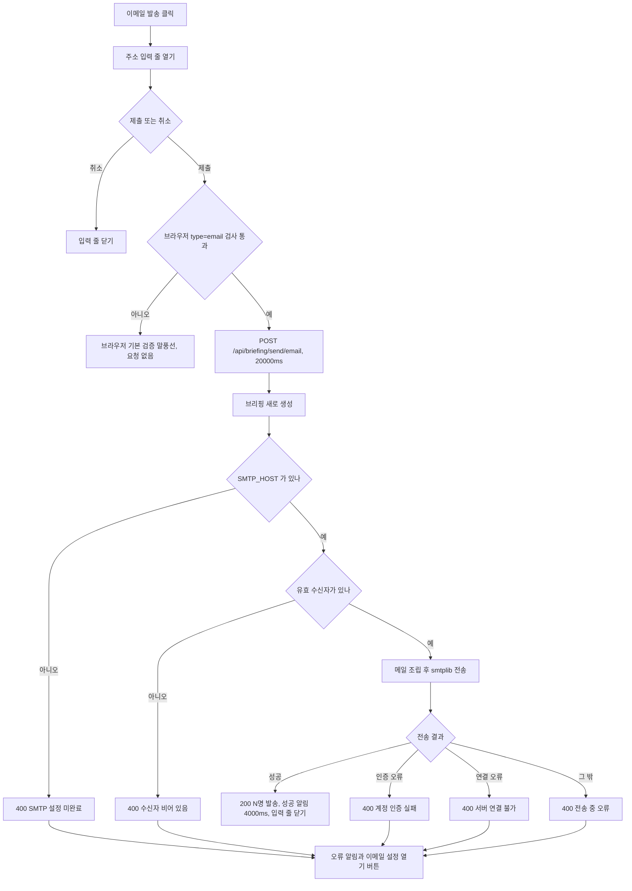

#### 4. 화면 표시 및 입력 데이터 항목 명세
| 항목명 | 화면 표시/입력 구분 | UI 컴포넌트 | 필수 여부 | 데이터 타입 / 제약 | 기본값 | 유효성 검증 규칙 | 노출/수정 조건 |
| :--- | :---: | :--- | :---: | :--- | :---: | :--- | :--- |
| 이메일 발송 | 사용자 조작 | `Button` secondary (토글, `aria-expanded`) / 모바일 메뉴 항목 | - | Button | 닫힘 | 발송 중 비활성 | 데스크톱 768px 이상, 모바일 메뉴 768px 미만 |
| 수신자 이메일 | 사용자 입력 | `TextField type="email"`, `autoComplete="email"`, `id` 폼 `daily-briefing-email-form` | 선택 | String | "" (닫았다 열어도 이전 값 유지) | 브라우저 `type=email` 기본 검증(`multiple` 없음). 서버: `;`→`,` 분리, `@` 와 `.` 포함 항목만 | 입력 줄이 열렸을 때 |
| 발송 / 기본 수신자로 발송 | 사용자 조작 | `Button type="submit"` primary | - | Button | - | 진행 중 비활성 | 입력이 있으면 "발송", 비면 "기본 수신자로 발송" |
| 취소 | 사용자 조작 | `Button` ghost | - | Button | - | - | 입력 줄 |
| `to_email` (요청) | API 입력 | - | 선택 | String, 쉼표·세미콜론 구분 | 없음 → `settings.SMTP_TO` | 위 파싱 규칙 | 입력이 비면 보내지 않음 |
| `subject` (요청) | API 입력 | 화면 입력 없음 | 선택 | String | `[AgentLens] 오늘의 AI 브리핑 - {date}` | - | 화면은 보내지 않음 |
| 성공 알림 | 노출 전용 | `InlineAlert` success | - | String | "이메일이 성공적으로 발송되었습니다." | - | 성공 뒤 4000ms |
| 오류 알림 | 노출 전용 | `InlineAlert` danger + "이메일 설정 열기" | - | String | "이메일 발송 실패"(Error 메시지가 없을 때) | 서버 `detail` 우선 | 실패 뒤 (자동으로 지우지 않음) |

#### 5. 비즈니스 규칙
- **BR-BRF-006-1**: 수신자 파싱은 `to.replace(";", ",").split(",")` → 공백 제거 → `"@" in p and "." in p` 만 남긴다 (`email_service.py:12-16`).
- **BR-BRF-006-2**: SMTP 접속 정보는 요청으로 덮을 수 없다. 수신자·제목만 요청으로 바꿀 수 있다.
- **BR-BRF-006-3**: 포트 465 면 `SMTP_SSL`(이때 STARTTLS 하지 않음), 아니면 `SMTP` + (`use_tls` 면 `starttls()`). 계정·비밀번호가 둘 다 있을 때만 `login`. SMTP envelope 발신자도 같은 발신자 주소다 (`email_service.py:169`).
- **BR-BRF-006-4**: 성공 응답 `{"success": true, "message": "성공적으로 {N}명의 수신자에게 이메일을 발송했습니다."}`. 화면은 이 메시지 대신 고정 문구를 보인다.
- **BR-BRF-006-5 (연타)**: 발송 중에는 도구줄 "이메일 발송" 과 제출 버튼이 모두 비활성이다.

#### 6. 예외 처리 및 엣지 케이스
| 발생 상황 | 화면 반응 및 시스템 처리 방식 | 사용자 안내 메시지 |
| :--- | :--- | :--- |
| 호스트 없음 | 400 | "SMTP 설정이 완료되지 않았습니다. 설정창에서 SMTP 서버를 등록해주세요." |
| 유효 수신자 없음 | 400 | "수신자 이메일 주소가 비어있습니다. 수신자를 입력해주세요." |
| `SMTPAuthenticationError` | 400 | "SMTP 계정 인증 실패: 아이디 또는 비밀번호(앱 비밀번호)를 확인해주세요." |
| `SMTPConnectError` | 400 | `SMTP 서버({host}:{port})에 연결할 수 없습니다. 호스트 및 포트를 확인해주세요.` |
| 그 밖의 예외 (DNS 실패·타임아웃 같은 소켓 오류 포함) | 400, 서버 로그 `SMTP error: …` | `이메일 전송 중 오류 발생: {예외}` |
| 입력란에 쉼표로 여러 주소 입력 | `type="email"` 에 `multiple` 이 없어 브라우저 검증이 제출을 막는다 (코드 읽기 기준, 브라우저 실행 확인하지 않음). 서버는 여러 주소를 받을 수 있다 | 브라우저 기본 검증 말풍선 |
| 저장소 기본 `config.json` 상태 | `smtp_host` `smtp.gmail.com`, `smtp_to` `team@example.com` 이 들어 있어(`config.json:50`, `:55`) 입력 없이 발송하면 이 값으로 실제 연결을 시도한다. 결과는 확인하지 못함 | 서버 오류 메시지 |
| 서버 소요가 20000ms 를 넘음 (SMTP 단계마다 12.0초 타임아웃) | 프론트 중단 메시지. 서버는 계속 진행해 메일이 실제로 나갈 수 있다 (코드 읽기 기준) | 브라우저 중단 메시지 |

#### 7. 비즈니스 에러 코드 매핑
| 비즈니스 에러 코드 | 발생 사유 | HTTP 상태 코드 매핑 | 클라이언트 표시 형태 |
| :--- | :--- | :---: | :--- |
| `BRF_SMTP_NOT_CONFIGURED` | 호스트 없음 | 400 | 대화상자 오류 알림 + "이메일 설정 열기" |
| `BRF_EMAIL_NO_RECIPIENT` | 유효 수신자 없음 | 400 | 같음 |
| `BRF_SMTP_AUTH_FAILED` | 인증 오류 | 400 | 같음 |
| `BRF_SMTP_CONNECT_FAILED` | 연결 오류 | 400 | 같음 |
| `BRF_SMTP_SEND_ERROR` | 그 밖의 예외 | 400 | 같음 |
| `BRF_CLIENT_TIMEOUT` | 20000ms 초과 | - | 같음 (브라우저 중단 메시지) |

---

### [FUNC-BRF-007] SMTP 연결 테스트

#### 1. 기본 정보
- **기능명**: SMTP 테스트 메일 발송
- **기능 ID**: `FUNC-BRF-007`
- **대응 요구사항 ID**: `REQ-BRF-005`
- **대상 화면 코드**: `SCR-BRF-003` (이메일 탭)
- **우선순위**: Should Have
- **관련 액터**: 사용자, SMTP 서버
- **관련 코드**: `backend/app/api/briefing.py:102-114`, `backend/app/services/email_service.py:180-224`, `backend/app/schemas/news.py:108-114`, `frontend/src/components/BriefingSettingsModal.tsx:244-263`, `:288-293`, `frontend/src/lib/api.ts:553-571`

#### 2. 사전 조건
1. 설정 대화상자에서 이메일 탭을 고른 상태다.
2. 설정을 다 불러왔고, 호스트 입력란이 비어 있지 않으며, 계정 또는 수신자 입력란 중 하나가 비어 있지 않다.

#### 3. 사용자 인터랙션 및 시스템 동작 흐름
1. 사용자가 바닥 "연결 테스트"를 누른다. 결과 알림을 지우고 진행 표시.
2. 화면은 `smtp_host`, `smtp_port`(`Number(입력값)`), `smtp_user`, `use_tls`, `to_email`(= "기본 수신자 목록" 입력값)을 그대로 보내고, 비밀번호는 `***` 가 아닐 때만 보낸다. 발신자(From) 입력값은 보내지 않는다. `POST /api/briefing/test/email`, 타임아웃 15000ms.
3. 서버: 호스트·계정·비밀번호·수신자는 요청값, 비었으면 `settings` 값. 포트는 요청값이 참이면 그것, 0·`null` 이면 `settings.SMTP_PORT` (스키마 기본값 587 이라 요청에서 빠지면 587). TLS 는 요청값이 `null` 일 때만 설정값 (스키마 기본값 true).
4. 호스트가 비면 실패.
5. 수신자: `to_email`(없으면 `SMTP_TO`)을 FUNC-BRF-006 규칙으로 파싱. 그 문자열이 비면 계정에 `@` 가 있을 때 계정 주소로 보낸다.
6. 발신자는 요청값이 아니라 저장된 `SMTP_FROM`, 없으면 계정, 없으면 `noreply@agentlens.local`.
7. 제목 `[AgentLens] SMTP 이메일 연동 테스트 성공`, 텍스트("AgentLens 이메일 연동이 성공적으로 완료되었습니다.…")와 HTML("🎉 AgentLens 이메일 연동 성공!", `{host}:{port}` 표시) 본문. 전송 방식은 FUNC-BRF-006 9번과 같다.
8. 화면은 결과를 대화상자 안 알림으로 보인다.

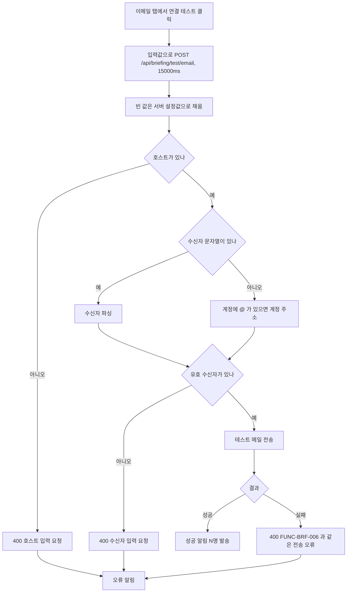

#### 4. 화면 표시 및 입력 데이터 항목 명세
(입력란은 FUNC-BRF-011 이메일 탭과 같은 필드다. 여기서는 테스트에 쓰이는 방식만 적는다.)

| 항목명 | 화면 표시/입력 구분 | UI 컴포넌트 | 필수 여부 | 데이터 타입 / 제약 | 기본값 | 유효성 검증 규칙 | 노출/수정 조건 |
| :--- | :---: | :--- | :---: | :--- | :---: | :--- | :--- |
| SMTP 서버 호스트 → `smtp_host` | 사용자 입력 | `TextField` | 필수 (비면 버튼 비활성) | String | 저장값 | 서버: 비면 설정값, 그래도 비면 400 | 이메일 탭 |
| 포트 → `smtp_port` | 사용자 입력 | `TextField type="number"` | 선택 | Integer | 저장값 또는 587 | `Number(입력)`. 빈 입력은 0 → 서버가 설정 포트로 대체 | 이메일 탭 |
| SMTP 계정 → `smtp_user` | 사용자 입력 | `TextField` | 조건부 (수신자와 둘 중 하나) | String | 저장값 | 수신자 대체 주소로 쓰일 수 있음(`@` 포함 시) | 이메일 탭 |
| SMTP 비밀번호 → `smtp_password` | 사용자 입력 | `SecretField` | 선택 | String | `***`(저장값 있음) | `***` 면 보내지 않음 → 서버 설정값 | 이메일 탭 |
| 기본 수신자 목록 → `to_email` | 사용자 입력 | `TextField` | 조건부 (계정과 둘 중 하나) | String 쉼표 구분 | 저장값 | FUNC-BRF-006 파싱 규칙 | 이메일 탭 |
| STARTTLS 암호화 사용 → `use_tls` | 선택 | `Switch` | - | Boolean | 저장값 또는 true | - | 이메일 탭 |
| 발신자 주소 (From) | 사용자 입력 | `TextField` | - | String | 저장값 | 테스트 요청에 넣지 않는다 (서버 저장값 사용) | 이메일 탭 |
| 연결 테스트 | 사용자 조작 | `Button` secondary | - | Button | - | 비활성: 불러오는 중, 호스트 빈 값, 계정과 수신자 모두 빈 값, 진행 중 | 이메일 탭 선택 시 |
| 결과 알림 | 노출 전용 | `InlineAlert` | - | String | 실패 기본 "이메일 발송 테스트 실패" | 서버 메시지 우선 | 테스트 뒤 |

#### 5. 비즈니스 규칙
- **BR-BRF-007-1**: 테스트는 저장하지 않는다. 입력값으로 바로 보낸다 (발신자 제외).
- **BR-BRF-007-2**: 빈 요청값은 서버 설정값(프로세스 시작 시점 값, R1)으로 채운다.
- **BR-BRF-007-3**: 성공 응답 `{"success": true, "message": "성공적으로 {N}명의 수신자에게 이메일을 발송했습니다."}` 를 그대로 성공 알림에 보인다.

#### 6. 예외 처리 및 엣지 케이스
| 발생 상황 | 화면 반응 및 시스템 처리 방식 | 사용자 안내 메시지 |
| :--- | :--- | :--- |
| 호스트 없음 | 400 | "SMTP 호스트 서버 주소를 입력해주세요." |
| 수신자 없음 | 400 | "테스트를 받을 유효한 수신자 이메일 주소를 입력해주세요." |
| 수신자 문자열은 있으나 유효 주소가 없음 | 계정 대체를 하지 않고 400 (대체는 문자열이 빌 때만) | 위와 같음 |
| 전송 오류 | 400 | FUNC-BRF-006 의 인증·연결·그 밖 메시지와 같음 |
| 서버 소요가 15000ms 를 넘음 | 프론트 중단 메시지, 서버는 계속 진행 (코드 읽기 기준) | 브라우저 중단 메시지 |

#### 7. 비즈니스 에러 코드 매핑
| 비즈니스 에러 코드 | 발생 사유 | HTTP 상태 코드 매핑 | 클라이언트 표시 형태 |
| :--- | :--- | :---: | :--- |
| `BRF_SMTP_TEST_HOST_MISSING` | 호스트 없음 | 400 | 설정 대화상자 오류 알림 |
| `BRF_SMTP_TEST_NO_RECIPIENT` | 수신자 없음 | 400 | 같음 |
| `BRF_SMTP_AUTH_FAILED` / `BRF_SMTP_CONNECT_FAILED` / `BRF_SMTP_SEND_ERROR` | 전송 오류 | 400 | 같음 |

---

### [FUNC-BRF-008] 이메일 템플릿

#### 1. 기본 정보
- **기능명**: 브리핑 이메일 HTML·텍스트 본문 생성
- **기능 ID**: `FUNC-BRF-008`
- **대응 요구사항 ID**: `REQ-BRF-004`
- **대상 화면 코드**: 없음 (수신자의 메일 클라이언트)
- **우선순위**: Should Have
- **관련 액터**: 메일 수신자
- **관련 코드**: `backend/app/services/email_service.py:18-144`, `:256-260`

#### 2. 사전 조건
1. FUNC-BRF-006 또는 FUNC-BRF-013 이 브리핑 딕셔너리를 넘긴다.

#### 3. 사용자 인터랙션 및 시스템 동작 흐름
1. 카테고리마다 항목 HTML 을 만들고 카드로 감싼다.
2. Action Items 가 있으면 초록 박스를 만든다.
3. 전체 HTML(폭 640px, 인라인 스타일)을 조립한다.
4. 텍스트 본문은 HTML 이 아니라 `markdown_report` 를 그대로 쓴다.

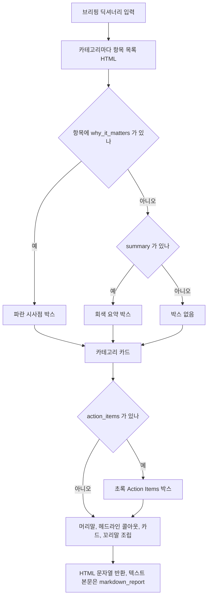

#### 4. 화면 표시 및 입력 데이터 항목 명세 (메일 본문 요소)
| 항목명 | 화면 표시/입력 구분 | UI 컴포넌트 | 필수 여부 | 데이터 타입 / 제약 | 기본값 | 유효성 검증 규칙 | 노출/수정 조건 |
| :--- | :---: | :--- | :---: | :--- | :---: | :--- | :--- |
| 문서 제목 | 노출 전용 | `<title>` | 필수 | String | `오늘의 AI 브리핑 - {date}` | - | 항상 |
| 머리말 배지 | 노출 전용 | 파란 둥근 배지 | 필수 | 고정 문구 | "AgentLens Daily Briefing" | - | 항상 |
| 머리말 제목·날짜 | 노출 전용 | `h1`, `p` | 필수 | String | "🌅 오늘의 AI 브리핑", "발행 일자: {date}" | - | 항상 |
| 헤드라인 콜아웃 | 노출 전용 | 파란 박스 `📌 {headline}` | 필수 | String | headline 이 없으면 "오늘의 AI 핵심 동향" | 이스케이프 없음 | 항상 |
| 개요 | 노출 전용 | 콜아웃 안 `div` | 선택 | String | - | 줄바꿈·`**` 를 변환하지 않은 원문 | `overview` 가 있을 때 |
| 카테고리 카드 머리글 | 노출 전용 | `h2` `{아이콘} {이름}` | 필수 | String | 아이콘 기본 🎯 | backend 이름·이모지 | 카테고리마다 |
| 동향 | 노출 전용 | 기울임 `p` "동향: {요약}" | 선택 | String | - | - | 요약이 있을 때 |
| 항목 링크 | 노출 전용 | `<a target="_blank">` `• {제목}` | 필수 | String / URL | url 없으면 `#` | 이스케이프 없음 | 항목마다 |
| 소스 | 노출 전용 | 회색 `[source]` | 필수 | String | "" (빈 `[]` 로 보임) | - | 항목마다 (빈 값이어도 그림) |
| 시사점 / 요약 박스 | 노출 전용 | 파란 "💡 시사점:" / 회색 "📝 요약:" | 선택 | String | - | why 우선 | why 또는 summary 가 있을 때 |
| Action Items | 노출 전용 | 초록 박스 "✅ 오늘의 추천 Action Items" 번호 목록 | 선택 | Array | - | - | 있을 때 |
| 꼬리말 | 노출 전용 | 텍스트 + 링크 | 필수 | 고정 | "AgentLens • AI & Agent 기술 큐레이션 웹 애플리케이션", "대시보드 바로가기" → `http://localhost:3001` | 고정 URL | 항상 |

#### 5. 비즈니스 규칙
- **BR-BRF-008-1**: 텍스트 파트는 `markdown_report`, HTML 파트는 이 템플릿. 둘 다 UTF-8 (`email_service.py:256-260`).
- **BR-BRF-008-2**: 대시보드 링크는 `http://localhost:3001` 로 고정이다. 실제 프론트 개발 포트(:3000)와 다르다 (`CLAUDE.md` `make dev`).
- **BR-BRF-008-3**: 카테고리 이름·아이콘은 backend `CATEGORY_DEFS` 값이다 (화면의 긴 라벨이 아님).

#### 6. 예외 처리 및 엣지 케이스
| 발생 상황 | 화면 반응 및 시스템 처리 방식 | 사용자 안내 메시지 |
| :--- | :--- | :--- |
| 수집한 제목·요약·URL·source 에 HTML 특수문자 | 이스케이프 없이 f-string 으로 끼워 넣어 메일 HTML 이 깨지거나 임의 마크업이 들어갈 수 있다 (`email_service.py:35-65`, `:122`) | — |
| 카테고리에 항목 0건 | 머리글·동향만 있고 빈 목록 | — |
| `overview` 의 줄바꿈 | HTML 에서 한 줄로 이어 보인다 (변환 없음) | — |

#### 7. 비즈니스 에러 코드 매핑
| 비즈니스 에러 코드 | 발생 사유 | HTTP 상태 코드 매핑 | 클라이언트 표시 형태 |
| :--- | :--- | :---: | :--- |
| (없음) | 템플릿 생성은 실패 경로가 없다. 전송 오류는 FUNC-BRF-006 | - | - |

---

### [FUNC-BRF-009] 웹훅 테스트 전송

#### 1. 기본 정보
- **기능명**: Slack·Discord·일반 웹훅 연동 확인 메시지 전송
- **기능 ID**: `FUNC-BRF-009`
- **대응 요구사항 ID**: `REQ-BRF-005`
- **대상 화면 코드**: `SCR-BRF-003` (웹훅 탭)
- **우선순위**: Should Have
- **관련 액터**: 사용자, 웹훅 수신 서버
- **관련 코드**: `backend/app/api/webhook.py:11-26`, `backend/app/services/webhook_service.py:9-69`, `:154-157`, `frontend/src/components/BriefingSettingsModal.tsx:265-281`, `:288-293`, `frontend/src/lib/api.ts:218-230`

#### 2. 사전 조건
1. 설정 대화상자에서 웹훅 탭을 고른 상태다.
2. 설정을 다 불러왔고 웹훅 입력란이 비어 있지 않다.

#### 3. 사용자 인터랙션 및 시스템 동작 흐름
1. 사용자가 바닥 "연결 테스트"를 누른다.
2. 화면은 대상 URL 을 웹훅 입력란, 저장된 Slack URL, 저장된 Discord URL 순으로 첫 번째 비어 있지 않은 값(앞뒤 공백 제거)으로 정한다. `http` 로 시작하지 않으면 요청 없이 오류 알림 "올바른 웹훅 URL을 입력해주세요.".
3. 결과 알림을 지우고 진행 표시. `POST /api/webhook/test` 본문 `{webhook_url}` (`provider` 는 보내지 않음), 타임아웃 8000ms.
4. 서버: URL 이 `http` 로 시작하지 않으면 400.
5. 제공자: `provider == "auto"`(기본) 면 URL 소문자에 `slack.com` → slack, `discord.com`/`discordapp.com` → discord, 그 밖 → generic. `auto` 가 아니면 받은 값을 그대로 쓴다.
6. 제공자별 테스트 페이로드를 httpx JSON POST(타임아웃 8.0초)로 보낸다. 200 또는 204 만 성공.
7. 성공 응답 `{"success": true, "message": "테스트 웹훅 메시지가 성공적으로 전송되었습니다."}` 를 성공 알림으로 보인다.

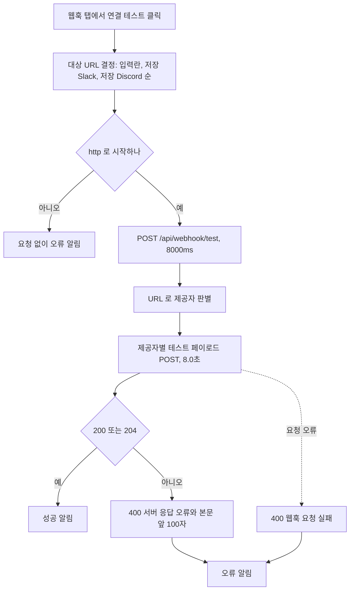

#### 4. 화면 표시 및 입력 데이터 항목 명세
| 항목명 | 화면 표시/입력 구분 | UI 컴포넌트 | 필수 여부 | 데이터 타입 / 제약 | 기본값 | 유효성 검증 규칙 | 노출/수정 조건 |
| :--- | :---: | :--- | :---: | :--- | :---: | :--- | :--- |
| Slack / Discord 웹훅 URL | 사용자 입력 | `TextField type="url"` (FUNC-BRF-011 과 같은 입력란) | 필수 (비면 버튼 비활성) | String URL | 저장된 Slack URL, 없으면 Discord URL | 클라이언트: `http` 로 시작. 서버: `http` 로 시작 | 웹훅 탭 |
| `webhook_url` (요청) | API 입력 | - | 필수 | String | - | `startswith("http")` | - |
| `provider` (요청) | API 입력 | 화면 입력 없음 | 선택 | String (`auto`, `slack`, `discord`, 그 밖) | `"auto"` | `auto` 가 아니면 그대로 사용 | 화면은 보내지 않음 |
| 연결 테스트 | 사용자 조작 | `Button` secondary | - | Button | - | 비활성: 불러오는 중, 입력란 빈 값, 진행 중 | 웹훅 탭 선택 시 |
| 결과 알림 | 노출 전용 | `InlineAlert` | - | String | 성공 기본 "웹훅 테스트 전송 완료", 실패 기본 "웹훅 테스트 실패" | 서버 메시지 우선 (api.ts 기본 "웹훅 전송에 실패했습니다.") | 테스트 뒤 |

#### 5. 비즈니스 규칙
- **BR-BRF-009-1 (테스트 페이로드, 확인 시각 `%Y-%m-%d %H:%M UTC`)**:
  - slack: `text` "🔔 AgentLens 웹훅 연동 테스트 성공!" + header 블록("🔔 AgentLens 웹훅 알림 연동 완료") + mrkdwn section(연결 완료 안내, "매일 아침 정기 브리핑 및 `⭐️ Must Read` 하네스 소식이 이 채널로 자동 전달" 문구, 확인 시각).
  - discord: `content` "🔔 **AgentLens 웹훅 연동 테스트 성공!**" + embed(제목 "AgentLens AI 알림 연동 완료", 설명에 확인 시각, 색 3900150).
  - generic: `{"event": "agentlens.test", "message": "AgentLens Webhook Test Successful", "timestamp": …}`.
- **BR-BRF-009-2**: 테스트는 설정을 저장하지 않는다.
- **BR-BRF-009-3**: 성공 판정은 HTTP 200 또는 204 뿐이다 (201 등도 실패).

#### 6. 예외 처리 및 엣지 케이스
| 발생 상황 | 화면 반응 및 시스템 처리 방식 | 사용자 안내 메시지 |
| :--- | :--- | :--- |
| 대상 URL 이 `http` 로 시작하지 않음 (클라이언트) | 요청하지 않음 | "올바른 웹훅 URL을 입력해주세요." |
| URL 형식 오류 (서버) | 400 | "유효한 HTTP/HTTPS 웹훅 URL을 입력해주세요." |
| 수신 서버가 200/204 외 응답 | 400 | `서버 응답 오류 (HTTP {코드}): {본문 앞 100자}` |
| 요청 오류 (DNS, 연결, 타임아웃) | 400, 서버 로그 | `웹훅 요청 실패: …` |
| 그 밖 예외 | 400, 서버 로그 | `예기치 못한 오류: …` |
| 수신 서버가 8초 가까이 걸림 | 프론트 8000ms 와 서버 8.0초가 같아 프론트가 먼저 끊길 수 있다 (코드 읽기 기준) | 브라우저 중단 메시지 |
| 입력란이 비고 저장 URL 만 있음 | 버튼이 비활성이라 저장 URL 로 테스트할 수 없다 (대상 결정 규칙의 저장 URL 대체는 실제로 쓰이지 않음) | — |

#### 7. 비즈니스 에러 코드 매핑
| 비즈니스 에러 코드 | 발생 사유 | HTTP 상태 코드 매핑 | 클라이언트 표시 형태 |
| :--- | :--- | :---: | :--- |
| `BRF_WEBHOOK_URL_INVALID_CLIENT` | 클라이언트 URL 검사 실패 | - | 오류 알림 |
| `BRF_WEBHOOK_URL_INVALID` | 서버 URL 검사 실패 | 400 | 오류 알림 |
| `BRF_WEBHOOK_BAD_RESPONSE` | 200/204 외 응답 | 400 | 오류 알림 |
| `BRF_WEBHOOK_REQUEST_FAILED` | 요청 오류 | 400 | 오류 알림 |
| `BRF_WEBHOOK_UNEXPECTED` | 그 밖 예외 | 400 | 오류 알림 |

---

### [FUNC-BRF-010] 웹훅 브리핑 발송

#### 1. 기본 정보
- **기능명**: 브리핑 웹훅 발송 (수동 API, 자동 발송)
- **기능 ID**: `FUNC-BRF-010`
- **대응 요구사항 ID**: `REQ-BRF-006`
- **대상 화면 코드**: 없음. 이 API 를 부르는 화면은 어디에도 붙지 않은 SCR-BRF-004 뿐이다
- **우선순위**: Should Have
- **관련 액터**: API 호출자, 스케줄러, 웹훅 수신 서버
- **관련 코드**: `backend/app/api/webhook.py:15-43`, `backend/app/services/webhook_service.py:71-152`, `:159-162`, `backend/app/services/briefing_service.py:239-257`, `frontend/src/lib/api.ts:232-244`

#### 2. 사전 조건
1. 수동: 호출자가 `webhook_url` 을 안다. 자동: `settings.SLACK_WEBHOOK_URL` 또는 `settings.DISCORD_WEBHOOK_URL` 이 있다.

#### 3. 사용자 인터랙션 및 시스템 동작 흐름
1. 수동 `POST /api/webhook/send-briefing` 본문 `{webhook_url, provider}`. URL 이 `http` 로 시작하지 않으면 400.
2. 브리핑을 새로 만든다 (FUNC-BRF-001).
3. 웹훅용 요약 데이터를 만든다 (수동·자동이 다르다, BR-BRF-010-1).
4. 제공자는 `provider` 와 상관없이 항상 URL 로 판별한다.
5. 제공자별 페이로드(BR-BRF-010-2)를 FUNC-BRF-009 6번과 같은 방식(8.0초, 200/204 성공)으로 보낸다.
6. 수동 성공 응답 `{"success": true, "message": "오늘의 일일 브리핑이 웹훅으로 성공적으로 발송되었습니다."}`. 자동 발송은 결과를 확인하지 않는다.

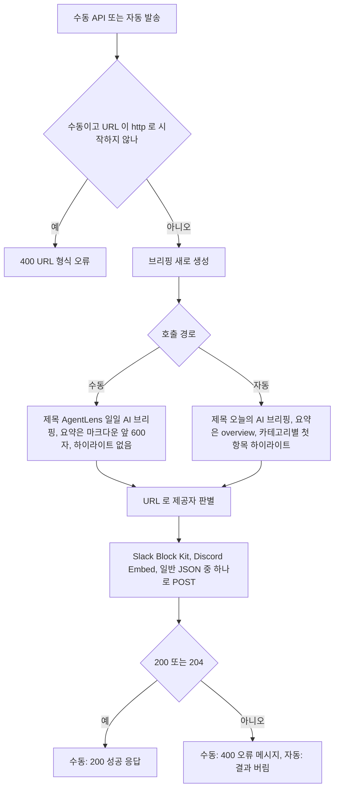

#### 4. 화면 표시 및 입력 데이터 항목 명세 (요청·페이로드 필드)
| 항목명 | 화면 표시/입력 구분 | UI 컴포넌트 | 필수 여부 | 데이터 타입 / 제약 | 기본값 | 유효성 검증 규칙 | 노출/수정 조건 |
| :--- | :---: | :--- | :---: | :--- | :---: | :--- | :--- |
| `webhook_url` (요청) | API 입력 | 화면 없음 (SCR-BRF-004 만 사용) | 필수 | String | - | `startswith("http")` | - |
| `provider` (요청) | API 입력 | - | 선택 | String | `"auto"` | 받기만 하고 쓰지 않는다 | - |
| `title` (웹훅) | 노출 전용 (수신 채널) | Slack header / Discord content / generic `title` | 필수 | String | 없으면 "🌅 오늘의 AI 에이전트 인텔리전스 브리핑" | 수동 `🌅 AgentLens 일일 AI 브리핑 ({date})`, 자동 `🌅 오늘의 AI 브리핑 ({date})` | 항상 |
| `executive_summary` (웹훅) | 노출 전용 | Slack section / Discord embed 설명(1500자) / generic `summary` | 필수 | String | "" | 수동: 헤드라인 + 빈 줄 + `markdown_report` 앞 600자 + `...`. 자동: 헤드라인 + 빈 줄 + `overview` | 항상 |
| `top_highlights` (웹훅) | 노출 전용 | Slack 하이라이트(최대 5) / Discord field(최대 4) / generic 배열 | 선택 | Array[브리핑 항목] | `[]` | 수동: 항상 빈 목록. 자동: 카테고리마다 첫 항목 1건(최대 4건) | 있을 때 |
| `date` | 노출 전용 | Slack context / Discord footer / generic `date` | 필수 | String | "" | 브리핑 `date` | 항상 |

#### 5. 비즈니스 규칙
- **BR-BRF-010-1 (요약 데이터)**: 수동 = `title` `🌅 AgentLens 일일 AI 브리핑 ({date})`, `executive_summary` = 헤드라인 + `\n\n` + `markdown_report[:600]` + `...`, `top_highlights` = `[]` (`webhook.py:34-39`). 자동 = `title` `🌅 오늘의 AI 브리핑 ({date})`, `executive_summary` = 헤드라인 + `\n\n` + `overview`, `top_highlights` = 카테고리마다 `items[:1]` (`briefing_service.py:242-251`).
- **BR-BRF-010-2 (제공자별 페이로드)**:
  - slack: header 블록(`title`), mrkdwn section `*📌 오늘의 총평*\n{요약}`, divider, 하이라이트가 있으면 section `*🎯 핵심 하이라이트*` + 최대 5건(``*{n}. <url|제목>* `[category]` ``, why 가 있으면 `\n   ↳ 💡 _{why}_`), context `AgentLens AI Curation Platform • {date}`. 최상위 `text` = `{title}\n{요약}`.
  - discord: `content` = `**{title}**`, embed 하나(제목 "📌 Executive Summary", 설명 = 요약 1500자, 색 3900150, 하이라이트 최대 4건을 field 로: 이름 = 제목 100자, 값 = `[기사 원문 바로가기](url)\n💡 {why_it_matters 또는 summary}` 200자, `inline: false`, footer `AgentLens • {date}`).
  - generic: `{"event": "agentlens.daily_briefing", "title", "summary", "top_highlights", "date"}`.
- **BR-BRF-010-3**: 제공자는 항상 URL 로 판별한다 (`dispatch_briefing` 은 `provider` 인자를 받지 않는다, `webhook_service.py:159-162`).

#### 6. 예외 처리 및 엣지 케이스
| 발생 상황 | 화면 반응 및 시스템 처리 방식 | 사용자 안내 메시지 |
| :--- | :--- | :--- |
| 수동 URL 형식 오류 | 400 | "유효한 HTTP/HTTPS 웹훅 URL을 입력해주세요." |
| 전송 실패 (수동) | 400 | FUNC-BRF-009 와 같은 메시지 |
| 전송 실패 (자동) | 결과를 버린다. 로그도 `webhook_service` 의 요청 오류·예외 로그뿐 (비 200/204 응답은 로그 없음) | — |
| 자동 발송 URL 이 `http` 로 시작하지 않음 | `send_payload` 가 "유효한 웹훅 URL이 아닙니다." 로 실패를 돌려주지만 버려진다 | — |
| Discord 하이라이트 값 | `it.get('why_it_matters', it.get('summary', ''))` 는 키가 있으면 빈 문자열이어도 쓰는데 브리핑 항목엔 `why_it_matters` 키가 늘 있어 요약으로 넘어가지 않는다 (`webhook_service.py:129`, `briefing_service.py:130`) | — |

#### 7. 비즈니스 에러 코드 매핑
| 비즈니스 에러 코드 | 발생 사유 | HTTP 상태 코드 매핑 | 클라이언트 표시 형태 |
| :--- | :--- | :---: | :--- |
| `BRF_WEBHOOK_URL_INVALID` | URL 형식 오류 | 400 | (호출 화면 없음) SCR-BRF-004 피드백 박스 |
| `BRF_WEBHOOK_BAD_RESPONSE` / `BRF_WEBHOOK_REQUEST_FAILED` / `BRF_WEBHOOK_UNEXPECTED` | 전송 실패 | 400 | 같음. 자동 발송은 표시 없음 |

---

### [FUNC-BRF-011] 연동 설정 조회·저장

#### 1. 기본 정보
- **기능명**: 공유 & 알림 설정 (Notion·SMTP·웹훅) 조회와 저장
- **기능 ID**: `FUNC-BRF-011`
- **대응 요구사항 ID**: `REQ-BRF-005`
- **대상 화면 코드**: `SCR-BRF-003`
- **우선순위**: Must Have
- **관련 액터**: 사용자 (로컬 운영자)
- **관련 코드**: `backend/app/api/briefing.py:116-211`, `backend/app/schemas/news.py:116-129`, `backend/app/config.py:14-37`, `:144-173`, `frontend/src/components/BriefingSettingsModal.tsx:94-481`, `frontend/src/components/Header.tsx:87`, `:216`, `frontend/src/components/CommandPalette.tsx:134-142`, `frontend/src/app/page.tsx:162`, `:288`, `:292`, `frontend/src/lib/api.ts:573-608`, `frontend/src/types/news.ts:184-211`, `docker-compose.yml:38`, `frontend/src/components/ui/Tabs.tsx`, `frontend/src/components/ui/ScrollRow.tsx`

#### 2. 사전 조건
1. 진입: 헤더 더보기 메뉴 "공유 & 알림"(모든 폭), 커맨드 팔레트 "공유 & 알림 설정 열기"(부제 "Notion · 이메일 · 웹훅 브리핑 연동"), 브리핑 대화상자의 설정 바로가기(FUNC-BRF-003).
2. backend 가 루트 `config.json` 을 읽고 쓸 수 있다.

#### 3. 사용자 인터랙션 및 시스템 동작 흐름
1. 대화상자(제목 "공유 & 알림 설정", 설명 "Notion 페이지 발행, 이메일(SMTP), Slack/Discord 알림을 설정합니다.", `Dialog size="md"`: 768px 이상 너비 560px, 미만 전체 화면)가 열린다.
2. 열 때마다 `GET /api/briefing/settings`(타임아웃 8000ms)를 부르고, 그동안 패널 자리에 스피너와 "설정을 불러오는 중..." 을 보인다.
3. 응답으로 입력란을 채운다. 토큰·비밀번호가 저장돼 있으면 입력란 값을 `***` 로 둔다.
4. 탭 세 개(`Tabs`, `aria-label="연동 종류"`): "Notion 연동", "이메일 (SMTP)", "웹훅 (Slack/Discord)". 탭을 바꾸면 결과 알림을 지운다.
5. 바닥 버튼은 탭과 관계없이 "닫기", "연결 테스트"(지금 탭의 FUNC-BRF-005·007·009), "저장"(세 탭의 값을 한 번에) 세 개다. 바닥 문구 "모든 토큰과 비밀번호는 config.json에 로컬 저장됩니다.".
6. "저장"을 누르면 결과 알림을 지우고 `POST /api/briefing/settings`(타임아웃 10000ms)로 페이로드를 보낸다.
7. 서버는 메모리 설정을 고친 뒤 `config.json` 을 덮어쓰고 `settings.reload()` 를 부른다.
8. 성공이면 성공 알림(서버 메시지)을 보이고 설정을 다시 불러온다. 실패면 오류 알림.
9. Escape·닫기 버튼·바닥 "닫기"로 닫힌다. 입력을 잃지 않도록 배경막 클릭으로는 닫히지 않는다 (`dismissOnScrim={false}`).

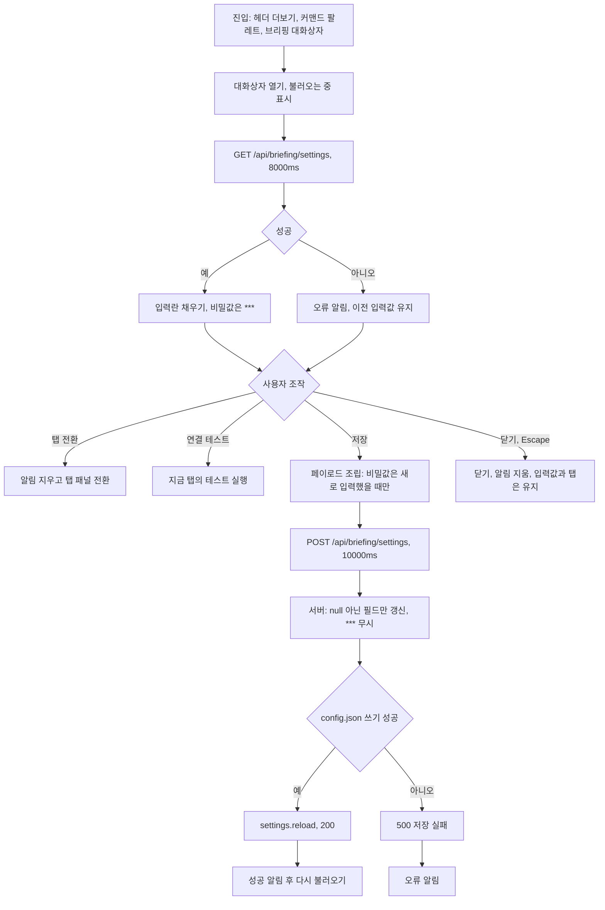

#### 4. 화면 표시 및 입력 데이터 항목 명세
| 항목명 | 화면 표시/입력 구분 | UI 컴포넌트 | 필수 여부 | 데이터 타입 / 제약 | 기본값 | 유효성 검증 규칙 | 노출/수정 조건 |
| :--- | :---: | :--- | :---: | :--- | :---: | :--- | :--- |
| 연동 종류 탭 | 선택 | `Tabs` (`aria-label="연동 종류"`), 공통 가로 스크롤 줄 | 필수 | Enum (`notion`, `email`, `webhook`) | 첫 열림 `notion`, 이후 마지막 탭 | 바꾸면 알림 지움. 처음 그릴 때와 선택이 바뀔 때 선택 탭이 보이도록 줄을 민다. `aria-controls` 는 선택 탭에만 | 항상. 넘치면 흐림, 768px 이상 `연동 종류 이전 항목 보기`/`… 다음 항목 보기` 버튼, 미만 장식 넘침 표시 |
| Notion 연동 방법 안내 | 노출 전용 | 안내 상자 3단계 + 링크 "Notion 개발자 포털"(`https://www.notion.so/my-integrations`, 새 탭) | - | 고정 문구 | - | - | Notion 탭 |
| Notion API 시크릿 토큰 → `notion_api_key` | 사용자 입력 | `SecretField` (`type=password`, "토큰 보기"/"토큰 숨기기" 토글, 설명 "Internal Integration Token", 고정폭 글꼴) | 선택 | String | 저장값 있으면 `***`, 없으면 "" | 비어 있지 않고 `***` 가 아닐 때만 보냄. 서버: `***` 무시, 앞뒤 공백 제거 | Notion 탭. placeholder: 저장값 있으면 "토큰 등록됨 (변경 시 새로 입력)", 없으면 "secret_..." |
| Notion 부모 페이지 ID 또는 전체 URL → `notion_page_id` | 사용자 입력 | `TextField` (placeholder "https://notion.so/... 또는 32자리 UUID") | 선택 | String | 저장값 | 항상 보냄. 서버: 공백 제거 후 원문 저장 (`clean_id` 는 사용할 때 적용) | Notion 탭 |
| 정기 브리핑 발행 시 자동으로 Notion 페이지 생성 → `notion_auto_export` | 선택 | `Switch` (`role="switch"`) | - | Boolean | 저장값 또는 false | 항상 보냄 | Notion 탭 |
| SMTP 서버 호스트 → `smtp_host` | 사용자 입력 | `TextField` (placeholder "smtp.gmail.com / smtp.naver.com") | 선택 | String | 저장값 | 항상 보냄, 서버 공백 제거 | 이메일 탭 |
| 포트 → `smtp_port` | 사용자 입력 | `TextField type="number"`, `inputMode="numeric"` | 선택 | Integer | 저장값, 0·없음이면 587 | `Number(입력)` 그대로 보냄 (범위 검사 없음) | 이메일 탭 |
| SMTP 계정 (아이디/이메일) → `smtp_user` | 사용자 입력 | `TextField` (placeholder "myaccount@gmail.com") | 선택 | String | 저장값 | 항상 보냄 | 이메일 탭 |
| SMTP 비밀번호 (또는 앱 비밀번호) → `smtp_password` | 사용자 입력 | `SecretField` ("비밀번호 보기"/"비밀번호 숨기기") | 선택 | String | 저장값 있으면 `***` | 비어 있지 않고 `***` 가 아닐 때만 보냄. 서버 `***` 무시 | 이메일 탭. placeholder: 저장값 있으면 "비밀번호 등록됨 (변경 시 새로 입력)", 없으면 "16자리 앱 비밀번호" |
| 발신자 주소 (From) → `smtp_from` | 사용자 입력 | `TextField` (placeholder "AgentLens <noreply@mydomain.com>") | 선택 | String | 저장값 | 항상 보냄 (형식 검사 없음) | 이메일 탭 |
| 기본 수신자 목록 (To) → `smtp_to` | 사용자 입력 | `TextField` (설명 "쉼표로 구분합니다.", placeholder "user1@company.com, team@company.com") | 선택 | String 쉼표 구분 | 저장값 | 항상 보냄 (형식 검사 없음) | 이메일 탭 |
| STARTTLS 암호화 사용 → `smtp_use_tls` | 선택 | `Switch` | - | Boolean | 저장값 또는 true | 항상 보냄 | 이메일 탭 |
| 정기 브리핑 시 수신자 목록으로 자동 발송 → `email_auto_send` | 선택 | `Switch` | - | Boolean | 저장값 또는 false | 항상 보냄 | 이메일 탭 |
| Slack / Discord 웹훅 URL → `slack_webhook_url` / `discord_webhook_url` | 사용자 입력 | `TextField type="url"` (placeholder "https://hooks.slack.com/services/... 또는 https://discord.com/api/webhooks/...", 설명 "URL에 따라 Slack Block Kit 또는 Discord Embed 서식으로 자동 최적화 전송됩니다.") | 선택 | String URL | 저장된 Slack URL, 없으면 Discord URL | BR-BRF-011-4 | 웹훅 탭 |
| 설정 불러오는 중 | 노출 전용 | `Spinner` + "설정을 불러오는 중..." | - | - | - | - | 조회 중 (탭 패널 대신) |
| 결과 알림 | 노출 전용 | `InlineAlert` success / danger | - | String | - | 서버 메시지 우선 | 저장·테스트·조회 실패 뒤. 탭 전환·닫기 때 지움 |
| 바닥 문구 | 노출 전용 | 텍스트 | - | 고정 | "모든 토큰과 비밀번호는 config.json에 로컬 저장됩니다." | - | 항상 |
| 닫기 | 사용자 조작 | `Button` ghost | - | Button | - | - | 항상 |
| 연결 테스트 | 사용자 조작 | `Button` secondary + `ShieldCheck` | - | Button | - | 탭별 비활성 조건 (FUNC-BRF-005·007·009) | 항상 |
| 저장 | 사용자 조작 | `Button` primary | - | Button | - | 불러오는 중·저장 중 비활성 | 항상 |

조회 응답 (`GET /api/briefing/settings`, 프론트 타입 `BriefingSettings` `types/news.ts:184-211`):

| 항목명 | 화면 표시/입력 구분 | UI 컴포넌트 | 필수 여부 | 데이터 타입 / 제약 | 기본값 | 유효성 검증 규칙 | 노출/수정 조건 |
| :--- | :---: | :--- | :---: | :--- | :---: | :--- | :--- |
| `title` | 노출 전용 (API) | 화면 미사용 | 필수 | String | "오늘의 AI 브리핑" | `briefing.title` 원문 | 이 API 로 수정 불가 |
| `auto_dispatch_hour` | 노출 전용 (API) | 화면 미사용 | 필수 | Integer | 0 | `briefing.auto_dispatch_hour` 원문 | 수정 불가, 스케줄에 쓰이지 않음 |
| `notion.enabled` | 노출 전용 (API) | 화면 미사용 | 필수 | Boolean | false | - | 저장 시 자동 계산 (BR-BRF-011-6) |
| `notion.has_api_key` | 노출 전용 (API) | 토큰 입력란 `***`·placeholder 결정 | 필수 | Boolean | false | 토큰이 비어 있지 않으면 true | - |
| `notion.masked_api_key` | 노출 전용 (API) | 화면 미사용 | 필수 | String | "" | 8자 초과면 앞 4자 + `...` + 뒤 4자, 아니면 `***`, 없으면 "" | - |
| `notion.page_id` / `notion.auto_export` | 노출 전용 (API) | Notion 탭 입력란 | 필수 | String / Boolean | "" / false | - | - |
| `email.smtp_host` / `smtp_port` / `smtp_user` / `smtp_from` / `smtp_to` / `use_tls` / `auto_send` | 노출 전용 (API) | 이메일 탭 입력란 | 필수 | String / Int / String / String / String / Bool / Bool | "" / 587 / "" / "" / "" / true / false | - | - |
| `email.has_password` / `email.enabled` | 노출 전용 (API) | 비밀번호 `***` 결정 / 화면 미사용 | 필수 | Boolean | false | 비밀번호 자체는 내려보내지 않는다 | - |
| `webhooks.slack_webhook_url` / `discord_webhook_url` | 노출 전용 (API) | 웹훅 입력란 | 필수 | String (원문) | "" | 마스킹 없이 원문 | - |
| `webhooks.auto_dispatch_daily_briefing` / `auto_alert_high_signal` | 노출 전용 (API) | 화면 미사용 | 필수 | Boolean | true / true | - | 이 API 로 수정 불가, 동작에 영향 없음 |

#### 5. 비즈니스 규칙
- **BR-BRF-011-1 (조회 원천)**: 조회는 메모리의 `config.json` 원본(`settings.raw_json_config` = 모듈 전역 `_json_data`)에서 읽는다 (`briefing.py:116-159`).
- **BR-BRF-011-2 (화면 저장 페이로드)**: Notion 페이지 ID, 자동 발행, SMTP 호스트·포트·계정·From·To·TLS·자동 발송, Slack·Discord URL 은 항상 넣는다. 토큰과 비밀번호는 비어 있지 않고 `***` 가 아닐 때만 넣는다 (`BriefingSettingsModal.tsx:199-218`).
- **BR-BRF-011-3 (서버 저장)**: 본문 `BriefingSettingsUpdate` 의 모든 필드는 선택이다(`notion_api_key`, `notion_page_id`, `notion_auto_export`, `smtp_host`, `smtp_port`, `smtp_user`, `smtp_password`, `smtp_from`, `smtp_to`, `smtp_use_tls`, `email_auto_send`, `slack_webhook_url`, `discord_webhook_url`). `null` 인 필드는 건드리지 않는다. 문자열은 앞뒤 공백을 지운다. `notion_api_key`, `smtp_password` 는 값이 `***` 면 무시한다.
- **BR-BRF-011-4 (웹훅 URL 결정)**: `slack_webhook_url` = 불러온 Slack URL, 그것이 비면 입력란 값에 `slack.com` 이 있을 때 입력란 값, 아니면 "". `discord_webhook_url` = 불러온 Discord URL, 그것이 비면 입력란 값에 `discord` 가 있을 때 입력란 값, 아니면 "" (`BriefingSettingsModal.tsx:209-210`).
- **BR-BRF-011-5 (저장 위치)**: `find_config_json()` 이 찾은 파일(cwd `config.json`, cwd 부모 `config.json`, 저장소 루트 `config.json`, `backend/app/config/config.json` 순). 없으면 `cwd/config.json` 에 새로 쓴다. `indent=2`, `ensure_ascii=False` JSON 으로 제자리 덮어쓰기(`open(p, "w")`) 후 `settings.reload()` (`config.py:14-25`, `:161-173`).
- **BR-BRF-011-6 (enabled 자동 계산)**: `notion_auto_export` 가 오면 `notion.enabled = auto_export 또는 토큰 존재`, `email_auto_send` 가 오면 `email.enabled = auto_send 또는 호스트 존재`. `enabled` 를 읽는 다른 코드는 없다.
- **BR-BRF-011-7 (수정 불가 항목)**: `briefing.title`, `briefing.auto_dispatch_hour`, `webhooks.auto_dispatch_daily_briefing`, `webhooks.auto_alert_high_signal` 은 이 API 로 바꿀 수 없다.
- **BR-BRF-011-8 (반영 시점)**: 저장해도 발송 서비스가 쓰는 `settings.NOTION_*`, `SMTP_*`, `EMAIL_AUTO_SEND` 는 프로세스를 다시 시작할 때까지 이전 값이다. Slack·Discord URL 은 이전 값이 빈 문자열이고 새 값이 있을 때만 바로 반영된다 (R1).
- **BR-BRF-011-9 (닫기)**: 닫으면 결과 알림을 지운다. 입력값과 고른 탭은 남는다. 다시 열면 설정을 새로 불러와 덮어쓴다.
- **BR-BRF-011-10 (Docker)**: Docker 는 `./config.json` 을 `/app/config.json` 에 읽기·쓰기(`:rw`) 단일 파일 bind mount 로 둔다 (`docker-compose.yml:38`). 저장이 제자리 쓰기라 Docker 에서도 저장되고, 그 결과 git 이 추적하는 루트 `config.json` 이 바뀐다 (토큰·비밀번호가 평문으로 남는다).

#### 6. 예외 처리 및 엣지 케이스
| 발생 상황 | 화면 반응 및 시스템 처리 방식 | 사용자 안내 메시지 |
| :--- | :--- | :--- |
| 조회 HTTP 오류 | 오류 알림, 입력란은 이전 값(또는 초기값) | "브리핑 설정을 불러오지 못했습니다." (api.ts 문구) |
| 조회 네트워크 오류·8000ms 초과 | 오류 알림 | 브라우저 예외 메시지 (Error 메시지가 없을 때만 "설정을 불러오지 못했습니다.") |
| 파일 쓰기 실패 | 500. 저장 전 `dict(settings.raw_json_config)` 가 얕은 복사라 메모리 원본의 중첩 딕셔너리는 이미 바뀐 상태로 남는다 | "설정 파일(config.json) 저장에 실패했습니다." |
| 저장 실패 (그 밖) | 오류 알림 | 서버 `detail`, 없으면 "설정 저장에 실패했습니다." |
| 저장 성공 | 성공 알림 후 다시 불러오기. 다시 불러오기가 실패하면 성공 알림이 조회 오류 알림으로 바뀐다 | "설정이 성공적으로 저장되었습니다." (서버 메시지가 비면 "설정이 안전하게 저장되었습니다.") |
| 토큰·비밀번호를 지우고 싶음 | 빈 값은 보내지 않아 화면에서 지울 방법이 없다 | — |
| 웹훅 URL 을 바꾸거나 지우고 싶음 | 저장된 Slack(또는 Discord) URL 이 입력란보다 우선해 새 URL 로 바꿀 수 없고, 입력란을 비워도 지워지지 않는다. Slack·Discord 가 아닌 일반 웹훅 URL 은 저장되지 않는다 | — |
| 포트 입력을 비움 | `Number('')` = 0 이 저장된다. 다시 열면 화면은 587 을 보이지만 파일에는 0 이 남는다 (코드 읽기 기준). 재시작 뒤 발송은 포트 0 으로 smtplib 를 부른다 | — |
| 발신자에 placeholder 형식 `AgentLens <…>` 입력 | 서버가 `AgentLens <{값}>` 으로 다시 감싸 `AgentLens <AgentLens <…>>` 가 되고, 같은 값이 SMTP envelope 발신자로도 쓰인다 | — |
| 배경막 클릭 | 닫히지 않는다 | — |

#### 7. 비즈니스 에러 코드 매핑
| 비즈니스 에러 코드 | 발생 사유 | HTTP 상태 코드 매핑 | 클라이언트 표시 형태 |
| :--- | :--- | :---: | :--- |
| `BRF_SETTINGS_LOAD_FAILED` | 조회 비 2xx | 비 2xx | 설정 대화상자 오류 알림 "브리핑 설정을 불러오지 못했습니다." |
| `BRF_SETTINGS_SAVE_FAILED` | `config.json` 쓰기 실패 | 500 | 오류 알림 "설정 파일(config.json) 저장에 실패했습니다." |
| `BRF_SETTINGS_INVALID_BODY` | 타입이 맞지 않는 본문 (예: `smtp_port` 에 숫자가 아닌 값). 화면은 만들지 않는다 | 422 (FastAPI 기본, 실행 확인하지 않음) | 오류 알림 (`detail` 이 배열이면 메시지가 문자열로 바뀐 형태, 확인하지 못함) |

---

### [FUNC-BRF-012] 웹훅 설정 모달 (미사용)

#### 1. 기본 정보
- **기능명**: 브라우저 저장 웹훅 URL 로 테스트·브리핑 즉시 전송
- **기능 ID**: `FUNC-BRF-012`
- **대응 요구사항 ID**: `REQ-BRF-008`
- **대상 화면 코드**: `SCR-BRF-004`
- **우선순위**: Won't Have (현재 어느 화면에도 연결되지 않음)
- **관련 액터**: 없음 (진입점 없음)
- **관련 코드**: `frontend/src/components/WebhookSettingsModal.tsx`, `frontend/src/lib/api.ts:218-244`

#### 2. 사전 조건
1. 진입점이 없다. `WebhookSettingsModal` 을 import 하는 화면이 없고, 페이지의 `webhookModalOpen` 상태는 `BriefingSettingsModal` 을 연다 (`page.tsx:99`, `:292`).

#### 3. 사용자 인터랙션 및 시스템 동작 흐름 (컴포넌트가 붙는다면)
1. 열릴 때 `localStorage['agentlens_webhook_url']` 를 읽어 값이 있으면 채운다. 입력할 때마다 같은 키에 쓴다.
2. URL 로 "Slack 감지됨" / "Discord 감지됨" / "Generic Webhook 감지됨" 배지를 보인다 (`http` 로 시작하지 않으면 배지 없음).
3. "테스트 발송" → `POST /api/webhook/test`, "오늘의 브리핑 즉시 전송" → `POST /api/webhook/send-briefing`. URL 이 `http` 로 시작하지 않으면 요청하지 않는다. 성공하면 URL 을 다시 저장한다.
4. 결과는 피드백 박스(`role="alert"` 또는 `status`)에 보인다.

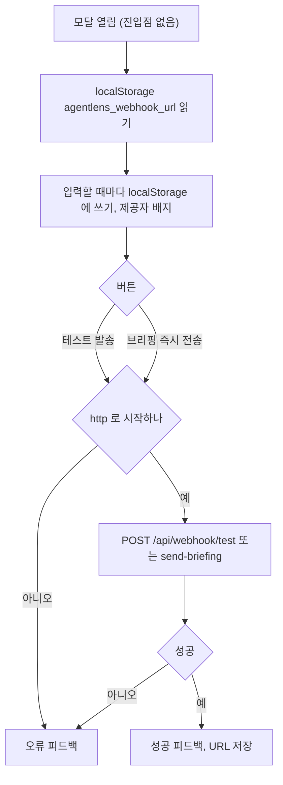

#### 4. 화면 표시 및 입력 데이터 항목 명세
| 항목명 | 화면 표시/입력 구분 | UI 컴포넌트 | 필수 여부 | 데이터 타입 / 제약 | 기본값 | 유효성 검증 규칙 | 노출/수정 조건 |
| :--- | :---: | :--- | :---: | :--- | :---: | :--- | :--- |
| 제목·부제 | 노출 전용 | `h2` "웹훅 알림 설정", "Slack / Discord 채널로 브리핑 및 특종을 자동 전송합니다." | - | 고정 | - | - | 열렸을 때 |
| Webhook Endpoint URL | 사용자 입력 | `<input type="url">` (placeholder "https://hooks.slack.com/services/... 또는 Discord Webhook URL") | 필수 | String | localStorage 값 또는 "" | 버튼에서 `http` 로 시작하는지 검사 | 열렸을 때 |
| 제공자 배지 | 노출 전용 | 배지 `{제공자} 감지됨` | - | Enum (Slack, Discord, Generic Webhook) | - | 소문자 URL 에 `slack.com` / `discord.com`·`discordapp.com` / `http` 시작 | URL 이 판별될 때 |
| 테스트 발송 | 사용자 조작 | 버튼 (`Send` 아이콘) | - | Button | - | 비활성: 진행 중 또는 빈 입력 | 열렸을 때 |
| 오늘의 브리핑 즉시 전송 | 사용자 조작 | 버튼 (`Bell` 아이콘) | - | Button | - | 비활성: 진행 중 또는 빈 입력 | 열렸을 때 |
| 피드백 박스 | 노출 전용 | `div role="alert"`/`status` | - | String | 실패 기본 "테스트 발송에 실패했습니다." / "브리핑 전송에 실패했습니다." | 서버 메시지 우선 | 버튼 뒤 |
| 안내문 | 노출 전용 | Slack·Discord URL 만드는 법, "입력하신 URL은 로컬 브라우저에 안전하게 저장되며, 정기 크론 수집 시에도 백엔드 환경변수(`SLACK_WEBHOOK_URL`)로 등록하여 자동 발송할 수 있습니다." | - | 고정 | - | - | 열렸을 때 |
| 닫기 | 사용자 조작 | 머리 X 버튼(`aria-label="닫기"`), 바닥 "닫기" | - | Button | - | - | 열렸을 때 |

#### 5. 비즈니스 규칙
- **BR-BRF-012-1**: 서버 설정(`config.json`)과 연결되지 않는다. 저장 위치는 브라우저 localStorage 키 `agentlens_webhook_url` 뿐이다.
- **BR-BRF-012-2**: 공통 `Dialog` 를 쓰지 않는 자체 오버레이다. 색은 다른 화면과 같은 디자인 토큰으로만 그린다. Escape·배경막 닫기 처리는 코드에 없다.

#### 6. 예외 처리 및 엣지 케이스
| 발생 상황 | 화면 반응 및 시스템 처리 방식 | 사용자 안내 메시지 |
| :--- | :--- | :--- |
| URL 이 `http` 로 시작하지 않음 | 요청하지 않음 | "올바른 HTTP/HTTPS 웹훅 URL을 입력해주세요." |
| 서버 오류 | 피드백 박스 | 서버 `detail` (api.ts 기본 "웹훅 전송에 실패했습니다." / "브리핑 전송에 실패했습니다.") |

#### 7. 비즈니스 에러 코드 매핑
| 비즈니스 에러 코드 | 발생 사유 | HTTP 상태 코드 매핑 | 클라이언트 표시 형태 |
| :--- | :--- | :---: | :--- |
| `BRF_WEBHOOK_URL_INVALID_CLIENT` | 클라이언트 URL 검사 실패 | - | 피드백 박스 |
| FUNC-BRF-009·010 의 코드 | 서버 실패 | 400 | 피드백 박스 |

---

### [FUNC-BRF-013] 자동 발송 스케줄

#### 1. 기본 정보
- **기능명**: 일일 브리핑 자동 발송 (Notion, 이메일, 웹훅)
- **기능 ID**: `FUNC-BRF-013`
- **대응 요구사항 ID**: `REQ-BRF-007`
- **대상 화면 코드**: 없음. 화면에서 이 스케줄을 보여 주는 곳은 없다 (`ScheduleModal` 은 수집 스케줄만 보여 준다)
- **우선순위**: Should Have
- **관련 액터**: 스케줄러 (APScheduler)
- **관련 코드**: `backend/app/scheduler.py:20-23`, `:55-62`, `backend/app/services/briefing_service.py:210-257`, `backend/app/config.py:75-100`, `:133-137`, `docker-compose.yml:34-35`, `frontend/src/components/ScheduleModal.tsx`

#### 2. 사전 조건
1. 앱 시작 시 `start_scheduler()` 가 job `daily_briefing_dispatch` 를 `CronTrigger(hour="0", minute="15", timezone="UTC")` 로 등록했다 (매일 00:15 UTC = 09:15 KST).
2. backend 프로세스가 그 시각에 떠 있다.

#### 3. 사용자 인터랙션 및 시스템 동작 흐름
1. 00:15 UTC 에 job 이 표준 출력에 `[Scheduler] Daily Briefing auto-dispatch triggered at …` 를 남기고 `briefing_service.auto_dispatch_all()` 을 부른다.
2. 브리핑을 한 번 만든다 (자체 DB 세션).
3. Notion: `NOTION_AUTO_EXPORT` 가 참이고 `NOTION_API_KEY` 가 있으면 FUNC-BRF-004 와 같은 방식으로 저장된 부모 페이지 아래에 페이지를 만든다. 성공 info, 실패 warning, 예외 error 로그.
4. 이메일: `EMAIL_AUTO_SEND` 가 참이고 `SMTP_HOST`, `SMTP_TO` 가 모두 있으면 FUNC-BRF-006 과 같은 방식으로 기본 수신자에게 보낸다. 로그 규칙은 Notion 과 같다.
5. 웹훅: 켜기·끄기 조건 없이 `SLACK_WEBHOOK_URL` 이 있으면 그 URL 로, `DISCORD_WEBHOOK_URL` 이 있으면 그 URL 로 FUNC-BRF-010 자동 형식으로 보낸다. 반환값은 확인하지도 로그로 남기지도 않는다.
6. 채널마다 예외를 잡아 로그만 남기고 다음 채널로 넘어간다. 재시도는 없다.

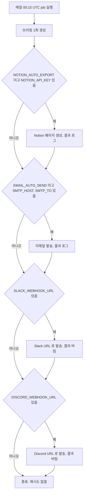

#### 4. 화면 표시 및 입력 데이터 항목 명세 (설정 입력)
| 항목명 | 화면 표시/입력 구분 | UI 컴포넌트 | 필수 여부 | 데이터 타입 / 제약 | 기본값 | 유효성 검증 규칙 | 노출/수정 조건 |
| :--- | :---: | :--- | :---: | :--- | :---: | :--- | :--- |
| `NOTION_AUTO_EXPORT` | 설정 입력 | SCR-BRF-003 Notion 스위치 | - | Boolean | false | `bool(config.briefing.notion.auto_export)` | 저장 뒤 재시작해야 반영 |
| `NOTION_API_KEY` / `NOTION_PAGE_ID` | 설정 입력 | SCR-BRF-003 Notion 입력란 | Notion 채널 필수 | String | "" | - | 저장 뒤 재시작해야 반영 |
| `EMAIL_AUTO_SEND` | 설정 입력 | SCR-BRF-003 이메일 스위치 | - | Boolean | false | - | 저장 뒤 재시작해야 반영 |
| `SMTP_HOST` / `SMTP_TO` 외 SMTP 값 | 설정 입력 | SCR-BRF-003 이메일 입력란 | 이메일 채널 필수 (호스트·수신자) | String / Int / Bool | "" / 587 / true | - | 저장 뒤 재시작해야 반영 |
| `SLACK_WEBHOOK_URL` / `DISCORD_WEBHOOK_URL` | 설정 입력 | SCR-BRF-003 웹훅 입력란, 환경 변수 | 웹훅 채널 필수 | String | "" | 환경 변수(pydantic-settings)가 `config.json` 값보다 우선 | 이전 값이 빈 문자열일 때만 저장 즉시 반영 |
| `briefing.auto_dispatch_hour` | 설정 (무효) | 화면 없음 | - | Integer | 0 | `BRIEFING_AUTO_DISPATCH_HOUR` 로 읽지만 스케줄에 쓰지 않음 | 무효 |
| `scheduler.auto_briefing_hour` | 설정 (무효) | 화면 없음 | - | Integer | 0 (`config.json:37`) | 코드가 읽지 않는다 | 무효 |
| `webhooks.auto_dispatch_daily_briefing` | 설정 (무효) | 화면 없음 | - | Boolean | true | 읽는 코드 없음 | false 로 둬도 웹훅 자동 발송은 멈추지 않는다 |

#### 5. 비즈니스 규칙
- **BR-BRF-013-1**: 실행 시각은 코드에 고정된 매일 00:15 UTC 다 (`scheduler.py:55`).
- **BR-BRF-013-2**: 채널 순서는 Notion → 이메일 → 웹훅(Slack → Discord). 한 채널의 실패가 다음 채널을 막지 않는다.
- **BR-BRF-013-3**: 웹훅은 켜기·끄기 스위치가 없다. URL 이 있으면 보낸다. 제공자는 URL 로 판별하므로 Slack 칸에 Discord URL 을 넣어도 Discord 형식으로 나간다. 두 칸에 같은 URL 이 있으면 두 번 보낸다.
- **BR-BRF-013-4**: 재시도·실패 알림이 없다. 로거 `agentlens.briefing` 의 info/warning/error 로만 남는다.
- **BR-BRF-013-5**: 같은 날 수동 Notion 발행과 별개로 새 페이지를 만든다 (중복 방지 없음).

#### 6. 예외 처리 및 엣지 케이스
| 발생 상황 | 화면 반응 및 시스템 처리 방식 | 사용자 안내 메시지 |
| :--- | :--- | :--- |
| Notion 실패 | warning 로그 `[Briefing] Notion auto-export failed: …` | 없음 |
| Notion 예외 | error 로그 `[Briefing] Notion auto-export exception: …` | 없음 |
| 이메일 실패·예외 | warning `[Briefing] Email auto-send failed: …` / error `[Briefing] Email auto-send exception: …` | 없음 |
| 웹훅 실패 | 결과를 버린다. 예외만 error `[Briefing] Webhook auto-dispatch exception: …` | 없음 |
| 그 시각에 backend 가 꺼져 있음 | 실행되지 않는다. 밀린 실행 처리는 APScheduler 기본값을 따른다 (확인하지 못함) | 없음 |
| 설정 화면에서 저장했지만 재시작 안 함 | Notion·이메일은 이전 값으로 판단·발송 (R1) | 없음 |

#### 7. 비즈니스 에러 코드 매핑
| 비즈니스 에러 코드 | 발생 사유 | HTTP 상태 코드 매핑 | 클라이언트 표시 형태 |
| :--- | :--- | :---: | :--- |
| `BRF_AUTO_NOTION_FAILED` | Notion 자동 발행 실패 | - | 표시 없음 (로그) |
| `BRF_AUTO_EMAIL_FAILED` | 이메일 자동 발송 실패 | - | 표시 없음 (로그) |
| `BRF_AUTO_WEBHOOK_FAILED` | 웹훅 자동 발송 실패 | - | 표시 없음 (예외일 때만 로그) |

---

## 상수·설정값

| 이름 | 값 | 위치 | 의미 |
|---|---|---|---|
| `CATEGORY_DEFS` | harness, mcp_plugins_skills, agent_tech, ai_news (순서 고정) | `backend/app/services/briefing_service.py:13-42` | 브리핑 카테고리, 이름, 아이콘, 기본 요약 |
| 카테고리별 항목 수 | 3 | `briefing_service.py:45`, `:119` | 카테고리당 최대 항목 |
| 보충 기준 | 2건 미만 | `briefing_service.py:57` | 이보다 적으면 전체 상위에서 키워드로 보충 |
| 보충 후보 수 | 15 | `briefing_service.py:61` | 보충 때 보는 전체 상위 항목 수 |
| 요약용 제목 길이 | 45자 / 요약 90자 | `briefing_service.py:86`, `:88` | 카테고리 요약 문장 자르기 |
| 헤드라인 제목 길이 | 40자 | `briefing_service.py:101-102` | 헤드라인 자르기 |
| 빈 브리핑 헤드라인 | `SWE-bench 평가 하네스 및 Model Context Protocol 생태계 동향` | `briefing_service.py:104` | 항목 0건일 때 |
| 브리핑 제목 | "오늘의 AI 브리핑" | `briefing_service.py:194` | 고정값 |
| 날짜 형식 | `%Y년 %m월 %d일` (UTC) | `briefing_service.py:114` | 브리핑 `date` |
| Notion API | `https://api.notion.com/v1`, 버전 `2022-06-28` | `backend/app/services/notion_service.py:10-11` | Notion 호출 |
| Notion 타임아웃 | 10.0초(조회·테스트), 15.0초(페이지 생성) | `notion_service.py:41`, `:239`, `:263` | httpx 타임아웃 |
| Notion 블록 제한 | 요청당 100블록, 텍스트 1900자, 제목 100자, 시사점·요약 250자 | `notion_service.py:87`, `:121`, `:139`, `:154-159`, `:188`, `:252` | Notion 페이로드 자르기 |
| SMTP 기본 포트 | 587 | `backend/app/config.py:86`, `backend/app/schemas/news.py:110` | 설정·테스트 기본값 |
| SMTP SSL 포트 | 465 | `backend/app/services/email_service.py:159` | 이 포트면 `SMTP_SSL` |
| SMTP 타임아웃 | 12.0초 | `email_service.py:160`, `:162` | 소켓 타임아웃 |
| 기본 발신자 | `noreply@agentlens.local` | `email_service.py:204`, `:238` | From 이 비었을 때 |
| 대시보드 링크 | `http://localhost:3001` | `email_service.py:137` | 메일 꼬리말 링크 (고정) |
| 웹훅 타임아웃 | 8.0초 | `backend/app/services/webhook_service.py:22` | httpx 타임아웃 |
| 웹훅 성공 코드 | 200, 204 | `webhook_service.py:24` | 이 외는 실패 |
| 웹훅 오류 본문 길이 | 100자 | `webhook_service.py:26` | 실패 메시지에 붙는 응답 본문 |
| Slack 하이라이트 수 | 5 | `webhook_service.py:95` | Slack 메시지 최대 항목 |
| Discord 하이라이트 수 / 설명 길이 / field 값 길이 | 4 / 1500자 / 200자 | `webhook_service.py:126`, `:138`, `:129` | Discord embed |
| Discord embed 색 | 3900150 | `webhook_service.py:60`, `:139` | 테스트·브리핑 공통 |
| 수동 웹훅 요약 길이 | 마크다운 앞 600자 | `backend/app/api/webhook.py:36` | `/send-briefing` 요약 |
| 자동 발송 시각 | 매일 00:15 UTC | `backend/app/scheduler.py:55` | `daily_briefing_dispatch` |
| `briefing.title` | "오늘의 AI 브리핑" | `config.json:40`, `config.py:76` | 읽지만 쓰이지 않음 |
| `briefing.auto_dispatch_hour` | 0 | `config.json:41`, `config.py:77` | 읽지만 쓰이지 않음 |
| `scheduler.auto_briefing_hour` | 0 | `config.json:37` | 코드가 읽지 않음 |
| 프론트 타임아웃 | 기본 8000ms, Notion 발행·이메일 20000ms, Notion 테스트 12000ms, SMTP 테스트 15000ms, 설정 저장 10000ms | `frontend/src/lib/api.ts:25`, `:508-512`, `:525-529`, `:542-546`, `:562-566`, `:599-603` | `fetchWithTimeout` |
| 복사 표시 시간 | 2000ms | `frontend/src/hooks/useCopyToClipboard.ts:70` | "복사됨"/"복사 실패" 유지 |
| 이메일 성공 알림 | 4000ms | `frontend/src/components/DailyBriefingModal.tsx:113` | 자동 숨김 |
| 대화상자 너비 | 브리핑 `xl` 896px, 설정 `md` 560px (768px 이상), 768px 미만 전체 화면 | `frontend/src/components/ui/Dialog.tsx:69-74`, `:255-257` | `Dialog` |
| localStorage 키 | `agentlens_webhook_url` | `frontend/src/components/WebhookSettingsModal.tsx:30`, `:40` | 미사용 모달의 저장 키 |

## 알려진 불일치·위험

- **R1 설정 저장 후 서비스에 반영되지 않는다.** `Settings` 의 필드 기본값은 클래스를 정의할 때 한 번 계산된 `config.json` 값이고, `settings.reload()` 는 모듈 전역 `_json_data` 만 바꾼 뒤 `__init__()` 을 다시 부른다. 그래서 `NOTION_API_KEY`, `NOTION_PAGE_ID`, `NOTION_AUTO_EXPORT`, `SMTP_*`, `EMAIL_AUTO_SEND` 는 프로세스를 다시 시작할 때까지 이전 값으로 남는다. `SLACK_WEBHOOK_URL`, `DISCORD_WEBHOOK_URL` 은 이전 값이 빈 문자열이고 새 값이 있을 때만 `merge_json_and_env` 에서 바뀐다. 반면 `GET /api/briefing/settings` 는 `raw_json_config`(새 값)를 읽으므로, 화면에는 저장된 값이 보이지만 발송·테스트(저장값 대체 시)는 이전 값으로 나간다. 근거: `backend/app/config.py:39-100`, `:108-142`, `:153-157`, `notion_service.py:35`, `:218-219`, `email_service.py:190-195`, `:233-240`, `briefing_service.py:216`, `:228`. 옛 기능명세는 pydantic-settings 동작을 작은 재현 코드로 확인했다고 적었다. 이번에는 코드 읽기로 다시 확인했다.
- **R2 저장소 `config.json` 에 테스트 값이 남아 있다.** 지금 루트 `config.json` 에 `notion.page_id` `test_notion_parent_page`, `email.smtp_host` `smtp.gmail.com`, `email.smtp_to` `team@example.com` 이 들어 있다 (`config.json:45`, `:50`, `:55`). 이 값들은 `test_briefing_settings_get_and_post`(`backend/tests/test_briefing_notion_email.py:134-152`)가 저장하는 값과 같다. 지금 테스트는 `llm_isolation` autouse fixture 가 `find_config_json` 과 `_json_data` 를 세션 임시 사본으로 돌려 원본을 고치지 않는다 (`backend/tests/conftest.py:162-202`). 남은 값은 이전 테스트 실행의 흔적으로 보인다 (언제 들어갔는지는 확인하지 못함).
- **R3 비밀값 저장·노출.** Notion 토큰, SMTP 비밀번호, 웹훅 URL 을 `config.json` 에 평문으로 저장한다. 인증 없는 `GET /api/briefing/settings` 가 웹훅 URL 원문과 Notion 토큰 앞뒤 4자를 돌려준다. CORS 는 모든 origin 을 허용한다. 근거: `backend/app/api/briefing.py:116-159`, `:207`, `backend/app/main.py:50-56`. 현재 `config.json` 의 토큰·비밀번호·웹훅 칸은 비어 있다.
- **R4 서버 측 요청 위조(SSRF) 가능성.** 인증 없는 `/api/webhook/test`, `/api/webhook/send-briefing` 가 `http` 로 시작하는 임의 URL 로 서버가 POST 하게 하고, 실패 시 응답 본문 앞 100자를 돌려준다. 근거: `backend/app/api/webhook.py:19-43`, `webhook_service.py:17-32`.
- **R5 이메일 HTML 이스케이프 없음.** 수집한 제목·요약·URL·source 를 그대로 HTML 에 넣는다. 근거: `email_service.py:35-65`, `:122`.
- **R6 From 헤더 중복.** 화면 placeholder 는 `AgentLens <noreply@mydomain.com>` 형식을 권하지만, 서버는 값을 다시 `AgentLens <{값}>` 으로 감싸고 같은 값을 SMTP envelope 발신자로도 쓴다. placeholder 대로 입력하면 `AgentLens <AgentLens <…>>` 가 된다. 근거: `frontend/src/components/BriefingSettingsModal.tsx:443`, `email_service.py:204-208`, `:238`, `:253`, `:169`.
- **R7 웹훅 URL 저장 로직.** 웹훅 탭에는 입력란이 하나뿐인데, 저장 시 불러온 Slack/Discord URL 이 입력란보다 우선한다. 이미 Slack URL 이 저장되어 있으면 새 Slack URL 로 바꿀 수 없고, 입력란을 비워도 지워지지 않으며, Slack·Discord 가 아닌 일반 웹훅 URL 은 저장되지 않는다. 근거: `BriefingSettingsModal.tsx:163-167`, `:209-210`.
- **R8 설정 대화상자 탭.** 이메일 실패 알림의 "이메일 설정 열기"도 이메일 탭으로 열지 않는다 (`initialTab` 을 넘기지 않아 처음엔 Notion 탭, 이후엔 마지막으로 본 탭). 근거: `frontend/src/app/page.tsx:288`, `:292`, `DailyBriefingModal.tsx:270-283`.
- **R9 글자 수로 자른 헤드라인·분야 요약.** 헤드라인은 첫 항목 제목을 40자에서, 분야 요약은 제목 45자·요약 90자에서 글자 수로 자르고 `...` 를 붙여 단어 중간에서 끊긴다 (예: `…persistent p...`). 프론트는 받은 글자를 그대로 그린다. 근거: `briefing_service.py:86`, `:88`, `:101-102`.
- **R10 backend 분야 이름·이모지.** `CATEGORY_DEFS` 의 이름(`MCP & 도구·스킬 생태계`, `에이전트 아키텍처 & 런타임`, `최신 AI 소식 & 프론티어 모델`)과 이모지 아이콘이 프론트 긴 라벨(`lib/labels.ts`)과 다르다. 대화상자의 카테고리별 요약 탭은 긴 라벨과 lucide 아이콘으로 바꿔 그리지만, 마크다운 전문 탭·Notion 페이지·이메일 본문·웹훅에는 backend 이름과 이모지(`📌` 포함)가 남는다. 근거: `briefing_service.py:13-42`, `:163-187`, `notion_service.py:79`, `email_service.py:120`.
- **R11 Discord 필드 폴백 무효.** `it.get('why_it_matters', it.get('summary', ''))` 는 키가 있으면 빈 문자열이라도 쓰는데, 브리핑 항목에는 `why_it_matters` 키가 항상 있어 요약으로 넘어가지 않는다. 근거: `webhook_service.py:129`, `briefing_service.py:130`.
- **R12 보충 규칙의 태그 처리.** `tags` 는 DB 문자열인데 `' '.join(it.tags)` 로 이어 붙여 글자 사이에 공백이 들어간다. 태그로는 키워드가 거의 맞지 않고 제목·요약으로만 맞는다. 근거: `briefing_service.py:68`, `backend/app/models/news.py:15`.
- **R13 "오늘의" 브리핑이지만 기간 필터가 없다.** 오래된 고신호 기사가 계속 상위에 남을 수 있다. Action Items 는 고정 문장이다. 근거: `briefing_service.py:47-51`, `:155-159`.
- **R14 수동 웹훅과 자동 웹훅의 내용이 다르다** (제목 문구, 요약 원천, 하이라이트 유무). `/send-briefing` 은 하이라이트를 보내지 않는다. 근거: `backend/app/api/webhook.py:34-39`, `briefing_service.py:242-251`.
- **R15 쓰이지 않는 설정·코드.** `briefing.title`, `briefing.auto_dispatch_hour`(읽기만 함), `scheduler.auto_briefing_hour`(읽지도 않음), `notion.enabled`, `email.enabled`, `webhooks.auto_dispatch_daily_briefing`, `webhooks.auto_alert_high_signal` 은 동작에 영향이 없다. `webhooks.auto_alert_high_signal` 에 해당하는 고신호 기사 알림 기능은 코드에 없다. 그런데 Slack 테스트 메시지는 "`⭐️ Must Read` 하네스 소식이 이 채널로 자동 전달" 된다고 안내한다 (`webhook_service.py:48`). `WebhookSettingsModal` 과 `POST /api/briefing/generate` 는 화면에서 쓰지 않는다. `WebhookBriefingRequest.provider` 는 무시된다.
- **R16 계약 정합.** 프론트 `types/news.ts` 의 `NotionExportResponse`, `EmailSendResponse` 는 정의만 있고 쓰는 곳이 없다 (`api.ts` 는 같은 모양의 인라인 타입을 쓴다). `DailyBriefingSchema`(zod)는 타입 추론에만 쓰고 응답 검증에 쓰지 않는다. 설정 API 는 `BriefingSettings`(`types/news.ts:184-211`)와 `BriefingSettingsUpdate`(`api.ts:580-595`)로 타입이 붙어 있다. MSW 목은 `/api/briefing/today`, `/api/briefing/generate` 만 있고 Notion·이메일·설정·웹훅 엔드포인트 목은 없다. 목 브리핑(`mockDailyBriefing`)은 backend 형식과 다르다: `title` "오늘의 AI 엔지니어링 브리핑", `date` ISO `YYYY-MM-DD`, `overview` 가 `• **이름**: …` 줄 형식이 아님, 카테고리 이름도 backend 이름과 다름. 근거: `frontend/src/types/news.ts:134-211`, `frontend/src/lib/api.ts:502-608`, `frontend/src/mocks/handlers.ts:71-125`, `:431-448`.
- **R17 자동 발송 실패 가시성.** 웹훅 결과는 버리고, Notion·이메일 실패는 로그로만 남는다. 재시도·알림은 없다. 근거: `briefing_service.py:215-257`.
- **R18 이메일 템플릿 대시보드 링크.** `http://localhost:3001` 로 고정되어 실제 프론트 주소(로컬 개발 :3000)와 다르다. 근거: `email_service.py:137`.
- **R19 프론트·서버 타임아웃 불일치.** 서버 쪽 외부 호출 타임아웃의 합이 프론트 타임아웃보다 길 수 있다 (Notion 발행 10+15초 대 20초, Notion 테스트 최대 3×10초 대 12초, 웹훅 8초 대 8초, SMTP 단계별 12초 대 15·20초). 이때 화면은 실패를 보이지만 서버 작업은 계속되어 페이지·메일이 실제로 만들어질 수 있다. 코드 읽기 기준이며 실행 확인하지 않았다.
- **R20 포트 0 저장.** 설정 화면에서 포트 입력을 비우고 저장하면 `smtp_port: 0` 이 저장된다. 화면은 다시 열 때 587 로 보인다. 코드 읽기 기준.

## 열린 질문

- **Q1**: (해결) 대응 요구사항 ID 를 `docs/spec-writer/01_PRD.md` 의 `REQ-BRF-001`~`008` 로 맞췄다. 처음에 둔 'FUNC 번호와 같은 REQ 번호' 는 쓰지 않는다.
- **Q2**: FUNC-BRF-012 `WebhookSettingsModal` 을 지울지 남길지 정해지지 않았다.
- **Q3**: R1(설정 재적재) 때문에 화면 저장과 실제 발송이 어긋난다. 저장 즉시 반영을 제품 요구로 볼지 정해지지 않았다.
- **Q4**: 자동 발송 시각을 `briefing.auto_dispatch_hour` 로 설정 가능하게 할지, 무효 설정을 지울지 정해지지 않았다.
- **Q5**: 브리핑 대상 기간(예: 최근 24시간)과 같은 날 Notion 페이지 중복 처리 정책이 정해지지 않았다.

## 옛 기능명세 ID 대응표

| 옛 ID | 새 ID | 기능 |
|---|---|---|
| BRF-01 | FUNC-BRF-001 | 브리핑 생성 |
| BRF-02 | FUNC-BRF-002 | 브리핑 바로가기 |
| BRF-03 | FUNC-BRF-003 | 브리핑 대화상자 |
| BRF-04 | FUNC-BRF-004 | Notion 발행 (수동) |
| BRF-05 | FUNC-BRF-005 | Notion 연결 테스트 |
| BRF-06 | FUNC-BRF-006 | 이메일 발송 (수동) |
| BRF-07 | FUNC-BRF-007 | SMTP 연결 테스트 |
| BRF-08 | FUNC-BRF-008 | 이메일 템플릿 |
| BRF-09 | FUNC-BRF-009 | 웹훅 테스트 전송 |
| BRF-10 | FUNC-BRF-010 | 웹훅 브리핑 발송 |
| BRF-11 | FUNC-BRF-011 | 연동 설정 조회·저장 |
| BRF-12 | FUNC-BRF-012 | 웹훅 설정 모달 (미사용) |
| BRF-13 | FUNC-BRF-013 | 자동 발송 스케줄 |
