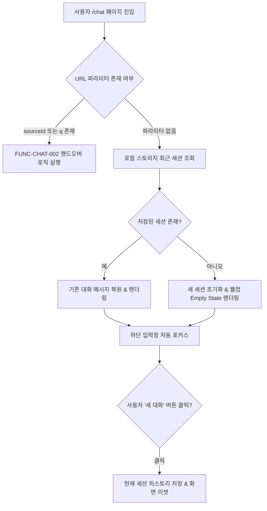
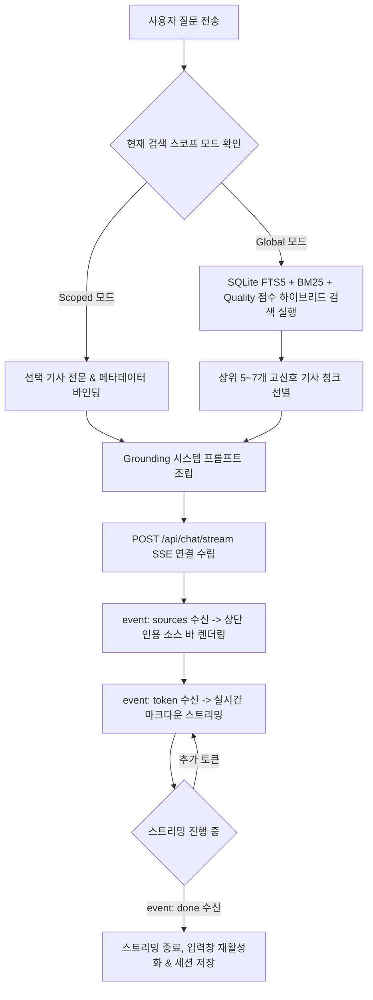
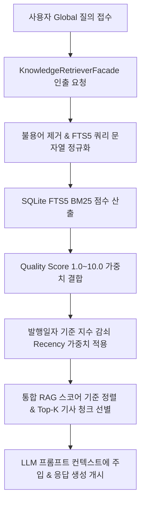
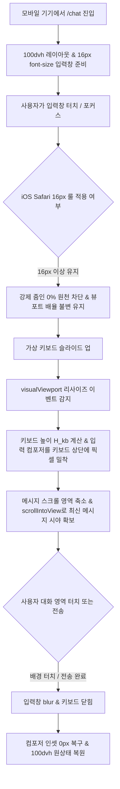
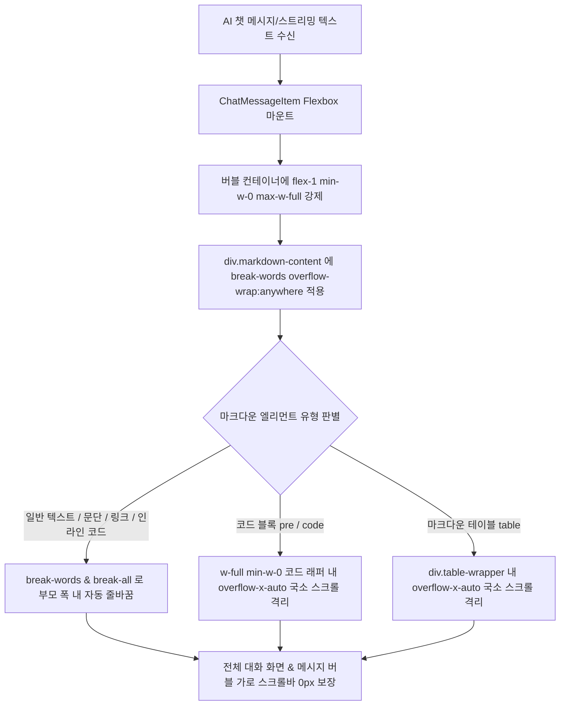
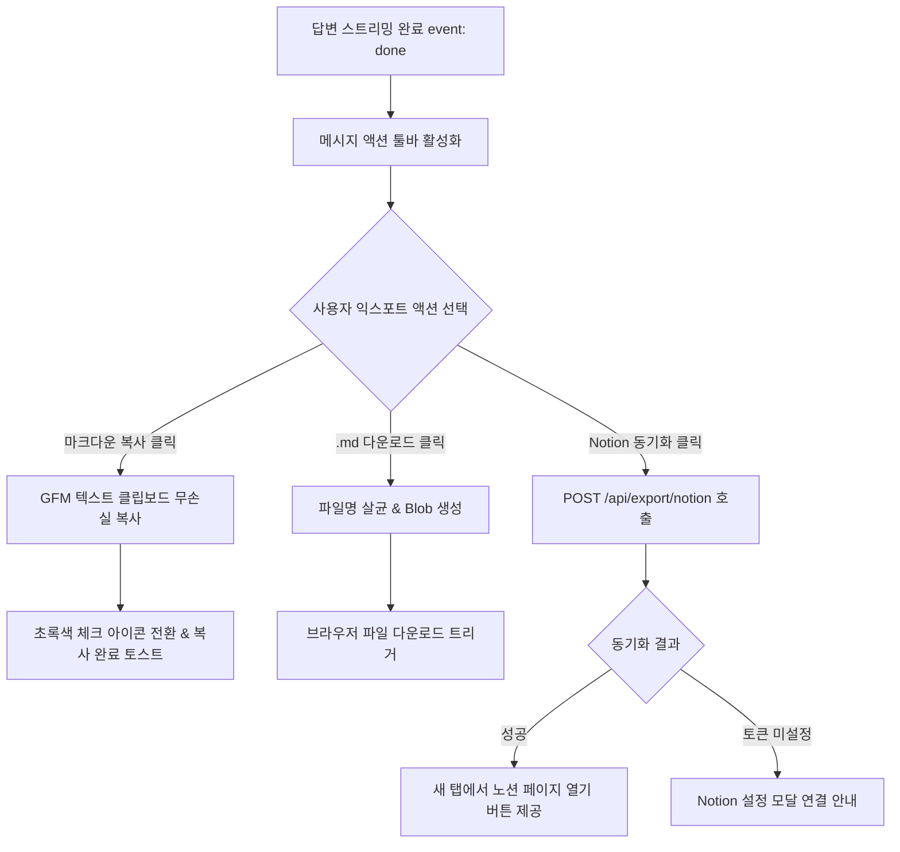
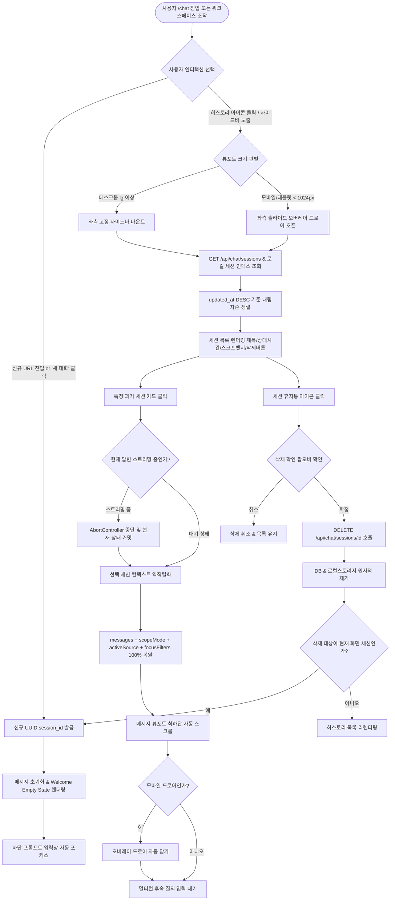

# 전용 AI 챗 및 개인 지식 RAG 상세기능정의서 (Dedicated AI Chat & Personal RAG FSD)

- **도메인**: 전용 AI 챗 워크스페이스, 컨텍스트 핸드오버, 듀얼 스코프 지식 검색(RAG), 인라인 인용 뱃지, 경량 리트리버, 수집 소스 타깃팅 포커스, 모바일 뷰포트 무결성, 원본 소스 실시간 전문 스크래핑 & 심층 분석, 자율 보충 검색 에이전트(Agentic Web Search), 메시지 렌더러 자동 줄바꿈 및 코드/테이블 국소 스크롤 격리, 대화 세션 히스토리 사이드바/드로어 및 멀티턴 복원/지속 관리
- **작성자**: 기획 명세 작성가 (`spec-writer`)
- **문서 버전**: v1.4 (대화 세션 히스토리 사이드바/드로어 및 멀티턴 대화 복원/지속 관리 [FUNC-CHAT-012] 완비)
- **상태**: Approved
- **선행 산출물**: [01_MARKET_BENCHMARK.md](../../market-analyst/01_MARKET_BENCHMARK.md) (v2.4), [01_PRD.md](../01_PRD.md) (v2.5)

---

## 단위 기능 상세 명세 (단위기능별 7대 상세 명세 완비)

---

### [FUNC-CHAT-001] 독립형 전용 AI 챗 워크스페이스 레이아웃 및 세션 관리

#### 1. 기본 정보
- **기능명**: 독립형 전용 AI 챗 워크스페이스 레이아웃 및 세션 관리
- **기능 ID**: `FUNC-CHAT-001`
- **대응 요구사항 ID**: `REQ-CHAT-001`, `REQ-CHAT-006`
- **대상 화면 코드**: `SCR-CHAT-001` (전용 AI 챗 페이지 `/chat`)
- **우선순위**: Must Have
- **관련 액터 (Actor)**: AI 에이전트 개발자 / 테크 리서처

#### 2. 사전 조건 (Pre-conditions)
1. 사용자가 웹 브라우저를 통해 `/chat` 경로에 정상 접근하였거나, 상단 내비게이션 바의 "AI 챗" 메뉴를 클릭한 상태.
2. 브라우저 로컬 저장소(`localStorage`) 및 세션 저장소(`sessionStorage`) 접근이 허용된 상태.
3. 백엔드 AI 챗 라우터 및 LLM 스트리밍 엔드포인트가 정상 구동 중인 상태.

#### 3. 사용자 인터랙션 및 시스템 동작 흐름과 플로우차트 (Step-by-Step Flow & Flowchart)
1. 사용자가 `/chat` 페이지에 진입한다.
2. 시스템은 URL 쿼리 파라미터(`sourceId`, `q`)의 유무를 판별한다:
   - 쿼리 파라미터가 있는 경우: `FUNC-CHAT-002`의 컨텍스트 핸드오버 파이프라인을 실행한다.
   - 쿼리 파라미터가 없는 경우: 로컬 저장소에 저장된 최근 활성 대화 세션을 조회한다. 기존 세션이 없으면 '새 대화 세션'을 초기화한다.
3. 화면은 상단 워크스페이스 헤더(글로벌/스코프 상태, 새 대화 시작 버튼, 세션 내역 버튼), 중앙 메시지 스크롤 영역, 하단 고정형 멀티라인 프롬프트 입력창으로 구성된 풀스크린 레이아웃을 렌더링한다.
4. 사용자가 "새 대화 시작" 버튼을 클릭하면 현재 대화가 로컬 세션 목록에 아카이빙되고 대화창이 빈 상태(Empty State)로 리셋된다.
5. 사용자가 브라우저를 새로고침하거나 탭을 닫았다 재접속해도 이전 대화 기록이 유실 없이 100% 자동 복구된다.



#### 4. 화면 표시 및 입력 데이터 항목 명세 (UI Data Elements - 8대 표준 컬럼)
| 항목명 | 화면 표시/입력 구분 | UI 컴포넌트 | 필수 여부 | 데이터 타입 / 제약 | 기본값 | 유효성 검증 규칙 (Validation) | 노출/수정 조건 |
| :--- | :---: | :--- | :---: | :--- | :---: | :--- | :--- |
| `session_id` | 시스템 관리 | Hidden State | 필수 | UUID v4 문자열 | 자동생성 | 정규식 `^[0-9a-f-]{36}$` | 상시 백그라운드 유지 |
| `nav_back_link` | 사용자 조작 | Button with Arrow Icon | 필수 | Link (`/`) | - | 클릭 시 메인 피드로 이동 | 헤더 좌측 상단 상시 노출 |
| `new_chat_button` | 사용자 조작 | Button (`새 대화`) | 필수 | Action Button | - | 클릭 시 현재 대화 세션 초기화 | 헤더 우측 상시 노출 |
| `chat_history_list` | 노출 전용 | Message Bubble List | 필수 | Array[ChatMessage] | [] | 시간순 오름차순 정렬 | 세션 내 메시지 존재 시 |
| `input_prompt` | 사용자 입력 | Auto-expanding Textarea | 필수 | String / 1~2000자 | "" | 트림 후 최소 1자 이상 | 답변 스트리밍 중 비활성화 |
| `submit_button` | 사용자 조작 | Icon Button (Send/Arrow) | 필수 | Submit Button | - | `input_prompt.trim().length > 0` | 텍스트 입력 시 활성화 |
| `welcome_empty_view` | 노출 전용 | Empty State Container | - | UI Component | - | `chat_history_list.length === 0` | 대화 내역이 없을 때 노출 |
| `suggested_prompts` | 사용자 선택 | Suggestion Pill Group | 선택 | Array[String] | 4개 기본값 | 클릭 시 `input_prompt` 자동 입력 | `welcome_empty_view` 내 노출 |

#### 5. 비즈니스 규칙 (Business Rules)
- **BR-CHAT-001-1 (세션 영속성 및 자동 저장)**: 모든 질문 및 답변 토큰은 수신 완료 즉시 로컬 스토리지 키 `agentlens_chat_session_{session_id}`에 직렬화되어 저장되어야 한다. 최대 20개의 최근 세션을 유지하며 초과 시 가장 오래된 세션부터 자동 정리(FIFO)한다.
- **BR-CHAT-001-2 (모바일 반응형 높이 보정)**: 모바일 브라우저의 가상 키보드 오픈 시 레이아웃 뭉개짐을 방지하기 위해 `100dvh`(Dynamic Viewport Height) 단위를 적용하고, 포커스 시 입력창이 뷰포트 최하단에 정확히 고정되어야 한다.
- **BR-CHAT-001-3 (키보드 단축키)**: `Enter` 키 입력 시 메시지를 즉시 전송하며, 줄바꿈은 `Shift + Enter`로 처리한다. 한글 등 IME 조합 중복 전송(Composition Issue) 방지 처리를 필수로 포함한다.

#### 6. 예외 처리 및 엣지 케이스 (Edge Cases & Exception Handling)
| 발생 상황 (Edge Case Scenario) | 화면 반응 및 시스템 처리 방식 | 사용자 안내 메시지 |
| :--- | :--- | :--- |
| 브라우저 로컬 저장소 용량 초과 (`QuotaExceededError`) | 가장 오래된 세션 5개를 자동 삭제 후 현재 세션 저장 재시도 | "저장 공간 확보를 위해 오래된 대화 기록을 정리했습니다." |
| 빈 문자열 또는 스페이스바만 입력 후 전송 시도 | 전송 이벤트를 무시하고 입력창에 포커스를 유지 | (메시지 미전송, 툴팁이나 피드백 없음) |
| 2,000자 초과 장문 프롬프트 붙여넣기 | 2,000자에서 입력을 자르고 글자 수 카운터를 붉은색으로 강조 | "질문은 최대 2,000자까지 입력할 수 있습니다." |
| 네트워크 단절 상태에서 진입 | 상단에 오프라인 경고 바 표시, 이전 대화 열람은 정상 지원 | "오프라인 상태입니다. 이전 대화만 확인할 수 있습니다." |

#### 7. 비즈니스 에러 코드 매핑
| 비즈니스 에러 코드 | 발생 사유 | HTTP 상태 코드 매핑 | 클라이언트 표시 형태 |
| :--- | :--- | :---: | :--- |
| `ERR_CHAT_STORAGE_BLOCKED` | 브라우저 쿠키/스토리지 전면 차단 환경 | 클라이언트 예외 | 화면 상단 고정 안내 배너 |
| `ERR_CHAT_PAYLOAD_TOO_LARGE` | 질문 본문 2,000자 초과 | 400 Bad Request | 입력창 하단 인라인 붉은색 경고 |

---

### [FUNC-CHAT-002] 뉴스 카드 및 상세 모달에서의 컨텍스트 핸드오버 (Context Handover)

#### 1. 기본 정보
- **기능명**: 뉴스 카드 및 상세 모달에서의 컨텍스트 핸드오버 (Context Handover)
- **기능 ID**: `FUNC-CHAT-002`
- **대응 요구사항 ID**: `REQ-CHAT-002`
- **대상 화면 코드**: `SCR-FEED-001` (피드), `SCR-FEED-002` (상세 모달), `SCR-CHAT-001` (전용 챗)
- **우선순위**: Must Have
- **관련 액터 (Actor)**: AI 에이전트 개발자 / 테크 리서처

#### 2. 사전 조건 (Pre-conditions)
1. 메인 피드의 뉴스 카드(`SCR-FEED-001`) 또는 뉴스 상세 모달(`SCR-FEED-002`)에 유효한 `NewsItem` 데이터가 로드된 상태.
2. 해당 기사의 고유 식별자(`id`), 제목(`title`), 3줄 요약(`tldr_bullets`) 또는 본문 요약(`summary`)이 존재함.

#### 3. 사용자 인터랙션 및 시스템 동작 흐름과 플로우차트 (Step-by-Step Flow & Flowchart)
1. 사용자가 뉴스 카드 또는 뉴스 상세 모달에서 `전용 챗에서 분석` 또는 `Ask AI` 버튼을 클릭한다.
2. 클라이언트는 대상 뉴스의 컨텍스트 객체(`{ id, title, category, tldr_bullets, summary, url }`)를 임시 메모리/세션 스토어에 바인딩하고 라우터 이동(`/chat?sourceId={id}`)을 실행한다. (상세 모달 내에서 작성 중이던 질문이 있을 경우 URL 파라미터 `&q={encodedQuestion}`로 함께 전달한다.)
3. 모달은 즉시 닫히고 화면이 전용 AI 챗 페이지(`/chat`)로 매끄럽게 전환된다.
4. `/chat` 페이지는 `sourceId`를 수신하여 상단 컨텍스트 영역에 대상 기사의 제목과 카테고리를 표시하는 **'활성 기사 컨텍스트 칩(Active Source Chip)'**을 즉각 생성한다.
5. 검색 스코프 모드는 자동으로 **'단일 기사 집중(Scoped Focus)'**으로 세팅된다.
6. 전달된 초기 질문(`q`)이 존재하는 경우, 사용자가 별도로 전송 버튼을 누르지 않아도 즉시 해당 질문에 대한 AI 답변 스트리밍 생성을 자동 개시한다.

```mermaid
flowchart TD
    A[뉴스 카드 또는 상세 모달 열람] --> B[사용자 '전용 챗에서 분석' CTA 클릭]
    B --> C{모달 내 입력 중인 질문 존재?}
    C -- 예 --> D[sourceId 및 q 쿼리 파라미터 빌드]
    C -- 아니오 --> E[sourceId 단독 쿼리 파라미터 빌드]
    D & E --> F[/chat 페이지로 라우팅 & 모달 닫힘]
    F --> G[기사 메타데이터 로드 & '활성 기사 칩' 헤더 렌더링]
    G --> H[검색 스코프 모드 = SCOPED 자동 지정]
    H --> I{초기 질문 q 존재?}
    I -- 예 --> J[자동 질문 전송 & AI 스트리밍 응답 개시]
    I -- 아니오 --> K[입력창에 포커스 & 추천 질문 칩 노출]
```

#### 4. 화면 표시 및 입력 데이터 항목 명세 (UI Data Elements - 8대 표준 컬럼)
| 항목명 | 화면 표시/입력 구분 | UI 컴포넌트 | 필수 여부 | 데이터 타입 / 제약 | 기본값 | 유효성 검증 규칙 (Validation) | 노출/수정 조건 |
| :--- | :---: | :--- | :---: | :--- | :---: | :--- | :--- |
| `source_chip` | 노출 전용 | Removable Pill Badge | 필수 | Component | - | 기사 제목 30자 말줄임 처리 | `sourceId` 존재 시 노출 |
| `source_title` | 노출 전용 | Text in Chip | 필수 | String / 최대 100자 | - | XSS 살균 완료 문자열 | 칩 내부 표시 |
| `source_category` | 노출 전용 | Small Category Badge | 필수 | Enum (`harness`, `mcp`, ...) | - | 5대 카테고리 매칭 | 칩 좌측 아이콘과 병기 |
| `remove_source_btn`| 사용자 조작 | Close Icon in Chip (X) | 필수 | Button | - | 클릭 시 단일 기사 컨텍스트 해제 | 호버/터치 시 활성화 |
| `handover_cta_btn` | 사용자 조작 | Indigo Action Button | 필수 | Button (`전용 챗에서 분석`) | - | 클릭 시 `/chat?sourceId={id}` 이동 | 카드 및 상세 모달 내 상시 노출 |
| `initial_prompt` | 사용자 전달 | URL Query String (`q`) | 선택 | String / URL Encoded | "" | 디코딩 후 트림 처리 | URL 파라미터 인입 시 |
| `article_preview_btn`| 사용자 조작| External Link Icon | 선택 | Button | - | 클릭 시 새 탭에서 원문 기사 열림 | 소스 칩 우측 노출 |
| `scope_auto_label` | 노출 전용 | Micro Text Badge | 필수 | String | '단일 기사 집중 모드' | Scoped 모드 바인딩 안내 | 소스 칩 하단 노출 |

#### 5. 비즈니스 규칙 (Business Rules)
- **BR-CHAT-002-1 (컨텍스트 바인딩 우선순위)**: URL 파라미터 `sourceId`로 전달된 기사 ID는 클라이언트 캐시 또는 백엔드 캐시에서 즉시 조회되어야 하며, 존재하지 않는 기사 ID인 경우 즉시 에러 토스트를 띄우고 `Global Corpus` 모드로 자동 폴백한다.
- **BR-CHAT-002-2 (컨텍스트 칩 제거 시 스코프 전이)**: 사용자가 활성 기사 칩의 `X` 버튼을 누르면 기사 바인딩이 해제되며, 검색 스코프는 즉각 `Global Corpus`(전체 뉴스 코퍼스) 모드로 전환된다.
- **BR-CHAT-002-3 (입력 질문 연속성 보장)**: 상세 모달 내 인라인 Ask AI에서 이미 타이핑해 둔 질문은 1글자도 유실되지 않고 전용 챗 입력창으로 그대로 전송되어야 한다.

#### 6. 예외 처리 및 엣지 케이스 (Edge Cases & Exception Handling)
| 발생 상황 (Edge Case Scenario) | 화면 반응 및 시스템 처리 방식 | 사용자 안내 메시지 |
| :--- | :--- | :--- |
| 존재하지 않거나 삭제된 `sourceId`로 진입한 경우 | 칩 생성 없이 전체 코퍼스(Global) 모드로 열리고 경고 토스트 노출 | "요청하신 기사를 찾을 수 없어 전체 뉴스 모드로 시작합니다." |
| 모달에서 질문 입력 도중 네트워크 단절 후 핸드오버 클릭 | 전용 챗으로 정상 이동하되 입력창에 질문을 그대로 채워둔 채 전송 대기 | "오프라인 상태입니다. 네트워크 연결 후 전송해주세요." |
| 동일한 기사 컨텍스트를 가진 상태에서 다시 피드로 나가 다른 기사 핸드오버 클릭 | 새 기사 메타데이터로 칩을 즉시 교체하고 새 대화 턴 시작 | (새 기사 칩으로 부드럽게 교체 애니메이션) |

#### 7. 비즈니스 에러 코드 매핑
| 비즈니스 에러 코드 | 발생 사유 | HTTP 상태 코드 매핑 | 클라이언트 표시 형태 |
| :--- | :--- | :---: | :--- |
| `ERR_HANDOVER_SOURCE_NOT_FOUND` | 유효하지 않은 sourceId 전달 | 404 Not Found | 상단 경고 토스트 및 Global 모드 전환 |
| `ERR_MALFORMED_QUERY_PARAM` | URL 쿼리 파라미터 디코딩 실패 | 400 Bad Request | 쿼리 무시 후 기본 빈 대화창 표시 |

---

### [FUNC-CHAT-003] 듀얼 스코프(Scoped Focus vs Global Corpus) 지식 검색 및 스트리밍 질의응답

#### 1. 기본 정보
- **기능명**: 듀얼 스코프(Scoped Focus vs Global Corpus) 지식 검색 및 실시간 스트리밍 질의응답
- **기능 ID**: `FUNC-CHAT-003`
- **대응 요구사항 ID**: `REQ-CHAT-003`, `REQ-CHAT-005`
- **대상 화면 코드**: `SCR-CHAT-001` (전용 AI 챗 페이지)
- **우선순위**: Must Have
- **관련 액터 (Actor)**: AI 에이전트 개발자 / 테크 리서처

#### 2. 사전 조건 (Pre-conditions)
1. 사용자가 전용 AI 챗 페이지(`SCR-CHAT-001`)에서 유효한 질문(2자 이상)을 작성한 상태.
2. 백엔드 AI 챗 스트리밍 엔드포인트(`/api/chat/stream`)가 가동 중인 상태.

#### 3. 사용자 인터랙션 및 시스템 동작 흐름과 플로우차트 (Step-by-Step Flow & Flowchart)
1. 사용자가 상단 스코프 셀렉터(또는 토글 스위치)를 통해 검색 범위를 결정한다:
   - **Scoped 모드**: 특정 기사(현재 선택된 아티클)의 전문 및 요약만을 컨텍스트로 격리 주입.
   - **Global Corpus 모드**: 수집된 전체 뉴스 데이터베이스를 대상으로 하이브리드 검색(`FUNC-CHAT-005`)을 실행하여 상위 5~7개의 고신호 기사 청크를 컨텍스트로 동적 결합.
2. 사용자가 질문을 입력하고 `Enter` 또는 전송 버튼을 누른다.
3. 시스템은 사용자 질문 버블을 대화창에 즉시 추가하고 스크롤을 하단으로 이동한다.
4. 시스템은 `POST /api/chat/stream` 엔드포인트로 SSE(Server-Sent Events) 스트리밍 요청을 개시한다. 페이로드에는 `{ question, scope: 'scoped' | 'global', source_id?: number, session_id: string }`가 포함된다.
5. 백엔드는 SSE 이벤트 스트림을 통해 다음 순서로 청크를 전송한다:
   - `event: sources`: 주입된 기사 레퍼런스 목록(`[{ index: 1, id: 101, title: '...', url: '...' }]`) 전송.
   - `event: token`: LLM이 생성하는 실시간 텍스트 토큰(`{ token: '...' }`) 연속 전송.
   - `event: done`: 스트리밍 완료 신호 및 사용된 모델 메타데이터 전송.
6. 클라이언트는 수신된 토큰을 마크다운 뷰어에 실시간 누적 렌더링하며, 인라인 인용 뱃지(`[1]`, `[2]`)를 감지하여 인터랙티브 컴포넌트로 파싱한다(`FUNC-CHAT-004`).
7. 스트리밍이 완료되면 입력창이 다시 활성화되고 후속 질문(Follow-up) 대기 상태로 전환된다.



#### 4. 화면 표시 및 입력 데이터 항목 명세 (UI Data Elements - 8대 표준 컬럼)
| 항목명 | 화면 표시/입력 구분 | UI 컴포넌트 | 필수 여부 | 데이터 타입 / 제약 | 기본값 | 유효성 검증 규칙 (Validation) | 노출/수정 조건 |
| :--- | :---: | :--- | :---: | :--- | :---: | :--- | :--- |
| `scope_mode` | 사용자 선택 | Segmented Control Tab | 필수 | Enum (`scoped`, `global`) | `global` (단, 핸드오버 시 `scoped`) | 정의된 2개 옵션 중 1개 선택 | 상시 상단 툴바 노출 |
| `question_input` | 사용자 입력 | Auto-growing Textarea | 필수 | String / 2~2,000자 | "" | 트림 후 최소 2자 이상 | 상시 하단 노출 |
| `streaming_bubble` | 노출 전용 | Markdown Chat Bubble | 필수 | Text Stream | - | 실시간 마크다운 파싱 및 XSS 살균 | 답변 생성 중 노출 |
| `pulsing_cursor` | 노출 전용 | Blinking Indicator | - | CSS Animation | - | 토큰 스트리밍 도중 표시 | 답변 수신 중 |
| `sources_summary_bar`| 노출 전용| Referenced Sources Bar | 선택 | Array[SourceMeta] | [] | 주입된 기사 개수 및 제목 태그 | Global 모드 답변 상단 |
| `stop_generating_btn`| 사용자 조작 | Action Button (Square) | 선택 | Button (`중단`) | - | 클릭 시 SSE 스트림 Abort | 답변 스트리밍 중만 노출 |
| `follow_up_chips` | 사용자 선택 | Suggestion Pill Group | 선택 | Array[String] | [] | LLM 제안 또는 기본 후속 질문 | 답변 완료 후 하단 노출 |
| `model_indicator` | 노출 전용 | Text Badge | 필수 | String | 'Gemini 2.5 Flash' | 실제 사용된 LLM 모델 표기 | 답변 말풍선 하단 |

#### 5. 비즈니스 규칙 (Business Rules)
- **BR-CHAT-003-1 (Scoped 모드 격리 원칙)**: `scope_mode === 'scoped'`일 때 LLM은 지정된 단일 기사의 본문 및 요약에 기재된 내용만을 기반으로 답변해야 하며, 기사에 명시되지 않은 사실은 "해당 기사에서 확인할 수 없는 내용입니다"라고 정직하게 폴백해야 한다.
- **BR-CHAT-003-2 (Global 모드 환각 방지 지침)**: `scope_mode === 'global'`일 때 검색기(Retriever)가 반환한 기사 청크들에 대해서만 인라인 인용 번호(`[1]`, `[2]`)를 매핑할 수 있으며, 검색되지 않은 허위 레퍼런스 번호 생성을 시스템 프롬프트 차원에서 엄격히 금지한다.
- **BR-CHAT-003-3 (스트리밍 중단 처리)**: 사용자가 "중단(Stop Generating)" 버튼을 클릭하거나 페이지를 이탈하면 클라이언트의 `AbortController`가 즉시 SSE 연결을 닫고, 현재까지 누적된 텍스트까지만 대화 내역으로 안전하게 커밋한다.

#### 6. 예외 처리 및 엣지 케이스 (Edge Cases & Exception Handling)
| 발생 상황 (Edge Case Scenario) | 화면 반응 및 시스템 처리 방식 | 사용자 안내 메시지 |
| :--- | :--- | :--- |
| Global 검색 질의 시 코퍼스 내 일치 기사가 0건인 경우 | 일반 AI 지식 모드로 부드럽게 폴백하여 답변하되 출처 뱃지 미부여 | "수집된 뉴스에서 직접적인 일치 기사를 찾지 못해 범용 AI 지식으로 답변합니다." |
| SSE 스트리밍 도중 백엔드 타임아웃 또는 연결 끊김 | 끊긴 시점까지의 메시지를 보존하고 말풍선 하단에 "재시도" 버튼 노출 | "네트워크 지연으로 응답이 중단되었습니다. [재시도]" |
| Scoped 모드인데 대상 기사 본문이 비정상적으로 짧은 경우 (50자 미만) | 사용자에게 본문 정보 부족을 알리고 Global 모드 전환 권유 칩 제공 | "기사 본문이 매우 짧습니다. 전체 뉴스 코퍼스 검색 모드로 전환하시겠습니까?" |

#### 7. 비즈니스 에러 코드 매핑
| 비즈니스 에러 코드 | 발생 사유 | HTTP 상태 코드 매핑 | 클라이언트 표시 형태 |
| :--- | :--- | :---: | :--- |
| `ERR_CHAT_STREAM_TIMEOUT` | 스트리밍 응답 15초 초과 무응답 | 504 Gateway Timeout | 말풍선 하단 인라인 재시도 안내 카드 |
| `ERR_LLM_QUOTA_EXCEEDED` | 외부 LLM API 사용량 초과 (429) | 429 Too Many Requests | 토스트 및 로컬 엔진 폴백 안내 |
| `ERR_INVALID_SCOPE_PARAM` | 지원하지 않는 scope_mode 값 전달 | 400 Bad Request | 기본값 'global'로 강제 보정 |

---

### [FUNC-CHAT-004] 클릭형 인라인 인용 뱃지(Citation Badges) 및 출처 뉴스 프리뷰 연동

#### 1. 기본 정보
- **기능명**: 클릭형 인라인 인용 뱃지(Citation Badges) 및 출처 뉴스 프리뷰 연동
- **기능 ID**: `FUNC-CHAT-004`
- **대응 요구사항 ID**: `REQ-CHAT-004`
- **대상 화면 코드**: `SCR-CHAT-001` (전용 AI 챗 대화창 내 답변 영역)
- **우선순위**: Must Have
- **관련 액터 (Actor)**: AI 에이전트 개발자 / 테크 리서처

#### 2. 사전 조건 (Pre-conditions)
1. AI 응답 텍스트 내에 번호형 인용 정규식(`\[\d+\]`) 패턴이 포함되어 렌더링된 상태.
2. 백엔드 스트림 `sources` 이벤트 또는 응답 메타데이터에 인용 번호와 매핑되는 기사 목록(`sources: [{ index, id, title, url, snippet }]`)이 전달된 상태.

#### 3. 사용자 인터랙션 및 시스템 동작 흐름과 플로우차트 (Step-by-Step Flow & Flowchart)
1. 클라이언트 마크다운 렌더러는 텍스트 내 `[1]`, `[2]` 패턴을 파싱하여 인터랙티브 `CitationBadge` 컴포넌트로 치환한다.
2. 사용자가 마우스 커서를 인용 뱃지에 올리거나(Hover), 터치스크린에서 탭(Tap)한다.
3. 뱃지 상단/하단에 부드러운 애니메이션과 함께 **'출처 뉴스 프리뷰 팝오버(Popover Card)'**가 팝업된다:
   - 팝오버 내용: 출처 기사 제목, 출처 매체(GitHub, arXiv, GeekNews 등), 발행 시각, 관련 본문 핵심 발췌문(Snippet).
4. 사용자가 팝오버 내 "원문 보기" 링크를 누르면 외부 원문 사이트가 새 탭으로 열린다.
5. 사용자가 팝오버 내 "기사 상세 보기"를 누르면 해당 기사의 전체 상세 모달이 챗 화면 위로 오버레이되어 전문을 열람할 수 있다.
6. 팝오버 바깥 영역을 클릭하거나 마우스가 벗어나면 팝오버가 부드럽게 닫힌다.

```mermaid
flowchart TD
    A[AI 답변 스트리밍 수신] --> B[마크다운 파서가 [N] 패턴 탐지]
    B --> C[CitationBadge UI 컴포넌트로 동적 치환]
    C --> D{사용자 인터랙션}
    D -- 뱃지 호버 또는 탭 --> E[해당 인덱스 N 기사 메타데이터 바인딩]
    E --> F[출처 뉴스 프리뷰 팝오버 렌더링]
    F --> G{팝오버 내 사용자 액션}
    G -- 원문 링크 클릭 --> H[새 탭에서 외부 원문 기사 오픈]
    G -- 기사 상세 클릭 --> I[인앱 기사 상세 모달 오버레이 오픈]
    G -- 바깥 클릭 / 언호버 --> J[팝오버 닫힘]
```

#### 4. 화면 표시 및 입력 데이터 항목 명세 (UI Data Elements - 8대 표준 컬럼)
| 항목명 | 화면 표시/입력 구분 | UI 컴포넌트 | 필수 여부 | 데이터 타입 / 제약 | 기본값 | 유효성 검증 규칙 (Validation) | 노출/수정 조건 |
| :--- | :---: | :--- | :---: | :--- | :---: | :--- | :--- |
| `citation_badge` | 사용자 조작 | Inline Numeric Button | 필수 | Component (`[1]`, `[2]`) | - | 1 이상의 자연수 인덱스 | 답변 텍스트 내 `[N]` 존재 시 |
| `popover_container`| 노출 전용 | Floating Popover Card | 필수 | UI Component | - | 뷰포트 경계 자동 충돌 감지(Flip) | 뱃지 호버/탭 시 활성화 |
| `source_title` | 노출 전용 | Heading Text in Popover | 필수 | String / 최대 120자 | - | XSS 살균 검증 완료 | 팝오버 상단 노출 |
| `source_publisher` | 노출 전용 | Media Source Badge | 필수 | String | - | 소스 이름 매핑 (ArXiv 등) | 제목 상단 메타 영역 |
| `source_snippet` | 노출 전용 | Highlighted Snippet Box | 선택 | String / 최대 200자 | "" | 인용 근거가 된 핵심 문단 | 스니펫 데이터 존재 시 |
| `external_link_btn`| 사용자 조작 | Button with External Icon | 필수 | Anchor Link | - | `target="_blank" rel="noopener"` | 팝오버 하단 우측 |
| `view_detail_btn` | 사용자 조작 | Secondary Action Button | 선택 | Button (`상세 보기`) | - | 클릭 시 인앱 상세 모달 오픈 | 팝오버 하단 좌측 |
| `published_time` | 노출 전용 | Relative Time Label | 필수 | String | - | "3일 전", "2026-09-15" | 메타데이터 영역 노출 |

#### 5. 비즈니스 규칙 (Business Rules)
- **BR-CHAT-004-1 (인용 인덱스 1:1 결정론적 매핑)**: 답변에 표시되는 번호 `[N]`은 서버가 내려준 `sources` 배열의 `index === N`인 요소와 항상 완벽히 일치해야 한다.
- **BR-CHAT-004-2 (유령 인용(Phantom Citation) 방어)**: 만약 LLM이 서버 소스 목록에 없는 허위 번호(예: 소스는 3개인데 `[7]` 생성)를 생성한 경우, 클라이언트는 이를 클릭 불가능한 일반 텍스트로 안전하게 폴백 렌더링하고 사용자에게 오해를 주지 않는다.
- **BR-CHAT-004-3 (접근성 및 모바일 터치 최적화)**: 모바일 환경에서는 호버 이벤트가 없으므로 터치 시 팝오버가 토글(Toggle) 방식으로 열리며, 최소 터치 타깃 크기 24x24px를 보장한다.

#### 6. 예외 처리 및 엣지 케이스 (Edge Cases & Exception Handling)
| 발생 상황 (Edge Case Scenario) | 화면 반응 및 시스템 처리 방식 | 사용자 안내 메시지 |
| :--- | :--- | :--- |
| 답변에 인용된 기사가 관리자에 의해 이미 삭제된 경우 | 팝오버에 제목 유지하되 원문 링크 비활성화 및 "삭제된 소식" 배지 표시 | "데이터베이스에서 정리된 소식입니다." |
| 화면 우측 끝에서 팝오버가 열려 뷰포트를 벗어나는 경우 | 팝오버 배치 위치를 좌측으로 자동 반전(Flip Positioning) | (화면 이탈 방지 레이아웃 자동 조정) |
| 원문 기사 URL이 `http://` 비보안 프로토콜인 경우 | 새 탭 오픈 전 보안 경고 툴팁 표기 및 `rel="noreferrer noopener"` 강제 | (보안 안전 플래그 자동 부여) |

#### 7. 비즈니스 에러 코드 매핑
| 비즈니스 에러 코드 | 발생 사유 | HTTP 상태 코드 매핑 | 클라이언트 표시 형태 |
| :--- | :--- | :---: | :--- |
| `ERR_CITATION_SOURCE_UNBOUND` | [N]에 해당하는 소스 메타데이터 결여 | 클라이언트 예외 | 클릭 불가 일반 회색 텍스트 렌더링 |
| `ERR_PREVIEW_FETCH_FAILED` | 기사 상세 프리뷰 페칭 실패 | 500 Internal Server Error | 팝오버 내 "출처 정보를 불러올 수 없습니다" |

---

### [FUNC-CHAT-005] 개인용 경량 코퍼스 검색(FTS5/BM25 + Quality Score + Recency) 및 파사드 인터페이스

#### 1. 기본 정보
- **기능명**: 개인용 경량 코퍼스 검색(FTS5/BM25 + Quality Score + Recency) 및 파사드 인터페이스
- **기능 ID**: `FUNC-CHAT-005`
- **대응 요구사항 ID**: `REQ-CHAT-005`, `REQ-EXT-001`
- **대상 화면 코드**: `SCR-CHAT-001` (전용 챗 백엔드 검색 파이프라인)
- **우선순위**: Must Have
- **관련 액터 (Actor)**: AI 에이전트 개발자 / 시스템 아키텍트

#### 2. 사전 조건 (Pre-conditions)
1. 백엔드 SQLite 데이터베이스에 `news_items` 테이블 및 `news_items_fts` FTS5 가상 테이블이 정상 구축되어 있는 상태.
2. 수집된 기사가 최소 1건 이상 데이터베이스에 저장되어 있는 상태.

#### 3. 사용자 인터랙션 및 시스템 동작 흐름과 플로우차트 (Step-by-Step Flow & Flowchart)
1. 사용자가 Global 모드에서 질문(예: "최근 LangGraph의 상태 관리 개선점은?")을 제출한다.
2. 백엔드 챗 서비스는 `KnowledgeRetrieverFacade`를 호출한다.
3. 리트리버는 질문 텍스트에서 불용어를 제거하고 키워드 쿼리를 생성한다.
4. SQLite FTS5의 `bm25()` 랭킹 함수를 실행하여 키워드 매칭 점수를 획득한다.
5. 시스템은 각 후보 기사에 대해 **품질 점수($S_{quality}$)**와 **발행일 최신성 감쇠(Recency Decay)**를 결합한 통합 하이브리드 RAG 스코어($S_{rag}$)를 계산한다.
6. 종합 점수 상위 $K$개(기본 5개)의 아티클 청크를 선별하여 LLM 프롬프트의 Grounding 컨텍스트 블록으로 주입한다.
7. 추후 Vector DB(예: Pgvector, Chroma) 또는 Graph DB로 확장 시, `BaseKnowledgeRetriever` 추상 인터페이스의 구현체만 교체하면 상위 비즈니스 로직 수정 없이 즉각 플러그 앤 플레이된다.



#### 4. 화면 표시 및 입력 데이터 항목 명세 (UI Data Elements - 8대 표준 컬럼)
| 항목명 | 화면 표시/입력 구분 | UI 컴포넌트 | 필수 여부 | 데이터 타입 / 제약 | 기본값 | 유효성 검증 규칙 (Validation) | 노출/수정 조건 |
| :--- | :---: | :--- | :---: | :--- | :---: | :--- | :--- |
| `retrieval_status` | 노출 전용 | Micro Progress Label | 필수 | String | '지식 검색 완료' | 상태 단계별 텍스트 매핑 | 검색 수행 중 |
| `retrieved_count` | 노출 전용 | Count Badge | 필수 | Integer (0 ~ 10) | 5 | 실제 주입된 기사 수 | 검색 완료 후 헤더에 표시 |
| `retrieval_latency`| 노출 전용 | Latency Monospace Tag | 선택 | String (e.g. '42ms') | - | 검색 엔진 소요 시간 표기 | 개발자 모드 켜짐 시 |
| `active_engine_tag`| 노출 전용 | Engine Pill Badge | 선택 | String | 'SQLite FTS5 + BM25' | 현재 가동 중인 리트리버 엔진 | 개발자 모드 또는 설정 모달 |
| `top_k_slider` | 사용자 선택 | Range Slider | 선택 | Integer (3 ~ 10) | 5 | 1단위 증감 유효성 | 고급 설정 패널 내 |
| `min_quality_filter`| 사용자 선택| Number Input | 선택 | Float (5.0 ~ 8.0) | 6.0 | 최소 품질 점수 이상만 검색 | 고급 설정 패널 내 |
| `source_filter_chip`| 사용자 선택| Multi-select Pill Group | 선택 | Array[String] | ['all'] | 특정 출처 소스만 한정 검색 | 고급 필터 옵션 확장 시 |
| `clear_filter_btn` | 사용자 조작 | Reset Icon Button | 선택 | Button | - | 기본 검색 파라미터로 복원 | 필터 수정 시 활성화 |

#### 5. 비즈니스 규칙 (Business Rules)
- **BR-CHAT-005-1 (통합 하이브리드 RAG 랭킹 공식)**:
  후보 기사 $i$의 최종 검색 순위 점수 $S_{rag}(i)$는 다음과 같이 결정론적으로 산출한다:
  $$S_{rag}(i) = 0.5 \cdot \text{Norm}(S_{bm25}(i)) + 0.3 \cdot \left(\frac{S_{quality}(i)}{10.0}\right) + 0.2 \cdot \exp\left(-\frac{\Delta t_i}{7 \times 86400}\right)$$
  (단, $\Delta t_i$는 현재 시각과 기사 발행 시각 사이의 초 단위 경과 시간이며, 7일 반감기 지수 감쇠를 적용한다.)
- **BR-CHAT-005-2 (저품질 노이즈 컷오프)**:
  통합 점수 계산 전, 품질 점수가 5.0 미만인 기사(`quality_score < 5.0`)는 코퍼스 검색 대상 인덱스에서 원천 배제하여 AI 환각 및 노이즈 주입을 차단한다.
- **BR-CHAT-005-3 (파사드 확장성 계약)**:
  모든 리트리버 클래스는 `async def retrieve(query: str, top_k: int = 5, filters: dict = None) -> List[RetrievedChunk]` 시그니처를 구현해야 하며, 추후 Chroma/Pgvector 구현체로 변경되어도 반환 DTO 구조는 불변으로 유지한다.

#### 6. 예외 처리 및 엣지 케이스 (Edge Cases & Exception Handling)
| 발생 상황 (Edge Case Scenario) | 화면 반응 및 시스템 처리 방식 | 사용자 안내 메시지 |
| :--- | :--- | :--- |
| FTS5 가상 테이블 색인이 누락되거나 손상된 경우 | 표준 SQL `LIKE` 복합 쿼리로 자동 폴백하여 무중단 서비스 제공 및 백그라운드 재색인 트리거 | (시스템 내부 안전 폴백, 사용자 안내 불필요) |
| 사용자가 특수 기호(따옴표, 괄호 등 FTS5 예약어)를 과도하게 입력 | FTS5 구문 오류 방지를 위해 쿼리 문자열 자동 이스케이프 및 살균 처리 | (정상 검색 수행) |
| 데이터베이스 내 전체 기사 수가 5건 미만인 초기 구동 환경 | 존재하는 기사 전체를 컨텍스트로 전달하고 부족 안내 생략 | (수집 데이터 한도 내에서 최선 답변) |

| `ERR_RETRIEVER_INDEX_ERROR` | FTS5 인덱스 테이블 접근 실패 | 500 Internal Server Error | 내부 에러 로깅 및 SQL LIKE 폴백 가동 |
| `ERR_EMPTY_CORPUS` | 데이터베이스에 수집된 기사가 0건 | 200 OK (빈 결과) | "수집된 뉴스가 없습니다. 피드 수집을 먼저 진행해주세요." |

---

### [FUNC-CHAT-006] 수집 소식 타깃팅 포커스 캡슐 및 바텀 시트 필터 피커

#### 1. 기본 정보
- **기능명**: 수집 소식 타깃팅 포커스 캡슐 및 바텀 시트 필터 피커 (Focus Mode Picker)
- **기능 ID**: `FUNC-CHAT-006`
- **대응 요구사항 ID**: `REQ-CHAT-007`
- **대상 화면 코드**: `SCR-CHAT-001` (전용 AI 챗 입력창 상단 포커스 바 및 바텀 시트 드로어)
- **우선순위**: Must Have
- **관련 액터 (Actor)**: AI 에이전트 개발자 / 테크 리서처

#### 2. 사전 조건 (Pre-conditions)
1. 사용자가 전용 AI 챗 페이지(`/chat`)에 정상 진입한 상태.
2. 검색 스코프가 `Global` 코퍼스 모드로 활성화된 상태 (Scoped 모드에서는 Scoped 전용 칩 노출).
3. 백엔드 뉴스 메타데이터 통계 또는 클라이언트 캐시가 로드된 상태.

#### 3. 사용자 인터랙션 및 시스템 동작 흐름과 플로우차트 (Step-by-Step Flow & Flowchart)
1. 사용자가 전용 AI 챗 대화 화면을 열면, 프롬프트 입력창 상단(또는 헤더 하단)에 30px 높이의 단일 컴팩트 포커스 캡슐(`[🎯 Focus: 전체 소식 ▾]`)이 깔끔하게 노출된다. 화면을 어지럽히는 나열식 필터 칩은 원천 배제된다.
2. 사용자가 포커스 캡슐 버튼을 탭(모바일) 또는 클릭(데스크톱)한다:
   - **모바일 환경**: 화면 하단에서 부드러운 슬라이드 업 애니메이션과 함께 **포커스 바텀 시트(Bottom Sheet Drawer)**가 뷰포트 50% 높이로 열리며 배경이 어두워진다(Dim Backdrop).
   - **데스크톱 환경**: 캡슐 바로 아래에 정렬된 플로팅 드롭다운 패널이 열린다.
3. 바텀 시트 내부에서 사용자는 다음 4가지 핵심 조건을 터치로 자유롭게 조작한다:
   - **카테고리 (Category)**: `all`(전체), `harness`(하네스/벤치마크), `mcp_plugins_skills`(MCP & Skills), `agent_tech`(에이전트 기술), `ai_news`(AI 프론티어)
   - **기간 (Recency Range)**: `all`(전체 기간), `24h`(오늘 / 최근 24시간), `7d`(최근 7일), `30d`(최근 30일)
   - **정렬 기준 (Sort Order)**: `hot`(인기/추천순), `latest`(최신순), `quality`(고품질순)
   - **고신호 필터 (High Signal Only)**: `quality_score >= 7.8` 기사만 한정할지 여부 토글
4. 사용자가 옵션을 선택할 때마다 바텀 시트 하단에 **"타깃 뉴스: {N}건 매칭"** 예측 뱃지가 100ms 이내로 실시간 갱신되어, 너무 좁은 조건으로 인한 0건 결과를 사전에 예방한다.
5. 사용자가 "필터 적용하기" 버튼을 누르거나 백드롭을 터치하면 시트가 아래로 닫히며, 캡슐 UI가 선택된 조건으로 스마트하게 축약 표기된다 (예: `[🎯 Focus: MCP · 최근 7일 ✕]`).
6. 캡슐 우측의 `✕` 버튼을 누르면 즉시 모든 필터가 기본값(`all`)으로 리셋되며 `[🎯 Focus: 전체 소식 ▾]`으로 복귀한다.
7. 사용자가 질문을 전송하면 `POST /api/chat/stream` 엔드포인트에 `filters: { category, time_range, sort, high_signal_only }` 파라미터가 자동으로 바인딩되어 백엔드 리트리버(`FUNC-CHAT-005`)로 전달된다.

```mermaid
flowchart TD
    A[Global 모드 챗 진입] --> B[컴팩트 [🎯 Focus: 전체 소식 ▾] 캡슐 노출]
    B --> C{사용자 캡슐 탭/클릭}
    C --> D[모바일 바텀 시트 Drawer 슬라이드 업]
    D --> E[카테고리/기간/정렬/고신호 옵션 조작]
    E --> F[로컬 캐시 기반 실시간 타깃 기사 수 N건 예측 렌더링]
    F --> G{사용자 액션}
    G -- 필터 적용 버튼 / 백드롭 터치 --> H[시트 닫힘 & [🎯 Focus: {조건} ✕] 캡슐 축약 표시]
    G -- ✕ 리셋 버튼 클릭 --> B
    H --> I[질문 입력 & 전송]
    I --> J[타깃 필터 파라미터 바인딩 & RAG 지식 검색 백엔드 요청]
```

#### 4. 화면 표시 및 입력 데이터 항목 명세 (UI Data Elements - 8대 표준 컬럼)
| 항목명 | 화면 표시/입력 구분 | UI 컴포넌트 | 필수 여부 | 데이터 타입 / 제약 | 기본값 | 유효성 검증 규칙 (Validation) | 노출/수정 조건 |
| :--- | :---: | :--- | :---: | :--- | :---: | :--- | :--- |
| `focus_capsule_btn` | 사용자 조작 | Pill Button with Chevron | 필수 | Component | `[🎯 Focus: 전체 소식 ▾]` | 클릭 시 바텀 시트 토글 | Global 모드 활성 시 노출 |
| `focus_drawer` | 노출 전용 | Bottom Sheet Drawer | 필수 | UI Container | 닫힘 (`isOpen=false`) | 터치 드래그 및 백드롭 클릭 지원 | 캡슐 탭 시 슬라이드 업 |
| `category_filter` | 사용자 선택 | Pill Button Group | 필수 | Enum (`all`, `harness`, `mcp_plugins_skills`, `agent_tech`, `ai_news`) | `all` | 정의된 5대 카테고리 매칭 | 바텀 시트 내 상단 |
| `time_range_filter`| 사용자 선택 | Segmented Control | 필수 | Enum (`all`, `24h`, `7d`, `30d`) | `all` | 정의된 4개 기간 코드 매칭 | 바텀 시트 내 중단 |
| `sort_filter` | 사용자 선택 | Segmented Control | 필수 | Enum (`hot`, `latest`, `quality`) | `hot` | 정의된 3대 정렬 코드 매칭 | 바텀 시트 내 하단 |
| `high_signal_switch`| 사용자 선택| Switch Toggle | 선택 | Boolean | false | true / false 토글 | 바텀 시트 내 하단 |
| `target_count_badge`| 노출 전용 | Monospace Count Badge | 필수 | Integer (>= 0) | - | "타깃 뉴스 N건 매칭" 표기 | 옵션 조작 시 실시간 갱신 |
| `reset_filter_btn` | 사용자 조작 | Close Icon in Capsule (✕) | 선택 | Button | - | 클릭 시 전체 소식으로 즉시 복원 | 기본 필터가 아닐 때 노출 |

#### 5. 비즈니스 규칙 (Business Rules)
- **BR-CHAT-006-1 (캡슐 라벨 스마트 축약 규칙)**:
  필터가 적용되었을 때 캡슐의 텍스트는 모바일 뷰포트 너비를 고려하여 다음 규칙에 따라 20자 이내로 결정론적으로 축약한다:
  - 카테고리만 변경 시: `[🎯 Focus: {카테고리명} ✕]`
  - 기간만 변경 시: `[🎯 Focus: {기간명} ✕]` (예: `[🎯 Focus: 최근 7일 ✕]`)
  - 복합 변경 시: `[🎯 Focus: {카테고리약칭} · {기간명} ✕]` (예: `[🎯 Focus: MCP · 7일 ✕]`)
- **BR-CHAT-006-2 (타깃 예측 카운팅 메커니즘)**:
  바텀 시트 내 옵션 변경 시 백엔드 네트워크 왕복 없이 클라이언트 로컬 스토어에 캐시된 최신 100건~500건 메타데이터를 기반으로 100ms 디바운스 즉시 필터링하여 예측 기사 건수를 산출한다.
- **BR-CHAT-006-3 (0건 결과 방어 및 자동 완화)**:
  사용자가 선택한 조건의 매칭 건수가 0건일 경우 바텀 시트 하단에 *"선택 조건의 소식이 없습니다. 기간을 [최근 30일]로 넓혀보세요"* 권유 문구를 표시하며, 0건 상태로 적용 후 질문 전송 시 백엔드는 기간 조건을 자동으로 `all`로 완화하여 지식 검색을 수행하고 안내 뱃지를 제공한다.
- **BR-CHAT-006-4 (Scoped 모드와의 상호 배타성)**:
  뉴스 상세 모달/카드에서 특정 기사 컨텍스트를 장착하여 넘어온 `Scoped` 모드에서는 포커스 캡슐이 `[🎯 이 기사 집중: {기사제목 15자...} ✕]`로 고정되며, ✕를 클릭하여 기사를 해제해야만 Global 포커스 캡슐로 전환된다.

#### 6. 예외 처리 및 엣지 케이스 (Edge Cases & Exception Handling)
| 발생 상황 (Edge Case Scenario) | 화면 반응 및 시스템 처리 방식 | 사용자 안내 메시지 |
| :--- | :--- | :--- |
| 바텀 시트가 열린 상태에서 기기를 가로 모드로 회전 시 | 바텀 시트의 최대 높이를 `85vh`로 제한하고 스크롤 영역을 자동 활성화 | (레이아웃 자동 맞춤) |
| 사용자가 바텀 시트 손잡이(Handle)를 아래로 스와이프 다운 시 | 100px 이상 스와이프 시 부드러운 하향 애니메이션과 함께 시트 닫힘 | (자연스러운 제스처 닫힘) |
| 선택한 카테고리의 모든 기사가 수집 데이터에서 삭제된 경우 | 매칭 카운트 0건 표시 및 "전체 카테고리로 재설정" 원클릭 버튼 표시 | "해당 카테고리의 소식이 없습니다." |
| 캡슐 텍스트가 320px 극소형 뷰포트에서 넘치는 경우 | 텍스트 말줄임(`truncate`) 처리 및 ✕ 아이콘의 최소 터치 타깃(24px) 보존 | (시각적 최적화) |

#### 7. 비즈니스 에러 코드 매핑
| 비즈니스 에러 코드 | 발생 사유 | HTTP 상태 코드 매핑 | 클라이언트 표시 형태 |
| :--- | :--- | :---: | :--- |
| `ERR_INVALID_FILTER_PARAM` | 허용되지 않은 카테고리/기간 코드 전달 | 400 Bad Request | 기본값(전체 소식)으로 자동 폴백 |
| `ERR_PREDICT_COUNT_FAILED` | 로컬 캐시 손상으로 카운팅 연산 실패 | 클라이언트 예외 | 카운트 뱃지 숨김 및 정상 적용 진행 |

---

### [FUNC-CHAT-007] 모바일 반응형 가상키보드 대응 및 뷰포트 안정성 제어

#### 1. 기본 정보
- **기능명**: 모바일 반응형 가상키보드 대응 및 뷰포트 안정성 제어 (Mobile Keyboard-Aware Viewport & Layout Controller)
- **기능 ID**: `FUNC-CHAT-007`
- **대응 요구사항 ID**: `REQ-CHAT-008`
- **대상 화면 코드**: `SCR-CHAT-001` (전용 AI 챗 모바일 뷰포트 및 입력 컴포저 영역)
- **우선순위**: Must Have
- **관련 액터 (Actor)**: 모바일 AI 챗 사용자 / 테크 리서처

#### 2. 사전 조건 (Pre-conditions)
1. 터치스크린 및 모바일 뷰포트 너비(`< 640px`) 환경 또는 가상 키보드가 동작하는 태블릿 기기에서 `/chat`에 접속한 상태.
2. 브라우저가 `window.visualViewport` API 또는 CSS `100dvh`를 지원하는 환경.

#### 3. 사용자 인터랙션 및 시스템 동작 흐름과 플로우차트 (Step-by-Step Flow & Flowchart)
1. 클라이언트는 Next.js 레이아웃의 메타데이터에 `interactiveWidget: 'resizes-content'`를 주입하고, 마운트 시 `window.visualViewport`의 리사이즈/스크롤 이벤트를 구독한다.
2. 사용자가 하단의 챗 입력창(Textarea)을 터치하여 포커스(`focus`)한다:
   - 입력창의 기본 폰트 크기가 **16px(`text-base`)**로 강제되어 있으므로, iOS Safari의 접근성 강제 확대(Auto-Zoom 115~130%)가 100% 원천 차단된다.
   - 브라우저 가상 키보드가 화면 하단에서 팝업된다.
   - 브라우저의 `visualViewport.height`가 키보드 높이만큼 축소됨에 따라 `resize` 이벤트가 발생한다.
   - 시스템은 `window.innerHeight - window.visualViewport.height`를 계산하여 가상 키보드 높이($H_{kb}$)를 실시간 추적하고, 입력 컴포저 컨테이너의 하단 인셋(`padding-bottom: ${H_{kb}}px` 또는 `bottom: ${H_{kb}}px`)을 픽셀 단위로 즉각 밀착시킨다.
   - 상단 대화 스크롤 영역의 높이가 유연하게 축소(Flex Shrink)되며, `chatEndRef.current?.scrollIntoView({ behavior: 'smooth' })`를 호출하여 최신 대화 버블과 방금 사용자가 타이핑 중인 문장이 키보드 뒤로 숨겨지지 않고 완전히 노출된다.
3. 사용자가 대화창 스크롤 영역을 터치하거나 키보드 외부 배경을 탭하면:
   - 입력창에 `blur()` 이벤트가 발생하며 가상 키보드가 부드럽게 닫힌다.
   - 컴포저 인셋이 `0px`로 복원되며 전체 화면이 원래의 `100dvh` 높이로 부드럽게 복구된다.
4. 최상위 레이아웃 컨테이너에 `overflow-x: hidden` 및 `w-full max-w-full`이 강제되어 있으므로 타이핑 중이나 스크롤 중 어떠한 좌우 흔들림(Horizontal Drift)도 발생하지 않는다.



#### 4. 화면 표시 및 입력 데이터 항목 명세 (UI Data Elements - 8대 표준 컬럼)
| 항목명 | 화면 표시/입력 구분 | UI 컴포넌트 | 필수 여부 | 데이터 타입 / 제약 | 기본값 | 유효성 검증 규칙 (Validation) | 노출/수정 조건 |
| :--- | :---: | :--- | :---: | :--- | :---: | :--- | :--- |
| `viewport_meta` | 시스템 제어 | Meta Tag in Head | 필수 | String | `interactive-widget=resizes-content` | Next.js Viewport API 규격 | HTML Head 상시 주입 |
| `chat_layout_root` | 노출 전용 | Outer Flex Container | 필수 | CSS (`h-[100dvh] w-full max-w-full overflow-x-hidden`) | - | 가로 스크롤 및 오버플로우 차단 | 상시 적용 |
| `message_scroll_box`| 노출 전용 | Scrollable Message Container| 필수 | CSS (`flex-1 overflow-y-auto overscroll-contain`) | - | 스크롤 체이닝 및 바디 바운스 방어 | 상시 중앙 배치 |
| `composer_wrapper` | 사용자 조작 | Sticky Composer Wrapper | 필수 | CSS (`w-full bg-white border-t transition-all`) | - | 키보드 상단 픽셀 흡착 | 뷰포트 하단 고정 |
| `prompt_textarea` | 사용자 입력 | Auto-expanding Textarea | 필수 | CSS (`text-base sm:text-sm`) | "" | 640px 미만 최소 16px 강제 | 상시 하단 노출 |
| `visual_viewport_sub`| 시스템 제어| React Hook / Listener | 필수 | Hook (`useVisualViewport`) | - | 60fps 쓰로틀 리사이즈 추적 | 클라이언트 마운트 시 |
| `keyboard_inset` | 시스템 관리 | Inline Style Padding | 필수 | String / Pixel (`0px` ~ `380px`) | `0px` | 키보드 팝업 시 높이 동기화 | 가상키보드 오픈 시 |
| `scroll_anchor` | 시스템 제어 | Dummy Div Element | 필수 | DOM Node (`ref={chatEndRef}`) | - | 스크롤 엔드 타깃 | 메시지 목록 최하단 |

#### 5. 비즈니스 규칙 (Business Rules)
- **BR-CHAT-007-1 (iOS 16px 룰 물리적 강제)**:
  모바일 뷰포트(`< 640px`)에서는 프롬프트 입력창(`prompt_textarea`)의 `font-size`를 반드시 `16px`(Tailwind `text-base`) 이상으로 강제한다. 데스크톱 브레이크포인트(`sm: 640px 이상`)에서만 `text-sm`(14px)으로 렌더링을 허용한다. 이를 통해 iOS Safari의 자동 확대 트리거를 100% 무력화한다.
- **BR-CHAT-007-2 (가로 스크롤 및 오버플로우 박멸)**:
  `html`, `body`, `#root`, 그리고 전용 챗 최상위 컨테이너에 `overflow-x: hidden`, `max-w-full`, `box-sizing: border-box`를 엄격히 강제하여, 입력창 타이핑이나 스트리밍 텍스트 렌더링 중 단 1px의 가로 흔들림도 발생하지 않도록 차단한다.
- **BR-CHAT-007-3 (visualViewport 키보드 높이 동기화)**:
  가상 키보드 팝업 시 입력창 하단 인셋은 브라우저 렌더링 프레임(RequestAnimationFrame)과 동기화되어 오차 $\le 2\text{px}$ 이내로 키보드 상단에 밀착되어야 하며, 키보드 등장 애니메이션(약 200~300ms) 동안 깜빡임(Flicker)이 없어야 한다.
- **BR-CHAT-007-4 (블라인드 타이핑 방지 스크롤)**:
  입력창에 포커스가 들어오는 순간과 키보드 리사이즈가 감지된 직후(150ms 후)에 최하단 메시지 앵커로 부드러운 스크롤(`scrollIntoView({ behavior: 'smooth', block: 'end' })`)을 2회 보정 실행하여, 사용자가 방금 입력한 문장과 AI의 최신 답변이 키보드 뒤에 가려지지 않도록 보장한다.

#### 6. 예외 처리 및 엣지 케이스 (Edge Cases & Exception Handling)
| 발생 상황 (Edge Case Scenario) | 화면 반응 및 시스템 처리 방식 | 사용자 안내 메시지 |
| :--- | :--- | :--- |
| 가상 키보드가 열린 상태에서 기기를 가로 모드로 회전 시 | `visualViewport` 리사이즈 즉각 감지 후 줄어든 높이에 맞춰 입력창 높이를 최소화(1줄)하여 대화 영역 확보 | (레이아웃 자동 적응) |
| 바텀 시트(`FUNC-CHAT-006`)가 열릴 때 입력창 포커스가 남아있는 경우 | 바텀 시트 오픈 트리거 즉시 입력창에 `blur()`를 호출하여 가상 키보드를 자동 닫기 | (키보드 자동 닫힘 처리) |
| 구형 모바일 브라우저에서 `visualViewport` 미지원 시 | 표준 `window.innerHeight` 및 `100dvh` CSS 폴백으로 안전 전환 | (내부 폴백 동작) |
| iOS 홈 인디케이터 Safe Area Inset 충돌 시 | 키보드가 닫혀 있을 때만 `env(safe-area-inset-bottom)`을 하단 패딩에 추가하고, 키보드가 열리면 Safe Area 패딩을 0으로 전환 | (이중 여백 방지 처리) |

#### 7. 비즈니스 에러 코드 매핑
| 비즈니스 에러 코드 | 발생 사유 | HTTP 상태 코드 매핑 | 클라이언트 표시 형태 |
| :--- | :--- | :---: | :--- |
| `ERR_VIEWPORT_UNSUPPORTED` | 브라우저 뷰포트 API 미지원 | 클라이언트 경고 | 기본 CSS 레이아웃으로 안전 폴백 |
| `ERR_KEYBOARD_INSET_CALC` | 키보드 높이 계산 비정상 음수값 발생 | 클라이언트 예외 | 인셋 기본값 `0px`로 강제 보정 |

---

### [FUNC-CHAT-008] 원본 소스 실시간 전문 수집 및 심층 엔지니어링 분석 (Live Full-Text Scraping & Deep Analysis)

#### 1. 기본 정보
- **기능명**: 원본 소스 실시간 전문 수집 및 심층 엔지니어링 분석
- **기능 ID**: `FUNC-CHAT-008`
- **대응 요구사항 ID**: `REQ-CHAT-009`
- **대상 화면 코드**: `SCR-CHAT-001` (전용 AI 챗 페이지 `/chat`)
- **우선순위**: Must Have
- **관련 액터 (Actor)**: AI 에이전트 개발자 / 시스템 아키텍트 / 테크 리서처

#### 2. 사전 조건 (Pre-conditions)
1. 사용자가 전용 AI 챗 페이지에서 특정 기사가 바인딩된 Scoped Focus 모드로 진입하였거나, Global 모드에서 특정 기사를 명시적으로 타깃팅한 상태.
2. 대상 기사의 원본 URL(`url`)이 데이터베이스 `news_items` 테이블에 유효한 HTTP/HTTPS 프로토콜로 등록되어 있는 상태.
3. 백엔드 실시간 스크래핑 엔진(Trafilatura / Readability) 및 SQLite `news_items.full_content` 스키마 접근이 정상 구동 중인 상태.

#### 3. 사용자 인터랙션 및 시스템 동작 흐름과 플로우차트 (Step-by-Step Flow & Flowchart)
1. 사용자가 Scoped 모드에서 기사에 대한 심층 질문(예: "이 에이전트 프레임워크의 내부 상태 머신 아키텍처와 실제 구동 파이썬 코드 예제 자세히 알려줘")을 입력하고 전송한다.
2. 백엔드는 대상 기사의 `full_content` 캐시 적재 여부를 확인한다:
   - **캐시 히트(Cache Hit)**: `news_items.full_content`에 이미 정제된 본문이 존재하거나 메모리 LRU 캐시에 존재하는 경우, 추가 스크래핑 네트워크 요청 없이 즉시 본문을 인출(0ms 지연)하여 프롬프트 조립 단계로 직행한다.
   - **캐시 미스(Cache Miss)**: 실시간 비동기 스크래퍼를 가동한다.
3. 백엔드는 SSE 클라이언트에 실시간 상태 이벤트를 즉시 발송한다 (`event: status`, `{"step": "extracting_source", "label": "🌐 원본 소스 본문 추출 중 (Trafilatura)...", "progress": 25}`).
4. 백엔드 비동기 스크래퍼는 원본 URL로 비동기 HTTP 요청을 수행(타임아웃 5.0초)하며, Trafilatura/Readability 알고리즘을 통해 광고 배너, 헤더 네비게이션, 푸터, 댓글, 자바스크립트 스크립트를 완전히 제거하고 순수 아티클 본문(제목, 소제목, 본문 텍스트, 마크다운 코드 블록, 인용구)을 추출한다.
5. 추출된 본문 텍스트(최소 500자 ~ 최대 30,000자)를 데이터베이스 `news_items.full_content` 컬럼에 영속화하고 인메모리 LRU 캐시에 적재한다.
6. 백엔드는 'Senior Staff Architect' 페르소나 기반의 심층 엔지니어링 프롬프트를 조립한다:
   - 기존 요약문(2줄 summary)의 단순 단어 치환(Parrot Summary)을 절대 금지하고, 추출된 원문 본문의 아키텍처 원리, 코드 스니펫, 구체적 설정 파라미터를 반드시 인용하도록 강제.
   - 엔지니어링 4단 구조화 서식(`## 1. 핵심 아키텍처 및 동작 원리`, `## 2. 주요 기능 및 코드 구현 예시`, `## 3. 기존 기술 대비 차별점 및 벤치마크`, `## 4. 실무 도입 시 고려사항 및 튜닝 파라미터`) 출력을 필수 규약으로 지정.
7. 백엔드는 `event: status` (`{"step": "synthesizing", "label": "📝 심층 엔지니어링 리포트 종합 중...", "progress": 85}`) 전송 후, LLM 스트리밍 답변(`event: token`)을 전송한다.
8. 클라이언트는 4단 구조화 리포트를 마크다운 뷰어에 실시간 렌더링하며, 코드 블록 원클릭 복사 버튼, 구문 하이라이트, 상단 출처 링크를 제공한다.

```mermaid
flowchart TD
    A[사용자 심층 기술 질문 제출] --> B{기사 전문 full_content 캐시 존재 여부}
    B -- 캐시 히트 (Hit) --> C[0ms 대기로 DB/메모리 본문 즉시 인출]
    B -- 캐시 미스 (Miss) --> D[SSE event: status extracting_source 발송]
    D --> E[Trafilatura/Readability 비동기 스크래퍼 가동 (타임아웃 5초)]
    E --> F{스크래핑 결과 판정}
    F -- 성공 (Clean Text >= 500자) --> G[DB full_content 컬럼 저장 & LRU 캐시 적재]
    F -- 실패 (차단/타임아웃) --> H[FUNC-CHAT-009 우아한 다운그레이드 & 웹 검색 폴백]
    C & G --> I[Senior Staff Architect 심층 프롬프트 조립]
    I --> J[2줄 요약 앵무새 답변 차단 & 4단 엔지니어링 구조 강제]
    J --> K[SSE event: synthesizing & token 실시간 마크다운 스트리밍]
    K --> L[클라이언트 4단 리포트 & 코드 블록 복사 UX 렌더링]
```

#### 4. 화면 표시 및 입력 데이터 항목 명세 (UI Data Elements - 8대 표준 컬럼)
| 항목명 | 화면 표시/입력 구분 | UI 컴포넌트 | 필수 여부 | 데이터 타입 / 제약 | 기본값 | 유효성 검증 규칙 (Validation) | 노출/수정 조건 |
| :--- | :---: | :--- | :---: | :--- | :---: | :--- | :--- |
| `full_content_status` | 노출 전용 | Status Badge in Accordion | 필수 | Enum (`extracting`, `cached`, `extracted`, `fallback`) | `cached` | 상태 코드 매핑 텍스트 | 진행 상태 UI 내부 |
| `scraped_char_count` | 노출 전용 | Monospace Count Badge | 선택 | Integer (>= 0) | - | "원본 본문 {N}자 분석 완료" | 본문 추출 완료 시 |
| `deep_report_container`| 노출 전용 | Markdown Article Layout | 필수 | Markdown Stream | - | 4단 헤딩(# 1~4) 및 XSS 살균 검증 | 답변 수신 중 및 완료 시 |
| `code_copy_button` | 사용자 조작 | Copy Icon Button | 필수 | Button (`Copy`) | - | 클릭 시 클립보드 복사 ("복사됨!") | 코드 블록 호버 시 |
| `section_anchor_nav` | 사용자 조작 | Mini Sticky Jump Links | 선택 | Component (4 Anchors) | - | 클릭 시 4대 섹션으로 스무스 스크롤 | 리포트 생성 완료 시 |
| `view_original_source_btn`| 사용자 조작| External Link Icon Button | 필수 | Anchor Link | - | `target="_blank" rel="noopener"` | 리포트 상단 출처 바 |
| `full_text_cache_indicator`| 노출 전용| Flash Icon Badge (⚡) | 선택 | String | '⚡ 캐시됨 (0ms)' | 캐시 히트 여부 플래그 | 캐시된 본문 사용 시 |
| `scrape_fallback_notice`| 노출 전용 | Amber Warning Banner | 선택 | UI Component | - | 차단 시 요약+보충검색 전환 안내 | 페이월/차단 발생 시 |

#### 5. 비즈니스 규칙 (Business Rules)
- **BR-CHAT-008-1 (2줄 요약 앵무새 답변 절대 금지 룰)**:
  단일 기사 Scoped 모드에서 LLM은 메타데이터의 `summary`나 `why_it_matters` 문장을 단순 재진술(Paraphrasing)해서는 안 되며, 추출된 `full_content`의 본문 문단과 코드 블록을 최소 2개 이상 직접 인용하여 구체적으로 서술해야 한다.
- **BR-CHAT-008-2 (엔지니어링 4단 구조화 리포트 서식 강제)**:
  출력 마크다운은 반드시 4대 섹션(`## 1. 핵심 아키텍처 및 동작 원리`, `## 2. 주요 기능 및 코드 구현 예시`, `## 3. 기존 기술 대비 차별점 및 벤치마크`, `## 4. 실무 도입 시 고려사항 및 튜닝 파라미터`)을 누락 없이 순서대로 포함해야 한다. 질문이 특정 하위 주제(예: 설치법)에 편중되더라도 4단 구조의 일관성을 유지하되 해당 주제를 2단(코드) 또는 3단(비교)에서 집중 조명한다.
- **BR-CHAT-008-3 (스크래핑 타임아웃 및 정제 임계치)**:
  스크래핑 네트워크 I/O 타임아웃은 최대 5.0초로 제한하며, 추출된 텍스트 길이가 500자 미만인 경우 본문 추출 실패로 간주한다. 본문 내 `<script>`, `<style>`, `<iframe>`, 광고 div 등은 완전히 제거하며, 마크다운 코드 블록(` ``` `)과 들여쓰기는 원형 보존한다.
- **BR-CHAT-008-4 (영속화 및 캐싱 계층 정책)**:
  추출 성공 시 SQLite `news_items.full_content` 컬럼을 갱신(`UPDATE news_items SET full_content = :text, scraped_at = CURRENT_TIMESTAMP WHERE id = :id`)하고 메모리 LRU 캐시(최대 500개 기사)에 적재한다. 동일 기사에 대한 후속 질문은 DB/메모리 캐시에서 즉시 인출되어 스크래핑 네트워크 요청을 0회(0ms)로 최적화한다.

#### 6. 예외 처리 및 엣지 케이스 (Edge Cases & Exception Handling)
| 발생 상황 (Edge Case Scenario) | 화면 반응 및 시스템 처리 방식 | 사용자 안내 메시지 |
| :--- | :--- | :--- |
| Cloudflare Anti-Bot 또는 페이월(403 Forbidden) 차단 시 | 시스템 에러를 발생시키지 않고 `FUNC-CHAT-009` 자율 보충 웹 검색 모드로 즉각 전환 | "⚠️ 원본 사이트 보안 정책으로 직접 추출이 제한되어, 기사 요약 및 웹 검색 보충 모드로 전환합니다." |
| 원본 사이트 응답 지연으로 스크래핑 5초 타임아웃 발생 시 | 스크래핑 작업을 즉시 중단하고 기존 요약 메타데이터 + 1차 웹 검색으로 폴백 | "원본 페이지 응답 지연으로 핵심 요약 및 보충 검색으로 대체 분석합니다." |
| 본문이 50,000자 초과 초장문인 경우 (논문 전문 등) | 서론, 주요 헤딩 섹션, 코드 블록, 결론을 보존하는 슬라이딩 윈도우 청킹(최대 12,000 토큰)으로 압축 주입 | (시스템 내부 청킹 최적화, 경고 없음) |
| 원본 URL이 404 Not Found이거나 도메인이 만료된 경우 | 수집 시점의 피드 3줄 요약과 Why It Matters를 기반으로 일반 지식 답변 진행 | "원본 링크가 만료되어 수집 당시 저장된 요약 정보로 답변합니다." |

#### 7. 비즈니스 에러 코드 매핑
| 비즈니스 에러 코드 | 발생 사유 | HTTP 상태 코드 매핑 | 클라이언트 표시 형태 |
| :--- | :--- | :---: | :--- |
| `ERR_SCRAPE_TIMEOUT` | 원본 웹페이지 스크래핑 5초 초과 | 504 Gateway Timeout | 보충 검색 폴백 안내 배너 |
| `ERR_SCRAPE_BLOCKED_PAYWALL` | 페이월 또는 Cloudflare 403 차단 | 403 Forbidden | Amber 경고 배너 및 웹 검색 대체 전환 |
| `ERR_SCRAPE_EMPTY_CONTENT` | 정제 후 본문 500자 미만 추출 실패 | 422 Unprocessable Entity | 요약 기반 분석 전환 툴팁 |
| `ERR_SCRAPE_DNS_FAIL` | 원본 호스트 도메인 DNS 확인 불가 | 502 Bad Gateway | 저장된 피드 메타데이터 분석 전환 |

---

### [FUNC-CHAT-009] 자율 보충 검색(Agentic Web Search) 및 실시간 워크플로우 진행 상태 UX

#### 1. 기본 정보
- **기능명**: 자율 보충 검색(Agentic Web Search) 및 실시간 워크플로우 진행 상태 UX (Autonomous Web Search Loop & SSE Status Tracker)
- **기능 ID**: `FUNC-CHAT-009`
- **대응 요구사항 ID**: `REQ-CHAT-010`
- **대상 화면 코드**: `SCR-CHAT-001` (전용 AI 챗 대화창 상단 스텝 트래커 및 메시지 버블)
- **우선순위**: Must Have
- **관련 액터 (Actor)**: AI 에이전트 개발자 / 테크 리서처

#### 2. 사전 조건 (Pre-conditions)
1. 사용자가 전용 AI 챗에서 질문을 제출하고 `POST /api/chat/stream` SSE 연결이 정상 수립된 상태.
2. 백엔드 외부 검색 파사드(DuckDuckGo Search 클라이언트 또는 Tavily API)가 환경변수에 바인딩되어 통신 가능한 상태.

#### 3. 사용자 인터랙션 및 시스템 동작 흐름과 플로우차트 (Step-by-Step Flow & Flowchart)
1. 사용자가 질문을 전송하면 백엔드는 100ms 이내에 SSE `event: status`를 발송한다:
   `data: {"step": "extracting_source", "label": "🌐 원본 소스 본문 추출 중...", "progress": 20}`
2. 클라이언트 대화창 상단에는 실시간 스텝 트래커 바(Step Tracker Bar)가 즉각 렌더링되며, 펄싱 애니메이션과 함께 현재 진행 작업이 표시된다.
3. 백엔드는 1차 원문 본문 확보 후 **정보 충실도 자체 평가(Sufficiency Evaluation)**를 실행한다:
   - LLM은 사용자 질문 해결에 원본 본문만으로 충분한지 판정한다 (`is_sufficient: boolean`, `missing_aspects: string[]`).
   - 충실도가 충족되면(`is_sufficient === true`): 보충 검색 단계를 생략하고 곧바로 4단계 종합으로 전이한다.
4. 충실도가 부족한 경우(`is_sufficient === false`):
   - 백엔드는 SSE `event: status`를 발송한다:
     `data: {"step": "agentic_searching", "label": "🔍 보충 기술 문서 자율 검색 중 (DuckDuckGo)...", "progress": 55, "query": "..."}`
   - 시스템은 기사 제목, 주요 기술 스택, 누락 요소를 결합하여 컨텍스트 앵커링(Context Anchoring) 하위 검색어를 1~2개 생성한다 (예: `"{기사 제목}" official github repository pip install guide`).
   - 외부 검색 API(DuckDuckGo / Tavily)를 비동기로 호출하여 상위 3개 웹 결과 스니펫을 확보한다.
5. 종합 생성 단계:
   - 백엔드는 SSE `event: status`를 발송한다:
     `data: {"step": "synthesizing", "label": "📝 심층 엔지니어링 리포트 종합 중...", "progress": 85}`
   - 백엔드는 SSE `event: sources`를 발송하여 원본 소스(`type: "primary"`, `index: 1`)와 외부 웹 보충 출처(`type: "supplementary"`, `index: "S1"`, `"S2"`)의 분리된 메타데이터를 클라이언트에 전달한다.
   - SSE `event: token`을 통해 텍스트를 실시간 마크다운으로 스트리밍한다.
   - SSE `event: done`을 전송하여 스트리밍을 정상 종료한다.
6. 프론트엔드 UI 완료 피드백:
   - 활성화되어 있던 실시간 스텝 트래커 바가 300ms 페이드아웃 후 28px 높이의 **접이식 완료 아코디언(Collapsible Accordion)**("💡 원본 본문 분석 및 웹 보충 검색 {N}건 완료 [펼치기 ▾]")으로 자동 축소 전환되어 본문 가독 공간을 즉시 확보한다.
   - 사용자는 아코디언을 클릭하여 각 단계별 실제 소요 시간, 자율 생성된 검색 쿼리, 참조된 외부 웹 문서 링크를 투명하게 열람할 수 있다.
7. 페이월/Anti-bot 차단 시 우아한 다운그레이드:
   - 원본 URL 스크래핑 차단 감지 시 `event: status`로 `"⚠️ 원본 페이지 보안 정책으로 본문 직접 추출 불가: 기사 요약 및 웹 검색 보충 모드로 전환"`을 안내하고, 즉시 웹 보충 검색으로 넘어가 대체 기술 블로그/공식 문서를 탐색하여 끊김 없이 답변을 완성한다.

```mermaid
flowchart TD
    A[질문 전송 & SSE /api/chat/stream 수립] --> B[SSE event: status extracting_source 즉시 푸시]
    B --> C[클라이언트 상단 실시간 스텝 트래커 바 마운트]
    C --> D[1차 원본 본문 스크래핑 / 캐시 로드]
    D --> E{정보 충실도 Sufficiency 평가}
    E -- 충실 (is_sufficient=true) --> I[보충 검색 생략]
    E -- 결손 (is_sufficient=false) --> F[SSE event: status agentic_searching 푸시]
    F --> G[기사 메타 앵커링 하위 검색 쿼리 1~2개 자율 생성]
    G --> H[외부 웹 검색 DuckDuckGo/Tavily 실행 & Top-3 스니펫 확보]
    I & H --> J[SSE event: status synthesizing 푸시]
    J --> K[SSE event: sources 원본 [1] & 보충 [S1, S2] 분리 전송]
    K --> L[SSE event: token 마크다운 스트리밍]
    L --> M[SSE event: done 완료 수신]
    M --> N[스텝 트래커가 접이식 완료 아코디언으로 자동 축소 전환]
```

#### 4. 화면 표시 및 입력 데이터 항목 명세 (UI Data Elements - 8대 표준 컬럼)
| 항목명 | 화면 표시/입력 구분 | UI 컴포넌트 | 필수 여부 | 데이터 타입 / 제약 | 기본값 | 유효성 검증 규칙 (Validation) | 노출/수정 조건 |
| :--- | :---: | :--- | :---: | :--- | :---: | :--- | :--- |
| `step_tracker_bar` | 노출 전용 | Real-time Progress Bar | 필수 | UI Component | - | `progress` 0~100% 게이지 채움 | 답변 생성 진행 중에만 노출 |
| `status_step_label` | 노출 전용 | Pulsing Step Text | 필수 | String / 1~50자 | '분석 준비 중...' | 서버 수신 `label` 실시간 바인딩 | 스텝 트래커 내부 |
| `completed_accordion`| 사용자 조작 | Collapsible Accordion Card | 필수 | UI Component | 닫힘 (`isOpen=false`) | 클릭 시 세부 진행 로그 토글 | 스트리밍 완료 후 노출 |
| `accordion_summary_text`| 노출 전용 | Text Label in Accordion | 필수 | String | - | "💡 원본 본문 분석 및 보충 검색 N건 완료" | 아코디언 헤더 |
| `sub_queries_list` | 노출 전용 | Monospace Badge List | 선택 | Array[String] | [] | 자율 생성된 검색 쿼리 표기 | 아코디언 확장 시 |
| `supplementary_source_badge`| 사용자 조작 | Web Citation Badge (`[S1]`, `[S2]`) | 선택 | Component | - | 클릭/호버 시 웹 출처 팝오버 오픈 | 답변 내 `[SN]` 존재 시 |
| `web_source_popover`| 노출 전용 | Floating Popover Card | 선택 | UI Component | - | 웹 페이지 제목, 도메인 파비콘, 스니펫 | `[SN]` 호버/탭 시 |
| `graceful_fallback_badge`| 노출 전용 | Warning Pill Badge | 선택 | Component | - | 페이월 우회 검색 대체 표기 | 페이월 다운그레이드 시 |

#### 5. 비즈니스 규칙 (Business Rules)
- **BR-CHAT-009-1 (정보 충실도 판정 3대 트리거)**:
  다음 3가지 조건 중 하나라도 해당할 경우 시스템은 `is_sufficient = false`로 판정하고 자율 보충 검색을 필수로 가동한다:
  1. 원본 본문에 등장하지 않는 설치 커맨드(`pip install`, `npm install`), 공식 리포지토리 링크, API 키 설정 요구
  2. 원본 본문 외의 타 프레임워크나 이전 버전과의 정량적 벤치마크/기능 차이 비교 요구
  3. 기사 발행 시점 이후의 최신 패치 내역, 릴리즈 변경점, 브레이킹 체인지 확인 요구
- **BR-CHAT-009-2 (컨텍스트 앵커링 쿼리 생성 규약)**:
  자율 검색 쿼리는 질문 텍스트만으로 생성해서는 안 되며, 반드시 원본 기사의 핵심 고유명사(`title` 또는 `tech_stack`)를 접두사(Prefix)로 강제 결합해야 한다. (예: 사용자가 "설치 커맨드 알려줘"라고 했을 때, 쿼리는 `"{기사 제목}" official github repository install quickstart`로 정밀 앵커링 생성). 이를 통해 검색어 드리프트(Query Drift)와 엉뚱한 동음이의어 웹페이지 수집을 100% 방지한다.
- **BR-CHAT-009-3 (검색 비용 및 레이턴시 제어 한도)**:
  질문 1턴당 자율 검색 API 호출은 최대 1회(하위 쿼리 최대 2개), 수집 스니펫은 최대 3개, 검색 타임아웃은 3.0초로 엄격히 제한한다. 검색 실패 시 기존 원본 본문만으로 답변 생성을 즉시 진행하여 사용자 대기 시간을 낭비하지 않는다.
- **BR-CHAT-009-4 (인용 뱃지 출처 분리 표기 규약)**:
  인용 뱃지는 기사 원본 출처(`[1]`)와 외부 보충 웹 검색 출처(`[S1]`, `[S2]`, ...)로 접두사를 엄격히 분리하여 사용자에게 정보의 1차 출처와 보충 출처를 100% 투명하게 전달한다.
- **BR-CHAT-009-5 (완료 시 아코디언 공간 회수 및 애니메이션)**:
  스트리밍 완료(`event: done`) 수신 즉시 스텝 트래커 바는 300ms 페이드아웃 후 28px 높이의 미니멀 접이식 아코디언으로 축소 전환되어, 사용자가 생성된 4단 리포트 본문 독해에만 집중할 수 있도록 뷰포트 공간을 즉시 회수한다.

#### 6. 예외 처리 및 엣지 케이스 (Edge Cases & Exception Handling)
| 발생 상황 (Edge Case Scenario) | 화면 반응 및 시스템 처리 방식 | 사용자 안내 메시지 |
| :--- | :--- | :--- |
| 외부 검색 API(DuckDuckGo / Tavily) 일시 장애 또는 Rate Limit (429) | 외부 검색을 안전하게 스킵하고 확보된 원본 본문 중심으로 답변 생성 | 아코디언 내: "외부 웹 검색 일시 제한으로 원문 본문 중심으로 분석되었습니다." |
| 자율 검색 결과 관련 스니펫이 0건인 경우 | 억지로 허위 정보를 지어내지 않고 검색 결과 0건 사실을 명시 후 원본 기반 답변 | "추가 웹 검색에서 직접적인 보충 문서를 찾지 못해 기사 원본을 중심으로 설명합니다." |
| 원본 URL 페이월 차단 + 외부 검색 성공 (우아한 다운그레이드) | 차단 배너와 함께 검색으로 발굴한 공식 문서/블로그 기반으로 리포트 완성 | "원본 기사 접근이 제한되어, 공식 GitHub 및 기술 문서를 검색하여 리포트를 구성했습니다." |
| 생성된 검색 쿼리의 유사도가 0.6 미만으로 관련성이 낮은 경우 | 해당 검색 스니펫을 폐기하고 LLM 프롬프트 주입 대상에서 원천 제외 | (시스템 내부 필터링, 사용자 안내 없음) |

#### 7. 비즈니스 에러 코드 매핑
| 비즈니스 에러 코드 | 발생 사유 | HTTP 상태 코드 매핑 | 클라이언트 표시 형태 |
| :--- | :--- | :---: | :--- |
| `ERR_AGENTIC_SEARCH_FAILED` | 외부 검색 API 네트워크 통신 오류 | 502 Bad Gateway | 원본 본문 중심 답변 생성 및 아코디언 내 안내 |
| `ERR_SUFFICIENCY_EVAL_TIMEOUT`| 정보 충실도 평가 단계 3초 초과 | 시스템 내부 타임아웃 | 충실한 것으로 간주하고 즉시 답변 생성 전이 |
| `ERR_WEB_SEARCH_QUOTA_EXCEEDED`| 외부 검색 API 할당량 소진 | 429 Too Many Requests | 검색 스킵 후 로컬 코퍼스 기반 답변 진행 |
| `ERR_QUERY_DRIFT_FILTERED` | 검색 결과 관련도 점수 0.6 미만 | 클라이언트 필터링 | 저품질 검색 스니펫 폐기 및 본문 전념 |

---

### [FUNC-CHAT-010] AI 챗 응답 자동 줄바꿈 및 코드/테이블 블록 국소 스크롤 격리 제어 (Word Wrapping & Local Isolated Code Scroll Controller)

#### 1. 기본 정보
- **기능명**: AI 챗 응답 자동 줄바꿈 및 코드/테이블 블록 국소 스크롤 격리 제어
- **기능 ID**: `FUNC-CHAT-010`
- **대응 요구사항 ID**: `REQ-CHAT-011`, `REQ-CHAT-008`
- **대상 화면 코드**: `SCR-CHAT-001` (전용 AI 챗 대화창 내 메시지 버블 및 마크다운 렌더러 영역)
- **우선순위**: Must Have
- **관련 액터 (Actor)**: 모바일/데스크톱 AI 챗 사용자, 프론트엔드 TDD 엔지니어

#### 2. 사전 조건 (Pre-conditions)
1. AI 챗 대화 화면(`SCR-CHAT-001`)에서 사용자 메시지 또는 어시스턴트 메시지 버블(`ChatMessageItem`)이 렌더링 중이거나 스트리밍 중인 상태.
2. 메시지 본문(`content`)에 임의의 길이의 일반 텍스트, 긴 URL, 인라인 코드, 마크다운 코드 블록(` ``` `), 또는 마크다운 표(`|---|---|`)가 포함된 상태.
3. 클라이언트 브라우저가 CSS Flexbox 및 표준 텍스트 줄바꿈 속성(`overflow-wrap: anywhere`, `word-break: break-word`)을 지원하는 환경.

#### 3. 사용자 인터랙션 및 시스템 동작 흐름과 플로우차트 (Step-by-Step Flow & Flowchart)
1. AI 응답 토큰 스트림 또는 완성된 마크다운 메시지가 클라이언트에 수신된다.
2. `ChatMessageList` 및 `ChatMessageItem`의 컨테이너 계층이 렌더링된다:
   - 봇 아바타 옆의 메시지 버블 래퍼는 `flex-1 min-w-0 max-w-full` 속성을 적용받아, 자식 엘리먼트의 최소 고유 너비(min-content)로 인한 flex 아이템의 자동 너비 팽창(`min-width: auto`)을 원천 차단한다.
   - 마크다운 콘텐츠 컨테이너(`div.markdown-content`)에 `w-full max-w-full min-w-0 break-words [overflow-wrap:anywhere] [word-break:break-word]`를 적용한다.
3. ReactMarkdown 파서는 각 하위 엘리먼트를 다음과 같이 정밀 렌더링한다:
   - **단락(`p`), 목록(`li`), 제목(`h1`~`h4`), 강조(`strong`)**: `break-words [overflow-wrap:anywhere] leading-relaxed`가 적용되어 200자 이상의 무공백 영문/한글 문자열이나 긴 URL(`https://...`)이 인입되더라도 컨테이너 경계에서 정확히 다음 줄로 자동 줄바꿈된다.
   - **인라인 코드(`code`)**: `break-all font-mono text-[12px] bg-slate-100 px-1.5 py-0.5 rounded border border-slate-200`를 적용하여 긴 심볼명이나 파라미터가 가로 폭을 넘지 않고 글자 단위로 자연스럽게 래핑된다.
   - **코드 블록(`pre`, `code`)**: 외곽 래퍼 `div.code-block-wrapper`에 `w-full max-w-full min-w-0 overflow-hidden`을 부여하고, 내부 `<pre>` 요소에 `p-3 overflow-x-auto font-mono text-[12px]`를 부여하여 코드 내용이 길 경우 **오직 코드 블록 내부에서만 부드러운 가로 스크롤바가 활성화**되도록 국소 격리한다.
   - **마크다운 테이블(`table`)**: 긴 열을 가진 표가 렌더링될 때 전체 화면을 늘리지 않도록 `<div className="w-full max-w-full min-w-0 overflow-x-auto my-3 border border-slate-200 rounded-lg">` 래퍼로 감싸 테이블 내부에서만 독립적으로 가로 스크롤되도록 격리한다.
4. 사용자가 모바일 또는 좁은 화면에서 좌우로 스와이프하거나 드래그하더라도, 최상위 화면 및 메시지 버블의 가로 이동량은 **0px**로 완벽 고정되며, 코드 블록/테이블 내부만 스크롤된다.



#### 4. 화면 표시 및 입력 데이터 항목 명세 (UI Data Elements - 8대 표준 컬럼)
| 항목명 | 화면 표시/입력 구분 | UI 컴포넌트 | 필수 여부 | 데이터 타입 / 제약 | 기본값 | 유효성 검증 규칙 (Validation) | 노출/수정 조건 |
| :--- | :---: | :--- | :---: | :--- | :---: | :--- | :--- |
| `msg_bubble_flex_container` | 노출 전용 | Outer Flex Bubble Item | 필수 | CSS (`flex-1 min-w-0 max-w-full`) | - | flex 자식 팽창 차단 | 어시스턴트 메시지 버블 |
| `markdown_root_container` | 노출 전용 | Markdown Article Layout | 필수 | CSS (`w-full max-w-full min-w-0 break-words [overflow-wrap:anywhere]`) | - | 텍스트 줄바꿈 기본 룰 강제 | 마크다운 콘텐츠 루트 |
| `wrapped_paragraph` | 노출 전용 | Paragraph Element | 필수 | CSS (`break-words [overflow-wrap:anywhere] my-2`) | - | 무공백 초장문/URL 줄바꿈 | 모든 본문 문단 |
| `wrapped_inline_code` | 노출 전용 | Inline Code Tag | 선택 | CSS (`break-all font-mono text-[12px]`) | - | 인라인 코드 글자 단위 래핑 | 인라인 코드 사용 시 |
| `isolated_code_block` | 노출 전용 | Preformatted Code Box | 선택 | CSS (`w-full max-w-full min-w-0 overflow-hidden rounded-lg`) | - | 상위 부모 팽창 방어 | 마크다운 코드 블록 사용 시 |
| `code_horizontal_scroll` | 노출 전용 | Inner Pre Container | 선택 | CSS (`p-3 overflow-x-auto font-mono`) | - | 코드 블록 내부 국소 스크롤 | 코드 너비가 부모 초과 시 |
| `isolated_table_wrapper` | 노출 전용 | Table Scroll Wrapper | 선택 | CSS (`w-full max-w-full min-w-0 overflow-x-auto my-3`) | - | 테이블 전용 국소 스크롤 | 마크다운 표 렌더링 시 |
| `chat_list_container` | 노출 전용 | Message Scroll Viewport | 필수 | CSS (`flex-1 overflow-y-auto overflow-x-hidden w-full max-w-full`) | - | 전체 가로 스크롤 0px 차단 | 대화창 중앙 스크롤 영역 |

#### 5. 비즈니스 규칙 (Business Rules)
- **BR-CHAT-010-1 (Flex 자식 min-w-0 물리적 강제)**:
  CSS Flexbox 스펙에 따라 flex 아이템의 기본 `min-width`는 `auto`이므로 자식 컨텐츠의 최소 고유 너비(min-content)만큼 컨테이너가 무제한 팽창한다. 따라서 모든 챗 메시지 flex 자식 컨테이너에는 반드시 `min-w-0`(`min-width: 0px`)을 선언하여 부모 Flexbox 경계를 초과하는 너비 팽창을 물리적으로 원천 봉쇄해야 한다.
- **BR-CHAT-010-2 (무공백 초장문 텍스트 강제 줄바꿈 룰)**:
  모든 텍스트 엘리먼트(`p`, `li`, `span`, `a`, `strong`, `em`)에는 `overflow-wrap: anywhere` 및 `word-break: break-word`를 적용하여, 공백(Space)이나 하이픈(-)이 없는 1,000자 무공백 토큰(예: SHA-256 해시, Base64 문자열, 정규식, 긴 URL)이 인입되더라도 단어 중간에서 강제 분할(Hard Break)하여 가로 스크롤을 0px로 유지한다.
- **BR-CHAT-010-3 (코드 및 테이블의 국소 스크롤 격리 룰)**:
  코드 블록(`pre`)과 테이블(`table`)은 가로 너비가 뷰포트 폭보다 넓더라도 상위 메시지 버블 및 전체 페이지 뷰포트를 절대 밀어낼 수 없으며, 반드시 자신의 블록 영역 내부에 한정하여 가로 스크롤(`overflow-x: auto; -webkit-overflow-scrolling: touch;`)을 렌더링해야 한다.
- **BR-CHAT-010-4 (최상위 컨테이너 가로 스크롤 0px 보장 룰)**:
  `html`, `body`, `#root`, `ChatMessageList`, `ChatWorkspace`의 최상위 컨테이너에 `overflow-x: hidden; width: 100%; max-width: 100%;`를 적용하여 어떠한 상황에서도 윈도우 수준의 가로 스크롤바가 노출되지 않아야 한다.

#### 6. 예외 처리 및 엣지 케이스 (Edge Cases & Exception Handling)
| 발생 상황 (Edge Case Scenario) | 화면 반응 및 시스템 처리 방식 | 사용자 안내 메시지 |
| :--- | :--- | :--- |
| 공백 없는 1,000자 초장문 문자열 (Base64/URL/해시) 인입 시 | `overflow-wrap: anywhere`에 의해 컨테이너 우측 여백에 닿는 순간 글자 단위 강제 분할 줄바꿈 | (자동 줄바꿈 렌더링 완료) |
| 10개 이상의 컬럼을 가진 초대형 마크다운 테이블 인입 시 | 메시지 버블은 팽창하지 않고, 테이블 감싸는 래퍼 내에서만 스와이프 가능한 가로 스크롤바 제공 | (표 내부 국소 스크롤) |
| 한 줄에 500자 이상 이어지는 단일 라인 긴 코드 스니펫 인입 시 | 코드 블록 내부의 `<pre>` 영역에만 스크롤바 노출, 메시지 버블과 상위 화면은 완벽 고정 | (코드 블록 내부 국소 스크롤) |
| 인라인 코드(`inline-code`)에 공백 없는 150자 긴 파일 경로 포함 시 | `break-all`이 적용되어 인라인 코드 블록 내에서 글자 단위 줄바꿈 수행 | (인라인 코드 내부 자연 래핑) |
| iOS Safari에서 코드 블록 스크롤 중 대화창 전체 스크롤 간섭(Chaining) 시 | 코드 블록 및 테이블 래퍼에 `overscroll-behavior-x: contain` 적용하여 수평 제스처 간섭 차단 | (제스처 독립 격리) |

#### 7. 비즈니스 에러 코드 매핑
| 비즈니스 에러 코드 | 발생 사유 | HTTP 상태 코드 매핑 | 클라이언트 표시 형태 |
| :--- | :--- | :---: | :--- |
| `ERR_LAYOUT_OVERFLOW_DETECTED` | DOM 렌더링 후 scrollWidth > clientWidth 감지 | 클라이언트 모니터링 경고 | `overflow-x: hidden` 강제 보정 적용 |
| `ERR_TEXT_WRAP_FAILURE` | 구형 브라우저에서 overflow-wrap 미지원 | 클라이언트 경고 | `word-break: break-all` 폴백 적용 |
| `ERR_TABLE_OVERSIZED` | 테이블 컬럼 수가 15개 초과 | 클라이언트 예외 | 테이블 래퍼 스크롤 인디케이터 강조 |

---

### [FUNC-CHAT-011] 심층 엔지니어링 리포트 4단 구조화 템플릿 합성 및 원클릭 익스포트 제어

#### 1. 기본 정보
- **기능명**: 심층 엔지니어링 리포트 4단 구조화 템플릿 합성 및 원클릭 익스포트 제어 (Structured Engineering Synthesis & One-Click Multi-Format Export)
- **기능 ID**: `FUNC-CHAT-011`
- **대응 요구사항 ID**: `REQ-EXPORT-001`, `REQ-CHAT-009`
- **대상 화면 코드**: `SCR-CHAT-001` (전용 AI 챗 메시지 액션 툴바)
- **우선순위**: Must Have
- **관련 액터 (Actor)**: AI 에이전트 엔지니어, 테크 리더, 리서처

#### 2. 사전 조건 (Pre-conditions)
1. AI 어시스턴트 메시지 생성이 완료(`event: done`)된 상태.
2. 클라이언트 브라우저가 클립보드 API(`navigator.clipboard`) 및 Blob 다운로드를 지원하는 상태.

#### 3. 사용자 인터랙션 및 시스템 동작 흐름과 플로우차트 (Step-by-Step Flow & Flowchart)
1. **4단 구조화 리포트 합성 (Structured Synthesis)**:
   - LLM은 Senior Staff Architect 페르소나와 프롬프트 제약에 따라 다음 4대 섹션을 필수로 포함하는 구조화 마크다운을 스트리밍한다:
     1. `1. 핵심 아키텍처 및 동작 원리 (Core Architecture & Mechanics)`
     2. `2. 주요 기능 및 코드 구현 예시 (Features & Code Snippets)`
     3. `3. 기존 기술 대비 차별점 및 벤치마크 (Comparison & Benchmarks)`
     4. `4. 실무 도입 시 고려사항 및 트레이드오프 (Production Considerations & Trade-offs)`
2. **익스포트 툴바 노출 (Action Toolbar)**:
   - 답변 스트리밍이 완료되면 메시지 버블 우측 상단/하단에 액션 툴바(`[마크다운 복사]`, `[.md 다운로드]`, `[Notion 동기화]`)가 페이드인 애니메이션과 함께 활성화된다.
3. **원클릭 마크다운 복사 (One-Click Copy)**:
   - 사용자가 "마크다운 복사" 버튼을 클릭한다.
   - 시스템은 HTML 렌더링 태그를 배제하고, 원본 GFM(GitHub Flavored Markdown) 전문과 인라인 출처 각주(`[1]`, `[S1]`)를 클립보드에 무손실 복사한다.
   - 버튼 아이콘이 초록색 체크(`Check`)로 2초간 변경되고 토스트("클립보드에 복사되었습니다")가 노출된다.
4. **마크다운 파일 다운로드 (.md Download)**:
   - 사용자가 ".md 다운로드" 버튼을 클릭한다.
   - 시스템은 브라우저 Blob 객체를 생성하여 `AgentLens_Analysis_{title}_{YYYYMMDD}.md` 파일로 다운로드를 즉시 실행한다.
5. **Notion 1-클릭 동기화 (Notion Export)**:
   - 사용자가 "Notion 동기화" 버튼을 클릭한다.
   - 시스템은 백엔드 Notion 연동 API를 호출하여 설정된 Notion 데이터베이스에 페이지를 생성하고, 완료 시 Notion 페이지 바로가기 링크를 제공한다.



#### 4. 화면 표시 및 입력 데이터 항목 명세 (UI Data Elements - 8대 표준 컬럼)
| 항목명 | 화면 표시/입력 구분 | UI 컴포넌트 | 필수 여부 | 데이터 타입 / 제약 | 기본값 | 유효성 검증 규칙 (Validation) | 노출/수정 조건 |
| :--- | :---: | :--- | :---: | :--- | :---: | :--- | :--- |
| `copy_markdown_btn` | 사용자 조작 | Button with Copy Icon | 필수 | Action Button | - | 클릭 시 클립보드 API 호출 | 답변 완료 시 상시 노출 |
| `download_file_btn` | 사용자 조작 | Button with Download Icon | 필수 | Action Button | - | 클릭 시 `.md` 파일 다운로드 | 답변 완료 시 상시 노출 |
| `notion_sync_btn` | 사용자 조작 | Button with Notion Icon | 선택 | Action Button | - | 클릭 시 Notion API 연동 | 답변 완료 시 노출 |
| `export_toast_msg` | 화면 표시 | Toast Notification | 선택 | String | "복사되었습니다." | 2초 후 자동 페이드아웃 | 액션 완수 시 노출 |
| `download_filename` | 시스템 제어 | Dynamic String | 필수 | String (`^[a-zA-Z0-9_\-\uac00-\ud7a3.]+$`) | - | 특수문자 제거 및 언더스코어 치환 | 파일 다운로드 시 |

#### 5. 비즈니스 규칙 (Business Rules)
- **BR-CHAT-011-1 (엔지니어링 4단 구조 강제)**:
  기술 분석 질의 시 LLM 시스템 프롬프트에 4개 필수 H2 헤딩(`## 1. 핵심 아키텍처`, `## 2. 주요 기능 및 코드 구현 예시`, `## 3. 기존 기술 대비 차별점`, `## 4. 실무 도입 시 고려사항`)을 반드시 포함하도록 강제하여 정보의 규격성을 보장한다.
- **BR-CHAT-011-2 (마크다운 포맷팅 보존 및 무손실 복사)**:
  클립보드 및 파일로 추출되는 마크다운은 코드 블록의 언어 태그(예: ````python`), 테이블 구조, 번호형 인용 뱃지(`[1]`, `[S1]`)를 100% 원본 그대로 보존해야 한다.
- **BR-CHAT-011-3 (파일명 살균 규약)**:
  다운로드 파일명 생성 시 공백 문자는 언더스코어(`_`)로 치환하고, 파일시스템 금지 특수문자(`\ / : * ? " < > |`)는 자동 제거하여 최대 50자로 제한한다.

#### 6. 예외 처리 및 엣지 케이스 (Edge Cases & Exception Handling)
| 발생 상황 (Edge Case Scenario) | 화면 반응 및 시스템 처리 방식 | 사용자 안내 메시지 |
| :--- | :--- | :--- |
| 브라우저 보안 정책으로 클립보드 API 접근 거부 시 | 임시 숨김 텍스트 영역(`<textarea>`)을 생성해 `document.execCommand('copy')` 폴백 실행 | "클립보드에 복사되었습니다." |
| 스트리밍 생성 도중(미완료 상태)에서 익스포트 시도 시 | 툴바 버튼을 비활성화(`disabled`)하고 로딩 중임을 표기 | (답변 생성 중 비활성화) |
| Notion 연동 토큰이 환경설정에 등록되지 않은 경우 | Notion 동기화 버튼 클릭 시 "설정에서 Notion API 키를 먼저 등록해주세요" 안내 팝오버 노출 | "Notion API 토큰 설정이 필요합니다." |

#### 7. 비즈니스 에러 코드 매핑
| 비즈니스 에러 코드 | 발생 사유 | HTTP 상태 코드 매핑 | 클라이언트 표시 형태 |
| :--- | :--- | :---: | :--- |
| `ERR_EXPORT_CLIPBOARD_FAILED` | 클립보드 쓰기 전면 실패 | 클라이언트 예외 | 실패 토스트 ("텍스트를 직접 드래그하여 복사해주세요") |
| `ERR_EXPORT_NOTION_UNAUTHORIZED` | 유효하지 않거나 만료된 Notion API 키 | 401 Unauthorized | Notion 설정 안내 다이얼로그 |
| `ERR_EXPORT_PAYLOAD_EMPTY` | 빈 메시지 대상 익스포트 시도 | 400 Bad Request | 경고 토스트 ("내보낼 내용이 없습니다") |

---

### [FUNC-CHAT-012] 대화 세션 히스토리 사이드바/드로어 및 멀티턴 대화 복원/지속 관리 (Chat Session History Sidebar/Drawer & Multi-turn Continuity)


#### 1. 기본 정보
- **기능명**: 대화 세션 히스토리 사이드바/드로어 및 멀티턴 대화 복원/지속 관리
- **기능 ID**: `FUNC-CHAT-012`
- **대응 요구사항 ID**: `REQ-CHAT-012`
- **대상 화면 코드**: `SCR-CHAT-001` (전용 AI 챗 대화창 내 좌측 히스토리 사이드바, 모바일 슬라이드 드로어 및 대화 복원 영역)
- **우선순위**: Must Have
- **관련 액터 (Actor)**: 모바일/데스크톱 AI 챗 사용자, 프론트엔드/백엔드 TDD 엔지니어

#### 2. 사전 조건 (Pre-conditions)
1. 사용자가 웹 브라우저를 통해 `/chat` 경로에 정상 접근하였거나 상단 내비게이션 바의 "AI 챗" 메뉴를 클릭한 상태.
2. 클라이언트 브라우저의 로컬 스토리지(`localStorage`) 접근 권한이 유효하며, 백엔드 세션 영속화 API(`GET/POST/DELETE /api/chat/sessions`)와 통신 가능한 상태.
3. 세션 히스토리 데이터 직렬화/역직렬화 스키마(`ChatSessionSchema`) 및 멀티턴 이력 스키마(`ChatMessageHistory`)가 시스템에 정의된 상태.

#### 3. 사용자 인터랙션 및 시스템 동작 흐름과 플로우차트 (Step-by-Step Flow & Flowchart)
1. **기본 진입 및 새 대화 시작 (New Chat Creation)**:
   - 사용자가 `/chat` 워크스페이스에 직접 진입하거나, 헤더 및 히스토리 사이드바의 "+ 새 대화" 버튼을 클릭한다.
   - [BR-CHAT-012-2] 기본 새 대화 진입 원칙에 따라 시스템은 과거 대화를 임의로 자동 로드하지 않고, 항상 새로운 세션 식별자(`sessionId = crypto.randomUUID()`)를 발급하여 빈 대화창(Empty State)과 추천 질의 칩을 렌더링한다.
   - 단, 명시적인 URL 쿼리 파라미터(`?session_id=...`)로 진입한 경우에는 해당 세션의 멀티턴 복원 절차를 수행한다.
2. **세션 히스토리 목록 조회 (Session History List Query)**:
   - 데스크톱 환경(lg $\ge$ 1024px)에서는 좌측에 영구 고정되거나 접을 수 있는 세션 히스토리 사이드바가 노출되고, 모바일/태블릿 환경(< 1024px)에서는 헤더의 대화 기록 버튼(`<History />`) 탭 시 좌측에서 부드럽게 오버레이 슬라이드되는 드로어가 오픈된다.
   - 시스템은 백엔드 DB(`GET /api/chat/sessions`) 및 로컬 스토리지(`agentlens_chat_sessions_index`)에서 최근 세션 목록을 최신 활동 순(`updated_at DESC`)으로 로드한다.
   - 각 세션 카드에는 [세션 제목(Auto-Titled), 최종 수정 상대시간("방금 전", "3시간 전", "어제"), 스코프 뱃지(`[Scoped]` 또는 `[Global]`), 세션 삭제(휴지통) 버튼]이 표시된다.
3. **세션 선택 및 멀티턴 복원 (Session Selection & Multi-turn Restoration)**:
   - 사용자가 히스토리 목록에서 특정 세션 카드를 클릭한다.
   - 현재 화면에서 스트리밍 중인 응답이 있다면 즉시 `AbortController.abort()`로 중단 처리하고 현재까지의 텍스트를 커밋한다.
   - 시스템은 선택된 세션의 전체 대화 내역(`messages`), 당시의 검색 스코프 모드(`scopeMode`), Scoped 기사 메타데이터(`activeSource`), 타깃 포커스 필터(`focusFilters`)를 100% 완전 역직렬화(Hydration)하여 대화창에 복원한다.
   - [BR-CHAT-012-3]에 따라 화면 스크롤을 복원된 대화의 최하단으로 부드럽게 자동 이동시키고, 모바일 환경인 경우 오버레이 드로어를 자동으로 닫는다.
   - 사용자가 하단 컴포저에 후속 질문을 입력하고 전송하면, 복원된 이전 대화 턴들(`history: [{role, content}, ...]`)이 백엔드로 함께 전달되어 문맥이 끊김 없이 연결되는 멀티턴 대화가 지속된다.
4. **세션 삭제 (Session Deletion & Cleanup)**:
   - 세션 카드의 삭제(휴지통) 아이콘을 클릭하면 인라인 삭제 확인 팝오버("이 대화를 삭제하시겠습니까?")가 나타난다.
   - 확인 클릭 시 백엔드 DB(`DELETE /api/chat/sessions/{session_id}`) 및 로컬 저장소에서 해당 세션과 연관 메시지를 원자적으로 영구 삭제한다.
   - 만약 삭제한 세션이 현재 화면에 띄워져 있던 활성 세션인 경우, [BR-CHAT-012-2]에 따라 즉시 새로운 빈 세션으로 초기화한다.



#### 4. 화면 표시 및 입력 데이터 항목 명세 (UI Data Elements - 8대 표준 컬럼)
| 항목명 | 화면 표시/입력 구분 | UI 컴포넌트 | 필수 여부 | 데이터 타입 / 제약 | 기본값 | 유효성 검증 규칙 (Validation) | 노출/수정 조건 |
| :--- | :---: | :--- | :---: | :--- | :---: | :--- | :--- |
| `history_sidebar_panel` | 노출 전용 | Fixed Aside / Drawer Wrapper | 필수 | CSS (`w-72 lg:w-80 border-r bg-white h-full shrink-0 z-40`) | - | 뷰포트에 따른 사이드바/드로어 분기 | 데스크톱 고정 / 모바일 드로어 열림 시 |
| `history_drawer_toggle_btn` | 사용자 조작 | Button (`<History />`) | 필수 | Icon Button (`p-1.5 rounded-md hover:bg-slate-100`) | - | 클릭 시 드로어 오픈/닫힘 토글 | 헤더 우측 상시 노출 |
| `new_chat_sidebar_btn` | 사용자 조작 | Button (`+ 새 대화`) | 필수 | Action Button (`w-full py-2 px-3 rounded-lg bg-blue-600 text-white font-medium text-xs`) | - | 클릭 시 [BR-CHAT-012-2] 새 세션 시작 | 사이드바 상단 상시 노출 |
| `session_search_input` | 사용자 입력 | Text Input (`검색...`) | 선택 | String / 최대 50자 | "" | 트림 후 세션 타이틀 실시간 필터링 | 세션 5개 이상 존재 시 상단 노출 |
| `session_list_scroll_area` | 노출 전용 | Scrollable List Viewport | 필수 | CSS (`flex-1 overflow-y-auto divide-y divide-slate-100 p-2`) | - | 세션 목록 스크롤 격리 (`overscroll-contain`) | 세션 목록 존재 시 |
| `session_card_item` | 사용자 선택/조작 | Interactive List Item Card | 필수 | Container Element (`group flex items-center justify-between p-2.5 rounded-lg hover:bg-slate-100 cursor-pointer`) | - | 클릭 시 해당 세션 멀티턴 복원 | 세션 데이터 존재 시 |
| `session_title_text` | 화면 표시 | Typography Text | 필수 | String / 1~50자 (말줄임 `truncate`) | "새 대화" | 첫 질문 기반 [BR-CHAT-012-4] 자동 생성 | 상시 노출 |
| `session_scope_badge` | 화면 표시 | Badge Tag | 필수 | Enum (`'scoped'` \| `'global'`) | `'global'` | `'scoped'`: 인디고 뱃지, `'global'`: 블루 뱃지 | 상시 노출 |
| `session_updated_time` | 화면 표시 | Relative Time Label | 필수 | String / ISO8601 $\rightarrow$ 상대시간 | "방금 전" | formatDistanceToNow 포맷팅 ("N분 전", "어제") | 상시 노출 |
| `session_delete_btn` | 사용자 조작 | Icon Button (`<Trash2 />`) | 필수 | Action Button (`opacity-0 group-hover:opacity-100 p-1 hover:text-rose-600 rounded`) | - | 클릭 시 삭제 확인 모달/팝오버 트리거 | 세션 카드 호버 또는 탭 시 노출 |
| `session_delete_confirm_popover`| 사용자 확인 | Confirmation Popover | 선택 | Popover Modal | - | "삭제" 클릭 시 영구 삭제, "취소" 시 닫힘 | 삭제 버튼 클릭 시 노출 |
| `session_empty_history_view` | 화면 표시 | Empty State Container | 선택 | UI Component (`div.empty-history text-center text-xs text-slate-400 py-8`) | - | `sessions.length === 0` | 저장된 과거 세션 부재 시 노출 |

#### 5. 비즈니스 규칙 (Business Rules)
- **BR-CHAT-012-1 (세션 영속화 - Dual-Layer Persistence)**:
  모든 대화 세션은 백엔드 영속성 데이터베이스(`chat_sessions`, `chat_messages` 테이블)와 브라우저 로컬 저장소(`localStorage.getItem('agentlens_chat_session_${id}')` 및 `agentlens_chat_sessions_index`)의 2계층(Dual-Layer) 구조로 원자적 동기화된다.
  - 사용자의 질문 전송 시 즉시 사용자 메시지가 로컬 및 서버 세션에 임시 적재된다.
  - LLM 응답 스트리밍이 완료(`event: done`)되는 즉시 어시스턴트 메시지, 인라인 인용 소스 목록(`sources`), 생성 레이턴시, 사용 모델명이 로컬 스토리지 및 백엔드 DB에 트랜잭션으로 영구 커밋된다.
  - 네트워크 단절이나 오프라인 환경에서도 로컬 저장소에 우선 커밋된 후, 온라인 재접속 시 백엔드와 양방향 머지 동기화된다.
- **BR-CHAT-012-2 (기본 새 대화 진입 원칙 - Default New Chat Entry Principle)**:
  사용자가 상단 내비게이션 바(`/chat`), 브라우저 북마크, 메인 피드 로고 등을 통해 챗 워크스페이스에 진입할 때의 기본 동작은 **과거 대화의 자동 이어받기가 아닌 '신규 세션(New Chat Session)'으로 시작**하는 것을 절대 원칙으로 한다.
  - 진입 시 항상 새로운 고유 세션 ID(`crypto.randomUUID()`)가 발급되며, 메시지 창은 빈 상태(Empty State)로 초기화되어 새로운 탐색을 시작할 수 있도록 보장한다.
  - 단, 명시적인 URL 파라미터(`?session_id=UUID`)를 통해 특정 세션으로 직접 링크된 경우에 한하여 해당 세션의 멀티턴 복원을 즉시 실행한다.
  - 뉴스 피드에서의 컨텍스트 핸드오버(`?sourceId=123`) 진입 시에도 해당 기사를 장착한 '새로운 Scoped 세션'을 즉시 초기화하여 이전 대화와의 맥락 오염(Context Pollution)을 원천 차단한다.
- **BR-CHAT-012-3 (멀티턴 복원 및 연속성 - Multi-turn Continuity & Full Context Hydration)**:
  사용자가 과거 대화 세션을 선택하면 시스템은 다음 4대 핵심 컨텍스트 요소를 100% 완전 복원(Full Hydration)해야 한다:
  1. `messages`: 시간순 정렬된 전체 질의/응답 버블, 인라인 인용 뱃지, 코드 블록, 마크다운 서식.
  2. `scopeMode`: 당시의 스코프 모드(`scoped` 또는 `global`).
  3. `activeSource`: Scoped 모드였을 경우 당시 대상 기사의 메타데이터 및 상단 기사 칩 복원.
  4. `focusFilters`: Global 모드였을 경우 당시 적용되었던 카테고리/기간/정렬/고신호 필터 복원.
  복원 직후 후속 질의 전송 시, 백엔드 API(`POST /api/chat/stream`)에 이전 대화의 턴 이력(`history: [{role, content}, ...]`)을 페이로드로 함께 전달하여 LLM이 이전 문맥을 완벽히 인지하는 진정한 멀티턴 대화를 지속한다. (멀티턴 윈도우는 최근 최대 10턴(20개 메시지)까지 슬라이딩 윈도우로 압축 전달).
- **BR-CHAT-012-4 (세션 자동 타이틀링 및 FIFO 정리 - Auto-Titling & FIFO Eviction)**:
  - **자동 타이틀링**: 신규 세션 생성 시 기본 타이틀은 `'새 대화'`이며, 사용자의 최초 질문(First Turn User Message)이 전송되는 순간 질문 본문의 앞 30자(공백/특수문자 트림)를 추출하여 세션 제목으로 자동 확정한다. (예: "LangGraph v0.3 Functional API 설명해줘" $\rightarrow$ "LangGraph v0.3 Functional API...").
  - **FIFO 용량 제한 관리**: 클라이언트 로컬 저장소 및 무로그 사용자 환경의 DB 용량 팽창을 방지하기 위해 저장 가능한 최대 세션 수는 **최대 30개**로 제한한다. 30개를 초과하는 신규 세션이 생성되면, `updated_at`이 가장 오래된 세션부터 백그라운드에서 원자적으로 자동 영구 정리(FIFO Eviction)한다.

#### 6. 예외 처리 및 엣지 케이스 (Edge Cases & Exception Handling)
| 발생 상황 (Edge Case Scenario) | 화면 반응 및 시스템 처리 방식 | 사용자 안내 메시지 |
| :--- | :--- | :--- |
| 브라우저 로컬 스토리지 용량 초과 (`QuotaExceededError`) | 가장 오래된 세션 5개를 즉시 원자적 삭제 후 현재 세션 커밋 재시도 | "저장 공간 확보를 위해 가장 오래된 대화 기록 5건을 정리했습니다." |
| 삭제되었거나 존재하지 않는 세션 ID로 URL 직접 진입 (`?session_id=deleted`) | 백엔드 404 수신 즉시 에러 화면 대신 새로운 빈 세션으로 안전하게 자동 전환 | "요청하신 대화 기록을 찾을 수 없어 새 대화로 시작합니다." |
| 답변 스트리밍 진행 도중 다른 과거 세션 카드 클릭 시 | 현재 스트리밍을 강제 중단(`AbortController.abort()`)하고 현재까지 수신된 텍스트를 저장한 후 선택 세션으로 전환 | "진행 중인 답변 생성을 중단하고 이전 대화를 불러왔습니다." |
| 답변 스트리밍 도중 현재 활성 세션의 삭제 버튼 클릭 시 | 삭제 전 "답변 생성이 진행 중입니다. 중단하고 대화를 삭제하시겠습니까?" 확인 다이얼로그 노출 | "답변 생성을 중단하고 대화 세션을 삭제했습니다." |
| 세션 복원 시 원본 기사가 시스템에서 삭제된 경우 (Scoped 세션) | 메시지 기록은 그대로 복원하되, 상단 기사 칩에 "[삭제된 기사]" 뱃지를 부착하고 Global 모드로 전환 유도 | "해당 대화의 원본 기사가 삭제되어 읽기 전용으로 복원되었습니다." |
| 네트워크 단절(오프라인) 상태에서 세션 전환 시 | 백엔드 API 대신 로컬 스토리지에 캐시된 세션 데이터를 즉시 복원하여 오프라인 열람 지원 | "오프라인 상태입니다. 기기에 저장된 대화 기록을 불러왔습니다." |
| 멀티턴 대화가 20턴 이상 누적되어 토큰 한도 초과 위험 시 | 백엔드 전송 시 최근 10턴(20개 메시지)만 슬라이딩 윈도우로 전송하고, 화면에는 전체 대화 버블 유지 | (자동 컨텍스트 슬라이딩 적용, 사용자 개입 불필요) |

#### 7. 비즈니스 에러 코드 매핑
| 비즈니스 에러 코드 | 발생 사유 | HTTP 상태 코드 매핑 | 클라이언트 표시 형태 |
| :--- | :--- | :---: | :--- |
| `ERR_SESSION_NOT_FOUND` | 요청한 세션 ID가 DB 및 로컬 스토리지에 미존재 | 404 Not Found | 경고 토스트 노출 후 새 대화 자동 시작 |
| `ERR_SESSION_STORAGE_QUOTA_EXCEEDED` | 브라우저 로컬 저장소 쿼터 초과 및 FIFO 정리 실패 | 클라이언트 예외 | 화면 상단 저장 공간 부족 경고 배너 |
| `ERR_SESSION_DELETE_FAILED` | 세션 레코드 삭제 트랜잭션 실패 | 500 Internal Server Error | 삭제 실패 에러 토스트 ("대화 삭제 실패") |
| `ERR_SESSION_CONFLICT_STREAMING` | 스트리밍 중 충돌 발생 | 409 Conflict | 인라인 경고 다이얼로그 |
| `ERR_SESSION_INVALID_UUID` | 세션 ID 형식(UUID v4) 불일치 | 400 Bad Request | 유효하지 않은 세션 접근 토스트 및 새 대화 생성 |


