# 소스 관리와 딥 리서치 상세기능정의서 (Modular FSD)

Updated: 2026-11-10
기준: v0.4.2 (main)

- **도메인**: 소스·딥 리서치 (도메인 코드 `SRC`)
- **작성자**: 기획 명세 작성가 (`spec-writer`)
- **문서 버전**: v1.1
- **상태**: Draft (지금 코드를 그대로 적은 as-built 명세)

---

## 문서 범위와 읽는 법
- 이 문서는 새 기능 설계가 아니라 지금 코드(v0.4.2, main)의 동작을 적는다. 코드 사실의 근거는 `path:line` 이다. 다른 에이전트가 같은 시기에 코드를 고치고 있어 줄 번호는 조금 어긋날 수 있다. 그때는 함수 이름을 기준으로 본다.
- v0.4.2 에서 화면이 부르지 않던 API 3개(`POST /api/sources/github`, `POST /api/research/discover`, `POST /api/research/register-candidate`)를 지웠다. 해당 단위 기능 `FUNC-SRC-005`, `FUNC-SRC-009`, `FUNC-SRC-010` 은 ID 만 남기고 '삭제(v0.4.2)' 로 표시한다. 살아 있는 단위 기능은 14 → 11개다.
- 화면이 없는 기능(API 전용, 스케줄)은 4번 표를 **입력·출력 데이터 항목 표**로 쓴다. 컬럼은 8대 컬럼 그대로이며, '화면 표시/입력 구분' 칸에 `API 입력`, `API 출력`, `파일 항목` 등을 적는다.
- **대응 요구사항 ID** 는 `docs/spec-writer/01_PRD.md` 3절의 `REQ-<코드>-NNN` 이다.
- **우선순위** 는 지금 동작에서 기능이 맡는 역할로 spec-writer 가 분류한 값이다 (열린 질문 2).
- **오류 형식 (v0.4.2)**: 모든 오류 응답은 `{"error_code", "message", "details"}` 다 (`backend/app/api/errors.py`, 전역 정책 `docs/spec-writer/03_POLICIES_AND_EDGES.md` 3절). 요청 검증 실패는 400 `ERR_INVALID_PAYLOAD`(`details` = `[{loc, msg}]`, 옛 422 없음), 대상 없음 404 `ERR_NOT_FOUND`, 처리 못 한 예외 500 `ERR_SERVER_INTERNAL`(예외 내용은 로그에만). 라우터가 문장을 정하면 그 문장이 `message` 다. 7번 표의 '비즈니스 에러 코드' 칸에는 `error_code` 와 `message`, 그리고 200 으로 돌려주는 `status` 값을 적는다.
- 수집기가 소스 설정을 읽는 방식은 `docs/spec-writer/fsd/03_COLLECTION_SPECIFICATION.md` 의 `FUNC-COLL-003` 과 겹친다. 파일 구조·저장 규칙은 이 문서(`FUNC-SRC-001`)가 정본이다.

## 개요
수집기가 어디서 기사를 가져올지는 `sources.json` 한 파일이 정한다 (RSS/Atom 피드 목록, GitHub 검색어와 모니터링 저장소, Reddit·HackerNews·arXiv·Hugging Face 설정). 사용자는 헤더 더보기 메뉴의 "소스 & 리서처"(또는 ⌘K 커맨드 팔레트)로 소스 관리 대화상자를 열어 RSS 피드를 보고, 추가하고, 켜고 끄고, 지운다. 같은 대화상자의 "AI 딥 리서처" 탭에서 자율 딥 리서치를 바로 돌리고, 판정 감사 일지(`source_research_logs`)를 보며, URL 하나를 넣어 피드를 감지해 볼 수 있다. 딥 리서치는 매일 03:00, 15:00 UTC 에도 자동으로 돌며(`scheduler.enabled` 가 참일 때), 규칙 기반 점수가 8.2 이상인 피드를 `sources.json` 에 자동으로 넣는다. 이 영역에는 LLM 호출이 없다 (점수는 키워드 규칙으로 낸다). 화면 문구도 v0.4.2 부터 '키워드 규칙 기반 적합도 점수' 로 이를 그대로 말한다.

## 기능 트리
- 1Depth: 소스·딥 리서치 (`SRC`)
  - 2Depth: 소스 설정 파일 (화면 없음)
    - `FUNC-SRC-001` sources.json 구조와 저장
  - 2Depth: 소스 & 리서처 대화상자 (`SCR-SRC-001`)
    - `FUNC-SRC-002` 소스 관리 대화상자
  - 2Depth: 등록된 수집원 탭 (`SCR-SRC-003`), 삭제 확인 창 (`SCR-SRC-004`)
    - `FUNC-SRC-003` 소스 목록 조회
    - `FUNC-SRC-004` RSS 피드 추가
    - `FUNC-SRC-005` GitHub 저장소 추가 — 삭제(v0.4.2)
    - `FUNC-SRC-006` 소스 켜기/끄기
    - `FUNC-SRC-007` 소스 삭제
  - 2Depth: AI 딥 리서처 탭 (`SCR-SRC-002`)
    - `FUNC-SRC-008` 단일 URL 검사
    - `FUNC-SRC-009` 카탈로그 후보 탐색 — 삭제(v0.4.2)
    - `FUNC-SRC-010` 후보 등록 — 삭제(v0.4.2)
    - `FUNC-SRC-011` 자율 딥 리서치 실행 (화면·API·스케줄)
    - `FUNC-SRC-012` 후보 평가·판정 규칙 (내부 모듈)
    - `FUNC-SRC-013` 딥 리서치 상태 조회
    - `FUNC-SRC-014` 감사 일지

| 화면 코드 | 화면 | 컴포넌트 |
|---|---|---|
| `SCR-SRC-001` | 소스 & 리서처 대화상자 | `frontend/src/components/SourcesModal.tsx` |
| `SCR-SRC-002` | AI 딥 리서처 탭 | `frontend/src/components/sources/DeepResearcherTab.tsx` |
| `SCR-SRC-003` | 등록된 수집원 탭 | `frontend/src/components/sources/SourcesListTab.tsx` |
| `SCR-SRC-004` | 소스 삭제 확인 창 | `SourcesModal.tsx` 안의 `ConfirmDialog` |

---

## 단위 기능 상세 명세 (단위기능별 7대 상세 명세 완비)

---

### [FUNC-SRC-001] sources.json 구조와 저장

#### 1. 기본 정보
- **기능명**: 소스 설정 파일 위치 탐색, 구버전 형식 정규화, 원자적 저장과 사본 동기화, 수집기 반영
- **기능 ID**: `FUNC-SRC-001`
- **대응 요구사항 ID**: `REQ-SRC-001`
- **대상 화면 코드**: 없음 (백엔드 모듈 `SourcesService` 싱글턴 `sources_service`. API·딥 리서치·수집기가 모두 이것을 거친다)
- **우선순위**: Must Have
- **관련 액터 (Actor)**: 시스템 (API, 딥 리서처, 수집기), 파일을 직접 고치는 운영자

#### 2. 사전 조건 (Pre-conditions)
1. 백엔드 프로세스가 `sources_service` 를 import 했다 (서비스 생성 때 파일 위치를 정한다).

#### 3. 사용자 인터랙션 및 시스템 동작 흐름과 플로우차트 (Step-by-Step Flow & Flowchart)
1. **위치 탐색**(`find_sources_file`): `cwd/sources.json`, `cwd 의 부모/sources.json`, 저장소 루트 `sources.json`, `backend/app/config/sources.json` 순으로 처음 존재하는 파일을 쓴다. 하나도 없으면 `backend/app/config/sources.json` 경로를 쓰고 그 폴더를 만든다. 위치는 서비스 생성 때 정하고, 그 파일이 사라졌을 때만 다시 찾는다.
2. **읽기**(`load_sources`): JSON 을 읽어 정규화한다. 파일의 (경로, 수정 시각, 크기)가 그대로면 다시 열지 않고 정규화된 캐시의 깊은 사본을 돌려준다 (v0.4.2). 읽기 실패(JSON 오류 등)나 파일 없음이면 로그를 남기고 내장 기본값을 돌려준다.
3. **정규화**(`_normalize_sources`): `rss_feeds` 가 없으면 구버전 키 `korean_sources`, `harness_and_mcp_releases`, `global_research_and_blogs` 의 항목을 모아 `rss_feeds` 로 바꾼다 (`id` 는 이름 소문자에서 영숫자·밑줄이 아닌 글자를 `_` 로). 빠진 소스 유형 섹션은 기본값으로 채운다. 정규화 결과는 파일에 쓰지 않는다.
4. **저장**(`save_sources`): `updated_at` 을 갱신하고 같은 폴더의 `.tmp` 파일에 쓴 뒤 `replace` 로 바꿔 끼운다. 교체가 `OSError` 면(Docker 의 단일 파일 bind mount 위 rename 은 `EBUSY`) 경고 로그를 남기고 대상 파일에 제자리로 쓴 뒤 `.tmp` 를 지운다. 그다음 쓴 파일이 `backend/app/config/sources.json`(`_mirror_path`)이 아니면 그 경로에도 같은 내용을 덮어쓴다 (실패는 무시). 본 파일 쓰기가 실패하면 `SourcesWriteError` 를 던지고, API 는 500 으로 알린다 (v0.4.2, 옛 동작은 `False` 를 돌려주고 아무도 확인하지 않았다). 잠금은 없다.
5. **수집기 반영**: 수집할 때마다 파일을 다시 읽으므로 변경은 다음 수집부터 반영된다.
   - RSS: `enabled` 인 피드만 쓴다. 활성 피드가 하나도 없으면 코드에 내장된 5개 피드로 대신한다. `country == "KR"` 이면 source 라벨 `rss_kr`, 아니면 `rss`. `category_hint` 는 항목에 실려, 관련성 평가를 통과했지만 분류기·평가가 카테고리를 정하지 못한(`unrelated`) 항목의 기본 카테고리로 쓰인다 (v0.4.2, FUNC-COLL-012).
   - GitHub: 섹션이 꺼져 있으면 건너뛴다. 검색어로 먼저 찾고, 결과가 5건 미만일 때만 켜진 모니터링 저장소를 항목으로 덧붙인다.
   - Reddit·HackerNews·arXiv·Hugging Face: 섹션의 `enabled` 와 목록을 읽는다.

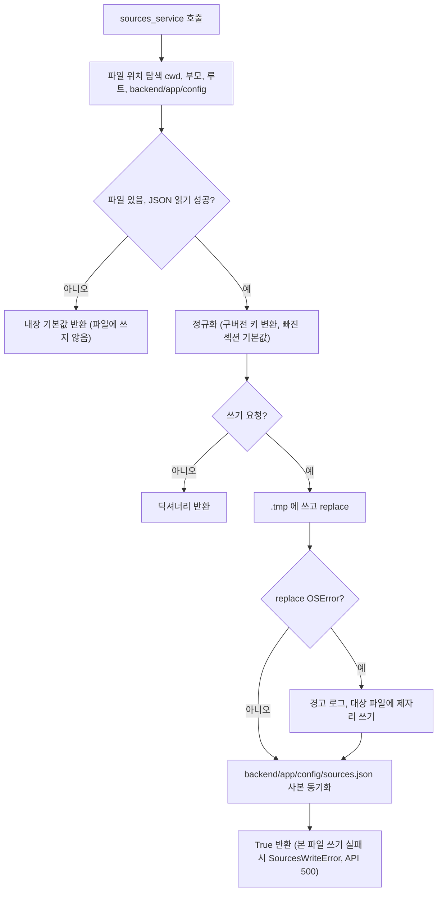

#### 4. 화면 표시 및 입력 데이터 항목 명세 (파일 항목 - 8대 표준 컬럼)
| 항목명 | 화면 표시/입력 구분 | UI 컴포넌트 | 필수 여부 | 데이터 타입 / 제약 | 기본값 | 유효성 검증 규칙 (Validation) | 노출/수정 조건 |
| :--- | :---: | :--- | :---: | :--- | :---: | :--- | :--- |
| `version` | 파일 항목 | `sources.json` | 선택 | 문자열 | 내장 기본값 `"1.0.0"` | 없음 | 파일 직접 편집 |
| `updated_at` | 파일 항목 | `sources.json` | 선택 | UTC ISO 8601 | - | 없음 | 저장할 때마다 갱신 |
| `rss_feeds[].id` | 파일 항목 | `sources.json` | 필수 | 문자열 | 이름에서 생성 | API 추가 시 겹치지 않게 만든다 (BR-SRC-004-2). 파일 직접 편집은 검사 없음 | 추가 시 생성 |
| `rss_feeds[].name`, `url`, `site_url` | 파일 항목 | `sources.json` | name·url 필수 | 문자열 | `site_url` 비면 `url` | API 추가 시 `name` 1~200자, `url` 은 `http(s)://` 로 시작하고 공백 없는 1000자 이하 (v0.4.2). 파일 직접 편집은 검사 없음 | 추가·갱신 시 |
| `rss_feeds[].category_hint` | 파일 항목 | `sources.json` | 선택 | `harness` / `mcp_plugins_skills` / `agent_tech` / `ai_news` | `ai_news` | API 추가 시 네 값만 허용 (v0.4.2) | 추가·갱신 시 |
| `rss_feeds[].country` | 파일 항목 | `sources.json` | 선택 | `KR` / `GLOBAL` | `GLOBAL` | API 추가 시 두 값만 허용 (v0.4.2) | 추가 시 |
| `rss_feeds[].enabled` | 파일 항목 | `sources.json` | 선택 | bool | true (없으면 true 로 본다) | - | 켜기/끄기 |
| `rss_feeds[].description`, `added_at` | 파일 항목 | `sources.json` | 선택 | 문자열 / UTC ISO | `""` / API 추가 시만 | - | 추가 시 |
| `github_sources` | 파일 항목 | `sources.json` | 선택 | `enabled`, `search_queries[]`, `monitored_repos[]`(`repo`, `category`, `enabled`, `description`, `stars_hint`) | 정규화 기본 `{enabled: true, [], []}` | - | 파일 편집 (저장소 추가 API 는 v0.4.2 에서 지웠다) |
| `reddit_sources` | 파일 항목 | `sources.json` | 선택 | `enabled`, `subreddits[]`, `keywords[]` | 정규화 기본 `LocalLLaMA, MachineLearning` / `agent, harness, mcp` | - | 파일 편집 |
| `hackernews_sources` | 파일 항목 | `sources.json` | 선택 | `enabled`, `queries[]` | 정규화 기본 `AI agent, Model Context Protocol` | - | 파일 편집 |
| `arxiv_sources` | 파일 항목 | `sources.json` | 선택 | `enabled`, `queries[]` | 정규화 기본 `all:"agent harness"` | - | 파일 편집 |
| `huggingface_sources` | 파일 항목 | `sources.json` | 선택 | `enabled` | 정규화 기본 true | - | 파일 편집 |

#### 5. 비즈니스 규칙 (Business Rules)
- **BR-SRC-001-1 (현재 파일)**: 저장소에는 루트 `sources.json` 과 `backend/app/config/sources.json` 이 있고 내용이 같다. 지금 작업 트리의 내용은 RSS 18개(KR 5개·GLOBAL 13개. 18번째 `Evil Martians` 는 사용자의 `make dev` 실행 중 딥 리서치 자동 채택이 넣은 앱 데이터이고 릴리스 커밋에서는 뺀다. 그래서 커밋 기준으로는 RSS 17개, GLOBAL 12개다), GitHub 검색어 5개·모니터링 저장소 8개, Reddit 서브레딧 4개·키워드 7개, HackerNews 검색어 6개, arXiv 검색어 3개, Hugging Face 켜짐이다.
- **BR-SRC-001-2 (Docker)**: Docker 에서는 `./sources.json` 을 `/app/sources.json` 에 읽기·쓰기(`:rw`)로 마운트하고 cwd 가 `/app` 이라 그 파일을 쓴다 (`docker-compose.yml:39`).
- **BR-SRC-001-3 (내장 기본값)**: 읽기 실패 시 기본값은 GeekNews 피드 1개(KR), GitHub `topic:mcp-server`, Reddit `LocalLLaMA` / `agent, mcp`, HackerNews `AI agent`, arXiv `all:"agent harness"`, Hugging Face 켜짐이다. 파일에 쓰지 않는다.
- **BR-SRC-001-4 (반영 시점)**: 편집은 다음 수집부터 반영된다. 진행 중인 수집에는 영향이 없다 (수집기는 시작할 때 읽는다).
- **BR-SRC-001-5 (잠금 없음)**: 읽고-고치고-쓰는 동안 잠금이 없다.
- **BR-SRC-001-6 (저장 실패 알림, v0.4.2)**: 인수 기준: `sources.json` 쓰기가 실패하면 `POST /api/sources/rss`, `PATCH …/toggle`, `DELETE …` 는 500 `ERR_SERVER_INTERNAL`, `message` "소스 파일(sources.json)을 저장하지 못했습니다. 파일 권한과 디스크를 확인해주세요." 를 돌려주고 `status: "success"` 를 돌려주지 않는다.

#### 6. 예외 처리 및 엣지 케이스 (Edge Cases & Exception Handling)
| 발생 상황 (Edge Case Scenario) | 화면 반응 및 시스템 처리 방식 | 사용자 안내 메시지 |
| :--- | :--- | :--- |
| JSON 문법 오류 | 오류 로그 후 내장 기본값으로 동작 (수집 대상이 크게 줄어든다) | 화면 안내 없음 |
| 파일이 사라짐 | 다음 호출에서 위치를 다시 찾는다 | 없음 |
| Docker bind mount 위 rename `EBUSY` | 제자리 쓰기로 저장 | 경고 로그만 |
| 저장 실패 (v0.4.2) | 로그 후 `SourcesWriteError`. API(추가·켜기/끄기·삭제)는 500 `ERR_SERVER_INTERNAL` 로 알린다. 딥 리서치 자동 채택 중이면 그 후보를 `WATCHLIST` 로 기록하고 다음 후보를 계속 본다 (FUNC-SRC-011) | "소스 파일(sources.json)을 저장하지 못했습니다. 파일 권한과 디스크를 확인해주세요." |
| 딥 리서치 자동 채택과 화면 편집이 겹침 | 한쪽 변경이 사라질 수 있다 | 없음 |
| 파일을 손으로 고침 | 수정 시각·크기가 바뀌어 다음 읽기에서 다시 읽는다 | 없음 |

#### 7. 비즈니스 에러 코드 매핑
| 비즈니스 에러 코드 | 발생 사유 | HTTP 상태 코드 매핑 | 클라이언트 표시 형태 |
| :--- | :--- | :---: | :--- |
| `ERR_SERVER_INTERNAL` (`SourcesWriteError`) | 본 파일 쓰기 실패 (v0.4.2) | 500 | 호출 화면의 실패 안내 (FUNC-SRC-004·006·007) |

- 관련 코드: `backend/app/services/sources_service.py:13-26`, `:31-41`, `:50-68`, `:70-100`, `:102-123`, `:125-156`, `backend/app/api/sources.py:19-24`, `backend/app/collectors/sources/rss.py`, `backend/app/collectors/sources/github.py`, `sources.json`

---

### [FUNC-SRC-002] 소스 관리 대화상자

#### 1. 기본 정보
- **기능명**: 두 탭(AI 딥 리서처, 등록된 수집원)과 공통 결과 안내를 가진 소스 & 리서처 대화상자
- **기능 ID**: `FUNC-SRC-002`
- **대응 요구사항 ID**: `REQ-SRC-001`
- **대상 화면 코드**: `SCR-SRC-001`
- **우선순위**: Must Have
- **관련 액터 (Actor)**: 웹 사용자

#### 2. 사전 조건 (Pre-conditions)
1. 사용자가 `/` 화면에 있다.
2. 헤더 더보기 메뉴 "소스 & 리서처"(모든 폭) 또는 커맨드 팔레트(⌘K) "소스 관리 & AI 리서처 열기"(부제 "RSS 피드 및 GitHub 소스 등록, 자율 소스 탐색")를 고른다.

#### 3. 사용자 인터랙션 및 시스템 동작 흐름과 플로우차트 (Step-by-Step Flow & Flowchart)
1. 대화상자가 열린다. 제목 "소스 & 리서처", `Dialog size="xl"`: 768px 이상 너비 896px, 768px 미만 전체 화면.
2. 열릴 때 `GET /api/sources`, `GET /api/research/status`, `GET /api/research/audit-logs?limit=30` 을 동시에 부른다. 하나라도 실패하면, 받은 데이터가 없을 때는 탭 내용 자리에 오류 상태(제목 "소스 정보를 불러오지 못했습니다.", 본문 "백엔드 서버 연결 상태를 확인해주세요.", "다시 시도" 버튼)를, 이전 데이터가 있을 때는 이전 데이터를 두고 결과 안내 영역에 같은 제목 문구를 보인다 (v0.4.2, 0건처럼 보이지 않게).
3. 탭 두 개(`Tabs`, `aria-label="소스 관리 화면"`, 탭 줄은 본문 위에 붙어 있다). 탭의 `aria-controls` 는 그려진 패널(선택된 탭)에만 달고, 탭 줄은 넘치면 가로로 스크롤하는 공통 스크롤 줄이다. 기본 탭은 "AI 딥 리서처" 이고 누적 자동 채택 수가 0 보다 크면 `+N` 배지를 붙인다. 두 번째 탭 "등록된 수집원" 에는 활성 RSS 수 배지를 붙인다.
4. 결과 안내: 성공·실패 메시지를 탭 아래 `aria-live="polite"` 영역에 3500ms 동안 보여 준다.
5. 켜기/끄기·삭제·추가·딥 리서치 기동·URL 감지 성공 뒤 데이터를 다시 불러오고, 페이지의 `onSourcesUpdated`(뉴스 목록·통계·브리핑 재조회)를 부른다.
6. 바닥 문구: "수집 대상의 기준 파일: sources.json".
7. 닫기: 닫기 버튼, 바닥 "닫기", Escape (Escape 는 오버레이 스택의 맨 위 레이어만 닫는다). 입력을 잃지 않도록 배경막 클릭으로는 닫히지 않는다.

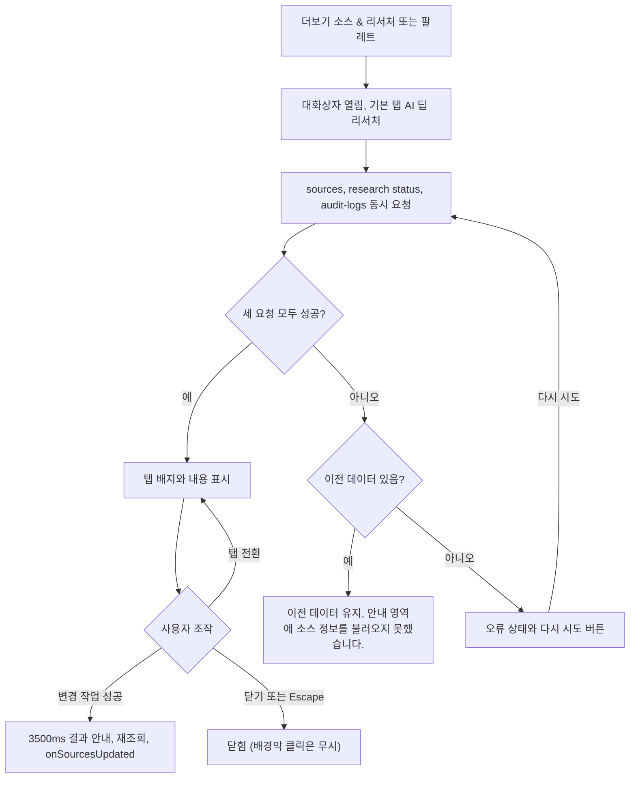

#### 4. 화면 표시 및 입력 데이터 항목 명세 (UI Data Elements - 8대 표준 컬럼)
| 항목명 | 화면 표시/입력 구분 | UI 컴포넌트 | 필수 여부 | 데이터 타입 / 제약 | 기본값 | 유효성 검증 규칙 (Validation) | 노출/수정 조건 |
| :--- | :---: | :--- | :---: | :--- | :---: | :--- | :--- |
| 탭 "AI 딥 리서처" | 선택 | `Tabs` 탭 + 배지 | - | 배지 `+{auto_adopted_count}` | 선택됨 | - | 배지는 누적 채택 수 > 0 일 때 |
| 탭 "등록된 수집원" | 선택 | `Tabs` 탭 + 배지 | - | 배지 `{active_rss}` | - | - | 항상 |
| 결과 안내 | 노출 전용 | `aria-live="polite"` 영역 | - | 성공/실패 문구 | 없음 | - | 3500ms 뒤 자동 숨김 |
| 불러오기 오류 (데이터 있음) | 노출 전용 | 결과 안내 영역 | - | "소스 정보를 불러오지 못했습니다." | - | - | 세 요청 중 하나라도 실패하고 이전 데이터가 있을 때. 다음 성공 때 지움 |
| 불러오기 오류 (데이터 없음) | 노출 전용 | `ErrorState` (제목, 본문 "백엔드 서버 연결 상태를 확인해주세요.", "다시 시도" 버튼, 다시 불러오는 중 버튼 로딩) | - | 고정 문구 | - | - | 받은 데이터가 없고 요청이 실패했을 때 탭 패널 대신 (v0.4.2) |
| 설명 문구 | 노출 전용 | 텍스트 | - | "RSS 피드, GitHub 저장소, arXiv, Reddit 수집 대상을 관리합니다." | - | - | 탭 위 |
| 바닥 문구 | 노출 전용 | 텍스트 | - | "수집 대상의 기준 파일: sources.json" | - | - | 항상 |
| 닫기 | 사용자 조작 | 닫기 버튼, 바닥 "닫기" | - | 버튼 | - | - | 항상 |

#### 5. 비즈니스 규칙 (Business Rules)
- **BR-SRC-002-1**: 열 때마다 세 데이터를 새로 읽는다.
- **BR-SRC-002-2**: 변경 작업이 성공하면 대화상자 데이터와 페이지 데이터(뉴스 목록·통계·브리핑)를 모두 다시 읽는다.
- **BR-SRC-002-3**: 배경막 클릭으로 닫히지 않는다.

#### 6. 예외 처리 및 엣지 케이스 (Edge Cases & Exception Handling)
| 발생 상황 (Edge Case Scenario) | 화면 반응 및 시스템 처리 방식 | 사용자 안내 메시지 |
| :--- | :--- | :--- |
| 세 요청 중 하나라도 실패 (이전 데이터 있음) | 이전 데이터를 유지한다. 이 메시지는 자동으로 사라지지 않고 다음 성공 때 지워진다 | "소스 정보를 불러오지 못했습니다." |
| 처음 열 때 실패 (데이터 없음) | 0건 목록 대신 오류 상태와 "다시 시도" 를 보인다 (v0.4.2) | "소스 정보를 불러오지 못했습니다." / "백엔드 서버 연결 상태를 확인해주세요." |
| 삭제 확인 창이 위에 열림 | Escape 는 맨 위 확인 창만 닫는다 | 없음 |

#### 7. 비즈니스 에러 코드 매핑
| 비즈니스 에러 코드 | 발생 사유 | HTTP 상태 코드 매핑 | 클라이언트 표시 형태 |
| :--- | :--- | :---: | :--- |
| (요청 실패) | 네트워크 오류, 비 2xx | 모두 | "소스 정보를 불러오지 못했습니다." (결과 안내 또는 오류 상태) |

- 관련 코드: `frontend/src/components/SourcesModal.tsx:54-89`, `:192-247`, `frontend/src/components/Header.tsx:86`, `frontend/src/components/CommandPalette.tsx:103-109`, `frontend/src/app/page.tsx:293-300`

---

### [FUNC-SRC-003] 소스 목록 조회

#### 1. 기본 정보
- **기능명**: 전체 소스와 활성 개수 통계 조회와 표시
- **기능 ID**: `FUNC-SRC-003`
- **대응 요구사항 ID**: `REQ-SRC-001`
- **대상 화면 코드**: `SCR-SRC-003`
- **우선순위**: Must Have
- **관련 액터 (Actor)**: 웹 사용자

#### 2. 사전 조건 (Pre-conditions)
1. `SCR-SRC-001` 이 열려 있고 "등록된 수집원" 탭을 골랐다 (데이터는 대화상자를 열 때 이미 읽었다).

#### 3. 사용자 인터랙션 및 시스템 동작 흐름과 플로우차트 (Step-by-Step Flow & Flowchart)
1. 서버는 `GET /api/sources` 에서 정규화된 전체 소스를 읽는다.
2. 통계를 계산한다: `total_rss`, `active_rss`(`enabled` 가 없거나 참인 피드), `total_github_repos`, `active_github_repos`, 그리고 `github_search_enabled`, `reddit_enabled`, `hackernews_enabled`, `arxiv_enabled`, `huggingface_enabled`(각 섹션의 `enabled`, 기본 true).
3. 화면 지표 카드(768px 미만 2열, 이상 4열): "활성 RSS 피드 N / 전체", "모니터링 GitHub N / 전체", "커뮤니티 수집 Reddit · HN · arXiv"(설정과 상관없이 고정 문구, 초록 점), "관리 파일 위치 sources.json"(마우스를 올리면 `sources_file` 값. v0.4.2 부터 서버가 파일 이름만 돌려주므로 `sources.json` 이다).
4. "등록된 RSS 피드 목록": 768px 이상은 표(열: 이름, URL, 카테고리, 상태, 작업), 768px 미만은 같은 행을 세로 카드로 그린다. 파일에 적힌 순서대로 그린다.
5. "지속 모니터링 GitHub 저장소" 카드(768px 이상 2열): 저장소명, 별 배지 `stars_hint`(없으면 0), 설명, 수집 스위치. 삭제 버튼은 없다.
6. Reddit·HackerNews·arXiv·Hugging Face 섹션과 GitHub 검색어는 화면에 나오지 않고, 섹션 전체 켜기/끄기 버튼도 없다.

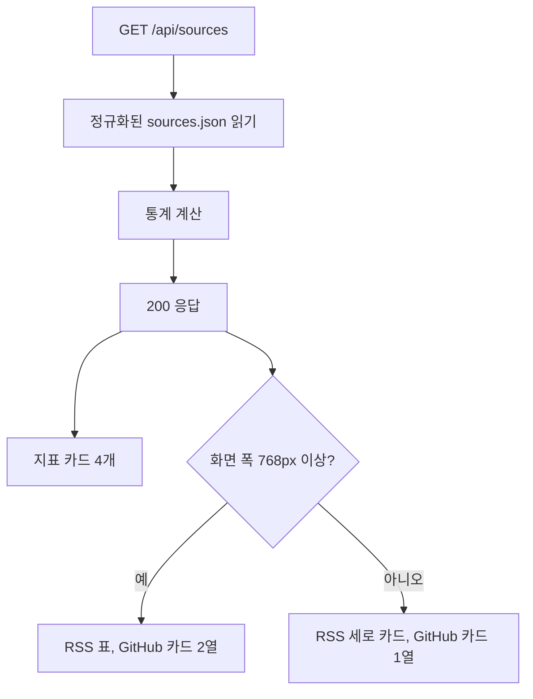

#### 4. 화면 표시 및 입력 데이터 항목 명세 (UI Data Elements - 8대 표준 컬럼)
| 항목명 | 화면 표시/입력 구분 | UI 컴포넌트 | 필수 여부 | 데이터 타입 / 제약 | 기본값 | 유효성 검증 규칙 (Validation) | 노출/수정 조건 |
| :--- | :---: | :--- | :---: | :--- | :---: | :--- | :--- |
| 활성 RSS 피드 | 노출 전용 | StatCard | - | `active_rss / total_rss` | 0 / 0 | - | 항상 |
| 모니터링 GitHub | 노출 전용 | StatCard | - | `active_github_repos / total_github_repos` | 0 / 0 | - | 항상 |
| 커뮤니티 수집 | 노출 전용 | StatCard (초록 점) | - | 고정 "Reddit · HN · arXiv" | 고정 | 설정 값과 연결 안 됨 | 항상 |
| 관리 파일 위치 | 노출 전용 | StatCard (`title` 툴팁) | - | "sources.json", 툴팁 `sources_file` (파일 이름만, v0.4.2. 서버 절대 경로는 내보내지 않는다) | - | - | 항상 |
| RSS 행 이름 | 노출 전용 | 표 셀 / 카드 | - | `name` | - | - | 피드마다 |
| 국가 배지 | 노출 전용 | `Badge` | - | `country` | GLOBAL | - | 피드마다 |
| 설명 | 노출 전용 | 텍스트 한 줄 | - | `description` | - | - | 있을 때만 |
| URL | 노출 전용 | 텍스트 | - | `url` | - | - | 피드마다 |
| 카테고리 | 노출 전용 | 라벨 배지 (`lib/labels.ts`) | - | `category_hint` | - | - | 피드마다 |
| 수집 스위치 | 사용자 토글 | `Switch` | - | bool | `enabled` | - | `FUNC-SRC-006` |
| 삭제 버튼 | 사용자 조작 | 휴지통 `IconButton` | - | 버튼 | - | - | RSS 행만 (`FUNC-SRC-007`) |
| GitHub 카드 | 노출 전용 | 카드 | - | `repo`, 별 `stars_hint`, `description` | 별 0 | - | 저장소마다, 삭제 버튼 없음 |

API 출력: `{"status": "success", "sources_file": "sources.json", "updated_at", "stats": {...}, "data": <정규화된 sources.json>}` (`sources_file` 은 v0.4.2 부터 파일 이름만).

#### 5. 비즈니스 규칙 (Business Rules)
- **BR-SRC-003-1**: `enabled` 가 없는 항목은 켜진 것으로 센다.
- **BR-SRC-003-2**: 목록 순서는 파일 순서다. 정렬·검색·필터가 없다.
- **BR-SRC-003-3**: "커뮤니티 수집" 카드는 설정과 상관없이 항상 켜진 것처럼 보인다.

#### 6. 예외 처리 및 엣지 케이스 (Edge Cases & Exception Handling)
| 발생 상황 (Edge Case Scenario) | 화면 반응 및 시스템 처리 방식 | 사용자 안내 메시지 |
| :--- | :--- | :--- |
| 요청 실패 | `FUNC-SRC-002` 의 불러오기 오류 처리 | "소스 정보를 불러오지 못했습니다." |
| 피드 0개 | 표·카드가 빈다 (빈 상태 전용 문구는 확인하지 못함) | 확인하지 못함 |
| 파일 읽기 실패 | 서버가 내장 기본값(피드 1개)을 돌려줘 화면에 1개만 보인다 | 없음 |

#### 7. 비즈니스 에러 코드 매핑
| 비즈니스 에러 코드 | 발생 사유 | HTTP 상태 코드 매핑 | 클라이언트 표시 형태 |
| :--- | :--- | :---: | :--- |
| `ERR_SERVER_INTERNAL` | 처리하지 못한 서버 예외 | 500 | "소스 정보를 불러오지 못했습니다." |
| (네트워크 오류) | 요청 실패 | - | "소스 정보를 불러오지 못했습니다." |

- 관련 코드: `backend/app/api/sources.py:26-51`, `frontend/src/components/sources/SourcesListTab.tsx`, `frontend/src/lib/api.ts:281-286`

---

### [FUNC-SRC-004] RSS 피드 추가

#### 1. 기본 정보
- **기능명**: 이름·URL·카테고리·국가·설명으로 RSS/Atom 피드 등록 (같은 URL 이면 갱신)
- **기능 ID**: `FUNC-SRC-004`
- **대응 요구사항 ID**: `REQ-SRC-002`
- **대상 화면 코드**: `SCR-SRC-003`
- **우선순위**: Must Have
- **관련 액터 (Actor)**: 웹 사용자

#### 2. 사전 조건 (Pre-conditions)
1. "등록된 수집원" 탭에서 "새 피드 직접 등록" 버튼(`aria-expanded`. `aria-controls="sources-add-form"` 은 폼이 열려 있을 때만 단다)으로 폼 "신규 RSS/Atom 피드 등록" 을 열었다.

#### 3. 사용자 인터랙션 및 시스템 동작 흐름과 플로우차트 (Step-by-Step Flow & Flowchart)
1. 사용자가 소스 이름, RSS/Atom URL, 카테고리, 국가, 설명을 입력하고 "저장하기" 를 누른다 ("취소" 는 폼을 닫는다).
2. 클라이언트: 이름이나 URL 이 trim 후 비면 요청하지 않는다. 이름·URL·설명은 앞뒤 공백을 지워 보낸다. `site_url` 은 보내지 않는다. `POST /api/sources/rss` (프론트 타임아웃 8000ms).
3. 서버 요청 검증 (v0.4.2): `name` 1~200자, `url` 은 `^https?://\S+$` 이고 1000자 이하, `category_hint` 는 `harness`/`mcp_plugins_skills`/`agent_tech`/`ai_news`, `country` 는 `KR`/`GLOBAL`. 어기면 400 `ERR_INVALID_PAYLOAD`("요청 형식이 올바르지 않습니다.", `details` = `[{loc, msg}]`).
4. 빈 값 보정: `site_url` 이 비면 `url`. `category_hint` 기본 `ai_news`, `country` 기본 `GLOBAL`.
5. 중복 판정: 기존 피드 중 끝의 `/` 를 뗀 URL 이 같은 것이 있으면 새로 만들지 않고 그 피드를 `enabled = true` 로 켜고 `name`, `category_hint` 를 새 값으로 바꾼 뒤 저장한다. `country`, `description`, `site_url` 은 바꾸지 않는다.
6. 새 피드: `id` 는 BR-SRC-004-2 규칙, `enabled: true`, `added_at` 을 붙여 목록 끝에 넣고 저장한다.
7. 저장이 실패하면 500 `ERR_SERVER_INTERNAL` "소스 파일(sources.json)을 저장하지 못했습니다. 파일 권한과 디스크를 확인해주세요." (v0.4.2). 성공하면 응답 `{"status": "success", "message": "'{name}' 등록 완료", "source": <생성 또는 갱신된 피드>}`. 기존 피드를 갱신한 경우에도 같은 메시지다.
8. 화면: 성공하면 서버 메시지로 결과 안내를 띄우고 이름·URL·설명 입력을 비우고(카테고리·국가는 유지) 폼을 닫은 뒤 목록과 페이지 데이터를 다시 불러온다.

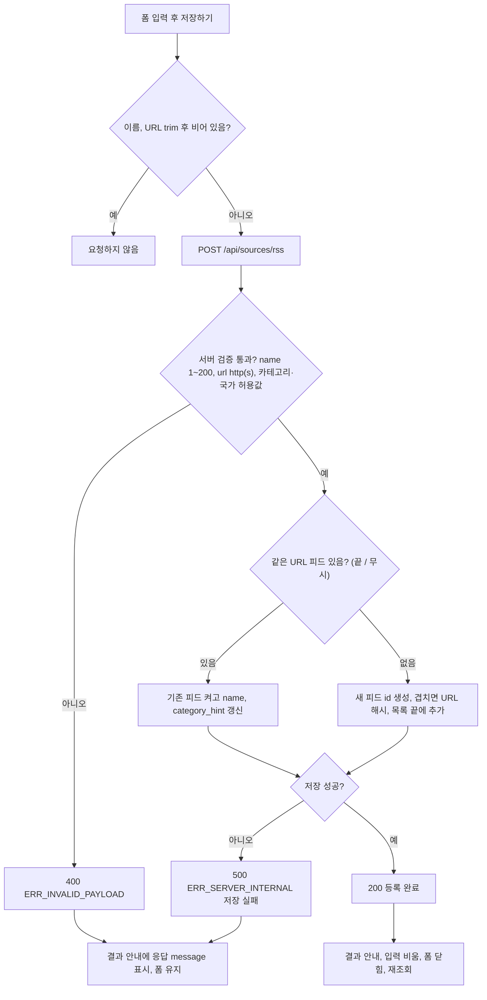

#### 4. 화면 표시 및 입력 데이터 항목 명세 (UI Data Elements - 8대 표준 컬럼)
| 항목명 | 화면 표시/입력 구분 | UI 컴포넌트 | 필수 여부 | 데이터 타입 / 제약 | 기본값 | 유효성 검증 규칙 (Validation) | 노출/수정 조건 |
| :--- | :---: | :--- | :---: | :--- | :---: | :--- | :--- |
| 소스 이름 `name` | 사용자 입력 | Text Input | 필수 | String 1~200자 | 빈 값 | 클라이언트 trim 후 비면 요청 안 함. 서버는 길이 1~200 밖이면 400 `ERR_INVALID_PAYLOAD` (v0.4.2) | 폼이 열려 있을 때 |
| RSS/Atom URL `url` | 사용자 입력 | URL Input (`type=url`) | 필수 | String, `http://` 또는 `https://` 로 시작, 공백 없음, 1000자 이하 | 빈 값 | 브라우저 `type=url` 검사. 서버는 정규식 `^https?://\S+$` 와 길이로 검사해 어기면 400 (v0.4.2). 실제 피드 여부는 검사하지 않는다 | 폼이 열려 있을 때 |
| 카테고리 분류 `category_hint` | 선택 | Select | 선택 | `harness` / `mcp_plugins_skills` / `agent_tech` / `ai_news`. 선택지 글자는 `lib/labels.ts` 긴 라벨 `하네스 & 벤치마크` / `MCP & 생태계` / `에이전트 아키텍처` / `최신 AI 동향` (피드 필터 칩과 같다) | `ai_news` | 서버는 네 값 밖이면 400 (v0.4.2) | 폼이 열려 있을 때. 저장 후에도 값 유지 |
| 국가/지역 `country` | 선택 | Select | 선택 | `GLOBAL`("GLOBAL (해외 소식)") / `KR`("KR (국내 소식)") | `GLOBAL` | 서버는 두 값 밖이면 400 (v0.4.2) | 폼이 열려 있을 때. 저장 후에도 값 유지 |
| 소스 설명 (선택) `description` | 사용자 입력 | Text Input | 선택 | String | 빈 값 | trim | 폼이 열려 있을 때 |
| `site_url` | API 입력 | - | 선택 | String | `""` → `url` 로 대체 | - | 화면은 보내지 않는다 |
| 저장하기 / 취소 | 사용자 조작 | Button | - | 버튼 | - | - | 폼이 열려 있을 때 |

#### 5. 비즈니스 규칙 (Business Rules)
- **BR-SRC-004-1 (URL 중복)**: 끝의 `/` 를 뗀 URL 이 같으면 새로 만들지 않고 기존 피드를 켜고 이름·카테고리를 바꾼다. 응답 메시지는 신규와 같다.
- **BR-SRC-004-2 (id 생성, v0.4.2)**: 이름을 소문자로 바꾸고 영숫자·밑줄이 아닌 글자를 `_` 로 바꾼 슬러그를 쓴다. 슬러그가 밑줄뿐이거나(한글만으로 된 이름 등) 이미 다른 피드의 `id` 면, `{밑줄을 걷어낸 슬러그 또는 feed}_{끝 / 를 뗀 URL 의 SHA-1 앞 8자}` 로 만든다 (`sources_service.py:35-41`). 인수 기준: 이름 `토스 테크` 는 `feed_xxxxxxxx`(8자 16진수) 형식이고, 같은 이름의 두 번째 피드는 첫 피드와 다른 `id` 를 받는다.
- **BR-SRC-004-3 (검사 범위)**: 서버는 이름 길이, URL 스킴·공백·길이, 카테고리·국가 허용값을 검사한다 (v0.4.2). 실제 피드 여부는 검사하지 않는다.
- **BR-SRC-004-4 (반영 시점)**: 새 피드는 다음 수집부터 쓰인다. `category_hint` 는 분류기·평가가 카테고리를 정하지 못한 항목의 기본 카테고리로 쓰인다 (v0.4.2, `FUNC-COLL-004`, `FUNC-COLL-012`).

#### 6. 예외 처리 및 엣지 케이스 (Edge Cases & Exception Handling)
| 발생 상황 (Edge Case Scenario) | 화면 반응 및 시스템 처리 방식 | 사용자 안내 메시지 |
| :--- | :--- | :--- |
| 서버 400 (검증 실패) | 폼 유지, 결과 안내 | 응답 `message` "요청 형식이 올바르지 않습니다." |
| 네트워크 실패 | 폼 유지, 결과 안내 | 브라우저 예외 메시지, 없으면 "피드 추가에 실패했습니다." |
| 이미 있는 URL | 기존 피드를 켜고 이름·카테고리만 갱신 | `'{name}' 등록 완료` |
| 피드가 아닌 URL 등록 | 저장된다. 수집 때 그 피드는 0건 | 없음 |
| `ftp://…`, `javascript:…` 같은 URL | 400 으로 막는다 (v0.4.2) | "요청 형식이 올바르지 않습니다." |
| 파일 저장 실패 | 500, 폼 유지 (v0.4.2, 옛 동작은 성공으로 응답) | "소스 파일(sources.json)을 저장하지 못했습니다. 파일 권한과 디스크를 확인해주세요." |
| 공백만 있는 이름을 API 로 직접 보냄 | 길이 1 이상이라 통과해 공백 이름으로 저장된다 (화면은 trim 으로 막는다) | `'  ' 등록 완료` |

#### 7. 비즈니스 에러 코드 매핑
| 비즈니스 에러 코드 | 발생 사유 | HTTP 상태 코드 매핑 | 클라이언트 표시 형태 |
| :--- | :--- | :---: | :--- |
| `ERR_INVALID_PAYLOAD` | 이름 길이, URL 형식, 카테고리·국가 값, 필수 키 누락 | 400 (v0.4.2, 옛 422) | 결과 안내에 `message` |
| `ERR_SERVER_INTERNAL` | `sources.json` 저장 실패 | 500 | 결과 안내에 `message` |

- 관련 코드: `backend/app/api/sources.py:9-24`, `:53-67`, `backend/app/services/sources_service.py:35-41`, `:220-244`, `frontend/src/components/sources/SourcesListTab.tsx:56-82`, `frontend/src/lib/labels.ts`, `frontend/src/lib/api.ts:297-313`

---

### [FUNC-SRC-005] GitHub 저장소 추가 — 삭제(v0.4.2)

#### 1. 기본 정보
- **기능명**: 모니터링 GitHub 저장소 등록 API. **v0.4.2 에서 지웠다** (부르는 화면이 없었다)
- **기능 ID**: `FUNC-SRC-005` (ID 는 다시 쓰지 않는다)
- **대응 요구사항 ID**: `REQ-SRC-005` (PRD 에서 삭제 표시)
- **대상 화면 코드**: 없음
- **우선순위**: 삭제 (v0.4.1 까지 Could Have)
- **관련 액터 (Actor)**: 없음

#### 2. 사전 조건 (Pre-conditions)
해당 없음 (기능 없음).

#### 3. 사용자 인터랙션 및 시스템 동작 흐름과 플로우차트 (Step-by-Step Flow & Flowchart)
1. 모니터링 저장소는 `sources.json` 의 `github_sources.monitored_repos` 를 직접 고쳐 더한다 (`FUNC-SRC-001`). 켜기/끄기·삭제는 화면(`FUNC-SRC-006`·`007`)으로 할 수 있다.
2. 옛 경로 `POST /api/sources/github` 는 맞는 라우트가 없어 404 `ERR_NOT_FOUND` 다 (코드 읽기 기준, 실행 확인하지 않음).

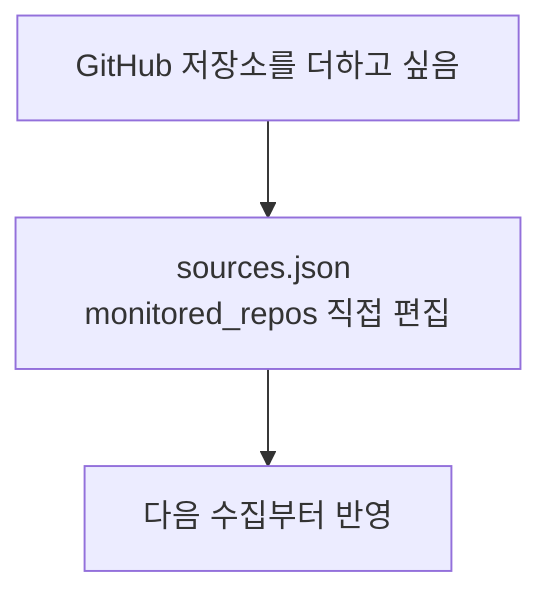

#### 4. 화면 표시 및 입력 데이터 항목 명세 (입력·출력 데이터 항목 - 8대 표준 컬럼)
| 항목명 | 화면 표시/입력 구분 | UI 컴포넌트 | 필수 여부 | 데이터 타입 / 제약 | 기본값 | 유효성 검증 규칙 (Validation) | 노출/수정 조건 |
| :--- | :---: | :--- | :---: | :--- | :---: | :--- | :--- |
| 해당 없음 | - | - | - | - | - | - | 기능을 지웠다 |

#### 5. 비즈니스 규칙 (Business Rules)
- **BR-SRC-005-1 (삭제)**: 저장소 추가 API·요청 스키마(`AddGitHubRepoRequest`)·서비스 함수(`add_github_repo`)·프론트 함수가 없다.

#### 6. 예외 처리 및 엣지 케이스 (Edge Cases & Exception Handling)
| 발생 상황 (Edge Case Scenario) | 화면 반응 및 시스템 처리 방식 | 사용자 안내 메시지 |
| :--- | :--- | :--- |
| 옛 API 호출 | 404 | "요청한 대상을 찾을 수 없습니다." |

#### 7. 비즈니스 에러 코드 매핑
| 비즈니스 에러 코드 | 발생 사유 | HTTP 상태 코드 매핑 | 클라이언트 표시 형태 |
| :--- | :--- | :---: | :--- |
| `ERR_NOT_FOUND` | 지운 경로 호출 | 404 | (화면 없음) |

- 관련 코드: 없음 (`backend/app/api/sources.py` 에 라우트 없음)

---

### [FUNC-SRC-006] 소스 켜기/끄기

#### 1. 기본 정보
- **기능명**: 피드·저장소·소스 유형 전체의 `enabled` 뒤집기
- **기능 ID**: `FUNC-SRC-006`
- **대응 요구사항 ID**: `REQ-SRC-002`
- **대상 화면 코드**: `SCR-SRC-003`
- **우선순위**: Must Have
- **관련 액터 (Actor)**: 웹 사용자

#### 2. 사전 조건 (Pre-conditions)
1. "등록된 수집원" 탭에 피드 행이나 GitHub 카드가 있다.

#### 3. 사용자 인터랙션 및 시스템 동작 흐름과 플로우차트 (Step-by-Step Flow & Flowchart)
1. 사용자가 RSS 피드 행이나 GitHub 카드의 수집 스위치(`Switch`, `role="switch"`, `aria-checked`, 접근 이름 "{이름} 수집 켜기", 768px 미만 44px)를 누른다.
2. 화면은 RSS 에 `rss` 와 `feed.id`(없으면 `feed.url`), GitHub 에 `github_repo` 와 `repo` 를 `PATCH /api/sources/{source_type}/{item_id}/toggle` 로 보낸다. `item_id` 는 `encodeURIComponent` 로 인코딩한다. 서버 경로는 `{item_id:path}` 라 `owner/repo`·URL 처럼 `/` 가 든 id 도 한 값으로 받는다 (v0.4.1, 리뷰 BUG-05, `backend/app/api/sources.py:69`).
3. 서버:
   - `rss`: `id` 또는 `url` 이 `item_id` 와 같은 첫 피드의 `enabled` 를 뒤집는다 (값이 없으면 true 로 보고 false 로).
   - `github_repo`: `repo` 가 정확히 같은(대소문자 구분) 첫 저장소의 `enabled` 를 뒤집는다.
   - `github`, `reddit`, `hackernews`, `arxiv`, `huggingface`: `item_id` 가 정확히 `all` 일 때만 `{type}_sources` 섹션 전체의 `enabled` 를 뒤집는다. 다른 `item_id` 는 없는 대상으로 보고 404 다 (v0.4.2). 화면에서 부르는 곳은 없다.
   - 바뀐 것이 있으면 저장한다. 저장이 실패하면 500 (v0.4.2).
4. 응답 `{"status": "success", "message": "소스 상태가 변경되었습니다 ({type} / {id})"}`. 화면은 "수집 상태가 변경되었습니다." 결과 안내를 띄우고 다시 불러온다. 스위치는 다시 불러온 값으로 바뀐다 (낙관적 갱신 없음).

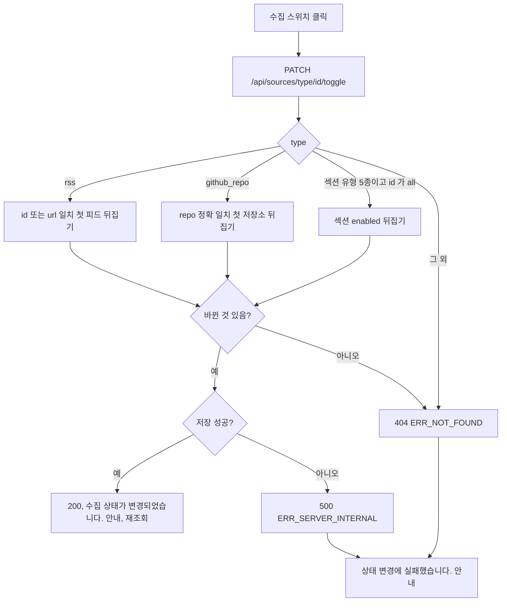

#### 4. 화면 표시 및 입력 데이터 항목 명세 (UI Data Elements - 8대 표준 컬럼)
| 항목명 | 화면 표시/입력 구분 | UI 컴포넌트 | 필수 여부 | 데이터 타입 / 제약 | 기본값 | 유효성 검증 규칙 (Validation) | 노출/수정 조건 |
| :--- | :---: | :--- | :---: | :--- | :---: | :--- | :--- |
| 수집 스위치 | 사용자 토글 | `Switch` (`role="switch"`, `aria-checked`) | - | bool | 현재 `enabled` (없으면 켜짐) | - | RSS 행, GitHub 카드 |
| `source_type` | API 입력 (경로) | - | 필수 | `rss`, `github_repo`, `github`, `reddit`, `hackernews`, `arxiv`, `huggingface` | - | 그 밖의 값은 404 | 항상 |
| `item_id` | API 입력 (경로, `{item_id:path}`) | - | 필수 | String (URL 인코딩, `/` 포함 가능). 섹션 유형 5종은 `all` 만 | - | 대상이 없거나 섹션 유형에 `all` 이 아닌 값이면 404 (v0.4.2) | 항상 |

#### 5. 비즈니스 규칙 (Business Rules)
- **BR-SRC-006-1**: RSS 는 `id` 또는 `url` 일치 **첫** 항목만 뒤집는다. `id` 가 겹치는 피드가 있으면 첫 항목만 바뀐다.
- **BR-SRC-006-2**: GitHub 저장소 일치는 대소문자를 구분한다 (추가 API 는 대소문자를 무시한다).
- **BR-SRC-006-3**: 변경은 다음 수집부터 반영된다.
- **BR-SRC-006-4 (섹션 토글, v0.4.2)**: 인수 기준: `PATCH /api/sources/reddit/all/toggle` 은 `reddit_sources.enabled` 를 뒤집고 200, `PATCH /api/sources/reddit/anything/toggle` 은 404 `ERR_NOT_FOUND` 이고 파일을 바꾸지 않는다.

#### 6. 예외 처리 및 엣지 케이스 (Edge Cases & Exception Handling)
| 발생 상황 (Edge Case Scenario) | 화면 반응 및 시스템 처리 방식 | 사용자 안내 메시지 |
| :--- | :--- | :--- |
| 대상이 없거나 유형이 다름 | 404 | "상태 변경에 실패했습니다." (화면 고정 문구) |
| 모든 RSS 피드를 끔 | 수집기가 코드 내장 5개 피드로 대신 수집한다 (`FUNC-COLL-004`) | 화면 안내 없음 |
| 파일 저장 실패 | 500 (v0.4.2, 옛 동작은 성공 응답) | "상태 변경에 실패했습니다." |

#### 7. 비즈니스 에러 코드 매핑
| 비즈니스 에러 코드 | 발생 사유 | HTTP 상태 코드 매핑 | 클라이언트 표시 형태 |
| :--- | :--- | :---: | :--- |
| `ERR_NOT_FOUND` (`message` "해당 소스를 찾을 수 없습니다.") | 대상 없음, 유형 불일치, 섹션 유형에 `all` 아닌 id | 404 | 결과 안내 "상태 변경에 실패했습니다." |
| `ERR_SERVER_INTERNAL` | `sources.json` 저장 실패 | 500 | 결과 안내 "상태 변경에 실패했습니다." |

- 관련 코드: `backend/app/api/sources.py:69-75`, `backend/app/services/sources_service.py:28`, `:193-218`, `frontend/src/components/SourcesModal.tsx:105-114`, `frontend/src/components/sources/SourcesListTab.tsx:231-238`, `:274-279`, `frontend/src/components/ui/Switch.tsx`, `frontend/src/lib/api.ts:367-374`

---

### [FUNC-SRC-007] 소스 삭제

#### 1. 기본 정보
- **기능명**: RSS 피드나 GitHub 저장소 삭제 (확인 창 거침)
- **기능 ID**: `FUNC-SRC-007`
- **대응 요구사항 ID**: `REQ-SRC-002`
- **대상 화면 코드**: `SCR-SRC-003`, `SCR-SRC-004`
- **우선순위**: Must Have
- **관련 액터 (Actor)**: 웹 사용자

#### 2. 사전 조건 (Pre-conditions)
1. "등록된 수집원" 탭에 RSS 피드 행이 있다 (GitHub 카드에는 삭제 버튼이 없다).

#### 3. 사용자 인터랙션 및 시스템 동작 흐름과 플로우차트 (Step-by-Step Flow & Flowchart)
1. 사용자가 RSS 피드 행의 삭제 버튼(휴지통 아이콘, 접근 이름 "{이름} 삭제")을 누른다.
2. 확인 창(`ConfirmDialog` 위험 톤, `role="alertdialog"`, 768px 미만 바텀시트, 소스 대화상자 위에 쌓인다)이 열린다. 처음 포커스는 "취소".
3. "취소" 를 누르면 요청하지 않고 닫는다. "삭제" 를 누르면 `DELETE /api/sources/{source_type}/{item_id}` 를 보낸다. 서버 경로는 `{item_id:path}` 라 `owner/repo`·URL id 도 동작한다 (v0.4.1, `backend/app/api/sources.py:77`).
4. 서버:
   - `rss`: `id` 가 같거나 `url` 이 같은 피드를 **모두** 지운다.
   - `github_repo`: `repo` 가 정확히 같은 저장소를 모두 지운다.
   - 하나라도 지웠으면 저장한다.
5. 응답 `{"status": "success", "message": "소스가 삭제되었습니다 ({type} / {id})"}`. 화면은 확인 창을 닫고 "소스가 삭제되었습니다." 결과 안내를 띄우고 다시 불러온다.

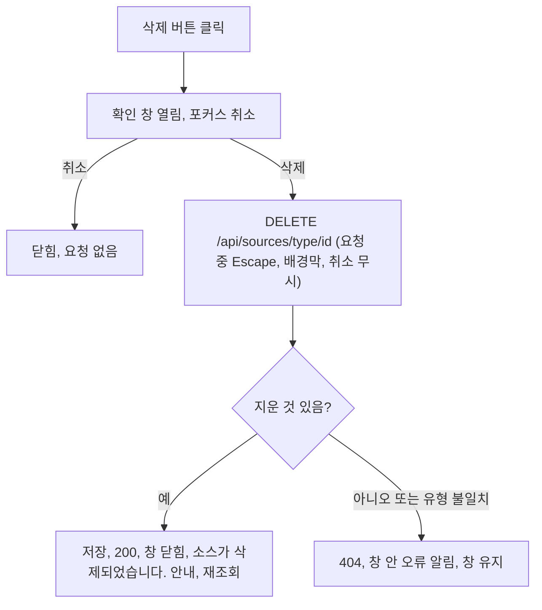

#### 4. 화면 표시 및 입력 데이터 항목 명세 (UI Data Elements - 8대 표준 컬럼)
| 항목명 | 화면 표시/입력 구분 | UI 컴포넌트 | 필수 여부 | 데이터 타입 / 제약 | 기본값 | 유효성 검증 규칙 (Validation) | 노출/수정 조건 |
| :--- | :---: | :--- | :---: | :--- | :---: | :--- | :--- |
| 삭제 버튼 | 사용자 조작 | `IconButton` (휴지통) | - | 버튼, 접근 이름 "{이름} 삭제" | - | - | RSS 행마다 |
| 확인 창 제목 | 노출 전용 | `ConfirmDialog` | - | "이 소스를 목록에서 삭제하시겠습니까?" | - | - | 확인 창이 열려 있을 때 |
| 확인 창 설명 | 노출 전용 | `ConfirmDialog` | - | "'{이름}' 을(를) 수집 목록에서 지웁니다." | - | - | 확인 창이 열려 있을 때 |
| 취소 / 삭제 | 사용자 조작 | Button | - | 버튼 | 포커스 "취소" | - | 요청 중에는 취소 무시 |
| 오류 알림 | 노출 전용 | 창 안 `InlineAlert` | - | "소스 삭제에 실패했습니다." | - | - | 실패 시 |
| `source_type` | API 입력 (경로) | - | 필수 | `rss` / `github_repo` | - | 그 밖은 404 | 항상 |
| `item_id` | API 입력 (경로, `{item_id:path}`) | - | 필수 | RSS 는 `id` 또는 `url`, GitHub 는 `repo`(`owner/repo`) | - | 일치 없으면 404 | 항상 |

#### 5. 비즈니스 규칙 (Business Rules)
- **BR-SRC-007-1**: RSS 삭제는 `id` 또는 `url` 이 일치하는 피드를 모두 지운다. 같은 `id` 가 여러 개면 모두 지워진다.
- **BR-SRC-007-2**: 소스 유형 섹션 자체는 지울 수 없다.
- **BR-SRC-007-3**: 삭제해도 이미 수집된 기사는 지우지 않는다 (삭제 대상은 `sources.json` 항목뿐이다).

#### 6. 예외 처리 및 엣지 케이스 (Edge Cases & Exception Handling)
| 발생 상황 (Edge Case Scenario) | 화면 반응 및 시스템 처리 방식 | 사용자 안내 메시지 |
| :--- | :--- | :--- |
| 지운 것이 없음, 유형 불일치 | 404, 창을 연 채 둔다 | "소스 삭제에 실패했습니다." |
| 파일 저장 실패 | 500, 창을 연 채 둔다 (v0.4.2, 옛 동작은 성공 응답) | "소스 삭제에 실패했습니다." |
| 요청 중 Escape·배경막·취소 | 무시 | 없음 |
| 확인 창에서 취소 | 요청하지 않음 | 없음 |

#### 7. 비즈니스 에러 코드 매핑
| 비즈니스 에러 코드 | 발생 사유 | HTTP 상태 코드 매핑 | 클라이언트 표시 형태 |
| :--- | :--- | :---: | :--- |
| `ERR_NOT_FOUND` (`message` "해당 소스를 찾을 수 없습니다.") | 일치 항목 없음, 유형 불일치 | 404 | 확인 창 안 오류 알림 "소스 삭제에 실패했습니다." |
| `ERR_SERVER_INTERNAL` | `sources.json` 저장 실패 | 500 | 확인 창 안 오류 알림 "소스 삭제에 실패했습니다." |

- 관련 코드: `backend/app/api/sources.py:77-83`, `backend/app/services/sources_service.py:246-263`, `frontend/src/components/SourcesModal.tsx:116-143`, `:236-246`, `frontend/src/components/sources/SourcesListTab.tsx:239-246`, `frontend/src/lib/api.ts:397-404`

---

### [FUNC-SRC-008] 단일 URL 검사

#### 1. 기본 정보
- **기능명**: URL 에서 RSS/Atom 피드를 찾아 최근 글과 점수를 보여 준다 (등록하지 않음)
- **기능 ID**: `FUNC-SRC-008`
- **대응 요구사항 ID**: `REQ-SRC-004`
- **대상 화면 코드**: `SCR-SRC-002`
- **우선순위**: Should Have
- **관련 액터 (Actor)**: 웹 사용자

#### 2. 사전 조건 (Pre-conditions)
1. "AI 딥 리서처" 탭 하단 "단일 URL 수동 프로빙 (테스트용)" 이 보인다.

#### 3. 사용자 인터랙션 및 시스템 동작 흐름과 플로우차트 (Step-by-Step Flow & Flowchart)
1. 사용자가 "검증할 사이트 URL" 입력란에 URL 을 넣고 "검증" 을 누른다 (입력이 비면 버튼 비활성, 요청 중 "분석 중..."). 화면은 앞뒤 공백을 지워 `POST /api/research/inspect-url` 로 보낸다 (프론트 타임아웃 12000ms).
2. 서버: 빈 `url` 은 400 `ERR_INVALID_PAYLOAD` "조사할 URL 을 입력해주세요.", `url` 키가 없으면 400 `ERR_INVALID_PAYLOAD` "요청 형식이 올바르지 않습니다." (v0.4.2). URL 이 `http://` 나 `https://` 로 시작하지 않으면 앞에 `https://` 를 붙인다.
3. GitHub: 호스트에 `github.com` 이 있고 경로 조각이 2개 이상이면 `https://github.com/{owner}/{repo}/releases.atom` 을 먼저 시험한다. 피드를 찾으면(`status == "found"`) `type: "atom"`, `source_kind: "github_releases"` 를 붙여 돌려주고, 못 찾으면 4번으로 넘어간다.
4. URL 을 GET 한다 (타임아웃 10.0초, 리다이렉트 따라감, User-Agent `Mozilla/5.0 (compatible; AgentLens-Researcher/2.0; +https://github.com/agentlens)`). 200 이 아니면 오류.
5. 응답 `content-type` 에 `xml`/`rss`/`atom` 이 있거나 본문 앞 300자에 `<rss` 또는 `<feed` 가 있으면 그 URL 자체를 피드로 본다.
6. HTML 이면 `<link>` 중 `rel` 에 `alternate` 또는 `feed` 가 있고 `type` 에 `rss`/`atom`/`xml` 이 있는 것의 `href` 를 절대 URL 로 모은다.
7. 그런 링크가 없으면 `/feed`, `/rss`, `/rss.xml`, `/atom.xml`, `/feed.xml`, `/index.xml` 을 순서대로 HEAD 요청(각 4.0초)해 처음 200 인 것을 쓴다.
8. 찾은 첫 피드를 받아(타임아웃 8.0초) feedparser 로 파싱한다. 항목이 없으면 `empty`.
9. 피드 제목(없으면 HTML `<title>` 또는 호스트명, 그것도 없으면 "발굴된 소스"), 설명(`description` 또는 `subtitle`), 링크를 읽고, 최근 4개 글의 `title`, `link`, `published`(없으면 `updated`), `snippet`(HTML 태그 제거 200자)을 만든다.
10. 피드 제목과 `제목 + 설명 + 글 제목·스니펫` 으로 `classify_and_tag` 를 돌려 카테고리를 정하고, `llm_processor.evaluate_quality_and_signal(..., "rss")` 로 점수를 낸다 (`FUNC-SRC-012` 의 기본 점수 규칙만. 딥 리서치의 기술 깊이 가산은 하지 않는다).
11. 끝의 `/` 를 뗀 피드 URL 이 `rss_feeds` 에 있으면 `already_registered: true`.
12. 결과를 등록하지 않는다. 화면은 성공 시 결과 안내 "RSS 피드를 성공적으로 감지했습니다: {feed_url}" 와 성공 알림 "발견: {이름} ({feed_url}) · 점수: {점수}점" 을 보여 주고, 실패 시 결과 안내와 오류 알림에 `message`(없으면 "RSS 피드를 찾을 수 없습니다.")를 보여 준다. 성공 후 대화상자 데이터와 페이지 데이터를 다시 불러온다.

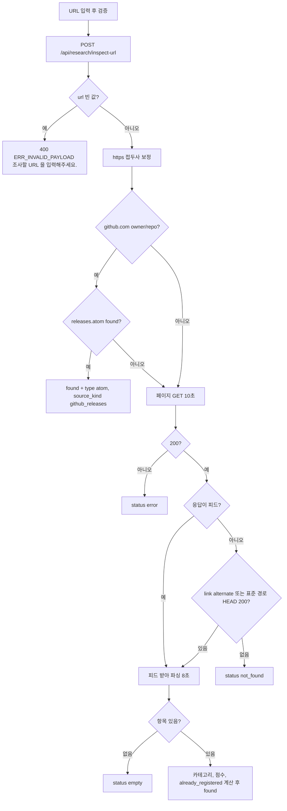

#### 4. 화면 표시 및 입력 데이터 항목 명세 (UI Data Elements - 8대 표준 컬럼)
| 항목명 | 화면 표시/입력 구분 | UI 컴포넌트 | 필수 여부 | 데이터 타입 / 제약 | 기본값 | 유효성 검증 규칙 (Validation) | 노출/수정 조건 |
| :--- | :---: | :--- | :---: | :--- | :---: | :--- | :--- |
| 검증할 사이트 URL `url` | 사용자 입력 | Text Input | 필수 | String | 빈 값 | 비면 버튼 비활성, trim. 서버는 빈 값 400, 스킴 없으면 `https://` 추가 | 딥 리서처 탭 하단 |
| 검증 버튼 | 사용자 조작 | Button | - | 버튼 | "검증" | - | 요청 중 "분석 중..." |
| 성공 알림 | 노출 전용 | `InlineAlert` (성공) | - | "발견: {name} ({feed_url}) · 점수: {relevance_score}점" | - | - | `status == "found"` |
| 실패 알림 | 노출 전용 | `InlineAlert` (위험) | - | `message` 또는 "RSS 피드를 찾을 수 없습니다." | - | - | 그 밖의 `status` |
| `name`, `feed_url`, `site_url` | API 출력 | JSON | - | String | - | - | found |
| `description` | API 출력 | JSON | - | 250자, 없으면 "실시간 최신 기술 피드" | - | - | found |
| `category_hint` | API 출력 | JSON | - | 4개 카테고리 또는 `unrelated` | - | - | found |
| `relevance_score`, `is_high_signal` | API 출력 | JSON | - | float 1.0~10.0 / bool | - | - | found |
| `recent_posts[]` | API 출력 | JSON | - | 최대 4개 `{title, link, published, snippet}` | - | - | found |
| `already_registered` | API 출력 | JSON | - | bool | - | - | found |
| `why_recommended` | API 출력 | JSON | - | "최신 {CAT} 관련 {N}건의 활성 글 발행 확인 (신호 강도 {점수}점)" | - | - | found |
| `type`, `source_kind` | API 출력 | JSON | - | `atom`, `github_releases` | - | - | GitHub releases 피드일 때 |
| `message`, `input_url` 또는 `feed_url` | API 출력 | JSON | - | 오류 문구와 대상 URL | - | - | error, not_found, empty |

#### 5. 비즈니스 규칙 (Business Rules)
- **BR-SRC-008-1**: 결과를 등록하지 않는다. 화면에도 검사 결과를 등록하는 버튼이 없다.
- **BR-SRC-008-2**: 실패도 HTTP 200 과 `status` 필드로 돌려준다.
- **BR-SRC-008-3**: 같은 피드라도 이 점수(기본 규칙만)와 딥 리서치 점수(기본 + 깊이 가산)는 다르다.

#### 6. 예외 처리 및 엣지 케이스 (Edge Cases & Exception Handling)
| 발생 상황 (Edge Case Scenario) | 화면 반응 및 시스템 처리 방식 | 사용자 안내 메시지 |
| :--- | :--- | :--- |
| 접속 실패 | `status: error`. 예외 원문은 서버 로그에만 남긴다 (v0.4.2) | "URL 에 접속하지 못했습니다. 주소와 네트워크를 확인해주세요." |
| 페이지 비 200 | `status: error` | "HTTP 응답 코드 오류 ({코드})" |
| 피드 다운로드 실패 | `status: error`. 예외 원문은 로그에만 (v0.4.2) | "피드를 내려받지 못했습니다." |
| 피드 비 200 | `status: error` | "피드 응답 오류 ({코드})" |
| 피드를 못 찾음 | `status: not_found` | "해당 페이지에서 RSS 또는 Atom 피드를 자동으로 발견하지 못했습니다." |
| 피드에 글 없음 | `status: empty` | "피드는 유효하나 발행된 최신 기사가 없습니다." |
| 요청 자체 실패 (타임아웃 12000ms 포함) | 결과 안내 | "URL 분석에 실패했습니다." |
| 내부 주소 입력 | 서버가 그 주소로 GET 한다 (인증 없음. SSRF 는 수용된 위험이라 사실로만 남긴다) | 없음 |

#### 7. 비즈니스 에러 코드 매핑
| 비즈니스 에러 코드 | 발생 사유 | HTTP 상태 코드 매핑 | 클라이언트 표시 형태 |
| :--- | :--- | :---: | :--- |
| `ERR_INVALID_PAYLOAD` ("조사할 URL 을 입력해주세요.") | 빈 URL, `url` 키 누락 | 400 (v0.4.2, 옛 `detail` "URL is required"·422) | 결과 안내 "URL 분석에 실패했습니다." (화면은 빈 입력을 보내지 않는다) |
| `status="error"` | 접속·응답·다운로드 실패 | 200 | 결과 안내 + 오류 알림에 `message` |
| `status="not_found"` | 피드 미발견 | 200 | 결과 안내 + 오류 알림에 `message` |
| `status="empty"` | 피드에 글 없음 | 200 | 결과 안내 + 오류 알림에 `message` |

- 관련 코드: `backend/app/api/research.py:7-19`, `backend/app/services/source_researcher.py:31-181`, `frontend/src/components/sources/DeepResearcherTab.tsx:76-95`, `frontend/src/lib/api.ts:324-333`

---

### [FUNC-SRC-009] 카탈로그 후보 탐색 — 삭제(v0.4.2)

#### 1. 기본 정보
- **기능명**: 내장 카탈로그에서 키워드·카테고리로 후보 고르기. **v0.4.2 에서 지웠다** (부르는 화면이 없었다)
- **기능 ID**: `FUNC-SRC-009` (ID 는 다시 쓰지 않는다)
- **대응 요구사항 ID**: `REQ-SRC-005` (PRD 에서 삭제 표시)
- **대상 화면 코드**: 없음
- **우선순위**: 삭제 (v0.4.1 까지 Could Have)
- **관련 액터 (Actor)**: 없음

#### 2. 사전 조건 (Pre-conditions)
해당 없음 (기능 없음).

#### 3. 사용자 인터랙션 및 시스템 동작 흐름과 플로우차트 (Step-by-Step Flow & Flowchart)
1. `POST /api/research/discover`, 내장 카탈로그 `CURATED_ECOSYSTEM_CATALOG`, 프론트 `discoverSources()` 를 지웠다. 후보 발굴은 자율 딥 리서치(`FUNC-SRC-011`)의 시드·인용 도메인 마이닝이 맡는다.

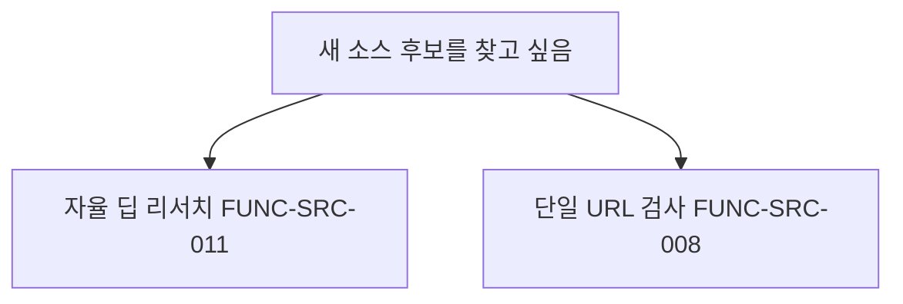

#### 4. 화면 표시 및 입력 데이터 항목 명세 (입력·출력 데이터 항목 - 8대 표준 컬럼)
| 항목명 | 화면 표시/입력 구분 | UI 컴포넌트 | 필수 여부 | 데이터 타입 / 제약 | 기본값 | 유효성 검증 규칙 (Validation) | 노출/수정 조건 |
| :--- | :---: | :--- | :---: | :--- | :---: | :--- | :--- |
| 해당 없음 | - | - | - | - | - | - | 기능을 지웠다 |

#### 5. 비즈니스 규칙 (Business Rules)
- **BR-SRC-009-1 (삭제)**: 고정 점수 카탈로그 추천이 없다.

#### 6. 예외 처리 및 엣지 케이스 (Edge Cases & Exception Handling)
| 발생 상황 (Edge Case Scenario) | 화면 반응 및 시스템 처리 방식 | 사용자 안내 메시지 |
| :--- | :--- | :--- |
| 옛 API 호출 | 404 `ERR_NOT_FOUND` | "요청한 대상을 찾을 수 없습니다." |

#### 7. 비즈니스 에러 코드 매핑
| 비즈니스 에러 코드 | 발생 사유 | HTTP 상태 코드 매핑 | 클라이언트 표시 형태 |
| :--- | :--- | :---: | :--- |
| `ERR_NOT_FOUND` | 지운 경로 호출 | 404 | (화면 없음) |

- 관련 코드: 없음 (`backend/app/services/source_researcher.py:23` 주석에 삭제 기록)

---

### [FUNC-SRC-010] 후보 등록 — 삭제(v0.4.2)

#### 1. 기본 정보
- **기능명**: 후보를 RSS 피드로 등록. **v0.4.2 에서 지웠다** (부르는 화면이 없었다)
- **기능 ID**: `FUNC-SRC-010` (ID 는 다시 쓰지 않는다)
- **대응 요구사항 ID**: `REQ-SRC-005` (PRD 에서 삭제 표시)
- **대상 화면 코드**: 없음
- **우선순위**: 삭제 (v0.4.1 까지 Could Have)
- **관련 액터 (Actor)**: 없음

#### 2. 사전 조건 (Pre-conditions)
해당 없음 (기능 없음).

#### 3. 사용자 인터랙션 및 시스템 동작 흐름과 플로우차트 (Step-by-Step Flow & Flowchart)
1. `POST /api/research/register-candidate`, 프론트 `registerCandidate()` 를 지웠다. 피드 등록은 화면의 RSS 피드 추가(`FUNC-SRC-004`)와 딥 리서치 자동 채택(`FUNC-SRC-011`) 두 경로다.

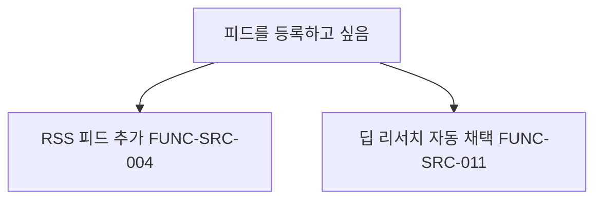

#### 4. 화면 표시 및 입력 데이터 항목 명세 (입력·출력 데이터 항목 - 8대 표준 컬럼)
| 항목명 | 화면 표시/입력 구분 | UI 컴포넌트 | 필수 여부 | 데이터 타입 / 제약 | 기본값 | 유효성 검증 규칙 (Validation) | 노출/수정 조건 |
| :--- | :---: | :--- | :---: | :--- | :---: | :--- | :--- |
| 해당 없음 | - | - | - | - | - | - | 기능을 지웠다 |

#### 5. 비즈니스 규칙 (Business Rules)
- **BR-SRC-010-1 (삭제)**: 검증 없는 등록 경로가 사라져, API 로 들어오는 피드는 모두 `FUNC-SRC-004` 의 서버 검증을 거친다 (딥 리서치 자동 채택은 서비스 함수를 직접 부른다).

#### 6. 예외 처리 및 엣지 케이스 (Edge Cases & Exception Handling)
| 발생 상황 (Edge Case Scenario) | 화면 반응 및 시스템 처리 방식 | 사용자 안내 메시지 |
| :--- | :--- | :--- |
| 옛 API 호출 | 404 `ERR_NOT_FOUND` | "요청한 대상을 찾을 수 없습니다." |

#### 7. 비즈니스 에러 코드 매핑
| 비즈니스 에러 코드 | 발생 사유 | HTTP 상태 코드 매핑 | 클라이언트 표시 형태 |
| :--- | :--- | :---: | :--- |
| `ERR_NOT_FOUND` | 지운 경로 호출 | 404 | (화면 없음) |

- 관련 코드: 없음

---

### [FUNC-SRC-011] 자율 딥 리서치 실행

#### 1. 기본 정보
- **기능명**: 시드·인용 도메인을 후보로 피드를 실증·평가해 자동 채택하고 감사 로그를 남긴다
- **기능 ID**: `FUNC-SRC-011`
- **대응 요구사항 ID**: `REQ-SRC-003`
- **대상 화면 코드**: `SCR-SRC-002`, 스케줄(화면 없음)
- **우선순위**: Should Have
- **관련 액터 (Actor)**: 웹 사용자, 스케줄러(APScheduler)

#### 2. 사전 조건 (Pre-conditions)
1. 화면: "AI 딥 리서처" 탭이 열려 있다. API: 웹 서버가 떠 있다. 스케줄: 웹 서버가 떠 있고 스케줄러가 시작됐다.
2. 같은 프로세스에서 딥 리서치가 실행 중이 아니다.

#### 3. 사용자 인터랙션 및 시스템 동작 흐름과 플로우차트 (Step-by-Step Flow & Flowchart)
1. **진입**:
   - 화면: "자율 딥 리서치 지금 실행" 버튼 → `triggerDeepResearch()` → `POST /api/research/run-deep?max_candidates=6`. 실행 중(`is_running`)이거나 요청 중이면 버튼이 진행 표시(비활성)와 "자율 탐색 가동 중..." 으로 바뀐다.
   - API: `POST /api/research/run-deep`, 쿼리 `max_candidates`(기본 6, 1~20 정수. 범위 밖이면 400 `ERR_INVALID_PAYLOAD`, v0.4.2).
   - 스케줄: APScheduler job `deep_research`, `CronTrigger(hour="3,15", minute="0", timezone="UTC")`(시간대 설정과 상관없이 UTC 고정), `run_deep_research()` 를 기본값 `max_candidates=8` 로 부른다. `scheduler.enabled` 가 거짓이면 스케줄 실행이 없다 (v0.4.2).
2. **API 응답**: 이미 실행 중이면 `{"status": "already_running", "message": "Deep Research is already executing"}`. 아니면 `asyncio.create_task` 로 백그라운드 실행을 걸고, 태스크 참조를 끝날 때까지 들고 있어 실행 중에 사라지지 않게 한 뒤(v0.4.2) 바로 `{"status": "started", "message": "자율 딥 리서치 사이클이 백그라운드에서 기동되었습니다.", "max_candidates": N}`.
3. **화면 후속**: `already_running` 이면 실패 안내, `started` 면 성공 안내(서버 메시지)를 띄우고 3000ms 뒤 한 번만 대화상자 데이터와 페이지 데이터를 다시 불러온다. 요청이 실패하면 "자율 딥 리서치 트리거에 실패했습니다.".
4. **실행 시작**: `run_deep_research` 도 시작 때 실행 중이면 `{"status": "already_running", "message": "Deep Research is currently executing."}` 를 돌려주고 끝난다 (스케줄 실행이 겹칠 때). 아니면 `is_running = True` 로 두고 `try/finally` 안에서 사이클(`_run_cycle`)을 돌린다. 예외가 나면 `last_run_time` 을 지금으로, `last_run_summary` 를 `{"status": "error", "error": <예외 클래스 이름>, "completed_at"}` 으로 남기고(v0.4.2, 예외 메시지는 로그에만) 예외를 올린다. `finally` 에서 `is_running = False` 로 되돌린다 (`backend/app/services/deep_researcher.py:378-405`).
5. **1단계 후보 풀 (v0.4.2)**: `sources.json` 의 RSS 피드 `url`·`site_url`(끝 `/` 제거)을 모아 '이미 감시 중' 집합을 만든다. 인용 도메인 마이닝 결과(최대 15개)와 시드 `SEED_EXPLORATION_TARGETS` 14개(Lilian Weng Tech Blog, Eugene Yan, Chip Huyen, Ahead of AI, Google DeepMind Research Blog, Microsoft Research AI, OpenHands·Aider·Cline·FastMCP GitHub, 당근 테크 블로그(medium 피드), 우아한형제들 기술블로그, vLLM Project Blog, Cursor Forum Announcements)에서 대상 URL 이 그 집합에 있는 후보를 뺀 뒤, 마이닝 1번·시드 1번·마이닝 2번·시드 2번… 순으로 번갈아 풀을 만든다 (한쪽이 다 떨어지면 남은 쪽을 이어 붙인다). 어느 쪽도 컷에서 굶지 않게 하려는 규칙이다 (`deep_researcher.py:411-432`).
6. **인용 도메인 마이닝**: `news_items` 를 `id` 내림차순으로 80건 읽어 `summary` 와 기사 `url` 에서 `https?://` URL 을 정규식으로 뽑는다. 호스트에 `DISALLOWED_DOMAINS`(twitter.com, x.com, facebook.com, instagram.com, youtube.com, linkedin.com, reddit.com, google.com, news.ycombinator.com, github.com/login, amazon.com) 중 하나가 부분 문자열로 들어 있으면 버리고, 점이 없는 호스트도 버린다. `scheme://host` 로 줄여 중복을 없애고 앞 15개를 쓴다. 마이닝 후보의 이름은 호스트명, 카테고리 힌트는 빈 값이다. 마이닝 중 예외는 debug 로그만 남긴다.
7. **평가 대상**: 풀의 앞에서 `max_candidates` 개만 자른다 (`deep_researcher.py:434`).
8. **2단계 피드 실증** (`probe_and_discover_feed`, 후보마다 직렬):
   - 호스트에 `github.com` 이 있고 경로 조각이 2개 이상이면 `releases.atom` 을 바로 받는다 (다른 경로로 대체하지 않는다).
   - 아니면 GET(타임아웃 8.0초, 리다이렉트 따라감, User-Agent `Mozilla/5.0 (compatible; AgentLens-DeepResearcher/2.0; +https://github.com/agentlens)`) → 200 이 아니면 오류 → 응답이 피드면 그대로 → HTML 이면 `<link rel=alternate|feed type=rss|atom|xml>` → 없으면 `/feed`, `/rss`, `/rss.xml`, `/atom.xml`, `/feed.xml`, `/index.xml` HEAD(각 3.0초) → 찾은 첫 피드를 받아(8.0초) 파싱. 피드를 못 찾으면 `no_feed`.
   - 파싱 결과: 피드 제목(없으면 HTML 제목·호스트, 그것도 없으면 "Unknown Source"), 설명 250자, 링크, 최근 4개 글(`title`, `link`, HTML 태그 제거한 요약 350자, `published`).
9. **실증 실패**(`status != "success"`): 판정 `REJECTED`, 점수 2.0, 사유 `기술 실증 실패: {메시지}`, 카테고리는 힌트(없으면 `ai_news`), `feed_url` 은 원래 URL.
10. **실증 성공**: `FUNC-SRC-012` 로 평가·판정한다. 이름은 피드 제목으로 바꾼다.
11. **4단계 자동 채택**: `should_add` 가 참(=AUTO_ADOPTED)이면 `add_rss_source` 로 등록한다. `site_url` 은 피드 링크(없으면 원래 URL), 카테고리는 판정 카테고리, 국가는 원래 URL 에 `kr`, `daangn`, `woowahan` 중 하나라도 부분 문자열로 들어 있으면 `KR`, 아니면 `GLOBAL`, 설명은 피드 설명(없으면 "자율 딥 리서처에 의해 자동 발굴 및 채택된 소스"). 이번 실행 채택 수와 프로세스 누적 채택 수(`auto_adopted_count`)를 1씩 올린다. 이때 `sources.json` 저장이 실패하면(`SourcesWriteError`) 그 후보를 `WATCHLIST` 로 바꾸고 사유 "채택 기준을 넘었으나(점수 {점수}점) sources.json 저장에 실패해 등록하지 못했습니다." 를 감사 기록에 남긴 뒤, 채택 실패 수(`adopt_failed`)를 1 올리고 다음 후보를 계속 본다. 오류는 로그에 남는다 (v0.4.2, `backend/app/services/deep_researcher.py:466-483`).
12. **5단계 감사 로그**: 후보마다 `SourceResearchLog` 를 세션에 추가한다 (`source_name`, `site_url` = 원래 후보 URL, `feed_url`, `category`, `relevance_score`, `verdict`, `verdict_reason`, `analyzed_articles_count` = 실증 성공 시 글 수 아니면 0, `created_at` UTC). 모든 후보를 처리한 뒤 한 번에 commit 한다.
13. 끝나면 `last_run_time`, `last_run_summary`(`evaluated_total`, `auto_adopted`, `adopt_failed`(채택 기준을 넘었지만 저장에 실패한 수, 정수, v0.4.2), `completed_at`, `results[]`: `source_name`, `site_url`, `feed_url`, `category`, `score`, `verdict`, `reason`)를 메모리에 두고, `finally` 에서 `is_running = False`.

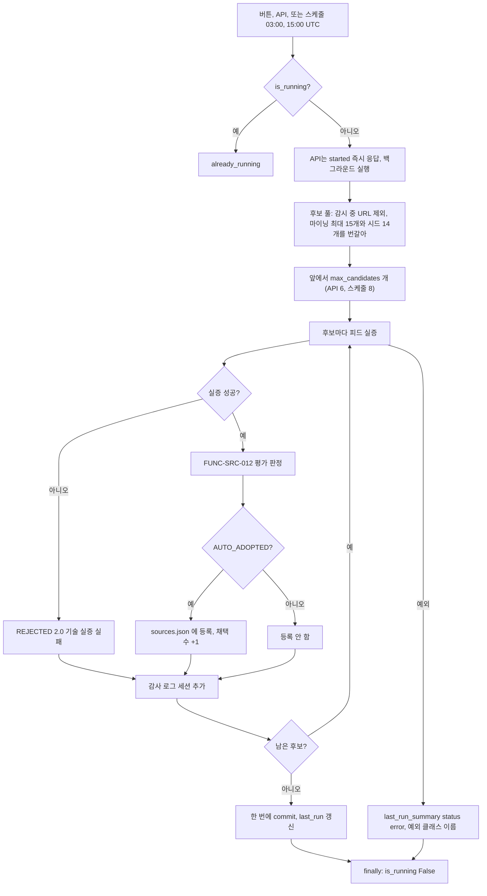

#### 4. 화면 표시 및 입력 데이터 항목 명세 (UI Data Elements - 8대 표준 컬럼)
| 항목명 | 화면 표시/입력 구분 | UI 컴포넌트 | 필수 여부 | 데이터 타입 / 제약 | 기본값 | 유효성 검증 규칙 (Validation) | 노출/수정 조건 |
| :--- | :---: | :--- | :---: | :--- | :---: | :--- | :--- |
| 실행 버튼 | 사용자 조작 | Button | - | "자율 딥 리서치 지금 실행" | - | - | 실행 중·요청 중이면 비활성, "자율 탐색 가동 중..." |
| 탭 설명 문구 | 노출 전용 | 텍스트 (제목 "자율 소스 발굴·선별") | - | "글로벌 및 국내 AI 에이전트 소스(GitHub, ArXiv, 기술 블로그)를 자율 탐색하고, 키워드 규칙 기반 적합도 점수가 기준을 넘는 피드를 자동으로 수집 대상에 편입합니다." (v0.4.2, 실제 규칙과 맞춤) | 고정 | - | 항상 |
| `max_candidates` | API 입력 (쿼리) | - | 선택 | int 1~20 | API 6, 스케줄 8, 화면 6 | 범위 밖·정수 아님이면 400 `ERR_INVALID_PAYLOAD` (v0.4.2) | 항상 |
| `status` | API 출력 | JSON | 필수 | `started` / `already_running` | - | - | 항상 |
| `message` | API 출력 | JSON | 필수 | 고정 문구 | - | - | 항상 |
| `max_candidates` (응답) | API 출력 | JSON | - | int | - | - | `started` 일 때 |

#### 5. 비즈니스 규칙 (Business Rules)
- **BR-SRC-011-1 (후보 순서, v0.4.2)**: 이미 감시 중인 피드·사이트(RSS `url`·`site_url`)와 같은 대상 URL 은 후보에서 뺀다. 남은 마이닝 후보와 시드를 하나씩 번갈아 풀을 만들고 앞에서 `max_candidates`(API·화면 6, 스케줄 8)개만 자른다. 인수 기준: 마이닝 후보 10개·시드 14개, `max_candidates=6` 이면 평가 대상은 마이닝 3개와 시드 3개이고 순서는 마이닝·시드·마이닝·시드·마이닝·시드다. 감시 중 URL 은 사이트 URL 기준으로만 빠지므로, 사이트 URL 은 다르지만 같은 피드로 이어지는 후보는 실증 뒤 `ALREADY_MONITORED` 로 기록될 수 있다.
- **BR-SRC-011-2 (채택 기준)**: 자동 채택은 `FUNC-SRC-012` 판정이 `AUTO_ADOPTED`(점수 8.2 이상)일 때만이다.
- **BR-SRC-011-3 (국가 판정)**: 원래 URL 에 `kr`, `daangn`, `woowahan` 이 부분 문자열로 있으면 `KR`.
- **BR-SRC-011-4 (직렬 처리)**: 후보를 직렬로 처리한다. 후보마다 네트워크 요청이 최대 수 회(GET, HEAD 최대 6회, 피드 GET) 일어난다.
- **BR-SRC-011-5 (상태 위치)**: `is_running`, 누적 채택 수, 마지막 실행은 프로세스 메모리에만 있어 재시작하면 사라진다.
- **BR-SRC-011-6 (실패 요약, v0.4.2)**: 인수 기준: 사이클 중 예외가 나면 `GET /api/research/status` 의 `last_run_summary` 는 `{"status": "error", "error": "<예외 클래스 이름>", "completed_at": <ISO>}` 이고 `is_running` 은 false 다. 예외 메시지 원문은 응답에 넣지 않는다.
- **BR-SRC-011-7 (채택 저장 실패, v0.4.2)**: 인수 기준: AUTO_ADOPTED 판정 후보의 `sources.json` 저장이 실패하면 그 후보의 감사 기록은 `verdict = "WATCHLIST"`, 사유 "채택 기준을 넘었으나(점수 {점수}점) sources.json 저장에 실패해 등록하지 못했습니다." 이고, 나머지 후보도 평가·기록되며, `last_run_summary.adopt_failed` 가 1 늘고 `auto_adopted` 는 늘지 않는다.

#### 6. 예외 처리 및 엣지 케이스 (Edge Cases & Exception Handling)
| 발생 상황 (Edge Case Scenario) | 화면 반응 및 시스템 처리 방식 | 사용자 안내 메시지 |
| :--- | :--- | :--- |
| 이미 실행 중 | `already_running`, 화면은 실패 톤 안내 | "Deep Research is already executing" |
| 트리거 요청 실패 | 결과 안내 | "자율 딥 리서치 트리거에 실패했습니다." |
| 실행이 3000ms 보다 김 | 화면은 한 번만 재조회하므로 결과를 보려면 "새로고침" 을 눌러야 한다 | 없음 |
| 자동 채택 저장 실패 | 그 후보만 `WATCHLIST` 로 기록하고 계속, `adopt_failed` 증가 (v0.4.2, BR-7) | 감사 일지 사유 "채택 기준을 넘었으나 … 등록하지 못했습니다." |
| 실행 도중 예외 (DB commit 실패, 평가 중 예외 등) | `finally` 가 `is_running` 을 False 로 되돌려 다음 실행은 막히지 않는다. `last_run_summary` 에 오류 요약이 남고 로그에 예외가 찍힌다 (v0.4.2). 감사 로그는 한 번에 commit 하므로 그 실행의 기록은 남지 않는다. 화면은 상태 지표에 이 요약을 따로 보여 주지 않는다 | 없음 |
| `max_candidates` 가 0, 21, 문자열 | 400 `ERR_INVALID_PAYLOAD` (v0.4.2). 화면은 6 만 보낸다 | "요청 형식이 올바르지 않습니다." |
| `scheduler.enabled=false` | 03:00·15:00 UTC 자동 실행이 없다. 버튼·API 실행은 된다 | 없음 |
| 실증 실패 | REJECTED 2.0 으로 감사 로그에 남는다 | 감사 일지 사유 `기술 실증 실패: {메시지}` (`연결 실패`, `HTTP {코드} 오류`, `피드 다운로드 실패`, `피드 HTTP {코드} 오류`, `피드는 열리나 발행된 기사가 존재하지 않음`, `유효한 RSS 또는 Atom 피드 엔드포인트를 발견하지 못함`) |
| 자동 채택과 화면 편집이 겹침 | `sources.json` 잠금이 없어 한쪽 변경이 사라질 수 있다 | 없음 |
| 기사 본문 URL 이 내부 주소 | 마이닝 후보로 서버가 요청한다 (SSRF, 수용된 위험이라 사실로만 남긴다) | 없음 |

#### 7. 비즈니스 에러 코드 매핑
| 비즈니스 에러 코드 | 발생 사유 | HTTP 상태 코드 매핑 | 클라이언트 표시 형태 |
| :--- | :--- | :---: | :--- |
| `status="already_running"` | 같은 프로세스에서 실행 중 | 200 | 결과 안내 (실패 톤) |
| `status="started"` | 정상 기동 | 200 | 결과 안내 (성공 톤, 서버 메시지) |
| `ERR_INVALID_PAYLOAD` | `max_candidates` 1~20 밖 | 400 (v0.4.2) | "자율 딥 리서치 트리거에 실패했습니다." |
| `last_run_summary.status="error"` | 백그라운드 사이클 예외 | - (상태 조회로만 보인다) | 화면 표시 없음 |
| (요청 실패) | 네트워크 오류 | - | "자율 딥 리서치 트리거에 실패했습니다." |

- 관련 코드: `backend/app/api/research.py:24-58`, `backend/app/services/deep_researcher.py:22-136`(시드·차단 도메인), `:140-156`, `:185-209`(마이닝), `:211-304`(실증), `:378-405`(실행 플래그·오류 요약·finally), `:407-510`(루프), `backend/app/scheduler.py:10-11`, `:57-63`, `:72-75`, `frontend/src/components/sources/DeepResearcherTab.tsx:56-74`, `:108-122`, `frontend/src/lib/api.ts:351-358`

---

### [FUNC-SRC-012] 후보 평가·판정 규칙

#### 1. 기본 정보
- **기능명**: 실증된 피드의 점수 계산과 판정 (AUTO_ADOPTED / WATCHLIST / REJECTED / ALREADY_MONITORED)
- **기능 ID**: `FUNC-SRC-012`
- **대응 요구사항 ID**: `REQ-SRC-003`
- **대상 화면 코드**: 없음 (`AutonomousDeepResearcher.evaluate_and_decide`, `FUNC-SRC-011` 10번에서 호출)
- **우선순위**: Should Have
- **관련 액터 (Actor)**: 시스템

#### 2. 사전 조건 (Pre-conditions)
1. 피드 실증이 성공했다 (이름, 피드 URL, 사이트 URL, 설명, 최근 글 4개).

#### 3. 사용자 인터랙션 및 시스템 동작 흐름과 플로우차트 (Step-by-Step Flow & Flowchart)
1. 끝의 `/` 를 뗀 피드 URL 이 이미 `rss_feeds` 에 있으면 판정 `ALREADY_MONITORED`, 점수 9.0, 카테고리는 힌트(없으면 `ai_news`), 사유 `'{name}' 소스는 이미 sources.json에 등록되어 실시간 모니터링 중입니다.`, 채택 안 함. 여기서 끝난다.
2. 평가 문서: `{이름} {설명}` 과 글마다 `- {제목}: {요약}` 줄.
3. 카테고리: `classify_and_tag(이름, 평가 문서)` 결과. 카테고리 힌트가 있으면 힌트로 덮어쓴다.
4. 기본 점수: `llm_processor.evaluate_quality_and_signal(이름, 평가 문서, "rss")`. 이름은 LLM 처럼 보이지만 키워드 규칙 함수다 (`FUNC-COLL-011`).
   - `rss` 는 혼합 소스로 취급한다. `is_strictly_ai_related` 정규식이 맞지 않으면 점수 1.0 으로 바로 끝난다.
   - 맞으면 5.0 에서 시작해 고신호 키워드(34개) 하나당 0.5, 최대 2.5 를 더한다.
   - AI 관련 `rss` 이므로 0.5 를 더한다.
   - 저신호 키워드(16개) 하나당 3.5 를 뺀다.
   - 이름(제목 인자)이 10자 미만이면 2.0 을 뺀다.
   - 1.0~10.0 으로 자르고 소수 한 자리로 반올림한다. 이 규칙의 최댓값은 8.0 이다.
5. 기술 깊이 가산: `harness, benchmark, swe-bench, eval, mcp, protocol, agent, reasoning, sandbox, docker` 10개 중 평가 문서(소문자)에 들어 있는 개수 × 0.3, 최대 1.8 을 더한다.
6. 최종 점수를 소수 한 자리로 반올림하고 1.0~9.9 로 자른다.
7. 판정: 8.2 이상 `AUTO_ADOPTED`(채택), 6.5 이상 8.2 미만 `WATCHLIST`, 6.5 미만 `REJECTED`.
8. 출력 `{"verdict", "score", "category", "reason", "should_add"}`.

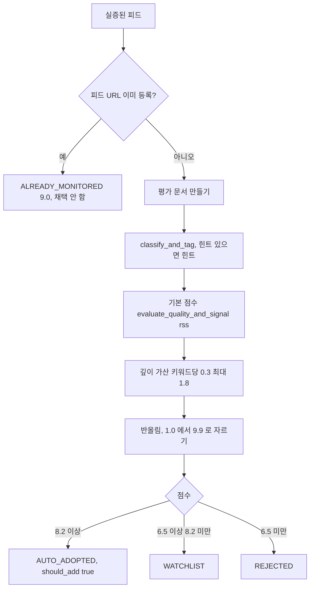

#### 4. 화면 표시 및 입력 데이터 항목 명세 (입력·출력 데이터 항목 - 8대 표준 컬럼)
| 항목명 | 화면 표시/입력 구분 | UI 컴포넌트 | 필수 여부 | 데이터 타입 / 제약 | 기본값 | 유효성 검증 규칙 (Validation) | 노출/수정 조건 |
| :--- | :---: | :--- | :---: | :--- | :---: | :--- | :--- |
| `feed_info` | 모듈 입력 | - | 필수 | `{name, feed_url, site_url, description, entries[]}` | name "Unknown" | - | 실증 성공 시 |
| `hint_cat` | 모듈 입력 | - | 선택 | 카테고리 문자열 | `""` | - | 시드는 힌트 있음, 마이닝은 빈 값 |
| `verdict` | 모듈 출력 | - | 필수 | `AUTO_ADOPTED` / `WATCHLIST` / `REJECTED` / `ALREADY_MONITORED` | - | - | 항상 |
| `score` | 모듈 출력 | - | 필수 | float 1.0~9.9 (기등록 9.0) | - | - | 항상 |
| `category` | 모듈 출력 | - | 필수 | 카테고리 | - | - | 항상 |
| `reason` | 모듈 출력 | - | 필수 | 템플릿 문장 | - | - | 항상 |
| `should_add` | 모듈 출력 | - | 필수 | bool | - | AUTO_ADOPTED 일 때만 true | 항상 |

#### 5. 비즈니스 규칙 (Business Rules)
- **BR-SRC-012-1 (점수식)**: `최종 = clamp(1.0, 9.9, round(기본 점수 + min(1.8, 깊이 키워드 수 × 0.3), 1))`. 기본 점수 최댓값이 8.0 이므로 최종 최댓값은 9.8 이다.
- **BR-SRC-012-2 (판정 사유 템플릿)**:
  - AUTO_ADOPTED: "최신 기술 분석 글 {N}편 검증 결과, {CAT} 영역의 실전 엔지니어링 및 벤치마크 관련 고밀도 신호가 확인되어 수집 대상에 자율 채택했습니다. (품질 종합 점수: {점수}점)"
  - WATCHLIST: "전반적인 콘텐츠 품질은 준수하나(점수 {점수}점), 하네스/에이전트 관련 게시물 밀도를 추가 검증하기 위해 워치리스트로 분류하고 모니터링합니다."
  - REJECTED: "에이전트/하네스 핵심 기술 연관성이 낮거나 홍보성 내용 비율이 높아 기준 미달로 기각했습니다. (점수 {점수}점)"
  - `{CAT}` 은 카테고리 대문자.
- **BR-SRC-012-3 (워치리스트)**: 별도 워치리스트 저장소나 재평가 절차는 없고 감사 로그에만 남는다.
- **BR-SRC-012-4 (LLM 없음)**: LLM 을 부르지 않는다. 시드의 `tags`, `expected_depth` 값은 평가에 쓰지 않는다.

#### 6. 예외 처리 및 엣지 케이스 (Edge Cases & Exception Handling)
| 발생 상황 (Edge Case Scenario) | 화면 반응 및 시스템 처리 방식 | 사용자 안내 메시지 |
| :--- | :--- | :--- |
| 이미 등록된 피드 | ALREADY_MONITORED 9.0 | 감사 일지 "기등록 모니터링" |
| AI 정규식 불일치 | 기본 1.0 + 깊이 가산 | 대개 REJECTED |
| 평가 중 예외 | 잡지 않아 그 실행이 끝난다. `FUNC-SRC-011` 의 `finally` 가 `is_running` 을 되돌린다 (v0.4.1) | 없음 |

#### 7. 비즈니스 에러 코드 매핑
| 비즈니스 에러 코드 | 발생 사유 | HTTP 상태 코드 매핑 | 클라이언트 표시 형태 |
| :--- | :--- | :---: | :--- |
| (없음) | 내부 모듈 | 해당 없음 | 감사 일지 판정 배지 (`FUNC-SRC-014`) |

- 관련 코드: `backend/app/services/deep_researcher.py:306-376`, `backend/app/services/llm_processor.py` (`evaluate_quality_and_signal`), `backend/app/services/categorizer.py` (`classify_and_tag`, v0.4.2 에 `collectors/` 에서 옮김)

---

### [FUNC-SRC-013] 딥 리서치 상태 조회

#### 1. 기본 정보
- **기능명**: 실행 중 여부, 마지막 실행, 누적 채택 수 조회와 지표 표시
- **기능 ID**: `FUNC-SRC-013`
- **대응 요구사항 ID**: `REQ-SRC-003`
- **대상 화면 코드**: `SCR-SRC-002`
- **우선순위**: Should Have
- **관련 액터 (Actor)**: 웹 사용자

#### 2. 사전 조건 (Pre-conditions)
1. 대화상자를 열었거나 "새로고침" 을 눌렀다.

#### 3. 사용자 인터랙션 및 시스템 동작 흐름과 플로우차트 (Step-by-Step Flow & Flowchart)
1. 화면이 `GET /api/research/status` 를 부른다.
2. 서버는 메모리 값을 그대로 돌려준다. `cadence` 는 고정 문자열 "Every 12 hours (03:00, 15:00 UTC) + On-demand".
3. 화면 지표 4칸(768px 미만 2열, 이상 4열)을 그린다. 지표 값은 말줄임 없이 어절 단위로 줄을 바꾼다 (좁은 폭에서 `매일 03:00,` / `15:00 UTC` 처럼 두 줄). 같은 줄 지표 카드의 높이는 같다.

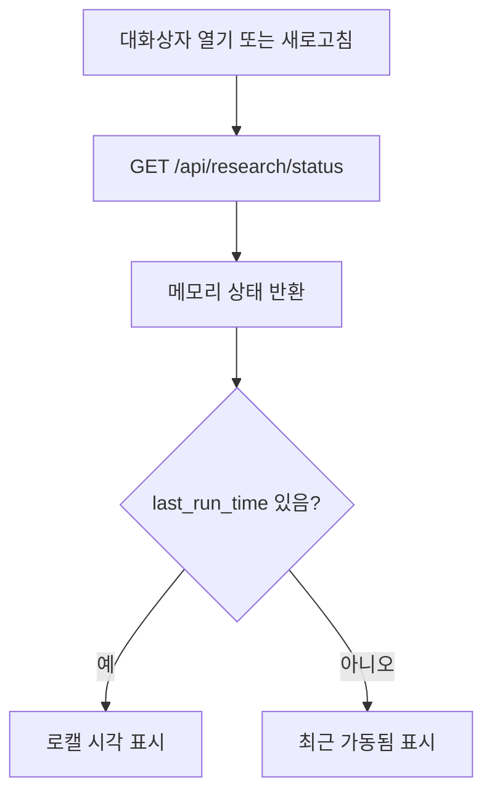

#### 4. 화면 표시 및 입력 데이터 항목 명세 (UI Data Elements - 8대 표준 컬럼)
| 항목명 | 화면 표시/입력 구분 | UI 컴포넌트 | 필수 여부 | 데이터 타입 / 제약 | 기본값 | 유효성 검증 규칙 (Validation) | 노출/수정 조건 |
| :--- | :---: | :--- | :---: | :--- | :---: | :--- | :--- |
| 자동 채택된 소스 | 노출 전용 | Metric | - | "{auto_adopted_count}개 소스" | 0 | - | 항상 |
| 자동 채택 기준 | 노출 전용 | Metric | - | "품질 점수 ≥ 8.2점" (고정 문구) | 고정 | 코드 상수와 연결 안 됨 | 항상 |
| 최근 리서치 일시 | 노출 전용 | Metric | - | `last_run_time` 의 브라우저 로캘 시각만 | "최근 가동됨" | - | 항상 |
| 정기 스케줄 | 노출 전용 | Metric | - | "매일 03:00, 15:00 UTC" (고정 문구) | 고정 | 코드 상수와 연결 안 됨 | 항상 |
| `is_running` | API 출력 | JSON | 필수 | bool | false | - | 실행 버튼 상태에 쓰인다 |
| `last_run_time` | API 출력 | JSON | - | ISO 또는 null | null | - | 항상 |
| `auto_adopted_count` | API 출력 | JSON | 필수 | int (프로세스 누적) | 0 | - | 항상 |
| `last_run_summary` | API 출력 | JSON | - | 성공 시 `FUNC-SRC-011` 13번 구조, 실패 시 `{status: "error", error, completed_at}` (v0.4.2) | `{}` | - | 항상. 화면은 쓰지 않는다 |
| `cadence` | API 출력 | JSON | 필수 | 고정 문자열 | - | - | 항상 |

#### 5. 비즈니스 규칙 (Business Rules)
- **BR-SRC-013-1**: 모든 값은 프로세스 메모리 값이다. 감사 로그 테이블에서 다시 계산하지 않는다.
- **BR-SRC-013-2**: 화면은 상태를 주기적으로 다시 읽지 않는다 (열 때, 새로고침, 기동 3000ms 뒤 1회).

#### 6. 예외 처리 및 엣지 케이스 (Edge Cases & Exception Handling)
| 발생 상황 (Edge Case Scenario) | 화면 반응 및 시스템 처리 방식 | 사용자 안내 메시지 |
| :--- | :--- | :--- |
| 재시작 직후 | `auto_adopted_count` 0, `last_run_time` null | "최근 가동됨" (실제와 다를 수 있음) |
| 요청 실패 | `FUNC-SRC-002` 불러오기 오류 | "소스 정보를 불러오지 못했습니다." |

#### 7. 비즈니스 에러 코드 매핑
| 비즈니스 에러 코드 | 발생 사유 | HTTP 상태 코드 매핑 | 클라이언트 표시 형태 |
| :--- | :--- | :---: | :--- |
| `ERR_SERVER_INTERNAL` | 처리하지 못한 서버 예외 | 500 | "소스 정보를 불러오지 못했습니다." |

- 관련 코드: `backend/app/api/research.py:26-29`, `backend/app/services/deep_researcher.py:149-156`, `frontend/src/components/sources/DeepResearcherTab.tsx:125-141`, `frontend/src/lib/api.ts:337-349`

---

### [FUNC-SRC-014] 감사 일지

#### 1. 기본 정보
- **기능명**: `source_research_logs` 최근 기록과 판정 사유 표시
- **기능 ID**: `FUNC-SRC-014`
- **대응 요구사항 ID**: `REQ-SRC-003`
- **대상 화면 코드**: `SCR-SRC-002`
- **우선순위**: Should Have
- **관련 액터 (Actor)**: 웹 사용자

#### 2. 사전 조건 (Pre-conditions)
1. 대화상자를 열었거나 "자율 리서치 판정 감사 일지" 의 "새로고침" 을 눌렀다.

#### 3. 사용자 인터랙션 및 시스템 동작 흐름과 플로우차트 (Step-by-Step Flow & Flowchart)
1. 화면이 `GET /api/research/audit-logs?limit=30` 을 부른다.
2. 서버는 테이블 `source_research_logs` 를 `created_at` 내림차순으로 `limit` 개 읽는다.
3. 응답 `{"status": "success", "total": <돌려준 개수>, "logs": [...]}`. `created_at` 은 UTC ISO 문자열(`Z` 표기, v0.4.2 `iso_utc`) 또는 null.
4. 화면: 기록이 없으면 "아직 기록된 딥 리서치 이력이 없습니다. …" 안내. 있으면 카드마다 이름, 판정 배지, 카테고리 라벨 배지, `feed_url`, 점수, 날짜, "판정 사유:" + 사유를 그린다.

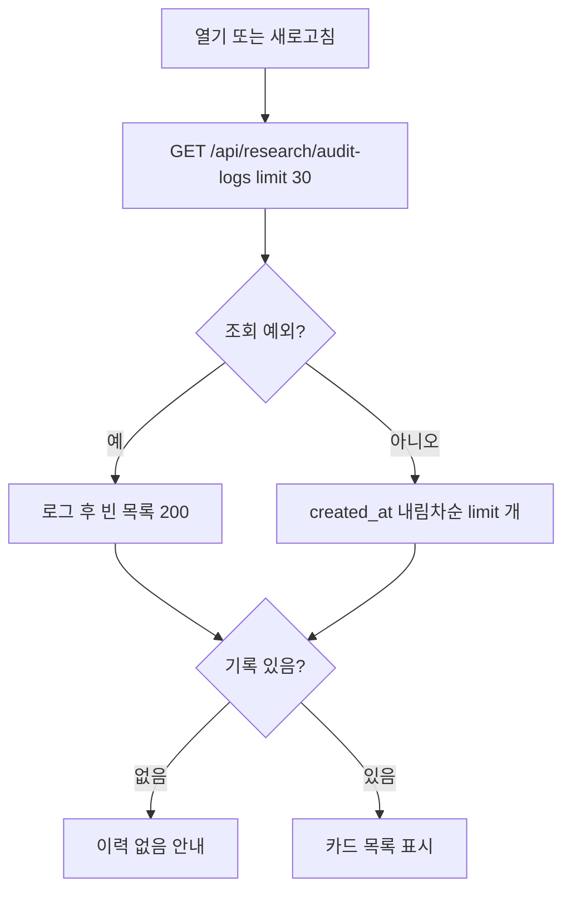

#### 4. 화면 표시 및 입력 데이터 항목 명세 (UI Data Elements - 8대 표준 컬럼)
| 항목명 | 화면 표시/입력 구분 | UI 컴포넌트 | 필수 여부 | 데이터 타입 / 제약 | 기본값 | 유효성 검증 규칙 (Validation) | 노출/수정 조건 |
| :--- | :---: | :--- | :---: | :--- | :---: | :--- | :--- |
| `limit` | API 입력 (쿼리) | - | 선택 | int 1~200 | 30 | 범위 밖·정수 아님이면 400 `ERR_INVALID_PAYLOAD` (v0.4.2) | 항상 |
| 이름 | 노출 전용 | 카드 제목 | - | `source_name` (최대 200자) | - | - | 기록마다 |
| 판정 배지 | 노출 전용 | `Badge` | - | AUTO_ADOPTED "자동 채택됨"(성공 톤), WATCHLIST "워치리스트 관찰"(경고 톤), REJECTED "기준 미달 기각"(위험 톤), ALREADY_MONITORED "기등록 모니터링"(강조 톤), 그 밖은 원문 | - | - | 기록마다 |
| 카테고리 | 노출 전용 | 라벨 배지 (`lib/labels.ts`) | - | `category` (기본 `ai_news`) | `ai_news` | - | 기록마다 |
| 피드 URL | 노출 전용 | 텍스트 | - | `feed_url` (최대 500자) | - | - | 기록마다 |
| 점수 | 노출 전용 | 텍스트 | - | 0 보다 크면 `{점수}점`, 아니면 `-` | 0.0 | - | 기록마다 |
| 날짜 | 노출 전용 | 텍스트 | - | `created_at` 로캘 날짜만 | - | - | 기록마다 |
| 판정 사유 | 노출 전용 | 텍스트 | - | "판정 사유:" + `verdict_reason` (v0.4.2, 옛 "AI 판정 사유:") | - | - | 기록마다 |
| 새로고침 | 사용자 조작 | Button | - | 버튼 | - | - | 항상 |
| `site_url`, `analyzed_articles_count`, `id` | API 출력 | JSON | - | 문자열(500) / int(기본 0) / int | - | - | 화면에 쓰지 않음 |

#### 5. 비즈니스 규칙 (Business Rules)
- **BR-SRC-014-1**: 이 테이블에 쓰는 곳은 `FUNC-SRC-011` 뿐이다. 수정·삭제 기능이 없다 (수집 데이터 초기화 `FUNC-COLL-020` 도 이 테이블을 지우지 않는다).
- **BR-SRC-014-2**: 열 구성: `id`(정수 PK), `source_name`(200), `site_url`(500), `feed_url`(500), `category`(50, 기본 `ai_news`), `relevance_score`(실수, 기본 0.0), `verdict`(30), `verdict_reason`(텍스트), `analyzed_articles_count`(정수, 기본 0), `created_at`(인덱스).
- **BR-SRC-014-3 (v0.4.2)**: 라벨은 "판정 사유:" 이고 사유는 규칙 기반 템플릿 문장이다 (옛 "AI 판정 사유" 표기는 고쳤다).

#### 6. 예외 처리 및 엣지 케이스 (Edge Cases & Exception Handling)
| 발생 상황 (Edge Case Scenario) | 화면 반응 및 시스템 처리 방식 | 사용자 안내 메시지 |
| :--- | :--- | :--- |
| 기록 없음 | 안내 문구 | "아직 기록된 딥 리서치 이력이 없습니다. …" |
| 조회 예외 | 서버가 로그를 남기고 빈 목록 200 | 기록 없음 안내 |
| `limit` 0 또는 201 | 400 (v0.4.2). 화면은 30 만 보낸다 | "요청 형식이 올바르지 않습니다." |
| 요청 실패 | `FUNC-SRC-002` 불러오기 오류 | "소스 정보를 불러오지 못했습니다." |

#### 7. 비즈니스 에러 코드 매핑
| 비즈니스 에러 코드 | 발생 사유 | HTTP 상태 코드 매핑 | 클라이언트 표시 형태 |
| :--- | :--- | :---: | :--- |
| (없음) | 조회 예외도 빈 목록 200 | 200 | 기록 없음 안내 |
| `ERR_INVALID_PAYLOAD` | `limit` 1~200 밖 | 400 (v0.4.2) | "소스 정보를 불러오지 못했습니다." |

- 관련 코드: `backend/app/api/research.py:31-39`, `backend/app/services/deep_researcher.py:158-183`, `backend/app/models/news.py:53-65`, `frontend/src/components/sources/DeepResearcherTab.tsx:27-32`, `:144-199`, `frontend/src/lib/api.ts:462-487`

---

## 상수·설정값
| 이름 | 값 | 위치 | 의미 |
|---|---|---|---|
| sources.json 탐색 순서 | cwd → cwd 부모 → 저장소 루트 → `backend/app/config/` | `backend/app/services/sources_service.py:13-26` | 사용할 파일 |
| sources.json 읽기 캐시 | (경로, 수정 시각, 크기)가 같으면 다시 읽지 않음 | `sources_service.py:55-68` | v0.4.2 |
| 사본 동기화 경로 | `backend/app/config/sources.json` (`SourcesService._mirror_path`) | `sources_service.py:47`, `:144-152` | 저장 시 항상 함께 쓰는 사본 |
| 저장 실패 문구 | "소스 파일(sources.json)을 저장하지 못했습니다. 파일 권한과 디스크를 확인해주세요." | `backend/app/api/sources.py:24` | 500 `ERR_SERVER_INTERNAL` (v0.4.2) |
| 카테고리 값 | harness, mcp_plugins_skills, agent_tech, ai_news (화면 선택지 글자는 긴 라벨) | `backend/app/api/sources.py:14`, `frontend/src/lib/labels.ts` | `category_hint` 허용값 (서버 검사, v0.4.2) |
| 국가 값 | KR, GLOBAL | `backend/app/api/sources.py:15` | `country` 허용값 (서버 검사, v0.4.2) |
| RSS 이름·URL 제약 | 이름 1~200자, URL `^https?://\S+$` 1000자 이하 | `backend/app/api/sources.py:11-12` | v0.4.2 |
| RSS `id` 해시 접미사 | 끝 `/` 를 뗀 URL 의 SHA-1 앞 8자 | `sources_service.py:35-41` | 슬러그가 비거나 겹칠 때 (v0.4.2) |
| 섹션 토글 id | `all` | `sources_service.py:28` | 소스 유형 전체 켜기/끄기 (v0.4.2) |
| `SEED_EXPLORATION_TARGETS` | 14개 | `backend/app/services/deep_researcher.py:23-130` | 딥 리서치 시드 |
| `DISALLOWED_DOMAINS` | 11개 | `deep_researcher.py` (시드 정의 바로 뒤) | 마이닝 제외 호스트(부분 문자열) |
| 마이닝 대상 기사 수 | 최근 80건 | `deep_researcher.py:191` | `id` 내림차순 |
| 마이닝 후보 상한 | 15 | `deep_researcher.py:209` | 인용 도메인 최대 수 |
| `max_candidates` | API 6(1~20), 스케줄 8 | `backend/app/api/research.py:42`, `deep_researcher.py:378`, `frontend/src/lib/api.ts:351` | 한 번에 평가할 후보 수 |
| 자동 채택 임계값 | 8.2 | `deep_researcher.py:349` | 이상이면 AUTO_ADOPTED |
| 워치리스트 임계값 | 6.5 | `deep_researcher.py:356` | 이상이면 WATCHLIST |
| 실증 실패 점수 | 2.0 | `deep_researcher.py:449` | REJECTED 기록 점수 |
| 기등록 점수 | 9.0 | `deep_researcher.py:322` | ALREADY_MONITORED 기록 점수 |
| 깊이 가산 | 키워드당 0.3, 최대 1.8 | `deep_researcher.py:341-343` | 딥 리서치 전용 |
| 최종 점수 범위 | 1.0~9.9 | `deep_researcher.py:346` | 반올림 소수 한 자리 |
| 기본 품질 점수 | 혼합 소스 5.0, 키워드당 +0.5(최대 2.5), AI rss +0.5, 저신호 −3.5, 짧은 제목 −2.0 | `backend/app/services/llm_processor.py` (`evaluate_quality_and_signal`) | 휴리스틱 결과는 캐시하지 않는다 (v0.4.2) |
| 피드 탐색 경로 | `/feed`, `/rss`, `/rss.xml`, `/atom.xml`, `/feed.xml`, `/index.xml` | `deep_researcher.py:253`, `source_researcher.py:99` | HEAD 탐색 순서 |
| HTTP 타임아웃 (딥 리서치) | GET 8.0초, HEAD 3.0초 | `deep_researcher.py:225`, `:256`, `:271` | httpx |
| HTTP 타임아웃 (URL 검사) | 페이지 10.0초, HEAD 4.0초, 피드 8.0초 | `source_researcher.py:57`, `:103`, `:124` | httpx |
| 최근 글 수 | 4 | `deep_researcher.py:289`, `source_researcher.py:147` | 피드에서 읽는 글 |
| 요약 길이 | 딥 리서치 350자, URL 검사 200자, 설명 250자 | `deep_researcher.py:293`, `:302`, `source_researcher.py:152`, `:174` | 자르기 |
| audit-logs `limit` | 기본 30, 1~200 | `backend/app/api/research.py:32`, `SourcesModal.tsx:69` | 감사 일지 수 (범위 v0.4.2) |
| 딥 리서치 스케줄 | 매일 03:00, 15:00 UTC (설정 없음) | `backend/app/scheduler.py:11`, `:57-63` | `deep_research` job |
| 결과 안내 표시 시간 | 3500ms | `frontend/src/components/SourcesModal.tsx` | 자동 숨김 |
| 기동 후 재조회 지연 | 3000ms | `frontend/src/components/sources/DeepResearcherTab.tsx:64-67` | 1회 |
| RSS 추가 프론트 타임아웃 | 8000ms | `frontend/src/lib/api.ts:297-313` | `fetchWithTimeout` 기본값 |
| URL 검사 프론트 타임아웃 | 12000ms | `frontend/src/lib/api.ts:330` | `fetchWithTimeout` |

## 알려진 불일치·위험
- **(v0.4.2 해결) 후보 순서**: 감시 중인 피드·사이트를 후보에서 빼고 마이닝·시드를 번갈아 채워, 어느 쪽도 컷에서 굶지 않는다. 근거: `backend/app/services/deep_researcher.py:411-434`.
- **(v0.4.2 해결) "LLM 평가" 표기**: API 설명과 탭 설명 문구는 '키워드 규칙 점수', '키워드 규칙 기반 적합도 점수' 로, 감사 일지 라벨은 "판정 사유:" 로 고쳤다. 근거: `backend/app/api/research.py:41-45`, `frontend/src/components/sources/DeepResearcherTab.tsx:109-112`, `:192`, `deep_researcher.py:337-368`.
- **(v0.4.1 해결) `is_running` 고착**: 예전에는 실행 중 예외 뒤 플래그가 True 로 남았다. 지금은 `try/finally` 로 되돌린다. 근거: `deep_researcher.py:390-405`.
- **(v0.4.2 해결) 백그라운드 실행 실패를 알 수 없음**: 태스크 참조를 끝날 때까지 들고 있고, 사이클 예외는 `last_run_summary`(`status: "error"`)와 로그로 남는다. 화면은 이 요약을 보여 주지 않는다. 근거: `backend/app/api/research.py:24`, `:50-53`, `deep_researcher.py:393-402`.
- **(v0.4.1 해결) 경로의 `item_id`**: 예전에는 `owner/repo` 처럼 `/` 가 든 id 의 토글·삭제가 404 였다. 지금은 `{item_id:path}` 다. 근거: `backend/app/api/sources.py:69`, `:77`.
- **테스트가 실제 파일과 외부 네트워크를 쓴다**: `test_deep_researcher.py` 는 실제 GitHub 피드를 받고 `run_deep_research` 를 돌려 자동 채택 시 실제 `sources.json` 에 피드를 넣을 수 있고, `test_sources_and_research.py` 는 실제 `sources.json` 에 임시 피드를 넣었다가 지운다. 근거: `backend/tests/test_deep_researcher.py:10-72`, `backend/tests/test_sources_and_research.py:20-90`. (현재 하네스의 pytest 는 `config.json`·`sources.json` 을 임시 사본에 쓴다고 `CLAUDE.md` 에 적혀 있다. 이 두 테스트가 그 사본을 쓰는지는 이번 작업에서 확인하지 않았다.)
- **(v0.4.2 해결) `id` 충돌**: 슬러그가 비거나 이미 쓰인 `id` 면 URL 해시 접미사를 붙여 API 로 넣는 피드끼리 `id` 가 겹치지 않는다. 남은 점: 파일을 손으로 고쳐 같은 `id` 를 두면 켜기/끄기는 첫 항목만 바뀌고 삭제는 모두 지운다. 근거: `sources_service.py:35-41`, `:197-202`, `:251`.
- **국가 판정 오탐**: 자동 채택 시 원래 URL 에 `kr` 이 부분 문자열로만 들어 있어도 `KR` 로 등록한다. 근거: `deep_researcher.py:469`.
- **(v0.4.2 해결) `category_hint` 미사용**: RSS 수집기가 피드의 `category_hint` 를 항목에 싣고, 관련성 평가를 통과했지만 분류기·평가가 카테고리를 정하지 못한(`unrelated`) 항목의 기본 카테고리로 쓴다. 예전에 버려지던 일부 항목이 이제 저장된다. 근거: `backend/app/collectors/sources/rss.py:80`, `backend/app/collectors/manager.py:163-165`.
- **화면에서 할 수 없는 일**: GitHub 저장소 추가(v0.4.2 에서 API 도 지움)·삭제, 소스 유형 섹션(GitHub 검색·Reddit·HN·arXiv·Hugging Face) 켜기/끄기(API `…/{type}/all/toggle` 만 있음)와 검색어 편집, URL 검사 결과 등록. 요약 카드의 "Reddit · HN · arXiv" 는 설정과 상관없이 항상 켜진 것처럼 보인다. 근거: `frontend/src/components/sources/SourcesListTab.tsx`, `DeepResearcherTab.tsx`.
- **서버 측 요청 위조(SSRF) 가능성**: 인증 없는 `/api/research/inspect-url` 이 임의 URL 을 서버에서 GET 하고 리다이렉트를 따라간다. 딥 리서치도 수집 기사 본문의 URL 로 요청한다. 수용된 위험(`CLAUDE.md` 최우선 규칙 6)이라 사실로만 남긴다. 근거: `backend/app/services/source_researcher.py:57-59`, `deep_researcher.py:185-209`, `:225-227`.
- **동시 쓰기**: `sources.json` 은 잠금 없이 읽고-고치고-쓴다. 딥 리서치 자동 채택과 화면 편집이 겹치면 한쪽 변경이 사라질 수 있다. 근거: `sources_service.py:125-156`, `:193-263`.
- **두 사본**: 저장 때마다 `backend/app/config/sources.json` 에도 쓴다. 어느 파일이 정본인지 코드에 정의가 없고, 루트 파일이 없으면 사본을 읽게 된다. 근거: `sources_service.py:13-26`, `:144-152`.
- **자동 채택이 추적 파일을 바꾼다**: 딥 리서치 자동 채택은 git 이 추적하는 루트 `sources.json` 과 사본에 피드를 더한다. 작업 트리의 `Evil Martians` 피드(`added_at` `2026-11-10T03:00:00…`)는 사용자의 `make dev` 실행 중 딥 리서치 자동 채택이 넣은 앱 데이터이고, v0.4.2 릴리스 커밋에서는 뺀다 (열린 질문 6).
- **오류 표현**: `/inspect-url` 은 실패도 HTTP 200 과 `status` 필드로 돌려준다. (v0.4.2 해결) `inspect-url`·딥 리서치 탐침은 접속·다운로드 예외 원문을 응답·감사 기록에 싣지 않고 고정 문장(`URL 에 접속하지 못했습니다. 주소와 네트워크를 확인해주세요.`, `피드를 내려받지 못했습니다.`, `연결 실패`, `피드 다운로드 실패`)을 쓰며, 원문은 로그에만 남긴다. 저장 실패는 500 으로 알린다. 근거: `source_researcher.py:58-66`, `:127-131`, `deep_researcher.py:226-230`, `:274-277`, `backend/app/api/sources.py:19-24`.
- **(v0.4.2 해결) 자동 채택 저장 실패가 사이클을 끝냄**: 이제 그 후보를 `WATCHLIST` 로 기록하고 계속하며 `last_run_summary.adopt_failed` 로 센다 (`deep_researcher.py:466-483`, `:512-518`).
- **(v0.4.2 해결) 서버 경로 노출**: `GET /api/sources` 의 `sources_file` 은 파일 이름만 돌려준다. 근거: `backend/app/api/sources.py:37`.
- **화면 지표 고정값**: "자동 채택 기준 8.2점", "매일 03:00, 15:00 UTC" 는 코드 상수와 연결되지 않은 문자열이다. "최근 리서치 일시" 는 기록이 없을 때 "최근 가동됨" 이라고 표시해 실제와 다를 수 있다. 근거: `DeepResearcherTab.tsx:126-141`.
- **계약 위치**: 이 영역의 응답(`SourcesResponse`, `ResearchStatus`, `ResearchAuditLog`, `InspectUrlResponse`, `RunDeepResearchResponse`)은 프론트에서 zod 스키마로 확인한다 (실패해도 던지지 않고 개발 중 경고만, `readJson`). 백엔드에는 대응 Pydantic 응답 스키마가 없다 (딕셔너리를 그대로 돌려준다). 계약 세부는 `docs/contract-integrator/01_CONTRACT_AND_MSW_SPEC.md` 가 정본이다.

## 열린 질문
1. (해결) 대응 요구사항 ID 는 `docs/spec-writer/01_PRD.md` 의 `REQ-SRC-001`~`005` 로 맞췄다.
2. (해결, v0.4.2) 화면에서 부르지 않던 `FUNC-SRC-005`, `009`, `010` 은 지웠다. 남은 우선순위(Must/Should)는 spec-writer 의 분류다.
3. 워치리스트(`WATCHLIST`) 판정의 후속 절차(재평가, 사람 검토)를 둘 것인가. 지금은 감사 로그에만 남는다.
4. `sources.json` 두 사본 중 정본을 어느 것으로 할 것인가.
5. 딥 리서치 실패 요약(`last_run_summary.status = "error"`)을 화면에 보여 줄 것인가. 지금은 API 로만 보인다.
6. 자동 채택이 git 추적 파일 `sources.json` 을 바꾼다. v0.4.2 작업 트리의 `Evil Martians` 는 사용자의 `make dev` 딥 리서치가 넣은 앱 데이터라 릴리스 커밋에서 뺀다. 운영 사본을 따로 둘지는 정해지지 않았다.

## 변경 이력
| 버전 | 날짜 | 바뀐 점 |
|---|---|---|
| v0.4.2 | 2026-11-10 | `FUNC-SRC-005`·`009`·`010` 삭제(API 3개 지움, 살아 있는 기능 14 → 11). RSS 추가 서버 검증(이름 1~200, URL http(s), 카테고리·국가 허용값) 400 `ERR_INVALID_PAYLOAD`. `sources.json` 저장 실패 500. 섹션 토글은 `item_id=all` 만. `id` 슬러그 + URL 해시. `sources_file` 파일 이름만. 소스 대화상자 불러오기 실패 시 오류 상태·다시 시도. 딥 리서치: 감시 중 후보 제외·마이닝/시드 번갈아, 태스크 참조 보관, 실패 요약, `max_candidates` 1~20, `limit` 1~200. 탭 설명 문구 '키워드 규칙 기반 적합도 점수', 감사 일지 라벨 '판정 사유:'. 탐침·URL 검사 오류 문구에서 예외 원문 제거. 채택 저장 실패는 WATCHLIST 기록·`adopt_failed`. `category_hint` 를 수집 기본 카테고리로 사용. 오류 형식 `{error_code, message, details}` |

## 옛 기능명세 대응표
| 옛 ID (`05-sources-and-research.md`) | 새 ID |
|---|---|
| SRC-01 sources.json 구조와 저장 | `FUNC-SRC-001` |
| SRC-02 소스 관리 대화상자 | `FUNC-SRC-002` |
| SRC-03 소스 목록 조회 | `FUNC-SRC-003` |
| SRC-04 RSS 피드 추가 | `FUNC-SRC-004` |
| SRC-05 GitHub 저장소 추가 | `FUNC-SRC-005` (삭제, v0.4.2) |
| SRC-06 소스 켜기/끄기 | `FUNC-SRC-006` |
| SRC-07 소스 삭제 | `FUNC-SRC-007` |
| SRC-08 단일 URL 검사 | `FUNC-SRC-008` |
| SRC-09 카탈로그 후보 탐색 | `FUNC-SRC-009` (삭제, v0.4.2) |
| SRC-10 후보 등록 | `FUNC-SRC-010` (삭제, v0.4.2) |
| SRC-11 자율 딥 리서치 실행 | `FUNC-SRC-011` |
| SRC-12 후보 평가·판정 규칙 | `FUNC-SRC-012` |
| SRC-13 딥 리서치 상태 조회 | `FUNC-SRC-013` |
| SRC-14 감사 일지 | `FUNC-SRC-014` |
| 상수·설정값, 알려진 불일치·위험 | 같은 이름의 절 |
