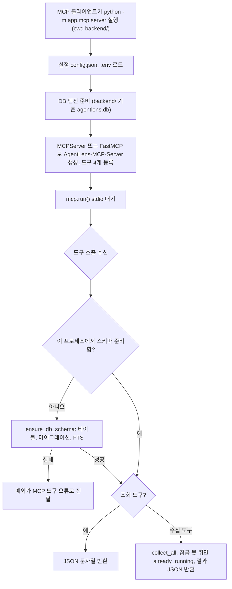
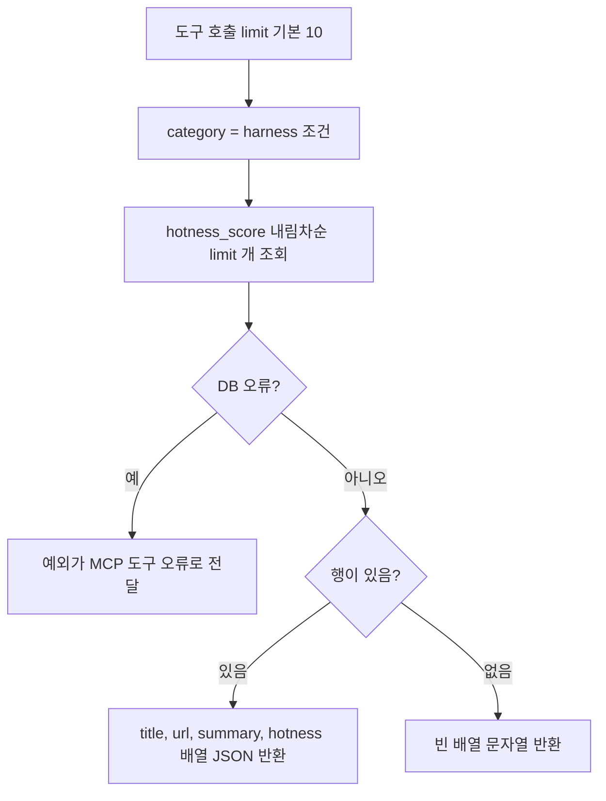
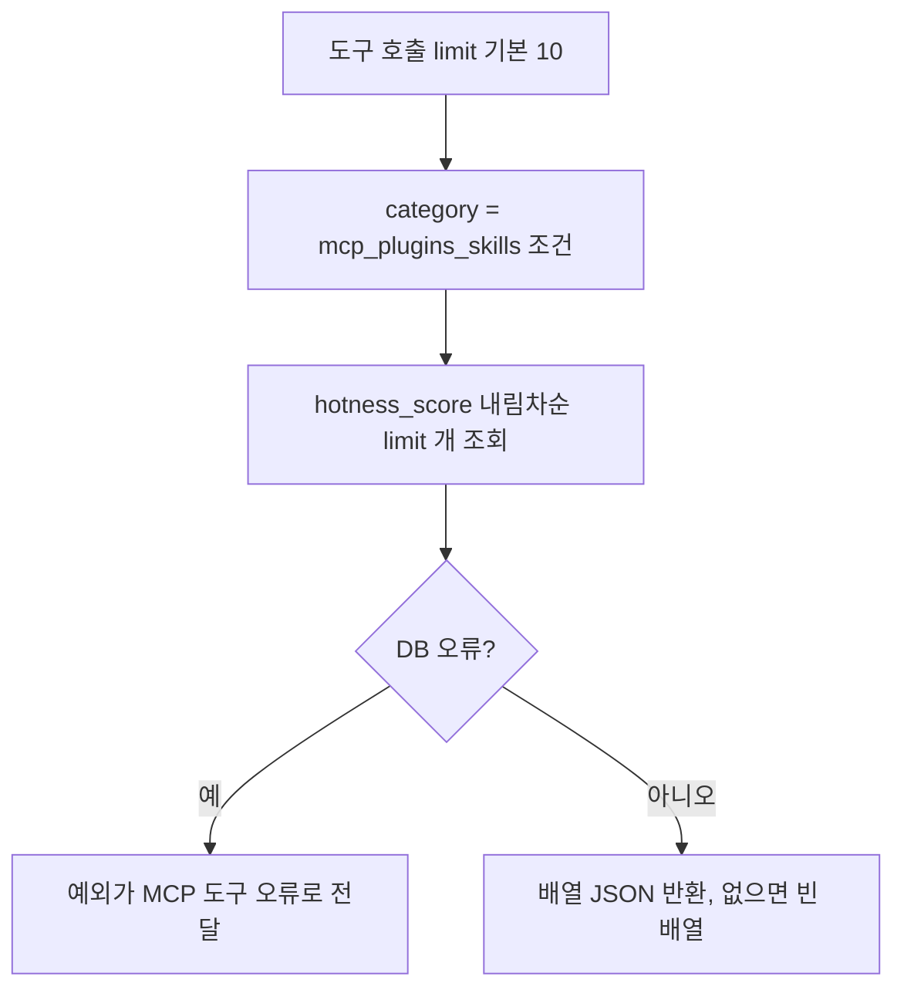
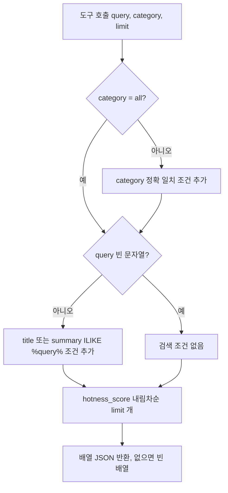
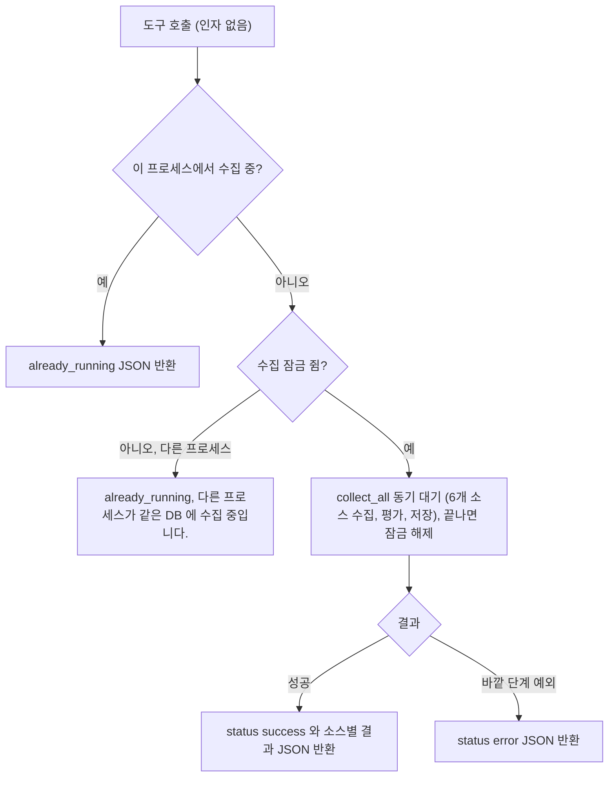
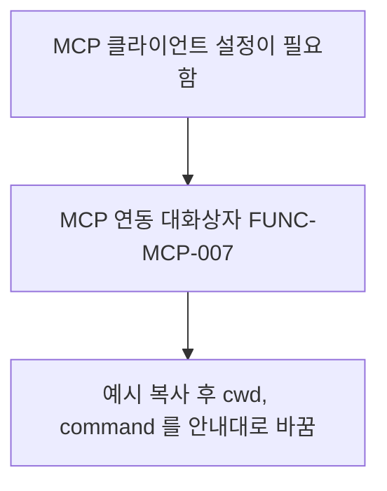
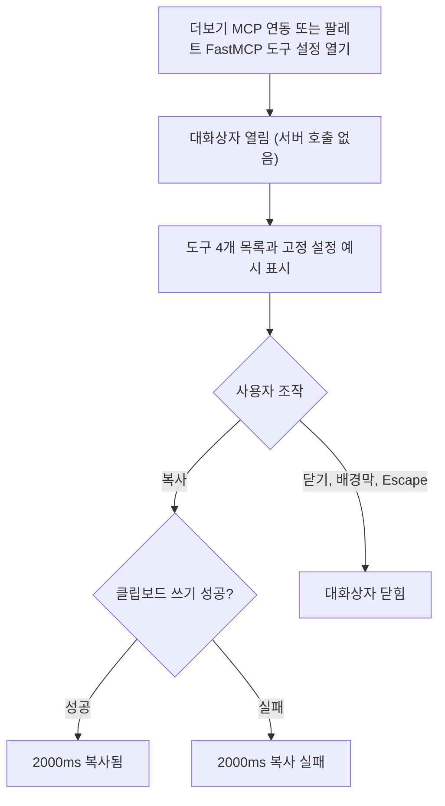

# MCP 서버 상세기능정의서 (Modular FSD)

Updated: 2026-11-10
기준: v0.4.2 (main)

- **도메인**: MCP 서버 (도메인 코드 `MCP`)
- **작성자**: 기획 명세 작성가 (`spec-writer`)
- **문서 버전**: v1.1
- **상태**: Draft (지금 코드를 그대로 적은 as-built 명세)

---

## 문서 범위와 읽는 법
- 이 문서는 새 기능 설계가 아니라 지금 코드(v0.4.2, main)의 동작을 적는다. 코드 사실의 근거는 `path:line` 이다.
- 화면이 없는 기능(MCP 도구)은 4번 표를 **입력·출력 데이터 항목 표**로 쓴다. 컬럼은 8대 컬럼 그대로이며, '화면 표시/입력 구분' 칸에 `도구 입력`, `도구 출력` 을 적는다.
- **대응 요구사항 ID** 는 `docs/spec-writer/01_PRD.md` 3절의 `REQ-<코드>-NNN` 이다.
- **우선순위** 는 지금 동작에서 기능이 맡는 역할로 spec-writer 가 분류한 값이다. 제품 오너가 정한 값이 아니다 (열린 질문 2).
- MCP 도구는 HTTP 가 아니라 MCP 프로토콜 오류로 실패를 알린다. 7번 표의 '비즈니스 에러 코드' 칸에는 예외 이름과 도구가 돌려주는 `status` 값을 적는다. 웹 API 의 오류 형식(`{error_code, message, details}`)은 이 도메인에 해당하지 않는다.
- v0.4.2 에서 `GET /api/mcp/info` 를 지웠다 (`FUNC-MCP-006` 삭제). 살아 있는 단위 기능은 7 → 6개다.
- 수집 파이프라인 자체(`collect_all`)의 규칙은 `docs/spec-writer/fsd/03_COLLECTION_SPECIFICATION.md` 가 다룬다.

## 개요
AgentLens 는 Model Context Protocol(MCP) 서버를 함께 제공해 Claude Desktop, Cursor 같은 MCP 클라이언트가 수집된 뉴스를 도구 호출로 조회하고 수집을 실행할 수 있게 한다. 서버는 `backend/app/mcp/server.py` 의 MCP 앱(mcp 2.x 의 `MCPServer`, 없으면 1.x 의 `FastMCP`)이며, 클라이언트가 `python -m app.mcp.server` 를 자식 프로세스로 띄워 stdio 로 통신한다. 웹 API 서버와는 별개 프로세스지만 같은 백엔드 코드·설정·SQLite DB 를 쓰고, 수집은 같은 DB 의 수집 잠금을 함께 쓴다. 도구는 4개(하네스 소식, MCP·스킬 생태계 소식, 키워드 검색, 즉시 수집)다. 웹 화면에서는 헤더 더보기 메뉴 "MCP 연동" 으로 여는 `McpModal` 대화상자가 도구 목록과 클라이언트 설정 예시, 설정 안내를 보여 준다.

## 기능 트리
- 1Depth: MCP 서버 (`MCP`)
  - 2Depth: MCP 서버 프로세스 (stdio, 화면 없음)
    - `FUNC-MCP-001` MCP 서버 실행
    - `FUNC-MCP-002` 도구 `get_latest_harness_methods`
    - `FUNC-MCP-003` 도구 `get_mcp_and_skills_ecosystem`
    - `FUNC-MCP-004` 도구 `search_agent_news`
    - `FUNC-MCP-005` 도구 `trigger_agentlens_crawl`
  - 2Depth: 웹 API (화면 없음)
    - `FUNC-MCP-006` MCP 정보 API `GET /api/mcp/info` — 삭제(v0.4.2)
  - 2Depth: MCP 연동 대화상자 (`SCR-MCP-001`)
    - `FUNC-MCP-007` MCP 연동 대화상자

| 화면 코드 | 화면 | 컴포넌트 |
|---|---|---|
| `SCR-MCP-001` | MCP 연동 대화상자 | `frontend/src/components/McpModal.tsx` |

---

## 단위 기능 상세 명세 (단위기능별 7대 상세 명세 완비)

---

### [FUNC-MCP-001] MCP 서버 실행

#### 1. 기본 정보
- **기능명**: MCP 서버를 stdio 로 실행
- **기능 ID**: `FUNC-MCP-001`
- **대응 요구사항 ID**: `REQ-MCP-001`
- **대상 화면 코드**: 없음 (MCP 클라이언트가 띄우는 자식 프로세스)
- **우선순위**: Must Have
- **관련 액터 (Actor)**: MCP 클라이언트 (Claude Desktop, Cursor 등), 그 클라이언트를 설정하는 개발자

#### 2. 사전 조건 (Pre-conditions)
1. 백엔드 의존성(`mcp>=1.0.0` 포함, `backend/requirements.txt`)이 설치된 Python 이 있다 (예: 저장소의 `.venv/bin/python`).
2. MCP 클라이언트 설정의 `command`/`args`/`cwd` 가 그 Python, `-m app.mcp.server`, cwd `backend/` 절대 경로를 가리킨다 (안내는 `FUNC-MCP-007`).

#### 3. 사용자 인터랙션 및 시스템 동작 흐름과 플로우차트 (Step-by-Step Flow & Flowchart)
1. MCP 클라이언트가 `backend/` 를 cwd 로 `python -m app.mcp.server` 를 자식 프로세스로 띄운다.
2. 모듈 import 시 `app.config`(설정), `app.database`(엔진·세션·스키마 함수), `app.models.news`, `app.collectors.manager`(수집기 전체)를 함께 불러온다.
3. 설정: `config.json` 을 cwd, cwd 의 부모, 저장소 루트, `backend/app/config/config.json` 순으로 찾고 `.env` 들을 읽는다 (웹 서버와 같은 `Settings`).
4. DB (v0.4.2): `DATABASE_URL` 기본값은 `backend/agentlens.db` 절대 경로이고, SQLite 상대 경로(예: `config.json` 의 `sqlite+aiosqlite:///./agentlens.db`)도 cwd 가 아니라 `backend/` 기준으로 푼다. 그래서 cwd 가 달라도 웹 서버·`make collect` 와 같은 DB 파일을 연다.
5. 서버 클래스를 고른다 (v0.4.2): `mcp.server.mcpserver.MCPServer`(mcp 2.x)를 먼저 불러오고, 없으면 `mcp.server.fastmcp.FastMCP`(mcp 1.x)를 쓴다. 이름 `AgentLens-MCP-Server` 로 인스턴스를 만들고 `@mcp.tool()` 로 도구 4개를 등록한다. 도구의 입력 스키마와 설명은 함수 시그니처(타입 힌트·기본값)와 docstring 에서 만들어진다.
6. `__main__` 으로 실행되면 `mcp.run()` 을 인자 없이 부른다. 전송 방식은 기본값인 stdio 다. HTTP/SSE 로 띄우는 코드는 없다. 스케줄러는 띄우지 않는다.
7. 도구가 처음 불릴 때 한 번 `ensure_db_schema()` 를 부른다 (v0.4.2): 테이블 생성, 버전 붙은 마이그레이션(`PRAGMA user_version`), FTS 색인. 같은 프로세스에서 다시 부르지 않는다. 실패하면 예외가 도구 오류로 전달되고 다음 호출 때 다시 시도한다.
8. 이후 클라이언트의 도구 호출마다 `FUNC-MCP-002`~`005` 를 실행한다. 모든 도구는 문자열(JSON 텍스트)을 돌려준다.

#### 4. 화면 표시 및 입력 데이터 항목 명세 (입력·출력 데이터 항목 - 8대 표준 컬럼)
| 항목명 | 화면 표시/입력 구분 | UI 컴포넌트 | 필수 여부 | 데이터 타입 / 제약 | 기본값 | 유효성 검증 규칙 (Validation) | 노출/수정 조건 |
| :--- | :---: | :--- | :---: | :--- | :---: | :--- | :--- |
| 실행 명령 `command` | 프로세스 입력 | MCP 클라이언트 설정 `command` | 필수 | backend 의존성이 설치된 Python 경로 | - | 없음. 의존성이 없으면 import 실패 | 클라이언트 설정에서 사용자가 고친다 |
| 실행 모듈 | 프로세스 입력 | MCP 클라이언트 설정 `args` | 필수 | `["-m", "app.mcp.server"]` | - | 없음 | 클라이언트 설정에서 사용자가 고친다 |
| 작업 폴더 `cwd` | 프로세스 입력 | MCP 클라이언트 설정 `cwd` | 필수 | 절대 경로, `backend/` | - | 없음. 잘못되면 `app` 패키지 import 실패 | 클라이언트 설정에서 사용자가 고친다 |
| `DATABASE_URL` | 설정 입력 | `config.json` `app.database_url` 또는 환경 | 선택 | 문자열 | `backend/agentlens.db` 절대 경로 | SQLite 상대 경로는 `backend/` 기준으로 푼다 (v0.4.2) | - |
| 서버 이름 | 프로토콜 출력 | MCP initialize 응답 | - | `AgentLens-MCP-Server` | 고정 | - | 항상 |
| 도구 목록 | 프로토콜 출력 | MCP tools/list | - | 도구 4개, 스키마는 함수 시그니처에서 생성 | 고정 | - | 항상 |

#### 5. 비즈니스 규칙 (Business Rules)
- **BR-MCP-001-1**: 전송은 stdio 하나다. 표준 출력은 MCP 프로토콜 채널이다. 수집기·설정 코드 중 import 시점에 표준 출력에 쓰는 코드는 확인하지 못했다 (`config.py` 의 저장 실패 `print` 는 저장 경로에서만 실행된다). 수집기는 진행 상황을 로거로 남기며, 수집 도구 실행 중 표준 출력에 쓰는 코드가 있는지는 이번에 확인하지 못했다.
- **BR-MCP-001-2**: 인증·권한 확인이 없다. 로컬 자식 프로세스로 띄우는 것을 전제로 한다.
- **BR-MCP-001-3 (스키마 보장, v0.4.2)**: 인수 기준: 빈 DB 파일(테이블 없음)로 서버를 띄우고 `get_latest_harness_methods` 를 부르면 오류 없이 `[]` 를 돌려주고, 그 뒤 DB 에 `news_items` 테이블과 FTS 색인이 생긴다.
- **BR-MCP-001-4**: 웹 서버와 같은 `Settings` 를 쓰므로 `.env`/`config.json` 의 LLM 키가 MCP 서버의 수집(`FUNC-MCP-005`)에도 쓰인다.
- **BR-MCP-001-5 (같은 DB, v0.4.2)**: 웹 서버, MCP 서버, `make collect` 는 cwd 와 상관없이 같은 `backend/agentlens.db`(설정이 절대 경로면 그 경로)를 쓴다.

#### 6. 예외 처리 및 엣지 케이스 (Edge Cases & Exception Handling)
| 발생 상황 (Edge Case Scenario) | 화면 반응 및 시스템 처리 방식 | 사용자 안내 메시지 |
| :--- | :--- | :--- |
| DB 파일이나 `news_items` 테이블이 없음 | 첫 도구 호출에서 스키마를 만든 뒤 처리한다 (v0.4.2). 조회 결과는 빈 목록 | 없음 |
| 스키마 생성·마이그레이션 실패 | 예외가 도구 오류로 전달되고 로그에 실패한 마이그레이션 번호가 남는다 | MCP 클라이언트가 보여 주는 도구 오류 |
| 웹 서버와 MCP 서버의 cwd 가 다름 | 같은 `backend/agentlens.db` 를 본다 (v0.4.2 해결) | 없음 |
| Docker 로 웹 서버를 띄움 | 웹 서버는 volume 의 `/app/data/agentlens.db` 를 쓰므로 호스트에서 띄운 MCP 서버와 데이터를 공유하지 않는다 | 없음 |
| `cwd` 가 `backend/` 가 아님 | `app` 패키지를 불러오지 못해 프로세스가 시작되지 않는다 | MCP 클라이언트의 서버 시작 실패 표시 |
| mcp 2.x 설치 | `MCPServer` 로 뜬다. 1.x 면 `FastMCP` 로 뜬다 (v0.4.2) | 없음 |

#### 7. 비즈니스 에러 코드 매핑
| 비즈니스 에러 코드 | 발생 사유 | HTTP 상태 코드 매핑 | 클라이언트 표시 형태 |
| :--- | :--- | :---: | :--- |
| (DB 예외) | 스키마 생성 실패, DB 잠금 시간 초과 등 | 해당 없음 (MCP 도구 오류) | MCP 클라이언트의 도구 오류 |
| (import 오류) | cwd·Python 환경 불일치 | 해당 없음 | MCP 클라이언트의 서버 시작 실패 |

- 관련 코드: `backend/app/mcp/server.py:1-23`, `:68-69`, `backend/app/config.py:15-58`, `backend/app/database.py:179-201`, `backend/requirements.txt`

---

### [FUNC-MCP-002] 도구 `get_latest_harness_methods`

#### 1. 기본 정보
- **기능명**: 하네스 카테고리 뉴스를 인기도(hotness) 순으로 조회
- **기능 ID**: `FUNC-MCP-002`
- **대응 요구사항 ID**: `REQ-MCP-001`
- **대상 화면 코드**: 없음 (MCP 도구)
- **우선순위**: Must Have
- **관련 액터 (Actor)**: MCP 클라이언트 (그 안의 에이전트)

#### 2. 사전 조건 (Pre-conditions)
1. `FUNC-MCP-001` 로 서버가 떠 있다. 스키마는 첫 호출 때 서버가 만든다 (v0.4.2).

#### 3. 사용자 인터랙션 및 시스템 동작 흐름과 플로우차트 (Step-by-Step Flow & Flowchart)
1. 클라이언트가 도구를 `limit`(선택)과 함께 부른다. 도구 설명(docstring): "Retrieve the latest agent harness methodologies, benchmarks (SWE-bench, GAIA), testbeds, and eval frameworks."
2. 이 프로세스에서 처음 부르는 도구면 스키마를 준비한다 (`FUNC-MCP-001` 7번). 새 DB 세션을 열어 `news_items` 에서 `category == "harness"` 인 행을 `hotness_score` 내림차순으로 `limit` 개 읽는다.
3. 각 행을 `{"title", "url", "summary", "hotness"}`(`hotness` = `hotness_score`)로 바꾼다.
4. JSON 문자열(`ensure_ascii=False`, `indent=2`)로 돌려준다. 결과가 없으면 `"[]"`.

#### 4. 화면 표시 및 입력 데이터 항목 명세 (입력·출력 데이터 항목 - 8대 표준 컬럼)
| 항목명 | 화면 표시/입력 구분 | UI 컴포넌트 | 필수 여부 | 데이터 타입 / 제약 | 기본값 | 유효성 검증 규칙 (Validation) | 노출/수정 조건 |
| :--- | :---: | :--- | :---: | :--- | :---: | :--- | :--- |
| `limit` | 도구 입력 | MCP 도구 인자 | 선택 | int | 10 | 없음 (0 이면 빈 목록, 음수의 SQLite 동작은 확인하지 못함) | 호출마다 |
| `title` | 도구 출력 | JSON 배열 원소 | 필수 | string | - | - | 행마다 |
| `url` | 도구 출력 | JSON 배열 원소 | 필수 | string | - | - | 행마다 |
| `summary` | 도구 출력 | JSON 배열 원소 | - | string 또는 null | - | - | 행마다 |
| `hotness` | 도구 출력 | JSON 배열 원소 | - | float (0~100, `hotness_score`. v0.4.2 부터 `min(100, 20·log10(1+원점수))` 로그 척도) | - | - | 행마다 |

#### 5. 비즈니스 규칙 (Business Rules)
- **BR-MCP-002-1**: 이름에 "latest" 가 있지만 발행일·수집일로 정렬하거나 거르지 않는다. 정렬은 `hotness_score` 내림차순 하나다.
- **BR-MCP-002-2**: 품질 점수·하이시그널 여부로 거르지 않는다.
- **BR-MCP-002-3**: `limit` 에 상한이 없어 큰 값을 주면 해당 카테고리 전체를 한 번에 직렬화한다.

#### 6. 예외 처리 및 엣지 케이스 (Edge Cases & Exception Handling)
| 발생 상황 (Edge Case Scenario) | 화면 반응 및 시스템 처리 방식 | 사용자 안내 메시지 |
| :--- | :--- | :--- |
| 하네스 기사가 0건 (빈 DB 포함) | `"[]"` 를 돌려준다 | 없음 |
| `limit = 0` | 빈 배열 | 없음 |
| DB 오류 | 잡지 않고 MCP 도구 오류로 전달 | 클라이언트의 도구 오류 |

#### 7. 비즈니스 에러 코드 매핑
| 비즈니스 에러 코드 | 발생 사유 | HTTP 상태 코드 매핑 | 클라이언트 표시 형태 |
| :--- | :--- | :---: | :--- |
| (DB 예외) | 스키마 생성 실패, DB 잠금 시간 초과 등 | 해당 없음 (MCP 도구 오류) | MCP 클라이언트의 도구 오류 |

- 관련 코드: `backend/app/mcp/server.py:25-33`

---

### [FUNC-MCP-003] 도구 `get_mcp_and_skills_ecosystem`

#### 1. 기본 정보
- **기능명**: MCP·스킬·플러그인 카테고리 뉴스를 인기도 순으로 조회
- **기능 ID**: `FUNC-MCP-003`
- **대응 요구사항 ID**: `REQ-MCP-001`
- **대상 화면 코드**: 없음 (MCP 도구)
- **우선순위**: Must Have
- **관련 액터 (Actor)**: MCP 클라이언트

#### 2. 사전 조건 (Pre-conditions)
1. `FUNC-MCP-001` 로 서버가 떠 있다. 스키마는 첫 호출 때 서버가 만든다 (v0.4.2).

#### 3. 사용자 인터랙션 및 시스템 동작 흐름과 플로우차트 (Step-by-Step Flow & Flowchart)
1. 클라이언트가 도구를 부른다. 설명: "Retrieve trending Model Context Protocol (MCP) servers, tools, skills, and plugins." 처음 부르는 도구면 스키마를 준비한다.
2. `category == "mcp_plugins_skills"` 인 행을 `hotness_score` 내림차순으로 `limit` 개 읽는다.
3. 각 행을 `{"title", "url", "summary", "hotness"}` 로 바꿔 JSON 배열 문자열(`ensure_ascii=False`, `indent=2`)로 돌려준다.

#### 4. 화면 표시 및 입력 데이터 항목 명세 (입력·출력 데이터 항목 - 8대 표준 컬럼)
| 항목명 | 화면 표시/입력 구분 | UI 컴포넌트 | 필수 여부 | 데이터 타입 / 제약 | 기본값 | 유효성 검증 규칙 (Validation) | 노출/수정 조건 |
| :--- | :---: | :--- | :---: | :--- | :---: | :--- | :--- |
| `limit` | 도구 입력 | MCP 도구 인자 | 선택 | int | 10 | 없음 | 호출마다 |
| `title`, `url`, `summary`, `hotness` | 도구 출력 | JSON 배열 원소 | - | `FUNC-MCP-002` 와 같다 | - | - | 행마다 |

#### 5. 비즈니스 규칙 (Business Rules)
- **BR-MCP-003-1**: 정렬은 `hotness_score` 내림차순, 거르기는 카테고리 하나뿐이다.
- **BR-MCP-003-2**: `limit` 상한이 없다.

#### 6. 예외 처리 및 엣지 케이스 (Edge Cases & Exception Handling)
| 발생 상황 (Edge Case Scenario) | 화면 반응 및 시스템 처리 방식 | 사용자 안내 메시지 |
| :--- | :--- | :--- |
| 해당 카테고리 0건 | `"[]"` | 없음 |
| DB 오류 | MCP 도구 오류로 전달 (`FUNC-MCP-002` 와 같다) | 클라이언트의 도구 오류 |

#### 7. 비즈니스 에러 코드 매핑
| 비즈니스 에러 코드 | 발생 사유 | HTTP 상태 코드 매핑 | 클라이언트 표시 형태 |
| :--- | :--- | :---: | :--- |
| (DB 예외) | 스키마 생성 실패 등 | 해당 없음 (MCP 도구 오류) | MCP 클라이언트의 도구 오류 |

- 관련 코드: `backend/app/mcp/server.py:35-43`

---

### [FUNC-MCP-004] 도구 `search_agent_news`

#### 1. 기본 정보
- **기능명**: 제목·요약 부분 일치 검색 (카테고리 필터 선택)
- **기능 ID**: `FUNC-MCP-004`
- **대응 요구사항 ID**: `REQ-MCP-001`
- **대상 화면 코드**: 없음 (MCP 도구)
- **우선순위**: Must Have
- **관련 액터 (Actor)**: MCP 클라이언트

#### 2. 사전 조건 (Pre-conditions)
1. `FUNC-MCP-001` 로 서버가 떠 있다. 스키마는 첫 호출 때 서버가 만든다 (v0.4.2).

#### 3. 사용자 인터랙션 및 시스템 동작 흐름과 플로우차트 (Step-by-Step Flow & Flowchart)
1. 클라이언트가 `query`(필수), `category`, `limit` 로 부른다. 설명: "Search global AI news, agent tech, harness methods, and MCP tools." 처음 부르는 도구면 스키마를 준비한다. 이 도구는 AI 챗의 검색 경로(`retriever`)를 쓰지 않는다.
2. `category != "all"` 이면 `category ==` 조건을 건다.
3. `query` 가 빈 문자열이 아니면 `%{query}%` 로 `title ILIKE` 또는 `summary ILIKE` 조건을 건다. 빈 문자열이면 검색 조건 없이 (카테고리 조건만) 조회한다.
4. `hotness_score` 내림차순으로 `limit` 개를 읽는다.
5. 각 행을 `{"title", "url", "category", "summary", "hotness"}` 로 바꿔 JSON 배열 문자열(`ensure_ascii=False`, `indent=2`)로 돌려준다.

#### 4. 화면 표시 및 입력 데이터 항목 명세 (입력·출력 데이터 항목 - 8대 표준 컬럼)
| 항목명 | 화면 표시/입력 구분 | UI 컴포넌트 | 필수 여부 | 데이터 타입 / 제약 | 기본값 | 유효성 검증 규칙 (Validation) | 노출/수정 조건 |
| :--- | :---: | :--- | :---: | :--- | :---: | :--- | :--- |
| `query` | 도구 입력 | MCP 도구 인자 | 필수 (스키마상) | str | 없음 | 없음. 빈 문자열이면 검색 조건 없음. `%`, `_` 는 이스케이프하지 않아 와일드카드로 동작 | 호출마다 |
| `category` | 도구 입력 | MCP 도구 인자 | 선택 | str. 의미 있는 값은 `all`, `harness`, `mcp_plugins_skills`, `agent_tech`, `ai_news` | `"all"` | 없음. 잘못된 값은 오류 없이 빈 배열 | 호출마다 |
| `limit` | 도구 입력 | MCP 도구 인자 | 선택 | int | 10 | 없음 | 호출마다 |
| `title`, `url`, `summary`, `hotness` | 도구 출력 | JSON 배열 원소 | - | `FUNC-MCP-002` 와 같다 | - | - | 행마다 |
| `category` | 도구 출력 | JSON 배열 원소 | - | str | - | - | 행마다 |

#### 5. 비즈니스 규칙 (Business Rules)
- **BR-MCP-004-1**: 검색은 대소문자 무시 부분 일치(`ILIKE`)뿐이다. 형태소 분석·태그·전문 검색·벡터 검색은 하지 않는다.
- **BR-MCP-004-2**: 결과 정렬은 관련도가 아니라 `hotness_score` 내림차순이다.
- **BR-MCP-004-3**: `category` 는 정확 일치이며 값 검사가 없다.

#### 6. 예외 처리 및 엣지 케이스 (Edge Cases & Exception Handling)
| 발생 상황 (Edge Case Scenario) | 화면 반응 및 시스템 처리 방식 | 사용자 안내 메시지 |
| :--- | :--- | :--- |
| 맞는 항목 없음 | `"[]"` | 없음 |
| 존재하지 않는 카테고리 | 오류 없이 `"[]"` | 없음 |
| `query = ""` | 카테고리 조건만으로 hotness 상위 `limit` 개 | 없음 |
| `query` 에 `%` 또는 `_` 포함 | LIKE 와일드카드로 해석되어 의도보다 넓게 일치 | 없음 |
| DB 오류 | MCP 도구 오류로 전달 | 클라이언트의 도구 오류 |

#### 7. 비즈니스 에러 코드 매핑
| 비즈니스 에러 코드 | 발생 사유 | HTTP 상태 코드 매핑 | 클라이언트 표시 형태 |
| :--- | :--- | :---: | :--- |
| (MCP 인자 검증 오류) | `query` 누락 (MCP 라이브러리가 시그니처에서 만든 스키마 기준) | 해당 없음 | MCP 클라이언트의 도구 오류 |
| (DB 예외) | 스키마 생성 실패 등 | 해당 없음 | MCP 클라이언트의 도구 오류 |

- 관련 코드: `backend/app/mcp/server.py:45-59`

---

### [FUNC-MCP-005] 도구 `trigger_agentlens_crawl`

#### 1. 기본 정보
- **기능명**: 전체 소스 수집을 즉시 실행하고 결과를 돌려준다
- **기능 ID**: `FUNC-MCP-005`
- **대응 요구사항 ID**: `REQ-MCP-002`
- **대상 화면 코드**: 없음 (MCP 도구)
- **우선순위**: Should Have
- **관련 액터 (Actor)**: MCP 클라이언트

#### 2. 사전 조건 (Pre-conditions)
1. `FUNC-MCP-001` 로 서버가 떠 있다.
2. 외부 소스에 닿을 네트워크가 있다. LLM 게이트를 쓰려면 LLM 키나 Ollama 가 있어야 한다 (없으면 휴리스틱 폴백, `FUNC-COLL-010`).

#### 3. 사용자 인터랙션 및 시스템 동작 흐름과 플로우차트 (Step-by-Step Flow & Flowchart)
1. 클라이언트가 인자 없이 부른다. 설명: "Trigger an immediate global crawl across all sources."
2. 처음 부르는 도구면 스키마를 준비한다. MCP 서버 프로세스 안에서 `collector_manager.collect_all()` 을 기다린다 (백그라운드로 넘기지 않는다). 수집이 끝날 때까지 도구 호출이 반환되지 않는다.
3. `collect_all` 은 같은 DB 의 수집 잠금 파일(`<db>.crawl.lock`)을 비차단으로 쥔다 (v0.4.2). 웹 서버(스케줄·즉시 수집·초기화)나 직접 모드 `make collect` 가 쥐고 있으면 `{"status": "already_running", "message": "다른 프로세스가 같은 DB 에 수집 중입니다."}` 를 바로 돌려준다.
4. 같은 프로세스에서 이미 수집 중이면 바로 `{"status": "already_running", "message": "Collector is currently running"}` 를 돌려준다.
5. 잠금을 쥐면 RSS, HackerNews, GitHub, arXiv, Hugging Face, Reddit 6개 소스를 동시에 수집하고, 소스별로 품질 평가·요약(LLM 호출 포함)을 거쳐 저장하며, 끝에 `crawl_logs` 에 한 줄(상태 `success`/`partial_failure`/`failed`, 실패 소스는 `error_message`)을 남긴다. 아무것도 모이지 않으면 내장 시드 항목을 넣는다. 끝나면 잠금을 푼다. 세부 규칙은 `docs/spec-writer/fsd/03_COLLECTION_SPECIFICATION.md` 의 `FUNC-COLL-001` 이다.
6. `collect_all` 반환값을 JSON 문자열(`ensure_ascii=False`, `indent=2`)로 돌려준다.

#### 4. 화면 표시 및 입력 데이터 항목 명세 (입력·출력 데이터 항목 - 8대 표준 컬럼)
| 항목명 | 화면 표시/입력 구분 | UI 컴포넌트 | 필수 여부 | 데이터 타입 / 제약 | 기본값 | 유효성 검증 규칙 (Validation) | 노출/수정 조건 |
| :--- | :---: | :--- | :---: | :--- | :---: | :--- | :--- |
| (입력 없음) | 도구 입력 | - | - | - | - | - | - |
| `status` | 도구 출력 | JSON 객체 | 필수 | `success` / `already_running` / `error` | - | - | 항상 |
| `total_collected` | 도구 출력 | JSON 객체 | - | int | - | - | `success` 일 때 |
| `total_saved` | 도구 출력 | JSON 객체 | - | int (신규 저장 건수) | - | - | `success` 일 때 |
| `total_filtered_low_quality` | 도구 출력 | JSON 객체 | - | int | - | - | `success` 일 때 |
| `source_results` | 도구 출력 | JSON 객체 | - | `{<소스명>: {"count"}}` 또는 `{<소스명>: {"error", "count": 0}}` | - | - | `success` 일 때 |
| `message` | 도구 출력 | JSON 객체 | - | 같은 프로세스 `"Collector is currently running"`, 다른 프로세스 `"다른 프로세스가 같은 DB 에 수집 중입니다."` (v0.4.2) | - | - | `already_running` 일 때 |
| `error` | 도구 출력 | JSON 객체 | - | 예외 메시지 | - | - | `error` 일 때 |

#### 5. 비즈니스 규칙 (Business Rules)
- **BR-MCP-005-1 (프로세스 사이 중복 방지, v0.4.2)**: `is_running` 은 프로세스 메모리 값이고, 프로세스 사이 중복은 DB 파일 옆 잠금 파일(비차단 `flock`)이 막는다. 인수 기준: 웹 서버가 수집 중일 때 이 도구를 부르면 수집하지 않고 `{"status": "already_running", "message": "다른 프로세스가 같은 DB 에 수집 중입니다."}` 를 돌려준다. 반대로 이 도구가 수집 중이면 웹 서버의 즉시 수집은 `already_running` + `other_process: true` 다. `fcntl` 이 없는 OS 에서는 같은 프로세스 안에서만 막는다.
- **BR-MCP-005-2**: `.env`/`config.json` 의 LLM 키로 외부 LLM 을 호출하며 비용이 든다. MCP 클라이언트가 도구를 부를 때마다 실행되고, 인증·호출 제한이 없다.
- **BR-MCP-005-3 (관찰 사항)**: 수집 진행 상황(`is_running`, 단계 문구, 건수)은 MCP 서버 프로세스 메모리에만 있어 웹 화면의 수집 진행 표시(`GET /api/schedule/progress`·`/status` 의 `is_running`)에 나타나지 않는다. 이는 결함이 아니라 '`is_running` 은 이 프로세스 기준' 이라는 동작이다.

#### 6. 예외 처리 및 엣지 케이스 (Edge Cases & Exception Handling)
| 발생 상황 (Edge Case Scenario) | 화면 반응 및 시스템 처리 방식 | 사용자 안내 메시지 |
| :--- | :--- | :--- |
| 같은 MCP 프로세스에서 두 번째 호출 | `already_running` 을 바로 돌려준다 | `"Collector is currently running"` |
| 웹 서버나 직접 모드 `make collect` 가 수집 중일 때 호출 | 수집 잠금을 못 쥐어 바로 `already_running` (v0.4.2) | `"다른 프로세스가 같은 DB 에 수집 중입니다."` |
| MCP 서버 프로세스가 수집 중에 죽음 | OS 가 잠금을 풀어 다음 수집이 막히지 않는다 | 없음 |
| 소스 하나 실패 | 그 소스는 `{"error", "count": 0}`, 나머지는 계속. 크롤 로그 상태 `partial_failure` (v0.4.2) | `source_results` 안 오류 문자열 |
| 크롤 로그 쓰기 등 바깥 단계 예외 | `{"status": "error", "error"}` | 예외 메시지 |
| 수집이 오래 걸림 | 끝날 때까지 도구 호출이 반환되지 않는다 (MCP 클라이언트 타임아웃 동작은 확인하지 못함) | 없음 |

#### 7. 비즈니스 에러 코드 매핑
| 비즈니스 에러 코드 | 발생 사유 | HTTP 상태 코드 매핑 | 클라이언트 표시 형태 |
| :--- | :--- | :---: | :--- |
| `status="already_running"` | 같은 프로세스에서 수집 중, 또는 다른 프로세스가 수집 잠금을 쥠 (v0.4.2) | 해당 없음 | 도구 결과 JSON (`message` 로 구분) |
| `status="error"` | `collect_all` 바깥 단계 예외 | 해당 없음 | 도구 결과 JSON (`error` 필드, 예외 문자열) |
| `source_results.<소스>.error` | 소스 수집기 예외 | 해당 없음 | 도구 결과 JSON |

- 관련 코드: `backend/app/mcp/server.py:61-66`, `backend/app/collectors/manager.py:64-124`, `:242-338`, `backend/app/database.py:17-26`

---

### [FUNC-MCP-006] MCP 정보 API `GET /api/mcp/info` — 삭제(v0.4.2)

#### 1. 기본 정보
- **기능명**: 도구 목록과 Claude Desktop 설정 예시를 실행 중인 서버 기준으로 돌려주던 API. **v0.4.2 에서 지웠다** (부르는 화면이 없었다)
- **기능 ID**: `FUNC-MCP-006` (ID 는 다시 쓰지 않는다)
- **대응 요구사항 ID**: `REQ-MCP-004` (PRD 에서 삭제 표시)
- **대상 화면 코드**: 없음
- **우선순위**: 삭제 (v0.4.1 까지 Could Have)
- **관련 액터 (Actor)**: 없음

#### 2. 사전 조건 (Pre-conditions)
해당 없음 (기능 없음).

#### 3. 사용자 인터랙션 및 시스템 동작 흐름과 플로우차트 (Step-by-Step Flow & Flowchart)
1. `backend/app/api/mcp.py` 와 라우터 등록을 지웠다. 클라이언트 설정 안내는 MCP 연동 대화상자(`FUNC-MCP-007`)가 맡는다. 도구 설명은 이제 MCP docstring 과 대화상자 두 곳에만 있다.

#### 4. 화면 표시 및 입력 데이터 항목 명세 (입력·출력 데이터 항목 - 8대 표준 컬럼)
| 항목명 | 화면 표시/입력 구분 | UI 컴포넌트 | 필수 여부 | 데이터 타입 / 제약 | 기본값 | 유효성 검증 규칙 (Validation) | 노출/수정 조건 |
| :--- | :---: | :--- | :---: | :--- | :---: | :--- | :--- |
| 해당 없음 | - | - | - | - | - | - | 기능을 지웠다 |

#### 5. 비즈니스 규칙 (Business Rules)
- **BR-MCP-006-1 (삭제)**: 웹 서버 실행 환경의 Python 경로·`backend/` 경로를 내보내는 API 가 없다.

#### 6. 예외 처리 및 엣지 케이스 (Edge Cases & Exception Handling)
| 발생 상황 (Edge Case Scenario) | 화면 반응 및 시스템 처리 방식 | 사용자 안내 메시지 |
| :--- | :--- | :--- |
| 옛 API 호출 | 404 `ERR_NOT_FOUND` | "요청한 대상을 찾을 수 없습니다." |

#### 7. 비즈니스 에러 코드 매핑
| 비즈니스 에러 코드 | 발생 사유 | HTTP 상태 코드 매핑 | 클라이언트 표시 형태 |
| :--- | :--- | :---: | :--- |
| `ERR_NOT_FOUND` | 지운 경로 호출 | 404 | (화면 없음) |

- 관련 코드: 없음 (`backend/app/api/mcp.py` 삭제)

---

### [FUNC-MCP-007] MCP 연동 대화상자

#### 1. 기본 정보
- **기능명**: MCP 도구 4개 설명과 고정된 `claude_desktop_config.json` 예시, 복사 버튼
- **기능 ID**: `FUNC-MCP-007`
- **대응 요구사항 ID**: `REQ-MCP-003`
- **대상 화면 코드**: `SCR-MCP-001` (MCP 연동 대화상자)
- **우선순위**: Should Have
- **관련 액터 (Actor)**: 웹 사용자 (MCP 클라이언트를 설정하려는 개발자)

#### 2. 사전 조건 (Pre-conditions)
1. 사용자가 `/` 화면에 있다.
2. 헤더 더보기 메뉴 "MCP 연동"(모든 폭) 또는 커맨드 팔레트(⌘K) "FastMCP 도구 설정 열기"(부제 "Claude Desktop 및 에이전트 연동 가이드")를 고른다.

#### 3. 사용자 인터랙션 및 시스템 동작 흐름과 플로우차트 (Step-by-Step Flow & Flowchart)
1. 대화상자(`Dialog size="lg"`: 768px 이상 너비 720px, 768px 미만 전체 화면)가 열린다. 서버를 호출하지 않는다.
2. 제목 "AgentLens MCP 연동", 설명 "Claude Desktop, Cursor 등에서 하네스 및 MCP 소식을 직접 호출할 수 있습니다."
3. "제공되는 MCP 도구" 정의 목록(`dl`, 640px 미만 1열·이상 2열, Tailwind `sm:`) 4개를 보여 준다.
4. "Claude Desktop 설정 (`claude_desktop_config.json`)" 절에 고정 문자열을 코드 블록(`CodeBlock`, 언어 표시 `json`, 가로 스크롤)으로 보여 주고, 그 아래에 안내 "`cwd` 는 이 저장소 backend 폴더의 절대 경로로 바꿉니다. `command` 는 backend 의존성이 설치된 Python(예: 저장소의 `.venv/bin/python`)을 씁니다." 를 보여 준다 (v0.4.2).
5. 사용자가 "복사" 를 누르면 문자열을 클립보드에 쓰고(`navigator.clipboard` 가 없거나 실패하면 `execCommand('copy')`), 2000ms 동안 버튼 글자를 "복사됨"(실패하면 "복사 실패")으로 바꾼다.
6. 닫기: 닫기 버튼, 바닥 "닫기", 배경막 클릭, Escape (Escape 는 오버레이 스택의 맨 위 레이어만 닫는다).

#### 4. 화면 표시 및 입력 데이터 항목 명세 (UI Data Elements - 8대 표준 컬럼)
| 항목명 | 화면 표시/입력 구분 | UI 컴포넌트 | 필수 여부 | 데이터 타입 / 제약 | 기본값 | 유효성 검증 규칙 (Validation) | 노출/수정 조건 |
| :--- | :---: | :--- | :---: | :--- | :---: | :--- | :--- |
| 제목·설명 | 노출 전용 | `Dialog` title/description | - | 고정 문자열 | - | - | 열려 있을 때 |
| 도구 목록 | 노출 전용 | `dl` (`dt` 도구명, `dd` 설명) | - | 4개 고정: `get_latest_harness_methods`(SWE-bench 및 에이전트 테스트 하네스 소식), `get_mcp_and_skills_ecosystem`(최신 MCP 서버, 스킬 플러그인 생태계), `search_agent_news`(키워드 및 카테고리별 글로벌 AI 소식 검색), `trigger_agentlens_crawl`(전세계 소스 실시간 크롤링 실행) | - | - | 열려 있을 때 |
| 설정 예시 | 노출 전용 | `CodeBlock` (`json`) | - | `mcpServers.agentlens` = `command: "python"`, `args: ["-m", "app.mcp.server"]`, `cwd: "/path/to/agentlens/backend"` (자리표시자) | 고정 | - | 열려 있을 때 |
| 설정 안내 | 노출 전용 | 문단 (`cwd`, `command`, `.venv/bin/python` 은 고정폭 글꼴) | - | 고정 문자열 | - | - | 열려 있을 때, 코드 블록 아래 (v0.4.2) |
| 복사 버튼 | 사용자 조작 | `CodeBlock` 복사 버튼 | - | 버튼 | "복사" | - | 누른 뒤 2000ms "복사됨"/"복사 실패" |
| 닫기 | 사용자 조작 | 닫기 버튼, 바닥 "닫기" 버튼 | - | 버튼 | - | - | 항상 |

#### 5. 비즈니스 규칙 (Business Rules)
- **BR-MCP-007-1**: 설정 예시는 자리표시자가 든 고정 문자열이다. 실제 경로는 사용자가 안내 문구대로 바꾼다 (경로를 계산해 주던 `/api/mcp/info` 는 v0.4.2 에서 지웠다).
- **BR-MCP-007-2**: 배경막 클릭으로도 닫힌다 (입력이 없는 대화상자).

#### 6. 예외 처리 및 엣지 케이스 (Edge Cases & Exception Handling)
| 발생 상황 (Edge Case Scenario) | 화면 반응 및 시스템 처리 방식 | 사용자 안내 메시지 |
| :--- | :--- | :--- |
| 클립보드 API 없음 또는 거부 | `execCommand('copy')` 로 다시 시도, 그것도 실패하면 실패 표시 | "복사 실패" (2000ms) |
| 사용자가 예시를 그대로 붙여 넣음 | `cwd` 자리표시자와 `python` 때문에 서버가 뜨지 않을 수 있다 | 코드 블록 아래 안내 문구가 바꿀 값을 알려 준다 (v0.4.2) |
| 대화상자 위에 다른 레이어가 쌓임 | Escape 는 맨 위 레이어만 닫는다 | 없음 |

#### 7. 비즈니스 에러 코드 매핑
| 비즈니스 에러 코드 | 발생 사유 | HTTP 상태 코드 매핑 | 클라이언트 표시 형태 |
| :--- | :--- | :---: | :--- |
| (없음) | 서버를 호출하지 않는다 | 해당 없음 | - |

- 관련 코드: `frontend/src/components/McpModal.tsx:8-66`, `frontend/src/components/ui/CodeBlock.tsx`, `frontend/src/hooks/useCopyToClipboard.ts`, `frontend/src/components/Header.tsx`, `frontend/src/components/CommandPalette.tsx`, `frontend/src/app/page.tsx` (v0.4.2 부터 `next/dynamic` 으로 늦게 불러온다)

---

## 상수·설정값
| 이름 | 값 | 위치 | 의미 |
|---|---|---|---|
| MCP 서버 이름 | `AgentLens-MCP-Server` | `backend/app/mcp/server.py:12` | MCP 서버 식별명 |
| 서버 클래스 | `MCPServer`(mcp 2.x) 우선, 없으면 `FastMCP`(mcp 1.x) | `server.py:7-10` | v0.4.2 |
| 실행 모듈 | `app.mcp.server` (`python -m`) | `server.py:68-69` | 실행 방법 |
| 전송 방식 | stdio (`mcp.run()` 기본값) | `server.py:69` | 클라이언트 통신 |
| 스키마 준비 | 프로세스당 첫 도구 호출 때 `ensure_db_schema()` 한 번 | `server.py:16-23` | v0.4.2 |
| 도구 기본 `limit` | 10 | `server.py:26`, `:36`, `:46` | 조회 도구 결과 수 |
| `search_agent_news` 기본 카테고리 | `"all"` | `server.py:46` | 카테고리 필터 없음 |
| 조회 정렬 | `hotness_score` 내림차순 | `server.py:30`, `:40`, `:56` | 모든 조회 도구 |
| JSON 직렬화 | `ensure_ascii=False`, `indent=2` | `server.py:33`, `:43`, `:59`, `:66` | 반환 문자열 형식 |
| 설정 예시 (대화상자) | `command: "python"`, `cwd: "/path/to/agentlens/backend"` + 바꾸는 법 안내 | `frontend/src/components/McpModal.tsx:15-23`, `:57-61` | 고정 자리표시자 |
| DB 기본 경로 | `backend/agentlens.db` (SQLite 상대 경로는 `backend/` 기준) | `backend/app/config.py:49-58` | v0.4.2, cwd 와 무관 |
| 수집 잠금 파일 | `<DB 파일>.crawl.lock` (비차단 `flock`) | `backend/app/collectors/manager.py:64-124` | 프로세스 사이 수집 중복 방지 (v0.4.2) |
| SQLite 동시성 | WAL, busy_timeout 30000ms | `backend/app/database.py:17-26` | 두 프로세스 동시 읽기·쓰기 |
| 복사 표시 시간 | 2000ms | `frontend/src/hooks/useCopyToClipboard.ts:70` | "복사됨"/"복사 실패" 유지 |

## 알려진 불일치·위험
- **(v0.4.2 해결) 설정 예시 불일치**: 실제 경로를 계산하던 `/api/mcp/info` 를 지우고, 대화상자에 `cwd`·`command` 를 바꾸는 안내를 더했다. 근거: `frontend/src/components/McpModal.tsx:57-61`.
- **도구 설명 두 벌**: MCP docstring(영문)과 대화상자의 한국어 설명이 따로 관리된다 (v0.4.2 에 세 벌 → 두 벌). 도구를 바꾸면 두 곳을 함께 고쳐야 한다. 근거: `backend/app/mcp/server.py:27`, `:37`, `:47`, `:63`, `McpModal.tsx:8-13`.
- **(v0.4.2 해결) DB 경로 의존**: SQLite 상대 경로를 `backend/` 기준으로 풀어 cwd 가 달라도 같은 DB 를 본다. 남은 점: Docker 의 웹 서버는 volume 의 `/app/data/agentlens.db` 를 쓰므로 호스트에서 띄운 MCP 서버와 데이터를 공유하지 않는다. 근거: `backend/app/config.py:49-58`, `:156`.
- **(v0.4.2 해결) 스키마 보장 없음**: 첫 도구 호출 때 `ensure_db_schema()` 를 부른다. 근거: `backend/app/mcp/server.py:16-23`.
- **(v0.4.2 해결) 프로세스 사이 수집 중복**: 수집 잠금 파일로 웹 서버·MCP·`make collect` 의 동시 수집을 막는다. 남은 점: 호출마다 LLM 비용이 들고, 인증이 없어 MCP 클라이언트(또는 그 안의 에이전트)가 제한 없이 부를 수 있다. 근거: `backend/app/collectors/manager.py:242-248`, `server.py:61-66`.
- **관찰 사항, `is_running` 은 이 프로세스 기준**: MCP 서버가 수집하는 동안 웹 화면의 진행 표시는 '수집 중' 이 아니다. 웹 서버의 즉시 수집 요청은 `already_running` + `other_process: true` 로 막히고, 화면은 바로 '수집 완료 (+0건 신규 반영)' 을 보일 수 있다 (`docs/spec-writer/fsd/03_COLLECTION_SPECIFICATION.md` FUNC-COLL-019). 결함이 아니라 지금 동작으로 기록한다.
- **이름과 동작 차이**: `get_latest_harness_methods` 는 최신순이 아니라 hotness 순이다. `search_agent_news` 의 `query` 는 필수 인자지만 빈 문자열이면 검색 조건 없이 동작하고, LIKE 와일드카드를 이스케이프하지 않는다. 근거: `server.py:30`, `:53-55`.
- **입력 검증 없음**: `limit` 상한이 없어 큰 값을 주면 해당 카테고리 전체를 한 번에 직렬화한다. `category` 값도 검사하지 않는다. 근거: `server.py:26-59`.
- **예외 처리 없음**: 도구 함수 안에 try/except 가 없어 DB·수집 예외는 MCP 도구 오류로 그대로 전달된다. 근거: `server.py:25-66`.

## 열린 질문
1. (해결) 대응 요구사항 ID 는 `docs/spec-writer/01_PRD.md` 의 `REQ-MCP-001`~`004` 로 맞췄다. `FUNC-COLL-022`(MCP 수집 트리거)도 `REQ-MCP-002` 에 대응한다. `REQ-MCP-004` 는 v0.4.2 에서 삭제 표시했다.
2. 우선순위(Must/Should)는 spec-writer 의 분류다. 제품 오너가 확인해야 한다.
3. MCP 클라이언트가 `trigger_agentlens_crawl` 호출을 얼마나 기다리는지(타임아웃)는 클라이언트마다 다르며 확인하지 못했다.
4. 웹 화면이 즉시 수집 응답의 `other_process` 를 보고 '다른 프로세스가 수집 중' 을 따로 안내할지 정해지지 않았다.

## 변경 이력
| 버전 | 날짜 | 바뀐 점 |
|---|---|---|
| v0.4.2 | 2026-11-10 | `FUNC-MCP-006`(`GET /api/mcp/info`) 삭제, 살아 있는 기능 7 → 6. 서버 클래스 `MCPServer`/`FastMCP` 선택. 첫 도구 호출 때 `ensure_db_schema()`. DB 경로 `backend/` 기준. 수집 잠금 파일로 프로세스 사이 중복 수집 방지. 대화상자에 `cwd`·`command` 안내. 대화상자 늦게 불러오기 |

## 옛 기능명세 대응표
| 옛 ID (`06-mcp-server.md`) | 새 ID |
|---|---|
| MCP-01 MCP 서버 실행 | `FUNC-MCP-001` |
| MCP-02 get_latest_harness_methods | `FUNC-MCP-002` |
| MCP-03 get_mcp_and_skills_ecosystem | `FUNC-MCP-003` |
| MCP-04 search_agent_news | `FUNC-MCP-004` |
| MCP-05 trigger_agentlens_crawl | `FUNC-MCP-005` |
| MCP-06 MCP 정보 API | `FUNC-MCP-006` (삭제, v0.4.2) |
| MCP-07 MCP 연동 대화상자 | `FUNC-MCP-007` |
| 상수·설정값, 알려진 불일치·위험 | 같은 이름의 절 |
