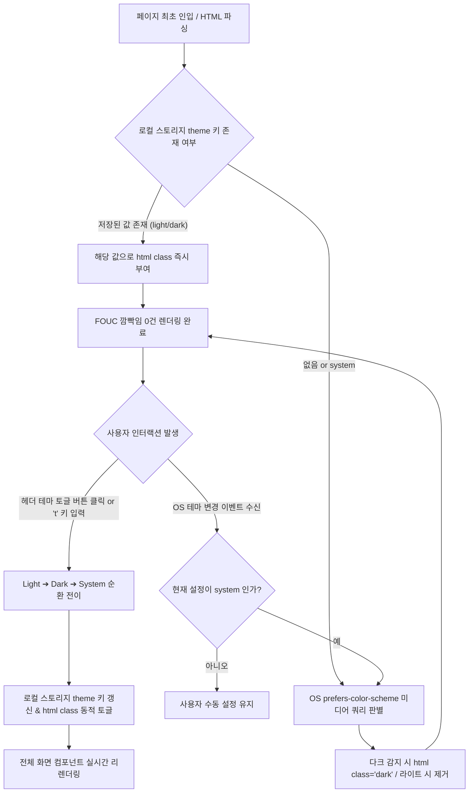

# 전역 UI 테마 및 파워 유저 단축키 상세기능정의서 (UI Theme & Power User Hotkeys FSD)

- **도메인**: 전역 다크모드/라이트모드/시스템 테마 스위칭, 무깜빡임 SSR 테마 공급기, 파워 유저 전역 커맨드 팔레트(Cmd+K), 키보드 단축키 오케스트레이션
- **작성자**: 기획 명세 작성가 (`spec-writer`)
- **문서 버전**: v1.0
- **상태**: Approved
- **선행 산출물**: [01_PRD.md](../01_PRD.md) (v3.0), [report.md](../../report.md)

---

## 단위 기능 상세 명세 (단위기능별 7대 상세 명세 완비)

---

### [FUNC-THEME-001] 전역 테마(다크/라이트/시스템) 스위칭 및 깜빡임 방지 테마 공급기

#### 1. 기본 정보
- **기능명**: 전역 테마(다크/라이트/시스템) 스위칭 및 깜빡임 방지 테마 공급기
- **기능 ID**: `FUNC-THEME-001`
- **대응 요구사항 ID**: `REQ-THEME-001`
- **대상 화면 코드**: `SCR-THEME-001` (전역 네비게이션 헤더 및 최상위 레이아웃)
- **우선순위**: Must Have
- **관련 액터 (Actor)**: 일반 사용자, AI 엔지니어, 프론트엔드/백엔드 TDD 엔지니어

#### 2. 사전 조건 (Pre-conditions)
1. 사용자가 웹 브라우저를 통해 AgentLens의 모든 웹 페이지(`/`, `/chat` 등)에 정상 접근한 상태.
2. 클라이언트 브라우저가 CSS 미디어 쿼리(`prefers-color-scheme`) 또는 `localStorage` 읽기/쓰기를 지원하는 상태.
3. Next.js 16 최상위 레이아웃에 `next-themes` 기반 `ThemeProvider`가 마운트된 상태.

#### 3. 사용자 인터랙션 및 시스템 동작 흐름과 플로우차트 (Step-by-Step Flow & Flowchart)
1. **초기 페이지 로드 (Initial Hydration)**:
   - 브라우저가 HTML을 파싱하기 전, `next-themes`가 제공하는 인라인 주입 스크립트가 `localStorage`의 `theme` 키 또는 OS의 `prefers-color-scheme`을 동기적으로 평가한다.
   - 테마가 `dark`인 경우 `<html>` 태그에 즉시 `class="dark"`를 부여하고, `light`인 경우 클래스를 제거한다.
   - 이를 통해 최초 렌더링 시 하얀 화면이 번쩍이는 FOUC(Flash of Unstyled Content) 현상을 0건으로 완전 차단한다.
2. **테마 수동 토글 (Theme Manual Switching)**:
   - 사용자가 헤더 우측 상단의 테마 버튼을 클릭하거나, 키보드 단축키 `t`를 누른다.
   - 드롭다운 메뉴에서 `[라이트(Light), 다크(Dark), 시스템(System)]` 중 하나를 선택하거나, 버튼 원클릭으로 모드를 순환(`Light` $\rightarrow$ `Dark` $\rightarrow$ `System` $\rightarrow$ `Light`)한다.
   - 시스템은 선택된 테마를 로컬 스토리지에 즉시 영속화하고, `<html>` 태그의 클래스를 실시간 교체한다.
   - 메인 피드 카드, 헤더, 모달, AI 챗 워크스페이스, 코드 블록, 상태 표시기 등 전체 화면의 색상 팔레트가 16ms(1 프레임) 이내에 부드럽게 전환된다.
3. **OS 테마 변경 자동 감지 (System Theme Sync)**:
   - 사용자의 테마 설정이 `system`인 경우, 브라우저의 OS 다크모드 전환 이벤트를 실시간 수신하여 별도 새로고침 없이 화면 테마를 즉각 동기화한다.



#### 4. 화면 표시 및 입력 데이터 항목 명세 (UI Data Elements - 8대 표준 컬럼)
| 항목명 | 화면 표시/입력 구분 | UI 컴포넌트 | 필수 여부 | 데이터 타입 / 제약 | 기본값 | 유효성 검증 규칙 (Validation) | 노출/수정 조건 |
| :--- | :---: | :--- | :---: | :--- | :---: | :--- | :--- |
| `theme_toggle_btn` | 사용자 조작 | Icon Button (Sun / Moon / Laptop) | 필수 | Action Button | - | 클릭 시 테마 순환 또는 드롭다운 오픈 | 헤더 우측 상시 노출 |
| `theme_mode_state` | 시스템 관리 | State Context | 필수 | Enum (`'light'`, `'dark'`, `'system'`) | `'system'` | 정의된 3대 모드 중 1개 일치 | ThemeProvider 내부 관리 |
| `html_dark_class` | 노출 전용 | DOM Class Attribute | 필수 | String (`'dark'` 또는 `''`) | `''` | Tailwind CSS 다크모드 선택자 연동 | `<html>` 태그 상시 바인딩 |
| `theme_dropdown_menu` | 사용자 선택 | Dropdown Menu | 선택 | Menu Item List | - | 각 항목 클릭 시 `setTheme(mode)` 실행 | 토글 버튼 클릭 시 노출 |
| `theme_tooltip_label` | 화면 표시 | Tooltip Text | 선택 | String | "테마 변경 (단축키: t)" | 호버 시 툴팁 안내 노출 | 버튼 마우스 호버 시 |
| `theme_storage_key` | 시스템 관리 | LocalStorage Key | 필수 | String (`'theme'`) | `'system'` | 유효한 테마 문자열만 허용 | 브라우저 스토리지 저장 |

#### 5. 비즈니스 규칙 (Business Rules)
- **BR-THEME-001-1 (FOUC 원천 차단 - Zero Flicker SSR Rule)**:
  Next.js 16 App Router의 루트 레이아웃(`<html lang="ko" suppressHydrationWarning>`)에 `next-themes`를 설정하여 클라이언트-서버 간 하이드레이션 불일치 경고를 방지하고, 브라우저 페인트 이전에 인라인 스크립트로 `class="dark"`를 주입하여 하얀색 화면 깜빡임을 100% 원천 차단해야 한다.
- **BR-THEME-001-2 (OS 테마 변경 실시간 동기화)**:
  사용자가 테마 모드를 `system`으로 지정한 경우, 브라우저의 `window.matchMedia('(prefers-color-scheme: dark)')` 이벤트 리스너를 유지하여 OS 레벨의 테마 변경 시 웹 애플리케이션의 리로드 없이 즉시 다크/라이트 모드를 반영해야 한다.
- **BR-THEME-001-3 (전역 UI 토큰 매핑 무결성)**:
  모든 메인 피드 카드(`bg-white dark:bg-slate-900 border-slate-200 dark:border-slate-800`), 텍스트(`text-slate-900 dark:text-slate-100`), 챗 워크스페이스 컨테이너, 마크다운 코드 블록, 모달 오버레이는 Tailwind CSS `dark:` 토큰을 누락 없이 적용하여 라이트/다크 양방향에서 가독성(WCAG AA 기준 명도 대비 4.5:1 이상)을 충족해야 한다.

#### 6. 예외 처리 및 엣지 케이스 (Edge Cases & Exception Handling)
| 발생 상황 (Edge Case Scenario) | 화면 반응 및 시스템 처리 방식 | 사용자 안내 메시지 |
| :--- | :--- | :--- |
| 브라우저 쿠키/스토리지 전면 차단 환경 (시크릿 모드/보안 브라우저) | 로컬 스토리지 쓰기 실패 예외(`QuotaExceededError` 또는 `SecurityError`) 감지 시 인메모리 상태로 안전 폴백하여 현재 세션 동안 정상 테마 전환 지원 | (무중단 작동, 에러 팝업 노출 안 함) |
| 로컬 스토리지에 유효하지 않은 임의의 테마 문자열(예: `"blue"`)이 저장된 경우 | 잘못된 값을 감지하여 즉시 `'system'` 기본값으로 초기화하고 정상 복구 | (자동 정상화) |
| 고대비 모드(High Contrast Mode) 운영체제 환경 진입 | OS의 `forced-colors: active` 미디어 쿼리를 감지하여 테마 강제 토글을 일시 억제하고 OS 고대비 팔레트 우선 적용 | (접근성 우선 적용) |

#### 7. 비즈니스 에러 코드 매핑
| 비즈니스 에러 코드 | 발생 사유 | HTTP 상태 코드 매핑 | 클라이언트 표시 형태 |
| :--- | :--- | :---: | :--- |
| `ERR_THEME_STORAGE_BLOCKED` | 브라우저 스토리지 접근 차단 환경 | 클라이언트 예외 | 인메모리 폴백 (조용한 처리) |
| `ERR_THEME_INVALID_VALUE` | 정의되지 않은 테마 파라미터 인입 | 클라이언트 예외 | `'system'` 기본값 자동 리셋 |

---

### [FUNC-NAV-001] 전역 커맨드 팔레트(Cmd+K) 및 파워 유저 키보드 단축키 오케스트레이션

#### 1. 기본 정보
- **기능명**: 전역 커맨드 팔레트(Cmd+K) 및 파워 유저 키보드 단축키 오케스트레이션
- **기능 ID**: `FUNC-NAV-001`
- **대응 요구사항 ID**: `REQ-SHORTCUT-001`
- **대상 화면 코드**: `SCR-NAV-001` (전역 커맨드 팔레트 모달 및 단축키 훅)
- **우선순위**: Must Have
- **관련 액터 (Actor)**: 파워 유저 엔지니어, AI 시스템 아키텍트

#### 2. 사전 조건 (Pre-conditions)
1. 사용자가 AgentLens 웹 애플리케이션의 어느 화면에든 진입해 있는 상태.
2. 클라이언트 윈도우 키보드 이벤트 리스너(`keydown`)가 정상 등록된 상태.

#### 3. 사용자 인터랙션 및 시스템 동작 흐름과 플로우차트 (Step-by-Step Flow & Flowchart)
1. **단축키 이벤트 인입 및 컨텍스트 판별**:
   - 사용자가 키보드를 누른다.
   - 시스템은 현재 포커스가 텍스트 입력 엘리먼트(`input`, `textarea`, `[contenteditable]`)에 위치해 있는지 검사한다:
     - 텍스트 입력 중인 경우: 일반 타이핑을 보호하기 위해 전역 단일 키 단축키(`j`/`k`, `/`, `b`, `c`, `t`)를 무시한다. (단, 조합키 `Cmd+K` / `Ctrl+K` 및 `Escape`는 항상 허용).
     - 입력창 외부인 경우: 등록된 단축키 액션을 즉각 실행한다.
2. **전역 커맨드 팔레트 호출 (`Cmd+K` / `Ctrl+K`)**:
   - `Cmd+K`(macOS) 또는 `Ctrl+K`(Windows/Linux) 입력 시 화면 중앙에 전역 커맨드 팔레트 모달이 오픈된다.
   - 검색창에 포커스가 자동 진입하며, 추천 명령어 목록(페이지 이동, 테마 변경, 즉시 수집, 리셋, 챗 진입 등)과 최근 소식 검색이 노출된다.
   - 사용자가 검색어를 입력하면 300ms 디바운스로 실시간 결과가 필터링된다.
   - 방향키 `ArrowUp` / `ArrowDown`으로 항목을 탐색하고 `Enter`를 눌러 즉시 액션을 실행하며 팔레트가 닫힌다.
3. **단일 키 파워 액션**:
   - `t`: 테마 즉시 순환 토글 (라이트 $\rightarrow$ 다크 $\rightarrow$ 시스템).
   - `/`: 메인 피드 상단 검색창으로 포커스 자동 스크롤 및 텍스트 선택.
   - `Escape`: 열려 있는 모든 모달, 팔레트, 드로어를 닫고 메인 화면으로 포커스 복귀.

```mermaid
flowchart TD
    A[사용자 키보드 키 입력 발생] --> B{현재 포커스가 입력 필드인가?}
    B -- 예 (input/textarea) --> C{Cmd+K or Escape 인가?}
    C -- 예 --> D[커맨드 팔레트 토글 or 모달 닫기 실행]
    C -- 아니오 --> E[이벤트 무시 & 브라우저 기본 타이핑 수행]

    B -- 아니오 (본문 영역) --> F{입력 키 판별}
    F -- Cmd+K or Ctrl+K --> G[CommandPaletteModal 오픈 & 검색창 자동 포커스]
    F -- t 키 --> H[전역 테마 즉시 순환 토글 (FUNC-THEME-001)]
    F -- / 키 --> I[상단 메인 검색창 포커스 이동 & e.preventDefault]
    F -- j / k 키 --> J[피드 뉴스 카드 아래/위 포커스 이동 (FUNC-FEED-007)]
    F -- b 키 --> K[현재 포커스 카드 북마크 토글 (FUNC-FEED-007)]
    F -- c 키 --> L[현재 포커스 카드 전용 챗 핸드오버 (FUNC-FEED-007)]
    F -- Escape 키 --> M[열린 모달/팔레트/드로어 닫기 & 포커스 복원]

    G --> N[방향키 탐색 & Enter 선택 ➔ 대상 액션 실행 후 닫힘]
```

#### 4. 화면 표시 및 입력 데이터 항목 명세 (UI Data Elements - 8대 표준 컬럼)
| 항목명 | 화면 표시/입력 구분 | UI 컴포넌트 | 필수 여부 | 데이터 타입 / 제약 | 기본값 | 유효성 검증 규칙 (Validation) | 노출/수정 조건 |
| :--- | :---: | :--- | :---: | :--- | :---: | :--- | :--- |
| `palette_modal_overlay` | 노출 전용 | Backdrop Overlay Container | 필수 | CSS (`fixed inset-0 z-50 bg-black/50 backdrop-blur-sm`) | - | 외부 클릭 시 모달 닫힘 | Cmd+K 오픈 시 |
| `palette_search_input` | 사용자 입력 | Text Input (`명령어 또는 검색어...`) | 필수 | String / 최대 100자 | "" | XSS 살균 검증 완료 | 모달 오픈 시 자동 포커스 |
| `palette_command_list` | 노출 전용 | Grouped List Viewport | 필수 | Array[CommandItem] | 8개 기본 액션 | 카테고리별 그룹핑 렌더링 | 검색어 일치 결과 노출 |
| `palette_selected_index` | 시스템 제어 | Highlighted Item State | 필수 | Integer (0 ~ N-1) | 0 | 방향키 이동 시 순환(Circular) 인덱싱 | 목록 존재 시 |
| `keyboard_shortcut_badges`| 화면 표시 | Kbd Tag Pill (`⌘K`, `Esc`, `↵`) | 선택 | UI Component (`px-1.5 py-0.5 text-[10px] font-mono bg-slate-100 dark:bg-slate-800 rounded border`) | - | OS 플랫폼(macOS vs Win) 자동 감지 | 각 커맨드 항목 우측 노출 |
| `palette_empty_state` | 노출 전용 | Empty State Box | 선택 | UI Component | - | 일치하는 명령어/기사 없을 때 표시 | 결과 0건 시 노출 |

#### 5. 비즈니스 규칙 (Business Rules)
- **BR-NAV-001-1 (입력 필드 이벤트 격리 - Input Isolation Rule)**:
  사용자가 `<input>`, `<textarea>`, 또는 `contenteditable="true"` 엘리먼트에 포커스하고 있을 때 전역 단일 키(`j`, `k`, `/`, `b`, `c`, `t`) 이벤트는 절대 실행되어서는 안 되며, 사용자의 텍스트 입력을 100% 온전히 보존해야 한다. 단, `Cmd+K`, `Ctrl+K`, `Escape`는 전역 제어자로서 입력 필드 내부에서도 즉시 반응해야 한다.
- **BR-NAV-001-2 (OS 플랫폼 키 매핑 자동화)**:
  사용자 브라우저의 `navigator.userAgent` 또는 `navigator.platform`을 판별하여, macOS 환경에서는 `⌘K`, Windows/Linux 환경에서는 `Ctrl+K`로 힌트 배지를 동적 표기해야 한다.
- **BR-NAV-001-3 (포커스 트랩 및 스크롤 고정)**:
  커맨드 팔레트 모달이 오픈된 동안에는 백그라운드 본문의 스크롤이 비활성화(`overflow: hidden`)되어야 하며, `Tab` 키 조작 시 포커스가 모달 내부에서만 순환(Focus Trap)되어야 한다. `Escape`를 누르면 모달이 닫히며 모달을 열기 직전에 포커스되어 있던 원래 DOM 요소로 포커스가 완벽히 복원되어야 한다.

#### 6. 예외 처리 및 엣지 케이스 (Edge Cases & Exception Handling)
| 발생 상황 (Edge Case Scenario) | 화면 반응 및 시스템 처리 방식 | 사용자 안내 메시지 |
| :--- | :--- | :--- |
| 한글 등 IME 조합 상태에서 단축키 입력 인입 시 (`e.isComposing === true`) | IME 조합이 완료되기 전 단축키 실행을 원천 무시하여 조합 중복 오작동 차단 | (정상 타이핑 보장) |
| 이미 다른 모달(예: 소스 관리 모달)이 열린 상태에서 `Cmd+K` 입력 시 | 기존 모달 위에 팔레트가 오버레이되며, `Escape` 입력 시 최상위 팔레트부터 순차적으로 닫힘 | (스택 기반 모달 관리) |
| 커맨드 팔레트 검색 결과가 0건인 경우 | 빈 화면 대신 "일치하는 명령어가 없습니다" 안내 및 추천 기본 액션 목록 노출 | "일치하는 명령어 또는 소식이 없습니다." |

#### 7. 비즈니스 에러 코드 매핑
| 비즈니스 에러 코드 | 발생 사유 | HTTP 상태 코드 매핑 | 클라이언트 표시 형태 |
| :--- | :--- | :---: | :--- |
| `ERR_NAV_ACTION_NOT_FOUND` | 유효하지 않은 커맨드 식별자 호출 | 클라이언트 예외 | 콘솔 경고 및 팔레트 기본 상태 유지 |
| `ERR_NAV_FOCUS_RESTORE_FAILED` | 이전 포커스 DOM 엘리먼트 제거됨 | 클라이언트 예외 | `document.body`로 안전 폴백 |
