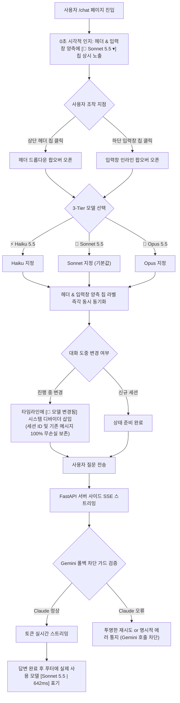
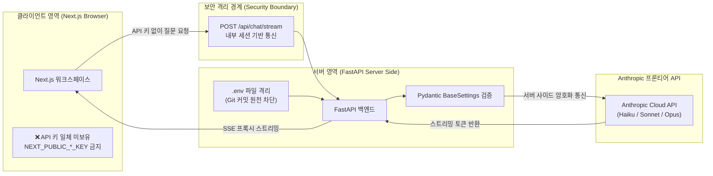

# Anthropic Claude 통합 및 멀티 모델 셀렉터 상세기능정의서 (Modular FSD)

- **도메인**: 데이터 수집 파이프라인(Claude Sonnet 5.5 전담 & Gemini 폴백 차단), AI 챗 멀티 모델 셀렉터(Haiku/Sonnet/Opus 듀얼 배치), Zero-Leak 보안 거버넌스
- **작성자**: 기획 명세 작성가 (`spec-writer`)
- **문서 버전**: 0.2.0 (Gemini 무단 폴백 차단, Claude 전용 파이프라인 확정 & AI 챗 모델 선택기 듀얼 배치 시각적 인지성 완성)
- **상태**: Approved
- **선행 산출물**: [01_MARKET_BENCHMARK.md](../../market-analyst/01_MARKET_BENCHMARK.md), [01_PRD.md](../01_PRD.md)

---

## 목차 (Table of Contents)
1. [개요 및 설계 원칙](#1-개요-및-설계-원칙)
2. [FUNC-COLL-005: Claude Sonnet 5.5 전담 데이터 수집/정제/요약/태깅 파이프라인](#func-coll-005-claude-sonnet-55-전담-데이터-수집정제요약태깅-파이프라인)
3. [FUNC-CHAT-013: AI 챗 워크스페이스 상단 헤더 & 입력창 듀얼 모델 셀렉터 인터랙션 및 상태 명세](#func-chat-013-ai-챗-워크스페이스-상단-헤더--입력창-듀얼-모델-셀렉터-인터랙션-및-상태-명세)
4. [POL-SEC-004: Zero-Leak API 키 보안 거버넌스 및 프록시 스트리밍 규약](#pol-sec-004-zero-leak-api-키-보안-거버넌스-및-프록시-스트리밍-규약)

---

## 1. 개요 및 설계 원칙

본 문서는 AgentLens 0.2.0의 핵심 아키텍처 및 사용자 경험(UX) 도약을 정의하는 상세기능정의서입니다.
- **고신호(High-Signal) 큐레이션 및 Gemini 폴백 원천 차단**: 저가형/소형 모델의 환각과 껍데기 요약을 영구 퇴출하고, 최상위 엔지니어링 분석 지능을 갖춘 **Claude Sonnet 5.5**를 데이터 수집·정제·요약·태깅 파이프라인 전담 모델로 단독 배정합니다. Claude API 장애 시 사용자 동의 없이 `Google gemini-3.5-flash-lite` 등 타사 모델로 사일런트 다운그레이드되는 동작을 전면 차단합니다.
- **헤더 & 입력창 듀얼 배치 모델 선택 UX (Prominent Discoverability)**: "AI 챗 화면에서 모델 선택은 어떻게 하는가?"라는 사용자 페인포인트를 해소하기 위해, **상단 글로벌 헤더(`ChatHeader`) 우측**과 **하단 프롬프트 입력창(`ChatPromptInput`) 좌하단** 양측에 직관적인 3-Tier(`⚡ Haiku 5.5`, `🎯 Sonnet 5.5 (기본값)`, `🧠 Opus 5.5`) 셀렉터를 듀얼 배치하여 진입 즉시 0초 만에 현재 모델을 확인하고 원클릭으로 교체할 수 있도록 설계합니다.
- **대화 맥락 보존형 인라인 동적 전환**: 대화 도중 모델을 교체하더라도 세션을 초기화하지 않고 기존 멀티턴 맥락(최대 10턴, 3,000토큰)을 100% 무손실 인계하며, 헤더와 입력창의 선택 상태가 실시간으로 양방향 동기화됩니다.
- **기업급 Zero-Leak 보안 거버넌스**: 브라우저(클라이언트)로 API 키를 단 1바이트도 노출하지 않으며, 백엔드 `.env` 격리와 FastAPI SSE 프록시 스트리밍을 통해 Git 커밋 및 외부 유출을 원천 차단합니다.

---

## 단위 기능 상세 명세 (단위기능별 7대 상세 명세 완비)

---

### [FUNC-COLL-005] Claude Sonnet 5.5 전담 데이터 수집/정제/요약/태깅 파이프라인

#### 1. 기본 정보
- **기능명**: Claude Sonnet 5.5 전담 데이터 수집/정제/요약/태깅 파이프라인 (Sonnet Dedicated Ingestion Pipeline)
- **기능 ID**: `FUNC-COLL-005`
- **대응 요구사항 ID**: `REQ-COLL-005`, `REQ-LLM-002`
- **대상 화면 코드**: `SCR-COLL-001` (수집 배치 엔진 백엔드 / 관리자 수집 상태 모니터링 모달 `SCR-SETT-001`)
- **우선순위**: **Must Have**
- **관련 액터 (Actor)**: 시스템 크론 스케줄러(Scheduler) / 수집 파이프라인 워커(Worker) / 시스템 관리자(Operator)

#### 2. 사전 조건 (Pre-conditions)
1. 백엔드 FastAPI 서버 환경변수에 유효한 `ANTHROPIC_API_KEY`가 주입되어 있거나, 테스트 환경(`PYTEST_CURRENT_TEST` 또는 `TESTING=True`)인 경우 `MockLLMProvider` 체인이 준비되어 있어야 한다.
2. 수집 대상 RSS 피드, HackerNews, arXiv, GitHub 저장소 등으로부터 원시 기사 메타데이터(URL, Title, Published Date)가 인입되어야 한다.
3. 원문 웹페이지의 HTML로부터 불필요한 스크립트/광고가 제거된 순수 마크다운 본문(Clean Text $\ge 500$자)이 `Trafilatura` 파서에 의해 1차 추출되어 있어야 한다.
4. 데이터베이스 `news_items` 테이블 및 중복 방지 인덱스(`dedup_hash`)가 정상 마이그레이션된 상태여야 한다.

#### 3. 사용자 인터랙션 및 시스템 동작 흐름과 플로우차트 (Step-by-Step Flow & Flowchart)
1. 시스템 크론(매시간) 또는 관리자의 '즉시 수동 수집' 트리거가 발생한다.
2. 파이프라인은 신규 기사의 URL과 제목으로 `dedup_hash`를 생성하고, DB 기등록 여부를 확인하여 중복 항목을 선별 폐기한다.
3. 미중복 신규 기사 원문을 비동기로 스크래핑(`Trafilatura`)하여 4,000~8,000토큰의 순수 마크다운 본문을 확보한다.
4. 시스템은 **Claude Sonnet 5.5 (`claude-3-5-sonnet-latest`)** 전담 모델을 호출한다:
   - **프롬프트 캐싱 적용**: 2,500토큰 분량의 Senior Staff Architect 분석 지침, 도메인 분류 루브릭, 퓨샷(Few-shot) 가이드라인에 `cache_control: {"type": "ephemeral"}` 헤더를 부여한다.
   - **Gemini 폴백 차단 가드**: Claude API 실패 시 Google Gemini(`_call_gemini`)를 절대 호출하지 않으며, 타사 모델로의 사일런트 다운그레이드를 영구 차단한다.
   - **엄격한 Pydantic 스키마 주입**: `SummaryItemSchema` 구조화 출력을 강제한다:
     - `summary`: 3줄 핵심 요약 (TL;DR Bullets)
     - `why_it_matters`: 엔지니어링 실무 도입 관점의 심층 시사점 (최소 150자)
     - `tech_stack`: 공인 기술 사전(Known Tech Registry) 기반 정밀 태깅
     - `tags`: 세부 도메인 토픽 분류 태그 (3~5개)
     - `quality_score`: 1.0 ~ 10.0 부동소수점 품질 평가 점수
     - `category`: `harness` | `mcp` | `agent` | `general_ai`
5. 응답 수신 후 Pydantic 모델 검증을 수행한다:
   - 검증 성공 시: 점수가 5.0 이상이면 메인 피드 DB에 원자적으로 저장(Upsert)하고, 7.8 이상인 경우 `⭐️ Must Read` 플래그를 활성화한다.
   - 검증 실패 시: 에러 로그를 기록하고 JSON 보정 프롬프트로 1회 재시도하며, 최종 실패 시 로컬 Fallback 파서로 처리한다.
6. 수집 완료 통계(처리 건수, 캐시 적중률, 소요 시간)를 세션 로그에 기록하고 메인 피드에 실시간 반영한다.

```mermaid
flowchart TD
    A[크론 스케줄러 or 수동 수집 트리거] --> B[원시 피드 항목 인입]
    B --> C{dedup_hash 중복 검사}
    C -- 기등록 충돌 --> D[중복 항목 즉시 폐기 Discard]
    C -- 신규 항목 --> E[Trafilatura 원문 본문 비동기 파싱]
    E --> F[본문 텍스트 정제 및 토큰 청킹]
    F --> G["Claude Sonnet 5.5 파이프라인 엔진 호출<br/>(시스템 프롬프트 캐싱 헤더 적용)"]
    G --> H{Anthropic API 호출 성공?}
    H -- 실패 시 --> H_Fail{"Gemini 무단 폴백 차단 가드<br/>(Anti-Gemini Rule)"}
    H_Fail -->|Gemini 호출 금지| H_Fallback["안전한 지수 백오프 재시도 or 로컬 Fallback"]
    H -- 성공 시 --> I{Pydantic Schema JSON 파싱}
    I -- 파싱 실패 --> J[JSON 보정 재시도 (최대 1회)]
    J --> I
    I -- 파싱 성공 --> K{Quality Score 평가}
    K -- "Score < 5.0" --> L[노이즈 컷오프 저장 생략]
    K -- "5.0 <= Score < 7.8" --> M[일반 피드 항목 저장 Normal Feed]
    K -- "Score >= 7.8" --> N["고신호 피드 항목 저장 (⭐️ Must Read)"]
    M & N --> O[SQLite WAL DB 원자적 트랜잭션 커밋]
    O --> P[캐시 적중률 및 메타데이터 세션 통계 갱신]
```

#### 4. 화면 표시 및 입력 데이터 항목 명세 (UI Data Elements - 8대 표준 컬럼)

| 항목명 | 화면 표시/입력 구분 | UI 컴포넌트 | 필수 여부 | 데이터 타입 / 제약 | 기본값 | 유효성 검증 규칙 (Validation) | 노출/수정 조건 |
| :--- | :---: | :--- | :---: | :--- | :---: | :--- | :--- |
| `pipeline_model` | 노출 전용 | Badge (`Sonnet 5.5`) | 필수 | String / 고정 | `claude-3-5-sonnet-latest` | Anthropic 공인 Sonnet 식별자 일치 (Gemini 일체 불가) | 관리자 모니터링 및 뉴스 상세 메타 |
| `tldr_bullets` | 노출 전용 | Bulleted List | 필수 | Array[String] / 3개 항목 | `[]` | 각 항목 10~150자, 공백 트림 | 뉴스 상세 모달 상시 노출 |
| `why_it_matters` | 노출 전용 | Highlight Card (Indigo) | 필수 | String / 150~600자 | `""` | 실무 엔지니어링 관점 필수 서술 | 뉴스 상세 모달 상시 노출 |
| `tech_stack` | 노출 전용 | Tag Pill Group | 필수 | Array[String] / 1~5개 | `[]` | 공인 기술 레지스트리 엔티티 일치 | 피드 카드 및 상세 모달 |
| `tags` | 노출 전용 | Tag Pill Group (Gray) | 필수 | Array[String] / 2~6개 | `[]` | 알파벳, 한글, 특수문자 `#-_` 허용 | 피드 카드 및 상세 모달 |
| `quality_score` | 노출 전용 | Score Badge with Star | 필수 | Float / 1.0 ~ 10.0 | `5.0` | 소수점 첫째 자리, $\ge 5.0$ 피드 승인 | $\ge 7.8$ 시 ⭐️ 뱃지 강조 |
| `cache_read_tokens` | 노출 전용 | Metric Text | 선택 | Integer / $\ge 0$ | `0` | 프롬프트 캐시 적중 토큰 수 | 관리자 수집 로그 모달 노출 |
| `processing_time_ms`| 노출 전용 | Latency Badge | 선택 | Integer / ms 단위 | `0` | 파이프라인 총 처리 시간 | 관리자 수집 로그 모달 노출 |

#### 5. 비즈니스 규칙 (Business Rules)
- **BR-COLL-005-1 (전담 모델 단일화 및 Gemini 폴백 금지 원칙)**:
  - 뉴스 피드의 분석 신뢰도와 일관성을 보장하기 위해, 데이터 수집·정제·요약·태깅 배치 파이프라인의 LLM은 오직 **Claude Sonnet 5.5 (`claude-3-5-sonnet-latest`)**만 사용해야 한다.
  - Claude API 장애, 타임아웃, 키 미등록 등의 상황에서도 Google Gemini(`gemini-3.5-flash-lite` 등) 또는 OpenAI로의 임의 사일런트 다운그레이드를 엄격히 금지한다.
- **BR-COLL-005-2 (프롬프트 캐싱 경제성 강제)**:
  - 수집 시스템 프롬프트(2,500토큰 규모)는 Anthropic Prompt Caching 헤더(`type: ephemeral`)를 필수 선언해야 한다.
  - 연속된 기사 배치 수집 시 캐시 적중률(Cache Hit Ratio)을 **90% 이상** 유지하여 입력 토큰 비용을 $0.10/MTok(정상가의 10%) 수준으로 절감해야 한다.
- **BR-COLL-005-3 (Why It Matters 고신호 엔지니어링 원칙)**:
  - `why_it_matters` 필드는 기사 첫 문장의 단순 번역이나 피상적 서술을 엄격히 금지하며, 아키텍처적 차별점, 도입 시 고려사항 및 벤치마크 시사점을 포함하여 최소 **150자 이상** 도출해야 한다.
- **BR-COLL-005-4 (Pydantic 스키마 무결성 보장)**:
  - LLM 응답은 백엔드 Pydantic `SummaryItemSchema` 모델 검증을 100% 통과해야 하며, 필드 누락이나 타입 불일치 시 트랜잭션 저장을 거부한다.
- **BR-COLL-005-5 (품질 점수 컷오프 정책)**:
  - `quality_score < 5.0`: 노이즈 컷오프(저장 제외).
  - `5.0 <= quality_score < 7.8`: 일반 기술 소식 피드 저장.
  - `quality_score >= 7.8`: `⭐️ Must Read` 배지 부여 및 브리핑 후보 등록.

#### 6. 예외 처리 및 엣지 케이스 (Edge Cases & Exception Handling)
| 발생 상황 (Edge Case Scenario) | 화면 반응 및 시스템 처리 방식 | 사용자/운영자 안내 메시지 |
| :--- | :--- | :--- |
| **Anthropic API 529 Overloaded 또는 일시적 네트워크 장애** | Gemini로 폴백하지 않고 최대 3회 지수 백오프(Exponential Backoff: 1s, 2s, 4s) 재시도 후, 실패 시 로컬 Fallback 파서로 처리 | 수집 로그: "[Anthropic API Overloaded] Gemini 폴백 차단됨. 로컬 Fallback 엔진으로 안전 처리" |
| **LLM이 Markdown 코드블록(````json ... ````)으로 감싸 응답한 경우** | 정규식 `re.search(r'\{.*\}', text, re.DOTALL)`을 적용하여 내부 JSON 본문만 무손실 추출 후 Pydantic 파싱 | 에러 없이 자동 정상 처리 |
| **원문 기사 본문이 25,000자 초과 초장문인 경우** | 서론 3,000자, 섹션별 H2/H3 요약 8,000자, 결론 2,000자를 추출하는 구조 보존형 청킹 적용 후 Sonnet 주입 | 수집 로그에 "[Long Article] 구조 보존 슬라이딩 청킹 적용됨" 기록 |
| **추출된 원문 본문이 500자 미만인 단문/빈 페이지인 경우** | 기사 본문 추출 실패로 판정하고, RSS 피드 설명문(Snippet) 기반으로 기본 요약 및 태깅 수행 | 수집 로그에 "[Short Text] 원문 스크래핑 미달, 피드 스니펫으로 요약됨" 기록 |

#### 7. 비즈니스 에러 코드 매핑
| 비즈니스 에러 코드 | 발생 사유 | HTTP 상태 코드 매핑 | 클라이언트 표시 형태 |
| :--- | :--- | :---: | :--- |
| `ERR_ANTHROPIC_KEY_MISSING` | `ANTHROPIC_API_KEY` 환경변수 미설정 | 503 Service Unavailable | 관리자 콘솔 경고 배너 및 Mock 체인 자동 가동 |
| `ERR_SONNET_SCHEMA_VALIDATION`| Pydantic JSON 스키마 검증 실패 | 422 Unprocessable Entity | 수집 로그 에러 기록 및 Fallback 파서 가동 |
| `ERR_ANTHROPIC_RATE_LIMIT` | Anthropic 분당 요청 한도(TPM/RPM) 초과 | 429 Too Many Requests | 지수 백오프 큐 대기 후 자동 재시도 |
| `ERR_ARTICLE_EXTRACTION_FAIL` | 원문 웹페이지 404/403 또는 본문 추출 실패 | 502 Bad Gateway | 피드 스니펫 기반 우아한 다운그레이드 처리 |

---

### [FUNC-CHAT-013] AI 챗 워크스페이스 상단 헤더 & 입력창 듀얼 모델 셀렉터 인터랙션 및 상태 명세

#### 1. 기본 정보
- **기능명**: AI 챗 워크스페이스 상단 헤더 & 입력창 듀얼 모델 셀렉터 (Dual-Placement Model Selector UX)
- **기능 ID**: `FUNC-CHAT-013`
- **대응 요구사항 ID**: `REQ-CHAT-013`, `REQ-UI-008`, `REQ-LLM-002`
- **대상 화면 코드**: `SCR-CHAT-001` (전용 AI 챗 페이지 `/chat` 상단 헤더 및 입력창)
- **우선순위**: **Must Have**
- **관련 액터 (Actor)**: AI 챗 사용자 / 테크 리더 / 소프트웨어 엔지니어

#### 2. 사전 조건 (Pre-conditions)
1. 사용자가 웹 브라우저를 통해 `/chat` 경로에 진입하여 워크스페이스가 로드된 상태.
2. 백엔드 FastAPI 서버가 Anthropic Claude 멀티 모델 라우팅 및 SSE 스트리밍 엔드포인트(`/api/chat/stream`)를 정상 지원하는 상태.
3. 세션 저장소 또는 클라이언트 상태 머신이 현재 세션 식별자(`session_id`)와 선택된 모델 티어(`selectedTier`)를 유지하고 있는 상태.

#### 3. 사용자 인터랙션 및 시스템 동작 흐름과 플로우차트 (Step-by-Step Flow & Flowchart)
1. 사용자가 `/chat` 페이지에 진입하면 화면 상단과 하단 양측에서 모델 선택기가 명확하게 노출된다:
   - **배치 위치 1 (상단 헤더 `ChatHeader` 우측)**: 데스크톱/모바일 공통 상시 노출 칩 `[🎯 Sonnet 5.5 ▾]`
   - **배치 위치 2 (하단 입력창 `ChatPromptInput` 좌하단)**: 프롬프트 작성 시 시선이 머무는 인라인 칩 `[🎯 Sonnet 5.5 ▾]`
2. 사용자가 상단 헤더 또는 하단 입력창 중 어느 쪽이든 셀렉터 칩을 클릭한다:
   - Fitts의 법칙을 준수하여 마우스/터치 위치에 즉시 **3-Tier 모델 선택 팝오버(Popover)**가 노출된다:
     - **⚡ Haiku 5.5**: "초고속 질의응답 (비용 1x, 레이턴시 ~0.3s)" — 빠른 팩트 확인, 용어 설명
     - **🎯 Sonnet 5.5 (기본값)**: "심층 엔지니어링 분석 & 코드 (비용 20x, 레이턴시 ~0.6s)" — 아키텍처 비교, 고난도 코드
     - **🧠 Opus 5.5**: "최고 난도 복합 추론 & 감사 (비용 40x, 레이턴시 ~1.8s)" — 다중 에이전트 하네스 설계, 복합 트레이드오프
3. 사용자가 원하는 티어를 클릭하면:
   - **헤더와 입력창의 칩 라벨 및 아이콘이 실시간으로 100% 동시 동기화**된다.
   - **대화 스레드 도중 변경 시**: 기존 대화 세션은 리셋되지 않으며, 타임라인에 `[🔄 Claude Opus 5.5로 모델 변경됨]` 시스템 알림 디바이더가 삽입된다.
4. 사용자가 질문을 입력하고 전송 버튼(`Enter`)을 누른다.
5. 프론트엔드는 `/api/chat/stream` 엔드포인트로 요청을 전송할 때 선택된 모델 식별자(`model: "claude-3-5-haiku-latest"` 등)를 페이로드에 포함한다.
6. 백엔드는 요청된 모델로 Anthropic 스트리밍 클라이언트를 바인딩하고 실시간 토큰을 SSE(`event: chunk`)로 스트리밍한다:
   - **Gemini 무단 폴백 차단 가드**: Claude API 호출 실패 시 Gemini로 다운그레이드하지 않고, Claude 재시도 또는 투명한 안내 상태 메시지를 전달한다.
7. 답변 스트리밍 완료 시:
   - 어시스턴트 메시지 카드 푸터에 실제 사용된 **모델 뱃지(`🎯 Sonnet 5.5`)**와 **응답 레이턴시(`642ms`)**를 표기한다 (Gemini 표기 원천 차단).
   - 메시지 레코드(`chat_messages`)에 `model_used` 필드가 DB에 안전하게 영속화된다.



#### 4. 화면 표시 및 입력 데이터 항목 명세 (UI Data Elements - 8대 표준 컬럼)

| 항목명 | 화면 표시/입력 구분 | UI 컴포넌트 | 필수 여부 | 데이터 타입 / 제약 | 기본값 | 유효성 검증 규칙 (Validation) | 노출/수정 조건 |
| :--- | :---: | :--- | :---: | :--- | :---: | :--- | :--- |
| `header_model_selector` | 선택 | Dropdown Chip Button | 필수 | Enum (`haiku`, `sonnet`, `opus`) | `sonnet` | 유효한 3개 티어 코드값 매칭 | **상단 헤더 우측 상시 노출** (스트리밍 중 Disabled) |
| `composer_model_selector`| 선택 | Inline Chip Button | 필수 | Enum (`haiku`, `sonnet`, `opus`) | `sonnet` | 유효한 3개 티어 코드값 매칭 | **입력창 좌하단 상시 노출** (스트리밍 중 Disabled) |
| `model_popover_menu` | 노출/선택 | Floating Popover (Radix) | 필수 | Container Element | 닫힘 | 외부 클릭 또는 Escape 키 시 닫힘 | 헤더 또는 입력창 칩 클릭 시 오픈 |
| `tier_item_haiku` | 사용자 선택 | Menu Item with Icon ⚡ | 필수 | Action Item | - | 클릭 시 `haiku` 설정 | 팝오버 내부 상단 |
| `tier_item_sonnet` | 사용자 선택 | Menu Item with Icon 🎯 | 필수 | Action Item | - | 클릭 시 `sonnet` 설정 (권장 배지) | 팝오버 내부 중간 (기본 선택) |
| `tier_item_opus` | 사용자 선택 | Menu Item with Icon 🧠 | 필수 | Action Item | - | 클릭 시 `opus` 설정 | 팝오버 내부 하단 |
| `cost_latency_indicator`| 노출 전용 | Subtitle Text & Badges | 필수 | String / Badge | - | 티어별 상대 비용(`$`, `$$`, `$$$`) 및 속도 표기 | 각 메뉴 아이템 내부 노출 |
| `model_switch_divider` | 노출 전용 | System Message Line | 조건부 | Component (`SystemDivider`)| - | 대화 도중 모델 변경 시에만 생성 | 대화 타임라인 내부 노출 |
| `footer_model_badge` | 노출 전용 | Small Badge (`Sonnet 5.5`) | 필수 | String / Badge | - | 실제 답변 생성에 사용된 모델명 (Gemini 표기 불가) | 어시스턴트 말풍선 우하단 푸터 |

#### 5. 비즈니스 규칙 (Business Rules)
- **BR-CHAT-013-1 (기본 모델 추천 및 선호 복원)**:
  - 새 대화 시작 또는 초기 접속 시 기본 모델은 무조건 **🎯 Sonnet 5.5 (`claude-3-5-sonnet-latest`)**로 지정된다.
  - `localStorage`에 저장된 사용자의 최근 선호 모델이 있을 경우 이를 우선 복원할 수 있다.
- **BR-CHAT-013-2 (헤더 & 입력창 듀얼 동기화 규약)**:
  - 상단 헤더(`ChatHeader`) 또는 하단 입력창(`ChatPromptInput`) 중 어디서 모델을 변경하더라도 양쪽 컴포넌트의 칩 텍스트와 아이콘이 0ms 지연 없이 즉시 동일한 상태로 동기화되어야 한다.
- **BR-CHAT-013-3 (대화 맥락 무손실 보존 규칙 - Zero Context Erasure)**:
  - 대화 스레드 진행 도중 사용자가 모델을 교체하더라도 현재 대화 세션 ID(`session_id`)와 이전 대화 메시지 목록(`messages`)을 절대 초기화해서는 안 된다.
  - 교체 시점의 타임라인에 `[🔄 Claude {Tier} 5.5로 모델 변경됨]` 시스템 디바이더를 생성해야 한다.
- **BR-CHAT-013-4 (컨텍스트 윈도우 인계 알고리즘)**:
  - 모델이 교체되더라도 직전까지의 대화 이력 슬라이딩 윈도우(최대 10턴, 3,000토큰)와 Scoped 모드의 기사 원문 컨텍스트(`full_content`)는 신규 모델의 프롬프트로 100% 무손실 인계되어야 한다.
- **BR-CHAT-013-5 (원시 버전 해시 차단 규약)**:
  - UI 레이어에서는 `claude-3-5-sonnet-20241022`와 같은 내부 릴리즈 해시 문자열을 일체 표기하지 않으며, 오직 브랜드 약칭(`Haiku 5.5`, `Sonnet 5.5`, `Opus 5.5`)과 티어 아이콘만 노출한다.
- **BR-CHAT-013-6 (Gemini 무단 노출 및 폴백 원천 차단)**:
  - 어떠한 상황에서도 답변 말풍선, 푸터 뱃지, 상태 표시기 등에 `Google gemini-*` 문자열이 출력되어서는 안 된다. Claude API 장애 시 타 모델로의 사일런트 다운그레이드를 영구 차단한다.
- **BR-CHAT-013-7 (스트리밍 중 모델 전환 잠금)**:
  - 답변 텍스트가 SSE로 실시간 스트리밍되는 도중(`isStreaming === true`)에는 헤더 및 입력창의 모델 셀렉터 버튼이 비활성화(Disabled)되며, 툴팁으로 "답변 생성이 완료된 후 모델을 변경할 수 있습니다"를 안내한다.

#### 6. 예외 처리 및 엣지 케이스 (Edge Cases & Exception Handling)
| 발생 상황 (Edge Case Scenario) | 화면 반응 및 시스템 처리 방식 | 사용자 안내 메시지 |
| :--- | :--- | :--- |
| **Opus 모델 선택 후 초기 추론 시간(TTFT) 지연 발생 (~1.8s)** | 질문 전송 즉시 입력창 상단에 `[🧠 심층 추론 모드 가동 중...]` 안내 뱃지 표출 및 부드러운 펄스 애니메이션 | "Opus 모델이 고난도 복합 추론을 수행 중입니다. 잠시만 기다려주세요." |
| **Haiku 모델 선택 후 복잡한 아키텍처 다이어그램 요청 시** | 답변 생성은 정상 수행하되, 답변 하단에 "더 깊은 아키텍처 분석이 필요하시면 Sonnet 또는 Opus 모델을 추천합니다" 인라인 팁 노출 | (인라인 도움말 팁 표출) |
| **요청 페이로드에 비정상/미지원 모델명이 인입된 경우** | 백엔드 라우터에서 유효성 검증 실패 시 Gemini로 가지 않고 기본 모델인 Sonnet 5.5로 안전 자동 복원 | 토스트 알림: "유효하지 않은 모델이 요청되어 기본 Sonnet 5.5로 자동 전환되었습니다." |
| **사용자가 선택한 모델이 일시적 Rate Limit(429)에 도달한 경우** | 429 에러 감지 시 즉시 사용자에게 알리고, 인접 티어(예: Opus $\rightarrow$ Sonnet)로 즉시 전환할 수 있는 '원클릭 재시도 버튼' 모달 제공 | "Opus 모델 호출 한도에 도달했습니다. Sonnet 5.5로 즉시 전환하여 답변을 받으시겠습니까?" |
| **모바일 가상 키보드가 올라온 상태에서 모델 셀렉터 터치** | 팝오버 대신 화면 하단에서 슬라이드 업되는 바텀시트(Bottom Sheet) 모달로 전환하여 가상 키보드 가림 완전 차단 | (모바일 전용 바텀시트 UI 렌더링) |

#### 7. 비즈니스 에러 코드 매핑
| 비즈니스 에러 코드 | 발생 사유 | HTTP 상태 코드 매핑 | 클라이언트 표시 형태 |
| :--- | :--- | :---: | :--- |
| `ERR_INVALID_MODEL_TIER` | 허용되지 않은 모델 티어 코드 요청 | 400 Bad Request | 경고 토스트 및 Sonnet 5.5 자동 복원 |
| `ERR_ANTHROPIC_RATE_LIMIT` | 선택 모델 Anthropic TPM/RPM 초과 | 429 Too Many Requests | 타 모델 전환 추천 모달 팝업 |
| `ERR_ANTHROPIC_OVERLOADED` | 선택 모델 Anthropic 서버 과부하 (529) | 503 Service Unavailable | 자동 재시도 스피너 및 다운그레이드 CTA |
| `ERR_STREAM_ABORTED_BY_USER` | 모델 전환 등으로 진행 중 스트림 중단 | 499 Client Closed Request | 중단 시점까지 토큰 저장 및 상태 복원 |

---

### [POL-SEC-004] Zero-Leak API 키 보안 거버넌스 및 프록시 스트리밍 규약

#### 1. 정책 개요 및 목적
AgentLens의 모든 AI 기능은 엔터프라이즈급 보안 무결성을 최우선 원칙으로 합니다. 실수로 Git 리포지토리에 비밀키가 커밋되거나 브라우저 클라이언트 네트워크 탭에 API 키가 노출되어 발생할 수 있는 대규모 과금 폭탄 및 데이터 탈취 사고를 **아키텍처적으로 원천 봉쇄(Zero-Leak Architecture)**합니다.

#### 2. 핵심 거버넌스 4대 규칙 (Non-Negotiable Security Rules)


1. **Rule 1: Client-Side Zero Exposure (클라이언트 절대 무노출)**:
   - 프론트엔드 코드베이스(Next.js) 내에 `NEXT_PUBLIC_ANTHROPIC_API_KEY`와 같은 공개 환경변수를 선언하는 행위를 엄격히 금지한다.
   - 브라우저는 오직 내부 백엔드 라우트(`/api/chat/stream`)와만 통신하며, HTTP 요청 헤더에 Anthropic API 키를 절대 담아 보내지 않는다.
2. **Rule 2: Server-Side Strict Isolation (서버 사이드 격리)**:
   - `ANTHROPIC_API_KEY`는 오직 백엔드 실행 환경의 OS 환경변수 또는 로컬 `.env` 파일에만 존재해야 한다.
   - 백엔드는 Python `pydantic-settings`의 `BaseSettings`를 통해 기동 시 환경변수 유효성을 엄격하게 단 1회 로드하고 메모리 외부로 노출하지 않는다.
3. **Rule 3: Git Tracking Prevention (.gitignore & Pre-commit Guard)**:
   - 프로젝트 루트의 `.gitignore`에 `.env`, `*.env`, `.env.local`, `.env.production`이 반드시 등록되어 있어야 한다.
   - Git Pre-commit 훅 및 CI 파이프라인 정적 분석 스크립트에서 정규식 `sk-ant-[a-zA-Z0-9_-]{30,}` 패턴이 감지될 경우 커밋 및 푸시를 원천 거부(Reject)한다.
4. **Rule 4: Admin UI Masking & Boolean Exposure (관리자 UI 마스킹)**:
   - 관리자 설정 화면(`SCR-SETT-001`)에서 API 키 등록 상태를 조회할 때 백엔드는 실제 키 전체를 반환하지 않고, 불리언 플래그(`is_configured: true`)와 마스킹된 앞뒤 4자리 문자열(`sk-ant-***-Ab3d`)만 제공한다.

---

## 5. 결론 및 산출물 정합성 확인

본 상세기능정의서(`07_CLAUDE_INTEGRATION_AND_MODEL_SELECTOR_SPECIFICATION.md`)는:
1. `docs/templates/fsd/DOMAIN_FSD_TEMPLATE.md` 표준 템플릿 구조를 100% 준수합니다.
2. `[FUNC-COLL-005]`의 Claude Sonnet 전담 파이프라인 및 Gemini 폴백 차단 규칙을 확정하였습니다.
3. `[FUNC-CHAT-013]`의 상단 헤더 & 입력창 듀얼 배치 모델 셀렉터 및 8대 UI 표준 컬럼 표를 누락 없이 완비하였습니다.
4. `[POL-SEC-004]` Zero-Leak 보안 거버넌스 및 서버 프록시 SSE 스트리밍 아키텍처를 빈틈없이 명시하였습니다.
