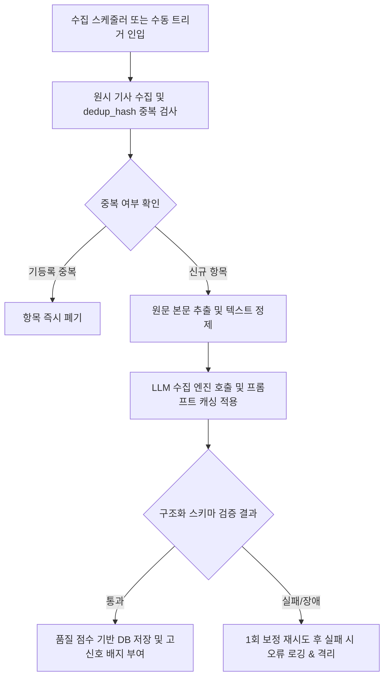
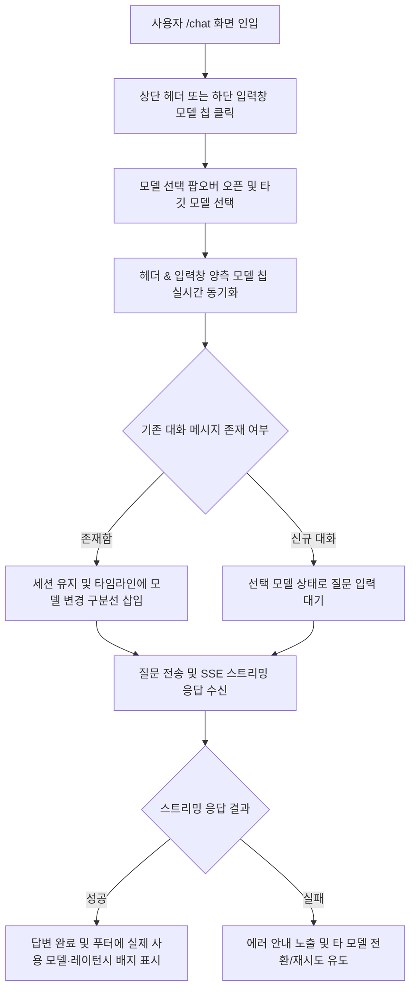

# 멀티 프로바이더 LLM 통합 및 듀얼 모델 셀렉터 상세기능정의서 (Modular FSD)

- **도메인**: 데이터 수집 파이프라인, 전용 AI 챗 멀티 모델 셀렉터 및 보안 거버넌스
- **작성자**: 기획 명세 작성가 (`spec-writer`)
- **문서 버전**: v1.0
- **상태**: Approved

---

## 단위 기능 상세 명세 (단위기능별 7대 상세 명세 완비)

---

### [FUNC-COLL-005] 고신호 데이터 수집/정제/요약/태깅 파이프라인

#### 1. 기본 정보
- **기능명**: 기본 & 멀티 프로바이더 호환 데이터 수집/정제/요약/태깅 파이프라인
- **기능 ID**: `FUNC-COLL-005`
- **대응 요구사항 ID**: `REQ-COLL-005`, `REQ-LLM-001`, `REQ-SEC-004`
- **대상 화면 코드**: `SCR-COLL-001` (수집 배치 엔진 및 관리자 수집 상태 모달 `SCR-SETT-001`)
- **우선순위**: Must Have
- **관련 액터 (Actor)**: 시스템 크론 스케줄러 / 수집 파이프라인 워커 / 시스템 관리자

#### 2. 사전 조건 (Pre-conditions)
1. 백엔드 서버 환경변수 또는 시스템 설정에 유효한 LLM 프로바이더 API 키(Anthropic Claude, Google Gemini, OpenAI, 또는 OpenAI-Compatible / Ollama)가 설정된 상태
2. 수집 대상 RSS 피드, GitHub 저장소 등으로부터 원시 기사 메타데이터(URL, 제목, 발행일)가 인입된 상태
3. 데이터베이스 `news_items` 테이블 및 중복 방지 인덱스(`dedup_hash`)가 준비된 상태

#### 3. 사용자 인터랙션 및 시스템 동작 흐름과 플로우차트 (Step-by-Step Flow & Flowchart)
1. 시스템 정기 크론 스케줄러 또는 관리자의 '즉시 수동 수집' 트리거가 실행된다.
2. 시스템은 인입된 기사의 정규화된 URL과 제목으로 `dedup_hash`를 생성하여 기등록 중복 기사를 선별 폐기한다.
3. 신규 기사에 대해 원문 파서(`Trafilatura`)로 본문 마크다운 텍스트를 추출한다.
4. 시스템은 설정된 수집 LLM(기본 주력 모델 또는 환경에 구성된 멀티 프로바이더 모델)을 호출하여 구조화된 분석 결과를 생성한다:
   - 시스템 프롬프트에 프롬프트 캐싱 헤더를 적용하여 반복 배치 처리 비용을 절감한다.
   - 3줄 핵심 요약(`tldr_bullets`), 실무 도입 시사점(`why_it_matters`), 기술 스택(`tech_stack`), 도메인 태그(`tags`), 품질 점수(`quality_score`)를 생성한다.
5. 백엔드 스키마 검증 결과에 따라 다음과 같이 분기한다:
   - **성공 시**: 품질 점수 5.0 이상 항목을 DB에 저장(7.8 이상은 `⭐️ Must Read` 고신호 지정)하고 메인 피드에 반영한다.
   - **실패 시**: 스키마 보정 재시도를 1회 수행하고, 프로바이더 장애 또는 스키마 검증 최종 실패 시 오류를 로깅하고 해당 수집 건을 안전하게 격리한다.

#### 4. 화면 표시 및 입력 데이터 항목 명세 (UI Data Elements - 8대 표준 컬럼)
| 항목명 | 화면 표시/입력 구분 | UI 컴포넌트 | 필수 여부 | 데이터 타입 / 제약 | 기본값 | 유효성 검증 규칙 (Validation) | 노출/수정 조건 |
| :--- | :---: | :--- | :---: | :--- | :---: | :--- | :--- |
| `pipeline_model` | 노출 전용 | Badge | 필수 | String / 2~60자 | `기본 설정 모델` | 지원 프로바이더/모델 식별자 매칭 | 관리자 상태 모달 및 기사 메타 |
| `tldr_bullets` | 노출 전용 | Bulleted List | 필수 | Array[String] / 3개 항목 | `[]` | 각 항목 10~150자 이내 | 뉴스 상세 모달 상시 노출 |
| `why_it_matters` | 노출 전용 | Highlight Card | 필수 | String / 150~600자 | 빈 값 | 실무 엔지니어링 시사점 서술 필수 | 뉴스 상세 모달 상시 노출 |
| `tech_stack` | 노출 전용 | Tag Pill Group | 필수 | Array[String] / 1~5개 | `[]` | 공인 기술 엔티티 사전 매칭 | 피드 카드 및 상세 모달 |
| `quality_score` | 노출 전용 | Score Badge | 필수 | Float / 1.0~10.0 | `5.0` | 5.0 이상 피드 노출, 7.8 이상 고신호 | 피드 카드 및 상세 모달 |

#### 5. 비즈니스 규칙 (Business Rules)
- **BR-COLL-005-1**: 수집 파이프라인은 기본적으로 구성된 분석 모델을 사용하며, 시스템 환경 설정에 따라 Google Gemini, OpenAI, OpenAI-Compatible / Ollama 등 멀티 프로바이더 모델을 유연하게 지원해야 한다.
- **BR-COLL-005-2**: 반복 배치 수집 시 시스템 프롬프트 캐싱을 적용하여 입력 토큰 비용을 절감해야 하며, 모든 LLM API 키는 백엔드 환경변수에만 격리 보관하여 클라이언트 노출을 원천 차단(`POL-SEC-004`)해야 한다.
- **BR-COLL-005-3**: 산출된 품질 점수가 5.0 미만인 기사는 노이즈로 분류하여 메인 피드 저장에서 제외하고, 7.8 이상인 기사는 `⭐️ Must Read` 고신호 항목으로 자동 지정한다.

#### 6. 예외 처리 및 엣지 케이스 (Edge Cases & Exception Handling)
| 발생 상황 (Edge Case Scenario) | 화면 반응 및 시스템 처리 방식 | 사용자 안내 메시지 |
| :--- | :--- | :--- |
| 가용한 LLM 프로바이더 API 키 미설정 | 수집 스케줄러 일시 정지 및 시스템 로그에 503 경고 기록 | "가용한 LLM 프로바이더 API 키가 설정되지 않았습니다." |
| 외부 LLM API 할당량 초과(429) 또는 일시적 네트워크 장애 | 지수 백오프 재시도 3회 수행 후 실패 시 수집 실패 로그 기록 및 다음 주기로 이관 | (시스템 로그에 429 한도 초과 기록 및 지연 재시도) |
| 원문 웹페이지 접근 차단(403) 또는 본문 500자 미만 추출 | 원문 스크래핑을 중단하고 RSS 피드 기본 요약문(Snippet)을 기반으로 분석 수행 | (수집 로그에 스니펫 기반 처리 기록 및 정상 노출) |
| 수동 수집 버튼 연타로 인한 중복 요청 인입 | 최초 클릭 즉시 버튼 비활성화(Debounce) 및 수집 진행 중 잠금 처리 | "현재 데이터 수집이 진행 중입니다. 잠시만 기다려주세요." |

#### 7. 비즈니스 에러 코드 매핑
| 비즈니스 에러 코드 | 발생 사유 | HTTP 상태 코드 매핑 | 클라이언트 표시 형태 |
| :--- | :--- | :---: | :--- |
| `ERR_LLM_PROVIDER_UNAVAILABLE` | 가용한 LLM 프로바이더 API 키 미설정 | 503 Service Unavailable | 관리자 설정 경고 배너 노출 |
| `ERR_LLM_UPSTREAM_FAILED` | 외부 LLM 통신 장애 또는 5xx 오류 | 502 Bad Gateway | 수집 실패 로그 기록 및 재시도 스케줄링 |
| `ERR_LLM_QUOTA_EXCEEDED` | 외부 LLM API 호출 한도 초과 | 429 Too Many Requests | 수집 백오프 지연 및 알림 로그 |
| `ERR_SCHEMA_VALIDATION` | LLM 응답 구조화 스키마 검증 실패 | 422 Unprocessable Entity | 수집 실패 로그 기록 및 항목 격리 |
| `ERR_COLLECTION_CONFLICT` | 이미 수집 또는 리셋 작업이 실행 중인 상태 | 409 Conflict | 토스트 메시지 알림 |

---

### [FUNC-CHAT-013] AI 챗 워크스페이스 상단 헤더 & 입력창 듀얼 모델 셀렉터

#### 1. 기본 정보
- **기능명**: AI 챗 상단 헤더 & 하단 입력창 듀얼 배치 멀티 모델 셀렉터 및 무손실 동적 전환
- **기능 ID**: `FUNC-CHAT-013`
- **대응 요구사항 ID**: `REQ-CHAT-013`, `REQ-UI-008`, `REQ-LLM-002`
- **대상 화면 코드**: `SCR-CHAT-001` (전용 AI 챗 워크스페이스 `/chat`)
- **우선순위**: Must Have
- **관련 액터 (Actor)**: 일반 사용자 / 테크 리더 / 소프트웨어 엔지니어

#### 2. 사전 조건 (Pre-conditions)
1. 사용자가 전용 AI 챗 화면(`SCR-CHAT-001`)에 정상 진입한 상태
2. 백엔드 멀티 프로바이더 스트리밍 엔드포인트(`/api/chat/stream`)와 통신이 가능한 상태
3. 현재 세션 식별자(`session_id`) 및 기본 선택 모델 상태가 초기화된 상태

#### 3. 사용자 인터랙션 및 시스템 동작 흐름과 플로우차트 (Step-by-Step Flow & Flowchart)
1. 사용자가 `/chat` 화면에 진입하면 상단 글로벌 헤더(`ChatHeader`) 우측과 하단 프롬프트 입력창(`ChatPromptInput`) 좌하단 양측에서 현재 선택된 모델 칩(`[🎯 Sonnet ▾]`)을 즉시 확인한다.
2. 사용자가 상단 헤더 또는 하단 입력창의 모델 칩을 클릭하면 의도 기반 티어(`⚡ Haiku`, `🎯 Sonnet`, `🧠 Opus`) 및 멀티 프로바이더 선택 팝오버가 열린다.
3. 사용자가 원하는 모델을 선택하면 클라이언트 상태가 즉시 갱신되며, 헤더와 입력창 양측의 모델 칩이 동시에 동기화된다.
4. 대화 도중 모델을 변경한 후 질문을 전송하면 백엔드 처리 결과에 따라 다음과 같이 분기한다:
   - **성공 시**: 기존 대화 히스토리를 유지한 채 타임라인에 모델 변경 안내선을 표시하고, 선택된 모델로 SSE 스트리밍 답변을 렌더링한 뒤 말풍선 하단 푸터에 실제 사용된 모델명과 응답 시간을 표시한다.
   - **실패 시**: 기존 대화 내용을 보존하고 재시도 또는 타 모델 전환 유도 안내를 토스트/인라인 카드로 노출한다.

#### 4. 화면 표시 및 입력 데이터 항목 명세 (UI Data Elements - 8대 표준 컬럼)
| 항목명 | 화면 표시/입력 구분 | UI 컴포넌트 | 필수 여부 | 데이터 타입 / 제약 | 기본값 | 유효성 검증 규칙 (Validation) | 노출/수정 조건 |
| :--- | :---: | :--- | :---: | :--- | :---: | :--- | :--- |
| `header_model_selector` | 선택 | Dropdown Chip | 필수 | Enum (`haiku`, `sonnet`, `opus` 등) | `sonnet` | 지원 모델 코드값 매칭 | 상단 헤더 우측 상시 노출 (스트리밍 중 비활성화) |
| `composer_model_selector` | 선택 | Inline Chip | 필수 | Enum (`haiku`, `sonnet`, `opus` 등) | `sonnet` | 지원 모델 코드값 매칭 | 하단 입력창 좌하단 상시 노출 (스트리밍 중 비활성화) |
| `cost_latency_indicator` | 노출 전용 | Badge / Label | 필수 | String / 읽기 전용 | 티어별 기본값 | 상대 비용(`$`, `$$`, `$$$`) 및 예상 시간 표시 | 모델 선택 팝오버 오픈 시 |
| `model_switch_divider` | 노출 전용 | System Divider | - | String / 읽기 전용 | - | 변경된 모델명 바인딩 | 대화 도중 모델 변경 시 타임라인 노출 |
| `footer_model_badge` | 노출 전용 | Badge / Label | 필수 | String / 읽기 전용 | - | 서버 응답 `model_used` 및 `latency_ms` 바인딩 | 답변 스트리밍 완료 시 말풍선 하단 노출 |

#### 5. 비즈니스 규칙 (Business Rules)
- **BR-CHAT-013-1**: 상단 헤더와 하단 프롬프트 입력창의 모델 선택기는 동일한 상태를 공유하며, 어느 한쪽에서 변경 시 지연 없이 양방향으로 동기화되어야 한다.
- **BR-CHAT-013-2**: 대화 스레드 진행 도중 모델을 교체하더라도 현재 세션 ID와 이전 메시지 내역을 초기화해서는 안 되며, 최근 10턴(최대 3,000토큰)의 대화 컨텍스트를 변경된 모델로 무손실 전달해야 한다.
- **BR-CHAT-013-3**: 스트리밍 응답이 진행되는 동안(`isStreaming === true`)에는 중복 변경 충돌을 막기 위해 모델 셀렉터 조작을 일시 잠금(Disabled) 처리한다.

#### 6. 예외 처리 및 엣지 케이스 (Edge Cases & Exception Handling)
| 발생 상황 (Edge Case Scenario) | 화면 반응 및 시스템 처리 방식 | 사용자 안내 메시지 |
| :--- | :--- | :--- |
| 선택한 모델의 API 호출 한도 초과(429) 또는 과부하 발생 시 | 에러 원인을 안내하고 인접 모델 티어 또는 가용 프로바이더로 즉시 재시도할 수 있는 버튼 제공 | "선택한 모델의 요청 한도에 도달했습니다. 다른 모델로 전환하여 다시 시도해주세요." |
| 답변 스트리밍 진행 도중 모델 셀렉터 클릭 시도 | 버튼 클릭 이벤트를 차단하고 툴팁으로 변경 가능 시점 안내 | "답변 생성이 완료된 후 모델을 변경할 수 있습니다." |
| 모바일 가상 키보드가 올라온 상태에서 모델 셀렉터 터치 | 화면 가림을 방지하기 위해 가상 키보드를 닫거나 바텀시트 형태로 선택 메뉴 노출 | (모바일 뷰포트 안전 렌더링) |

#### 7. 비즈니스 에러 코드 매핑
| 비즈니스 에러 코드 | 발생 사유 | HTTP 상태 코드 매핑 | 클라이언트 표시 형태 |
| :--- | :--- | :---: | :--- |
| `ERR_INVALID_MODEL_TIER` | 허용되지 않은 모델 식별자 요청 | 400 Bad Request | 경고 토스트 및 기본 모델 자동 복원 |
| `ERR_LLM_PROVIDER_UNAVAILABLE` | 선택한 모델 프로바이더 API 키 미설정 | 503 Service Unavailable | 키 설정 안내 인라인 배너 노출 |
| `ERR_LLM_UPSTREAM_FAILED` | 해당 프로바이더 연결 실패 또는 외부 API 장애 | 502 Bad Gateway | 재시도 버튼이 포함된 에러 안내 노출 |
| `ERR_LLM_QUOTA_EXCEEDED` | 선택 모델 호출 할당량 초과 | 429 Too Many Requests | 타 모델 전환 유도 인라인 카드 및 경고 토스트 |
