# UI 공통 상세기능정의서 (Modular FSD)

Updated: 2026-11-10
기준: v0.4.2 (main)

- **도메인**: UI 공통 (도메인 코드 `UI`) — 피드 헤더, 수집 진행 줄, 테마, 전역 단축키, 피드 키보드 탐색, 커맨드 팔레트, 대화상자·오버레이 공통 규칙, 반응형, 모바일 뷰포트, 로딩·오류·빈 상태, 마크다운, 복사 피드백, 접근성. 그리고 화면·라우트·대화상자 목록·화면 상태·localStorage·단축키의 기능 사실
- **작성자**: 기획 명세 작성가 (`spec-writer`)
- **문서 버전**: v1.0 (as-built: 지금 코드를 그대로 설명한다. 새 기능 설계가 아니다)
- **상태**: Draft
- **관련 문서**: 뉴스 피드 `docs/spec-writer/fsd/01_NEWS_FEED_SPECIFICATION.md`, AI 챗 `docs/spec-writer/fsd/02_AI_CHAT_SPECIFICATION.md`, 수집 `docs/spec-writer/fsd/03_COLLECTION_SPECIFICATION.md`, 브리핑·공유 `docs/spec-writer/fsd/04_BRIEFING_AND_SHARING_SPECIFICATION.md`, 소스·리서치 `docs/spec-writer/fsd/05_SOURCES_AND_RESEARCH_SPECIFICATION.md`, MCP `docs/spec-writer/fsd/06_MCP_SERVER_SPECIFICATION.md`. 색·간격·부품 같은 디자인 규칙과 컴포넌트 구조는 이 문서 범위가 아니다 (디자인 시스템 산출물).

---

## 개요

화면 여러 곳에 걸치는 UI 동작을 정리한다. 뉴스 피드 화면(`/`)의 헤더, 테마(라이트·다크·시스템), 전역 단축키, 커맨드 팔레트, 대화상자·오버레이 공통 규칙, 반응형 레이아웃, 모바일 뷰포트 대응, 로딩·오류·빈 상태 표시, 마크다운 렌더링, 복사 피드백, 접근성 속성이 대상이다.

- 테마 상태는 루트 레이아웃의 테마 제공자가 모든 화면에 제공한다 (`frontend/src/app/layout.tsx:35`).
- 피드 헤더와 단일 키 단축키는 뉴스 피드 화면(`/`)에만 있다. `/chat` 화면은 자체 챗 헤더를 쓰고, 커맨드 팔레트(⌘K)와 테마 선택은 두 화면 모두에 있다.
- 대화상자·드로어·확인 창·메뉴·팝오버는 공통 부품과 오버레이 스택 위에서 같은 규칙으로 동작한다 (FUNC-UI-008).
- UI 문구는 한국어다 (`<html lang="ko">`, `frontend/src/app/layout.tsx:30`).
- 아이콘은 모두 `lucide-react` 아이콘(장식이면 `aria-hidden`)으로 그리고, 프론트가 정한 UI 글자(버튼·탭·라벨·제목·알림 문구)에는 그림 이모지를 쓰지 않는다. 그림 이모지는 기본이 이모지 표현인 글자(`Emoji_Presentation`)와 U+FE0F 로 이모지 표현을 고른 그림 문자다. `©`·`↔`·`➔`·`✓` 같은 텍스트 표현 기호는 해당하지 않는다. 정적 검사 `frontend/src/tests/ui/IconGuard.test.ts` 가 `src/components/**`·`src/app/**` 의 `.ts`·`.tsx` 를 검사한다. 사용자·기사 글은 대상이 아니다. v0.4.2 부터 backend 가 만든 글자(브리핑 마크다운·Notion·이메일·웹훅, 챗 단계 라벨, 수집 진행 문구)에도 그림 이모지가 없다.

### 에러 코드 표기 규칙
이 도메인의 기능은 대부분 서버를 부르지 않는다. 서버를 부르는 곳(스케줄 상태, 즉시 수집, 초기화)의 오류 응답은 v0.4.2 부터 공통 형식 `{error_code, message, details}`(`ERR_INVALID_PAYLOAD`·`ERR_NOT_FOUND`·`ERR_SERVER_INTERNAL` 등)이다. '비즈니스 에러 코드 매핑' 표에는 그 `error_code` 와 화면 표시를 적고, 200 으로 오는 `status` 값(`already_running` 등)도 적는다. 화면은 응답 `message` 를 먼저 쓰고, 오류 형식이 아니면 함수별 기본 문구를 쓴다 (`frontend/src/lib/api.ts` `readErrorMessage`).

### 화면 코드
| 화면 코드 | 화면·요소 | 있는 곳 |
|---|---|---|
| `SCR-UI-001` | 피드 헤더 + 수집 진행 줄 | `/` 상단 |
| `SCR-UI-002` | 커맨드 팔레트 | `/`, `/chat` |
| `SCR-UI-003` | 메뉴 (테마 선택, 더보기) | 피드 헤더, 챗 헤더 |
| `SCR-UI-004` | 공통 오버레이 (대화상자·드로어·바텀시트·확인 창·메뉴·팝오버) | 모든 화면 |
| `SCR-UI-000` | 전역 (테마 적용, 반응형, 뷰포트, 로딩 표시, 마크다운, 복사, 접근성) | 모든 화면 |

뉴스 피드 화면 코드는 `01_NEWS_FEED_SPECIFICATION.md`(`SCR-NEWS-xxx`), 챗 화면 코드는 `02_AI_CHAT_SPECIFICATION.md` 를 따른다. 자동 수집 스케줄 대화상자는 `SCR-COLL-002`, 초기화 확인 창은 `SCR-COLL-003`, 브리핑 대화상자·설정 대화상자는 `SCR-BRF-002`·`SCR-BRF-003`, 소스 & 리서처 대화상자는 `SCR-SRC-001`, MCP 연동 대화상자는 `SCR-MCP-001` 이다. 커맨드 팔레트는 피드·챗 모두 `SCR-UI-002`, 피드 헤더와 수집 진행 줄은 `SCR-UI-001` 이다. 전체 목록은 `docs/spec-writer/02_FUNCTIONAL_SPECIFICATION.md` 3절.

### 기능 트리와 우선순위
as-built 문서라 우선순위는 지금 제품에서의 역할로 분류했다 (제품 오너 확인 전, '열린 질문' Q-UI-1). Must = 모든 화면이 기대는 기반 동작, Should = 편의·운영 기능.

- UI 공통 (UI)
  - 헤더 `SCR-UI-001`: FUNC-UI-001 피드 헤더 (Must), FUNC-UI-002 수집 진행 줄과 초기화 확인 창 (Should)
  - 테마 `SCR-UI-000`·`SCR-UI-003`: FUNC-UI-003 테마 시스템 (Should), FUNC-UI-004 테마 선택 메뉴 (Should)
  - 키보드 `SCR-UI-000`: FUNC-UI-005 전역 단축키 (Should), FUNC-UI-006 피드 키보드 탐색 (Should)
  - 팔레트 `SCR-UI-002`: FUNC-UI-007 커맨드 팔레트 (Should)
  - 오버레이 `SCR-UI-004`: FUNC-UI-008 대화상자·오버레이 공통 규칙 (Must)
  - 배치 `SCR-UI-000`: FUNC-UI-009 반응형 레이아웃 (Must), FUNC-UI-010 모바일 뷰포트·가상 키보드 대응 (Should)
  - 표시 `SCR-UI-000`: FUNC-UI-011 로딩·오류·빈 상태 (Must), FUNC-UI-012 마크다운 렌더링 (Must), FUNC-UI-013 복사 피드백 (Should), FUNC-UI-014 접근성 속성 (Must)

---

## 화면·라우트

| 경로 | 종류 | 제목(`<title>`) | 하는 일 |
|---|---|---|---|
| `/` | 페이지 (클라이언트) | `AgentLens \| AI Agent, Harness & MCP Global News` (루트 레이아웃 메타데이터) | 뉴스 피드, 일일 브리핑, 트렌드 레이더, 대화상자 6종 |
| `/chat` | 페이지 (서버 컴포넌트 껍데기 + 클라이언트 챗 작업 영역) | `AI 챗 워크스페이스 \| AgentLens` | AI 챗 워크스페이스 |
| `/api/health` | 프론트 자체 API (`GET`) | — | 프론트 헬스체크. 응답 `{"status":"healthy","service":"agentlens-frontend","version":<NEXT_PUBLIC_APP_VERSION, 없으면 "unknown">,"timestamp":<ISO>}`. 버전은 빌드 때 `package.json` 에서 넣는다 (v0.4.2, `frontend/src/app/api/health/route.ts`) |

- 그 밖의 `/api/*` 요청은 rewrite 로 backend(`INTERNAL_API_URL`, 기본 `http://127.0.0.1:8000`)에 넘긴다. 모든 화면은 클라이언트 컴포넌트가 데이터를 읽는다. 서버 컴포넌트에서 데이터를 읽는 곳은 없다.
- 환경 변수 (v0.4.2, `frontend/src/lib/env.ts`): 브라우저용 `NEXT_PUBLIC_API_URL`(기사 질문 스트림을 backend 에 직접 붙일 주소. 비우면 같은 출처 `/api/...` 로 보낸다. 기본 빈 값), `NEXT_PUBLIC_APP_VERSION`. 서버용 `INTERNAL_API_URL`, `ALLOWED_DEV_ORIGINS`, `PORT`, `NODE_ENV`. 브라우저용 값이 스키마에 맞지 않으면(예: URL 이 아닌 `NEXT_PUBLIC_API_URL`) 읽을 때 오류를 던진다.
- 오류 경계 (v0.4.2): 홈·챗 공용 라우트 오류 경계(`frontend/src/app/error.tsx`)가 렌더 중 예외를 잡아 레이아웃은 남기고 본문에 오류 상태(제목 `화면을 그리지 못했습니다`, 본문 `일시적인 문제일 수 있습니다. 다시 시도해도 같으면 페이지를 새로 고쳐 주세요.`, `다시 시도` 버튼 = 경계 재설정)를 보인다. 예외 원문은 화면에 쓰지 않고 콘솔에만 남긴다.
- 대화상자 6종(뉴스 상세, 일일 브리핑, 자동 수집 스케줄, MCP 연동, 공유 & 알림 설정, 소스 & 리서처)은 `next/dynamic`(`ssr: false`)으로 처음 열 때 불러온다 (v0.4.2, `frontend/src/app/page.tsx:27-35`).
- 루트 레이아웃: `<html lang="ko">`. 첫 그리기 전에 저장된 테마와 OS 설정으로 `<html>` 의 테마를 정한다 (FUNC-UI-003). 메타 설명 `전세계 AI 뉴스, 최신 Agent 기술, 하네스(Harness) 방법론 및 벤치마크, MCP(Model Context Protocol) 및 스킬 플러그인 큐레이션 플랫폼`. 웹 글꼴을 읽지 않는다 (시스템 글꼴) (`frontend/src/app/layout.tsx:17-44`).
- viewport: `width=device-width, initial-scale=1, interactive-widget=resizes-content`, `color-scheme: light dark`, `theme-color` 라이트 `#f8fafc` / 다크 `#0e1013`. 확대를 막지 않는다 (`frontend/src/app/layout.tsx:6-15`).
- `/chat` 쿼리 파라미터 (`frontend/src/components/chat/ChatWorkspace.tsx:474-540`):

  | 파라미터 | 동작 |
  |---|---|
  | `session_id` | 저장된 대화를 불러온다. 있으면 다른 파라미터는 보지 않는다 |
  | `sourceId` | 정수 기사 id. 기사를 읽어 `단일 기사` 범위(scoped)로 시작한다. 못 찾으면 경고 알림 `요청하신 기사를 찾을 수 없어 전체 소식 모드로 시작합니다.` 후 `전체 소식` 범위(global) |
  | `q` | 시작하자마자 이 질문을 보낸다 (`sourceId` 와 함께면 그 기사 범위로) |
- 404 커스텀 페이지와 로딩 페이지는 없다. 오류 페이지는 위 라우트 오류 경계 하나다 (v0.4.2).
- 피드 화면 본문에는 화면 읽기용 제목 `AI 에이전트 소식`(`h1`, 보이지 않음)이 있고, 바닥글은 `AgentLens © 2026 · AI 에이전트 · 하네스 · MCP 생태계 소식` 이다 (`frontend/src/app/page.tsx:172`, `:271-273`).

### 피드 화면(`/`) 영역
| 순서 | 영역 | 하는 일 | 기능 |
|---|---|---|---|
| 0 | 전역 단축키 | 화면에 그리지 않음. 오버레이가 열려 있으면 단일 키를 막는다 | FUNC-UI-005, FUNC-UI-006 |
| 1 | 헤더 | 건너뛰기 링크, 브랜드(`/` 링크, 1024px 이상 버전 배지), 주 내비(`피드`·`AI 챗`), 수집 상태, 즉시 수집, 커맨드 팔레트, 테마 메뉴, 더보기 메뉴. 커맨드 팔레트와 초기화 확인 창을 가진다 | FUNC-UI-001, FUNC-UI-004, FUNC-UI-007 |
| 2 | 수집 진행 줄 | 헤더 바로 아래, 메시지가 있을 때만 보인다. 수집 중에 화면을 떠났다 오면 다시 붙는다 | FUNC-UI-002 |
| 3 | 요약 바 | `오늘의 브리핑 · 날짜 · 헤드라인` 버튼(→ 일일 브리핑, 768px 미만 날짜 숨김, 남는 폭을 모두 쓰는 한 줄 말줄임), 1024px 이상 급상승 태그 칩 3개, `트렌드` 펼침 버튼. 첫 읽기가 끝나기 전이고 보여 줄 것이 없을 때만 48px 스켈레톤, 다시 읽는 동안에는 이전 내용. 브리핑·레이더 둘 다 없으면 그리지 않는다. 펼친 패널의 카테고리 분포 라벨은 한국어, 640px 미만 1열·이상 2열·1024px 이상 4열 | FUNC-NEWS-014, FUNC-NEWS-018 |
| 4 | 검색 영역·필터 영역 | 검색 입력(자리표시 `키워드 검색`, `/` 로 포커스), 카테고리 칩 5개, 소스 칩(`전체`, 건수가 있는 소스, `북마크 n`)과 오른쪽 끝 `Must-Read` 토글. 필터를 바꾸면 1페이지로, 카테고리를 바꾸면 소스 `all` | FUNC-NEWS-002~005 |
| 5 | 목록 머리줄 | 상태(`총 N건`, 필터 중 `(전체 M건)`, `북마크 보기`·`Must-Read` 배지, `페이지 p / T`)와 정렬(인기순·품질순·최신순·추천순). 정렬을 바꾸면 1페이지로 | FUNC-NEWS-001, FUNC-NEWS-006 |
| 6 | 카드 그리드 | 고정 틀 카드. 카드(또는 제목 버튼) 클릭 → 뉴스 상세. 북마크(`보관하기`), `AI 챗에서 분석`(→ `/chat?sourceId=`), `원문`. j/k 포커스 링 | FUNC-NEWS-008 |
| 7 | 로딩·오류·빈 상태 | 스켈레톤(지금 조건의 목록이 아직 없을 때만) / 오류 + `다시 시도` / 빈 상태 + `필터 전체 초기화`. 같은 조건을 다시 읽는 동안은 이전 카드, 그 다시 읽기가 실패하면 `danger` 알림 | FUNC-UI-011 |
| 8 | 페이지 이동 | 이전·다음, `p / T`. 바꾸면 목록 머리줄의 상태로 스크롤·포커스. 한 페이지 18건 | FUNC-NEWS-001 |
| 9 | 바닥글 | 저작권 한 줄 | — |
| 10 | 대화상자 6종 | 뉴스 상세, 일일 브리핑, 자동 수집 스케줄, MCP 연동, 공유 & 알림 설정, 소스 & 리서처 | 아래 '대화상자·드로어·시트·팝오버' |

본문 영역 사이 세로 간격은 768px 미만 12px, 이상 16px 하나다: 요약 바 → 검색 영역 → 필터 영역 → 목록 머리줄 → 카드 그리드가 모두 이 간격이다 (`frontend/src/app/page.tsx:170`, `frontend/src/components/feed/FeedToolbar.tsx:218-221`).

### 챗 화면(`/chat`) 영역
`/chat` 에는 피드 헤더와 단일 키 단축키가 없다. 챗 헤더가 ⌘K 커맨드 팔레트와 더보기 메뉴(테마 라디오 3개)를 가진다. 챗 동작 상세는 `02_AI_CHAT_SPECIFICATION.md`.

| 영역 | 하는 일 |
|---|---|
| 대화 기록 사이드바 (1024px 이상) | 머리 영역 두 줄(1줄 56px `+ 새 대화`·접기, 2줄 44px 제목 검색), 세션 카드 목록(제목, 범위 배지 `단일 기사`·`전체 소식`, 시간. 접근 이름 `대화: <제목>, <시간>, 단일 기사 모드`/`… 전체 소식 모드`. 삭제 확인 팝오버). 접으면 그리지 않는다 |
| 챗 헤더 | 왼쪽부터 피드로 돌아가기(`/`, 모든 폭에서 맨 왼쪽), 기록 버튼(1024px 이상은 사이드바 접기·펴기, 미만은 드로어), 제목 `AI 챗`, 새 대화, 커맨드 팔레트(768px 이상), 더보기(테마 라디오, `뉴스 피드로 이동`, 768px 미만 `커맨드 팔레트`) |
| 맥락 줄 | 검색 스코프 전환(그룹 이름 `검색 스코프 모드`, `단일 기사`(scoped)·`전체 소식`(global)), 선택 기사 칩(짧은 카테고리 라벨, 해제). 가로 스크롤 줄, 안쪽 폭은 메시지 열과 같다 |
| 메시지 목록 | 웰컴/추천 질문(카드마다 앞에 아이콘 `Server`·`GitBranch`·`ChartColumn`·`TrendingUp`, 글자 왼쪽 정렬, 누르면 아이콘 없는 글자 그대로 보냄), 메시지·모델 변경 구분선 시간순, 답변의 모델 배지(티어 아이콘: haiku `Zap`, sonnet `Target`, opus `Brain`, Claude 밖 gemini `Sparkles`·gpt `Bot`·그 밖 `Target` + 이름). 스크롤은 목록 상자 안에서만 일어난다: 맨 아래(24px 이내)를 보고 있을 때만 새 내용을 따라 내려가고, 위로 올려 읽는 중이면 그대로 둔다. 새 메시지(전송·세션 열기)는 언제나 맨 아래로 (v0.4.2 FE-36, BR-UI-009-10) |
| 포커스 캡슐 | 현재 필터 요약 버튼(앞말 `포커스:`, 필터가 없으면 `포커스: 전체 소식`, → 포커스 필터), 필터가 걸려 있으면 초기화 버튼 |
| 입력창 | 질문 입력(Enter 전송, Shift+Enter 줄바꿈), 모델 칩(모든 폭에서 화면의 유일한 모델 선택, 팝오버는 위로 열림, 생성 중 비활성), 글자 수 `n / 2000`, `질문 전송` / 생성 중 `답변 생성 중단` |
| 기록 드로어 (1024px 미만) | 사이드바와 같은 내용, 세션 선택·새 대화 때 닫힘 |
| 포커스 필터 | 카테고리(그룹 `도메인 카테고리`: `전체 소식`, `하네스 & 벤치마크`, `MCP & 생태계`, `에이전트 아키텍처`, `최신 AI 동향` — 피드 카테고리 칩과 같은 긴 라벨), 기간, 정렬, Must-Read 스위치, 대상 건수, `초기화`·`적용하기` |
| 커맨드 팔레트 | `뉴스 피드로 이동`, 테마 순환, `새 대화 시작`, `대화 기록 열기` |
| 알림 영역 (입력 영역 위) | 입력 영역 바로 위(8px 띄움)에 그린다. 안쪽 폭은 메시지 열과 같다. 대화상자가 열려 있으면 전역 알림 영역이 대신 그린다. 영역이 바뀌어 다시 그려진 알림은 화면 읽기 프로그램에 다시 알리지 않는다 |

### 대화상자·드로어·시트·팝오버
공통 규칙과 닫기 수단은 FUNC-UI-008. 크기 `sm` 420px · `md` 560px · `lg` 720px · `xl` 896px 는 768px 이상의 너비다. 768px 미만에서 `전체 화면` 은 화면 전체, `바텀시트` 는 아래에서 올라오는 시트(최대 `90dvh`)다.

| 이름 | 종류·크기 (768px 미만) | 여는 곳 | 담는 내용 | 닫기 | 기능 상세 |
|---|---|---|---|---|---|
| 뉴스 상세 | 대화상자 `xl` (전체 화면) | 카드·제목 버튼 클릭, 포커스 카드 Enter/Space | 머리줄(카테고리 긴 라벨·Must-Read 배지, 제목 2줄, 북마크, 닫기, 탭 `AI 요약 & 시사점` / `AI 질의응답`+대화 수), 요약 탭, 질의응답 탭, 바닥(출처, 작성자, `원문 링크 방문`) | Escape(질의응답 탭 질문 입력창 안에서는 닫지 않고 탭 패널로 포커스), 배경막, 머리줄 X. 닫으면 스트림 중단·상태 초기화 | FUNC-NEWS-009, FUNC-NEWS-010 |
| 일일 브리핑 | 대화상자 `xl` (전체 화면) | 요약 바 `오늘의 브리핑` | 제목 `오늘의 AI 브리핑` + 날짜, 설명 = 헤드라인(여기 한 번만), 도구줄(`Notion 내보내기`/`Notion에서 열기`, `이메일 발송`→주소 입력 줄, 복사, `.md 다운로드`. 768px 미만은 주 버튼 + `브리핑 작업` 메뉴(이메일 발송·복사·`.md 다운로드`)), 결과 인라인 알림(실패하면 `Notion 설정 열기`·`이메일 설정 열기`), 탭 `카테고리별 요약` / `마크다운 전문`. 요약 탭: `오늘의 핵심 요약` 칸(개요가 있을 때만, 개요 줄의 분야 이름은 긴 라벨로), 분야별 칸(머리글 = 피드 카테고리 칩과 같은 아이콘 + 긴 라벨, 표에 없는 분야는 아이콘 없이 backend 이름, 기사마다 `Lightbulb` 아이콘 + `시사점:`). 바닥 `연동 설정`(설정 진입은 이 한 곳)·`닫기` | Escape, 배경막, X, `닫기` | BRF |
| 공유 & 알림 설정 | 대화상자 `md` (전체 화면) | 더보기 `공유 & 알림`, 팔레트, 일일 브리핑 바닥 `연동 설정`·실패 알림의 `Notion 설정 열기`·`이메일 설정 열기` (브리핑 위에 쌓인다) | 탭 `Notion 연동` / `이메일 (SMTP)` / `웹훅 (Slack/Discord)`, 입력 필드, 결과 인라인 알림, 바닥 `닫기`·`연결 테스트`(현재 탭)·`저장` | Escape, X, `닫기` (배경막으로 닫히지 않음) | BRF |
| 자동 수집 스케줄 | 대화상자 `md` (전체 화면) | 헤더 수집 상태 버튼(768px 이상), 더보기 `수집 스케줄`(768px 미만), 팔레트 | 설명 `정해진 시각마다 전세계 소식을 자동 수집합니다.`, 수집 주기(응답 `schedule_hours`·`timezone` 으로 그림. 시간대가 UTC 일 때만 KST 환산을 덧붙임, v0.4.2), 다음 예정(분, 시각. 받기 전 `계산 중...`), '위험 영역' `초기화 & 재수집…`(수집 중 비활성), 바닥 `즉시 수집`(수집 중 `수집 중`) | Escape, 배경막, X | COLL, FUNC-NEWS-017 |
| AgentLens MCP 연동 | 대화상자 `lg` (전체 화면) | 더보기 `MCP 연동`, 팔레트 | MCP 도구 4개(정의 목록), `claude_desktop_config.json` 예시 코드 블록(복사)과 `cwd`·`command` 바꾸는 법 안내, 바닥 `닫기` | Escape, 배경막, X, `닫기` | MCP |
| 소스 & 리서처 | 대화상자 `xl` (전체 화면) | 더보기 `소스 & 리서처`, 팔레트 | 탭 `AI 딥 리서처`(기본, 지표 카드 4개 2열·768px 이상 4열, 값은 말줄임 없이 줄을 바꿔 전부 보인다) / `등록된 수집원`, 결과 안내(`aria-live`), 바닥 `sources.json` 표시·`닫기`. 수집원 삭제는 확인 창 | Escape, X, `닫기` (배경막으로 닫히지 않음) | SRC |
| 수집 데이터 전체 삭제 및 재수집 | 확인 창 (`alertdialog`, `sm`, 바텀시트) | 더보기 `초기화 & 재수집…`, 스케줄 대화상자 '위험 영역', 팔레트 | 영구 삭제 경고, `취소`(처음 포커스) / `전체 삭제 후 다시 수집`(진행 중 `초기화 중...`), 실패 시 창 안 오류 | Escape, 배경막, `취소`, 머리줄 X (진행 중에는 모두 무시) | FUNC-UI-002, FUNC-NEWS-017 |
| 확인 창 (대화 초기화, 소스 삭제) | 확인 창 (`sm`, 바텀시트) | 뉴스 상세 질의응답 탭 `대화 초기화`, 수집원 삭제 버튼 | `AI 대화 내역을 모두 초기화하시겠습니까?` / `이 소스를 목록에서 삭제하시겠습니까?` | Escape, 배경막, `취소`, 머리줄 X | FUNC-NEWS-010, SRC |
| 커맨드 팔레트 | 대화상자 `md`, 위쪽 배치 (전체 화면, 768px 이상은 위에서 `12dvh`, 560px) | ⌘K / Ctrl+K, 헤더 팔레트 버튼, 챗 더보기 `커맨드 팔레트` | 검색 입력(combobox), 명령 목록(listbox), 키 안내(640px 이상) | Escape, 배경막, X, ⌘K | FUNC-UI-007 |
| 대화 기록 드로어 | 왼쪽 드로어 (`min(320px, 85vw)`, 높이 전체) | 챗 헤더 기록 버튼 (1024px 미만), 챗 팔레트 `대화 기록 열기` | 제목 `대화 기록`, 새 대화, 검색, 세션 목록 | Escape, 배경막, `대화 기록 드로어 닫기`, 세션 선택·새 대화 | CHAT |
| 수집 소식 타깃팅 포커스 필터 | 대화상자 `sm` 바텀시트 (768px 이상 가운데 420px) | 포커스 캡슐 | 카테고리, 기간, 정렬, Must-Read, 대상 건수, `초기화`·`적용하기` | Escape, 배경막, `필터 닫기`, 아래로 100px 스와이프, `적용하기` | CHAT |
| 모델 선택 | 팝오버 `role="radiogroup"` | 입력창 모델 칩(위로) | haiku / sonnet / opus 3단계 | Escape, 바깥 pointerdown, 선택 | CHAT |
| 인용 출처 프리뷰 | 팝오버 `role="dialog"`, `body` 포털에 그린다 (v0.4.2, 메시지 목록의 넘침 자르기에 잘리지 않는다) | 답변 안 인용 배지 클릭 | 출처 기사 요약 | Escape, 바깥 pointerdown, `팝오버 닫기` | CHAT |
| 세션 삭제 확인 | 팝오버 `role="dialog"` (`min(18rem, 100vw-2rem)`) | 세션 카드 삭제 버튼 | `이 대화를 삭제하시겠습니까?`, `취소`(처음 포커스)·`삭제` | Escape, 바깥 pointerdown, `취소` | CHAT |
| 메뉴 | 메뉴 버튼 (`min(280px, 100vw-32px)`) | 피드 헤더 `더보기`·`테마 선택`, 챗 헤더 `더보기`, 브리핑 `브리핑 작업` | 메뉴 항목·라디오·구분선 | Escape(트리거로 포커스), 바깥 pointerdown, Tab, 항목 실행 | FUNC-UI-004 |

- 브라우저 기본 대화상자(`window.confirm`, `alert`)는 쓰지 않는다.
- 어디서도 렌더하지 않던 `WebhookSettingsModal`(웹훅 URL 을 localStorage 에 저장)은 v0.4.2 에서 지웠다.

### 화면 상태와 기본값
| 범위 | 가진 상태와 기본값 | 유지 |
|---|---|---|
| 앱 전체 테마 | `theme`(기본 `system`), `resolvedTheme`, 순환·직접 선택 | localStorage `agentlens_theme`. 같은 탭은 `agentlens:theme-change` 이벤트, 다른 탭은 `storage` 이벤트로 동기화 |
| 오버레이 스택 | 열린 대화상자·드로어·메뉴·팝오버 레이어 목록. 하나라도 열려 있는지, 맨 위 레이어 | 메모리 |
| 수집 상태 | 스케줄 상태, `isCollecting`, 진행 줄 `message`. 헤더·진행 줄·스케줄 대화상자·초기화 확인 창이 같은 값을 본다. 구독자가 하나 이상일 때만 30초 재조회·진행 폴링을 돌리고, 마지막 구독자가 빠지면 모두 정리하고 처음 상태로 되돌린다 | 메모리 |
| 알림 | 알림 목록과 등록된 알림 영역. 그리는 영역은 하나다: 모달이 없고 `composer` 영역(챗 입력 영역 위)이 있으면 가장 나중에 등록된 `composer`, 아니면 처음 등록된 `global`. 알림마다 처음 알린 영역을 기록해, 다른 영역이 그린 뒤에는 live 속성 없이 그린다 (알림이 닫히면 기록을 지운다) | 메모리 |
| 화면 너비 | `matchMedia` 구독. 서버·하이드레이션 첫 렌더는 false | 메모리 |
| 홈 피드 데이터·필터 | `category`(`all`), `source`(`all`), `search`(''), `sort`(`hot`), `highSignalOnly`(false), `page`(1), `selectedTag`(null). 필터가 바뀌면 자동 재조회. 통계·브리핑·레이더는 마운트 때 한 번(그리고 새로고침 때) 읽는다 | 메모리 (새로고침하면 처음 값) |
| 반복 시사점 | 지금 목록에서 시사점이 반복되는 기사 id 집합 | 파생 |
| 북마크 | 북마크 id 목록과 기사 스냅샷 목록 | localStorage `agentlens_bookmarks` |
| 홈 대화상자·포커스 | `focusedIndex`(-1, 목록이 바뀌면 -1), 선택 기사, 대화상자 열림 6개 | 메모리 |
| 헤더 | 팔레트 열림, 초기화 확인 창 열림 | 메모리 |
| 챗 세션 목록 | 세션 목록, 로딩, 오류, 검색어. 서버와 localStorage 이중 저장, 최대 30개 | 서버 + localStorage |
| 챗 작업 상태 | 세션 id(UUID), 메시지, 입력, 검색 스코프(`global`), 선택 기사, 포커스 필터, 모델 티어(`sonnet`), 모델 변경 기록, 사이드바 열림(true), 드로어·바텀시트·팔레트 열림, 스트리밍 여부, 화면 높이 | 메모리 |
| URL | `/chat?session_id=&sourceId=&q=` | 챗 초기 진입 상태 |

전역 상태 라이브러리나 데이터 패칭 라이브러리는 없다 (`frontend/package.json`).

### localStorage 키 (전체)
| 키 | 값 | 쓰는 때 | 비고 |
|---|---|---|---|
| `agentlens_theme` | `light` \| `dark` \| `system` | 테마 선택·순환 때. 첫 그리기 전에 읽는다 | `frontend/src/lib/theme-store.ts:72`, `:87`, `frontend/src/app/layout.tsx:23` |
| `agentlens_bookmarks` | `NewsItem[]` JSON (최근 추가가 앞) | 북마크 토글 때 | 북마크 보기는 서버 대신 이 목록을 거른다. 읽을 때 형식을 검사해 맞지 않는 항목은 버린다 (v0.4.2) (`frontend/src/hooks/useBookmarks.ts`) |
| `agentlens_chat_sessions_index` | `ChatSessionMeta[]` JSON, 최대 30개 | 서버 목록 조회 성공 때 덮어쓰고, 실패 때 대체로 쓴다. 읽을 때 형식 검사 (v0.4.2) | `frontend/src/components/chat/useChatSessions.ts` |
| `agentlens_chat_session_{sessionId}` | `ChatSessionDetail` JSON | 세션 상세 L1 캐시. 서버가 404 이거나 네트워크 오류면 이것을 쓴다. 읽을 때 형식 검사 (v0.4.2) | `frontend/src/components/chat/useChatSessions.ts` |

- v0.4.1 의 `agentlens_webhook_url` 키는 쓰던 대화상자를 지워 v0.4.2 부터 읽거나 쓰지 않는다. 옛 브라우저에 남은 값은 무시된다.

- `sessionStorage`, 쿠키, IndexedDB 는 쓰지 않는다.

---

## 단위 기능 상세 명세 (단위기능별 7대 상세 명세 완비)

---

### [FUNC-UI-001] 피드 헤더

#### 1. 기본 정보
- **기능명**: 브랜드, 주 내비, 수집 상태·즉시 수집, 팔레트, 테마, 더보기 메뉴를 담은 56px 한 줄 상단 바. 폭에 따라 요소를 줄이고 나머지는 더보기 메뉴로 옮긴다
- **기능 ID**: `FUNC-UI-001`
- **대응 요구사항 ID**: `REQ-UI-001` (옛 기능명세 `UI-01`)
- **대상 화면 코드**: `SCR-UI-001`
- **우선순위**: Must Have
- **관련 액터 (Actor)**: 피드 사용자
- **진입점**: 뉴스 피드 화면(`/`)의 최상단. 바로 아래에 수집 진행 줄(FUNC-UI-002)을 둔다 (`frontend/src/app/page.tsx:155-165`).

#### 2. 사전 조건 (Pre-conditions)
1. `/` 에 진입했다.
2. 헤더가 받는 동작: 새로고침(필수), 스케줄 열기(필수), MCP 열기(필수), 공유 & 알림 열기(선택), 소스 열기(선택). 홈 화면은 다섯 개를 모두 넘긴다.

#### 3. 사용자 인터랙션 및 시스템 동작 흐름과 플로우차트
1. 헤더가 마운트되면 수집 상태 저장소를 구독해 스케줄 상태를 읽는다 (구독자가 생길 때 한 번, 그 뒤 30,000ms 마다).
2. 폭에 따라 요소 모양을 바꾸고, 768px 미만에서는 수집 스케줄·즉시 수집·테마를 더보기 메뉴로 옮긴다.
3. 사용자가 요소를 누르면 각 대화상자·확인 창·팔레트를 열거나 수집을 시작한다.

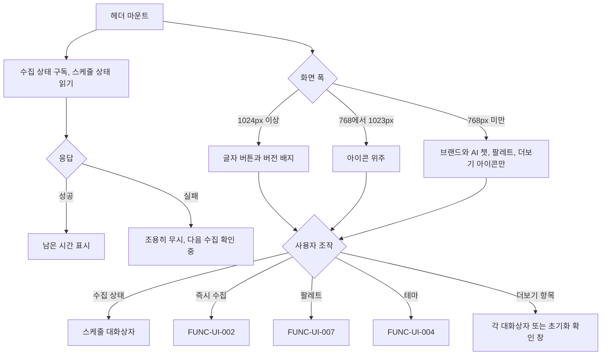

#### 4. 화면 표시 및 입력 데이터 항목 명세 (UI Data Elements - 8대 표준 컬럼)
| 항목명 | 화면 표시/입력 구분 | UI 컴포넌트 | 필수 여부 | 데이터 타입 / 제약 | 기본값 | 유효성 검증 규칙 (Validation) | 노출/수정 조건 |
| :--- | :---: | :--- | :---: | :--- | :---: | :--- | :--- |
| 건너뛰기 링크 | 사용자 조작 | 링크 `본문으로 건너뛰기` → `#main` | - | - | 숨김 | - | 포커스를 받으면 보인다 |
| 브랜드 | 사용자 조작 | `/` 링크 (아이콘 + `AgentLens`) | 필수 | - | - | - | 상시 |
| 버전 배지 | 노출 전용 | Badge `v{NEXT_PUBLIC_APP_VERSION}` | - | 빌드 때 `package.json` 의 `version` (v0.4.2 릴리스 기준 `v0.4.2`) | - | 값이 없으면 숨김 | 1024px 이상 |
| 주 내비 | 사용자 조작 | `<nav aria-label="주 메뉴">` 링크 `피드`(`aria-current="page"`) · `AI 챗` | 필수 | - | - | - | 768px 이상 글자 링크 둘. 768px 미만 `피드` 숨김, `AI 챗` 아이콘 링크(글자는 화면 읽기용) |
| 수집 상태 | 사용자 조작 | 버튼 (시계 아이콘) | - | 1024px 이상 `다음 수집 {h}h {m}m 후`, 768~1023px `{h}h {m}m`. 수집 중 스피너 + `수집 중`. 상태를 모르면 1024px 이상 `다음 수집 확인 중`, 768~1023px `…` | - | 접근 이름 `수집 스케줄 · {다음 수집 … 후 \| 다음 수집 확인 중}` | 768px 이상. 누르면 스케줄 대화상자 |
| 즉시 수집 | 사용자 조작 | 보조 버튼 (아이콘 + `즉시 수집`) | - | 수집 중 스피너 + `수집 중`, 비활성 | - | - | 1024px 이상 글자, 768~1023px 아이콘 버튼(이름 `즉시 수집`). 768px 미만은 더보기 |
| 커맨드 팔레트 | 사용자 조작 | 1024px 이상 `검색·명령` + `⌘K` 버튼, 미만 아이콘 버튼 `커맨드 팔레트 열기` | - | - | - | - | 상시 |
| 테마 | 사용자 선택 | 메뉴 버튼 `테마 선택` | - | FUNC-UI-004 | - | - | 768px 이상. 미만은 더보기의 `테마` 라디오 3개 |
| 더보기 | 사용자 조작 | 메뉴 버튼 `더보기` | 필수 | 항목: `소스 & 리서처`, `공유 & 알림`, `MCP 연동`, `RSS 피드`(새 탭), 구분선, `초기화 & 재수집…`(위험 톤). 768px 미만은 `RSS 피드` 뒤에 구분선 + `수집 스케줄` 또는 `수집 스케줄 (다음 {h}h {m}m 후)`, `즉시 수집`/`수집 중`(비활성), 구분선 + `테마` 그룹 라디오 `라이트`·`다크`·`시스템` 을 넣는다 | - | `소스 & 리서처`·`공유 & 알림` 은 해당 동작을 넘겼을 때만. `초기화 & 재수집…` 은 수집 중 비활성 | 상시 |

#### 5. 비즈니스 규칙 (Business Rules)
- **BR-UI-001-1 (헤더 틀)**: `<header>` 는 sticky 위쪽 고정, 높이 56px, 반투명 배경·아래 테두리, 줄바꿈 없는 한 줄이다. 안쪽 최대 너비 `max-w-7xl`, 좌우 여백 16/24/32px (`frontend/src/components/Header.tsx:122`, `:129`).
- **BR-UI-001-2 (요소 순서)**: 브랜드 → 주 내비 → 수집 상태 → 즉시 수집 → 커맨드 팔레트 → 테마 → 더보기 (`frontend/src/components/Header.tsx:131-205`).
- **BR-UI-001-3 (모바일 판정)**: 768px 미만 판정은 CSS 와 함께 `useMediaQuery('(max-width: 767px)')` 를 쓴다. 이 값으로 테마 메뉴를 그릴지, 더보기 메뉴에 모바일 항목을 넣을지 정한다 (`frontend/src/components/Header.tsx:62`, `:90`, `:202`).
- **BR-UI-001-4 (남은 시간)**: `GET /api/schedule/status` 의 `minutes_until_next_run` 으로 계산한다. 시 = `floor(분/60)`, 분 = `round(분 % 60)`, 시가 0 이면 `{m}m`. 0 이하이거나 숫자가 아니면 0 으로 본다. 상태를 아직 모르면 1024px 이상 `다음 수집 확인 중`, 768~1023px `…`, 모바일 메뉴 `수집 스케줄` (`frontend/src/hooks/useCollector.ts:246-252`, `frontend/src/components/Header.tsx:83`, `:94`, `:166-167`).
- **BR-UI-001-5 (재조회)**: 스케줄 상태는 수집 상태 저장소가 구독자가 생길 때 한 번, 그 뒤 30,000ms 마다 다시 읽는다. 실패는 조용히 무시하고, 늦게 도착한 오래된 응답은 버린다 (FUNC-UI-002 BR-10) (`frontend/src/hooks/useCollector.ts:104-119`, `:167-170`).
- **BR-UI-001-6 (⌘K·소유)**: ⌘K / Ctrl+K 는 헤더의 `useHotkey('mod+k')` 가 받는다 (FUNC-UI-007). 커맨드 팔레트와 초기화 확인 창은 헤더가 가진다. 팔레트의 초기화 명령도 수집 중이면 비활성(`aria-disabled`)이다 (`frontend/src/components/Header.tsx:69-81`, `:209-221`).

#### 6. 예외 처리 및 엣지 케이스 (Edge Cases & Exception Handling)
| 발생 상황 (Edge Case Scenario) | 화면 반응 및 시스템 처리 방식 | 사용자 안내 메시지 |
| :--- | :--- | :--- |
| 서버 렌더·하이드레이션 첫 렌더 | 너비 판정이 false 라 모바일에서도 잠깐 데스크톱 기준(테마 메뉴 있음, 더보기에 모바일 항목 없음)으로 그린다. 테마 메뉴는 CSS 가 아니라 이 값으로 숨기므로 첫 렌더 직후 사라진다 | (없음) |
| 360px 폭 | 줄바꿈하지 않는다. 브랜드 + 아이콘 버튼 3개(AI 챗, 팔레트, 더보기)가 한 줄에 들어간다 | (없음) |
| 스케줄 상태 조회 실패 | 조용히 무시. 상태를 모르면 `다음 수집 확인 중` | `다음 수집 확인 중` |

#### 7. 비즈니스 에러 코드 매핑
| 비즈니스 에러 코드 | 발생 사유 | HTTP 상태 코드 매핑 | 클라이언트 표시 형태 |
| :--- | :--- | :---: | :--- |
| `ERR_SERVER_INTERNAL` 등 | 스케줄 상태 조회 실패 (응답 `message`, 없으면 `스케줄 정보를 불러오지 못했습니다.` 예외) | 비 2xx 또는 타임아웃 | 표시 없음 (이전 값 유지, 처음이면 `다음 수집 확인 중`) |

- 근거: `frontend/src/components/Header.tsx:1-251`, `frontend/src/hooks/useCollector.ts`, `frontend/src/app/page.tsx:155-165`, 동작 확인 테스트 `frontend/src/tests/Header.test.tsx`

---

### [FUNC-UI-002] 수집 진행 줄과 초기화 확인 창

#### 1. 기본 정보
- **기능명**: 헤더 아래에 수집 진행 메시지를 보여 주고, 즉시 수집·초기화를 실행한다
- **기능 ID**: `FUNC-UI-002`
- **대응 요구사항 ID**: `REQ-COLL-004`, `REQ-COLL-007` (옛 기능명세 `UI-02`)
- **대상 화면 코드**: `SCR-UI-001`, `SCR-COLL-003`
- **우선순위**: Should Have
- **관련 액터 (Actor)**: 피드 사용자, 수집기(backend)
- **진입점**: 즉시 수집 — 헤더 `즉시 수집`(768px 이상), 더보기 `즉시 수집`(768px 미만), 스케줄 대화상자 바닥 `즉시 수집`, 팔레트 `최신 소식 즉시 수집 트리거`. 초기화 — 더보기 `초기화 & 재수집…`, 스케줄 대화상자 '위험 영역' `초기화 & 재수집…`, 팔레트 `수집 데이터 초기화 & 재수집`.

#### 2. 사전 조건 (Pre-conditions)
1. 수집 상태 저장소를 구독하는 화면 요소(헤더 등)가 하나 이상 마운트되어 있다.

#### 3. 사용자 인터랙션 및 시스템 동작 흐름과 플로우차트
1. 즉시 수집을 누르면 `POST /api/schedule/trigger` 를 부르고 진행 폴링을 시작한다.
2. 진행 폴링은 1,200ms 마다 진행도를 읽어 메시지를 바꾸고, 저장 건수가 늘면 피드를 새로고침하고, 끝나면 완료 메시지를 4,000ms 보인다.
3. 초기화 확인을 누르면 `POST /api/schedule/reset-and-collect` 를 부르고 성공 시 진행 폴링을 시작한다.
4. 스케줄 상태가 수집 중이라고 하면(다른 화면에 갔다 온 경우 등) 진행 폴링을 다시 붙인다.

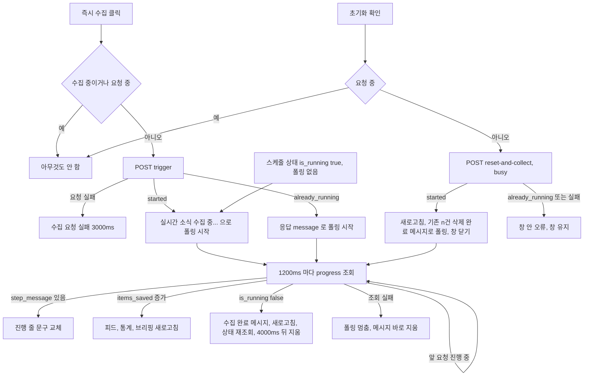

#### 4. 화면 표시 및 입력 데이터 항목 명세 (UI Data Elements - 8대 표준 컬럼)
| 항목명 | 화면 표시/입력 구분 | UI 컴포넌트 | 필수 여부 | 데이터 타입 / 제약 | 기본값 | 유효성 검증 규칙 (Validation) | 노출/수정 조건 |
| :--- | :---: | :--- | :---: | :--- | :---: | :--- | :--- |
| 진행 줄 메시지 | 노출 전용 | 헤더 아래 한 줄 (높이 36px), 알림 영역 `role="status" aria-live="polite"` | - | String | 없음 | - | 메시지가 있을 때만 보인다. 알림 영역은 늘 DOM 에 있다. 스크롤하면 함께 올라간다 |
| 진행 아이콘 | 노출 전용 | 스피너 / 초록 체크 | - | - | - | - | 수집 중 스피너, 끝나면 체크 |
| `피드 실시간 반영 중` | 노출 전용 | 오른쪽 보조 글자 | - | - | - | - | 수집 중, 640px 이상 |
| 메시지 문구 | 노출 전용 | - | - | `실시간 소식 수집 중...`, `step_message`, `수집 완료 (+{items_saved}건 신규 반영)`, `수집 요청 실패`, `기존 {deleted_count}건 삭제 완료. 신규 수집 중...`, `already_running` 응답 `message` | - | - | 각 상황 |
| 초기화 확인 창 | 사용자 조작 | `alertdialog` (위험 톤, 768px 미만 바텀시트) | - | 제목 `수집 데이터 전체 삭제 및 재수집`, 영구 삭제 경고 문구, `취소`(처음 포커스), `전체 삭제 후 다시 수집`(진행 중 `초기화 중...`) | - | 진행 중 두 버튼 비활성, Escape·배경막 무시 | FUNC-NEWS-017 |
| 창 안 오류 | 노출 전용 | 인라인 알림 | - | 오류 메시지 | `초기화 실패` | - | 실패 시 |

#### 5. 비즈니스 규칙 (Business Rules)
- **BR-UI-002-1 (공유 저장소)**: 수집 상태는 모듈 단위 저장소 하나에 있다. 헤더, 수집 진행 줄, 스케줄 대화상자, 초기화 확인 창이 같은 값(`status`, `isCollecting`, `message`)을 본다 (`frontend/src/hooks/useCollector.ts:31-38`, `:266-291`).
- **BR-UI-002-2 (즉시 수집)**: 수집 중이거나 요청 중이면 아무것도 하지 않는다. `POST /api/schedule/trigger` 를 부르고, 성공하면 `실시간 소식 수집 중...` 으로 진행 폴링을 시작한다. 응답 `status` 가 `already_running`(이 backend 나 같은 DB 를 쓰는 다른 프로세스가 수집 중이라 새로 시작하지 않음)이면 응답 `message`(이 backend 면 `이미 수집이 진행 중입니다.`, 다른 프로세스면 `다른 프로세스(MCP 서버·make collect)가 같은 DB 에 수집 중입니다.`)로 진행 폴링을 시작해 진행 중인 수집을 따라간다. 응답의 `other_process` 는 화면이 쓰지 않는다. 다른 프로세스의 수집은 이 backend 의 진행도에 나타나지 않아 폴링이 곧 `수집 완료 (+0건 신규 반영)` 으로 끝날 수 있다 (관찰 사항, '알려진 불일치·위험' 9). 요청 자체가 실패하면 `수집 요청 실패` 를 3,000ms 동안 보여 준다 (`frontend/src/hooks/useCollector.ts`, `backend/app/api/schedule.py:39-62`).
- **BR-UI-002-3 (진행 폴링)**: 1,200ms 마다 `GET /api/schedule/progress` 를 읽는다. 앞 요청이 끝나지 않았으면 그 회차는 건너뛴다. `step_message` 가 있으면 메시지를 그것으로 바꾼다. `items_saved` 가 직전보다 늘면 등록된 새로고침 콜백(피드·통계·브리핑 다시 읽기)을 부른다. `is_running` 이 false 가 되면 폴링을 멈추고 `수집 완료 (+{items_saved}건 신규 반영)` 를 보여 준 뒤, 새로고침과 스케줄 상태 재조회를 하고 4,000ms 뒤 메시지를 지운다 (이 재조회 응답은 반영된다, BR-10). 폴링 요청이 실패하면 폴링을 멈추고 메시지를 바로 지운다. 이때는 스케줄 상태를 바로 다시 읽지 않는다 (진행 조회만 계속 실패하면 폴링이 1.2초마다 켜졌다 꺼지므로). 수집이 아직 돌고 있으면 다음 30초 재조회가 BR-9 로 다시 붙인다 (`frontend/src/hooks/useCollector.ts:121-165`).
- **BR-UI-002-4 (진행 줄 위치)**: 헤더 밖, 헤더 바로 아래 한 줄이다 (`frontend/src/components/Header.tsx:226-251`).
- **BR-UI-002-5 (초기화 확인 창)**: 제목 `수집 데이터 전체 삭제 및 재수집`, 영구 삭제 경고 문구, 버튼 `취소`(처음 포커스)와 `전체 삭제 후 다시 수집` (`frontend/src/components/ResetConfirmDialog.tsx:44-60`).
- **BR-UI-002-6 (초기화 실행)**: 확인을 누르면 `POST /api/schedule/reset-and-collect` 를 부른다. 진행 중에는 확인 버튼이 `초기화 중...`(스피너)으로 바뀌고 `busy` 라 두 버튼이 비활성, Escape·배경막도 무시된다. 성공하면 새로고침 후 `기존 {deleted_count}건 삭제 완료. 신규 수집 중...` 메시지로 진행 폴링을 시작하고 창을 닫는다. 이미 요청 중이면 다시 보내지 않는다. 진행 폴링은 시작할 때마다 회차 번호를 올리고, 이전 회차의 늦은 응답은 버린다 (`frontend/src/components/ResetConfirmDialog.tsx:29-42`, `frontend/src/hooks/useCollector.ts:229-244`).
- **BR-UI-002-7 (초기화 실패)**: 창을 닫지 않고 창 안 인라인 알림으로 오류 메시지(없으면 `초기화 실패`)를 보여 준다. 응답 `status` 가 `already_running`(이 backend 가 수집 중이거나 다른 프로세스가 수집 잠금을 쥐고 있어 삭제하지 않음, v0.4.2)이어도 실패로 다룬다: 응답 `message`(`현재 수집이 진행 중이므로 초기화할 수 없습니다. 잠시 후 다시 시도해주세요.`)를 창 안 오류로 보이고, 새로고침·진행 폴링을 시작하지 않는다. 앞선 초기화 요청이 아직 끝나지 않았는데 다시 누르면 `이미 초기화 요청을 처리하고 있습니다.` 로 거절한다 (v0.4.2). HTTP 오류는 응답 `message`, 없으면 `초기화 및 재수집 요청 실패` 다 (`frontend/src/hooks/useCollector.ts`, `frontend/src/lib/api.ts:271-278`, `backend/app/api/schedule.py:64-95`).
- **BR-UI-002-8 (정리)**: 마지막 구독자(헤더 등)가 언마운트되면 스케줄 재조회·진행 폴링·메시지 타이머를 모두 정리하고 상태를 처음으로 되돌린다. 정리 뒤에 도착한 응답은 버린다 (`frontend/src/hooks/useCollector.ts:172-196`).
- **BR-UI-002-9 (수집 상태 복원)**: 스케줄 상태(첫 구독 때와 30초 재조회 때)가 `is_running: true` 이고 진행 폴링이 돌고 있지 않으면 `실시간 소식 수집 중...` 으로 진행 폴링을 시작한다. 그래서 수집 중에 다른 화면에 갔다 돌아와도, 이 화면 밖에서 시작된 수집(정기 스케줄 등)이어도 진행 줄과 `isCollecting`(즉시 수집 `수집 중`·비활성)이 다시 붙는다 (`frontend/src/hooks/useCollector.ts:104-119`).
- **BR-UI-002-10 (오래된 스케줄 상태 응답 버리기)**: 스케줄 상태 요청마다 번호(`statusSeq`)를 매기고, 마지막으로 반영한 응답 번호(`appliedStatusSeq`)와 진행 폴링이 완료·실패로 끝날 때의 번호(`progressEndSeq`)를 기억한다. 응답 번호가 `appliedStatusSeq` 보다 작거나(더 나중 요청의 응답이 이미 반영됨) `progressEndSeq` 이하이면(진행 폴링이 끝나기 전에 보낸 요청) 상태도 폴링도 바꾸지 않고 버린다. 그래서 수집 중에 나간 30초 재조회의 `is_running: true` 응답이 진행 폴링이 완료를 본 뒤에 늦게 도착해도 폴링이 다시 켜지지 않고, 수집 한 번에 `수집 완료` 는 한 번만 뜬다. 완료 처리에서 부르는 재조회는 `progressEndSeq` 를 정한 뒤에 보내므로 반영된다. 마지막 구독자가 빠지면(BR-8) 세 번호를 0 으로 되돌린다 (`frontend/src/hooks/useCollector.ts:58-66`, `:104-119`, `:134-149`).

#### 6. 예외 처리 및 엣지 케이스 (Edge Cases & Exception Handling)
| 발생 상황 (Edge Case Scenario) | 화면 반응 및 시스템 처리 방식 | 사용자 안내 메시지 |
| :--- | :--- | :--- |
| 초기화 확인 창 닫기 | Escape·배경막·`취소` 로 닫힌다 (진행 중 제외) | (없음) |
| 스케줄 대화상자 안에서 초기화 확인 창 | 스케줄 대화상자 위에 쌓이고, Escape 는 확인 창만 닫는다 | (없음) |
| 수집 중 `/chat` 으로 이동 | 정리 규칙(BR-8)에 따라 폴링이 멈춘다. 다시 `/` 로 돌아오면 첫 스케줄 상태 조회에서 BR-9 로 진행 줄이 다시 붙는다. 문구는 `실시간 소식 수집 중...` 으로 시작해 다음 진행 응답의 `step_message` 로 바뀐다 | `실시간 소식 수집 중...` |
| 돌아온 직후 스케줄 상태를 받기 전 `즉시 수집` | 요청이 간다. backend 가 `already_running` 으로 답해 새 수집은 시작되지 않고, BR-2 대로 진행 폴링만 붙는다 | `이미 수집이 진행 중입니다.` |
| MCP 서버나 직접 모드 `make collect` 가 수집 중일 때 `즉시 수집` | `already_running` + `other_process: true`. 폴링을 붙이지만 이 backend 의 진행도는 `is_running: false` 라 곧 끝난다 (관찰 사항) | `다른 프로세스(MCP 서버·make collect)가 같은 DB 에 수집 중입니다.` 후 `수집 완료 (+0건 신규 반영)` |
| 다른 프로세스 수집 중 초기화 | 수집 잠금을 못 쥐어 삭제하지 않는다 (v0.4.2) | `현재 수집이 진행 중이므로 초기화할 수 없습니다. 잠시 후 다시 시도해주세요.` |
| 즉시 수집 요청 실패 | 3,000ms 표시 후 지움 | `수집 요청 실패` |
| 진행 조회 실패 | 폴링 멈춤, 메시지 지움 | (없음) |

#### 7. 비즈니스 에러 코드 매핑
| 비즈니스 에러 코드 | 발생 사유 | HTTP 상태 코드 매핑 | 클라이언트 표시 형태 |
| :--- | :--- | :---: | :--- |
| `status: "already_running"` (`other_process` 있음) | 즉시 수집 때 이미 수집 중 (이 backend 또는 다른 프로세스) | 200 | 진행 줄에 응답 `message` 로 폴링 |
| `status: "already_running"` | 초기화 때 수집 중 (이 backend 또는 다른 프로세스) | 200 | 확인 창 안 오류 (응답 `message`) |
| `ERR_SERVER_INTERNAL` 등 | trigger 실패 (응답 `message`, 없으면 `수집 요청에 실패했습니다.` 예외) | 비 2xx 또는 타임아웃 | 진행 줄 `수집 요청 실패` 3,000ms |
| `ERR_SERVER_INTERNAL` 등 | reset 실패 | 비 2xx 또는 타임아웃 | 확인 창 안 오류 (응답 `message` 또는 `초기화 및 재수집 요청 실패`, 예외 문구가 비면 `초기화 실패`) |
| 없음 | progress 실패 | 비 2xx 또는 타임아웃 | 폴링 멈춤, 메시지 지움 |

- 근거: `frontend/src/hooks/useCollector.ts`, `frontend/src/components/Header.tsx`, `frontend/src/components/ResetConfirmDialog.tsx`, `frontend/src/components/ScheduleModal.tsx`, `frontend/src/lib/api.ts:236-278`, `backend/app/api/schedule.py:39-95`, 동작 확인 테스트 `frontend/src/tests/hooks/useCollector.test.ts`, `frontend/src/tests/Header.test.tsx`

---

### [FUNC-UI-003] 테마 시스템

#### 1. 기본 정보
- **기능명**: light·dark·system 세 모드, OS 설정 추종, localStorage 저장, 첫 그리기 전 적용, `<html>` 클래스 적용
- **기능 ID**: `FUNC-UI-003`
- **대응 요구사항 ID**: `REQ-UI-005` (옛 기능명세 `UI-03`)
- **대상 화면 코드**: `SCR-UI-000`
- **우선순위**: Should Have
- **관련 액터 (Actor)**: 모든 사용자, OS 색 설정
- **진입점**: 루트 레이아웃 `<head>` 의 인라인 스크립트와 `<body>` 안 테마 제공자 (`frontend/src/app/layout.tsx:22-40`). 컴포넌트는 `useTheme()` 으로 읽는다.

#### 2. 사전 조건 (Pre-conditions)
1. 앱이 로드된다. 테마 제공자 기본값: 기본 테마 `'system'`, 저장 키 `'agentlens_theme'`, 적용 속성 `'class'`. 루트 레이아웃은 기본값을 그대로 쓴다.

#### 3. 사용자 인터랙션 및 시스템 동작 흐름과 플로우차트
1. 첫 그리기 전 인라인 스크립트가 저장된 모드와 OS 설정으로 `<html>` 테마를 정한다.
2. 하이드레이션 뒤 테마 제공자가 같은 값을 외부 저장소로 읽고 `resolvedTheme` 이 바뀔 때마다 `<html>` 에 적용한다.
3. 사용자가 선택(FUNC-UI-004)·순환(`t`, 팔레트)하면 저장하고 알린다. 다른 탭·OS 설정 변경도 반영한다.

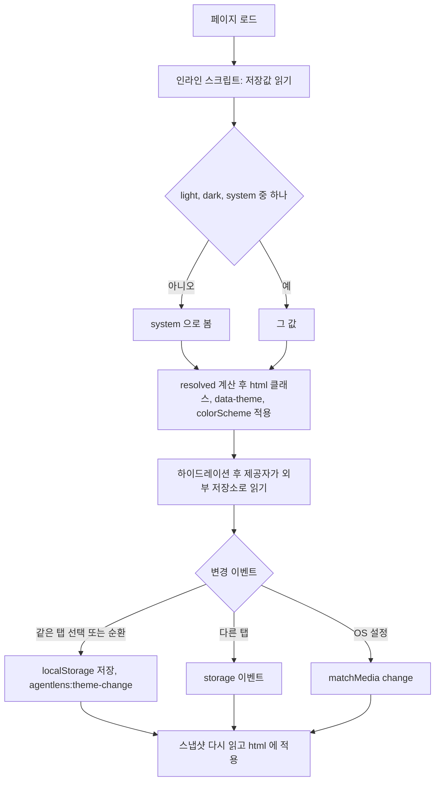

#### 4. 화면 표시 및 입력 데이터 항목 명세 (UI Data Elements - 8대 표준 컬럼)
| 항목명 | 화면 표시/입력 구분 | UI 컴포넌트 | 필수 여부 | 데이터 타입 / 제약 | 기본값 | 유효성 검증 규칙 (Validation) | 노출/수정 조건 |
| :--- | :---: | :--- | :---: | :--- | :---: | :--- | :--- |
| `theme` | 시스템 저장 | localStorage `agentlens_theme` | 필수 | Enum `light`, `dark`, `system` | `system` | 세 값이 아니면 기본값 | 선택·순환 때 저장 |
| `resolvedTheme` | 시스템 제어 | `<html>` 클래스 `dark`/`light` 하나, `data-theme`, `style.colorScheme` | 필수 | Enum `light`, `dark` | 서버 렌더 `light` | `system` 이면 OS 설정, 아니면 `theme` | 상시 |

#### 5. 비즈니스 규칙 (Business Rules)
- **BR-UI-003-1 (컨텍스트 값)**: `theme`(선택한 모드), `resolvedTheme`(실제 적용된 `light`/`dark`), `toggleTheme()`, `setTheme(mode)` (`frontend/src/context/ThemeContext.tsx:16-25`).
- **BR-UI-003-2 (첫 그리기 전)**: 인라인 스크립트가 `localStorage['agentlens_theme']`(세 값이 아니면 `system`)와 `prefers-color-scheme` 으로 `<html>` 의 `dark`/`light` 클래스, `data-theme`, `style.colorScheme` 을 정한다. 예외는 무시한다 (`frontend/src/app/layout.tsx:22-26`).
- **BR-UI-003-3 (상태 원천)**: 스냅샷을 만들 때마다 `localStorage[storageKey]`(세 값 중 하나가 아니면 기본 테마, 읽기 예외면 인스턴스 안 대체값 또는 기본 테마)와 `matchMedia('(prefers-color-scheme: dark)').matches`(`matchMedia` 가 없으면 light)를 새로 읽는다 (`frontend/src/context/ThemeContext.tsx:50-53`, `frontend/src/lib/theme-store.ts:65-83`).
- **BR-UI-003-4 (변경 알림)**: 같은 탭의 선택·순환은 `agentlens:theme-change` window 이벤트로, 다른 탭의 변경은 `storage` 이벤트로, OS 설정 변경은 `matchMedia` `change`(없으면 `addListener`)로 알린다 (`frontend/src/lib/theme-store.ts:95-127`).
- **BR-UI-003-5 (적용)**: `resolvedTheme` 가 바뀔 때마다 `<html>` 에 `dark` 또는 `light` 클래스 하나, `data-theme`, `style.colorScheme` 을 단다 (`frontend/src/context/ThemeContext.tsx:56-58`, `frontend/src/lib/theme-store.ts:133-144`).
- **BR-UI-003-6 (순환 순서)**: `light → dark → system → light` (`frontend/src/lib/theme-store.ts:23-27`).
- **BR-UI-003-7 (저장)**: 새 모드를 `localStorage[storageKey]` 에 쓴다. 쓰기 예외면 인스턴스 안 대체값에 둔다 (`frontend/src/lib/theme-store.ts:85-93`).
- **BR-UI-003-8 (스타일 반영)**: 색 토큰이 `.dark` 클래스에서 다크 값으로 바뀐다. 토큰 값은 디자인 시스템 산출물 범위다 (`frontend/src/app/globals.css:2`, `:38-67`).

#### 6. 예외 처리 및 엣지 케이스 (Edge Cases & Exception Handling)
| 발생 상황 (Edge Case Scenario) | 화면 반응 및 시스템 처리 방식 | 사용자 안내 메시지 |
| :--- | :--- | :--- |
| 제공자 밖에서 `useTheme()` | 기본값(`theme: 'system'`, `resolvedTheme: 'light'`, 아무것도 안 하는 함수) | (없음) |
| 서버 렌더·하이드레이션 첫 렌더 | 서버 스냅샷(기본 테마, light)으로 그리고 바로 클라이언트 값으로 다시 그린다. 색은 인라인 스크립트가 이미 적용해 깜빡이지 않는다. `<html>` 에 `suppressHydrationWarning` 이 있다 | (없음) |
| localStorage 사용 불가 | 이 탭 안 대체값으로 동작 | (없음) |

#### 7. 비즈니스 에러 코드 매핑
| 비즈니스 에러 코드 | 발생 사유 | HTTP 상태 코드 매핑 | 클라이언트 표시 형태 |
| :--- | :--- | :---: | :--- |
| 없음 | 서버 호출 없음 | - | - |

- 근거: `frontend/src/context/ThemeContext.tsx:1-73`, `frontend/src/lib/theme-store.ts:1-144`, `frontend/src/app/layout.tsx:22-40`, `frontend/src/app/globals.css`, 동작 확인 테스트 `frontend/src/tests/ThemeSystem.test.tsx`

---

### [FUNC-UI-004] 테마 선택 메뉴

#### 1. 기본 정보
- **기능명**: 라이트·다크·시스템 중 하나를 고르는 메뉴. 단축키·팔레트는 순환
- **기능 ID**: `FUNC-UI-004`
- **대응 요구사항 ID**: `REQ-UI-005` (옛 기능명세 `UI-04`)
- **대상 화면 코드**: `SCR-UI-003`
- **우선순위**: Should Have
- **관련 액터 (Actor)**: 모든 사용자
- **진입점**: 피드 헤더 `테마 선택` 메뉴(768px 이상), 피드 더보기 메뉴의 `테마` 라디오(768px 미만), 챗 헤더 더보기 메뉴의 `테마` 라디오(모든 폭). 단축키 `t`(FUNC-UI-005, `/` 만)와 팔레트 테마 명령(FUNC-UI-007, 두 화면)은 순환한다.

#### 2. 사전 조건 (Pre-conditions)
1. 테마 제공자가 있다 (FUNC-UI-003).

#### 3. 사용자 인터랙션 및 시스템 동작 흐름과 플로우차트
1. 사용자가 `테마 선택` 이나 더보기를 연다.
2. 라디오 항목 하나를 고르면 바로 적용·저장하고 메뉴가 닫힌다.

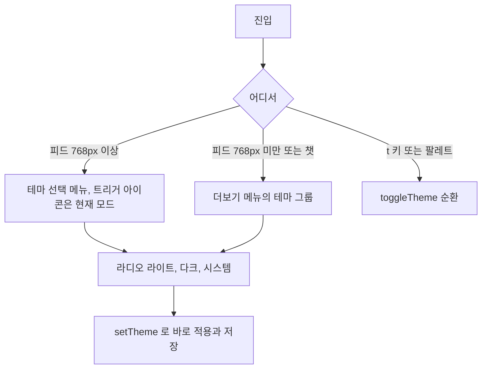

#### 4. 화면 표시 및 입력 데이터 항목 명세 (UI Data Elements - 8대 표준 컬럼)
| 항목명 | 화면 표시/입력 구분 | UI 컴포넌트 | 필수 여부 | 데이터 타입 / 제약 | 기본값 | 유효성 검증 규칙 (Validation) | 노출/수정 조건 |
| :--- | :---: | :--- | :---: | :--- | :---: | :--- | :--- |
| 트리거 | 사용자 조작 | 메뉴 버튼 `테마 선택` | - | 아이콘: `light` 해, `dark` 달, `system` 노트북 | - | - | 피드 헤더 768px 이상 |
| 테마 라디오 | 사용자 선택 | `menuitemradio` 3개 `라이트`·`다크`·`시스템` | 필수 | Enum | 현재 모드에 `aria-checked="true"` | - | 메뉴가 열렸을 때 |
| `테마` 그룹 제목 | 노출 전용 | 메뉴 그룹 라벨 | - | - | - | - | 더보기 메뉴 안 |

#### 5. 비즈니스 규칙 (Business Rules)
- **BR-UI-004-1**: 항목을 고르면 `setTheme(mode)` 로 바로 적용·저장한다 (FUNC-UI-003). 메뉴 정렬 기본 `end`.
- **BR-UI-004-2**: 메뉴 열기·닫기·키보드 규칙은 FUNC-UI-008, FUNC-UI-014 의 메뉴 규칙을 따른다.

#### 6. 예외 처리 및 엣지 케이스 (Edge Cases & Exception Handling)
| 발생 상황 (Edge Case Scenario) | 화면 반응 및 시스템 처리 방식 | 사용자 안내 메시지 |
| :--- | :--- | :--- |
| 순환 버튼 | 렌더하는 곳이 없던 `ThemeToggle` 은 v0.4.2 에서 지웠다. 순환은 `t` 키와 팔레트 명령뿐이다 | (없음) |
| 하이드레이션 첫 렌더 (모바일) | 테마 메뉴가 잠깐 보였다 사라진다 (FUNC-UI-001) | (없음) |

#### 7. 비즈니스 에러 코드 매핑
| 비즈니스 에러 코드 | 발생 사유 | HTTP 상태 코드 매핑 | 클라이언트 표시 형태 |
| :--- | :--- | :---: | :--- |
| 없음 | 서버 호출 없음 | - | - |

- 근거: `frontend/src/components/ui/ThemeMenu.tsx:1-34`, `frontend/src/components/ui/Menu.tsx`, `frontend/src/components/Header.tsx:45-49`, `:105-109`, `:202`, `frontend/src/components/chat/ChatHeader.tsx:36-91`

---

### [FUNC-UI-005] 전역 단축키

#### 1. 기본 정보
- **기능명**: 단일 키 단축키, 입력창·IME·오버레이 예외
- **기능 ID**: `FUNC-UI-005`
- **대응 요구사항 ID**: `REQ-UI-004` (옛 기능명세 `UI-05`)
- **대상 화면 코드**: `SCR-UI-000` (`/` 화면 전체)
- **우선순위**: Should Have
- **관련 액터 (Actor)**: 키보드 사용자
- **진입점**: 홈 화면이 렌더하는 단축키 리스너. `window` 의 `keydown` 을 듣고 화면에는 아무것도 그리지 않는다 (`frontend/src/app/page.tsx:140-154`).

#### 2. 사전 조건 (Pre-conditions)
1. `/` 에 있다. 리스너 입력 (v0.4.2 단일 키 전용): 콜백 `onNavigateFeed`, `onOpenDetailModal`, `onHandoverChat`, `onToggleBookmark`, `onFocusSearch`, `onToggleTheme`, `enabled`(기본 true), `blockSingleKeys`(기본 false). 홈 화면은 `blockSingleKeys` 에 '오버레이가 하나라도 열려 있는지' 를 넘긴다. v0.4.1 의 `onCloseOverlays`, `onToggleCommandPalette`, `customHotkeys` 입력은 쓰는 곳이 없어 지웠다 (⌘K 는 헤더, Escape 는 오버레이 스택이 처리한다).

#### 3. 사용자 인터랙션 및 시스템 동작 흐름과 플로우차트
판정 순서 (`frontend/src/components/HotkeyListener.tsx:61-127`):

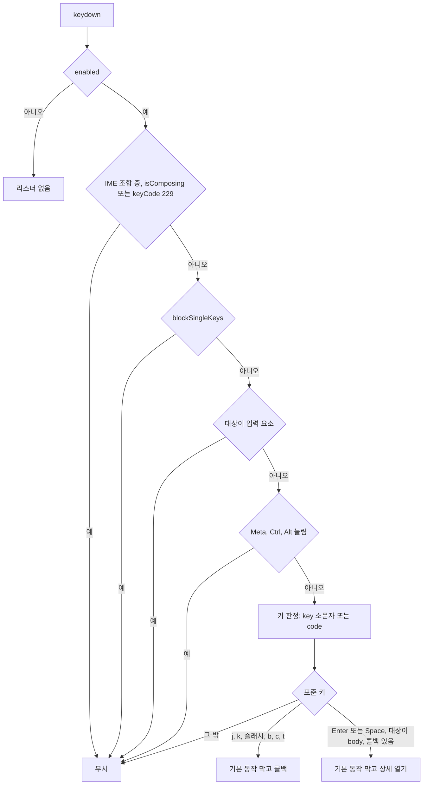

#### 4. 화면 표시 및 입력 데이터 항목 명세 (UI Data Elements - 8대 표준 컬럼)
| 항목명 | 화면 표시/입력 구분 | UI 컴포넌트 | 필수 여부 | 데이터 타입 / 제약 | 기본값 | 유효성 검증 규칙 (Validation) | 노출/수정 조건 |
| :--- | :---: | :--- | :---: | :--- | :---: | :--- | :--- |
| 단일 키 | 사용자 입력 | 키보드 | - | `j`, `k`, `/`, `b`, `c`, `t`, `Enter`, `Space` | - | `e.key` 소문자가 `j`·`k`·`b`·`c`·`t`·`/` 중 하나면 그 값, 아니면 `e.code`(`KeyJ`, `KeyK`, `KeyB`, `KeyC`, `KeyT`, `Slash`)로 바꾼다 | 오버레이 없음, 입력 요소 밖, ⌘·Ctrl·Alt 없음, IME 아님 |
| `blockSingleKeys` | 시스템 제어 | (없음) | - | Boolean | false (홈: 오버레이 열림 여부) | - | 대화상자·드로어·메뉴·팝오버·팔레트가 열려 있으면 단일 키 모두 무시 |

#### 5. 비즈니스 규칙 (Business Rules)
- **BR-UI-005-1 (입력 요소)**: 대상 요소가 `INPUT`, `TEXTAREA`, `SELECT`, `contentEditable`, `role="combobox"` 이면 끝낸다.
- **BR-UI-005-2 (조합키)**: ⌘, Ctrl, Alt 중 하나라도 눌려 있으면 끝낸다. Shift 는 검사하지 않는다.
- **BR-UI-005-3 (한글 입력)**: 물리 키 판정이라 한글 입력 상태에서도 동작한다 (`frontend/src/components/HotkeyListener.tsx:24-41`).
- **BR-UI-005-4 (단일 키 전용, v0.4.2)**: 이 리스너는 단일 키만 다룬다. 추가 매핑(`customHotkeys`)과 그 `modifiers`·`allowInInputs` 필드, ⌘K·Escape 처리는 지웠다. 인수 기준: 홈 화면에서 ⌘K 를 누르면 팔레트가 한 번만 열린다(헤더 `useHotkey('mod+k')` 하나만 반응).
- **BR-UI-005-5 (표준 키)**: `j` → `onNavigateFeed(1)`, `k` → `onNavigateFeed(-1)`, `/` → `onFocusSearch()`, `b` → `onToggleBookmark()`, `c` → `onHandoverChat()`, `t` → `onToggleTheme()`. 모두 기본 동작을 막는다.
- **BR-UI-005-6 (Enter/Space)**: `onOpenDetailModal` 이 있고 이벤트 대상이 `document.body` 일 때만 기본 동작을 막고 부른다. 버튼·링크·입력 등에 포커스가 있으면 가로채지 않는다 (`frontend/src/components/HotkeyListener.tsx:115-123`).
- **BR-UI-005-7 (다시 달기)**: 콜백이나 `blockSingleKeys` 가 바뀔 때마다 리스너를 다시 단다 (`frontend/src/components/HotkeyListener.tsx:129-140`).
- **BR-UI-005-8 (홈 화면 연결)** (`frontend/src/app/page.tsx:140-154`):

  | 콜백 | 연결된 동작 |
  |---|---|
  | `onNavigateFeed` | 카드 포커스 이동 (FUNC-UI-006) |
  | `onOpenDetailModal` | 포커스 카드의 상세 대화상자 열기 |
  | `onHandoverChat` | 포커스 카드로 `/chat?sourceId={id}` 이동 |
  | `onToggleBookmark` | 포커스 카드 북마크 토글 |
  | `onFocusSearch` | 검색 입력창에 스크롤 없이 포커스한 뒤 검색 영역을 `scrollIntoView({ block: 'nearest' })` (`frontend/src/app/page.tsx:145-151`) |
  | `onToggleTheme` | 테마 순환 |
  | `blockSingleKeys` | 오버레이 열림 여부 |

#### 6. 예외 처리 및 엣지 케이스 (Edge Cases & Exception Handling)
| 발생 상황 (Edge Case Scenario) | 화면 반응 및 시스템 처리 방식 | 사용자 안내 메시지 |
| :--- | :--- | :--- |
| `Shift+J` 등 | Shift 를 검사하지 않아 같은 동작을 한다 | (없음) |
| `/chat` 화면 | 리스너가 없다. 챗에서 쓰는 키는 ⌘K(FUNC-UI-007)와 각 요소의 키 처리뿐이다 (단축키 표) | (없음) |
| ⌘K, Escape (홈) | 이 리스너가 처리하지 않는다. ⌘K 는 헤더, Escape 는 오버레이 스택 (FUNC-UI-007, FUNC-UI-008) | (없음) |

#### 7. 비즈니스 에러 코드 매핑
| 비즈니스 에러 코드 | 발생 사유 | HTTP 상태 코드 매핑 | 클라이언트 표시 형태 |
| :--- | :--- | :---: | :--- |
| 없음 | 서버 호출 없음 | - | - |

- 근거: `frontend/src/components/HotkeyListener.tsx:1-143`, `frontend/src/app/page.tsx`, `frontend/src/lib/overlay-stack.ts:152-163`, 동작 확인 테스트 `frontend/src/tests/HotkeyListener.test.tsx`, `frontend/src/tests/HotkeyGating.test.tsx`

---

### [FUNC-UI-006] 피드 키보드 탐색

#### 1. 기본 정보
- **기능명**: j/k 로 카드 포커스를 옮기고 포커스 카드에 상세·북마크·챗 이동을 실행
- **기능 ID**: `FUNC-UI-006`
- **대응 요구사항 ID**: `REQ-UI-004` (옛 기능명세 `UI-06`)
- **대상 화면 코드**: `SCR-NEWS-001` (카드 그리드)
- **우선순위**: Should Have
- **관련 액터 (Actor)**: 키보드 사용자
- **진입점**: 홈 화면 카드 그리드. 단축키 `j`, `k`, `Enter`/스페이스, `b`, `c` (FUNC-UI-005).

#### 2. 사전 조건 (Pre-conditions)
1. 카드 목록이 비어 있지 않다. `focusedIndex` 초기값 -1 (`frontend/src/app/page.tsx:36`).

#### 3. 사용자 인터랙션 및 시스템 동작 흐름과 플로우차트
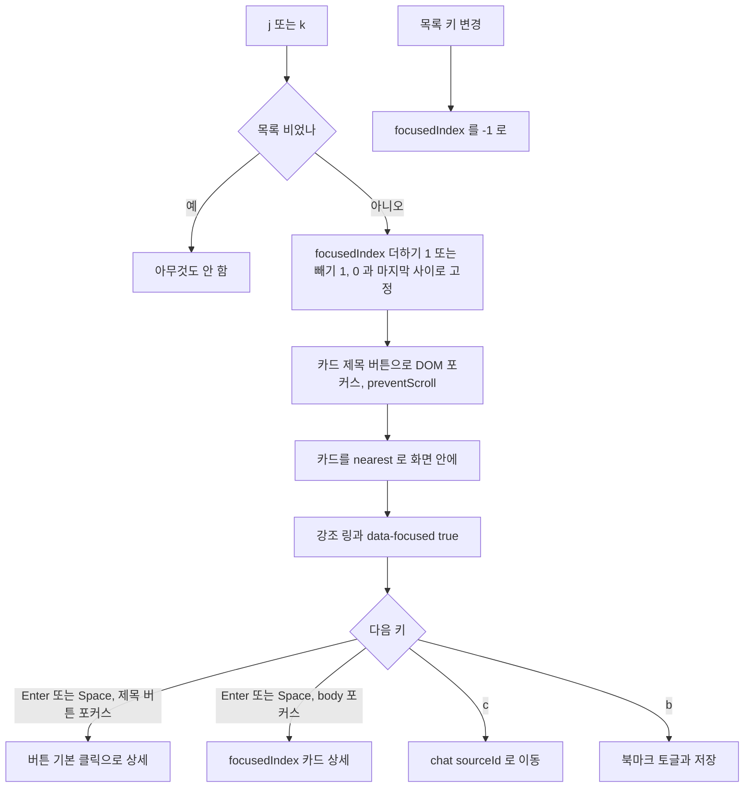

#### 4. 화면 표시 및 입력 데이터 항목 명세 (UI Data Elements - 8대 표준 컬럼)
| 항목명 | 화면 표시/입력 구분 | UI 컴포넌트 | 필수 여부 | 데이터 타입 / 제약 | 기본값 | 유효성 검증 규칙 (Validation) | 노출/수정 조건 |
| :--- | :---: | :--- | :---: | :--- | :---: | :--- | :--- |
| `focusedIndex` | 시스템 제어 | (상태) | 필수 | Integer -1 ~ 목록 길이-1 | -1 | `j` +1, `k` -1, 0 미만이면 0, 목록 길이 이상이면 마지막 | 목록 키 변경 시 -1 |
| 포커스 링 | 노출 전용 | 카드 강조 링 (`ring-2 ring-accent`), `data-focused="true"` | - | - | - | - | 포커스 카드 |
| 카드 제목 버튼 | 사용자 조작 | `<button>` | - | - | - | - | Tab 으로 닿고 Enter/스페이스로 상세 |

#### 5. 비즈니스 규칙 (Business Rules)
- **BR-UI-006-1 (이동)**: 처음 `j` 를 누르면 -1 → 0 으로 첫 카드가 포커스된다 (`frontend/src/app/page.tsx:108-118`).
- **BR-UI-006-2 (열기)**: 제목 버튼에 포커스가 있으면 Enter/스페이스가 버튼의 기본 클릭이 되어 상세를 연다. 포커스가 `document.body` 에 있으면 리스너가 `focusedIndex` 카드의 상세를 연다 (`frontend/src/app/page.tsx:120-124`).
- **BR-UI-006-3 (c, b)**: `focusedIndex >= 0` 이고 카드가 있으면 `c` 는 `router.push('/chat?sourceId={id}')`, `b` 는 북마크를 토글하고 `localStorage['agentlens_bookmarks']` 에 저장한다 (`frontend/src/app/page.tsx:126-136`).
- **BR-UI-006-4 (리셋)**: 목록 키(`page`, `category`, `source`, `search`, `sort`, `highSignalOnly`)가 바뀌면 `focusedIndex` 를 -1 로 되돌린다 (`frontend/src/app/page.tsx:83-89`).

#### 6. 예외 처리 및 엣지 케이스 (Edge Cases & Exception Handling)
| 발생 상황 (Edge Case Scenario) | 화면 반응 및 시스템 처리 방식 | 사용자 안내 메시지 |
| :--- | :--- | :--- |
| 마우스로 카드를 누르거나 Tab 으로 제목 버튼에 감 | `focusedIndex` 는 바뀌지 않는다. 그 상태에서 `b`/`c` 는 j/k 로 고른 카드에 적용된다 | (없음) |
| 검색어를 한 글자 입력 | 목록 키가 바뀌어 `focusedIndex` 가 -1 이 된다 | (없음) |

#### 7. 비즈니스 에러 코드 매핑
| 비즈니스 에러 코드 | 발생 사유 | HTTP 상태 코드 매핑 | 클라이언트 표시 형태 |
| :--- | :--- | :---: | :--- |
| 없음 | 서버 호출 없음 | - | - |

- 근거: `frontend/src/app/page.tsx:36`, `:83-136`, `:235-250`, `frontend/src/components/NewsCard.tsx:102-149`, 동작 확인 테스트 `frontend/src/tests/HotkeyGating.test.tsx`, `frontend/src/tests/NewsCard.test.tsx`

---

### [FUNC-UI-007] 커맨드 팔레트

#### 1. 기본 정보
- **기능명**: 명령을 검색·선택·실행하는 대화상자. 피드 9개, 챗 4개
- **기능 ID**: `FUNC-UI-007`
- **대응 요구사항 ID**: `REQ-UI-004` (옛 기능명세 `UI-07`)
- **대상 화면 코드**: `SCR-UI-002`
- **우선순위**: Should Have
- **관련 액터 (Actor)**: 모든 사용자
- **진입점**: ⌘K / Ctrl+K (`/` 는 피드 헤더, `/chat` 은 챗 헤더), 피드 헤더 `검색·명령 ⌘K` 버튼(1024px 이상)·`커맨드 팔레트 열기` 아이콘 버튼(1024px 미만), 챗 헤더 `커맨드 팔레트 열기`(768px 이상)·더보기 `커맨드 팔레트`(768px 미만).

#### 2. 사전 조건 (Pre-conditions)
1. 다른 오버레이 레이어가 열려 있지 않다 (⌘K 로 열 때).
2. 피드 헤더는 명령 목록을 넘기지 않고 동작(소스·MCP·즉시 수집·스케줄·설정·RSS 주소·초기화 요청·초기화 비활성 여부)을 넘긴다. 챗 화면은 명령 목록을 통째로 넘긴다 (`frontend/src/components/Header.tsx:209-220`, `frontend/src/components/chat/ChatWorkspace.tsx:727-731`).

#### 3. 사용자 인터랙션 및 시스템 동작 흐름과 플로우차트
1. ⌘K 나 버튼으로 연다. 열리면 검색 입력창에 포커스가 간다.
2. 입력으로 명령을 거른다. ↑↓ 로 고르고 Enter 로 실행하거나 마우스로 누른다.
3. 실행하면 명령을 수행하고 팔레트를 닫는다. 닫히면 내용이 언마운트되어 검색어·선택이 초기화된다.

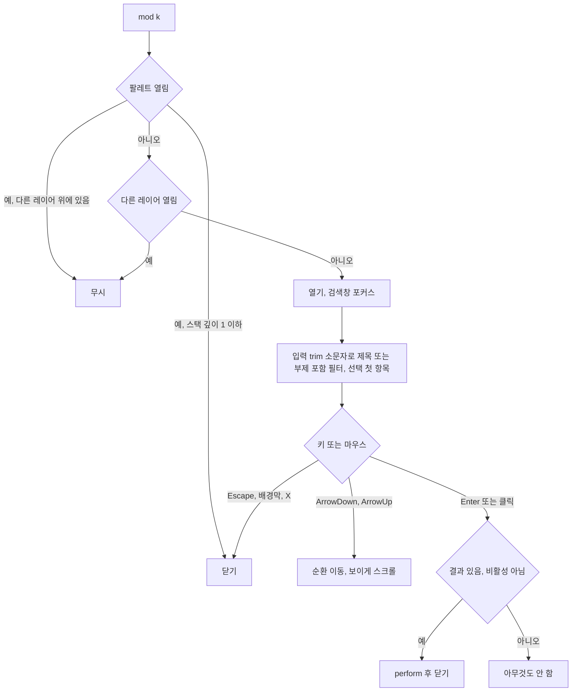

#### 4. 화면 표시 및 입력 데이터 항목 명세 (UI Data Elements - 8대 표준 컬럼)
| 항목명 | 화면 표시/입력 구분 | UI 컴포넌트 | 필수 여부 | 데이터 타입 / 제약 | 기본값 | 유효성 검증 규칙 (Validation) | 노출/수정 조건 |
| :--- | :---: | :--- | :---: | :--- | :---: | :--- | :--- |
| 검색어 | 사용자 입력 | combobox 입력 (`aria-label="명령어 검색"`, 자리표시 `명령어 검색 또는 바로가기`) | 선택 | String | `''` | 앞뒤 공백 제거·소문자로 제목 또는 부제 포함 | 열리면 포커스. 자리표시는 360px 화면의 입력 폭 안에 들어간다 |
| 명령 목록 | 사용자 선택 | listbox (`aria-label="명령어 목록"`), 항목 option (아이콘, 제목, 부제, 단축키 표시) | - | 피드 9개 / 챗 4개 (BR-1, BR-2) | 전체 | - | 상시. 선택 항목 강조 |
| 결과 없음 | 노출 전용 | 안내 글자 | - | `검색된 명령어가 없습니다.` | - | - | 결과 0건 |
| 닫기 | 사용자 조작 | 머리줄 아이콘 버튼 `닫기` | - | - | - | - | 상시 |
| 바닥 안내 | 노출 전용 | `↑↓ 탐색`, `↵ 실행`, `Esc 닫기` | - | - | - | - | 640px 이상. 단축키 표시도 640px 이상 |

#### 5. 비즈니스 규칙 (Business Rules)
- **BR-UI-007-1 (피드 명령, 표시 순서)** (`frontend/src/components/CommandPalette.tsx:81-165`). 선택적 명령은 해당 동작을 넘겼을 때만 붙는다.

  | id | 제목 | 부제 | 실행 | 단축키 표시 |
  |---|---|---|---|---|
  | chat | AI 챗 워크스페이스 이동 | 기술 소식 기반 심층 질의응답 및 에이전틱 리서치 | `/chat` 이동 | 없음 |
  | theme | 현재 모드에 따라 바뀜 (BR-3) | 시스템 및 개인 선호 테마 순환 토글 (Light -> Dark -> System) | 테마 순환 | T |
  | sources | 소스 관리 & AI 리서처 열기 | RSS 피드 및 GitHub 소스 등록, 자율 소스 탐색 | 소스 & 리서처 열기 | 없음 |
  | mcp | FastMCP 도구 설정 열기 | Claude Desktop 및 에이전트 연동 가이드 | MCP 연동 열기 | 없음 |
  | collect | 최신 소식 즉시 수집 트리거 | 등록된 모든 소스에서 즉시 신규 기술 소식 크롤링 | 즉시 수집 (FUNC-UI-002) | 없음 |
  | schedule | 수집 스케줄 보기 | 자동 수집 주기와 다음 예정 시각 | 스케줄 열기 | 없음 |
  | settings | 공유 & 알림 설정 열기 | Notion · 이메일 · 웹훅 브리핑 연동 | 공유 & 알림 설정 열기 | 없음 |
  | rss | RSS 피드 열기 | 새 탭에서 RSS 피드 주소를 엽니다 | `window.open(rssUrl, '_blank', 'noopener,noreferrer')` | 없음 |
  | reset | 수집 데이터 초기화 & 재수집 | 저장된 소식을 모두 지우고 처음부터 다시 수집 (확인 후 실행). 수집 중이면 `수집 중에는 초기화할 수 없습니다` | 초기화 확인 창 (FUNC-UI-002). 수집 중이면 `aria-disabled`, 실행 안 됨 | 없음 |
- **BR-UI-007-2 (챗 명령)**: `뉴스 피드로 이동`(부제 `수집된 AI 에이전트 소식 목록으로 돌아갑니다`, `/` 이동), 테마 순환(제목 규칙 같음, 단축키 표시 없음), `새 대화 시작`(부제 `현재 대화를 닫고 빈 대화로 시작합니다`), `대화 기록 열기`(부제 `저장된 대화 목록을 엽니다`, 1024px 이상은 사이드바 열기, 미만은 드로어 열기) (`frontend/src/components/chat/ChatWorkspace.tsx:543-583`).
- **BR-UI-007-3 (테마 명령 제목)**: `light` 이면 `다크 모드로 전환`, `dark` 이면 `시스템 모드로 전환`, `system` 이면 `라이트 모드로 전환 (현재 시스템)`. 아이콘도 현재 모드(해·달·노트북)를 따른다.
- **BR-UI-007-4 (실행 후 닫기)**: 명령을 실행하면 수행 뒤 팔레트를 닫는다. 비활성 명령은 수행하지 않고 닫지도 않는다 (`frontend/src/components/CommandPalette.tsx:189-193`).
- **BR-UI-007-5 (검색)**: 입력값을 앞뒤 공백 제거·소문자로 바꿔 제목 또는 부제에 포함되는 명령만 남긴다. 빈 입력이면 전체. 입력이 바뀌면 선택을 첫 항목으로 되돌린다 (`frontend/src/components/CommandPalette.tsx:171-177`, `:222-225`).
- **BR-UI-007-6 (입력창 키)**: IME 조합 중 제외. `ArrowDown` 다음 항목(끝에서 처음으로), `ArrowUp` 이전 항목(처음에서 끝으로), `Enter` 선택 항목 실행(결과가 없으면 아무것도 안 함). 선택 항목은 목록 안에서 보이게 스크롤한다 (`frontend/src/components/CommandPalette.tsx:182-207`).
- **BR-UI-007-7 (마우스)**: 항목 위에서 움직이면 그 항목이 선택되고, 클릭하면 실행한다.
- **BR-UI-007-8 (⌘K)**: 화면 헤더가 처리한다. 팔레트가 열려 있고 오버레이 스택 깊이가 1 이하(팔레트가 맨 위)면 닫고, 다른 레이어가 열려 있으면 무시하고, 아무것도 없으면 연다. 입력창 안에서도 동작한다 (`frontend/src/components/Header.tsx:69-81`, `frontend/src/components/chat/ChatHeader.tsx:62-75`).
- **BR-UI-007-9 (닫기)**: Escape(오버레이 스택), 배경막 클릭, 머리줄 X(`닫기`), ⌘K. 닫힘 안내는 머리줄 `닫기` 버튼과 바닥줄 `Esc 닫기`(640px 이상)가 알린다.
- **BR-UI-007-10 (배치)**: 대화상자 `md`, 위쪽 배치, `aria-label="커맨드 팔레트"`. 768px 미만은 화면 전체, 이상은 위에서 `12dvh`, 너비 560px, 최대 높이 `85dvh` (`frontend/src/components/CommandPalette.tsx:235-314`).
- **BR-UI-007-11 (초기화)**: 닫히면 내용이 언마운트되어 검색어와 선택이 초기화된다 (`frontend/src/components/CommandPalette.tsx:55-58`).

#### 6. 예외 처리 및 엣지 케이스 (Edge Cases & Exception Handling)
| 발생 상황 (Edge Case Scenario) | 화면 반응 및 시스템 처리 방식 | 사용자 안내 메시지 |
| :--- | :--- | :--- |
| 결과 없음 | 안내를 보이고 Enter 는 아무것도 안 함 | `검색된 명령어가 없습니다.` |
| 테마 명령 옆 `T` | 피드 화면의 전역 `t` 키를 뜻한다. 팔레트가 열려 있는 동안에는 입력창에 포커스가 있어 `T` 는 검색어로 들어간다 | (없음) |
| 메뉴·대화상자 등 다른 레이어가 열림 | ⌘K 로 팔레트를 열 수 없다 | (없음) |
| 수집 중 초기화 명령 | 보이지만 흐리게, 실행되지 않음 | `수집 중에는 초기화할 수 없습니다` (부제) |

#### 7. 비즈니스 에러 코드 매핑
| 비즈니스 에러 코드 | 발생 사유 | HTTP 상태 코드 매핑 | 클라이언트 표시 형태 |
| :--- | :--- | :---: | :--- |
| 없음 | 팔레트 자체는 서버를 부르지 않는다. 실행된 명령의 오류는 각 기능(FUNC-UI-002 등)을 따른다 | - | - |

- 근거: `frontend/src/components/CommandPalette.tsx:1-316`, `frontend/src/components/Header.tsx:69-81`, `:185-199`, `:209-220`, `frontend/src/components/chat/ChatHeader.tsx:62-75`, `:92-94`, `:129-136`, `frontend/src/components/chat/ChatWorkspace.tsx:543-583`, 동작 확인 테스트 `frontend/src/tests/CommandPalette.test.tsx`

---

### [FUNC-UI-008] 대화상자·오버레이 공통 규칙

#### 1. 기본 정보
- **기능명**: 대화상자·드로어·시트·확인 창·메뉴·팝오버의 열기/닫기, 포커스, 배경, 레이어, 폭별 배치
- **기능 ID**: `FUNC-UI-008`
- **대응 요구사항 ID**: `REQ-UI-006` (옛 기능명세 `UI-08`)
- **대상 화면 코드**: `SCR-UI-004`
- **우선순위**: Must Have
- **관련 액터 (Actor)**: 모든 사용자
- **진입점**: 각 대화상자의 여는 버튼 (목록은 위 '대화상자·드로어·시트·팝오버').

#### 2. 사전 조건 (Pre-conditions)
1. 각 대화상자는 열림 여부와 닫기 동작을 부모에게서 받는다. 홈 화면은 대화상자 열림 6개(상세, 브리핑, 스케줄, MCP, 공유 & 알림, 소스), 헤더는 팔레트·초기화 확인 창, 챗 화면은 드로어·바텀시트·팔레트 열림을 가진다.

#### 3. 사용자 인터랙션 및 시스템 동작 흐름과 플로우차트
1. 열리면 문서 끝에 그리고(포털), 오버레이 스택에 올리고, 배경을 비활성(`inert`)으로 만들고, 스크롤을 잠그고, 포커스를 안으로 옮긴다.
2. Escape 는 맨 위 레이어 하나만 닫는다. 배경막·닫기 버튼은 종류별 규칙을 따른다.
3. 닫히면 스택에서 빼고, 배경 `inert`·스크롤 잠금을 풀고, 연 요소로 포커스를 돌려준다.

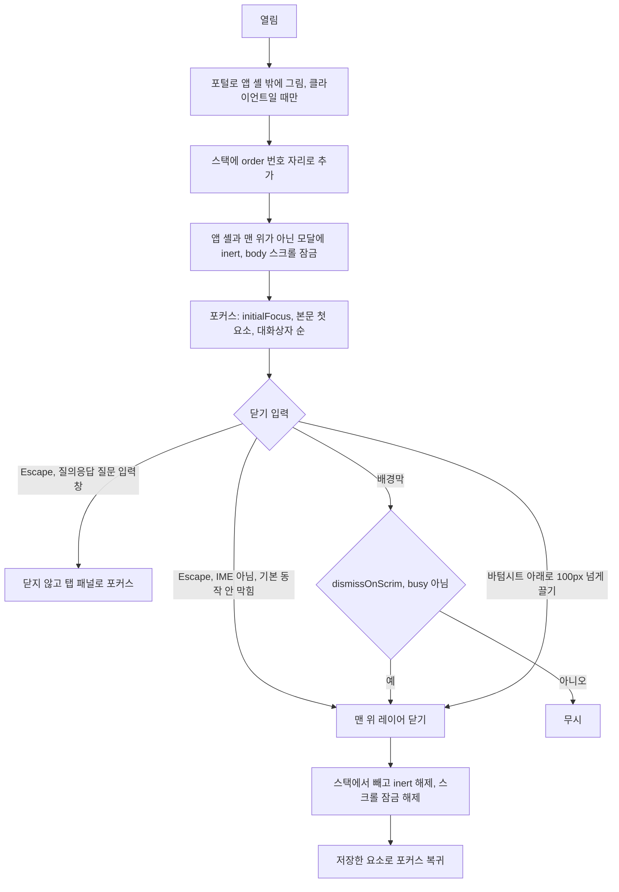

#### 4. 화면 표시 및 입력 데이터 항목 명세 (UI Data Elements - 8대 표준 컬럼)
| 항목명 | 화면 표시/입력 구분 | UI 컴포넌트 | 필수 여부 | 데이터 타입 / 제약 | 기본값 | 유효성 검증 규칙 (Validation) | 노출/수정 조건 |
| :--- | :---: | :--- | :---: | :--- | :---: | :--- | :--- |
| 열림 | 시스템 제어 | 대화상자 | 필수 | Boolean | false | - | 부모가 가진다 |
| 크기 | 시스템 제어 | 대화상자 | - | `sm` 420 / `md` 560 / `lg` 720 / `xl` 896px (768px 이상) | `md` | 화면 폭 - 3rem 을 넘지 않음 | 768px 이상 |
| 모바일 배치 | 시스템 제어 | 대화상자 | - | `fullscreen`, `sheet` | `fullscreen` (`sm` 은 `sheet`) | - | 768px 미만 |
| 배경막 닫기 | 시스템 제어 | 배경막 | - | Boolean | true (입력 폼 false) | - | - |
| 진행 중 | 시스템 제어 | `aria-busy` | - | Boolean | false | 진행 중이면 Escape·배경막·닫기 버튼 무시 | - |
| 머리줄 닫기 | 사용자 조작 | 아이콘 버튼 | - | 접근 이름 기본 `닫기` | `닫기` | - | 제목이 있는 기본 머리줄 |
| 끌기 손잡이 | 노출 전용 | 장식 막대 | - | - | - | - | 바텀시트, 768px 미만 |

#### 5. 비즈니스 규칙 (Business Rules)
- **BR-UI-008-1 (공통 프레임)**: 대화상자, 드로어, 확인 창은 같은 프레임을 쓴다. 문서 `body` 에 포털로 `#app-shell` 밖에 그리고, 열려 있고 클라이언트일 때만 그린다(닫히면 내용이 언마운트된다) (`frontend/src/components/ui/Dialog.tsx:125-249`).
- **BR-UI-008-2 (오버레이 스택)**: 대화상자·드로어·확인 창은 `modal`, 메뉴·팝오버는 `popover` 레이어로 열릴 때 스택에 올라가고 닫히면 빠진다. 스택이 비어 있지 않을 때만 `window` keydown 리스너 하나가 달린다. Escape(IME 조합 중·이미 기본 동작이 막힌 이벤트 제외)는 맨 위 레이어의 닫기만 부르고 기본 동작을 막는다. 컴포넌트별 Escape 리스너는 없다 (`frontend/src/lib/overlay-stack.ts:47-55`, `:199-229`).
- **BR-UI-008-3 (쌓는 순서)**: 레이어마다 순서 번호(`order`)가 있고 스택은 번호 오름차순이다. 열림이 false→true 로 바뀌는 렌더에서 번호를 받는다. 부모가 자식보다 먼저 렌더되므로 부모·자식 대화상자를 같은 렌더에서 함께 열어도 자식이 맨 위다 (자식 effect 가 먼저 스택에 올라가도 번호 자리에 들어간다). 닫았다 다시 열면 새 번호를 받아 맨 위가 된다. 맨 위 판정, `inert`, Escape 는 이 순서를 본다 (`frontend/src/lib/overlay-stack.ts:104-116`, `:203-210`).
- **BR-UI-008-4 (Escape 예외)**: 뉴스 상세 `AI 질의응답` 탭의 질문 입력창에서 누른 Escape 는 대화상자를 닫지 않는다. IME 조합 중이 아니면 기본 동작을 막고(스택이 무시한다) 포커스를 질의응답 탭 패널로 옮긴다. 입력한 글자와 대화 기록은 그대로다. 패널에서 다시 누른 Escape 는 맨 위 레이어(상세 대화상자)를 닫는다 (`frontend/src/components/news-detail/AskAiPanel.tsx:90-98`).
- **BR-UI-008-5 (속성)**: `role="dialog"`(확인 창 `alertdialog`), `aria-modal="true"`, 제목 `h2` 로 `aria-labelledby`(제목이 없으면 `aria-label`), 설명이 있으면 `aria-describedby`, 진행 중이면 `aria-busy` (`frontend/src/components/ui/Dialog.tsx:200-213`).
- **BR-UI-008-6 (포커스)**: 열 때 이전 포커스 요소를 저장하고 처음 포커스 지정 요소 → 본문의 첫 포커스 가능 요소 → 대화상자(`tabIndex={-1}`) 순으로 포커스한다. Tab/Shift+Tab 은 대화상자 안에서 돈다. 닫으면 저장한 요소로 돌려준다 (`frontend/src/hooks/useFocusTrap.ts`).
- **BR-UI-008-7 (배경)**: 모달이 하나라도 열려 있으면 `#app-shell` 에 `inert`, 맨 위가 아닌 모달에도 `inert` 를 단다. `body` 스크롤은 참조 수로 잠가 마지막 모달이 닫힐 때 풀린다. 알림 영역은 `#app-shell` 밖이라 가려지지 않는다 (`frontend/src/lib/overlay-stack.ts:68-96`, `frontend/src/hooks/useScrollLock.ts`).
- **BR-UI-008-8 (배경막)**: 반투명 배경막(라이트 `rgb(15 23 42 / 0.45)`, 다크 `rgb(0 0 0 / 0.6)`), 페이드 인 (`frontend/src/components/ui/Dialog.tsx:194-199`, `frontend/src/app/globals.css:33`, `:62`).
- **BR-UI-008-9 (레이어 순서)**: 피드 필터 영역 < 챗 사이드바 < 헤더(`/`, `/chat`) < 메뉴·팝오버 < 대화상자·드로어·시트 < 알림. 겹친 대화상자는 나중에 포털에 붙은 것이 위다 (예: 일일 브리핑 위의 공유 & 알림 설정, 스케줄 위의 초기화 확인 창).
- **BR-UI-008-10 (폭별 배치)** (`frontend/src/components/ui/Dialog.tsx:89-115`):

  | 폭 | 기본 (`fullscreen`) | 바텀시트 (확인 창, 포커스 필터) | 위쪽 배치 (팔레트) | 드로어 |
  |---|---|---|---|---|
  | 768px 미만 | 화면 전체(`h-dvh`), 머리줄 56px, 본문 스크롤, 바닥 고정 + 아래 여백 `max(0.75rem, env(safe-area-inset-bottom))` | 아래 바텀시트, 위 모서리 둥금, 끌기 손잡이, 최대 `90dvh` | 화면 전체, 검색창 맨 위 | 왼쪽, 너비 `min(320px, 85vw)`, 높이 전체 |
  | 768px 이상 | 가운데, 크기별 너비(화면 - 3rem 이하), 최대 높이 `85dvh`, 머리줄·바닥 고정, 본문 스크롤 | 가운데 (420px) | 위에서 `12dvh`, 560px | 같음 |
- **BR-UI-008-11 (대화상자별 크기)**: 뉴스 상세·일일 브리핑·소스 & 리서처 `xl`, MCP `lg`, 공유 & 알림 설정·스케줄·팔레트 `md`, 확인 창·포커스 필터 `sm`.
- **BR-UI-008-12 (닫기 수단)**:

  | 종류 | Escape | 배경막 클릭 | 닫기 버튼 | 기타 |
  |---|---|---|---|---|
  | 읽기 위주 (뉴스 상세, 일일 브리핑, 스케줄, MCP, 커맨드 팔레트, 대화 기록 드로어, 포커스 필터) | 닫힘 | 닫힘 | 머리줄 X `닫기` (드로어 `대화 기록 드로어 닫기`, 포커스 필터 `필터 닫기`), 일일 브리핑·MCP 바닥 `닫기` | 팔레트 ⌘K, 드로어는 세션 선택·새 대화 때, 포커스 필터는 `적용하기`·아래로 100px 스와이프 |
  | 입력 폼 (공유 & 알림 설정, 소스 & 리서처) | 닫힘 | 안 닫힘 | 머리줄 X, 바닥 `닫기` | — |
  | 확인 창 | 닫힘 (진행 중이면 무시) | 닫힘 (진행 중이면 무시) | `취소`, 머리줄 X `닫기` (진행 중이면 비활성) | 처음 포커스는 `취소` |
  | 메뉴 | 닫힘, 트리거로 포커스 | 바깥 pointerdown | — | Tab, 항목 실행 |
  | 팝오버 (모델 선택, 인용 출처, 세션 삭제 확인) | 닫힘, 트리거로 포커스 | 바깥 pointerdown | 인용 `팝오버 닫기`, 삭제 확인 `취소` | 모델 선택은 고르면 닫힘 |
- **BR-UI-008-13 (애니메이션)**: 대화상자 200ms, 바텀시트 240ms, 드로어 240ms, 메뉴·팝오버 페이드 150ms. 모두 사용자가 동작 줄이기를 켜지 않았을 때만 (`motion-safe`).
- **BR-UI-008-14 (끌어 닫기)**: 바텀시트는 시트 위에서 아래로 100px 넘게 끌면 닫힌다 (진행 중 제외) (`frontend/src/components/ui/Dialog.tsx:25`, `:179-190`).
- **BR-UI-008-15 (확인 창 사용)**: 확인이 필요한 동작은 브라우저 기본 대화상자 대신 확인 창을 쓴다: 소스 삭제(`이 소스를 목록에서 삭제하시겠습니까?`), Ask AI 대화 초기화(`AI 대화 내역을 모두 초기화하시겠습니까?`), 초기화 & 재수집 (FUNC-UI-002).
- **BR-UI-008-16 (상태 보존)**: 뉴스 상세 대화상자는 닫을 때와 닫힌 동안 열림/기사 id 가 바뀔 때 탭·질문·대화 기록·복사 표시를 초기화하고 진행 중인 스트리밍 요청을 중단한다 (`frontend/src/components/NewsDetailModal.tsx:62-117`). 다른 대화상자 컴포넌트는 마운트된 채라 내부 상태가 남는 것이 있다 (예: 일일 브리핑의 보기 탭).

#### 6. 예외 처리 및 엣지 케이스 (Edge Cases & Exception Handling)
| 발생 상황 (Edge Case Scenario) | 화면 반응 및 시스템 처리 방식 | 사용자 안내 메시지 |
| :--- | :--- | :--- |
| 입력창 안 Escape | 맨 위 대화상자를 닫는다. 뉴스 상세 `AI 질의응답` 탭 질문 입력창만 예외(BR-4). 질의응답 탭 패널에서 Escape 로 닫으면 BR-16 대로 대화 기록이 지워진다 | (없음) |
| 팝오버·메뉴 | 포털 없이 트리거 옆에 그려 부모의 쌓임 맥락 안에 있다 | (없음) |
| 768px 이상에서 포커스 필터를 터치로 끌기 | 끌어 닫기는 폭을 보지 않아, 가운데에 뜬 포커스 필터도 아래로 100px 끌면 닫힌다 | (없음) |
| 챗 기록 드로어를 연 채 1024px 이상으로 넓힘 | 드로어는 `열림 && 데스크톱 아님` 일 때만 열린다. 넓히면 닫혀 보이고, 다시 좁히면 다시 열린다 (`frontend/src/components/chat/ChatWorkspace.tsx:702`) | (없음) |
| 하이드레이션 첫 렌더 | 포털을 그리지 않는다 (요소가 없다) | (없음) |

#### 7. 비즈니스 에러 코드 매핑
| 비즈니스 에러 코드 | 발생 사유 | HTTP 상태 코드 매핑 | 클라이언트 표시 형태 |
| :--- | :--- | :---: | :--- |
| 없음 | 서버 호출 없음 | - | - |

- 근거: `frontend/src/components/ui/Dialog.tsx:1-260`, `frontend/src/components/ui/Drawer.tsx`, `frontend/src/components/ui/ConfirmDialog.tsx`, `frontend/src/components/ui/Menu.tsx`, `frontend/src/components/ui/Popover.tsx`, `frontend/src/lib/overlay-stack.ts:1-229`, `frontend/src/hooks/useFocusTrap.ts`, `frontend/src/hooks/useScrollLock.ts`, `frontend/src/components/news-detail/AskAiPanel.tsx:90-98`, `frontend/src/app/page.tsx:94-100`, `:276-300`, 동작 확인 테스트 `frontend/src/tests/ui/Dialog.test.tsx`, `frontend/src/tests/ui/OverlayStack.test.tsx`, `frontend/src/tests/ui/Menu.test.tsx`, `frontend/src/tests/modals/NewsDetailModal.test.tsx`

---

### [FUNC-UI-009] 반응형 레이아웃

#### 1. 기본 정보
- **기능명**: 모바일·태블릿·데스크톱 배치, 요소 숨김, 가로 스크롤 방지, 가로 스크롤 줄
- **기능 ID**: `FUNC-UI-009`
- **대응 요구사항 ID**: `REQ-UI-002` (옛 기능명세 `UI-09`)
- **대상 화면 코드**: `SCR-UI-000`
- **우선순위**: Must Have
- **관련 액터 (Actor)**: 모든 사용자 (모든 기기)
- **진입점**: 모든 화면.

#### 2. 사전 조건 (Pre-conditions)
1. 입력은 뷰포트 너비다.

#### 3. 사용자 인터랙션 및 시스템 동작 흐름과 플로우차트
1. 화면 폭에 따라 CSS 가 배치를 바꾼다. JS 너비 판정이 필요한 곳은 `useMediaQuery` 만 쓴다.
2. 가로 스크롤 줄은 넘침 상태를 계산해 흐림·스크롤 버튼·넘침 표시를 붙이고, 선택 항목이 보이게 민다.

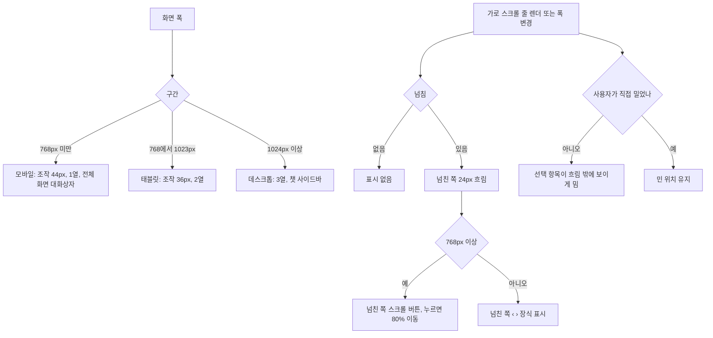

#### 4. 화면 표시 및 입력 데이터 항목 명세 (UI Data Elements - 8대 표준 컬럼)
| 항목명 | 화면 표시/입력 구분 | UI 컴포넌트 | 필수 여부 | 데이터 타입 / 제약 | 기본값 | 유효성 검증 규칙 (Validation) | 노출/수정 조건 |
| :--- | :---: | :--- | :---: | :--- | :---: | :--- | :--- |
| 구간 | 시스템 제어 | (CSS) | 필수 | sm 640, md 768, lg 1024, xl 1280px | - | 모바일 < 768, 태블릿 768~1023, 데스크톱 ≥ 1024 | 상시 |
| 조작 요소 높이 | 노출 전용 | 버튼·입력 | - | 모바일 44px, 768px 이상 36px | - | - | 상시 |
| 스크롤 버튼 | 사용자 조작 | `{줄 이름} 이전 항목 보기` / `{줄 이름} 다음 항목 보기` | - | 누르면 줄 폭의 80% 이동 | - | - | 768px 이상, 넘친 쪽 |
| 넘침 표시 | 노출 전용 | `‹`·`›` (`aria-hidden`) | - | - | - | - | 768px 미만, 넘친 쪽 |
| 넘침 상태 | 시스템 제어 | `data-overflow` | - | `none`·`start`·`end`·`both` | - | - | JS 로 정해 서버 렌더·첫 그림에는 없다 |

#### 5. 비즈니스 규칙 (Business Rules)
- **BR-UI-009-1 (너비 판정)**: JS 너비 판정은 `useMediaQuery` 만 쓴다: 피드 헤더 `(max-width: 767px)`, 챗 `(min-width: 1024px)`·`(min-width: 768px)`, 가로 스크롤 줄의 스크롤 버튼·넘침 표시 `(min-width: 768px)` (`frontend/src/components/Header.tsx:62`, `frontend/src/components/chat/ChatWorkspace.tsx:64`, `frontend/src/components/chat/ChatHeader.tsx:58-59`, `frontend/src/components/ui/ScrollRow.tsx`). 피드 툴바 배치는 JS 판정 없이 CSS 로만 바꾼다.
- **BR-UI-009-2 (홈 화면 배치)**:

  | 영역 | 768px 미만 | 768~1023px | 1024px 이상 |
  |---|---|---|---|
  | 본문 좌우 여백·최대 너비 | 16px, `max-w-7xl` | 24px | 32px |
  | 본문 영역 사이 세로 간격 (요약 바·검색 영역·필터 영역·목록 머리줄·그리드) | 12px, 위 여백 12px | 16px, 위 여백 24px | 같음 |
  | 헤더 (FUNC-UI-001) | 브랜드 + AI 챗·팔레트·더보기 아이콘 | + `피드`·`AI 챗` 글자, 수집 상태(남은 시간), 즉시 수집 아이콘, 테마 메뉴 | + 버전 배지, `다음 수집 … 후`, `즉시 수집` 글자, `검색·명령 ⌘K` |
  | 요약 바 | 브리핑 버튼(`오늘의 브리핑 · 헤드라인`, 날짜 숨김) + `트렌드` | + 날짜 | + 급상승 태그 칩 3개 |
  | 검색 영역 | 검색 입력 전체 폭, 44px. 고정하지 않음 | 전체 폭, 36px. 고정하지 않음 | 같음 |
  | 필터 영역 | 줄 1 카테고리 칩(아이콘 숨김, 화면 좌우 끝까지) / 줄 2 소스 칩(왼쪽 화면 끝까지) + `Must-Read` 토글(별 아이콘만, 44×44). 고정하지 않음 | 줄 1 카테고리 칩(아이콘 숨김) / 줄 2 소스 칩 + `Must-Read` 토글(별 + 글자). 헤더 아래 고정 | 1024~1279px 는 768~1023px 과 같다. 1280px 이상은 카테고리 칩 아이콘이 보인다. 고정. 필터 영역 안에 입력·선택 상자가 없다. `Must-Read` 토글은 소스 줄 밖, 같은 줄 오른쪽 끝이라 모든 폭 첫 화면에서 전체가 보인다 |
  | 목록 머리줄 | 상태 + 정렬(`w-28`, 44px) | 상태 + 정렬(`w-28`, 36px) | 1280px 이상 정렬 `w-32`. 모든 폭에서 DOM 순서 = 화면 순서 = Tab 순서 `검색 → 카테고리 → 소스 → Must-Read → 상태 → 정렬 → 카드`, 검색·필터 줄·머리줄의 양 끝이 콘텐츠 상자 끝과 같다 |
  | 칩 줄 | 한 줄 가로 스크롤. 넘친 쪽만 24px 흐림, 넘친 쪽마다 줄 밖에 `‹`(왼쪽)·`›`(오른쪽) 표시 | 넘친 쪽만 흐림 + 넘친 쪽에 스크롤 버튼 | 같음 |
  | 뉴스 카드 그리드 | 1열, 간격 16px | 2열 | 3열, 간격 20px. 카드 바닥 `AI 챗에서 분석` 글자는 모든 폭에서 보이고, 한 줄에 다 들지 않으면 버튼 묶음이 다음 줄로 내려간다 |
  | 페이지 이동 | 이전·다음이 반씩 차지 | 가운데 | 같음 |
- **BR-UI-009-3 (챗 화면 배치)**:

  | 영역 | 768px 미만 | 768~1023px | 1024px 이상 |
  |---|---|---|---|
  | 대화 기록 | 헤더 기록 버튼 → 왼쪽 드로어(`min(320px, 85vw)`) | 같음 | 왼쪽 고정 사이드바(288px), 기록 버튼은 사이드바 접기/펴기 |
  | 사이드바·드로어 머리 영역 | 1줄 `+ 새 대화`, 2줄 `대화 검색` (최소 44px) | 같음 (2줄 44px) | 1줄 56px(`+ 새 대화`, 접기) = 챗 헤더 높이, 2줄 44px(`대화 검색`) = 맥락 줄 높이. 아래 경계가 100px 로 헤더 + 맥락 줄 아래 경계와 같다 |
  | 챗 헤더 (56px, 한 줄, 왼쪽부터) | `←`(아이콘만, 맨 왼쪽), 기록, `AI 챗`, 새 대화, 더보기(+`커맨드 팔레트`) | `← 피드`(맨 왼쪽), 기록, `AI 챗`, 새 대화, 팔레트, 더보기 (모델 선택은 모든 폭에서 입력창 아래) | 같음. 새 대화는 사이드바를 접었을 때만 |
  | 맥락 줄 | 최소 44px, 가로 스크롤 줄 | 44px | 같음 |
  | 열 맞춤 (맥락 줄 스크롤 영역·메시지 열·입력 영역) | 바깥 16px, 안쪽 최대 768px 가운데 | 바깥 24px, 안쪽 같음 | 같음. 세 영역의 왼쪽 끝이 맞는다 |
  | 추천 질문 | 1열 (640px 이상 2열), 앞에 아이콘, 글자 왼쪽 정렬 | 2열 | 2열 |
  | 알림 | 입력 영역 바로 위(8px 띄움), 메시지 열 폭 안 | 같음 | 같음. 대화상자가 열려 있으면 전역 알림 영역 |
  | 포커스 필터 | 바텀시트 | 가운데 대화상자 (420px) | 같음 |
  | 입력창 안내 | `Enter: 전송, Shift+Enter: 줄바꿈` 숨김 | 숨김 | 보임 |
- **BR-UI-009-4 (새 대화 버튼)**: 표시 조건은 `데스크톱 아님 또는 사이드바 접힘` 이다. 1024px 미만에서는 늘 보인다 (`frontend/src/components/chat/ChatHeader.tsx:77`).
- **BR-UI-009-5 (가로 스크롤 방지)**: `<body>` 와 챗 루트에 가로 넘침 숨김 (`frontend/src/app/layout.tsx:34`, `frontend/src/components/chat/ChatWorkspace.tsx:602-605`).
- **BR-UI-009-6 (가로 스크롤 줄)**: 피드 카테고리·소스 칩 줄, 요약 바 급상승 칩, 챗 맥락 줄, 탭 목록, Ask AI 빠른 질문은 자체 가로 스크롤을 갖는다. 줄에는 넘침 상태 `data-overflow` 가 붙고 넘친 쪽만 24px 흐린다. 768px 이상은 넘친 쪽에 스크롤 버튼이 붙는다. 포커스를 가진 버튼이 사라지면(끝에 닿음, 폭이 768px 미만이 됨) 반대쪽 버튼 → 선택 항목 → 줄의 첫 포커스 가능 요소 순으로 포커스를 옮긴다. 768px 미만은 넘친 쪽마다 장식 표시(`aria-hidden`)가 붙는다: 왼쪽이 넘치면 줄 앞에 `‹`, 오른쪽이 넘치면 줄 뒤에 `›`. 버튼과 표시는 줄 밖 형제라 항목을 덮지 않고, 표시가 나타나고 사라져도 항목이 옆으로 움직이지 않는다. 줄 안 항목이 포커스를 받으면, 그리고 처음 그릴 때와 선택 항목(칩 `aria-pressed="true"`, 탭 `aria-selected="true"`, 피드 소스 줄은 선택 소스 칩 `[data-source-chip][aria-pressed="true"]`)이 바뀔 때 그 항목이 흐림 밖에 보이게 줄을 민다. 그 뒤 줄 폭(넘침 상태·스크롤 버튼·표시·화면 폭)이나 줄·항목 크기가 바뀌면, 그 선택 항목이 생긴 뒤 사용자가 줄을 직접 스크롤하지 않았을 때만 다시 보이게 민다.
- **BR-UI-009-7 (사용자 스크롤 판정)**: 사용자 스크롤은 입력 신호 뒤에 온 `scroll` 만이다.
  - 입력 신호: 줄 바깥 감싸개(스크롤 줄·스크롤 버튼·넘침 표시를 담은 요소)에서 받은 `pointerdown`·`touchstart`·`keydown`, 가로 의도의 `wheel`(`Math.abs(deltaX) > Math.abs(deltaY) || shiftKey`), 스크롤 버튼 클릭, 줄 안으로의 사용자 포커스 이동(`focusin`). 세로 휠(가로 성분이 세로 이하이고 Shift 없음)은 줄 위에서 페이지를 내리는 동작이라 입력 신호가 아니다. 그래서 sticky 툴바 위에서 페이지를 세로 휠로 내리는 동안 브라우저가 범위를 자르거나 스냅 위치로 다시 맞춘 `scroll` 은 사용자 스크롤로 기록되지 않는다. 스크롤 버튼이 사라질 때 이 부품이 옮긴 포커스는 입력 신호가 아니다.
  - 입력 신호를 받으면 '사용자 조작 중' 이 되고, 그동안 온 `scroll` 이 사용자 스크롤이다 (줄을 '사용자가 스크롤함' 으로 표시하고, 새 선택 항목이 생기면 지운다). '사용자 조작 중' 은 `scrollend` 에서 끝나고, `scrollend` 를 지원하지 않으면 마지막 `scroll` 뒤 150ms, 입력 뒤 1,000ms 안에 `scroll` 이 없으면 끝난다.
  - 입력 신호 없이 온 `scroll`(브라우저가 줄이 좁아져 범위를 자르거나 스냅 위치로 다시 맞춘 것, 다른 코드의 `scrollLeft` 변경)과 이 부품이 선택 항목을 보이려고 둔 값(1px 이내)의 `scroll` 은 사용자 스크롤이 아니다. 그래서 손대지 않은 줄은 폭이 바뀔 때마다 선택 항목이 다시 보이고, 손가락·가로 휠(Shift + 휠 포함)·버튼으로 민 줄은 폭이 바뀌어도 민 위치가 남는다.
- **BR-UI-009-8 (마크다운 영역)**: 마크다운 영역은 긴 토큰을 끊고, 코드 블록과 표만 자체 가로 스크롤을 갖는다 (FUNC-UI-012).
- **BR-UI-009-9 (한국어 줄바꿈)**: 모든 글자가 어절 단위로 줄을 바꾸고(`word-break: keep-all`), 긴 토큰은 넘칠 때만 끊는다 (`frontend/src/app/globals.css:125-134`). 마크다운·코드 영역은 자체 규칙이 이긴다. 카드 제목·뉴스 상세 제목은 어절 단위를 지키되 긴 토큰도 끊는다.
- **BR-UI-009-10 (챗 메시지 목록 스크롤, v0.4.2 FE-36)**: 챗 화면에서 세로로 스크롤되는 것은 메시지 목록 상자 하나다. 헤더·맥락 줄·입력 영역은 제자리에 있다. 새 내용(토큰·단계·구분선)이 오면 목록 상자의 `scrollTop` 을 맨 아래로 바꾼다. `scrollIntoView` 는 넘침이 숨겨진 바깥 상자까지 밀어 입력창을 화면 밖으로 밀어내므로 쓰지 않는다. 토큰마다 부드러운 스크롤을 걸지 않는다. 맨 아래에서 24px(`STICK_THRESHOLD_PX`) 이내를 보고 있을 때만 따라 내려가고, 위로 올려 읽는 중이면 그대로 둔다. 메시지 수가 바뀌면(질문 전송, 세션 열기) 따라가기를 다시 켜고 맨 아래로 간다. 목록 상자는 `relative` 라, 모바일에서 화면 읽기 전용으로 숨긴 라벨(절대 위치)이 바깥 열을 넘치게 하지 않는다 (`frontend/src/components/chat/ChatMessageList.tsx:20`, `:39-62`, `:113-126`). 인수 기준: (1) 360×640 화면에서 답변이 스트리밍되는 동안 입력창의 화면 위치가 바뀌지 않는다. (2) 목록을 맨 아래에서 100px 위로 올린 뒤 토큰이 더 와도 `scrollTop` 이 바뀌지 않는다. (3) 그 상태에서 새 질문을 보내면 목록이 맨 아래로 간다.

#### 6. 예외 처리 및 엣지 케이스 (Edge Cases & Exception Handling)
| 발생 상황 (Edge Case Scenario) | 화면 반응 및 시스템 처리 방식 | 사용자 안내 메시지 |
| :--- | :--- | :--- |
| 서버 렌더·하이드레이션 첫 렌더 | `useMediaQuery` 가 false. 챗 화면은 첫 렌더에서 데스크톱이 아닌 것으로 보고 그린 뒤 바로 바뀐다 | (없음) |
| 1024px 이상에서 사이드바 접음 | 사이드바(`chat-history-sidebar`)를 그리지 않는다. 기록 버튼은 그동안 `aria-controls` 를 달지 않는다 (FUNC-UI-014) | (없음) |
| 폭 변경 (피드) | 검색 영역·필터 영역·목록 머리줄은 같은 트리이고 CSS 로만 바뀌어, 서버 렌더·첫 렌더와 그 뒤의 배치·DOM 순서가 같다. 검색 입력·칩 줄·`Must-Read` 토글·정렬이 다시 마운트되지 않는다. 768px 미만 토글의 `Must-Read` 글자는 화면 읽기용으로 남아 접근 이름이 같다 (`frontend/src/components/feed/FeedToolbar.tsx:211-229`, `frontend/src/components/feed/FeedStatusBar.tsx:52-86`) | (없음) |
| 가로 스크롤 줄 첫 그림 | 넘침 상태·스크롤 버튼·`‹`·`›` 표시는 JS 로 정하므로 서버 렌더와 첫 그림에는 없다 | (없음) |
| 모바일 챗에서 답변 스트리밍 중 위로 올려 읽기 | 목록이 아래로 끌려가지 않는다. 맨 아래 24px 안으로 다시 내리면 따라가기가 다시 켜진다 (v0.4.2) | (없음) |
| 모바일 챗 스트리밍 중 입력창 위치 | 바깥 상자가 스크롤되지 않아 입력창이 밀려 올라가거나 사라지지 않는다 (v0.4.2 FE-36, 옛 동작은 `scrollIntoView` 가 바깥 상자까지 밀었다) | (없음) |

#### 7. 비즈니스 에러 코드 매핑
| 비즈니스 에러 코드 | 발생 사유 | HTTP 상태 코드 매핑 | 클라이언트 표시 형태 |
| :--- | :--- | :---: | :--- |
| 없음 | 서버 호출 없음 | - | - |

- 근거: `frontend/src/app/page.tsx:167-269`, `frontend/src/components/Header.tsx:122-205`, `frontend/src/components/feed/FeedToolbar.tsx:63-229`, `frontend/src/components/feed/FeedStatusBar.tsx:29-88`, `frontend/src/components/feed/InsightsBar.tsx:54-118`, `frontend/src/components/ui/ScrollRow.tsx:35-49`, `frontend/src/components/chat/ChatSidebarHeader.tsx:26-76`, `frontend/src/components/chat/ChatMessageList.tsx:20-126`, `frontend/src/components/chat/ChatWorkspace.tsx`, `frontend/src/components/chat/ChatHeader.tsx:77-151`, `frontend/src/components/chat/ChatContextBar.tsx:37-57`, `frontend/src/app/globals.css:125-134`, 동작 확인 테스트 `frontend/src/tests/ResponsiveLayout.test.tsx`, `frontend/src/tests/ui/ChipGroup.test.tsx`, `frontend/src/tests/feed/FeedToolbar.test.tsx`

---

### [FUNC-UI-010] 모바일 뷰포트·가상 키보드 대응

#### 1. 기본 정보
- **기능명**: 가상 키보드 높이 추종, 입력창 스크롤, safe-area 여백
- **기능 ID**: `FUNC-UI-010`
- **대응 요구사항 ID**: `REQ-UI-007` (옛 기능명세 `UI-10`)
- **대상 화면 코드**: `SCR-UI-000` (`/chat`, 루트 레이아웃, 768px 미만 대화상자)
- **우선순위**: Should Have
- **관련 액터 (Actor)**: 모바일 사용자
- **진입점**: 루트 레이아웃 viewport 설정, `/chat` 화면, 768px 미만 대화상자.

#### 2. 사전 조건 (Pre-conditions)
1. 입력은 뷰포트 크기와 `window.visualViewport` 다.

#### 3. 사용자 인터랙션 및 시스템 동작 흐름과 플로우차트
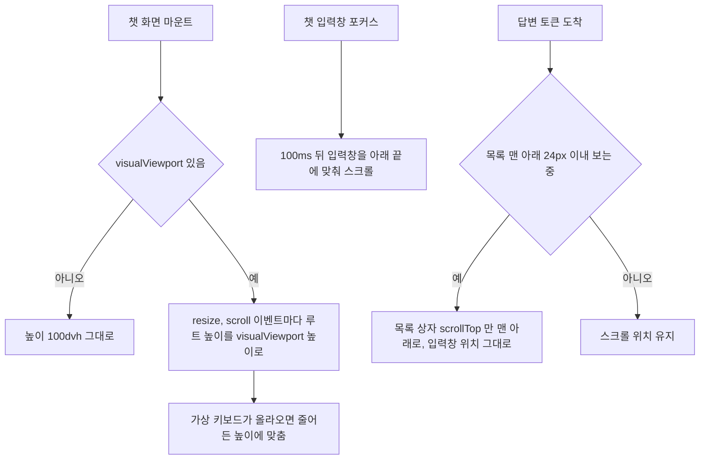

#### 4. 화면 표시 및 입력 데이터 항목 명세 (UI Data Elements - 8대 표준 컬럼)
| 항목명 | 화면 표시/입력 구분 | UI 컴포넌트 | 필수 여부 | 데이터 타입 / 제약 | 기본값 | 유효성 검증 규칙 (Validation) | 노출/수정 조건 |
| :--- | :---: | :--- | :---: | :--- | :---: | :--- | :--- |
| 챗 화면 높이 | 시스템 제어 | 챗 루트 | 필수 | CSS 길이 | `100dvh` | `{visualViewport.height}px` | `visualViewport` 가 있을 때 |
| 챗 입력창 글자 크기 | 노출 전용 | 텍스트 영역 | - | 640px 미만 16px, 이상 14px | - | iOS 자동 확대를 피함 | 상시 |
| 다른 입력 필드 글자 크기 | 노출 전용 | 텍스트 입력 | - | 768px 미만 16px | - | - | 상시 |
| 챗 입력창 높이 | 노출 전용 | 텍스트 영역 | - | 내용에 맞춰 늘고 최대 180px | - | - | 상시 |
| 아래 여백 | 노출 전용 | 하단 입력 영역, 전체 화면 대화상자 바닥 | - | `max(0.75rem, env(safe-area-inset-bottom))` | - | - | 상시 |

#### 5. 비즈니스 규칙 (Business Rules)
- **BR-UI-010-1 (viewport)**: `width=device-width`, `initialScale=1`, `interactiveWidget='resizes-content'`, `colorScheme: 'light dark'`, `themeColor` 라이트 `#f8fafc` / 다크 `#0e1013`. 확대를 막지 않는다 (`frontend/src/app/layout.tsx:6-15`).
- **BR-UI-010-2 (챗 페이지 높이)**: 챗 페이지 `<main>` 은 `100dvh` 다 (`frontend/src/app/chat/page.tsx:12`).
- **BR-UI-010-3 (가상 키보드)**: `visualViewport` 의 `resize`·`scroll` 이벤트마다 루트 높이를 `{visualViewport.height}px` 로 바꾼다. 처음 높이는 `100dvh` 이고, `visualViewport` 가 없으면 그대로 둔다 (`frontend/src/components/chat/ChatWorkspace.tsx:97`, `:115-132`, `:604`).
- **BR-UI-010-4 (입력창 포커스 스크롤)**: 포커스되면 100ms 뒤 입력창을 `scrollIntoView({ block: 'end' })` 한다. 사용자가 동작 줄이기를 켰으면 즉시, 아니면 부드럽게 (`frontend/src/components/chat/ChatPromptInput.tsx:44`, `:73-78`).
- **BR-UI-010-5 (입력창 높이)**: 최대 180px (`frontend/src/components/chat/ChatPromptInput.tsx:27`, `:96`, `frontend/src/components/ui/Textarea.tsx:51-54`).
- **BR-UI-010-6 (알림 위치)**: 전역 알림 영역은 768px 미만에서 아래 `max(1rem, env(safe-area-inset-bottom))` 에 뜬다 (`frontend/src/components/ui/Toast.tsx:250`). 챗 화면의 알림은 입력 영역 바로 위에 떠 입력창과 겹치지 않는다 (FUNC-UI-009).
- **BR-UI-010-7 (바텀시트)**: 아래로 100px 넘게 끌면 닫힌다 (FUNC-UI-008).
- **BR-UI-010-8 (모바일 챗 스크롤, v0.4.2 FE-36)**: 가상 키보드가 열려 루트 높이가 줄어도 스크롤은 메시지 목록 상자 안에서만 일어난다. 스트리밍 중 자동 따라가기는 목록 상자의 `scrollTop` 만 바꾸고 바깥 상자를 밀지 않아, 입력창이 키보드 위 제자리에 남는다. 입력창 포커스 때의 `scrollIntoView`(BR-4)는 그대로다. 세부 규칙과 인수 기준은 BR-UI-009-10.

#### 6. 예외 처리 및 엣지 케이스 (Edge Cases & Exception Handling)
| 발생 상황 (Edge Case Scenario) | 화면 반응 및 시스템 처리 방식 | 사용자 안내 메시지 |
| :--- | :--- | :--- |
| `visualViewport` 없는 브라우저 | `100dvh` 그대로 | (없음) |
| 키보드가 열린 채 답변 스트리밍 | 목록만 따라 내려가고 입력창은 키보드 위에 남는다 (v0.4.2) | (없음) |

#### 7. 비즈니스 에러 코드 매핑
| 비즈니스 에러 코드 | 발생 사유 | HTTP 상태 코드 매핑 | 클라이언트 표시 형태 |
| :--- | :--- | :---: | :--- |
| 없음 | 서버 호출 없음 | - | - |

- 근거: `frontend/src/app/layout.tsx:6-15`, `frontend/src/app/chat/page.tsx:10-24`, `frontend/src/components/chat/ChatWorkspace.tsx:115-132`, `:671`, `frontend/src/components/chat/ChatPromptInput.tsx:27-110`, `frontend/src/components/chat/ChatMessageList.tsx:39-62`, `frontend/src/components/ui/Dialog.tsx:241`, 동작 확인 테스트 `frontend/src/tests/chat/MobileViewport.test.tsx`

---

### [FUNC-UI-011] 로딩·오류·빈 상태 표시

#### 1. 기본 정보
- **기능명**: 데이터 영역별 스켈레톤·스피너, 오류 표시와 재시도, 빈 상태 안내
- **기능 ID**: `FUNC-UI-011`
- **대응 요구사항 ID**: `REQ-UI-006` (옛 기능명세 `UI-11`)
- **대상 화면 코드**: `SCR-UI-000` (피드, 챗 기록, 대화상자)
- **우선순위**: Must Have
- **관련 액터 (Actor)**: 모든 사용자
- **진입점**: 데이터를 읽는 각 영역.

#### 2. 사전 조건 (Pre-conditions)
1. 각 영역이 loading / error / 데이터 상태를 가진다.

#### 3. 사용자 인터랙션 및 시스템 동작 흐름과 플로우차트
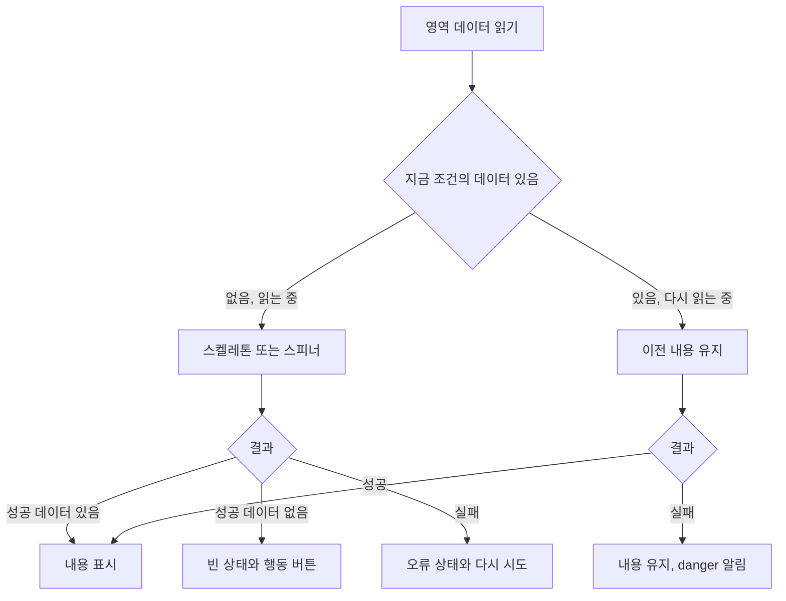

#### 4. 화면 표시 및 입력 데이터 항목 명세 (UI Data Elements - 8대 표준 컬럼)
| 항목명 | 화면 표시/입력 구분 | UI 컴포넌트 | 필수 여부 | 데이터 타입 / 제약 | 기본값 | 유효성 검증 규칙 (Validation) | 노출/수정 조건 |
| :--- | :---: | :--- | :---: | :--- | :---: | :--- | :--- |
| 피드 로딩 | 노출 전용 | 카드 스켈레톤 6장(`aria-hidden`) + 화면 읽기 `소식을 불러오는 중...` | - | - | - | - | 지금 목록 키의 응답이 없을 때만. 첫 렌더부터 |
| 피드 오류 | 노출 전용 | 오류 블록 (`role="alert"`) + `다시 시도` | - | 제목 오류 메시지(`API 오류 ({status}): {statusText}` 또는 `데이터를 불러오지 못했습니다.` 등), 안내 `백엔드 서버(포트 8000) 연결 상태를 확인해주세요.` | - | - | 목록 키가 바뀐 요청 실패 |
| 피드 다시 읽기 실패 | 노출 전용 | `danger` 알림 | - | 오류 메시지 | - | 실패마다 한 번 | 같은 목록 키 다시 읽기 실패 |
| 피드 빈 상태 | 사용자 조작 | 빈 상태 블록 + `필터 전체 초기화` | - | `조건에 일치하는 소식이 없습니다`, `다른 카테고리를 선택하거나 검색어 및 필터를 초기화해 보세요.` | - | - | 0건 |
| 요약 바 스켈레톤 | 노출 전용 | 48px 스켈레톤 | - | - | - | - | 첫 읽기 전이고 보여 줄 브리핑·레이더 없음 |
| 헤더 스케줄 미확인 | 노출 전용 | 글자 | - | `다음 수집 확인 중` | - | - | 스케줄 상태를 모를 때 |
| 공유 & 알림 설정 로딩 | 노출 전용 | 스피너 + `설정을 불러오는 중...` | - | - | - | - | 설정을 읽는 동안 |
| 소스 & 리서처 결과 | 노출 전용 | `aria-live` 안내 | - | 읽기 실패 `데이터를 불러오지 못했습니다.` | - | 3,500ms 뒤 사라짐 | 결과가 있을 때 |
| 스케줄 계산 중 | 노출 전용 | 글자 | - | `계산 중...` | - | - | 상태를 받기 전 |
| 버튼 진행 | 노출 전용 | 비활성 + `aria-busy` + 스피너 | - | - | - | - | 진행 중인 버튼 |
| 챗 기록 로딩 | 노출 전용 | 스켈레톤 5줄 (`role="status" aria-label="대화 기록을 불러오는 중..."`) | - | - | - | - | 로딩 중 |
| 챗 기록 오류 | 사용자 조작 | 오류 블록 + `다시 시도` | - | `대화 기록을 불러오지 못했습니다` + 오류 문구 | - | - | 오류이고 캐시 없음 |
| 챗 기록 빈 상태 | 노출 전용 | 빈 상태 (검색 결과 없음 / 대화 없음 구분) | - | - | - | - | 0건 |
| 챗 기사 없음 알림 | 노출 전용 | `warning` 알림 (`알림 닫기`) | - | `요청하신 기사를 찾을 수 없어 전체 소식 모드로 시작합니다.` | - | 3,500ms 뒤 사라짐 | URL `sourceId` 기사를 못 찾음 |
| 챗 페이지 대기 | 노출 전용 | 글자 | - | `워크스페이스 환경을 초기화하는 중...` | - | - | 챗 페이지 Suspense 대기 |

#### 5. 비즈니스 규칙 (Business Rules)
- **BR-UI-011-1 (피드 세 상태 배타)**: 로딩·오류·빈 상태(그리고 카드 그리드)는 서로 배타적이다. 로딩은 지금 목록 키(카테고리·소스·검색어·정렬·Must-Read·페이지)의 응답이 아직 없을 때만이다. 같은 목록 키를 다시 읽는 동안(수집 중 새 소식 저장, 수집 끝, 검색 제출, 소스 변경)에는 스켈레톤으로 바꾸지 않고 이전 카드·건수·페이지 이동을 그대로 그린다. 검색어는 입력이 300ms 멈춘 뒤에 목록 키에 들어간다 (FUNC-NEWS-005) (`frontend/src/app/page.tsx:214-268`, `frontend/src/hooks/useNewsFeed.ts:59-73`, `:153-170`).
- **BR-UI-011-2 (오류 다시 시도)**: `다시 시도` 는 오류를 지우고 다시 읽는다.
- **BR-UI-011-3 (빈 상태 초기화)**: `필터 전체 초기화` 는 카테고리·소스·검색어·Must-Read 를 초기화하고 1페이지로. 정렬은 그대로.
- **BR-UI-011-4 (페이지 이동)**: 로딩이 아니고 전체 페이지가 2 이상일 때만 나온다 (`frontend/src/components/feed/FeedPagination.tsx:17`).
- **BR-UI-011-5 (요약 바)**: 통계·브리핑·레이더 첫 읽기가 끝나기 전이고 보여 줄 브리핑·레이더가 없으면 바 전체가 48px 스켈레톤이다. 다시 읽는 동안에는 이전 브리핑·레이더를 그대로 그린다. 브리핑도 레이더 태그도 없으면 그리지 않는다. 레이더 태그가 없으면 `트렌드` 버튼과 급상승 칩이 빠진다. 세 요청은 `Promise.allSettled` 로 함께 읽어 하나가 실패해도 나머지를 반영하고, 실패는 화면에 표시하지 않는다 (통계 실패만 콘솔) (`frontend/src/hooks/useNewsFeed.ts:75-97`, `frontend/src/components/feed/InsightsBar.tsx:41-52`, `:77`).
- **BR-UI-011-6 (대화상자)**: 공유 & 알림 설정은 결과·실패를 인라인 알림으로 (`frontend/src/components/BriefingSettingsModal.tsx:336-345`). 소스 & 리서처 결과 안내는 대화상자 안 `aria-live` 영역에 보이고 3,500ms 뒤 사라진다 (`frontend/src/components/SourcesModal.tsx:73-74`, `:100-102`, `:200-211`). 스케줄은 상태를 받기 전 `계산 중...` (`frontend/src/components/ScheduleModal.tsx:55`). 일일 브리핑은 Notion·이메일 결과를 인라인 알림으로(실패면 해당 설정 열기 버튼).
- **BR-UI-011-7 (챗)**: 대화 목록 조회가 실패해도 localStorage 캐시가 있으면 오류 없이 캐시를 보여 준다 (`frontend/src/components/chat/useChatSessions.ts:83-97`). 메시지가 없으면 웰컴 화면과 추천 질문 4개를 보여 준다 (`frontend/src/components/chat/ChatMessageList.tsx:49-88`). URL 의 `sourceId` 기사를 찾지 못하면 `warning` 알림을 입력 영역 바로 위에 띄운다 (`frontend/src/components/chat/ChatWorkspace.tsx:42`, `:506`, `:519`). 챗 기록 목록 상태 (`frontend/src/components/chat/SessionList.tsx:35-60`, `frontend/src/components/chat/SessionListSkeleton.tsx:19-20`). 챗 페이지 Suspense 대기 문구 (`frontend/src/app/chat/page.tsx:13-19`).
- **BR-UI-011-8 (알림 자동 닫힘)**: 알림은 기본 3,500ms 뒤 닫힌다 (`frontend/src/components/ui/Toast.tsx:25`).
- **BR-UI-011-9 (화면 오류 경계, v0.4.2)**: 렌더 중 예외는 라우트 오류 경계가 받아 본문 자리에 `화면을 그리지 못했습니다` 오류 상태와 `다시 시도` 를 보인다 ('화면·라우트' 절). 인수 기준: 피드 카드 렌더가 예외를 던지면 헤더는 남고 본문에 이 제목과 `다시 시도` 버튼이 보이며, 예외 원문은 화면에 없다.
- **BR-UI-011-10 (응답 형식 검증, v0.4.2)**: API 응답은 zod 스키마로 확인하되 맞지 않아도 던지지 않고 받은 값으로 그린다 (개발 중에만 콘솔 경고). 그래서 계약에서 조금 벗어난 응답이 오류 상태를 만들지 않는다 (`frontend/src/lib/api.ts` `readJson`).
- **BR-UI-011-11 (소스 대화상자 첫 읽기 실패, v0.4.2)**: 받은 데이터가 없으면 0건 목록 대신 오류 상태와 `다시 시도` 를 보인다 (FUNC-SRC-002).

#### 6. 예외 처리 및 엣지 케이스 (Edge Cases & Exception Handling)
| 발생 상황 (Edge Case Scenario) | 화면 반응 및 시스템 처리 방식 | 사용자 안내 메시지 |
| :--- | :--- | :--- |
| 북마크 보기 | 서버를 부르지 않고 localStorage 목록을 거르므로 로딩·오류 상태가 없다 (`frontend/src/hooks/useNewsFeed.ts`) | (없음) |
| 챗 API 응답 지연 (v0.4.2 해결) | 챗 REST 호출은 8,000ms, 스트림은 첫 바이트 30,000ms 시간 제한이 있다. 넘으면 실패로 끝내 로딩이 계속되지 않는다 (`frontend/src/lib/chatApi.ts`, FSD02) | 스트림: `응답이 늦어 요청을 멈췄습니다. 다시 시도해 주세요.` |
| 렌더 중 예외 | 라우트 오류 경계 (BR-9) | `화면을 그리지 못했습니다` |

#### 7. 비즈니스 에러 코드 매핑
| 비즈니스 에러 코드 | 발생 사유 | HTTP 상태 코드 매핑 | 클라이언트 표시 형태 |
| :--- | :--- | :---: | :--- |
| `ERR_INVALID_PAYLOAD` / `ERR_SERVER_INTERNAL` 등 | 피드 목록 실패 | 400·500 등, 타임아웃 | 오류 상태 또는 `danger` 알림 (FUNC-NEWS-001) |
| `ERR_SERVER_INTERNAL` 등 | 챗 기록 목록 실패, 캐시 없음 | 비 2xx, 네트워크 | 오류 상태 `대화 기록을 불러오지 못했습니다` |
| `ERR_NOT_FOUND` | 챗 `sourceId` 기사 없음 | 404 | `warning` 알림 |
| (클라이언트) | 렌더 중 예외 | - | 라우트 오류 경계 |

- 근거: 위 각 줄, `frontend/src/app/error.tsx`, `frontend/src/components/ui/ErrorState.tsx`, `frontend/src/components/ui/EmptyState.tsx`, `frontend/src/components/ui/Skeleton.tsx`, `frontend/src/components/ui/Toast.tsx`, 동작 확인 테스트 `frontend/src/tests/hooks/useNewsFeed.test.tsx`, `frontend/src/tests/feed/InsightsBar.test.tsx`

---

### [FUNC-UI-012] 마크다운 렌더링

#### 1. 기본 정보
- **기능명**: GFM 마크다운을 스타일 입힌 요소로 그리고, 코드 블록에 복사 버튼을 단다
- **기능 ID**: `FUNC-UI-012`
- **대응 요구사항 ID**: `REQ-UI-006` (옛 기능명세 `UI-12`)
- **대상 화면 코드**: `SCR-UI-000`
- **우선순위**: Must Have
- **관련 액터 (Actor)**: 모든 사용자
- **진입점**: 마크다운 뷰어를 쓰는 곳 — 뉴스 상세 `상세 본문 요약`(`frontend/src/components/NewsDetailModal.tsx:379`), 일일 브리핑 `마크다운 전문` 탭(`frontend/src/components/DailyBriefingModal.tsx:410`), Ask AI 답변(`frontend/src/components/news-detail/AskAiPanel.tsx:220`). 챗 답변은 자체 설정을 쓰고 코드 렌더러와 줄바꿈 규칙만 가져다 쓴다 (`frontend/src/components/chat/ChatMessageItem.tsx:13`, `:285-287`).

#### 2. 사전 조건 (Pre-conditions)
1. 입력은 마크다운 문자열과 선택 클래스다.

#### 3. 사용자 인터랙션 및 시스템 동작 흐름과 플로우차트
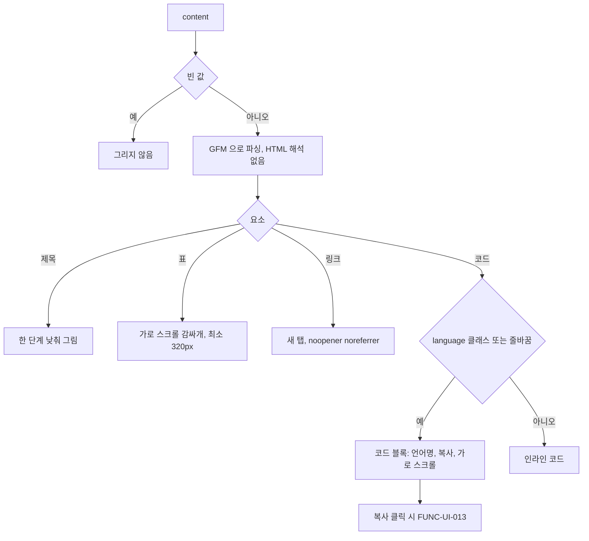

#### 4. 화면 표시 및 입력 데이터 항목 명세 (UI Data Elements - 8대 표준 컬럼)
| 항목명 | 화면 표시/입력 구분 | UI 컴포넌트 | 필수 여부 | 데이터 타입 / 제약 | 기본값 | 유효성 검증 규칙 (Validation) | 노출/수정 조건 |
| :--- | :---: | :--- | :---: | :--- | :---: | :--- | :--- |
| `content` | 노출 전용 | 마크다운 뷰어 | 필수 | String (GFM) | - | 빈 값이면 그리지 않음 | 값이 있을 때 |
| 코드 블록 머리줄 | 노출 전용 | 언어명 | - | `language-xxx` 의 xxx | `snippet` | - | 블록 코드 |
| 코드 블록 복사 | 사용자 조작 | 아이콘 버튼 | - | `복사` → `복사됨` / `복사 실패` (2,000ms) | `복사` | 끝 줄바꿈 하나를 뺀 원문 복사 | 블록 코드 |
| 코드 본문 | 사용자 조작 | `<pre tabIndex={0} aria-label="가로 스크롤 가능한 코드 블록">` | - | - | - | - | 키보드로 포커스 후 가로 스크롤 |

#### 5. 비즈니스 규칙 (Business Rules)
- **BR-UI-012-1 (파서)**: `react-markdown` + `remark-gfm`(표, 취소선, 자동 링크 등 GFM). HTML 을 해석하는 rehype 플러그인은 쓰지 않는다.
- **BR-UI-012-2 (바깥)**: 클래스 `markdown-viewer`, 전체 폭, 글자 14px, 긴 단어 끊기 (`frontend/src/components/MarkdownViewer.tsx:118-127`).
- **BR-UI-012-3 (제목)**: 한 단계씩 낮춰 그린다: `#` → `<h2>`, `##` → `<h3>`, `###` → `<h4>`, `####` → `<h5>`. `#`·`##` 는 아래 테두리가 있다 (`frontend/src/components/MarkdownViewer.tsx:58-75`).
- **BR-UI-012-4 (요소 모양)**: 목록 마커는 흐린 글자색, 인용은 왼쪽 강조색 4px 테두리·옅은 배경, 링크는 새 탭(`target="_blank" rel="noopener noreferrer"`)·강조색·아무 곳에서나 줄바꿈, `hr` 은 테두리 색 선, `strong` 은 semibold.
- **BR-UI-012-5 (표)**: 가로 스크롤 감싸개(`table-wrapper`, 둥근 테두리) 안에 최소 너비 320px, 글자 12px 표로 그린다 (`frontend/src/components/MarkdownViewer.tsx:93`).
- **BR-UI-012-6 (코드 판정)**: `pre` 는 감싸지 않고 자식만 넘긴다. `language-xxx` 클래스가 있거나 내용에 줄바꿈이 있으면 블록, 아니면 인라인 코드다. 인라인은 테두리 + 옅은 배경, 고정폭 12px, 아무 곳에서나 줄바꿈. 챗 답변은 인라인 클래스를 따로 넘긴다. 블록은 공통 코드 블록(바깥 클래스 `code-block-wrapper`) — 머리줄(언어명, 없으면 `snippet`)과 복사 버튼, 본문 가로 스크롤 (`frontend/src/components/MarkdownViewer.tsx:31-53`, `frontend/src/components/ui/CodeBlock.tsx:21-57`).
- **BR-UI-012-7 (복사)**: 끝 줄바꿈 하나를 뺀 원문을 복사하고 2,000ms 동안 `복사됨` 또는 `복사 실패` 를 보인다 (FUNC-UI-013).
- **BR-UI-012-8 (강조 없음)**: 문법 강조(syntax highlighting)는 없다.
- **BR-UI-012-9 (테마)**: 색은 모두 토큰이라 테마를 따로 처리하지 않는다 (FUNC-UI-003).

#### 6. 예외 처리 및 엣지 케이스 (Edge Cases & Exception Handling)
| 발생 상황 (Edge Case Scenario) | 화면 반응 및 시스템 처리 방식 | 사용자 안내 메시지 |
| :--- | :--- | :--- |
| 언어 표시 없는 한 줄짜리 펜스 코드 블록 | 줄바꿈이 없으면 판정 규칙상 인라인 코드로 그려질 수 있다 | (없음) |
| HTML 태그가 섞인 마크다운 | HTML 로 해석하지 않는다 | (없음) |

#### 7. 비즈니스 에러 코드 매핑
| 비즈니스 에러 코드 | 발생 사유 | HTTP 상태 코드 매핑 | 클라이언트 표시 형태 |
| :--- | :--- | :---: | :--- |
| 없음 | 서버 호출 없음 | - | - |

- 근거: `frontend/src/components/MarkdownViewer.tsx:1-134`, `frontend/src/components/ui/CodeBlock.tsx:1-59`, 동작 확인 테스트 `frontend/src/tests/ResponsiveLayout.test.tsx`

---

### [FUNC-UI-013] 복사 피드백

#### 1. 기본 정보
- **기능명**: 클립보드 복사(실패 시 대체 방식) 뒤 2초 동안 `복사됨`/`복사 실패` 표시
- **기능 ID**: `FUNC-UI-013`
- **대응 요구사항 ID**: `REQ-UI-008` (옛 기능명세 `UI-13`)
- **대상 화면 코드**: `SCR-UI-000`
- **우선순위**: Should Have
- **관련 액터 (Actor)**: 모든 사용자
- **진입점**: 코드 블록 `복사`(FUNC-UI-012, MCP 대화상자 설정 예시 포함), 일일 브리핑 `마크다운 복사`, 뉴스 상세 Ask AI 답변 `복사`, 챗 답변 `답변 복사`·`마크다운 복사`.

#### 2. 사전 조건 (Pre-conditions)
1. 입력은 복사할 문자열이다.

#### 3. 사용자 인터랙션 및 시스템 동작 흐름과 플로우차트
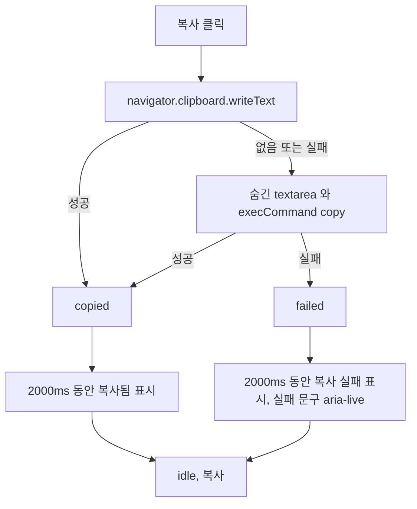

#### 4. 화면 표시 및 입력 데이터 항목 명세 (UI Data Elements - 8대 표준 컬럼)
| 항목명 | 화면 표시/입력 구분 | UI 컴포넌트 | 필수 여부 | 데이터 타입 / 제약 | 기본값 | 유효성 검증 규칙 (Validation) | 노출/수정 조건 |
| :--- | :---: | :--- | :---: | :--- | :---: | :--- | :--- |
| 복사 상태 문구 | 노출 전용 | 버튼 글자·아이콘 | - | Enum `복사` / `복사됨` / `복사 실패` | `복사` | - | 결과 뒤 2,000ms |
| 코드 블록 복사 | 사용자 조작 | 아이콘 버튼 (복사 → 체크 / 경고, 문구 `aria-live="polite"`) | - | - | - | - | 코드 블록 |
| 브리핑 `마크다운 복사` | 사용자 조작 | 버튼 → `복사됨` / `복사 실패` | - | - | - | - | 768px 미만은 `브리핑 작업` 메뉴 항목 |
| 챗 `답변 복사` | 사용자 조작 | 답변 머리줄 버튼 | - | - | - | - | 챗 답변 |
| 챗 `마크다운 복사` | 사용자 조작 | 내보내기 도구줄 버튼 | - | - | - | - | 챗 답변 |
| Ask AI 답변 복사 | 사용자 조작 | 버튼 (성공 체크 + `복사됨`, 실패 경고 아이콘 + `복사 실패`(위험 색)) | - | - | - | 스트리밍 중·빈 답 비활성 | 실패 문구는 버튼 옆 화면 읽기용 `aria-live="polite"` 영역에도 |

#### 5. 비즈니스 규칙 (Business Rules)
- **BR-UI-013-1 (복사 함수)**: `navigator.clipboard.writeText` 로 쓴다. 없거나 실패하면(권한 거부, 비보안 출처) 숨긴 `textarea` + `document.execCommand('copy')` 로 한 번 더 시도한다. 그래도 실패하면 false 다 (`frontend/src/hooks/useCopyToClipboard.ts:12-57`).
- **BR-UI-013-2 (공통 훅)**: 결과에 따라 상태를 `copied` 또는 `failed` 로 2,000ms 유지한 뒤 `idle` 로 되돌린다. 문구는 `복사` / `복사됨` / `복사 실패` (`frontend/src/hooks/useCopyToClipboard.ts:6-10`, `:70-111`).
- **BR-UI-013-3 (쓰는 곳)**: 코드 블록 (`frontend/src/components/ui/CodeBlock.tsx:22-46`), 일일 브리핑 (`frontend/src/components/DailyBriefingModal.tsx:65`, `:127-128`), 챗 답변 머리줄 (`frontend/src/components/chat/ChatMessageItem.tsx:38`, `:47`), 챗 내보내기 도구줄 (`frontend/src/components/chat/ExportToolbar.tsx:38`, `:53-57`, `:82-84`).
- **BR-UI-013-4 (Ask AI)**: Ask AI 답변 복사는 복사 함수를 바로 쓴다. 결과를 그 답변의 복사 버튼에 2,000ms 동안 보인다. 공통 훅과 같은 문구·시간이다. 새 결과가 나오면 앞 타이머를 지우고, 대화상자를 닫거나 언마운트하면 타이머를 정리한다 (`frontend/src/components/NewsDetailModal.tsx:217-237`, `frontend/src/components/news-detail/AskAiPanel.tsx:184-211`).

#### 6. 예외 처리 및 엣지 케이스 (Edge Cases & Exception Handling)
| 발생 상황 (Edge Case Scenario) | 화면 반응 및 시스템 처리 방식 | 사용자 안내 메시지 |
| :--- | :--- | :--- |
| 비보안 출처(HTTP LAN 접속) | 첫 방식이 실패하고 대체 방식에 기댄다 (알려진 문제) | 성공하면 `복사됨` |
| 두 방식 모두 실패 | 2,000ms 동안 실패 표시 | `복사 실패` |

#### 7. 비즈니스 에러 코드 매핑
| 비즈니스 에러 코드 | 발생 사유 | HTTP 상태 코드 매핑 | 클라이언트 표시 형태 |
| :--- | :--- | :---: | :--- |
| 없음 | 서버 호출 없음 | - | - |

- 근거: `frontend/src/hooks/useCopyToClipboard.ts:1-113`, 위 줄, 동작 확인 테스트 `frontend/src/tests/ui/useCopyToClipboard.test.tsx`, `frontend/src/tests/AskAiPanel.test.tsx`

---

### [FUNC-UI-014] 접근성 속성

#### 1. 기본 정보
- **기능명**: role, aria-* 속성, 키보드 조작 지원 범위
- **기능 ID**: `FUNC-UI-014`
- **대응 요구사항 ID**: `REQ-UI-003` (옛 기능명세 `UI-14`)
- **대상 화면 코드**: `SCR-UI-000`
- **우선순위**: Must Have
- **관련 액터 (Actor)**: 화면 읽기 프로그램·키보드 사용자
- **진입점**: 각 컴포넌트.

#### 2. 사전 조건 (Pre-conditions)
1. 없음.

#### 3. 사용자 인터랙션 및 시스템 동작 흐름과 플로우차트
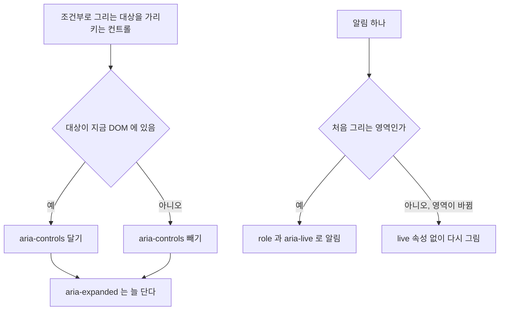

#### 4. 화면 표시 및 입력 데이터 항목 명세 (UI Data Elements - 8대 표준 컬럼)
| 항목명 | 화면 표시/입력 구분 | UI 컴포넌트 | 필수 여부 | 데이터 타입 / 제약 | 기본값 | 유효성 검증 규칙 (Validation) | 노출/수정 조건 |
| :--- | :---: | :--- | :---: | :--- | :---: | :--- | :--- |
| `aria-controls` | 시스템 제어 | 펼침·메뉴·탭·기록 버튼 | - | 대상 id | 없음 | 대상이 DOM 에 있을 때만 | 접힌 사이드바, 닫힌 드로어·메뉴·팝오버·폼, 그리지 않은 탭 패널이면 뺀다 |
| `aria-expanded` | 시스템 제어 | 같은 컨트롤 | 필수 | Boolean | false | - | 늘 단다 |
| 알림 live 속성 | 시스템 제어 | 알림 | - | `role`·`aria-live` | - | 처음 그려진 한 번만 | 영역이 바뀌면 빼고 그린다 |
| 건너뛰기 링크 | 사용자 조작 | `본문으로 건너뛰기` → `#main` | - | - | - | - | 포커스 때만 보임 |

#### 5. 비즈니스 규칙 (Business Rules)
- **BR-UI-014-1 (aria-controls)**: 가리키는 요소가 그 순간 DOM 에 있을 때만 단다. 조건부로 그리는 대상을 가리키는 컨트롤은 대상이 없을 때 속성을 빼고, `aria-expanded` 는 늘 단다.
- **BR-UI-014-2 (컴포넌트별 속성)**:

  | 컴포넌트 | 속성 |
  |---|---|
  | 대화상자 공통 (대화상자, 드로어, 확인 창) | `role="dialog"`(확인 창 `alertdialog`), `aria-modal="true"`, `aria-labelledby`(제목 `h2`) 또는 `aria-label`, `aria-describedby`, 진행 중 `aria-busy`, 닫기 `닫기`. 포커스 가두기·복귀, 배경 `inert` (FUNC-UI-008) |
  | 건너뛰기 링크 | `본문으로 건너뛰기` → `#main` (`main tabIndex={-1}`), 포커스 때만 보임 |
  | 피드 헤더 | `<nav aria-label="주 메뉴">`, 현재 쪽 `aria-current="page"`, 모바일 `AI 챗` 링크는 화면 읽기용 글자, 수집 상태 `aria-label="수집 스케줄 · 다음 수집 … 후"`, `커맨드 팔레트 열기`, `즉시 수집`, `테마 선택`, `더보기` |
  | 메뉴 | 트리거 `aria-haspopup="menu" aria-expanded`, 열렸을 때만 `aria-controls`, `role="menu"`, 항목 `menuitem` / `menuitemradio`(`aria-checked`), `separator`. 열면 첫 항목 포커스, ↑↓ 순환, Home·End, Enter·Space 실행, Escape 닫고 트리거로, Tab 닫기 |
  | 커맨드 팔레트 | `role="dialog" aria-label="커맨드 팔레트"`, 입력 `role="combobox" aria-label="명령어 검색" aria-expanded aria-controls aria-autocomplete="list" aria-activedescendant`, 목록 `role="listbox" aria-label="명령어 목록"`, 항목 `role="option" aria-selected`(비활성 `aria-disabled`) |
  | 상태 알림 | 수집 진행 줄·피드 목록 머리줄의 상태 `role="status" aria-live="polite"`(정렬은 그 밖 형제), 알림 `role="status" aria-live="polite"`(오류 `role="alert" aria-live="assertive"`, 닫기 `알림 닫기`), 인라인 알림·오류 블록 오류 `role="alert"`. 알림 하나는 처음 그려진 한 번만 `role`·`aria-live` 를 갖는다: 그리는 영역이 바뀌어(챗 입력 영역 위 ↔ 전역, 대화상자가 열리고 닫힐 때) 다시 그려지면, 처음 영역으로 돌아와도 같은 글자·닫기 버튼을 live 속성 없이 그려 화면 읽기 프로그램이 다시 읽지 않는다. 새 알림은 지금 영역에서 알린다 (`frontend/src/components/ui/Toast.tsx:32-37`, `:201-225`) |
  | 피드 검색·필터·목록 머리줄 | 검색 영역 `<form role="search">` + 화면 읽기용 라벨 `키워드 검색` + `검색어 지우기`, 필터 영역 칩 묶음 `role="group" aria-label`(`카테고리`, `소스`) + 칩 `aria-pressed`, `Must-Read` 토글 `aria-pressed`, 목록 머리줄 정렬 `<select>` 화면 읽기용 라벨 `정렬` |
  | 가로 스크롤 줄 | 768px 이상 스크롤 버튼 `{줄 이름} 이전 항목 보기`/`{줄 이름} 다음 항목 보기`(줄 밖 형제라 그룹 안 버튼 수를 바꾸지 않는다). 포커스를 가진 버튼이 사라지면 포커스가 `body` 로 빠지지 않게 반대쪽 버튼 → 선택 항목 → 줄의 첫 포커스 가능 요소로 옮긴다 (사용자가 먼저 다른 곳으로 옮겼으면 그대로). 768px 미만 넘침 표시 `‹`·`›` 와 보이지 않는 표시 자리는 `aria-hidden` 장식(포커스·이름 없음) |
  | 요약 바 | `트렌드` 버튼 `aria-expanded aria-controls`(패널 자리는 접혀도 `hidden` 으로 DOM 에 있다), 패널 `aria-label="트렌드 레이더"`, 급상승 칩 줄 `role="group" aria-label="급상승 태그"` |
  | 뉴스 카드 | `<article>` + 제목 `h3 > button`(Tab, Enter·Space), 북마크 `보관하기` + `aria-pressed`(`title` `보관하기`/`보관됨`), 바닥 통계 화면 읽기용 `스타`·`포인트`·`추천`·`포크`·`댓글`·`인기 점수`, `AI 챗에서 분석` 은 접근 이름 = 보이는 글자, `원문` 링크에 화면 읽기용 `(새 탭)` |
  | 페이지 이동 | `<nav aria-label="페이지 이동">` |
  | 탭 | `role="tablist" aria-label`, `role="tab" aria-selected`, 패널이 DOM 에 있는 탭(선택된 탭, 숨겨 둔 패널의 탭)에만 `aria-controls`, 로빙 `tabIndex`, ←/→ 순환·Home·End(자동 활성화), `role="tabpanel" aria-labelledby tabIndex={0}` |
  | 뉴스 상세 `AI 질의응답` 탭 | 빠른 질문 `role="group" aria-label="빠른 질문"`(버튼 안 아이콘 `aria-hidden`), 질문 입력 화면 읽기용 라벨 `질문 입력`(입력 중 Escape 는 패널로 포커스, FUNC-UI-008), 답변 복사 실패 문구 화면 읽기용 `aria-live="polite"` (FUNC-UI-013) |
  | 일일 브리핑·소스 & 리서처 | `이메일 발송`·`새 피드 직접 등록` 은 `aria-expanded`, 폼이 열렸을 때만 `aria-controls` |
  | 스위치 | `button role="switch" aria-checked` |
  | 코드 블록 | `<pre tabIndex={0} aria-label="가로 스크롤 가능한 코드 블록">` (키보드로 포커스 후 가로 스크롤) |
  | 챗 헤더 | DOM 순서대로 `피드로 돌아가기`(첫 조작 요소, 툴팁 `뉴스 피드로 돌아가기`), 기록 버튼 `aria-label="대화 기록 보기" aria-expanded`, 기록이 열렸을 때만 `aria-controls`(1024px 이상 `chat-history-sidebar`, 미만 `chat-history-drawer`), 제목 `h1` `AI 챗`, `새 대화 시작`, `커맨드 팔레트 열기`, `더보기` |
  | 맥락 줄 | 스코프 `role="group" aria-label="검색 스코프 모드"` + 버튼 `aria-pressed`, 기사 칩 해제 `기사 컨텍스트 해제` |
  | 대화 기록 사이드바·드로어 | 사이드바 `<aside role="navigation" aria-label="대화 기록 목록">`, 드로어 `role="dialog"`(제목 `대화 기록`) 안 `<nav aria-label="대화 기록 목록">`, 닫기 `대화 기록 드로어 닫기`, `사이드바 접기`/`사이드바 펼치기`, 검색 `대화 검색`·`검색어 지우기`, 검색 결과 수 화면 읽기용 `aria-live="polite"` |
  | 세션 카드 | 선택 `<button>`(활성 `aria-current="true"`, `aria-label="대화: {제목}, {시간}, {모드}"`, 안에는 구문 요소만)과 삭제 `IconButton`(`대화 '{제목}' 삭제`)이 형제다. 버튼 안 버튼이 없다 (v0.4.2) |
  | 메시지 목록 | `role="log" aria-live="polite" aria-relevant="additions" aria-busy={스트리밍 중}`. 토큰마다 읽지 않고, 답변이 끝나면 화면 읽기용 상태 영역이 `답변이 완료되었습니다.` 를 한 번 알린다 (v0.4.2) |
  | 포커스 필터 | 캡슐 `<button aria-haspopup="dialog" aria-expanded aria-label="지식 검색 포커스 필터 설정 열기. 현재 설정: …">`, `포커스 필터 초기화`, 시트는 대화상자 공통 + 닫기 `필터 닫기`, Must-Read `role="switch"` |
  | 모델 선택 | 트리거 `aria-label="Claude 모델 선택: {이름}" aria-haspopup aria-expanded`, 열렸을 때만 `aria-controls`, 팝오버 `role="radiogroup" aria-label="Claude AI 모델 선택"` + 항목 `role="radio" aria-checked` 로빙 `tabIndex`, 화살표 4방향 순환·Home·End, Enter/스페이스 선택 |
  | 기타 챗 | 입력창 화면 읽기용 라벨 `질문 입력`, `답변 생성 중단`, `질문 전송`, `답변 복사`, `답변 다시 시도`, 내보내기 `role="group" aria-label="리포트 익스포트 툴바"`(`마크다운 복사`, `.md 다운로드`. v0.4.1 에서 모의 `Notion 동기화` 버튼을 지웠다), 진행 표시 `role="region"`/`role="progressbar"`(단계 라벨에 이모지 없음, v0.4.2), 모델 변경 구분선 `role="separator"`, 인용 팝오버 `role="dialog"` + `팝오버 닫기`(`body` 포털, v0.4.2) |

#### 6. 예외 처리 및 엣지 케이스 (Edge Cases & Exception Handling)
| 발생 상황 (Edge Case Scenario) | 화면 반응 및 시스템 처리 방식 | 사용자 안내 메시지 |
| :--- | :--- | :--- |
| 세션 카드와 삭제 버튼 | 형제 요소라 상호작용 요소가 중첩되지 않는다 (v0.4.2 해결) | (없음) |
| 인용 팝오버 | `body` 포털에 `fixed` 로 그려 답변 문단 안 중첩과 넘침 자르기가 없다 (v0.4.2 해결) | (없음) |
| 답변 스트리밍 중 화면 읽기 | `aria-busy` 동안 토큰을 하나씩 읽지 않고, 끝나면 `답변이 완료되었습니다.` 한 번 (v0.4.2) | `답변이 완료되었습니다.` |

#### 7. 비즈니스 에러 코드 매핑
| 비즈니스 에러 코드 | 발생 사유 | HTTP 상태 코드 매핑 | 클라이언트 표시 형태 |
| :--- | :--- | :---: | :--- |
| 없음 | 서버 호출 없음 | - | - |

- 근거: `frontend/src/components/ui/Dialog.tsx:200-245`, `frontend/src/components/ui/Menu.tsx`, `frontend/src/components/ui/Tabs.tsx`, `frontend/src/components/ui/ScrollRow.tsx`, `frontend/src/components/news-detail/AskAiPanel.tsx`, `frontend/src/components/DailyBriefingModal.tsx:162-172`, `frontend/src/components/sources/SourcesListTab.tsx:118-126`, `frontend/src/components/CommandPalette.tsx:209-314`, `frontend/src/components/Header.tsx:123-205`, `frontend/src/components/NewsCard.tsx:80-238`, `frontend/src/components/chat/ChatHeader.tsx:98-151`, `frontend/src/components/chat/ChatContextBar.tsx`, `frontend/src/components/chat/SessionItemCard.tsx:80-135`, `frontend/src/components/chat/ChatMessageList.tsx:64-69`, `:118-126`, `frontend/src/components/chat/CitationPopover.tsx:44`, `frontend/src/components/ui/Popover.tsx:89-177`, `frontend/src/components/chat/FocusCapsule.tsx:83-108`, `frontend/src/components/chat/ChatModelSelector.tsx:96-187`

---

## 단축키 표
| 키 | 동작 | 조건 | 위치 |
|---|---|---|---|
| ⌘K / Ctrl+K | 커맨드 팔레트 열기 / 닫기 | `/`, `/chat`. 팔레트가 맨 위면 닫고, 다른 레이어가 열려 있으면 무시. 입력창 안에서도 동작. 기본 동작 막음. IME 조합 중 무시 | `frontend/src/components/Header.tsx:69-81`, `frontend/src/components/chat/ChatHeader.tsx:62-75`, `frontend/src/hooks/useHotkey.ts:97-121` |
| Escape | 맨 위 레이어 하나 닫기 (대화상자, 드로어, 시트, 확인 창, 팔레트, 메뉴, 팝오버) | 모든 화면. 레이어가 열려 있을 때. 입력창 안에서도 동작 (뉴스 상세 `AI 질의응답` 탭 질문 입력창은 닫지 않고 그 탭 패널로 포커스). IME 조합 중 무시. 확인 창은 진행 중이면 무시 | `frontend/src/lib/overlay-stack.ts:47-55`, `frontend/src/components/news-detail/AskAiPanel.tsx:90-98` |
| j | 다음 카드로 포커스 (제목 버튼으로 DOM 포커스, 화면 안으로 스크롤) | `/`, 입력 중 아님, ⌘·Ctrl·Alt 없음, IME 조합 아님, 오버레이 없음 | `frontend/src/components/HotkeyListener.tsx:91-94`, `frontend/src/app/page.tsx` |
| k | 이전 카드로 포커스 | 같음 | `frontend/src/components/HotkeyListener.tsx:95-98` |
| / | 검색 입력창 포커스, 검색 영역을 sticky 헤더 아래로 보이게 스크롤 | 같음 | `frontend/src/components/HotkeyListener.tsx:99-102`, `frontend/src/app/page.tsx` |
| b | 포커스 카드 북마크 토글 | 같음 + 포커스 카드 있음 | `frontend/src/components/HotkeyListener.tsx:103-106` |
| c | 포커스 카드로 `/chat?sourceId={id}` 이동 | 같음 + 포커스 카드 있음 | `frontend/src/components/HotkeyListener.tsx:107-110` |
| t | 테마 순환 (light→dark→system) | 같음 | `frontend/src/components/HotkeyListener.tsx:111-114` |
| Enter / 스페이스 | 포커스 카드 상세 열기 | 같음 + 이벤트 대상이 `document.body`. 버튼·링크 등에서는 브라우저 기본 동작 (카드 제목 버튼은 기본 클릭으로 상세를 연다) | `frontend/src/components/HotkeyListener.tsx:115-123` |
| ↑ / ↓ | 팔레트 항목 이동 (순환) | 팔레트 검색 입력창 포커스, IME 조합 아님 | `frontend/src/components/CommandPalette.tsx:197-202` |
| Enter | 팔레트 선택 항목 실행 | 팔레트 검색 입력창 포커스, IME 조합 아님 | `frontend/src/components/CommandPalette.tsx:203-206` |
| ↑ / ↓, Home / End, Enter / 스페이스, Tab | 메뉴 항목 이동 (순환)·처음/끝·실행·닫기 | 메뉴가 열려 있을 때 | `frontend/src/components/ui/Menu.tsx:103-140` |
| ← / →, Home / End | 탭 이동 (순환, 자동 활성화) | 탭 목록 포커스 | `frontend/src/components/ui/Tabs.tsx` |
| Tab / Shift+Tab | 대화상자 안에서 포커스 순환 | 대화상자가 열려 있을 때 | `frontend/src/hooks/useFocusTrap.ts` |
| Enter | 챗 질문 전송 | 챗 입력창, Shift 없음, IME 조합 아님 | `frontend/src/components/chat/ChatPromptInput.tsx:53` |
| Shift+Enter | 챗 입력창 줄바꿈 | 챗 입력창 | `frontend/src/components/chat/ChatPromptInput.tsx:53` (기본 동작) |
| ↑ ↓ ← →, Home / End | 모델 항목 이동 (순환)·처음/끝 | 모델 선택 radiogroup 안 포커스 | `frontend/src/components/chat/ChatModelSelector.tsx:65-82` |
| Enter / 스페이스 | 모델 선택, 세션 선택 | 각 요소 포커스 | `frontend/src/components/chat/ChatModelSelector.tsx:83-86`, `frontend/src/components/chat/SessionItemCard.tsx:59` |

## 상수·설정값
| 이름 | 값 | 위치 |
|---|---|---|
| 테마 저장 키 | `agentlens_theme` (`light` / `dark` / `system`) | `frontend/src/context/ThemeContext.tsx:47`, `frontend/src/app/layout.tsx:23` |
| 기본 테마 | `system` | `frontend/src/context/ThemeContext.tsx:46` |
| 테마 순환 순서 | light → dark → system → light | `frontend/src/lib/theme-store.ts:23-27` |
| 같은 탭 테마 변경 이벤트 | `agentlens:theme-change` | `frontend/src/lib/theme-store.ts:14` |
| `<html>` 테마 표시 | 클래스 `dark`/`light`, 속성 `data-theme`, `style.colorScheme` | `frontend/src/lib/theme-store.ts:133-144`, `frontend/src/app/layout.tsx:23-26` |
| 북마크 저장 키 | `agentlens_bookmarks` | `frontend/src/hooks/useBookmarks.ts:6` |
| 스케줄 재조회 주기 | 30,000ms | `frontend/src/hooks/useCollector.ts:23` |
| 수집 진행 폴링 주기 | 1,200ms | `frontend/src/hooks/useCollector.ts:24` |
| 수집 완료 메시지 표시 | 4,000ms | `frontend/src/hooks/useCollector.ts:25` |
| 수집 요청 실패 메시지 표시 | 3,000ms | `frontend/src/hooks/useCollector.ts:29` |
| 헤더 버전 표시 | `NEXT_PUBLIC_APP_VERSION` (빌드 때 `package.json` 의 `version`, v0.4.2 릴리스 기준 `v0.4.2`), 1024px 이상, 값이 없으면 숨김 | `frontend/next.config.ts`, `frontend/src/lib/env.ts:10`, `frontend/src/components/Header.tsx` |
| 챗 목록 따라가기 기준 | 맨 아래에서 24px (`STICK_THRESHOLD_PX`) | `frontend/src/components/chat/ChatMessageList.tsx:20` (v0.4.2) |
| 챗 API 시간 제한 | REST 8,000ms, 스트림 첫 바이트 30,000ms | `frontend/src/lib/chatApi.ts` (v0.4.2) |
| 늦게 불러오는 대화상자 | 6종 (`next/dynamic`, `ssr: false`) | `frontend/src/app/page.tsx:27-35` (v0.4.2) |
| 헤더 높이 | 56px | `frontend/src/components/Header.tsx:122`, `frontend/src/components/chat/ChatHeader.tsx:98` |
| 팔레트 명령 수 | 피드 9 (기본 5 + 선택 4), 챗 4 | `frontend/src/components/CommandPalette.tsx:81-165`, `frontend/src/components/chat/ChatWorkspace.tsx:543-583` |
| 팔레트 위치·크기 | 768px 이상 위에서 `12dvh`, 너비 560px, 최대 높이 `85dvh` / 미만 전체 화면 | `frontend/src/components/ui/Dialog.tsx:91`, `:101-105` |
| 대화상자 너비 (768px 이상) | sm 420 / md 560 / lg 720 / xl 896px | `frontend/src/components/ui/Dialog.tsx:69-74` |
| 드로어 너비 | `min(320px, 85vw)` | `frontend/src/components/ui/Dialog.tsx:99` |
| 바텀시트 최대 높이 | `90dvh` | `frontend/src/components/ui/Dialog.tsx:109` |
| 바텀시트 스와이프 닫기 거리 | 100px | `frontend/src/components/ui/Dialog.tsx:25` |
| 메뉴 너비·최대 높이 | `min(280px, 100vw - 32px)`, `min(70dvh, 32rem)` | `frontend/src/components/ui/Menu.tsx:182` |
| 복사 피드백 | 2,000ms (`복사됨`·`복사 실패`) | `frontend/src/hooks/useCopyToClipboard.ts:70`, `frontend/src/components/NewsDetailModal.tsx:24` |
| 알림 자동 닫힘 | 3,500ms | `frontend/src/components/ui/Toast.tsx:25` |
| 소스 대화상자 결과 안내 | 3,500ms | `frontend/src/components/SourcesModal.tsx:102` |
| 챗 입력창 최대 높이 | 180px | `frontend/src/components/chat/ChatPromptInput.tsx:27` |
| 챗 입력창 포커스 스크롤 지연 | 100ms | `frontend/src/components/chat/ChatPromptInput.tsx:76` |
| 챗 사이드바/드로어 전환 기준 | 1024px | `frontend/src/components/chat/ChatWorkspace.tsx:64` |
| 가로 스크롤 줄 버튼 이동 비율 | 줄 폭의 80% | `frontend/src/components/ui/ScrollRow.tsx:35` |
| 가로 스크롤 줄 '사용자 조작 중' 종료 | `scrollend`, 없으면 마지막 `scroll` 뒤 150ms. 입력 뒤 `scroll` 이 없으면 1,000ms | `frontend/src/components/ui/ScrollRow.tsx:47`, `:49` |
| 레이어 순서 | 피드 필터 영역 < 챗 사이드바 < 헤더 < 메뉴·팝오버 < 대화상자 < 알림 | 각 파일 |
| 모션 | 페이드 150ms, 대화상자 200ms, 시트·드로어 240ms | `frontend/src/app/globals.css:101-105` |
| viewport | `device-width`, scale 1, `resizes-content`, `color-scheme: light dark`, `theme-color` `#f8fafc`/`#0e1013` | `frontend/src/app/layout.tsx:6-15` |

## 알려진 불일치·위험
1. **클립보드 복사가 폐기 예정 API 에 기댄다.** 공통 훅과 Ask AI 복사는 `navigator.clipboard` 가 실패하면 `execCommand('copy')` 로 다시 시도하는데, 이 API 는 표준에서 폐기 예정이다. `frontend/next.config.ts` 의 허용 개발 출처에 LAN IP(`192.168.1.109`)가 있어 HTTP(비보안 출처)로 접속하면 첫 번째 방식이 실패하고 대체 방식에 기댄다 (FUNC-UI-013).
2. **(v0.4.2 해결) 팝오버가 포털을 쓰지 않는다.** 인용 팝오버는 `body` 포털에 그린다 (`frontend/src/components/chat/CitationPopover.tsx:44`).
3. **(v0.4.2 해결) 세션 카드 안에 버튼이 중첩된다.** 선택 버튼과 삭제 버튼이 형제다 (`frontend/src/components/chat/SessionItemCard.tsx:80-126`).
4. **(v0.4.2 해결) 단축키 매핑의 `modifiers`·`allowInInputs` 는 선언만 있고 동작하지 않는다.** 단축키 리스너를 단일 키 전용으로 줄이고 추가 매핑을 지웠다. `ThemeToggle` 도 지웠다.
5. **가로 스크롤 줄의 사용자 스크롤 판정이 시간 값에 기댄다.** 150ms·1,000ms 는 측정 근거가 없는 값이다. `scrollend` 가 없는 브라우저에서 관성 스크롤이 150ms 넘게 멈췄다 다시 움직이면 그 뒤 `scroll` 을 사용자 스크롤로 보지 않아, 폭이 바뀔 때 선택 항목으로 줄을 끌어올 수 있다. 입력 없이 다른 코드가 줄을 움직여도 사용자 스크롤로 보지 않는다 (FUNC-UI-009 BR-7, `frontend/src/components/ui/ScrollRow.tsx`).
6. **(v0.4.2 해결) 쓰지 않는 화면 코드가 있다.** `WebhookSettingsModal`, `ThemeToggle` 을 지웠다.
7. **(v0.4.2 해결) 챗 API 호출에 시간 제한이 없다.** 챗 REST 호출은 8,000ms, 스트림은 첫 바이트 30,000ms 시간 제한이 있다 (`frontend/src/lib/chatApi.ts`).
8. **(v0.4.2 해결) 챗 세션 상세 캐시가 쌓인다.** 세션 목록을 30개로 자를 때 밀려난 세션의 `agentlens_chat_session_{id}` 키를 지우고, 세션 초기화는 상세 키도 모두 지운다 (`frontend/src/components/chat/useChatSessions.ts:56-64`, `:217-224`, `:284-290`). 남은 점: 서버가 FIFO 로 지운 세션의 상세 키는 프론트 목록에 남아 있지 않으면 지울 계기가 없다 (코드 경로 판단).
9. **관찰 사항, 다른 프로세스의 수집은 화면 진행 표시에 나타나지 않는다.** MCP 서버나 직접 모드 `make collect` 가 수집하는 동안 이 backend 의 `is_running` 은 false 다(이 프로세스 기준). 즉시 수집은 `already_running` 으로 막히고 진행 줄은 곧 `수집 완료 (+0건 신규 반영)` 을 보인다. 결함이 아니라 지금 동작으로 기록한다 (FUNC-UI-002 BR-2). (v0.4.2 해결) 스케줄 대화상자의 고정 수집 시각 문구는 backend 응답(`schedule_hours`, `timezone`)으로 그리도록 바뀌었다 (`frontend/src/components/ScheduleModal.tsx:35`, `:64-76`).
10. **MCP 대화상자의 설정 예시가 고정 문자열이다.** `"cwd": "/path/to/agentlens/backend"` 자리표시는 그대로지만, v0.4.2 부터 코드 블록 아래 안내가 `cwd`·`command` 를 바꾸라고 알려 준다 (`frontend/src/components/McpModal.tsx:15-23`, `:57-61`).

## 열린 질문
- **Q-UI-1**: 우선순위(Must/Should)는 as-built 역할로 분류했다. 제품 오너가 확정해야 한다.
- **Q-UI-2**: (해결) 대응 요구사항 ID 는 `docs/spec-writer/01_PRD.md` 의 `REQ-UI-001`~`008`, `REQ-COLL-004`, `REQ-COLL-007` 로 맞췄다.
- **Q-UI-3**: (해결) 화면 코드 `SCR-UI-000~004` 는 기능 인덱스(`docs/spec-writer/02_FUNCTIONAL_SPECIFICATION.md` 3절)에 그대로 올렸다. 챗 FSD 의 챗 커맨드 팔레트와 수집 FSD 의 헤더 수집 컨트롤은 `SCR-UI-002`, `SCR-UI-001` 로 합쳤고, 초기화 확인 창은 `SCR-COLL-003` 으로 정했다.
- **Q-UI-4**: 가로 스크롤 줄 판정 시간(150ms·1,000ms)은 측정 근거가 없다. 측정할지, 그대로 둘지 정해지지 않았다.
- **Q-UI-5**: (해결, v0.4.2) `WebhookSettingsModal`, `ThemeToggle` 을 지웠다. 웹훅 단독 설정 화면은 되살리지 않는다.
- **Q-UI-6**: (해결, v0.4.2) 챗 호출 시간 제한과 세션 상세 캐시 정리(목록에서 밀려나면 지움, 초기화 때 모두 지움)를 정했다.
- **Q-UI-7**: 즉시 수집 응답의 `other_process: true` 를 화면이 따로 안내할지(예: '다른 프로세스가 수집 중' 문구 유지, 진행 폴링 생략) 정해지지 않았다.

## 변경 이력
| 버전 | 날짜 | 바뀐 점 |
|---|---|---|
| v0.4.2 | 2026-11-10 | 모바일 챗 스크롤(FE-36): 목록 상자 `scrollTop` 만, 24px 따라가기, `relative` 목록 (BR-UI-009-10, BR-UI-010-8). 라우트 오류 경계. 대화상자 6종 늦게 불러오기. `env.ts` 환경 변수 검증. 단축키 리스너 단일 키 전용. `ThemeToggle`·`WebhookSettingsModal`·`agentlens_webhook_url` 삭제. 인용 팝오버 포털, 세션 카드 버튼 형제, 메시지 목록 `aria-relevant="additions"`·`aria-busy`·완료 알림. 챗 API 시간 제한. 챗 세션 상세 캐시 정리. 스케줄 대화상자 응답 기반 시각. 즉시 수집·초기화의 다른 프로세스 `already_running`. 오류 형식 `{error_code, message, details}`. backend 문자열 이모지 제거. FUNC 수 변화 없음 (14) |

## 옛 기능명세 ID 대응표
| 옛 ID (`docs/functional-spec/07-ui-common.md`) | 새 ID |
|---|---|
| UI-01 | FUNC-UI-001 |
| UI-02 | FUNC-UI-002 |
| UI-03 | FUNC-UI-003 |
| UI-04 | FUNC-UI-004 |
| UI-05 | FUNC-UI-005 |
| UI-06 | FUNC-UI-006 |
| UI-07 | FUNC-UI-007 |
| UI-08 | FUNC-UI-008 |
| UI-09 | FUNC-UI-009 |
| UI-10 | FUNC-UI-010 |
| UI-11 | FUNC-UI-011 |
| UI-12 | FUNC-UI-012 |
| UI-13 | FUNC-UI-013 |
| UI-14 | FUNC-UI-014 |

`docs/ui-spec.md` 에서 옮긴 절: 라우트(`/chat` 쿼리 파라미터, `/api/health` 응답 포함) → '화면·라우트', 화면별 영역 구성과 와이어프레임의 기능 사실 → '피드 화면 영역'·'챗 화면 영역'·FUNC-UI-009, 대화상자·드로어·시트·팝오버 표 → 같은 이름 절, 상태 관리 표의 기본값·유지 범위 → '화면 상태와 기본값', localStorage 키 → 같은 이름 절, 알려진 불일치 4·5·6·9·10 → 이 문서 '알려진 불일치·위험' 6~10.
