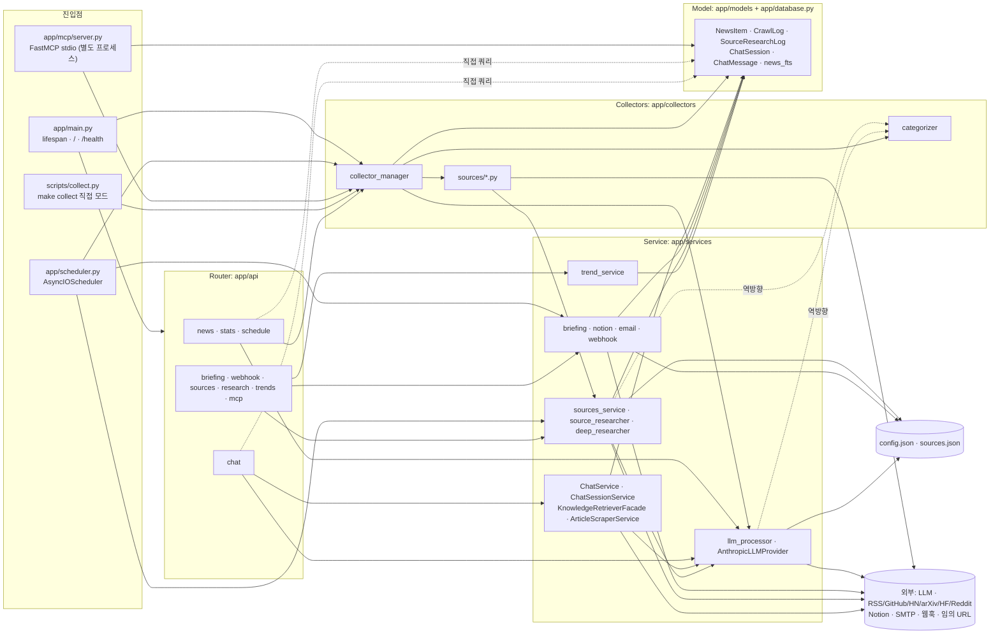
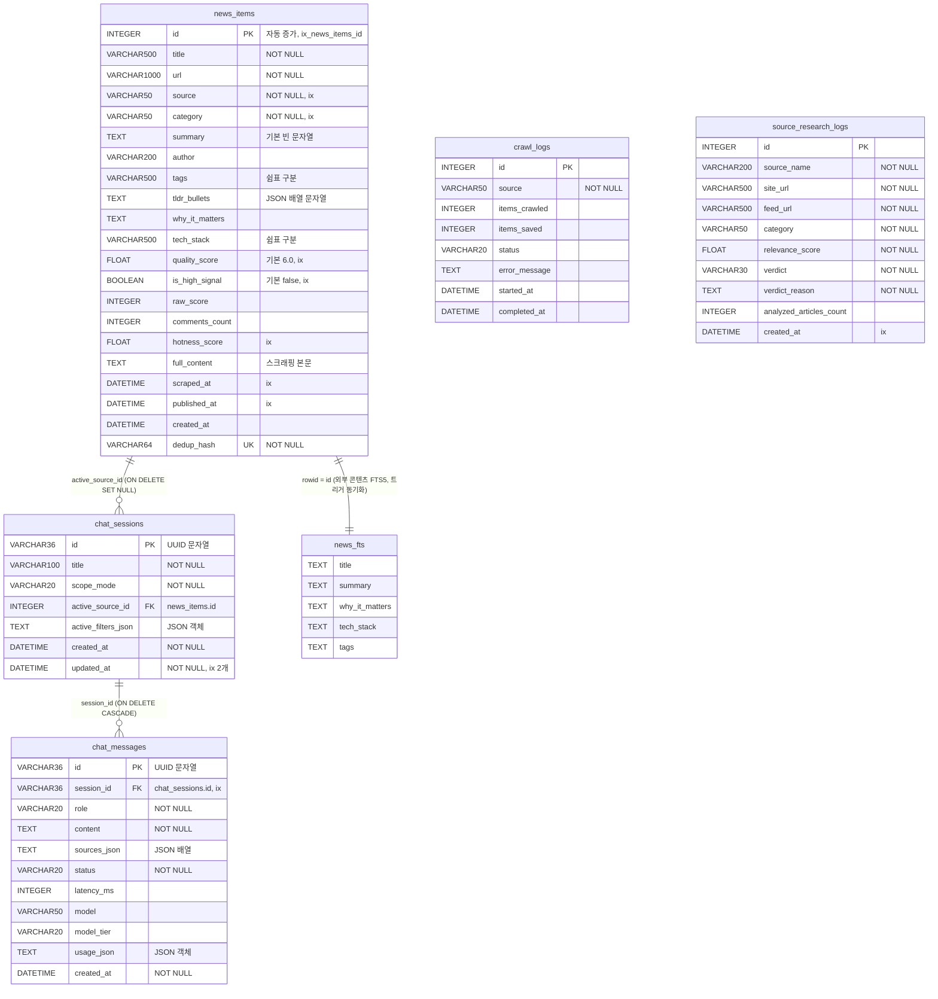
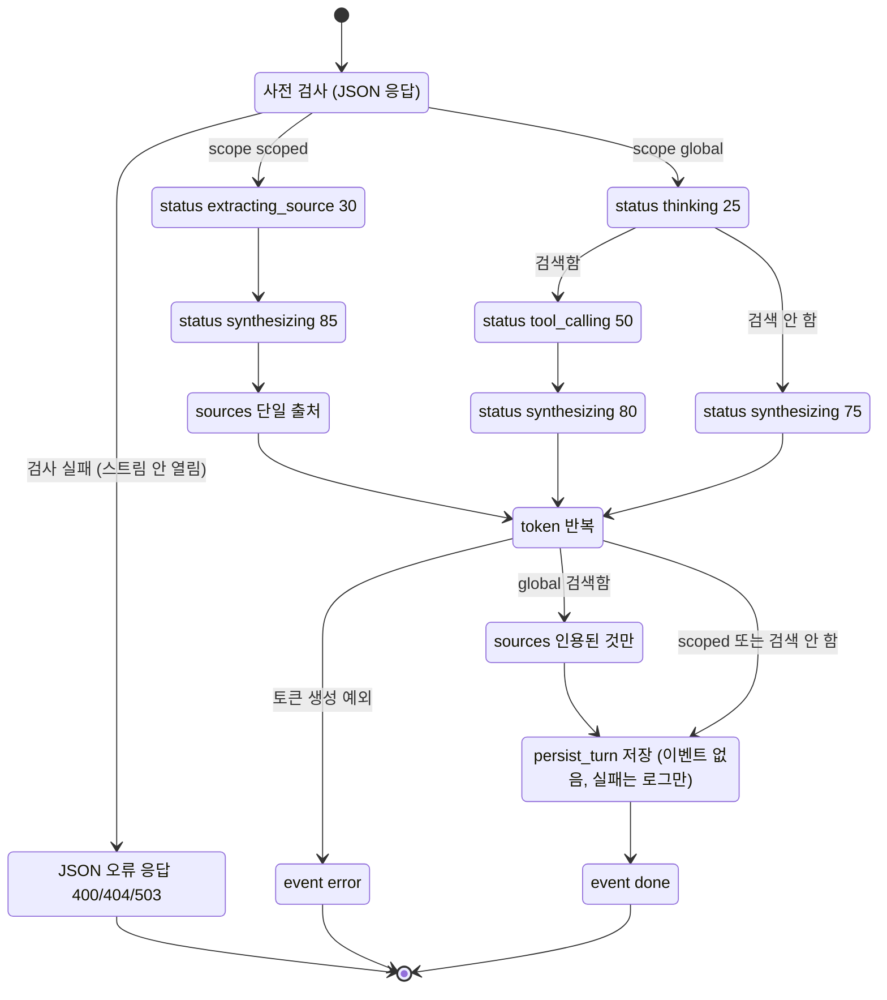

# AgentLens 백엔드 시스템 및 데이터베이스 설계서 (System Design & ERD)

- **작성일자**: 2026-11-09
- **Updated**: 2026-11-09
- **기준**: v0.4.1 (main)
- **작성자**: 백엔드 시스템 디자이너 (`system-designer`)
- **문서 버전**: v1.0
- **상태**: Draft
- **성격**: as-built. 지금 코드(`backend/app/`)를 그대로 적는다. v0.4.1 리뷰 수정(작업 트리, 2026-11-09)까지 반영했다 (15.2). 새 설계는 없다 (14절 '이번 변경 설계' 참고). 다음 기능 작업은 이 문서를 고쳐 쓴다.
- **선행 산출물 (읽기 전용)**: `docs/fullstack-architect/01_ARCHITECTURE_ADR.md`, `docs/spec-writer/fsd/01_NEWS_FEED_SPECIFICATION.md` ~ `07_UI_COMMON_SPECIFICATION.md`
- **짝 산출물**: [`02_OPENAPI_SPEC.yaml`](./02_OPENAPI_SPEC.yaml) (FastAPI `app.openapi()` 자동 생성 + 보충)
- **근거 규칙**: 코드 사실은 `path:line`. 서버를 띄워 확인하지 않은 동작은 '코드상 판단' 또는 '실행 확인 안 함' 으로 적는다. 2026-11-09 에 실행한 것은 `app.openapi()` 추출 하나다 (lifespan 은 돌지 않는다, 스케줄러 `running=False` 확인).
- **설치본 버전 (`.venv`, 2026-11-09 확인)**: fastapi 0.162.2, starlette 1.10.0, pydantic 2.14.3, sqlalchemy 2.1.8. `backend/requirements.txt` 는 하한만 둔다 (`fastapi>=0.141.0` 등).

---

## 1. 백엔드 모듈 아키텍처 및 계층도 (Layered Architecture)

### 1.1 디렉터리 (지금 코드)

```
backend/
├── app/
│   ├── main.py            # FastAPI 앱, lifespan(스키마 보정·스케줄러·빈 DB 첫 수집), CORS, 전역 예외 처리, GET / · /health
│   ├── config.py          # pydantic-settings Settings, config.json 탐색·로드·저장(save_json_config), .env 선로드
│   ├── database.py        # async 엔진(sqlite+aiosqlite), PRAGMA, AsyncSessionLocal, get_db(), ensure_db_schema()
│   ├── scheduler.py       # APScheduler AsyncIOScheduler, 잡 3개(수집·딥 리서치·브리핑 발송)
│   ├── api/               # Router 계층 (APIRouter 10개 + router.py 가 prefix=/api 로 묶음)
│   │   ├── news.py  chat.py  briefing.py  schedule.py  sources.py
│   │   ├── research.py  trends.py  webhook.py  stats.py  mcp.py
│   │   └── router.py
│   ├── schemas/           # Pydantic 요청·응답 모델 (chat.py, news.py). 일부 요청 모델은 라우터 파일 안에 있다
│   ├── services/          # Service 계층 (모듈 싱글턴 또는 요청마다 AsyncSession 을 받는 클래스)
│   │   ├── chat_service.py  chat_session_service.py  retriever.py  scraper.py  agentic_search.py
│   │   ├── llm_processor.py  llm_providers/{base.py, anthropic_provider.py}
│   │   ├── briefing_service.py  notion_service.py  email_service.py  webhook_service.py
│   │   ├── sources_service.py  source_researcher.py  deep_researcher.py  trend_service.py
│   ├── models/            # SQLAlchemy ORM (news.py: NewsItem·CrawlLog·SourceResearchLog, chat_session.py: ChatSession·ChatMessage)
│   ├── collectors/        # 수집기: manager.py(CollectorManager), categorizer.py, sources/{rss, hackernews, github, arxiv, huggingface, reddit}.py
│   ├── mcp/server.py      # FastMCP stdio 서버 (별도 프로세스, python -m app.mcp.server)
│   └── config/sources.json  # sources.json 거울 사본
└── tests/                 # pytest (conftest.py 가 test_agentlens.db·설정 파일 사본·흉내 LLM 을 건다)
```

repository 계층은 없다. 서비스와 일부 라우터가 `AsyncSession` 으로 직접 SQLAlchemy 쿼리를 쓴다.

### 1.2 계층 의존 그래프 (import 기준)



점선은 1.3 의 '목표 규약과 다른 곳' 이다.

### 1.3 목표 규약(Router → Service → Model 단방향)과 지금 코드

| 규약 | 지금 코드 | 근거 |
|---|---|---|
| Router 는 Service 만 부른다 | `news`·`stats`·`schedule` 라우터는 `NewsItem`·`CrawlLog` 를 직접 쿼리·삭제한다. `chat` 라우터는 `/stream` 사전 검사에서 `db.get(NewsItem, source_id)` 를 직접 부른다 | `backend/app/api/news.py:58-102`, `backend/app/api/stats.py:13-15`, `backend/app/api/schedule.py:20`, `:80-82`, `backend/app/api/chat.py:358-359` |
| Service 는 Router 를 모른다 | 지킨다. 서비스가 `app.api` 를 import 하는 곳이 없다 | `grep "from app.api" backend/app/services` 결과 없음 |
| Service 와 수집기는 한 방향 | 양방향이다. `collectors/manager.py` → `services/llm_processor`, `collectors/sources/*` → `services/sources_service`, 반대로 `services/llm_processor.py`·`deep_researcher.py`·`source_researcher.py` → `collectors/categorizer` | `backend/app/collectors/manager.py:12`, `backend/app/collectors/sources/rss.py` 등 import, `backend/app/services/llm_processor.py:10` |
| Model 은 상위 계층을 모른다 | 지킨다. `models/*.py` 는 `app.database.Base` 만 import 한다 | `backend/app/models/news.py:3`, `backend/app/models/chat_session.py:5` |
| 스키마(DTO) 위치 | `app/schemas/chat.py`·`news.py`. 단 `WebhookTestRequest`·`AddRssRequest`·`InspectUrlRequest` 등 요청 모델 6종은 라우터 파일 안에 있다 | `backend/app/api/webhook.py:11`, `backend/app/api/sources.py:8`, `backend/app/api/research.py:8` |
| 트랜잭션 경계는 Service 단위 | 요청 세션(`get_db`)을 서비스가 중간에 여러 번 커밋한다. 4.2 참고 | `backend/app/database.py:31-40` |

서비스 인스턴스 생명주기

| 종류 | 객체 | 근거 |
|---|---|---|
| 모듈 싱글턴 (프로세스 메모리 상태를 가진다) | `collector_manager`, `llm_processor`(`_qa_cache`, `_eval_cache`, `last_usage`), `deep_researcher`(`is_running`, `last_run_summary`), `sources_service`, `briefing_service`, `trend_service`, `notion_service`, `email_service`, `webhook_service`, `source_researcher` | `backend/app/collectors/manager.py:259`, `backend/app/services/llm_processor.py:113-127`, `backend/app/services/deep_researcher.py:138-145` |
| 요청마다 `AsyncSession` 을 받아 만든다 | `ChatService`, `ChatSessionService`, `KnowledgeRetrieverFacade`/`SqliteFtsRetriever`, `ArticleScraperService` (단 L1 캐시·URL 잠금은 클래스 변수라 프로세스 공유) | `backend/app/services/chat_service.py:79-84`, `backend/app/services/scraper.py:35-38` |
| 만들기만 하고 쓰지 않는다 | `ChatService.agentic_search` (`AgenticSearchService()`) | `backend/app/services/chat_service.py:83` (다른 사용처 없음) |

### 1.4 수집기·스케줄러·MCP·시작 경계

**수집기 (`backend/app/collectors`)**

- 진입점은 `collector_manager.collect_all()` 하나다 (`backend/app/collectors/manager.py:176`). 부르는 곳:

| 호출자 | 위치 | 프로세스 |
|---|---|---|
| 스케줄 잡 `daily_crawl` (0·6·12·18시 UTC) | `backend/app/scheduler.py:11-13`, `:39` | backend |
| `POST /api/schedule/trigger` (BackgroundTasks) | `backend/app/api/schedule.py:60` | backend |
| `POST /api/schedule/reset-and-collect` (BackgroundTasks) | `backend/app/api/schedule.py:92` | backend |
| lifespan, `news_items` 가 0건일 때 `asyncio.create_task` | `backend/app/main.py:28-36` | backend |
| MCP 도구 `trigger_agentlens_crawl` (끝날 때까지 await) | `backend/app/mcp/server.py:43-47` | MCP 프로세스 |
| `make collect` 직접 모드 (`ensure_db_schema()` 후 `collect_all()`) | `scripts/collect.py:138-139` | 스크립트 프로세스 |
| `make collect` API 모드 (`/api/schedule/trigger` 후 `/progress` 폴링) | `scripts/collect.py:65-83` | backend |

- 흐름: 소스 6종(`fetch_rss`, `fetch_hackernews`, `fetch_github`, `fetch_arxiv`, `fetch_huggingface`, `fetch_reddit`)을 `asyncio.gather` 로 동시에 돌리고, 소스마다 `_process_and_save_batch` 로 항목별 LLM 평가 → 분류 → dedup → INSERT/UPDATE 한다. 수집 결과가 0건이면 시드 2건을 저장하고, 끝에 `crawl_logs` 1행을 남긴다 (`backend/app/collectors/manager.py:191-234`).
- 수집기는 `services/llm_processor`(평가·요약)와 `services/sources_service`(활성 소스 목록)를 쓴다. 수집 대상 목록은 DB 가 아니라 `sources.json` 이다.
- 진행 상태는 메모리 필드(`is_running`, `current_source`, `step_message`, `items_*`, `completed_sources`, `last_crawl_time`)로만 남는다 (`backend/app/collectors/manager.py:46-57`).

**스케줄러 (`backend/app/scheduler.py`)**

| 잡 id | 트리거 (UTC, 코드 고정) | 호출 | 근거 |
|---|---|---|---|
| `daily_crawl` | `CronTrigger(hour="0,6,12,18", minute="0")` | `collector_manager.collect_all()` | `backend/app/scheduler.py:39-46` |
| `deep_research` | `CronTrigger(hour="3,15", minute="0")` | `deep_researcher.run_deep_research()` (기본 `max_candidates=8`) | `backend/app/scheduler.py:47-54`, `backend/app/services/deep_researcher.py:376` |
| `daily_briefing_dispatch` | `CronTrigger(hour="0", minute="15")` | `briefing_service.auto_dispatch_all()` | `backend/app/scheduler.py:55-62` |

- `config.json` 의 `scheduler.crawl_hours` 는 `SCHEDULED_HOURS` 로 읽혀 `get_next_run_time()` 의 대체 계산과 `/api/schedule/status` 표시에만 쓰인다. 실제 cron 은 하드코딩이다 (`backend/app/scheduler.py:9`, `:25-35`, `:39`). `scheduler.enabled`·`timezone`·`auto_briefing_hour`, `briefing.auto_dispatch_hour` 는 실행에 쓰이지 않는다.
- 잡은 backend 의 이벤트 루프에서 돈다. 수집 잡이 이미 실행 중인 수집과 겹치면 `collect_all()` 이 `already_running` dict 를 돌려주고 잡은 그 값을 버린다 (`backend/app/scheduler.py:13`).
- `auto_dispatch_all` 은 `settings.NOTION_AUTO_EXPORT and NOTION_API_KEY` 일 때 Notion, `EMAIL_AUTO_SEND and SMTP_HOST and SMTP_TO` 일 때 이메일, 이어서 웹훅을 보낸다 (`backend/app/services/briefing_service.py:210-250`). `webhooks.auto_dispatch_daily_briefing` 은 판단에 쓰지 않는다.

**MCP (`backend/app/mcp/server.py`)**

- `FastMCP("AgentLens-MCP-Server")` stdio 서버. backend 와 다른 프로세스로 뜨고 같은 코드와 (cwd 상대 경로가 같으면) 같은 SQLite 파일을 쓴다. HTTP 로는 열지 않고, `GET /api/mcp/info` 가 설정 예시만 준다 (`backend/app/api/mcp.py:6-27`).

| 도구 | 동작 | 근거 |
|---|---|---|
| `get_latest_harness_methods(limit=10)` | `category == "harness"`, `hotness_score` 내림차순 | `backend/app/mcp/server.py:10-17` |
| `get_mcp_and_skills_ecosystem(limit=10)` | `category == "mcp_plugins_skills"` | `backend/app/mcp/server.py:19-26` |
| `search_agent_news(query, category="all", limit=10)` | `title`·`summary` ILIKE | `backend/app/mcp/server.py:28-41` |
| `trigger_agentlens_crawl()` | MCP 프로세스 안에서 `collect_all()` 을 끝까지 실행 | `backend/app/mcp/server.py:43-47` |

- 경계상 주의: MCP 프로세스는 `ensure_db_schema()` 를 부르지 않는다 (`backend/app/mcp/server.py` 전체). 테이블이 없는 DB 를 열면 쿼리가 실패할 것으로 코드상 판단한다. MCP 프로세스의 `collector_manager` 는 backend 와 별개 인스턴스라 수집 중복 실행 방지가 프로세스 사이에 걸리지 않는다 (4.3).

**시작·종료 (lifespan, `backend/app/main.py:23-47`)**

1. `ensure_db_schema()` (3.2 마이그레이션)
2. `start_scheduler()`
3. `news_items` 건수가 0 이면 `collect_all()` 을 백그라운드 태스크로 띄우고 바로 요청을 받는다. 그동안 `GET /health` 의 `running` 은 `true` 다. 태스크 예외는 콜백이 출력한다 (`:15-20`).
4. 종료 때 끝나지 않은 첫 수집 태스크를 취소하고, 스케줄러를 내리고, 엔진을 dispose 한다.

**외부 의존 경계**

| 대상 | 클라이언트 | 타임아웃 | 근거 |
|---|---|---|---|
| Anthropic | httpx `AsyncClient` (SDK 아님) | 45초(일괄), 120초(스트림) | `backend/app/services/llm_providers/anthropic_provider.py:238`, `:285` |
| OpenAI | httpx(일괄 60초), `openai.AsyncOpenAI`(스트림) | 60초 | `backend/app/services/llm_processor.py:262`, `:451` |
| Ollama | httpx `AsyncClient` 90초/120초, 가용 판정은 **동기** `httpx.Client` 1초 | — | `backend/app/services/llm_processor.py:279`, `:480`, `:177` |
| Gemini | httpx `AsyncClient` 20초 (모델 이름에 `gemini` 가 있을 때만) | 20초 | `backend/app/services/llm_processor.py:223` |
| 수집 소스 | httpx `AsyncClient` (RSS 피드당 6초, 세마포어 6) | 6~12초 | `backend/app/collectors/sources/rss.py:29-35`, `arxiv.py:18` |
| 기사 스크래핑 | httpx 5초 + trafilatura → readability-lxml | 5초 | `backend/app/services/scraper.py:74`, `:95-117` |
| Notion | httpx `AsyncClient` | 10~15초 | `backend/app/services/notion_service.py:41`, `:239`, `:263` |
| SMTP | `smtplib` 을 `asyncio.to_thread` 로 | 12초 | `backend/app/services/email_service.py:157-174`, `:222`, `:262` |
| 웹훅 | httpx `AsyncClient` | 8초 | `backend/app/services/webhook_service.py:22` |
| 임의 URL (inspect-url, 딥 리서치) | httpx `AsyncClient`, 리다이렉트 따라감 | 3~10초 | `backend/app/services/source_researcher.py:205`, `:251`, `:272`, `backend/app/services/deep_researcher.py:223`, `:254`, `:269` |

LLM 우선순위는 Anthropic → OpenAI → Ollama 이고 Gemini 는 모델을 명시했을 때만 쓴다. Ollama 는 `GET {주소}/api/tags`(1초)가 200 이고 설정 모델(태그 생략 시 `:latest`)이 설치돼 있어야 쓸 수 있다 (`backend/app/services/llm_processor.py:171-194`, `:301-325`).

### 1.5 공통 HTTP 규약

- **베이스 URL**: `uvicorn app.main:app`, :8000 (`docker-compose.yml:15` 의 `BACKEND_PORT` 기본 8000). 업무 API 는 `APIRouter(prefix="/api")` 아래 라우터 10개(news, schedule, stats, mcp, briefing, trends, webhook, sources, research, chat) (`backend/app/api/router.py:13-23`). 접두사 밖은 `GET /`, `GET /health` (`backend/app/main.py:71`, `:75`). `docs_url` 등을 끄지 않아 `/docs`, `/redoc`, `/openapi.json` 이 열린다 (`backend/app/main.py:49`).
- **프록시**: 브라우저는 상대 경로 `/api/...` 를 부르고 Next rewrite 가 `/api/:path*` 를 `${INTERNAL_API_URL}/api/:path*`(기본 `http://127.0.0.1:8000`)로 넘긴다 (`frontend/next.config.ts:23-24`). 서버 측 렌더링은 `INTERNAL_API_URL` → `NEXT_PUBLIC_API_URL` → `http://127.0.0.1:8000` 순 (`frontend/src/lib/api.ts:3`).
- **직접 연결**: `POST /api/news/{id}/ask/stream` 만 `getDirectApiBase()` 로 backend 에 붙는다 (`NEXT_PUBLIC_API_URL`, 없으면 브라우저 호스트의 :8000). 직접 연결이 실패하면(AbortError 제외) 상대 경로로 한 번 더 시도한다 (`frontend/src/lib/api.ts:12`, `:97`). `POST /api/chat/stream` 은 `ChatWorkspace.tsx` 가 상대 경로로 불러 rewrite 를 거친다 (`frontend/src/components/chat/ChatWorkspace.tsx:338`).
- **인증**: 없다. 의존성 기반 인증, API 키 검사, 세션 검사가 어디에도 없다. 쓰기·삭제·외부 발송 엔드포인트도 같다.
- **CORS**: `CORSMiddleware(allow_origins=["*"], allow_credentials=True, allow_methods=["*"], allow_headers=["*"])` (`backend/app/main.py:50-56`). `settings.CORS_ORIGINS` (`backend/app/config.py:45`) 는 정의만 있고 `main.py` 가 읽지 않는다.
- **Content-Type**: 요청은 JSON. chat 의 `/query`, `/stream`, `POST /sessions` 는 본문 바인딩 대신 `await request.json()` 으로 직접 읽어 자동 생성 OpenAPI 에 요청 본문 스키마가 없다 (`backend/app/api/chat.py:129`, `:281`, `:472`). `02_OPENAPI_SPEC.yaml` 은 이 셋에 `requestBody` 를 보충했다. 응답은 대부분 `application/json`, 예외는 `GET /api/news/feed/rss.xml`(`application/xml`), `POST /api/news/{id}/ask/stream`(`text/event-stream`), `POST /api/chat/stream`(`text/event-stream; charset=utf-8`).
- **로깅**: `print` 와 `logging.getLogger("agentlens.*")` 가 섞여 있고 로깅 설정은 없다.

---

## 2. 데이터베이스 엔티티 관계도 (Mermaid ERD)

### 2.1 저장소 개요

| 저장소 | 종류 | 정의 위치 | 소유 |
|---|---|---|---|
| SQLite DB (`agentlens.db`) | 테이블 5개 + FTS5 가상 테이블 1개 + 트리거 3개 | `backend/app/models/news.py`, `backend/app/models/chat_session.py`, `backend/app/database.py:45-115` | backend |
| `config.json` (저장소 루트) | 앱 설정 JSON | `backend/app/config.py:14-37` | backend (읽기, `POST /api/briefing/settings` 로 쓰기) |
| `sources.json` (루트, `backend/app/config/sources.json`) | 수집 소스 목록 JSON | `backend/app/services/sources_service.py` | backend (읽기·쓰기) |
| 브라우저 localStorage | 키 5종 | `frontend/src/...` (11.3) | frontend |
| 프로세스 메모리 | 수집 진행 상태, LLM 응답·평가 캐시, 스크래핑 L1 캐시, 딥 리서치 상태, 스케줄러 job | `backend/app/collectors/manager.py:46-57`, `backend/app/services/llm_processor.py:119-127`, `backend/app/services/scraper.py:35-38`, `backend/app/services/deep_researcher.py:138-145` | backend (재시작하면 사라진다) |

### 2.2 ERD



`crawl_logs`, `source_research_logs` 는 다른 테이블과 관계가 없다.

### 2.3 공통 규칙

- 기본값은 모두 Python 쪽 `default=` 다. `server_default` 가 없어 DDL 에 DEFAULT 절이 없고, ORM 을 거치지 않은 INSERT(원시 SQL)에는 기본값이 들어가지 않는다.
- `nullable` 을 쓰지 않은 열은 SQLAlchemy 기본값대로 NULL 을 허용한다(PK 제외). 아래 표의 'NULL' 열은 이 규칙을 반영한다.
- `DateTime` 열은 모두 `timezone=True` 없이 선언됐다. 코드는 `datetime.now(timezone.utc)` 를 넣고, 읽은 값이 naive 면 UTC 로 간주한다 (`backend/app/collectors/categorizer.py:141-142`, `backend/app/services/trend_service.py:73-74`).
- 문자열 길이(`String(n)`)는 SQLite 가 강제하지 않는다.
- 인덱스 이름은 SQLAlchemy 명명 규칙(`ix_<테이블>_<열>`)에 따른 이름이다. 실행 중인 DB 파일을 열어 보지 않았다.

### 2.4 news_items — 수집·선별된 소식

모델: `backend/app/models/news.py:5-39`

| 열 | 타입 | NULL | 기본값 | 인덱스/제약 | 의미 |
|---|---|---|---|---|---|
| id | INTEGER | 아니오 | 자동 증가 | PK, `ix_news_items_id` | 소식 ID |
| title | VARCHAR(500) | 아니오 | — | — | 제목. RSS 는 `[피드명] 제목` (`backend/app/collectors/sources/rss.py:69`) |
| url | VARCHAR(1000) | 아니오 | — | — | 원문 URL |
| source | VARCHAR(50) | 아니오 | — | `ix_news_items_source` | 수집처 값 (2.9) |
| category | VARCHAR(50) | 아니오 | — | `ix_news_items_category` | 카테고리 4종 |
| summary | TEXT | 예 | `""` | — | 요약. RSS 는 320자에서 자르고 `...` (`rss.py:72`) |
| author | VARCHAR(200) | 예 | NULL | — | 작성자 |
| tags | VARCHAR(500) | 예 | `""` | — | 쉼표 구분 키워드 (`backend/app/collectors/manager.py:153`) |
| tldr_bullets | TEXT | 예 | `"[]"` | — | JSON 문자열 배열, 최대 3개 (`backend/app/services/llm_processor.py:751`) |
| why_it_matters | TEXT | 예 | `""` | — | 개발자 관점 의미. LLM 평가값 또는 카테고리 기본 문구 (`llm_processor.py:741-748`) |
| tech_stack | VARCHAR(500) | 예 | `""` | — | 쉼표 구분 기술·모델 이름 (`manager.py:156`) |
| quality_score | FLOAT | 예 | 6.0 | `ix_news_items_quality_score` | 품질 점수 1.0~10.0 |
| is_high_signal | BOOLEAN | 예 | False | `ix_news_items_is_high_signal` | 고신호 여부 (`HIGH_SIGNAL_THRESHOLD` 이상) |
| raw_score | INTEGER | 예 | 0 | — | 출처 점수(별, 업보트 등). RSS 는 고정값 KR 180, GLOBAL 150 (`rss.py:75`) |
| comments_count | INTEGER | 예 | 0 | — | 댓글 수 |
| hotness_score | FLOAT | 예 | 0.0 | `ix_news_items_hotness_score` | 화제성 0~100: `min(100, (raw + comments*2.5 + 5) / (hours+2)^1.3 * 8)` (`backend/app/collectors/categorizer.py:139-146`) |
| full_content | TEXT | 예 | NULL | — | 스크래핑한 본문 (`backend/app/services/scraper.py:158-165`) |
| scraped_at | DATETIME | 예 | NULL | `ix_news_items_scraped_at` | 스크래핑 시각 |
| published_at | DATETIME | 예 | 현재 UTC | `ix_news_items_published_at` | 원문 발행 시각 |
| created_at | DATETIME | 예 | 현재 UTC | — | 행 생성 시각 |
| dedup_hash | VARCHAR(64) | 아니오 | — | UNIQUE 인덱스 `ix_news_items_dedup_hash` | 중복 제거 키. `sha256(영숫자·한글만 남긴 소문자 제목 + "::" + utm 파라미터·끝 / 를 뗀 URL)` (`categorizer.py:83-87`) |

복합 인덱스: `idx_category_published(category, published_at)`, `idx_category_hotness(category, hotness_score)`, `idx_high_signal(is_high_signal, hotness_score)` (`backend/app/models/news.py:35-39`).

| 쓰는 동작 | 위치 |
|---|---|
| INSERT (신규), UPDATE (같은 `dedup_hash` 면 raw_score·comments_count 는 큰 값, hotness·quality·is_high_signal 은 덮어쓰기, why_it_matters 가 비어 있으면 요약 필드 채움) | `backend/app/collectors/manager.py:130-166` |
| UPDATE full_content, scraped_at | `backend/app/services/scraper.py:158-165` |
| DELETE 전체 | `backend/app/api/news.py:96-102`, `backend/app/api/schedule.py:80` |
| 테스트 시드 (id=1) | `backend/tests/conftest.py:17-43` |

읽는 코드: `api/news.py` (목록·상세·질문·RSS), `api/stats.py:13-15`, `api/chat.py:359`, `services/chat_service.py`, `services/chat_session_service.py:155`, `services/retriever.py`, `services/briefing_service.py:45-60`, `services/trend_service.py:42`, `services/deep_researcher.py:189`, `mcp/server.py`, `main.py:29` (시작 시 건수).

### 2.5 news_fts — 전문 검색 인덱스 (FTS5 가상 테이블)

- ORM 모델이 없다. `ensure_db_schema()` 가 원시 SQL 로 만든다 (`backend/app/database.py:73-112`). 같은 생성 코드가 `SqliteFtsRetriever._ensure_fts_table()` 에도 있다 (`backend/app/services/retriever.py:62-120`).
- 정의: `fts5(title, summary, why_it_matters, tech_stack, tags, content='news_items', content_rowid='id')` (외부 콘텐츠 테이블).
- 동기화 트리거: `news_items_ai`(AFTER INSERT), `news_items_ad`(AFTER DELETE), `news_items_au`(AFTER UPDATE) (`database.py:87-106`).
- 재구축: 테이블을 새로 만들 때, 그리고 `news_fts` 행 수가 `news_items` 보다 적을 때 `INSERT INTO news_fts(news_fts) VALUES('rebuild')` (`database.py:107-112`, `retriever.py:105`, `:115`).
- SQLite 가 FTS5 를 지원하지 않거나 오류가 나면 예외를 삼키고 넘어간다 (`database.py:113-114`). 검색은 FTS 결과가 없거나 오류면 `LIKE` 로 대체한다 (`retriever.py:322-345`).

### 2.6 crawl_logs — 수집 실행 기록

모델: `backend/app/models/news.py:41-51`

| 열 | 타입 | NULL | 기본값 | 인덱스 | 의미 |
|---|---|---|---|---|---|
| id | INTEGER | 아니오 | 자동 증가 | PK, `ix_crawl_logs_id` | |
| source | VARCHAR(50) | 아니오 | — | — | 코드가 쓰는 값은 `all_sources_stream_ingestion` 하나 (`manager.py:226`) |
| items_crawled | INTEGER | 예 | 0 | — | 평가한 항목 수 |
| items_saved | INTEGER | 예 | 0 | — | 신규 저장 수 |
| status | VARCHAR(20) | 예 | `"success"` | — | 코드가 쓰는 값은 `success` 하나 |
| error_message | TEXT | 예 | NULL | — | 쓰는 코드가 없다 |
| started_at | DATETIME | 예 | 현재 UTC | — | |
| completed_at | DATETIME | 예 | 현재 UTC | — | |

- 쓰기: `collect_all()` 이 끝날 때 한 행 (`manager.py:224-234`). 수집 중 전역 예외가 나면 행을 남기지 않는다 (`manager.py:252-255`).
- 읽기: `GET /api/schedule/status` 가 `id` 내림차순 최근 5행 (`backend/app/api/schedule.py:20`).
- 삭제: `POST /api/schedule/reset-and-collect` (`schedule.py:81`).

### 2.7 source_research_logs — 딥 리서치 소스 판정 기록

모델: `backend/app/models/news.py:53-65`

| 열 | 타입 | NULL | 기본값 | 인덱스 | 의미 |
|---|---|---|---|---|---|
| id | INTEGER | 아니오 | 자동 증가 | PK, `ix_source_research_logs_id` | |
| source_name | VARCHAR(200) | 아니오 | — | — | 후보 소스 이름 |
| site_url | VARCHAR(500) | 아니오 | — | — | 탐색 대상 URL |
| feed_url | VARCHAR(500) | 아니오 | — | — | 발견한 피드 URL (실패 시 대상 URL) |
| category | VARCHAR(50) | 아니오 | `"ai_news"` | — | 추정 카테고리 |
| relevance_score | FLOAT | 아니오 | 0.0 | — | 종합 점수 1.0~9.9 (탐지 실패 시 2.0) |
| verdict | VARCHAR(30) | 아니오 | — | — | 판정 (2.9) |
| verdict_reason | TEXT | 아니오 | — | — | 한국어 판정 이유 |
| analyzed_articles_count | INTEGER | 예 | 0 | — | 분석한 피드 항목 수 |
| created_at | DATETIME | 예 | 현재 UTC | `ix_source_research_logs_created_at` | |

- 쓰기: `run_deep_research()` 가 후보마다 한 행을 `session.add` 하고 사이클 끝에 한 번 커밋 (`backend/app/services/deep_researcher.py:461-484`).
- 읽기: `GET /api/research/audit-logs` → `get_audit_logs()` (`deep_researcher.py:156-181`).
- 삭제하는 코드가 없다. 리셋 계열 작업도 지우지 않는다.

### 2.8 chat_sessions · chat_messages — AI 챗 세션

`chat_sessions` 모델: `backend/app/models/chat_session.py:7-33`

| 열 | 타입 | NULL | 기본값 | 인덱스/제약 | 의미 |
|---|---|---|---|---|---|
| id | VARCHAR(36) | 아니오 | `uuid4()` 문자열 | PK | 세션 UUID. 클라이언트가 보낸 값이면 UUID 형식을 검사한다 (`backend/app/services/chat_session_service.py:215-219`) |
| title | VARCHAR(100) | 아니오 | `"새 대화"` | — | 제목. 첫 사용자 질문으로 자동 생성(마크다운·태그·줄바꿈 제거 후 30자 + `...`) (`chat_session_service.py:38-49`, `:342-343`) |
| scope_mode | VARCHAR(20) | 아니오 | `"global"` | — | `global` 또는 `scoped` |
| active_source_id | INTEGER | 예 | NULL | FK → `news_items.id` ON DELETE SET NULL | scoped 챗의 대상 소식 |
| active_filters_json | TEXT | 예 | NULL | — | 포커스 필터 JSON (2.10) |
| created_at | DATETIME | 아니오 | 현재 UTC | — | |
| updated_at | DATETIME | 아니오 | 현재 UTC, 갱신 시 현재 UTC | `ix_chat_sessions_updated_at`, `idx_chat_sessions_updated_at` (같은 열에 두 개) | 정렬·FIFO 기준 |

- 관계: `messages` (cascade `all, delete-orphan`, `created_at` 오름차순) (`chat_session.py:24-29`).
- 쓰기: `POST /api/chat/sessions` (생성·업서트, `chat_session_service.py:213-280`), `POST /api/chat/stream` 토큰 생성이 끝난 뒤 `done` 앞에서 자동 저장 (`backend/app/services/chat_service.py:804-823` → `persist_turn`). `POST /api/chat/query` 는 저장하지 않는다 (`chat_service.py:478-574` 에 저장 호출 없음).
- 삭제: `DELETE /api/chat/sessions/{id}` (`chat_session_service.py:282-299`), FIFO 보존 (12.3).
- 읽기: `GET /api/chat/sessions`(limit 1~50, 기본 30, `backend/app/api/chat.py:444-453`), `GET /api/chat/sessions/{id}`.

`chat_messages` 모델: `backend/app/models/chat_session.py:35-59`

| 열 | 타입 | NULL | 기본값 | 인덱스/제약 | 의미 |
|---|---|---|---|---|---|
| id | VARCHAR(36) | 아니오 | `uuid4()` 문자열 | PK | |
| session_id | VARCHAR(36) | 아니오 | — | FK → `chat_sessions.id` ON DELETE CASCADE, `ix_chat_messages_session_id` | |
| role | VARCHAR(20) | 아니오 | — | — | `user`, `assistant`, `system` |
| content | TEXT | 아니오 | — | — | 본문 |
| sources_json | TEXT | 예 | NULL | — | 인용 출처 JSON 배열 |
| status | VARCHAR(20) | 아니오 | `"completed"` | — | 메시지 상태 |
| latency_ms | INTEGER | 예 | NULL | — | 응답 지연 |
| model | VARCHAR(50) | 예 | NULL | — | 응답 모델 식별자 (예: `Google gemini-...`, `OpenAI gpt-4o-mini`, Anthropic 모델 ID) |
| model_tier | VARCHAR(20) | 예 | NULL | — | `haiku`, `sonnet`, `opus` |
| usage_json | TEXT | 예 | NULL | — | 토큰 사용량 JSON 객체 |
| created_at | DATETIME | 아니오 | 현재 UTC | — | |

복합 인덱스: `idx_chat_messages_session_created(session_id, created_at)` (`chat_session.py:57-59`).

- 쓰기: `append_messages_batch()` (`chat_session_service.py:301-382`). 한 배치의 메시지는 같은 `created_at` 을 받는다 (`:310`, `:372`). 들어온 메시지 id 중 DB 에 이미 있는 것(어느 세션이든)과 같은 배치 안에서 앞서 나온 것은 건너뛴다 (`:327-338`, `:376`).
- `persist_turn` 은 `ChatStreamRequest.user_message_id`·`assistant_message_id` 가 있으면 그 id 로, 없으면 uuid4 로 저장한다. 건너뛴 자리는 `None` 으로 돌려준다 (`chat_session_service.py:384-425`).
- `POST /api/chat/sessions` 의 `messages` 는 `model_tier`, `usage` 를 넘기지 않아 이 두 열이 NULL 로 저장된다 (`chat_session_service.py:258-268`).

### 2.9 열거형·고정 값

| 값 | 정의 위치 | 비고 |
|---|---|---|
| 카테고리: `harness`, `mcp_plugins_skills`, `agent_tech`, `ai_news` | `backend/app/collectors/categorizer.py:6-11`, 주석 `models/news.py:12`, `manager.py:108`, 프론트 `frontend/src/types/news.ts:7-13`(+`all`), 챗 필터 `backend/app/schemas/chat.py:23`(+`all`) | 분류 결과 `unrelated` 는 저장하지 않는다 (`manager.py:112-115`). LLM 평가 응답의 `irrelevant` 도 저장 대상이 아니다 (`llm_processor.py:638`, `:663`) |
| `news_items.source`: `rss`, `rss_kr`, `hackernews`, `github`, `arxiv`, `huggingface`, `reddit` (기본 `web`) | `collectors/sources/rss.py:65`, `hackernews.py:35`, `github.py:40`, `:65`, `arxiv.py:44`, `huggingface.py:29`, `reddit.py:32`, 기본값 `manager.py:84` | `rss_kr` 은 피드의 `country == "KR"` |
| `chat_messages.role`: `user`, `assistant`, `system` | 주석 `models/chat_session.py:45`, `schemas/chat.py:19`, `:188` | |
| `chat_messages.status`: `pending`, `streaming`, `completed`, `error`, `aborted` | 주석 `models/chat_session.py:48`, `schemas/chat.py:192` | 서버가 직접 저장하는 값은 `completed` 뿐 (`chat_session_service.py:406-418`) |
| `chat_messages.model_tier`: `haiku`, `sonnet`, `opus` | `schemas/chat.py:9` | |
| `chat_sessions.scope_mode`: `global`, `scoped` | `schemas/chat.py:205`, `:218`, `:229` | |
| 챗 필터 `time_range`: `all`, `24h`, `7d`, `30d` / `sort`: `hot`, `latest`, `quality` | `schemas/chat.py:24-25` | |
| `source_research_logs.verdict`: `AUTO_ADOPTED`, `WATCHLIST`, `REJECTED`, `ALREADY_MONITORED` | `services/deep_researcher.py:319`, `:348`, `:355` 등 | 모델 주석(`models/news.py:62`)에 `ALREADY_MONITORED` 가 없다. 임계값: 8.2 이상 채택, 6.5 이상 워치리스트 (`deep_researcher.py:347-362`) |
| `crawl_logs.status`: `success` | `models/news.py:48`, `manager.py:229` | |
| 피드 `country`: `KR`, `GLOBAL` | `api/sources.py:13`, `sources_service.py` | |
| 품질 임계: `QUALITY_CUTOFF_SCORE`(기본 5.0), `HIGH_SIGNAL_THRESHOLD`(기본 7.8, 루트 config.json 값 7.0) | `backend/app/config.py:64-65`, `config.json:25-26` | 사용 `llm_processor.py:567-568`, `:660-664` |

### 2.10 JSON 으로 저장되는 열

| 열 | 구조 | 쓰기 / 읽기 |
|---|---|---|
| `news_items.tldr_bullets` | `string[]` (최대 3개, 예: `"핵심 주제: …"`, `"관련 기술/모델: …"`, `"주요 내용: …"`) | 쓰기 `manager.py:143`, `:154` / 읽기 `api/news.py:21`, `chat_session_service.py:159` |
| `news_items.tags`, `tech_stack` | JSON 아님. 쉼표로 이은 문자열 | 읽을 때 `split(",")` (`api/news.py:18-19`) |
| `chat_sessions.active_filters_json` | `ChatFocusFilter`: `{category: "all"\|카테고리, time_range: "all"\|"24h"\|"7d"\|"30d", sort: "hot"\|"latest"\|"quality", high_signal_only: bool}` (`schemas/chat.py:22-26`) | 쓰기 `model_dump_json()` (`chat_session_service.py:222`, `:314`) / 읽기 실패 시 None (`chat_session_service.py:73-77`) |
| `chat_messages.sources_json` | `ChatSourceItem[]`: `{index: int\|str, type: "primary"\|"supplementary", id?, title, url, source, category?, quality_score?, score?, snippet?, full_content?, domain?, relevance_score?, published_at?, publisher?}` (`schemas/chat.py:75-90`) | 쓰기 `chat_session_service.py:345-351` / 읽기 `:118-124` |
| `chat_messages.usage_json` | `TokenUsageMeta`: `{input_tokens: int, output_tokens: int, cache_read_input_tokens: int\|null, cache_creation_input_tokens: int\|null}` (`schemas/chat.py:12-16`) | 쓰기 `chat_session_service.py:353-359` / 읽기 `:126-133` |

---

## 3. 인덱싱 및 쿼리 최적화 전략 (Indexing Strategy)

### 3.1 인덱스와 대상 쿼리

| 테이블명 | 인덱스 컬럼 | 인덱스 유형 | 생성 목적 및 대상 쿼리 |
| :--- | :--- | :--- | :--- |
| `news_items` | `id` (`ix_news_items_id`) | B-Tree (PK 와 중복) | `index=True` 가 PK 에 붙어 있다 (`models/news.py:8`). PK 로 이미 rowid 조회라 쓸모가 없다 |
| `news_items` | `dedup_hash` | UNIQUE B-Tree | 수집 배치의 기존 행 조회 `WHERE dedup_hash = ?` (`collectors/manager.py:130-133`), 중복 INSERT 차단 |
| `news_items` | `category`, `source` | B-Tree | `GET /api/news` 필터, MCP `category ==`, `GET /api/stats` GROUP BY (`api/news.py:59-62`, `api/stats.py:14-15`) |
| `news_items` | `(category, published_at)` | Composite B-Tree | 카테고리 + 최신순 (`sort=latest`, RSS `category` 필터 + `published_at desc`) |
| `news_items` | `(category, hotness_score)` | Composite B-Tree | 카테고리 + 화제순 (`sort=hot` 기본, 브리핑 카테고리 상위, MCP 도구) |
| `news_items` | `(is_high_signal, hotness_score)` | Composite B-Tree | `high_signal_only=true` + 화제순 |
| `news_items` | `quality_score`, `hotness_score`, `is_high_signal`, `published_at`, `scraped_at` | 단일 B-Tree | 정렬·필터 (`sort=quality`, 검색 후보 `quality_score >= min_quality`, RSS 최신 50) |
| `news_fts` | `title, summary, why_it_matters, tech_stack, tags` | FTS5 (BM25) | `GET /api/chat/search`, 챗 global 검색 (`services/retriever.py:245-320`) |
| `crawl_logs` | `id` | PK | `/api/schedule/status` 최근 5행 `ORDER BY id DESC` |
| `source_research_logs` | `created_at` | B-Tree | `/api/research/audit-logs` `ORDER BY created_at DESC LIMIT n` |
| `chat_sessions` | `updated_at` (`ix_` + `idx_` 두 개) | B-Tree 중복 | 세션 목록 `ORDER BY updated_at DESC`, FIFO `ORDER BY updated_at ASC LIMIT excess` (`chat_session_service.py:58-65`, `:466-471`) |
| `chat_messages` | `session_id` | B-Tree | `selectinload` 의 `WHERE session_id IN (...)` |
| `chat_messages` | `(session_id, created_at)` | Composite B-Tree | 세션 내 메시지 시간순 (`relationship order_by created_at`) |

인덱스로 해결되지 않는 쿼리 (코드상 판단, 측정 안 함):

- `GET /api/news?search=` 는 `ILIKE '%term%'` 를 열 5개에 OR 로 건다 (`api/news.py:65-75`). 앞 와일드카드라 인덱스를 못 쓰고 전체 스캔이다. 같은 질의를 `count` 와 본문에 두 번 실행한다 (`:77-90`).
- `GET /api/chat/sessions` 는 `selectinload(messages)` 로 목록 세션의 메시지 전체를 읽어 `len()` 과 마지막 메시지만 쓴다 (`chat_session_service.py:60-80`).
- `GET /api/trends/radar` 는 최근 500건을 읽어 파이썬에서 센다 (`services/trend_service.py:42`).

### 3.2 스키마 생성·변경 (마이그레이션 영향, SQLite)

마이그레이션 도구(Alembic 등)가 없다. `backend/requirements.txt` 에도 없다.

`ensure_db_schema()` (`backend/app/database.py:45-115`) 가 앱 시작(`main.py:25`), 테스트 fixture(`backend/tests/conftest.py:15`), `make collect` 직접 모드(`scripts/collect.py:138`)에서 한 트랜잭션(`engine.begin()`)으로 다음을 한다.

| 순서 | 동작 | 위치 |
|---|---|---|
| 1 | `Base.metadata.create_all` — 없는 테이블·인덱스만 만든다. 있는 테이블의 열은 바꾸지 않는다 | `database.py:48` |
| 2 | `news_items` 에 `full_content TEXT` 가 없으면 ALTER ADD | `database.py:54-55` |
| 3 | `news_items` 에 `scraped_at DATETIME` 이 없으면 ALTER ADD | `database.py:56-57` |
| 4 | `CREATE INDEX IF NOT EXISTS ix_news_items_scraped_at` | `database.py:58` |
| 5 | `chat_messages` 에 `model_tier VARCHAR(20)` 이 없으면 ALTER ADD | `database.py:66-67` |
| 6 | `chat_messages` 에 `usage_json TEXT` 가 없으면 ALTER ADD | `database.py:68-69` |
| 7 | `news_fts` 와 트리거 3개 생성 또는 재구축 | `database.py:73-112` |

- 각 단계는 `try/except: pass` 로 감싸여 실패해도 로그 없이 넘어간다 (`database.py:59-60`, `:70-71`, `:113-114`).
- 위 목록 밖의 열 추가·타입 변경·이름 변경·삭제는 기존 DB 에 반영되지 않는다. SQLite `ALTER TABLE` 은 열 추가 외 변경(타입·제약·삭제)을 직접 지원하지 않아, 그런 변경은 테이블 재생성 절차를 따로 써야 한다.
- 새 열을 모델에 추가하는 작업의 영향: 위 목록에 ALTER 를 같이 추가하지 않으면 기존 DB(`backend/agentlens.db`, Docker volume DB, `test_agentlens.db`)에서 그 열을 읽는 쿼리가 실패한다. `test_agentlens.db` 는 실행 사이에 지우지 않으므로 테스트도 같은 영향을 받는다 (12.1).
- `news_fts` 재구축 조건(행 수 비교)은 시작할 때마다, 그리고 검색할 때마다(`retriever.py:541`) 돈다.

---

## 4. 트랜잭션 및 동시성 제어 정책 (Concurrency & Transactions)

### 4.1 연결·세션 설정 (`backend/app/database.py:6-40`)

| 항목 | 값 |
|---|---|
| 드라이버 | `sqlite+aiosqlite` (async), `create_async_engine(echo=False, future=True)` |
| connect_args | `timeout=30.0`, `check_same_thread=False` |
| PRAGMA (연결마다) | `journal_mode=WAL`, `synchronous=NORMAL`, `cache_size=-64000`(약 64MB), `busy_timeout=30000`, `foreign_keys=ON` |
| 세션 | `async_sessionmaker(expire_on_commit=False)` |
| 요청 세션 `get_db()` | `yield session` → 정상 종료 시 `commit()`, 예외 시 `rollback()` 후 다시 던짐, 마지막에 `close()` |
| 격리 수준 | 따로 지정하지 않는다. SQLite 는 쓰기 트랜잭션을 한 번에 하나만 허용하고(WAL 에서 읽기는 동시 가능), 다른 쓰기는 `busy_timeout` 30초까지 기다린 뒤 `database is locked` 로 실패한다 |
| 낙관적 락·버전 열 | 없다 |

- `get_db` 의 종료 코드는 응답을 다 보낸 뒤에 돈다. 설치본 FastAPI 0.162.2 는 엔드포인트 의존성의 `AsyncExitStack` 을 `await response(scope, receive, send)` 뒤에 닫는다 (`.venv/lib/python3.11/site-packages/fastapi/routing.py:148-154`). 그래서 SSE 응답은 스트림이 끝날 때까지 요청 세션을 붙잡는다.

### 4.2 트랜잭션 경계 (흐름별)

요청 하나 = 트랜잭션 하나가 아니다. 서비스·라우터가 요청 세션을 중간에 직접 커밋한다.

| 흐름 | 커밋 지점 | 원자성 | 근거 |
|---|---|---|---|
| `DELETE /api/news/all` | 라우터가 `delete` 후 바로 커밋, `get_db` 가 한 번 더 커밋(빈 커밋) | 한 트랜잭션 | `backend/app/api/news.py:99-100` |
| `POST /api/schedule/reset-and-collect` | `delete(NewsItem)`, `delete(CrawlLog)` 후 커밋, 그 뒤 BackgroundTasks 로 수집 | 삭제 둘은 한 트랜잭션. 수집은 별개 | `backend/app/api/schedule.py:80-92` |
| 수집 `_process_and_save_batch` | 소스 배치 하나 = 독립 세션·트랜잭션 하나. 배치 안 예외는 전체 롤백하고 0 을 돌려준다 | 배치 단위 | `backend/app/collectors/manager.py:77-174` |
| 수집 종료 `crawl_logs` | 별도 세션에서 1행 커밋 | 배치들과 별개 | `manager.py:224-234` |
| `POST /api/chat/sessions` | ① 세션 행 INSERT/UPDATE 커밋 → ② 이미 있는 id 를 건너뛴 메시지 배치 INSERT + `updated_at` 커밋 → ③ FIFO 삭제 커밋 → 응답은 `populate_existing` 으로 다시 읽은 상세 | 세 트랜잭션. ② 가 실패해도 ① 은 남는다. id 중복은 건너뛰므로 PK 충돌로는 실패하지 않는다 | `backend/app/services/chat_session_service.py:255`, `:379`, `:478`, `:107` |
| `POST /api/chat/stream` 저장 | 토큰·(global 검색 시) `sources` 를 보낸 뒤, `done` 을 보내기 **전에** `persist_turn` → `append_messages_batch`(커밋) → FIFO(커밋). 실패는 로그만 남기고 `done` 을 보낸다. `error` 이벤트로 끝난 턴은 저장하지 않는다 | 저장 실패가 클라이언트에 보이지 않는다. `done` 을 받은 시점에는 저장이 끝나 있다 | `backend/app/services/chat_service.py:804-825` |
| scoped 챗 스크래핑 | 본문을 받으면 요청 세션으로 `UPDATE news_items` 후 바로 커밋 (스트림 도중) | 스크래핑 단위 | `backend/app/services/scraper.py:157-167` |
| 코퍼스 검색 | FTS 테이블 생성·`rebuild` 후 요청 세션 커밋 (GET 이 쓴다). 실패하면 요청 세션 롤백 | 검색 전 별개 커밋 | `backend/app/services/retriever.py:62-120` |
| `DELETE /api/chat/sessions/{id}` | `session.delete` + 커밋, 실패 시 롤백 후 `SessionDeleteFailedException` | 한 트랜잭션 (ORM cascade 로 메시지 포함) | `chat_session_service.py:282-293` |
| 딥 리서치 사이클 | 후보마다 `sources.json` 에 즉시 쓰고(파일), 감사 로그는 사이클 끝에 한 번 커밋 | 파일과 DB 가 따로. 커밋이 실패하면 채택된 소스만 남고 로그가 없다 | `backend/app/services/deep_researcher.py:423-484` |
| `ensure_db_schema` | `engine.begin()` 한 트랜잭션 (단계별 예외는 삼킨다) | — | `backend/app/database.py:47-115` |
| `POST /api/briefing/settings` | DB 없음. config.json 전체를 제자리 쓰기 | 파일 쓰기 도중 실패하면 깨진 파일이 남을 수 있다 (임시 파일 교체를 쓰지 않는다) | `backend/app/config.py:161-173` |
| sources.json 저장 | `.tmp` 쓰기 → `replace()`, `OSError` 면 제자리 쓰기 → 거울 사본 쓰기 | 정본과 거울이 따로 쓰인다 | `backend/app/services/sources_service.py:102-132` |

### 4.3 동시 실행 방지

| 대상 | 장치 | 범위 | 빈틈 | 근거 |
|---|---|---|---|---|
| 수집 `collect_all` | 메모리 플래그 `is_running` 확인 후 설정 (사이에 await 가 없어 한 이벤트 루프 안에서는 원자적), `finally` 에서 해제 | 프로세스 하나 | MCP 프로세스(`trigger_agentlens_crawl`)와 `make collect` 직접 모드는 다른 프로세스라 backend 의 플래그를 보지 않는다. 같은 DB 에 동시에 수집하면 같은 `dedup_hash` INSERT 가 UNIQUE 위반으로 배치 전체를 롤백(0건)할 수 있다고 코드상 판단한다 | `backend/app/collectors/manager.py:176-180`, `:171-174`, `:256-257` |
| 수집 배치 저장 | `asyncio.Lock` (`_db_lock`) 로 배치를 직렬화 | 프로세스 하나 | 잠금과 DB 세션을 잡은 채 항목마다 LLM 평가(`await evaluate_content_with_llm`)를 기다린다. 첫 INSERT 가 flush 된 뒤로는 SQLite 쓰기 트랜잭션이 배치 끝까지 열려 있어, 그동안 다른 쓰기(챗 저장, 스크래핑 UPDATE, 세션 API)가 최대 30초 기다리다 `database is locked` 가 날 수 있다고 코드상 판단한다 (측정 안 함) | `manager.py:57`, `:77-168` |
| 수동 수집 API | 라우터가 `is_running` 을 보고 BackgroundTasks 를 건다. 확인과 시작 사이에 다른 요청이 끼어도 `collect_all` 이 다시 확인해 두 번째는 `already_running` 을 버린다 | 프로세스 하나 | 두 번째 요청은 `started` 를 받지만 실제로는 시작되지 않는다 | `backend/app/api/schedule.py:51-67` |
| `reset-and-collect` | `is_running` 이면 아무것도 지우지 않는다 | 프로세스 하나 | `DELETE /api/news/all` 에는 이 검사가 없어 수집 도중 삭제가 된다 | `schedule.py:72-77`, `backend/app/api/news.py:96-102` |
| 딥 리서치 | 메모리 플래그 `is_running`, `run_deep_research` 가 `try/finally` 로 해제 (예외는 그대로 올라간다) | 프로세스 하나 | `run-deep` 은 `asyncio.create_task` 결과를 보관하지 않고, 사이클이 예외로 끝나면 `last_run_summary` 에 실패가 남지 않는다 | `backend/app/services/deep_researcher.py:385-393`, `backend/app/api/research.py:83-87` |
| 기사 스크래핑 | URL 마다 `asyncio.Lock` (single-flight), L1 재확인 | 프로세스 하나 | `_url_locks` 는 지우지 않아 URL 수만큼 쌓인다 | `backend/app/services/scraper.py:37-48`, `:145-151` |
| sources.json 읽기-수정-쓰기 | 장치 없음. 서비스 메서드가 동기 함수라 한 프로세스 안에서는 중간에 끼어들 await 가 없다 | — | 프로세스가 여럿이면(backend + MCP + 직접 수집) 마지막 쓰기가 이긴다 | `backend/app/services/sources_service.py:169-264` |
| config.json 쓰기 | 장치 없음 | — | 동시 저장 시 마지막 쓰기가 이긴다 | `backend/app/config.py:161-173` |
| 스케줄 잡 겹침 | APScheduler 기본값에 맡긴다. 수집 잡은 `collect_all` 플래그로 막힌다 | 프로세스 하나 | 브리핑 발송 잡은 중복 방지 없음 (하루 한 번 cron) | `backend/app/scheduler.py:37-64` |

### 4.4 비동기 경로의 블로킹 호출

| 호출 | 위치 | 영향 (코드상 판단, 측정 안 함) |
|---|---|---|
| Ollama 가용 판정 `httpx.Client(timeout=1.0)` 동기 GET | `backend/app/services/llm_processor.py:171-194` | `has_live_provider()` 가 Anthropic 키도 OpenAI 키도 없을 때 부른다. 호출처: 챗 스트림 사전 검사(`backend/app/api/chat.py:372`), `generate_live_answer`·`stream_tokens`(`llm_processor.py:356`, `:362`, `:419`), ReAct 계획(`chat_service.py:381`), 수집 항목 평가(`llm_processor.py:619`, 항목마다). 한 번에 최대 1초 이벤트 루프를 멈춘다 |
| trafilatura·readability-lxml·BeautifulSoup 본문 추출 (CPU) | `backend/app/services/scraper.py:95-117` | 큰 HTML 에서 이벤트 루프를 멈춘다 |
| `feedparser.parse(resp.text)` (CPU) | `backend/app/collectors/sources/rss.py:39`, `backend/app/services/source_researcher.py:281`, `backend/app/services/deep_researcher.py:278` | 피드마다 이벤트 루프에서 파싱 |
| `load_json_config()` 디스크 읽기 | `backend/app/services/llm_processor.py:133`, `:143`, `:154`, `:164`, `:200`, `:304` | OpenAI·Ollama 설정 해석마다 config.json 을 다시 연다 |
| sources.json 읽기·쓰기 | `backend/app/services/sources_service.py:36-45`, `:102-132` | 소스 API 와 수집기마다 파일을 다시 연다 (캐시 없음) |
| `smtplib` | `backend/app/services/email_service.py:222`, `:262` | `asyncio.to_thread` 로 감싸 이벤트 루프를 막지 않는다 |

### 4.5 공유 메모리 상태

| 상태 | 위치 | 문제 |
|---|---|---|
| `llm_processor.last_usage` | `backend/app/services/llm_processor.py:122-127`, `:371`, `:433` | 싱글턴 하나를 모든 요청이 쓴다. 동시 요청이면 다른 요청의 사용량이 `done.usage`·`/query` 응답에 섞일 수 있다. OpenAI·Ollama 경로는 갱신하지 않아 이전 값이 남는다 |
| `_qa_cache`, `_eval_cache` | `llm_processor.py:119-120` | 크기 제한 없는 dict |
| 스크래핑 L1 캐시 | `backend/app/services/scraper.py:35-36` | `OrderedDict` 500개 LRU |
| 수집 진행 카운터 | `backend/app/collectors/manager.py:46-57` | `reset-and-collect` 가 수집 시작 전에 직접 초기화한다 (`backend/app/api/schedule.py:85-89`) |

---

## 5. RESTful API 엔드포인트 명세 목록 (Endpoint Catalog)

상세 YAML 스펙은 [`02_OPENAPI_SPEC.yaml`](./02_OPENAPI_SPEC.yaml) 을 참조한다. 총 44개 (News 6, Chat 8, Briefing 8, Schedule 4, Sources 5, Research 6, Trends 1, Webhook 2, Stats 1, MCP 1, 기타 2). 2026-11-09 `app.openapi()` 결과와 같다 (경로 41개, operation 44개). Auth 는 전부 없음(Public).

| Method | Endpoint Path | Summary | Auth | Request Body | Response Body | 라우터 | 프론트 사용처 (api.ts 함수 / 없음) |
| :---: | :--- | :--- | :---: | :--- | :--- | :--- | :--- |
| `GET` | `/` | 서비스 이름·버전 | Public | - | `RootResponse` (dict) | `main.py` | 없음 |
| `GET` | `/health` | 헬스체크 | Public | - | `HealthResponse` (dict) | `main.py` | 없음 (docker-compose healthcheck) |
| `GET` | `/api/news` | 뉴스 목록 (필터·정렬·페이지) | Public | - | `NewsListResponse` | `news.py` | `fetchNewsFeed` |
| `DELETE` | `/api/news/all` | 뉴스 전체 삭제 | Public | - | `DeleteAllNewsResponse` (dict) | `news.py` | `deleteAllNews` (정의만, 호출처 없음) |
| `GET` | `/api/news/{news_id}` | 뉴스 단건 | Public | - | `NewsItemResponse` | `news.py` | 없음 |
| `POST` | `/api/news/{news_id}/ask` | 기사 Ask AI (동기) | Public | `AskQuestionRequest` | `AskQuestionResponse` | `news.py` | `askQuestionAboutNews` (정의만, 호출처 없음) |
| `POST` | `/api/news/{news_id}/ask/stream` | 기사 Ask AI (SSE) | Public | `AskQuestionRequest` | SSE `NewsAskStreamEvent` | `news.py` | `askQuestionAboutNewsStream` |
| `GET` | `/api/news/feed/rss.xml` | RSS 2.0 피드 | Public | - | `application/xml` | `news.py` | 없음 (`Header.tsx:35` `RSS_FEED_URL` 링크) |
| `GET` | `/api/chat/sources/{source_id}` | 챗 핸드오버용 기사 상세 | Public | - | `ChatSourceDetailResponse` | `chat.py` | 없음 (`ChatWorkspace.tsx:492` 직접 fetch) |
| `GET` | `/api/chat/search` | 코퍼스 검색 미리보기 | Public | - | `ChatSearchResponse` | `chat.py` | 없음 |
| `POST` | `/api/chat/query` | 챗 단발 질의 (동기) | Public | `ChatQueryRequest` (직접 파싱) | `ChatQueryResponse` | `chat.py` | 없음 |
| `POST` | `/api/chat/stream` | 챗 질의 (SSE) | Public | `ChatStreamRequest` (직접 파싱) | SSE status/sources/token/done/error | `chat.py` | 없음 (`ChatWorkspace.tsx:338` 직접 fetch) |
| `GET` | `/api/chat/sessions` | 대화 세션 목록 | Public | - | `List[ChatSessionSummary]` | `chat.py` | 없음 (`useChatSessions.ts:67`) |
| `POST` | `/api/chat/sessions` | 대화 세션 생성/업서트 | Public | `ChatSessionCreateRequest` (직접 파싱) | `ChatSessionDetail` (201) | `chat.py` | 없음 (`useChatSessions.ts:234`) |
| `GET` | `/api/chat/sessions/{session_id}` | 대화 세션 상세 | Public | - | `ChatSessionDetail` | `chat.py` | 없음 (`useChatSessions.ts:136`) |
| `DELETE` | `/api/chat/sessions/{session_id}` | 대화 세션 삭제 | Public | - | `GenericSuccessResponse` | `chat.py` | 없음 (`useChatSessions.ts:265`) |
| `GET` | `/api/briefing/today` | 오늘의 브리핑 | Public | - | `DailyBriefingResponse` | `briefing.py` | `fetchDailyBriefing` |
| `POST` | `/api/briefing/generate` | 브리핑 재생성 | Public | - | `DailyBriefingResponse` | `briefing.py` | 없음 |
| `POST` | `/api/briefing/export/notion` | 브리핑을 Notion 페이지로 | Public | `NotionExportRequest` (생략 가능) | `NotionExportResponse` | `briefing.py` | `exportBriefingToNotion` |
| `POST` | `/api/briefing/send/email` | 브리핑 이메일 발송 | Public | `EmailSendRequest` (생략 가능) | `EmailSendResponse` | `briefing.py` | `sendBriefingByEmail` |
| `POST` | `/api/briefing/test/notion` | Notion 연결 테스트 | Public | `TestNotionRequest` | `SuccessMessageResponse` (dict) | `briefing.py` | `testNotionConnection` |
| `POST` | `/api/briefing/test/email` | SMTP 연결 테스트 (테스트 메일 발송) | Public | `TestEmailRequest` | `SuccessMessageResponse` (dict) | `briefing.py` | `testEmailConnection` |
| `GET` | `/api/briefing/settings` | 브리핑·발송 설정 조회 | Public | - | `BriefingSettingsResponse` (dict) | `briefing.py` | `fetchBriefingSettings` |
| `POST` | `/api/briefing/settings` | 브리핑·발송 설정 저장 (config.json) | Public | `BriefingSettingsUpdate` | `SuccessMessageResponse` (dict) | `briefing.py` | `updateBriefingSettings` |
| `GET` | `/api/schedule/status` | 수집 스케줄·최근 로그 | Public | - | `ScheduleStatusResponse` | `schedule.py` | `fetchScheduleStatus` |
| `GET` | `/api/schedule/progress` | 수집 진행 상황 | Public | - | `CrawlProgressResponse` (dict) | `schedule.py` | `fetchCrawlProgress` |
| `POST` | `/api/schedule/trigger` | 수동 수집 시작 | Public | - | `TriggerCollectResponse` (dict) | `schedule.py` | `triggerManualCollect` |
| `POST` | `/api/schedule/reset-and-collect` | 뉴스·로그 전체 삭제 후 재수집 | Public | - | `ResetAndCollectResponse` (dict) | `schedule.py` | `resetAndRecollect` |
| `GET` | `/api/sources` | 수집 소스 목록·통계 | Public | - | `SourcesListResponse` (dict) | `sources.py` | `fetchSources` |
| `POST` | `/api/sources/rss` | RSS 소스 추가 | Public | `AddRssRequest` | `AddRssResponse` (dict) | `sources.py` | `addRssSource` |
| `POST` | `/api/sources/github` | GitHub 저장소 추가 | Public | `AddGitHubRepoRequest` | `AddGitHubRepoResponse` (dict) | `sources.py` | 없음 |
| `PATCH` | `/api/sources/{source_type}/{item_id}/toggle` | 소스 활성 토글 | Public | - | `StatusMessageResponse` (dict) | `sources.py` | `toggleSource` |
| `DELETE` | `/api/sources/{source_type}/{item_id}` | 소스 삭제 | Public | - | `StatusMessageResponse` (dict) | `sources.py` | `deleteSource` |
| `POST` | `/api/research/inspect-url` | URL 의 피드 탐지·평가 | Public | `InspectUrlRequest` | `InspectUrlResponse` (dict) | `research.py` | `inspectUrl` |
| `POST` | `/api/research/discover` | 큐레이션 카탈로그에서 후보 추천 | Public | `DiscoverRequest` | `DiscoverResponse` (dict) | `research.py` | `discoverSources` (정의만, 호출처 없음) |
| `POST` | `/api/research/register-candidate` | 후보를 RSS 소스로 등록 | Public | `RegisterCandidateRequest` | `RegisterCandidateResponse` (dict) | `research.py` | `registerCandidate` (정의만, 호출처 없음) |
| `GET` | `/api/research/status` | 딥 리서치 상태 | Public | - | `DeepResearchStatusResponse` (dict) | `research.py` | `fetchDeepResearchStatus` |
| `GET` | `/api/research/audit-logs` | 딥 리서치 판정 기록 | Public | - | `ResearchAuditLogsResponse` (dict) | `research.py` | `fetchResearchAuditLogs` |
| `POST` | `/api/research/run-deep` | 딥 리서치 즉시 실행 | Public | - (쿼리 `max_candidates`) | `RunDeepResponse` (dict) | `research.py` | `triggerDeepResearch` |
| `GET` | `/api/trends/radar` | 기술 레이더 집계 | Public | - | `TechRadarResponse` (dict) | `trends.py` | `fetchTechRadar` |
| `POST` | `/api/webhook/test` | 웹훅 테스트 메시지 발송 | Public | `WebhookTestRequest` | `SuccessMessageResponse` (dict) | `webhook.py` | `testWebhook` |
| `POST` | `/api/webhook/send-briefing` | 브리핑을 웹훅으로 발송 | Public | `WebhookBriefingRequest` | `SuccessMessageResponse` (dict) | `webhook.py` | `sendBriefingToWebhook` |
| `GET` | `/api/stats` | 뉴스 개수 통계 | Public | - | `StatsResponse` | `stats.py` | `fetchStats` |
| `GET` | `/api/mcp/info` | MCP 서버 정보·Claude Desktop 설정 | Public | - | `McpInfoResponse` (dict) | `mcp.py` | 없음 (`McpModal.tsx:12` 가 도구 목록을 따로 하드코딩) |

`(dict)` 는 `response_model` 이 없어 자동 생성 OpenAPI 의 응답 스키마가 빈 `{}` 인 곳이다. 이름은 `02_OPENAPI_SPEC.yaml` 이 보충한 문서용 스키마다 (코드에 같은 이름의 클래스는 없다).

---

## 6. 엔드포인트 상세

각 항목: 파라미터·본문, 응답, 오류, 부수 효과, 관련 코드. 오류 형식은 8절.

### 6.1 News

**GET /api/news** — 뉴스 목록을 필터·검색·정렬해 페이지 단위로 돌려준다 (`backend/app/api/news.py:47`).

| 쿼리 | 타입 | 필수 | 기본값 | 제약 |
|---|---|---|---|---|
| `category` | string | 아니오 | 없음 | 소문자로 바꿔 `news_items.category` 와 일치 비교. `all` 이면 필터 없음 |
| `source` | string | 아니오 | 없음 | 소문자로 바꿔 `news_items.source` 와 일치 비교. `all` 이면 필터 없음 |
| `search` | string | 아니오 | 없음 | 앞뒤 공백 제거 후 `title`, `summary`, `tags`, `tech_stack`, `why_it_matters` 에 `ILIKE %search%` (OR) |
| `high_signal_only` | bool | 아니오 | `false` | `true` 면 `is_high_signal = true` 만 |
| `sort` | string | 아니오 | `hot` | `latest`(published_at desc), `top`(raw_score desc), `quality`(quality_score desc, hotness_score desc). 그 밖의 값은 모두 `hot`(hotness_score desc, published_at desc) |
| `page` | int | 아니오 | 1 | ≥ 1 |
| `size` | int | 아니오 | 20 | 1 ~ 100 |

- 응답 200 `NewsListResponse` 예:

```json
{
  "items": [ { "id": 1, "title": "...", "url": "https://...", "source": "hackernews", "category": "agent_tech",
    "summary": "", "author": null, "tags": ["agent"], "tldr_bullets": ["..."], "why_it_matters": "",
    "tech_stack": ["MCP"], "quality_score": 6.0, "is_high_signal": false, "raw_score": 0,
    "comments_count": 0, "hotness_score": 0.0, "published_at": "2026-11-06T01:02:03",
    "created_at": "2026-11-06T01:02:03", "dedup_hash": "..." } ],
  "total": 120, "page": 1, "size": 20, "total_pages": 6
}
```

- 변환: `tags`, `tech_stack` 쉼표 문자열 → 배열. `tldr_bullets` JSON 파싱, 실패 시 `[]`. `quality_score` 가 0 이나 NULL 이면 6.0 (`news.py:17-45`).
- 오류: 422 (`page` < 1, `size` 범위 밖 등). 부수 효과: 없음.

**DELETE /api/news/all** — `news_items` 모든 행 삭제 (`news.py:96`).

- 응답 200 `{"status": "success", "deleted_count": <int>}` (response_model 없음).
- 오류: 명시 분기 없음. DB 예외는 전역 500.
- 부수 효과: `DELETE FROM news_items` 후 커밋. FTS 트리거 `news_items_ad` 가 색인에서도 지운다. `crawl_logs` 는 지우지 않는다. `chat_sessions.active_source_id` 는 FK 로 NULL. 확인 절차·인증·수집 중 검사 없음.

**GET /api/news/{news_id}** — 뉴스 한 건 (`news.py:104`).

- 경로: `news_id` (int). 응답 200 `NewsItemResponse`.
- 오류: 404 `{"detail": "News item not found"}`, 422 (`news_id` 가 정수가 아님. `GET /api/news/all` 도 여기 걸려 422).

**POST /api/news/{news_id}/ask** — 기사 제목·요약·카테고리·기술 스택을 넣은 프롬프트로 답한다 (`news.py:111`).

- 본문 `AskQuestionRequest`: `question` (string, 필수, 길이 제약 없음, 빈 문자열도 통과).
- 응답 200 `AskQuestionResponse` `{"news_id", "question", "answer", "model_used": str | null}`.
- 동작: `llm_processor.answer_question_with_meta` 가 메모리 캐시(키 `'<제목>:<질문 소문자>'`)를 먼저 보고, 없으면 `generate_live_answer`(Anthropic → OpenAI → Ollama). LLM 이 모두 실패하면 예외를 삼키고 휴리스틱 답변, `model_used` 는 `"AgentLens Heuristic Engine"` (`backend/app/services/llm_processor.py:756-792`, `:853`, `:502`). LLM 실패가 HTTP 오류로 드러나지 않는다.
- 오류: 404 `{"detail": "News item not found"}`, 422.
- 부수 효과: 외부 LLM 호출, `_qa_cache` 저장 (크기 제한 없음).

**POST /api/news/{news_id}/ask/stream** — 위 질문을 SSE 로 스트리밍 (`news.py:137`, `llm_processor.py:855`). 이벤트는 7.1.

- 경로·본문은 `/ask` 와 같다. 응답 200 `text/event-stream`, 헤더 `Cache-Control: no-cache`, `Connection: keep-alive`, `X-Accel-Buffering: no`.
- 오류: 404 `{"detail": "News item not found"}` (스트림을 열기 전), 422.
- 부수 효과: 외부 LLM 스트리밍(Anthropic → OpenAI SDK, 둘 다 실패하면 휴리스틱). 성공한 답은 `_qa_cache` 에 저장.

**GET /api/news/feed/rss.xml** — 최신 50건 RSS 2.0 (`news.py:169`).

- 쿼리 `category` (string, 선택): `all` 이 아니면 일치 비교. `GET /api/news` 와 달리 소문자로 바꾸지 않는다.
- 응답 200 `application/xml`. `<channel><link>` 는 `http://localhost:3000` 고정. 항목마다 `title`, `link`, `description`(summary), `category`, `pubDate`(`"%a, %d %b %Y %H:%M:%S GMT"`), `guid`(url).
- 오류: 명시 분기 없음. `summary` 나 `published_at` 이 NULL 인 행이 있으면 `saxutils.escape(None)` / `None.strftime` 예외로 전역 500 (`news.py:182`, `:184`). `category` 는 XML 이스케이프하지 않는다.

### 6.2 Chat

chat 라우터 오류는 모두 `ErrorResponse` (`{"error_code", "message", "details"}`) 다. 단 `POST /api/chat/stream` 의 요청 모델 변환 실패는 전역 500 형식이다.

**GET /api/chat/sources/{source_id}** — 컨텍스트 칩·인용 팝오버용 기사 상세 (`backend/app/api/chat.py:49`, `backend/app/services/chat_service.py:86`).

- 응답 200 `ChatSourceDetailResponse` (`full_content`, `scraped_at` 포함, 날짜는 `isoformat()` 문자열).
- 오류: 404 `ERR_HANDOVER_SOURCE_NOT_FOUND` (message `기사 ID {id}를 데이터베이스에서 찾을 수 없습니다.`), 422 (FastAPI 기본, 정수 아님).

**GET /api/chat/search** — FTS5(BM25)·품질·최신성 점수로 청크 미리보기 (`chat.py:66`, `chat_service.py:127`).

| 쿼리 | 타입 | 필수 | 기본값 | 제약 |
|---|---|---|---|---|
| `q` | string | 사실상 예 | 없음 | 공백 제거 후 2자 이상, 아니면 400 |
| `top_k` | int | 아니오 | 5 | 1 ~ 20 |
| `min_quality` | float | 아니오 | 5.0 | 1.0 ~ 10.0 |
| `category` | string | 아니오 | `all` | `ChatFocusFilter.category` 리터럴(`all`, `harness`, `mcp_plugins_skills`, `agent_tech`, `ai_news`) |
| `time_range` | string | 아니오 | `all` | `all`, `24h`, `7d`, `30d` |
| `sort` | string | 아니오 | `hot` | `hot`, `latest`, `quality` |
| `high_signal_only` | bool | 아니오 | `false` | — |
| `source` | string | 아니오 | 없음 | — |

- 응답 200 `ChatSearchResponse` `{"query", "total_matches", "chunks": [ChatSearchChunk], "latency_ms"}`.
- 오류: 400 `ERR_SEARCH_QUERY_TOO_SHORT`; 500 `ERR_RETRIEVER_INDEX_ERROR` (그 밖의 모든 예외. `category`·`time_range`·`sort` 에 리터럴 밖 값을 넣으면 `ChatFocusFilter` 생성 실패로 이 500 이 난다. `details.error` 에 예외 문자열); 422 (`top_k`, `min_quality` 범위 밖).
- 부수 효과: `news_fts`·트리거가 없으면 만들고 `rebuild`, 색인 행 수가 `news_items` 보다 적으면 `rebuild` 하고 커밋 (`backend/app/services/retriever.py:62-120`). GET 이 스키마를 바꿀 수 있다.

**POST /api/chat/query** — 챗 질문에 동기로 한 번 답한다 (`chat.py:125`, `chat_service.py:478`).

- 본문 `ChatQueryRequest` (`request.json()` 으로 읽은 뒤 `ChatQueryRequest(**body)`):

| 필드 | 타입 | 필수 | 기본값 | 제약 |
|---|---|---|---|---|
| `question` | string | 예 | — | 1 ~ 2000자, 공백만이면 안 됨 |
| `model` | string | 아니오 | `settings.ANTHROPIC_DEFAULT_CHAT_MODEL` | 값 검증 없음. `gemini` 가 들어가면 Gemini, `gpt`/`openai` 가 들어가면 OpenAI |
| `model_tier` | `haiku` \| `sonnet` \| `opus` | 아니오 | null | — |
| `scope` | `scoped` \| `global` | 아니오 | `global` | — |
| `source_id` | int | scoped 일 때 예 | null | — |
| `session_id` | string | 아니오 | null | 형식 검증 없음. 없으면 새 UUID 를 만들어 응답에 넣는다 |
| `history` | `ChatMessageHistory[]` | 아니오 | null | — |
| `top_k` | int | 아니오 | 5 | 1 ~ 10 |
| `filters` | `ChatFocusFilter` | 아니오 | null | — |

- 응답 200 `ChatQueryResponse`.
- 동작: scoped 면 기사 본문(`full_content`, 없으면 스크래핑)을 단일 출처로. global 이면 먼저 ReAct 계획(`_plan_react_action`, 테스트 환경이 아니고 쓸 수 있는 LLM 이 있으면 haiku 모델 LLM 호출 `chat_service.py:381-401`)으로 검색 여부를 정하고, 검색하면 FTS5 결과를 출처 후보로. 답변 뒤 global 은 `[N]` 인용이나 제목 토큰이 등장한 출처만 남긴다 (`chat_service.py:447-476`).
- 오류:

| 상태 | error_code | 조건 |
|---|---|---|
| 400 | `ERR_INVALID_PAYLOAD` | 본문이 JSON 이 아님 |
| 400 | `ERR_CHAT_PAYLOAD_EMPTY` | `question` 이 문자열이 아니거나 비어 있음 |
| 400 | `ERR_CHAT_PAYLOAD_TOO_LARGE` | 2000자 초과 |
| 400 | `ERR_INVALID_SCOPE_PARAM` | `scope` 가 `scoped`/`global` 이 아님 |
| 404 | `ERR_HANDOVER_SOURCE_NOT_FOUND` | scoped 인데 `source_id` 가 없거나 기사가 없음 |
| 401 | `ERR_CLAUDE_API_KEY_MISSING` | Anthropic 키 없음 또는 인증 실패 |
| 429 | `ERR_CLAUDE_QUOTA_EXCEEDED` | 분기는 있다. 다만 `generate_live_answer` 가 Anthropic 429 를 `LLMQuotaExceededException` 으로 바꿔 던지므로(`llm_processor.py:373-374`) 실제로는 `ERR_LLM_QUOTA_EXCEEDED` 가 나갈 것으로 보인다 |
| 529 | `ERR_CLAUDE_OVERLOADED` | Anthropic 503/529 |
| 503 | `ERR_LLM_PROVIDER_UNAVAILABLE` | 쓸 수 있는 LLM 없음: Anthropic·OpenAI 키가 없고, Ollama 는 주소가 없거나 `/api/tags` 가 1초 안에 200 이 아니거나 설정 모델(`OLLAMA_MODEL`) 미설치. 본문은 같고 원인은 서버 로그 WARNING 에만 |
| 502 | `ERR_LLM_UPSTREAM_FAILED` | 모든 프로바이더 호출 실패 |
| 429 | `ERR_LLM_QUOTA_EXCEEDED` | Anthropic/OpenAI 429 |
| 500 | `ERR_SERVER_INTERNAL` | 그 밖의 예외. `model_tier`·`filters`·`top_k`·`history` 검증 실패도 여기 (400 아님). `details.error` 에 예외 문자열 |

- 부수 효과: 외부 LLM 호출(계획 1회 + 답변 1회까지). scoped 에서 본문이 없으면 스크래핑하고 `news_items.full_content`, `scraped_at` 갱신 (`backend/app/services/scraper.py:126-174`). 대화 세션에는 저장하지 않는다.

**POST /api/chat/stream** — 챗 질문 SSE (`chat.py:276`). 이벤트는 7.2.

- 본문 `ChatStreamRequest`: `ChatQueryRequest` 필드 전부 + `user_message_id`, `assistant_message_id` (string\|null, 각 1~36자, 둘 다 있으면 서로 달라야 함, `backend/app/schemas/chat.py:38-46`). 프론트가 만든 이 턴의 메시지 id 로, 서버가 그 id 로 턴을 저장해 프론트의 세션 POST 와 한 벌만 남는다.
- 응답 200 `text/event-stream; charset=utf-8`, 헤더 `Cache-Control: no-cache, no-transform`, `Connection: keep-alive`, `X-Accel-Buffering: no`.
- 스트림을 열기 전 검사 (모두 JSON 응답):

| 상태 | error_code | 조건 |
|---|---|---|
| 400 | `ERR_INVALID_PAYLOAD` | 본문이 JSON 이 아님, 또는 JSON 이 객체가 아님 (`chat.py:281-300`) |
| 400 | `ERR_CHAT_PAYLOAD_EMPTY` | `question` 이 비어 있음 |
| 400 | `ERR_CHAT_PAYLOAD_TOO_LARGE` | 2000자 초과 |
| 400 | `ERR_INVALID_SCOPE_PARAM` | `scope` 값 오류 |
| 400 | `ERR_INVALID_MODEL_TIER` | `ChatStreamRequest(**body)` 검증 오류 중 `model_tier` 가 있음. message `유효하지 않은 모델 티어입니다: <값>` (`chat.py:333-345`) |
| 400 | `ERR_INVALID_PAYLOAD` | 그 밖의 필드 검증 실패 (`filters`, `top_k`, `history`, `user_message_id`·`assistant_message_id` 길이·같은 값 등). message `요청 필드 형식이 올바르지 않습니다.`, `details: null` |
| 404 | `ERR_HANDOVER_SOURCE_NOT_FOUND` | scoped 인데 `source_id` 가 없거나 기사가 없음 (모델 검증 뒤, `chat.py:346-368`) |
| 503 | `ERR_LLM_PROVIDER_UNAVAILABLE` | `check_provider_available()` 실패 (키 없음, Ollama 연결 안 됨, Ollama 설정 모델 미설치) (`chat.py:370-426`) |
| 401/429/529/502 | `ERR_CLAUDE_API_KEY_MISSING` 등 | 핸들러에 분기는 있으나 `check_provider_available()` 은 `LLMProviderUnavailableException` 만 던진다 (`llm_processor.py:327-337`). 나머지 분기가 실행되는 경로는 확인하지 못했다 |
| 500 | (전역 형식 `{"detail", "error"}`) | `ValidationError` 밖의 예외만 (요청 모델 검증 실패는 v0.4.1 부터 400) |

검사 순서: JSON 파싱 → 객체 여부 → `question` 비었는지·길이 → `scope` → 요청 모델 검증 → scoped 기사 존재 → LLM 가용성 (`chat.py:277-426`).

- 스트림 도중 오류: LLM 토큰 생성 단계 예외는 `event: error` 를 보내고 끝낸다. 그 전 단계(계획, 검색, 스크래핑)의 예외는 오류 이벤트 없이 스트림이 끊긴다 (try 범위 밖, `chat_service.py:595-741`).
- 부수 효과: 외부 LLM 호출, scoped 에서 스크래핑과 `news_items` 갱신. 토큰 생성이 끝나면 `done` 을 보내기 **전에** `persist_turn` 으로 질문·답변 두 메시지를 `chat_messages` 에 넣는다 (`user_message_id`·`assistant_message_id` 가 있으면 그 id, 없으면 uuid4. 이미 있는 id 는 건너뛴다). 세션이 없으면 만들고, 제목이 `새 대화` 면 질문으로 자동 제목, 세션을 30개로 자르는 FIFO. 저장 실패는 로그만 남기고 `done` 을 보낸다 (`chat_service.py:804-825`, `backend/app/services/chat_session_service.py:384-425`, `:457-480`). `error` 이벤트로 끝난 턴과, 클라이언트가 저장 전에 연결을 끊은 턴은 저장되지 않는다고 코드상 판단한다 (끊김은 실행 확인 안 함).

**GET /api/chat/sessions** — 세션 목록, `updated_at` 내림차순 (`chat.py:444`, `chat_session_service.py:58`).

- 쿼리: `limit` (1~50, 기본 30), `offset` (≥0, 기본 0).
- 응답 200 `ChatSessionSummary[]` (배열). `last_message_preview` 는 마지막 메시지 앞 100자.
- 오류: 500 `ERR_SERVER_INTERNAL` (예외 메시지를 `message` 에 붙인다), 422.

**POST /api/chat/sessions** — 생성 또는 `id` 가 있으면 갱신(업서트), `messages` 가 오면 이어 붙인다 (`chat.py:465`, `chat_session_service.py:213`).

| 필드 | 타입 | 필수 | 기본값 | 제약 |
|---|---|---|---|---|
| `id` | string | 아니오 | null (새 UUID) | 주어지면 `uuid.UUID()` 로 파싱 가능해야 함 |
| `title` | string | 아니오 | `새 대화` | 길이 검증 없음 (DB 컬럼은 `String(100)`) |
| `scope_mode` | `scoped` \| `global` | 아니오 | `global` | — |
| `active_source_id` | int | 아니오 | null | 존재 여부 검사 없음 |
| `active_filters` | `ChatFocusFilter` | 아니오 | null | — |
| `messages` | `ChatMessageItem[]` | 아니오 | null | 항목마다 `id`, `session_id`, `role`, `content`, `created_at` 필수 |

- 응답 201 `ChatSessionDetail` (갱신이어도 201). 메시지 추가·FIFO 뒤 `populate_existing` 으로 다시 읽어 갱신 뒤 상태를 돌려준다 (`chat_session_service.py:100-107`).
- 오류: 400 `ERR_SESSION_INVALID_UUID` (본문 JSON 오류, 모델 검증 실패, `id` UUID 형식 오류 모두 같은 코드), 500 `ERR_SESSION_CREATE_FAILED` (그 밖의 예외, 예외 메시지를 `message` 에 붙인다).
- 부수 효과: `chat_sessions` INSERT/UPDATE, `messages` 를 `chat_messages` 에 INSERT. DB 에 이미 있는 id(다른 세션 것 포함)와 같은 요청 안의 중복 id 는 건너뛴다. 세션 30개 초과 시 `updated_at` 이 가장 오래된 세션부터 삭제 (`chat_session_service.py:213-280`, `:301-382`, `:457-480`). 커밋 3번 (4.2).

**GET /api/chat/sessions/{session_id}** — 세션·메시지 전체·`active_source` 상세 (`chat.py:518`, `chat_session_service.py:100`).

- `session_id` 형식 검증 없음. 메시지는 `created_at` 오름차순. `sources_json`, `usage_json`, `active_filters_json` 은 파싱하고 실패하면 null.
- 오류: 404 `ERR_SESSION_NOT_FOUND`, 500 `ERR_SERVER_INTERNAL`.

**DELETE /api/chat/sessions/{session_id}** — 세션과 하위 메시지 삭제 (ORM `cascade="all, delete-orphan"`) (`chat.py:547`, `chat_session_service.py:282`).

- 응답 200 `GenericSuccessResponse` `{"status": "success", "message": "대화 세션 및 하위 메시지가 원자적으로 영구 삭제되었습니다.", "deleted_count": 1}`.
- 오류: 404 `ERR_SESSION_NOT_FOUND`, 500 `ERR_SESSION_DELETE_FAILED`.

### 6.3 Briefing

**GET /api/briefing/today** — 카테고리 4개(harness, mcp_plugins_skills, agent_tech, ai_news)별 상위 기사 최대 3건으로 브리핑을 만든다. 저장·캐시 없이 부를 때마다 만든다. LLM 은 부르지 않는다 (요약·헤드라인·액션 아이템은 코드 규칙과 고정 문구) (`backend/app/api/briefing.py:25`, `backend/app/services/briefing_service.py:106`).

```json
{
  "title": "오늘의 AI 브리핑",
  "date": "2026년 11월 06일",
  "headline": "...",
  "overview": "• **하네스 & 벤치마크**: ...",
  "categories": [ { "id": "harness", "name": "하네스 & 벤치마크", "icon": "🎯", "summary": "...",
    "items": [ { "id": 1, "title": "...", "url": "...", "source": "...", "why_it_matters": "", "summary": "",
      "tags": [], "category": "harness", "category_name": "하네스 & 벤치마크", "hotness_score": 0.0 } ] } ],
  "action_items": ["...", "...", "..."],
  "markdown_report": "# 🌅 오늘의 AI 브리핑\n...",
  "featured_items_count": 12,
  "generated_at": "2026-11-06T00:00:00+00:00"
}
```

- 오류: 명시 분기 없음 (전역 500). 부수 효과: 없음 (DB 읽기).

**POST /api/briefing/generate** — `GET /api/briefing/today` 와 같은 함수·같은 응답. 저장된 브리핑이 없어 '재생성' 의미가 없다 (`briefing.py:40`).

**POST /api/briefing/export/notion** — 브리핑을 만들어 Notion 부모 페이지 아래 새 페이지로 (`briefing.py:55`, `backend/app/services/notion_service.py:208`).

- 본문 `NotionExportRequest` (생략 가능): `api_key` (null → `settings.NOTION_API_KEY`), `page_id` (null → `settings.NOTION_PAGE_ID`, URL·하이픈 섞인 ID 를 `clean_id` 로 정리).
- 응답 200 `NotionExportResponse` `{"success": true, "message": "Notion 페이지가 성공적으로 생성되었습니다!", "url": "<page url>"}`.
- 오류: 400 `{"detail": "<서비스 메시지>"}` — 키 없음, 부모 페이지 없음, Notion API 오류, 네트워크 오류 모두.
- 부수 효과: Notion API(`https://api.notion.com/v1`, `POST /pages`) 호출, 워크스페이스에 페이지 생성.

**POST /api/briefing/send/email** — 브리핑을 HTML 메일로 (`briefing.py:75`, `backend/app/services/email_service.py:226`). SMTP 설정은 항상 `settings`(config.json).

- 본문 `EmailSendRequest` (생략 가능): `to_email` (null → `settings.SMTP_TO`, 쉼표 등으로 여러 명 `_parse_recipients`), `subject` (null → `[AgentLens] 오늘의 AI 브리핑 - <date>`).
- 응답 200 `EmailSendResponse` `{"success": true, "message": "성공적으로 N명의 수신자에게 이메일을 발송했습니다."}`.
- 오류: 400 `{"detail": ...}` — SMTP 호스트 미설정, 수신자 없음, 인증 실패, 연결 실패, 기타 발송 오류.
- 부수 효과: 외부 SMTP 접속과 발송 (`asyncio.to_thread` 안에서 `smtplib`).

**POST /api/briefing/test/notion** — 토큰 인증과 (주어지면) 페이지 접근 권한 확인 (`briefing.py:95`, `notion_service.py:33`).

- 본문 `TestNotionRequest` `{"api_key"?, "page_id"?}` (비면 `settings` 값).
- 응답 200 `{"success": true, "message": "Notion 연동 성공! (연결된 통합: <bot>)"}`.
- 오류: 400 (토큰 없음, 인증 실패, 페이지 권한 오류, 네트워크 오류). 부수 효과: Notion API 읽기.

**POST /api/briefing/test/email** — 주어진 SMTP 설정으로 접속·인증하고 테스트 메일 발송 (`briefing.py:102`, `email_service.py:180`).

| 필드 | 타입 | 필수 | 기본값 |
|---|---|---|---|
| `smtp_host` | string | 아니오 | null → `settings.SMTP_HOST` |
| `smtp_port` | int | 아니오 | 587 |
| `smtp_user` | string | 아니오 | null → `settings.SMTP_USER` |
| `smtp_password` | string | 아니오 | null → `settings.SMTP_PASSWORD` |
| `use_tls` | bool | 아니오 | true |
| `to_email` | string | 아니오 | null → `settings.SMTP_TO`, 그것도 없으면 `smtp_user` 가 이메일 형식일 때 그 주소 |

- 응답 200 `{"success": true, "message": "성공적으로 N명의 수신자에게 이메일을 발송했습니다."}`. 오류: 400 (호스트 없음, 수신자 없음, 인증·연결 실패 등).
- 부수 효과: 요청자가 지정한 임의 호스트·포트로 SMTP 접속, 실제 메일 발송.

**GET /api/briefing/settings** — config.json 의 `briefing`, `webhooks` 섹션 (`briefing.py:116`).

```json
{
  "title": "오늘의 AI 브리핑",
  "auto_dispatch_hour": 0,
  "notion": { "enabled": false, "has_api_key": true, "masked_api_key": "secr...abcd", "page_id": "", "auto_export": false },
  "email": { "enabled": false, "smtp_host": "", "smtp_port": 587, "smtp_user": "", "has_password": false,
             "smtp_from": "", "smtp_to": "", "use_tls": true, "auto_send": false },
  "webhooks": { "slack_webhook_url": "", "discord_webhook_url": "",
                "auto_dispatch_daily_briefing": true, "auto_alert_high_signal": true }
}
```

- 마스킹: Notion 키는 9자 이상이면 앞 4자 + `...` + 뒤 4자, 아니면 `***`. SMTP 비밀번호는 내보내지 않고 `has_password` 만. Slack/Discord 웹훅 URL 은 마스킹 없이 그대로.

**POST /api/briefing/settings** — 브리핑·SMTP·웹훅 설정을 config.json 에 쓴다 (`briefing.py:161`). 본문 `BriefingSettingsUpdate` (모든 필드 선택, null 이면 건드리지 않음):

| 필드 | 타입 | 저장 위치 | 비고 |
|---|---|---|---|
| `notion_api_key` | string | `briefing.notion.api_key` | 값이 `***` 이면 무시 |
| `notion_page_id` | string | `briefing.notion.page_id` | — |
| `notion_auto_export` | bool | `briefing.notion.auto_export` | `enabled` 를 `auto_export or api_key 있음` 으로 함께 바꾼다 |
| `smtp_host` | string | `briefing.email.smtp_host` | — |
| `smtp_port` | int | `briefing.email.smtp_port` | — |
| `smtp_user` | string | `briefing.email.smtp_user` | — |
| `smtp_password` | string | `briefing.email.smtp_password` | 값이 `***` 이면 무시 |
| `smtp_from` | string | `briefing.email.smtp_from` | — |
| `smtp_to` | string | `briefing.email.smtp_to` | — |
| `smtp_use_tls` | bool | `briefing.email.use_tls` | — |
| `email_auto_send` | bool | `briefing.email.auto_send` | `enabled` 를 `auto_send or smtp_host 있음` 으로 함께 바꾼다 |
| `slack_webhook_url` | string | `webhooks.slack_webhook_url` | URL 검증 없음 |
| `discord_webhook_url` | string | `webhooks.discord_webhook_url` | URL 검증 없음 |

- 응답 200 `{"success": true, "message": "설정이 성공적으로 저장되었습니다."}`.
- 오류: 500 `{"detail": "설정 파일(config.json) 저장에 실패했습니다."}` (파일 쓰기 실패). `docker-compose.yml:38` 은 `./config.json:/app/config.json:rw` 로 마운트하고 `save_json_config` 는 제자리 쓰기라 Docker 에서도 저장된다 (옛 `docs/api.md` 기록: 2026-11-09 실행 확인 200). Docker 에서 저장하면 git 이 추적하는 루트 `config.json` 이 바뀐다.
- 부수 효과: config.json 전체를 다시 쓰고(`indent=2`) `settings.reload()`. `dict(settings.raw_json_config)` 는 얕은 복사라 저장 전에 메모리 설정의 중첩 값이 먼저 바뀐다 (`briefing.py:163`, `backend/app/config.py:144-147`, `:161`).

### 6.4 Schedule

**GET /api/schedule/status** — 다음 수집 시각, 실행 여부, 최근 수집 로그 5건 (`backend/app/api/schedule.py:14`).

```json
{
  "current_time": "2026-11-06T03:00:00+00:00",
  "schedule_hours": [0, 6, 12, 18],
  "timezone": "UTC",
  "next_run": "2026-11-06T06:00:00+00:00",
  "minutes_until_next_run": 180.0,
  "is_running": false,
  "last_crawl_time": "2026-11-06T00:05:00",
  "last_crawl_status": "idle",
  "recent_logs": [ { "id": 10, "source": "...", "items_crawled": 30, "items_saved": 5, "status": "success",
                     "started_at": "...", "completed_at": "..." } ]
}
```

- `last_crawl_status` 는 로그 상태가 아니라 메모리 플래그 `collector_manager.is_running` 으로 `running`/`idle`.

**GET /api/schedule/progress** — 수집기 메모리 상태 그대로 (`schedule.py:43`, `backend/app/collectors/manager.py:59`): `{"is_running", "current_source", "step_message", "items_collected", "items_saved", "items_filtered", "total_sources", "completed_sources", "last_crawl_time": str | null}`.

**POST /api/schedule/trigger** — 전체 수집을 백그라운드로 시작하고 바로 응답 (`schedule.py:48`).

- 응답 200 (두 경우 모두): 시작 `{"status": "started", "message": "...", "total_collected": 0, "total_saved": 0, "source_results": {}}` / 이미 실행 중 `{"status": "already_running", "message": "이미 수집이 진행 중입니다.", "total_collected": <int>, "total_saved": <int>, "source_results": {}}`.
- 부수 효과: `BackgroundTasks` 로 `collect_all()`. 외부 소스(RSS, GitHub, Reddit, Hacker News, arXiv, Hugging Face) 호출, 항목별 LLM 평가(`evaluate_content_with_llm`), `news_items` INSERT, 끝에 `crawl_logs` 1행 (`manager.py:176-255`).

**POST /api/schedule/reset-and-collect** — 뉴스와 수집 로그를 모두 지우고 재수집 (`schedule.py:69`).

- 응답 200: 시작 `{"status": "started", "message": "기존 데이터 N건이 삭제되었으며, ...", "deleted_count": N}` / 이미 실행 중 `{"status": "already_running", "message": "...", "deleted_count": 0}` (삭제하지 않는다).
- 부수 효과: `DELETE FROM news_items`, `DELETE FROM crawl_logs` 후 커밋, 수집기 메모리 카운터 초기화, 백그라운드 `collect_all()`. 확인 절차·인증 없음.

### 6.5 Sources

소스 목록은 DB 가 아니라 `sources.json` 파일이다 (11.2). 저장 실패(`save_sources` 가 False)는 엔드포인트가 확인하지 않아 성공으로 응답한다.

**GET /api/sources** — 등록된 소스 전체와 요약 통계 (`backend/app/api/sources.py:22`).

```json
{
  "status": "success",
  "sources_file": "/abs/path/to/sources.json",
  "updated_at": "2026-11-06T00:00:00+00:00",
  "stats": { "total_rss": 20, "active_rss": 18, "total_github_repos": 3, "active_github_repos": 3,
             "github_search_enabled": true, "reddit_enabled": true, "hackernews_enabled": true,
             "arxiv_enabled": true, "huggingface_enabled": true },
  "data": { "version": "...", "updated_at": "...", "rss_feeds": [ ... ],
            "github_sources": { "enabled": true, "search_queries": [], "monitored_repos": [] },
            "reddit_sources": { ... }, "hackernews_sources": { ... }, "arxiv_sources": { ... },
            "huggingface_sources": { "enabled": true } }
}
```

- `sources_file` 로 서버 절대 경로를 노출한다. 파일을 못 읽으면 내장 기본 소스(`_default_sources`). 파일이 없으면 기본 경로의 상위 디렉터리를 만든다 (`mkdir`).

**POST /api/sources/rss** — RSS/Atom 피드 등록. 같은 URL(끝 `/` 무시)이 있으면 새로 만들지 않고 그 항목을 `enabled=true` 로, 이름·카테고리를 덮어쓴다 (`sources.py:49`, `backend/app/services/sources_service.py:195`).

| 필드 | 타입 | 필수 | 기본값 | 제약 |
|---|---|---|---|---|
| `name` | string | 예 | — | 빈 문자열이면 400 |
| `url` | string | 예 | — | 빈 문자열이면 400. URL 형식 검증 없음 |
| `site_url` | string | 아니오 | `""` → `url` | — |
| `category_hint` | string | 아니오 | `ai_news` | 값 검증 없음 |
| `country` | string | 아니오 | `GLOBAL` | 값 검증 없음 |
| `description` | string | 아니오 | `""` | — |

- 응답 200 `{"status": "success", "message": "'<name>' 등록 완료", "source": {id, name, url, site_url, category_hint, country, enabled, description, added_at}}`. 새 `id` 는 이름을 소문자로 바꾸고 영숫자·`_` 밖 문자를 `_` 로 바꾼 값 (같은 `id` 중복을 막지 않는다).
- 오류: 400 `{"detail": "Name and URL are required"}`, 422. 부수 효과: `sources.json` 쓰기.

**POST /api/sources/github** — 모니터링할 GitHub 저장소 등록. 같은 이름(대소문자 무시)이면 `enabled=true`, `category` 덮어쓰기 (`sources.py:64`, `sources_service.py:222`).

| 필드 | 타입 | 필수 | 기본값 | 제약 |
|---|---|---|---|---|
| `repo` | string | 예 | — | 빈 문자열이면 400. `owner/repo` 형식 검증 없음 |
| `category` | string | 아니오 | `agent_tech` | — |
| `description` | string | 아니오 | `""` | — |
| `stars_hint` | int | 아니오 | 0 | — |

- 응답 200 `{"status": "success", "message": "'<repo>' 등록 완료", "repo": {repo, category, enabled, description, stars_hint, added_at}}`. 오류: 400 `{"detail": "Repository is required"}`, 422.

**PATCH /api/sources/{source_type}/{item_id}/toggle** — 소스 하나 또는 유형 전체의 `enabled` 를 뒤집는다. 경로 선언은 `/{source_type}/{item_id:path}/toggle` (`sources.py:77`, `sources_service.py:169`).

| 경로 | 값 |
|---|---|
| `source_type` | `rss`(item_id 는 피드 `id` 또는 `url`), `github_repo`(item_id 는 `repo`), `github`·`reddit`·`hackernews`·`arxiv`·`huggingface`(유형 전체 토글, item_id 무시) |
| `item_id` | `{item_id:path}` 라 `/` 를 담을 수 있다 (`owner/repo`, URL 로 된 RSS id). 프론트가 `%2F` 로 보내도 ASGI 가 디코딩한 경로로 매칭된다 |

- 응답 200 `{"status": "success", "message": "소스 상태가 변경되었습니다 (<type> / <id>)"}`. 오류: 404 `{"detail": "Source not found or invalid type"}`.

**DELETE /api/sources/{source_type}/{item_id}** — `rss`(id 또는 url 일치 항목 모두), `github_repo`(repo 일치)만 지원. 경로 선언은 `/{source_type}/{item_id:path}` 라 `owner/repo` 가 들어간다 (`sources.py:85`, `sources_service.py:245`).

- 응답 200 `{"status": "success", "message": "소스가 삭제되었습니다 (<type> / <id>)"}`. 오류: 404 `{"detail": "Source not found or failed to delete"}` (그 밖의 유형 포함).

### 6.6 Research

**POST /api/research/inspect-url** — 임의 URL(블로그, 웹사이트, GitHub 저장소)에서 RSS/Atom 피드를 찾아 최근 글 4건과 신호 점수 (`backend/app/api/research.py:24`, `backend/app/services/source_researcher.py:179`).

- 본문 `InspectUrlRequest` `{"url": str}` (필수). `http(s)://` 가 없으면 `https://` 를 붙인다.
- 동작: GitHub 저장소 URL 이면 `releases.atom` 먼저. 아니면 URL 을 받아 XML 이면 피드로, HTML 이면 `<link rel="alternate">` 탐지. 점수는 동기 휴리스틱 `evaluate_quality_and_signal` (LLM 없음).
- 응답 200 (결과와 상관없이 200):

| `status` | 필드 |
|---|---|
| `found` | `name`, `feed_url`, `site_url`, `description`, `category_hint`, `relevance_score`, `is_high_signal`, `recent_posts[{title, link, published, snippet}]`, `already_registered`, `why_recommended`. GitHub 이면 `type: "atom"`, `source_kind: "github_releases"` 추가 |
| `error` | `message`, `input_url` 또는 `feed_url` |
| `not_found` | `message`, `input_url` |
| `empty` | `message`, `feed_url` |

- 오류: 400 `{"detail": "URL is required"}`, 422. 부수 효과: 서버가 요청자 URL 로 외부 HTTP GET (리다이렉트 따라감, 타임아웃 10초/8초).

**POST /api/research/discover** — 코드 안 큐레이션 카탈로그(`CURATED_ECOSYSTEM_CATALOG`)에서 키워드·카테고리로 후보를 고른다. 이름과 달리 외부 탐색은 하지 않는다 (`research.py:35`, `source_researcher.py:331`).

| 필드 | 타입 | 필수 | 기본값 | 제약 |
|---|---|---|---|---|
| `query` | string | 아니오 | `""` | 이름·설명·카테고리·태그 부분 일치 (소문자) |
| `category` | string | 아니오 | `""` | `category_hint` 일치 |
| `limit` | int | 아니오 | 8 | 상한 없음. 0 이면 8 (`req.limit or 8`) |

- 응답 200 `{"query", "category", "total_found", "candidates": [{id, name, site_url, feed_url, category_hint, country, description, relevance_score, tags, already_registered, why_recommended}]}`. 미등록 후보 먼저, 그다음 점수 내림차순 (`source_researcher.py:375`). 부수 효과: 없음 (`sources.json` 읽기).

**POST /api/research/register-candidate** — 후보를 RSS 소스로 등록 (`sources_service.add_rss_source` 재사용) (`research.py:48`, `source_researcher.py:385`).

| 필드 | 타입 | 필수 | 기본값 |
|---|---|---|---|
| `name` | string | 예 | — |
| `feed_url` | string | 예 | — |
| `site_url` | string | 아니오 | `""` |
| `category_hint` | string | 아니오 | `ai_news` |
| `country` | string | 아니오 | `GLOBAL` |
| `description` | string | 아니오 | `""` |

- 응답 200 `{"status": "success", "message": "'<name>' 소스가 성공적으로 스크래핑 대상에 등록되었습니다.", "source": {...}}`. 오류: 400 `{"detail": "name과 feed_url은 필수입니다."}`, 422. 부수 효과: `sources.json` 쓰기.

**GET /api/research/status** — 딥 리서치 메모리 상태 (`research.py:62`, `backend/app/services/deep_researcher.py:147`): `{"is_running", "last_run_time": str | null, "auto_adopted_count", "last_run_summary": {evaluated_total, auto_adopted, completed_at, results[]} 또는 {}, "cadence": "Every 12 hours (03:00, 15:00 UTC) + On-demand"}`.

**GET /api/research/audit-logs** — `source_research_logs` 최신순 (`research.py:67`, `deep_researcher.py:156`).

- 쿼리 `limit` (int, 선택, 기본 30, 범위 제약 없음).
- 응답 200 `{"status": "success", "total": <돌려준 개수>, "logs": [{id, source_name, site_url, feed_url, category, relevance_score, verdict, verdict_reason, analyzed_articles_count, created_at}]}`. `verdict` 는 `AUTO_ADOPTED`, `WATCHLIST`, `REJECTED`, `ALREADY_MONITORED`. DB 오류는 로그만 남기고 빈 배열.
- 오류: 422 (`limit` 이 정수가 아님).

**POST /api/research/run-deep** — 딥 리서치 한 사이클을 `asyncio.create_task` 로 시작 (`research.py:77`).

- 쿼리 `max_candidates` (int, 선택, 기본 6, 범위 제약 없음). 본문이 아니라 쿼리다.
- 응답 200: 시작 `{"status": "started", "message": "자율 딥 리서치 사이클이 백그라운드에서 기동되었습니다.", "max_candidates": N}` / 이미 실행 중 `{"status": "already_running", "message": "Deep Research is already executing"}`.
- 부수 효과: 후보는 최근 80건 기사에서 뽑은 외부 도메인(발굴 URL)을 먼저, 시드 사이트를 그 뒤에 두고 앞에서 `max_candidates` 개만 평가한다 (`deep_researcher.py:400-419`). 발굴 후보가 컷보다 많으면 시드는 평가되지 않고, 이미 등록된 소스를 미리 거르지 않는다. 후보마다 HTTP 요청(피드 탐지), 휴리스틱 평가, `AUTO_ADOPTED` 면 `sources.json` 에 RSS 소스 자동 추가, `source_research_logs` INSERT (`deep_researcher.py:376-496`). 사이클이 예외로 끝나도 `finally` 로 `is_running` 을 푼다.

### 6.7 Trends · Webhook · Stats · MCP · 기타

**GET /api/trends/radar** — 최근 500건의 `tech_stack` 을 세어 기술 레이더 (`backend/app/api/trends.py:6`, `backend/app/services/trend_service.py:40`).

```json
{
  "updated_at": "2026-11-06T00:00:00+00:00",
  "total_analyzed": 500,
  "surging_tags": [ { "name": "MCP", "count": 40, "category": "Protocols & Tooling", "recent_count": 5,
                      "velocity": "+100%", "sample_news_id": 12 } ],
  "categories": [ { "name": "Harness & Benchmark", "count": 30, "percentage": 25.0 } ],
  "tags": [ ... 최대 25개, surging_tags 와 같은 모양 ... ]
}
```

- `velocity`: 24시간 내 등장 수 `recent_count` 가 3 이상이면 `+{recent_count*20}%`, 1~2 면 `+25%`, 0 이고 전체 8 이상이면 `HOT`, 아니면 `STEADY`. `surging_tags` 는 `recent_count > 0` 또는 `count >= 5` 인 태그 중 상위 6개. 뉴스가 없으면 숫자 0 과 빈 배열.

**POST /api/webhook/test** — 지정 URL 로 테스트 메시지 POST (`backend/app/api/webhook.py:19`, `backend/app/services/webhook_service.py:17`).

| 필드 | 타입 | 필수 | 기본값 | 제약 |
|---|---|---|---|---|
| `webhook_url` | string | 예 | — | `http` 로 시작해야 함 (그 밖의 검증 없음) |
| `provider` | string | 아니오 | `auto` | `auto` 면 URL 로 판별(`slack.com` → slack, `discord.com`/`discordapp.com` → discord, 그 밖 generic). 그 밖의 값은 그대로 쓰고 `slack`/`discord` 가 아니면 generic 페이로드 |

- 응답 200 `{"success": true, "message": "테스트 웹훅 메시지가 성공적으로 전송되었습니다."}`.
- 오류: 400 `{"detail": "유효한 HTTP/HTTPS 웹훅 URL을 입력해주세요."}`, 400 `{"detail": "<전송 실패 메시지>"}` (대상이 200/204 가 아니거나 요청 실패).
- 부수 효과: 서버가 요청자 URL 로 외부 HTTP POST (타임아웃 8초). 실패 메시지에 대상 응답 본문 앞 100자.

**POST /api/webhook/send-briefing** — 브리핑을 만들어 지정 URL 로 보낸다 (`webhook.py:28`).

- 본문 `WebhookBriefingRequest` (`webhook_url` 필수, `provider` 기본 `auto`). `provider` 는 받기만 하고 쓰지 않는다 (항상 URL 로 판별).
- 응답 200 `{"success": true, "message": "오늘의 일일 브리핑이 웹훅으로 성공적으로 발송되었습니다."}`. 오류: 400 (URL 형식, 전송 실패).
- 부수 효과: 브리핑 생성(DB 읽기), 외부 HTTP POST. 페이로드 `executive_summary` 는 헤드라인 + 마크다운 리포트 앞 600자 + `...`, `top_highlights` 는 빈 배열. (스케줄 자동 발송은 `executive_summary` 가 헤드라인 + overview, `top_highlights` 는 카테고리별 첫 항목 — `briefing_service.py:242-250`.)

**GET /api/stats** — 뉴스 전체 개수와 카테고리별·소스별 개수 (`backend/app/api/stats.py:11`): `StatsResponse` `{"total_news", "category_counts", "source_counts", "last_updated"}`. `last_updated` 는 데이터 갱신 시각이 아니라 응답 시각.

**GET /api/mcp/info** — MCP 서버(stdio, `python -m app.mcp.server`) 소개와 Claude Desktop 설정 예시 (`backend/app/api/mcp.py:6`).

```json
{
  "name": "AgentLens MCP Server",
  "description": "...",
  "tools": [ { "name": "get_latest_harness_methods", "description": "..." },
             { "name": "get_mcp_and_skills_ecosystem", "description": "..." },
             { "name": "search_agent_news", "description": "..." },
             { "name": "trigger_agentlens_crawl", "description": "..." } ],
  "claude_desktop_config": { "mcpServers": { "agentlens": {
      "command": "<sys.executable 절대 경로>", "args": ["-m", "app.mcp.server"], "cwd": "<backend 절대 경로>" } } }
}
```

- 도구 목록은 하드코딩이다. `backend/app/mcp/server.py` 의 `@mcp.tool()` 네 개와 이름이 같다. 서버의 Python 실행 파일 경로와 backend 디렉터리 절대 경로를 노출한다.

**GET /** — `{"service": "AgentLens API", "version": "<settings.VERSION>", "docs": "/docs"}` (`backend/app/main.py:71`).

**GET /health** — `{"status": "healthy", "version": "<settings.VERSION>", "running": <collector_manager.is_running>}`. DB 연결은 확인하지 않는다. docker-compose 의 backend healthcheck 가 `curl -f http://127.0.0.1:8000/health` 로 부른다 (`backend/app/main.py:75`, `docker-compose.yml:42`).

---

## 7. SSE 스트림

### 7.1 POST /api/news/{news_id}/ask/stream

- 프레임: `event:` 줄 없이 `data: <JSON>\n\n` 만 보낸다. 종류는 JSON 의 `event` 필드 (`backend/app/api/news.py:157`).

| `event` | 필드 | 설명 |
|---|---|---|
| `meta` | `model: str` | 쓰는 모델 이름. 캐시 적중이면 `"<model> (캐시됨)"`. 프로바이더를 바꿔 다시 시도하면 두 번 이상 올 수 있다 |
| `token` | `text: str` | 답변 조각 |
| `done` | `total_text: str` | 전체 답변. 종료 신호 |

- 순서: `meta` → `token`* → `done`. 토큰을 보내기 전에 Anthropic 이 실패하면 OpenAI, 그다음 휴리스틱으로 넘어간다. 토큰을 하나라도 보낸 뒤 Anthropic·OpenAI 가 실패하면 다른 엔진 답을 이어 붙이지 않고 `done` 없이 끝내며 캐시하지 않는다 (`backend/app/services/llm_processor.py:895-977`, `:917-919`, `:950-951`).
- 캐시 적중이면 저장된 답을 4단어씩 `token` 으로 나눠 보낸다 (`llm_processor.py:864-877`).
- 오류 이벤트: 없다. 토큰 전 실패는 휴리스틱 답변으로 대체한다. 토큰 뒤 실패와 휴리스틱 단계 예외는 오류 이벤트 없이 `done` 없이 끝난다 (프론트는 받은 글자를 답으로 보인다, 13.5).
- 종료: `done` 은 `full_text` 가 비어 있지 않을 때만 보낸다.

### 7.2 POST /api/chat/stream

- 프레임: `event: <종류>\ndata: <JSON>\n\n` (`backend/app/services/chat_service.py:576`). data 는 Pydantic 모델이 아니라 dict 를 `json.dumps` 한 것이다. `ChatStatusPayload`·`ChatSourcesPayload`·`StreamErrorPayload`·`DonePayload` 는 정의만 있다.

| 이벤트 | data 필드 | 설명 |
|---|---|---|
| `status` | `step`, `label`, `progress`, `timestamp`, (`query`) | 진행 단계. backend 가 보내는 `step` 은 `extracting_source`(30), `synthesizing`(85/80/75), `thinking`(25), `tool_calling`(50, `query` 포함) 넷뿐 |
| `sources` | `sources: ChatSourceItem[]`, `applied_filters`, `is_relaxed`, `primary_count`, `supplementary_count` | 출처. `supplementary_count` 는 항상 0, 모든 출처의 `type` 은 `primary` |
| `token` | `token: str` | 답변 조각 |
| `done` | `done: true`, `session_id`, `model`, `model_tier`, `sources_count`, `primary_count`, `supplementary_count`, `latency_ms`, `usage` | 종료 신호. `usage` 는 `llm_processor.last_usage` 딕셔너리 그대로 |
| `error` | `error_code: "ERR_LLM_STREAM_FAILED"`, `message`, `status_code: 502`, `step: "synthesizing"`, `retryable: true` | 토큰 생성 단계 예외 (`stream_tokens` 안의 `LLMUpstreamException`·`LLMProviderUnavailableException`·`LLMStreamFailedException`·`AnthropicOverloadedException` 포함). 이 이벤트 뒤 스트림을 끝내고 `done` 은 보내지 않으며 턴을 저장하지 않는다 (`chat_service.py:759-769`) |



- scoped 순서: `status(extracting_source, 30)` → `status(synthesizing, 85)` → `sources`(단일 출처, `full_content` 포함, `applied_filters: null`) → `token`* → `done`.
- global, 검색함: `status(thinking, 25)` → `status(tool_calling, 50)` → `status(synthesizing, 80)` → `token`* → `sources`(답변에 인용된 출처만, 토큰 뒤) → `done`.
- global, 검색 안 함: `status(thinking, 25)` → `status(synthesizing, 75)` → `token`* → `done` (`sources` 없음).
- 서버는 `done` 을 보내기 **직전에** 대화 턴을 DB 에 저장한다 (`chat_service.py:804-825`). `done` 이 마지막 이벤트다.
- Anthropic 스트림 오류 (`backend/app/services/llm_providers/anthropic_provider.py:251-334`): Anthropic SSE 의 `error` 이벤트가 `overloaded_error` 면 `AnthropicOverloadedException`, 그 밖이면 `AnthropicStreamError` 를 던진다 (`:323-329`). `message_delta` 의 `stop_reason == "max_tokens"` 면 스트림을 다 받은 뒤 `AnthropicStreamError` 를 던진다 (`:322`, `:333-334`). `stream_tokens` 에서 `AnthropicOverloadedException` 은 그대로 올라가 `error` 이벤트가 되고 (`llm_processor.py:437-438`), `AnthropicStreamError` 는 토큰을 보낸 뒤면 `LLMStreamFailedException` 으로 바뀌어 `error` 이벤트가 되며, 토큰 전이면 OpenAI → Ollama 로 넘어간다 (`llm_processor.py:439-443`). 비스트림 호출(`generate_text_with_usage`)은 `stop_reason` 을 보지 않는다.

---

## 8. 오류 응답 형식, 페이지네이션, 날짜 형식

### 8.1 오류 응답 형식 (라우터마다 다르다)

| 형식 | 모양 | 쓰는 곳 |
|---|---|---|
| HTTPException | `{"detail": "<메시지 문자열>"}` | news, briefing, webhook, sources, research |
| 요청 검증 실패 (FastAPI 기본) | 422, `{"detail": [{"type", "loc", "msg", "input", ...}]}` | 쿼리·경로·본문 모델 바인딩을 쓰는 모든 엔드포인트. 기본 핸들러를 덮어쓰지 않는다 |
| chat ErrorResponse | `{"error_code": "ERR_...", "message": "...", "details": null 또는 {"error": "..."}}` | chat 라우터 전부 (`JSONResponse` 로 직접 만든다) |
| 전역 예외 처리 | 500, `{"detail": "Internal server error occurred. Please check server logs.", "error": "<str(exc)>"}` | 처리하지 않은 모든 예외 (`backend/app/main.py:58-67`). 예외 문자열을 그대로 싣는다 |

- 실패를 200 으로 돌려주는 곳: `POST /api/research/inspect-url` (접속 실패도 200 + `"status": "error"`), `POST /api/schedule/trigger`·`/reset-and-collect`·`POST /api/research/run-deep` (이미 실행 중이면 200 + `"status": "already_running"`).

### 8.2 chat 오류 코드 전체

| error_code | HTTP | 내는 곳 |
|---|---|---|
| `ERR_INVALID_PAYLOAD` | 400 | `/query`, `/stream` 본문 JSON 오류 (`backend/app/api/chat.py:131-138`, `:283-290`). `/stream` 은 본문이 객체가 아니거나(`:292-300`) `model_tier` 밖의 필드 검증 실패(`:333-345`)도 이 코드 |
| `ERR_CHAT_PAYLOAD_EMPTY` | 400 | `/query`, `/stream` |
| `ERR_CHAT_PAYLOAD_TOO_LARGE` | 400 | `/query`, `/stream` |
| `ERR_INVALID_SCOPE_PARAM` | 400 | `/query`, `/stream` |
| `ERR_SEARCH_QUERY_TOO_SHORT` | 400 | `/search` |
| `ERR_INVALID_MODEL_TIER` | 400 | `/stream` 의 `model_tier` 검증 실패 (v0.4.1, `backend/app/api/chat.py:333-345`). `/query` 는 500 `ERR_SERVER_INTERNAL` 그대로 |
| `ERR_SESSION_INVALID_UUID` | 400 | `POST /sessions` |
| `ERR_HANDOVER_SOURCE_NOT_FOUND` | 404 | `/sources/{id}`, `/query`, `/stream` |
| `ERR_SESSION_NOT_FOUND` | 404 | `GET`·`DELETE /sessions/{id}` |
| `ERR_CLAUDE_API_KEY_MISSING` | 401 | `/query`, `/stream`(분기만) |
| `ERR_CLAUDE_QUOTA_EXCEEDED` | 429 | `/query`, `/stream`(분기만) |
| `ERR_LLM_QUOTA_EXCEEDED` | 429 | `/query`, `/stream`(분기만) |
| `ERR_CLAUDE_OVERLOADED` | 529 | `/query`, `/stream`(분기만) |
| `ERR_LLM_PROVIDER_UNAVAILABLE` | 503 | `/query`, `/stream` |
| `ERR_LLM_UPSTREAM_FAILED` | 502 | `/query`, `/stream`(분기만) |
| `ERR_SERVER_INTERNAL` | 500 | `/query`, `GET /sessions`, `GET /sessions/{id}` |
| `ERR_RETRIEVER_INDEX_ERROR` | 500 | `/search` |
| `ERR_SESSION_CREATE_FAILED` | 500 | `POST /sessions` |
| `ERR_SESSION_DELETE_FAILED` | 500 | `DELETE /sessions/{id}` |
| `ERR_LLM_STREAM_FAILED` | (SSE `error` 이벤트, `status_code: 502`) | `/stream` 도중 |

### 8.3 페이지네이션 (엔드포인트마다 다르다)

| 엔드포인트 | 파라미터 | 규칙 |
|---|---|---|
| `GET /api/news` | `page`(≥1, 기본 1), `size`(1~100, 기본 20) | offset = `(page-1)*size`. 응답에 `total`, `page`, `size`, `total_pages`(`ceil(total/size)`, total 0 이면 1) |
| `GET /api/chat/sessions` | `limit`(1~50, 기본 30), `offset`(≥0, 기본 0) | `updated_at` 내림차순. 배열만 주고 전체 개수는 주지 않는다 |
| `GET /api/research/audit-logs` | `limit`(기본 30, 제약 없음) | `created_at` 내림차순. 응답 `total` 은 이번에 돌려준 개수 |
| `GET /api/chat/search` | `top_k`(1~20, 기본 5) | 상위 k 개만 |
| `GET /api/news/feed/rss.xml` | 없음 | `published_at` 내림차순 최대 50개 고정 |

### 8.4 날짜 형식

- DB `DateTime` 열(`published_at`, `created_at`, `started_at` 등)은 시간대 없이 저장되어 오프셋 없는 ISO 8601 문자열(예: `2026-11-06T01:02:03.123456`)로 나간다. 코드는 UTC 로 기록하고 UTC 로 해석한다 (`backend/app/services/trend_service.py:73-74` 의 `tzinfo is None` 보정).
- 서버가 그 자리에서 만드는 시각(`datetime.now(timezone.utc).isoformat()`)은 `+00:00` 이 붙는다 (예: `stats.last_updated`, `schedule.current_time`, `briefing.generated_at`, SSE `status.timestamp`).
- 일일 브리핑 `date` 는 `"%Y년 %m월 %d일"` 한국어 문자열 (`backend/app/services/briefing_service.py:114`).
- RSS `pubDate` 는 `"%a, %d %b %Y %H:%M:%S GMT"` (`backend/app/api/news.py:184`).

---

## 9. 스키마 사전

필드별 타입·기본값·제약의 정본은 `02_OPENAPI_SPEC.yaml` 의 `components.schemas` 다 (코드에서 자동 생성). 여기에는 같은 내용을 줄여 적고, 코드상 사용 여부를 함께 적는다. 표기: `필드: 타입 (기본값)`, `*` 는 필수.

### 9.1 `backend/app/schemas/news.py`

| 모델 | 필드 | 비고 |
|---|---|---|
| `NewsItemBase` (`:5`) / `NewsItemResponse` (`:26`) | `title*`, `url*`, `source*`, `category*`: str; `summary`: str\|null (`""`); `author`: str\|null (null); `tags`, `tldr_bullets`, `tech_stack`: str[] (`[]`); `why_it_matters`: str\|null (`""`); `quality_score`: float (6.0); `is_high_signal`: bool (false); `raw_score`, `comments_count`: int (0); `hotness_score`: float (0.0); `published_at*`: datetime. Response 는 + `id*`: int, `created_at*`: datetime, `dedup_hash*`: str | `full_content`·`scraped_at` 은 내보내지 않는다 |
| `NewsListResponse` (`:32`) | `items*`: NewsItemResponse[], `total*`, `page*`, `size*`, `total_pages*`: int | |
| `AskQuestionRequest` (`:39`) | `question*`: str | 길이 제약 없음 |
| `AskQuestionResponse` (`:42`) | `news_id*`: int, `question*`, `answer*`: str, `model_used`: str\|null (null) | |
| `BriefingCategoryItem` (`:48`) | `id`: int\|null (null), `title*`, `url*`: str, `source`, `why_it_matters`, `summary`, `category`, `category_name`: str\|null (`""`), `tags`: str[]\|null (`[]`, 문자열이면 쉼표로 쪼갠다), `hotness_score`: float\|null (0.0) | |
| `BriefingCategorySection` (`:69`) | `id*`, `name*`, `icon*`, `summary*`: str, `items`: BriefingCategoryItem[] (`[]`) | |
| `DailyBriefingResponse` (`:76`) | `title`: str\|null (`오늘의 AI 브리핑`), `date*`, `headline*`: str, `overview`: str\|null (`""`), `categories`: BriefingCategorySection[]\|null (`[]`), `action_items`: str[]\|null (`[]`), `markdown_report*`: str, `featured_items_count*`: int, `generated_at*`: str | |
| `NotionExportRequest` (`:87`) | `api_key`, `page_id`: str\|null (null) | |
| `NotionExportResponse` (`:91`) | `success*`: bool, `message*`: str, `url`: str\|null (null) | |
| `EmailSendRequest` (`:96`) | `to_email`, `subject`: str\|null (null) | |
| `EmailSendResponse` (`:100`) | `success*`: bool, `message*`: str | |
| `TestNotionRequest` (`:104`) | `api_key`, `page_id`: str\|null (null) | |
| `TestEmailRequest` (`:108`) | `smtp_host`: str\|null (null), `smtp_port`: int\|null (587), `smtp_user`, `smtp_password`: str\|null (null), `use_tls`: bool\|null (true), `to_email`: str\|null (null) | |
| `BriefingSettingsUpdate` (`:116`) | `notion_api_key`, `notion_page_id`, `smtp_host`, `smtp_user`, `smtp_password`, `smtp_from`, `smtp_to`, `slack_webhook_url`, `discord_webhook_url`: str\|null; `notion_auto_export`, `smtp_use_tls`, `email_auto_send`: bool\|null; `smtp_port`: int\|null. 모두 기본 null | |
| `ScheduleStatusResponse` (`:131`) | `current_time*`: str, `schedule_hours*`: int[], `timezone*`, `next_run*`: str, `minutes_until_next_run*`: float, `is_running*`: bool, `last_crawl_time`: str\|null (null), `last_crawl_status`: str\|null (`idle`), `recent_logs`: dict[] (`[]`) | |
| `StatsResponse` (`:142`) | `total_news*`: int, `category_counts*`, `source_counts*`: dict[str,int], `last_updated`: str\|null (null) | |
| `ManualCollectResponse` (`:148`) | `message*`: str, `total_collected*`, `total_saved*`: int, `source_results*`: dict | 정의만 있고 response_model 로 쓰는 곳이 없다 (`/api/schedule/trigger` 는 `status` 를 더한 dict 를 직접 돌려준다) |

### 9.2 `backend/app/schemas/chat.py`

| 모델 | 필드 | 비고 |
|---|---|---|
| `TokenUsageMeta` (`:12`) | `input_tokens`, `output_tokens`: int (0), `cache_read_input_tokens`, `cache_creation_input_tokens`: int\|null (null) | |
| `ChatMessageHistory` (`:18`) | `role*`: `user`\|`assistant`\|`system`, `content*`: str | 길이 제약 없음 |
| `ChatFocusFilter` (`:22`) | `category`: `all`\|`harness`\|`mcp_plugins_skills`\|`agent_tech`\|`ai_news` (`all`), `time_range`: `all`\|`24h`\|`7d`\|`30d` (`all`), `sort`: `hot`\|`latest`\|`quality` (`hot`), `high_signal_only`: bool (false) | |
| `ChatStreamRequest` (`:28`) / `ChatQueryRequest` (`:48`) | `question*`: str (1~2000자), `model`: str\|null (`get_default_chat_model()` = `settings.ANTHROPIC_DEFAULT_CHAT_MODEL`, 없으면 `claude-sonnet-5-5`, `:5-7`), `model_tier`: `haiku`\|`sonnet`\|`opus`\|null (null), `scope`: `scoped`\|`global` (`global`), `source_id`: int\|null, `session_id`: str\|null, `history`: ChatMessageHistory[]\|null, `top_k`: int (5, 1~10), `filters`: ChatFocusFilter\|null | `ChatStreamRequest` 에만 `user_message_id`, `assistant_message_id`: str\|null (null, 각 1~36자, 둘 다 있으면 달라야 함 — `model_validator`, `:38-46`). 라우터가 직접 파싱한다 (1.5) |
| `ChatStatusPayload` (`:64`) | `step*`: `ChatStatusStep`(`thinking`·`tool_calling`·`observing`·`extracting_source`·`evaluating_sufficiency`·`agentic_searching`·`synthesizing`), `label*`, `timestamp*`: str, `progress`: int\|null, `query`: str\|null, `queries`: str[]\|null, `sources_found`: int\|null | 정의만. `stream_chat` 은 dict 를 직접 `json.dumps` |
| `ChatSourceItem` (`:75`, 별칭 `ChatSourceMeta`) | `index*`: int\|str, `type`: `primary`\|`supplementary` (`primary`), `id`: int\|null, `title*`, `url*`, `source*`: str, `category`, `snippet`, `full_content`, `domain`, `published_at`, `publisher`: str\|null, `quality_score`, `score`, `relevance_score`: float\|null | |
| `ChatSourcesPayload` (`:95`) | `sources*`: ChatSourceItem[], `applied_filters`: any (null), `is_relaxed`: bool (false), `primary_count`, `supplementary_count`: int\|null | 정의만 |
| `StreamErrorPayload` (`:102`) | `error_code*`, `message*`: str, `status_code`: int (502), `step`: str\|null (null), `retryable`: bool (true) | 정의만 |
| `DonePayload` (`:109`) | `done`: bool (true), `session_id*`: str, `model`: str\|null (기본 모델), `model_tier` (`sonnet`), `sources_count*`: int, `primary_count`, `supplementary_count`: int\|null, `latency_ms*`: int, `usage`: TokenUsageMeta\|null | 정의만 |
| `ChatQueryResponse` (`:120`) | `answer*`: str, `sources*`: ChatSourceItem[], `session_id*`: str, `model`: str\|null (기본 모델), `model_tier`: ModelTier\|null (`sonnet`), `scope*`: `scoped`\|`global`, `applied_filters`: ChatFocusFilter\|null, `is_relaxed`: bool (false), `primary_count`, `supplementary_count`: int\|null, `latency_ms*`: int, `usage`: TokenUsageMeta\|null | |
| `ChatSourceDetailResponse` (`:134`) | `id*`: int, `title*`, `url*`, `source*`, `category*`: str, `author`: str\|null, `summary`: str (`""`), `tldr_bullets`, `tech_stack`, `tags`: str[] (`[]`), `why_it_matters`: str (`""`), `quality_score*`: float, `is_high_signal`: bool (false), `hotness_score`: float (0.0), `published_at*`: str, `created_at`, `full_content`, `scraped_at`: str\|null | |
| `ChatSearchChunk` (`:156`) | `index*`, `id*`: int, `title*`, `url*`, `source*`, `category*`, `snippet*`: str, `quality_score*`: float, `published_at*`: str, `bm25_score*`, `rag_score*`: float | |
| `ChatSearchResponse` (`:169`) | `query*`: str, `total_matches*`: int, `chunks*`: ChatSearchChunk[], `latency_ms*`: int | |
| `ErrorResponse` (`:175`) | `error_code*`, `message*`: str, `details`: dict\|null | import 하지만 실제 응답은 같은 모양 dict |
| `GenericSuccessResponse` (`:180`) | `status`: str (`success`), `message`: str\|null, `deleted_count`: int\|null | |
| `ChatMessageItem` (`:185`) | `id*`, `session_id*`: str, `role*`: `user`\|`assistant`\|`system`, `content*`, `created_at*`: str, `sources`: ChatSourceItem[]\|null, `status`: `pending`\|`streaming`\|`completed`\|`error`\|`aborted` (`completed`), `model`: str\|null, `model_tier`: ModelTier\|null, `latency_ms`: int\|null, `usage`: TokenUsageMeta\|null | |
| `ChatSessionSummary` (`:200`) | `id*`, `title*`, `created_at*`, `updated_at*`: str, `scope_mode*`: `scoped`\|`global`, `active_source_id`: int\|null, `message_count`: int (0), `last_message_preview`: str\|null, `active_filters`: ChatFocusFilter\|null | |
| `ChatSessionDetail` (`:213`) | `id*`, `title*`, `created_at*`, `updated_at*`, `scope_mode*`, `active_source_id`: int\|null, `active_source`: ChatSourceDetailResponse\|null, `active_filters`: ChatFocusFilter\|null, `messages`: ChatMessageItem[] (`[]`) | |
| `ChatSessionCreateRequest` (`:226`) | `id`: str\|null, `title`: str\|null (`새 대화`), `scope_mode`: `scoped`\|`global`\|null (`global`), `active_source_id`: int\|null, `active_filters`: ChatFocusFilter\|null, `messages`: ChatMessageItem[]\|null | |

### 9.3 라우터 파일 안의 요청 모델

| 모델 | 필드 |
|---|---|
| `WebhookTestRequest` / `WebhookBriefingRequest` (`backend/app/api/webhook.py:11`, `:15`) | `webhook_url*`: str, `provider`: str\|null (`auto`) |
| `AddRssRequest` (`backend/app/api/sources.py:8`) | `name*`, `url*`: str, `site_url` (`""`), `category_hint` (`ai_news`), `country` (`GLOBAL`), `description` (`""`) — 모두 str\|null |
| `AddGitHubRepoRequest` (`backend/app/api/sources.py:16`) | `repo*`: str, `category` (`agent_tech`), `description` (`""`), `stars_hint`: int\|null (0) |
| `InspectUrlRequest` (`backend/app/api/research.py:8`) | `url*`: str |
| `DiscoverRequest` (`backend/app/api/research.py:11`) | `query`: str\|null (`""`), `category`: str\|null (`""`), `limit`: int\|null (8) |
| `RegisterCandidateRequest` (`backend/app/api/research.py:16`) | `name*`, `feed_url*`: str, `site_url` (`""`), `category_hint` (`ai_news`), `country` (`GLOBAL`), `description` (`""`) |

---

## 10. 계약 대조 (backend Pydantic ↔ frontend `src/types` ↔ MSW)

계약 위치(손으로 맞춘다): backend `backend/app/schemas/chat.py`, `news.py` / frontend `frontend/src/types/chat.ts`, `news.ts`, `trends.ts`, `frontend/src/lib/api.ts` / 목 `frontend/src/mocks/handlers.ts`, `frontend/src/mocks/handlers/chat.ts`, `frontend/src/mocks/fixtures/chat.ts` / 계약 테스트 `frontend/src/tests/chat/ContractAndMsw.test.ts`. 프론트 런타임 코드는 zod 로 응답을 `parse` 하지 않는다 (`.parse` 호출은 `src/tests/` 에만). 그래서 zod 와 backend 의 차이는 런타임 오류가 아니라 타입·계약 테스트의 어긋남으로 나타난다.

### 10.1 경로

| 경로 | backend | frontend / MSW |
|---|---|---|
| `GET /api/chat/stream` | 없음 (POST 만, GET 은 405) | MSW `sseGetChatStreamHandler` 가 GET 을 목으로 제공 (`frontend/src/mocks/handlers.ts:480`) |
| `PATCH`/`DELETE /api/sources/github_repo/{owner/repo}` | v0.4.1 에서 `{item_id:path}` 로 바꿔 `/` 가 든 id 가 매칭된다 (`backend/app/api/sources.py:77`, `:85`) | `onToggle('github_repo', r.repo)` (`frontend/src/components/sources/SourcesListTab.tsx:278`) → `toggleSource`·`deleteSource` 가 `encodeURIComponent` 로 `%2F` 를 보낸다 (`frontend/src/lib/api.ts:369`, `:399`). 불일치 해소 (v0.4.0 까지는 404 였을 것으로 보았다) |
| MSW 가 없는 경로 | — | schedule 4개, trends, webhook 2개, research 6개, sources 쓰기 4개, briefing 의 export·send·test·settings 6개, mcp, `/news/feed/rss.xml`, `/`, `/health` |
| 프론트가 쓰지 않는 경로 | `POST /api/sources/github`, `POST /api/briefing/generate`, `GET /api/news/{id}`, `GET /api/chat/search`, `POST /api/chat/query`, `GET /api/mcp/info` | `askQuestionAboutNews`, `deleteAllNews`, `discoverSources`, `registerCandidate` 는 `api.ts` 에 정의만 있고 호출처가 없다 |
| MCP 도구 목록 | `GET /api/mcp/info` 가 하드코딩 목록을 준다 | `McpModal.tsx:12` 등이 목록을 따로 하드코딩한다 (API 를 부르지 않는다) |

### 10.2 News·Briefing·Sources (`frontend/src/types/news.ts`, `frontend/src/lib/api.ts`)

| 대상 | 필드 | 불일치 |
|---|---|---|
| `NewsItemSchema` | `full_content`, `scraped_at` | zod 에만 있다 (optional, `news.ts:40-41`). backend `NewsItemResponse` 는 내보내지 않는다 |
| `NewsItemSchema` | `url` | zod `z.string().url()`, backend `str` (형식 보장 없음) |
| `NewsItemSchema` | `quality_score` | zod `0~10`, backend 범위 제약 없음 |
| `NewsItemSchema` | `published_at`, `created_at` | zod `string`, backend `datetime` (오프셋 없는 ISO 로 직렬화) |
| `MonitoredRepoSchema` | `category` 기본값 | zod `mcp_plugins_skills` (`news.ts:76`), backend `agent_tech` |
| `CrawlProgress` (api.ts) | `last_crawl_time` | TS `string` optional, backend 는 `null` 을 보낸다 |
| `InspectUrlResponse` (api.ts) | `type`, `source_kind`, `input_url` | backend 는 보내지만 TS 타입에 없다 |
| `triggerDeepResearch` 반환 | `max_candidates` | backend 는 보내지만 TS 타입에 없다 |
| `BriefingSettings`, `ScheduleStatus`, `TechRadarData`, 브리핑 export·email 응답 | — | zod 없이 TS interface 만. 필드 이름은 backend 와 일치 |

### 10.3 Chat (`frontend/src/types/chat.ts`)

| 대상 | 필드 | 불일치 |
|---|---|---|
| `ChatSourceDetailResponseSchema` | `full_content`, `scraped_at` | backend 에만 있다 (zod 에 없음) |
| `ChatSourceDetailResponseSchema`, `ChatSourceItemSchema`, `ChatSearchChunkSchema` | `url`, `quality_score`, `title` | zod 는 URL 형식, `1.0~10.0`, 최대 500자. backend 는 제약 없음 |
| `ChatSearchChunkSchema` | `rag_score` | zod `0~1`, backend 제약 없음 |
| `ChatStreamRequestSchema`, `ChatQueryRequestSchema` | `model` 기본값 | zod `claude-sonnet-5-5` 고정, backend 는 설정값 |
| 같은 두 스키마 | `source_id`, `session_id` | zod 는 양의 정수, UUID. backend 는 `int`, 아무 문자열 |
| `ChatMessageHistorySchema` | `content` | zod 최소 1자, backend 제약 없음 |
| `ChatSessionSummarySchema`, `ChatSessionDetailSchema` | `title` | zod 1~100자, backend 는 POST 로 받은 길이 그대로 저장·반환 |
| `ChatQueryResponseSchema` | `answer`, `model` | zod 최소 1자 필수, backend `model` 은 nullable |
| `LlmErrorCodeSchema` | 코드 목록 | backend 가 내는 `ERR_INVALID_PAYLOAD`, `ERR_RETRIEVER_INDEX_ERROR` 가 enum 에 없다 (v0.4.1 작업 트리에서 다시 확인하지 않았다, contract-integrator 확인 필요). enum 의 `ERR_INVALID_MODEL_TIER` 는 v0.4.1 부터 backend `/stream` 이 낸다. `ERR_CHAT_STREAM_TIMEOUT`, `ERR_SESSION_LIMIT_EXCEEDED`, `ERR_INVALID_FILTER_PARAM`, `ERR_ARTICLE_EXTRACTION_FAIL`, `ERR_STREAM_ABORTED_BY_USER`, `ERR_SONNET_SCHEMA_VALIDATION`, `ERR_ANTHROPIC_*` 별칭은 backend 에서 내는 곳을 찾지 못했다 |
| `ChatStreamRequestSchema` | `user_message_id`, `assistant_message_id` | v0.4.1 에서 양쪽에 추가 (zod `ChatClientMessageIdSchema` 1~36자, `frontend/src/types/chat.ts` `CHAT_MESSAGE_ID_MAX_LENGTH`). MSW `/stream` 핸들러도 같은 검증과 id 건너뛰기를 흉내 낸다 (`frontend/src/mocks/handlers/chat.ts`) |
| `LlmErrorCodeSchema` 주석 | `ERR_CLAUDE_API_KEY_MISSING` | 주석은 HTTP 503, backend 는 401 |
| `ChatStreamErrorPayloadSchema`, `LlmErrorResponseSchema` | `provider` | zod·MSW 에는 있다. backend 는 보내지 않는다 |
| `ChatStatusStepSchema` | `evaluating_sufficiency`, `agentic_searching`, `observing` | zod·MSW 에는 있다. backend 스트림은 보내지 않는다 |

### 10.4 MSW 동작 vs backend

| 경로 | MSW | backend |
|---|---|---|
| `GET /api/news` 잘못된 page/size | 400 `{"error_code": "ERR_INVALID_PAGE_PARAM", ...}` | 422 FastAPI 검증 형식 |
| `GET /api/news/{id}` 없음 | 404 `{"error_code": "ERR_FEED_CARD_NOT_FOUND", ...}` | 404 `{"detail": "News item not found"}` |
| `POST /api/news/{id}/ask` 빈 질문 | 400 `ERR_CHAT_PAYLOAD_EMPTY` | 200 (빈 질문도 처리) |
| `POST /api/news/{id}/ask` LLM 없음 | 503 `ERR_LLM_PROVIDER_UNAVAILABLE` | 200 휴리스틱 답변 (`model_used: "AgentLens Heuristic Engine"`) |
| `POST /api/news/{id}/ask/stream` 없음 | 404 `{"error_code": ...}` | 404 `{"detail": ...}` |
| `DELETE /api/news/all` | `{status, message, deleted_count}` | `{status, deleted_count}` (`message` 없음) |
| `POST /api/chat/stream`, `/query` 잘못된 `model`·`model_tier` | 400 `ERR_INVALID_MODEL_TIER` (`model` 은 세 Claude 모델만 허용) | `model` 은 검증하지 않는다. `model_tier` 오류는 `/stream` 에서 400 `ERR_INVALID_MODEL_TIER` (v0.4.1), `/query` 에서 500 `ERR_SERVER_INTERNAL` |
| `POST /api/chat/stream` 이벤트 순서 | 항상 `status`×4(`extracting_source`→`evaluating_sufficiency`→`agentic_searching`→`synthesizing`) → `sources` → `token` → `done`, 보충 출처(`supplementary`) 포함 | 7.2 순서. global 은 `sources` 가 토큰 뒤에 오고 보충 출처는 없다 |
| `POST /api/chat/stream` 오류 이벤트 | `provider: "anthropic"` 포함 | `provider` 없음 |

---

## 11. 설정 파일 구조

### 11.1 config.json (저장소 루트)

찾는 순서 (첫 번째로 존재하는 파일, `backend/app/config.py:14-25`): `cwd/config.json` → `cwd/../config.json` → `<저장소 루트>/config.json` → `backend/app/config/config.json`. 없으면 `{}` 로 보고 코드 기본값. 파싱 오류도 `{}` (`config.py:27-35`). 쓸 때는 찾은 파일, 없으면 `cwd/config.json` (`config.py:161-173`). `.env` 는 import 때 `cwd/.env`, `cwd/backend/.env`, `cwd/../.env`, `backend/.env` 를 `override=False` 로 먼저 읽는다 (`config.py:8-10`), `Settings.model_config.env_file` 도 `(".env", "backend/.env", "../.env")` (`config.py:102-106`).

config.json 은 git 에 커밋되어 있다 (`.gitignore` 에 없음). 값은 `Settings` 필드의 **기본값**이 되고, 같은 이름의 환경 변수가 있으면 환경 변수가 이긴다.

| 키 | 타입 | 코드 기본값 | 매핑 Settings 필드 | 읽는 코드 |
|---|---|---|---|---|
| `app.project_name` | string | `"AgentLens"` | PROJECT_NAME | `main.py:49` (FastAPI title) |
| `app.version` | string | `"0.4.1"` | VERSION | `main.py:49`, `:73`, `:77` |
| `app.host`, `app.port`, `app.frontend_port` | string/int | — | 없음 | 읽는 코드 없음 |
| `app.database_url` | string | `"sqlite+aiosqlite:///./agentlens.db"` | DATABASE_URL | `database.py:7-17` |
| `llm.provider` | string | `"auto"` | LLM_PROVIDER | 읽는 코드 없음 |
| `llm.anthropic_api_key` | string | `""` | ANTHROPIC_API_KEY | `anthropic_provider.py:157-164` |
| `llm.anthropic_model` | string | `"claude-sonnet-5-5"` | ANTHROPIC_MODEL | 모델 해석 폴백 (`anthropic_provider.py:45`, `:51`) |
| `llm.anthropic_collection_model` | string | `"claude-sonnet-5-5"` | ANTHROPIC_COLLECTION_MODEL | `anthropic_provider.py:360` |
| `llm.anthropic_default_chat_model` | string | `"claude-sonnet-5-5"` | ANTHROPIC_DEFAULT_CHAT_MODEL | `anthropic_provider.py:49`, `:91`, `schemas/chat.py:7`, `llm_processor.py:99` |
| `llm.anthropic_haiku_model` | string | `"claude-haiku-5-5"` | ANTHROPIC_HAIKU_MODEL | `anthropic_provider.py:37`, `chat_service.py:397` |
| `llm.anthropic_sonnet_model` | string | `"claude-sonnet-5-5"` | ANTHROPIC_SONNET_MODEL | `anthropic_provider.py:42` |
| `llm.anthropic_opus_model` | string | `"claude-opus-5-5"` | ANTHROPIC_OPUS_MODEL | `anthropic_provider.py:39` |
| `llm.gemini_api_key` | string | `""` | GEMINI_API_KEY | `llm_processor.py:200-206`, `:303-311` (Settings 와 별도로 config.json 을 다시 읽음) |
| `llm.gemini_model` | string | `"gemini-3.5-flash-lite"` | GEMINI_MODEL | `llm_processor.py:210-215` |
| `llm.openai_api_key` | string | `""` | OPENAI_API_KEY | `llm_processor.py:129-139` (`_resolve_openai_key`, config.json 을 다시 읽음) |
| `llm.openai_model` | string | `"gpt-4o-mini"` | OPENAI_MODEL | `llm_processor.py:141-148` (`_resolve_openai_chat_model`) |
| `llm.ollama_base_url` | string | `"http://localhost:11434"` | OLLAMA_BASE_URL | `llm_processor.py:150-160` (`_resolve_ollama_url`, Settings 가 비면 config.json 을 다시 읽음) |
| `llm.ollama_model` | string | `"llama3.2:latest"` | OLLAMA_MODEL | `llm_processor.py:162-169` (`_resolve_ollama_generate_model`. 일괄·스트리밍 생성과 Ollama 가용 판정이 같은 값) |
| `llm.quality_cutoff_score` | float | 5.0 | QUALITY_CUTOFF_SCORE | `llm_processor.py:567`, `:660` |
| `llm.high_signal_threshold` | float | 7.8 | HIGH_SIGNAL_THRESHOLD | `llm_processor.py:568`, `:661` |
| `scheduler.enabled` | bool | — | 없음 | 읽는 코드 없음 (스케줄러는 항상 시작) |
| `scheduler.crawl_hours` | int[] | `[0,6,12,18]` | CRAWL_SCHEDULE_HOURS (쉼표 문자열) | `scheduler.py:9` (다음 실행 시각 대체 계산·상태 표시만. 실제 cron 은 하드코딩) |
| `scheduler.timezone` | string | `"UTC"` | CRAWL_TIMEZONE | `api/schedule.py:34` (표시만) |
| `scheduler.auto_briefing_hour` | int | — | 없음 | 읽는 코드 없음 |
| `briefing.title` | string | `"오늘의 AI 브리핑"` | BRIEFING_TITLE | Settings 필드는 쓰는 곳 없음. `GET /api/briefing/settings` 가 원시 값 반환 (`api/briefing.py:133`) |
| `briefing.auto_dispatch_hour` | int | 0 | BRIEFING_AUTO_DISPATCH_HOUR | Settings 필드는 쓰는 곳 없음. 설정 API 반환만 (`api/briefing.py:134`) |
| `briefing.notion.enabled` | bool | — | 없음 | 설정 API 읽기·쓰기만 (`api/briefing.py:136`, `:180`) |
| `briefing.notion.api_key` | string | `""` | NOTION_API_KEY | `notion_service.py:35`, `:218`, `briefing_service.py:216` |
| `briefing.notion.page_id` | string | `""` | NOTION_PAGE_ID | `notion_service.py:51`, `:219` |
| `briefing.notion.auto_export` | bool | False | NOTION_AUTO_EXPORT | `briefing_service.py:216` |
| `briefing.email.enabled` | bool | — | 없음 | 설정 API 읽기·쓰기만 (`api/briefing.py:143`, `:199`) |
| `briefing.email.smtp_host` | string | `""` | SMTP_HOST | `email_service.py:190`, `:233` |
| `briefing.email.smtp_port` | int | 587 | SMTP_PORT | `email_service.py:191`, `:234` |
| `briefing.email.smtp_user` | string | `""` | SMTP_USER | `email_service.py:192`, `:235` |
| `briefing.email.smtp_password` | string | `""` | SMTP_PASSWORD | `email_service.py:193`, `:236` |
| `briefing.email.smtp_from` | string | `""` | SMTP_FROM | `email_service.py:204`, `:238` |
| `briefing.email.smtp_to` | string | `""` | SMTP_TO | `email_service.py:195`, `:240` |
| `briefing.email.use_tls` | bool | True | SMTP_USE_TLS | `email_service.py:194`, `:237` |
| `briefing.email.auto_send` | bool | False | EMAIL_AUTO_SEND | `briefing_service.py:228` |
| `webhooks.slack_webhook_url` | string | `""` | SLACK_WEBHOOK_URL | `briefing_service.py:252-253` |
| `webhooks.discord_webhook_url` | string | `""` | DISCORD_WEBHOOK_URL | `briefing_service.py:254-255` |
| `webhooks.auto_dispatch_daily_briefing` | bool | — | 없음 | 설정 API 반환만 (`api/briefing.py:156`). 발송 판단에 쓰지 않는다 |
| `webhooks.auto_alert_high_signal` | bool | — | 없음 | 설정 API 반환만 (`api/briefing.py:157`) |
| `crawler.user_agent` | string | `"AgentLens-Collector/1.0"` | USER_AGENT | Settings 필드는 쓰는 곳 없음. 수집기는 User-Agent 를 하드코딩 (`collectors/sources/github.py:19`, `reddit.py:16`, `rss.py:28`) |
| `crawler.request_timeout_seconds`, `max_concurrent_requests`, `items_per_source_limit` | int | — | 없음 | 읽는 코드 없음 |
| `security.secret_key` | string | 기본 문자열(32자 이상) | SECRET_KEY | 루트 config.json 에 이 키가 없다. `ENVIRONMENT == "production"` 일 때 길이만 검사 (`config.py:140-141`) |
| `chat.max_session_limit` / `max_history_turns` / `max_history_tokens` | int | 30 / 10 / 3000 | CHAT_SESSION_MAX_LIMIT 등 (`config.py:68-70`) | 루트 config.json 에 없다. 쓰는 코드 없음 (FIFO 30 은 하드코딩, `chat_session_service.py:279`, `:381`) |
| `scraper.timeout_seconds` | float | 5.0 | SCRAPER_TIMEOUT_SECONDS | 루트 config.json 에 없다. 쓰는 코드 없음 (스크래퍼는 5.0 하드코딩, `scraper.py:74`) |
| `search.max_queries` | int | 2 | AGENTIC_SEARCH_MAX_QUERIES | 루트 config.json 에 없다. 쓰는 코드 없음 |

`POST /api/briefing/settings` 가 쓰는 키 (`backend/app/api/briefing.py:161-211`): `briefing.notion.{api_key, page_id, auto_export, enabled}`, `briefing.email.{smtp_host, smtp_port, smtp_user, smtp_password, smtp_from, smtp_to, use_tls, auto_send, enabled}`, `webhooks.{slack_webhook_url, discord_webhook_url}`. 값 `"***"` 은 비밀번호·API 키를 바꾸지 않는다는 뜻이다.

설정 저장 후 반영 범위: `settings.reload()` 는 `_json_data` 를 다시 읽고 `__init__()` 을 부르지만(`config.py:153-157`), 필드 기본값은 클래스 정의 시점에 읽은 config.json 값으로 정해진다(`config.py:39-100`). `merge_json_and_env` 가 다시 채우는 필드(LLM 키·모델, 웹훅 URL 이 비어 있을 때 등, `config.py:108-142`) 밖의 Notion·SMTP 필드는 프로세스를 재시작해야 바뀐다고 코드상 판단한다 (실행 확인 안 함). 반면 `GET /api/briefing/settings` 는 `raw_json_config`(`_json_data`)를 읽어 저장 직후 값이 보인다.

### 11.2 sources.json

찾는 순서 (`backend/app/services/sources_service.py:11-24`): `cwd/sources.json` → `cwd/../sources.json` → `<저장소 루트>/sources.json` → `backend/app/config/sources.json`. 모두 없으면 `backend/app/config/sources.json` 경로를 쓰고(상위 디렉터리 `mkdir`), 파일이 없으면 내장 기본값(`_default_sources`, `sources_service.py:79-100`). 파일은 읽을 때마다 다시 연다 (캐시 없음).

| 키 | 타입 | 내용 |
|---|---|---|
| `version` | string | `"1.0.0"` |
| `updated_at` | ISO 8601 string | 저장할 때마다 갱신 (`sources_service.py:103`) |
| `rss_feeds[]` | object[] | `{id, name, url, site_url, category_hint, country: "KR"\|"GLOBAL", enabled: bool, description, added_at?}`. `id` 는 이름 소문자·`[^a-zA-Z0-9_]→_` (`sources_service.py:206`) |
| `github_sources` | object | `{enabled, search_queries: string[], monitored_repos: [{repo: "owner/name", category, enabled, description, stars_hint, added_at?}]}` |
| `reddit_sources` | object | `{enabled, subreddits: string[], keywords: string[]}` |
| `hackernews_sources` | object | `{enabled, queries: string[]}` |
| `arxiv_sources` | object | `{enabled, queries: string[]}` (arXiv 검색식) |
| `huggingface_sources` | object | `{enabled}` |

- 하위 호환: `rss_feeds` 가 없으면 옛 키 `korean_sources`, `harness_and_mcp_releases`, `global_research_and_blogs` 를 `rss_feeds` 로 바꾸고 빠진 섹션은 기본값으로 채운다 (`sources_service.py:47-77`).
- 저장: 찾은 파일에 `.tmp` 로 쓴 뒤 `replace()`. 교체가 `OSError` 면(Docker 단일 파일 bind mount 위 rename 은 `EBUSY`) 경고 로그를 남기고 대상 파일에 제자리로 쓴 뒤 `.tmp` 를 지운다. 그 경로가 거울 경로(`_mirror_path`, 기본 `backend/app/config/sources.json`)가 아니면 거울에도 같은 내용을 쓴다 (`sources_service.py:29`, `:102-132`).
- 쓰는 곳: `/api/sources` 의 RSS 추가·GitHub 추가·토글·삭제 (`api/sources.py:49-90`), 후보 등록 (`source_researcher.py:385-397`), 딥 리서치 자동 채택 (`deep_researcher.py:447-457`).

두 벌 비교 (옛 `docs/data-model.md` 의 2026-11-06 작업 트리 기준 기록):

| 항목 | 루트 `sources.json` | `backend/app/config/sources.json` |
|---|---|---|
| 내용 | 바이트 단위로 같다 (`diff` 차이 없음) | 같다 |
| 규모 | `rss_feeds` 17개(2개에 `added_at`), `monitored_repos` 8개, GitHub 검색식 5개, subreddit 4개, HN 질의 6개, arXiv 질의 3개 | 같다 |
| 로컬 실행 시 역할 | cwd 가 `backend/` 이면 `cwd/../sources.json` 으로 먼저 찾혀 정본 | 저장 시 동기화 사본 |
| Docker | `./sources.json:/app/sources.json:rw` 로 마운트되어 `/app/sources.json` 이 정본 (`docker-compose.yml:39`) | 이미지에 `app/` 과 함께 복사(`backend/Dockerfile:24`). 저장 시 컨테이너 레이어의 `/app/app/config/sources.json` 에 동기화되고 컨테이너를 다시 만들면 사라진다 |
| git | 커밋됨 | 커밋됨 |

같은 내용이 유지되는 이유는 저장 코드가 두 곳에 쓰기 때문이다. 한쪽 파일을 손으로 고치면 어긋날 수 있다.

### 11.3 프론트 localStorage

| 키 | 값 | 정의 위치 |
|---|---|---|
| `agentlens_theme` | `"light"` \| `"dark"` \| `"system"` | `frontend/src/context/ThemeContext.tsx:47`, 첫 그리기 전 스크립트 `frontend/src/app/layout.tsx:23` |
| `agentlens_bookmarks` | `NewsItem[]` JSON (북마크한 소식 전체 객체) | `frontend/src/hooks/useBookmarks.ts:6` |
| `agentlens_chat_sessions_index` | `ChatSessionMeta[]` JSON (세션 목록 캐시, 서버 실패 시 폴백) | `frontend/src/components/chat/useChatSessions.ts:19` |
| `agentlens_chat_session_<세션 UUID>` | `ChatSessionDetail` JSON (세션 상세 캐시) | `useChatSessions.ts:20`, 저장 `:224-227` |
| `agentlens_webhook_url` | 웹훅 URL 문자열 | `frontend/src/components/WebhookSettingsModal.tsx:30`, `:40` |

북마크는 서버에 저장하지 않는다. 서버에서 소식이 지워져도 브라우저의 북마크 사본은 남는다.

---

## 12. DB 파일 위치, 파괴 작업, 데이터 생명주기

### 12.1 DB 파일 위치

`DATABASE_URL` 기본값은 `sqlite+aiosqlite:///./agentlens.db` 로 **프로세스 cwd 기준 상대 경로**다 (`backend/app/config.py:42`, `config.json:8`).

| 실행 방식 | cwd | DB 파일 |
|---|---|---|
| backend 로컬 실행 (`cd backend && uvicorn app.main:app`) | `backend/` | `backend/agentlens.db` |
| `make collect` 직접 모드 (backend 가 없을 때, `COLLECT_MODE=direct`) | `backend/` (`Makefile:54-55`) | `backend/agentlens.db` (`DATABASE_URL` 로 바꿀 수 있다. 첫 줄에 절대 경로를 낸다) |
| `make collect` API 모드 (backend 가 떠 있을 때) | — | 그 backend 의 DB (Docker 면 volume DB, `make dev` 면 `backend/agentlens.db`). 수집은 backend 프로세스가 한다 |
| `make dev` | `backend/` (`scripts/dev.sh`) | `backend/agentlens.db` |
| 저장소 루트에서 실행한 프로세스 | 루트 | `./agentlens.db` |
| MCP 서버 (`python -m app.mcp.server`, `/api/mcp/info` 가 안내하는 cwd 는 `backend/`, `api/mcp.py:22-23`) | `backend/` | `backend/agentlens.db` |
| Docker backend | `/app` | `DATABASE_URL=sqlite+aiosqlite:///./data/agentlens.db` → `/app/data/agentlens.db`, named volume `agentlens-data` (`docker-compose.yml:21`, `:37`, `:76-79`) |
| 테스트 | — | `backend/tests/test_agentlens.db` (절대 경로, `backend/tests/conftest.py:6-7`) |

- WAL 모드라 DB 파일 옆에 `-wal`, `-shm` 파일이 생긴다. `.gitignore` 가 `*.db`, `*.db-journal`, `*.db-wal`, `*.db-shm`, `agentlens.db`, `backend/agentlens.db`, `test_agentlens.db` 등을 제외한다 (`.gitignore:12-21`).
- 테스트 DB 는 세션마다 지우지 않는다. fixture 는 `ensure_db_schema()` 후 id=1 행이 없을 때만 시드한다 (`conftest.py:13-44`). 설정 파일은 테스트 사본을 쓴다: 세션 fixture 가 루트 `config.json`(LLM 키 세 개와 `ollama_base_url` 을 비움)과 `sources.json` 을 세션 임시 폴더에 복사하고(`conftest.py:162-180`), autouse fixture `llm_isolation` 이 `find_config_json`·`_json_data`·`sources_service._file_path`·`_mirror_path` 를 그 사본으로 돌린다(`conftest.py:183-213`). 원본은 읽기만 한다.

### 12.2 파괴 작업과 리셋 범위

| 작업 | news_items | crawl_logs | source_research_logs | chat_* | 파일 |
|---|---|---|---|---|---|
| `DELETE /api/news/all` (`api/news.py:96-102`) | 전부 삭제 | 유지 | 유지 | 유지 (`active_source_id` 는 FK 로 NULL) | 유지 |
| `POST /api/schedule/reset-and-collect` (`api/schedule.py:69-99`) | 전부 삭제 | 전부 삭제 | 유지 | 유지 (`active_source_id` NULL) | 유지. 이어서 백그라운드 재수집 |
| `make reset` (`Makefile:57-73`) | `reset-and-collect` 를 `AGENTLENS_API_URL`(기본 `http://localhost:8000`)의 backend 에 호출. 그 backend 의 DB 에서 위 행과 같다 (Docker 면 volume DB). backend 가 없거나(`/health` 실패) 응답이 `started` 가 아니면 실패로 끝난다 | | | | |
| `DELETE /api/sources/{type}/{id}`, `PATCH .../toggle` | — | — | — | — | `sources.json` 수정 |
| `DELETE /api/chat/sessions/{id}`, FIFO | — | — | — | 세션·메시지 삭제 | — |
| `POST /api/briefing/settings` | — | — | — | — | config.json 전체 재작성 |

`reset-and-collect` 는 수집이 진행 중이면(`collector_manager.is_running`) 아무것도 지우지 않고 `already_running` 을 돌려준다 (`api/schedule.py:72-77`). `DELETE /api/news/all` 에는 이 검사가 없다. 원격 태그 push 와 `make reset`·`curl … reset-and-collect` 는 저장소 하네스의 `RELEASE_APPROVAL` 게이트 대상이다 (`CLAUDE.md`).

### 12.3 데이터 생명주기

| 데이터 | 생성 | 갱신 | 삭제 | 보존 |
|---|---|---|---|---|
| news_items | 수집(`collect_all`) — 스케줄, `POST /api/schedule/trigger`, `make collect`, MCP `trigger_agentlens_crawl`, 시작 시 DB 가 비었을 때 백그라운드 (`main.py:28-36`). 수집 결과가 0건이면 시드 2건 저장 시도 (`manager.py:22-43`, `:220-221`) | 같은 `dedup_hash` 재수집 시 점수 갱신, 스크래핑 시 본문 저장 | `DELETE /api/news/all`, `POST /api/schedule/reset-and-collect` | 기간 제한 없음 |
| news_fts | 트리거로 자동 | 트리거로 자동 | 트리거로 자동 | news_items 와 같다 |
| crawl_logs | `collect_all` 종료 시 1행 | 없음 | `reset-and-collect` 만 | 기간 제한 없음 |
| source_research_logs | 딥 리서치(스케줄 3·15시 UTC, `POST /api/research/run-deep`) | 없음 | 없음 | 무기한 누적 |
| chat_sessions | `POST /api/chat/sessions`, `POST /api/chat/stream` 완료 | 업서트, 메시지 추가 시 `updated_at` | `DELETE /api/chat/sessions/{id}`, FIFO | 최대 30개. 초과분은 `updated_at` 이 오래된 것부터 삭제 (`chat_session_service.py:457-480`) |
| chat_messages | 세션과 함께 | 없음 | 세션 삭제 시 CASCADE | 세션을 따른다 |
| config.json | 저장소에 포함 | `POST /api/briefing/settings` | 없음 | — |
| sources.json | 저장소에 포함 | `/api/sources/*`, 딥 리서치 자동 채택 | `DELETE /api/sources/{type}/{id}` 로 항목 삭제 | — |
| 프로세스 메모리 상태 | 프로세스 시작 | 수집·질의 중 | 재시작 시 소멸 | — |

---

## 13. 알려진 불일치·위험

### 13.1 파괴적 엔드포인트 (인증·확인 없음)

- `DELETE /api/news/all`: 뉴스 전부 삭제 (수집 중 검사도 없다).
- `POST /api/schedule/reset-and-collect`: 뉴스와 수집 로그 전부 삭제 후 외부 수집·LLM 평가 시작.
- `DELETE /api/sources/{type}/{id}`, `PATCH .../toggle`: `sources.json` 수정.
- `DELETE /api/chat/sessions/{id}`: 세션 삭제. `POST /api/chat/sessions` 와 스트림 저장은 세션이 30개를 넘으면 가장 오래된 세션을 자동으로 지운다.
- `POST /api/briefing/settings`: config.json 전체를 다시 쓴다.

### 13.2 인증 없는 쓰기·외부 호출

- 인증이 없고 CORS 가 모든 출처를 허용한다(`allow_credentials=True`). backend 포트(:8000)에 닿는 누구나 13.1 과 아래 외부 호출을 부를 수 있다.
- 서버가 요청자가 지정한 주소로 요청을 보낸다 (SSRF 성격): `POST /api/webhook/test`·`/send-briefing`(임의 http URL 로 POST, 응답 본문 일부를 되돌려준다), `POST /api/research/inspect-url`(임의 URL GET, 리다이렉트 따라감), `POST /api/briefing/test/email`(임의 SMTP 호스트·포트 접속 후 메일 발송), `POST /api/briefing/test/notion`·`/export/notion`(요청자 토큰으로 Notion 호출).
- 비용이 드는 호출에 속도 제한이 없다: `/api/chat/query`, `/api/chat/stream`, `/api/news/{id}/ask(*)`, `/api/schedule/trigger`(항목별 LLM 평가).

### 13.3 정보 노출

- 전역 예외 처리가 `str(exc)` 를 `error` 필드로 돌려준다. chat 라우터도 `details.error` 나 `message` 에 예외 문자열을 싣는다.
- `GET /api/briefing/settings` 가 Slack/Discord 웹훅 URL 을 마스킹 없이 돌려준다 (웹훅 URL 자체가 비밀이다).
- `GET /api/sources` 의 `sources_file`, `GET /api/mcp/info` 의 `command`·`cwd` 가 서버 절대 경로를 노출한다.
- 비밀값 평문 저장: LLM 키, Notion 토큰, SMTP 비밀번호, 웹훅 URL 을 config.json 에 평문으로 저장할 수 있고 (`config.py:50-100`, `api/briefing.py:173-205`), config.json 은 git 추적 대상이다. 프론트는 웹훅 URL 을 localStorage 에 평문으로 둔다.

### 13.4 입력 검증 누락

- `POST /api/news/{id}/ask(*)` 의 `question` 에 길이 제한이 없다 (chat 은 2000자).
- `GET /api/research/audit-logs?limit`, `POST /api/research/run-deep?max_candidates`, `POST /api/research/discover` 의 `limit` 에 범위 제약이 없다.
- `POST /api/sources/rss`·`/github`, `register-candidate`: URL·저장소 형식, `category_hint`·`country` 검증 없음. RSS `id` 가 이름에서 만들어져 중복될 수 있고, `DELETE` 는 같은 `id` 를 가진 항목을 모두 지운다.
- `POST /api/briefing/settings`: 웹훅 URL·SMTP 값 검증 없음.
- 검증 실패가 400 이 아니라 500 으로 나가는 곳: `/api/chat/query`(`ERR_SERVER_INTERNAL`), `/api/chat/search`(필터 리터럴 오류가 `ERR_RETRIEVER_INDEX_ERROR`). `/api/chat/stream` 은 v0.4.1 부터 400 (`ERR_INVALID_MODEL_TIER`·`ERR_INVALID_PAYLOAD`).
- `POST /api/chat/sessions` 는 JSON 오류·필드 오류·UUID 오류를 모두 `ERR_SESSION_INVALID_UUID` 로 돌려준다.

### 13.5 동작·데이터 위험

- **대화 메시지 중복·충돌 (v0.4.1 에서 해소)**: 프론트가 스트림 요청에 `user_message_id`·`assistant_message_id` 를 싣고 서버 `persist_turn` 이 그 id 로 저장하며, `append_messages_batch` 가 이미 있는 id 를 건너뛰어 프론트의 세션 POST(`frontend/src/components/chat/useChatSessions.ts:234`, 턴마다 한 번 `ChatWorkspace.tsx:309-318`)와 겹쳐도 한 턴 = 메시지 2개다. 남은 것: 클라이언트 id 가 **다른 세션**에 이미 있으면 그 메시지는 이 세션에 저장되지 않고 건너뛴다 (`backend/app/services/chat_session_service.py:327-338`, 실행 확인 안 함). id 를 싣지 않은 요청은 서버가 uuid4 로 저장해 예전처럼 중복될 수 있다.
- **`usage` 공유 상태**: `done` 이벤트와 `/query` 응답의 `usage` 는 싱글턴 `llm_processor.last_usage` 를 읽는다 (4.5).
- **GET 의 쓰기**: `GET /api/chat/search` 가 FTS 테이블 생성·`rebuild`·커밋을 할 수 있다. `SqliteFtsRetriever._fts_initialized` 는 설정만 하고 확인하지 않아 검색마다 확인 쿼리(count 2번)가 돈다 (`backend/app/services/retriever.py:57`, `:117`, `:541`).
- **브리핑 재생성 의미 없음**: `GET /api/briefing/today` 와 `POST /api/briefing/generate` 는 같은 함수.
- **sources.json 저장 실패 무시**: sources·research 엔드포인트가 `save_sources` 반환값을 확인하지 않아 성공으로 응답한다.
- **RSS 피드**: `summary`·`published_at` 이 NULL 인 행이 있으면 500, `<link>` 는 `http://localhost:3000` 고정.
- **스트림 앞 단계 예외**: `POST /api/chat/stream` 의 계획·검색·스크래핑 단계 예외는 `error` 이벤트 없이 스트림을 끊는다.
- **기사 Ask AI 스트림 도중 실패**: 토큰 뒤 실패는 `done` 없이 끝나고 `error` 이벤트가 없다. 프론트는 받은 글자를 답으로 보인다 (`backend/app/services/llm_processor.py:917-919`, `:950-951`).
- **비스트림 잘림 무시**: `generate_text_with_usage` 는 `stop_reason` 을 보지 않아 `max_tokens` 에서 잘린 답을 그대로 쓴다 (스트림만 `AnthropicStreamError`).
- **프론트 쪽 남은 지적 (리뷰 보고서 기준, 이 문서 범위 밖)**: FE-04 재시도 시 history 중복, FE-17·18 localStorage 값이 배열이 아닐 때 렌더 오류, FE-35 검색 디바운스 중 페이지 이동. 상세는 `docs/frontend-code-reviewer/01_CODE_REVIEW_REPORT.md`.
- **딥 리서치 실패 추적 없음**: `is_running` 은 `finally` 로 풀리지만(v0.4.1), `run-deep` 은 태스크 참조를 보관하지 않고 실패한 사이클은 `last_run_summary` 에 남지 않는다 (`backend/app/api/research.py:87`, `backend/app/services/deep_researcher.py:385-393`).
- **딥 리서치 후보 컷**: 발굴 후보가 `max_candidates` 보다 많으면 시드는 평가되지 않고, 이미 등록된 소스를 컷 전에 거르지 않는다 (`deep_researcher.py:400-419`).
- **다중 프로세스 수집**: MCP·직접 수집 프로세스는 backend 의 수집 중복 방지를 우회한다. MCP 프로세스는 `ensure_db_schema()` 도 부르지 않는다 (1.4, 4.3).
- **긴 쓰기 트랜잭션**: 수집 배치가 LLM 평가를 기다리는 동안 SQLite 쓰기 잠금을 쥔다 (4.3).
- **이벤트 루프 블로킹**: 동기 Ollama 판정, 본문 추출, 피드 파싱 (4.4).
- **무한 증가 캐시**: `_qa_cache`, `_eval_cache`, 스크래퍼 `_url_locks` (4.3, 4.5).

### 13.6 스키마·데이터 모델

- **마이그레이션 부재**: `create_all` 은 기존 테이블을 바꾸지 않고, 수동 ALTER 는 열 4개뿐이다 (`database.py:54-69`). ALTER·FTS 단계의 예외는 로그 없이 삼켜진다 (3.2).
- **FTS 생성 코드 중복**: `news_fts` 와 트리거 생성 SQL 이 `backend/app/database.py:73-112` 와 `backend/app/services/retriever.py:62-120` 두 곳에 있다.
- **중복 인덱스**: `chat_sessions.updated_at` 에 `index=True`(`ix_chat_sessions_updated_at`)와 명시 `idx_chat_sessions_updated_at` 이 함께 있다 (`chat_session.py:21`, `:32`). `news_items.id` 는 PK 인데 `index=True` 도 있다 (`models/news.py:8`).
- **모델 주석과 코드 값 불일치**: `verdict` 주석에 `ALREADY_MONITORED` 가 빠져 있다 (`models/news.py:62` vs `deep_researcher.py:319`). `crawl_logs.error_message` 와 `status` 의 실패 값은 쓰는 코드가 없다.
- **`HIGH_SIGNAL_THRESHOLD` 기본값 3곳 불일치**: `config.py` 기본 7.8 (`config.py:65`), 루트 config.json 7.0 (`config.json:26`), `getattr` 폴백 7.0 (`llm_processor.py:568`, `:661`).
- **업서트 시 메시지 메타 손실**: `POST /api/chat/sessions` 의 메시지는 `model_tier`, `usage` 가 저장되지 않는다 (`chat_session_service.py:258-268`). 같은 id 를 서버가 먼저 저장했으면(스트림 `persist_turn`) 프론트 POST 의 그 메시지는 건너뛰어, 서버 쪽 메타가 남는다.
- **`/api/chat/query` 비저장**: 동기 질의는 세션 DB 에 기록되지 않고 스트리밍만 기록된다.
- **보존 정책 없음**: `news_items`, `crawl_logs`, `source_research_logs` 는 자동 삭제가 없다. `source_research_logs` 는 어떤 경로로도 지워지지 않는다.
- **sources.json 두 벌**: 정본이 cwd 에 따라 달라진다. Docker 에서는 동기화 사본이 컨테이너 레이어에만 남는다 (`sources_service.py:120-128`, `backend/Dockerfile:24`).
- **DB 경로가 cwd 상대**: 실행 위치에 따라 다른 DB 파일을 쓴다. 옛 문서 작성 시점 작업 트리에 `agentlens.db` 와 `backend/agentlens.db` 가 둘 다 있었다 (둘 다 git 제외).
- **테스트 DB 비격리**: `test_agentlens.db` 는 실행 사이에 지우지 않는다. 설정은 격리된다: `llm_isolation` 이 LLM 환경 변수를 지우고 `settings` 의 LLM 필드를 고정하며, `settings.reload()` 가 `.env` 를 다시 읽지 않게 `env_file` 을 끄고(`conftest.py:205`), `config.json`·`sources.json` 은 세션 사본을 쓴다(`conftest.py:201`, `:208-209`). `.env` 는 `config.py:8-10` 이 import 때 읽지만 테스트의 LLM 설정에는 반영되지 않는다.
- **테스트의 설정 저장은 세션 사본에 간다**: `test_briefing_settings_get_and_post` 가 `POST /api/briefing/settings` 를 실제로 호출하고 (`backend/tests/test_briefing_notion_email.py:145-150`), `save_json_config` 는 `find_config_json()` 경로에 쓴다. 테스트에서는 그 경로가 세션 사본이라 루트 `config.json` 은 바뀌지 않는다. 커밋된 루트 `config.json` 의 `briefing.notion.page_id`, `briefing.email.smtp_host`, `smtp_to` 값은 예전 실행이 남긴 이 테스트 입력값과 같은 형태다.

---

## 14. 이번 변경 설계

이 문서는 as-built 정리라 따로 설계하는 변경이 없다. 다만 v0.4.1 리뷰 수정(이미 구현, 작업 트리)으로 아래 계약이 바뀌었고 1~13절에 반영했다.

| 대상 | 변경 전 (v0.4.0) | 변경 후 (v0.4.1) | 근거 |
|---|---|---|---|
| `ChatStreamRequest` | 필드 9개 | + `user_message_id`, `assistant_message_id` (str\|null, 1~36자, 서로 달라야 함) | `backend/app/schemas/chat.py:38-46` |
| `POST /api/chat/stream` 검증 오류 | 요청 모델 검증 실패 → 전역 500 `{detail, error}` | 객체 아님·필드 오류 400 `ERR_INVALID_PAYLOAD`, `model_tier` 400 `ERR_INVALID_MODEL_TIER`. scoped 확인·LLM 가용성 확인보다 먼저 | `backend/app/api/chat.py:292-345` |
| `POST /api/chat/stream` 이벤트·저장 순서 | `done` 뒤 저장 | 저장 뒤 `done`. 요청의 메시지 id 로 저장 | `backend/app/services/chat_service.py:804-825` |
| `POST /api/chat/sessions` | 메시지 id 중복 시 PK 충돌 500 가능, 응답은 메시지 추가 전 컬렉션일 수 있음 | 이미 있는 id 건너뜀, `populate_existing` 으로 갱신 뒤 상태 응답 | `backend/app/services/chat_session_service.py:107`, `:327-338` |
| `PATCH`·`DELETE /api/sources/{source_type}/{item_id}` | `item_id` 한 마디 | `{item_id:path}` (OpenAPI 경로 문자열은 같다) | `backend/app/api/sources.py:77`, `:85` |
| 딥 리서치 | `is_running` 고착 가능, 시드 먼저 | `try/finally`, 발굴 후보 먼저 | `backend/app/services/deep_researcher.py:376-419` |
| 기사 Ask AI 스트림 | 토큰 뒤 실패 시 다른 엔진 답을 이어 붙임 | `done` 없이 끝, 캐시 안 함 | `backend/app/services/llm_processor.py:917-919`, `:950-951` |
| Anthropic 스트림 | `error` 이벤트·`max_tokens` 무시 | `AnthropicOverloadedException`·`AnthropicStreamError` | `backend/app/services/llm_providers/anthropic_provider.py:29-31`, `:322-334` |

테이블·열·인덱스 변경은 없다 (마이그레이션 영향 없음).

- `contract-integrator` 에 넘길 것: 위 표의 앞 두 행(이미 frontend `types/chat.ts`·MSW 에 반영됨)과 10절의 남은 불일치.
- 다음 기능 작업이 이 문서를 고칠 때: 바뀌는 엔드포인트·테이블만 이 절에 '변경 전/후' 로 적고, 1~13절의 해당 행을 고친다. `02_OPENAPI_SPEC.yaml` 은 `app.openapi()` 를 다시 뽑아 보충을 다시 얹는다 (생성 절차는 YAML 머리 주석).

---

## 15. 옛 문서와 달랐던 곳 (2026-11-09 코드 대조)

| 옛 문서 기록 | 지금 코드 | 처리 |
|---|---|---|
| `docs/api.md` '동작상 위험': "`POST /api/briefing/settings` 는 Docker 에서 config.json 이 읽기 전용 마운트라 실패할 것으로 보인다" | `docker-compose.yml:38` 은 `./config.json:/app/config.json:rw`. 같은 문서의 엔드포인트 절은 `:rw` 와 실행 확인 200 을 적었다 (문서 안 모순) | 실패 문장을 버리고 `:rw` 로 적었다 (6.3) |
| `docs/api.md` `ChatWorkspace.tsx:300` | `/api/chat/stream` fetch 는 `frontend/src/components/chat/ChatWorkspace.tsx:338` (v0.4.1 작업 트리) | 고침 |
| `docs/api.md` `useChatSessions.ts:225` | `POST /api/chat/sessions` fetch 는 `useChatSessions.ts:234` | 고침 |
| `docs/api.md` `SourcesListTab.tsx:261` (`toggleSource('github_repo', r.repo)` 의 `encodeURIComponent`) | 호출은 `SourcesListTab.tsx:278` 의 `onToggle('github_repo', r.repo)`, 인코딩은 `frontend/src/lib/api.ts:369`, `:399` | 고침 |
| `docs/api.md` `retriever.py:60` | `_ensure_fts_table` 은 `backend/app/services/retriever.py:62` | 고침 |
| `docs/data-model.md` `retriever.py:65-115` | `retriever.py:62-120` | 고침 |
| `docs/data-model.md` `rss.py:68`, `:64`, `:70`, `:74` | 제목 `:69`, 소스 라벨 `:65`, 요약 `:72`, raw_score `:75` | 고침 |
| `docs/data-model.md` `ThemeContext.tsx:5, 46`, `WebhookSettingsModal.tsx:23, 33` | `ThemeContext.tsx:47` (+ `layout.tsx:23`), `WebhookSettingsModal.tsx:30`, `:40` | 고침 |
| `docs/data-model.md` `.gitignore:11-20` | `.gitignore:12-21` | 고침 |
| `docs/data-model.md` `llm_processor.py:742-748` | `:741-748` | 고침 |
| `docs/tech-spec.md` (옛 기록, `docs/api.md` 가 지적) "SSE 2개 모두 직접 연결" | 직접 연결은 `POST /api/news/{id}/ask/stream` 뿐 | `docs/api.md` 정정 그대로 (1.5) |
| v0.3.1 `docs/system-designer/01_SYSTEM_DESIGN.md` 의 `core/`, `repositories/`, `mock_provider.py`, `article_scraper.py`, Gemini 경로 퇴역, 모델 ID `claude-3-5-*` 등 | 지금 코드에 없다 (`repositories/` 없음, 스크래퍼는 `services/scraper.py`, Gemini 경로는 `llm_processor.py:196` 에 남아 있다, 모델 ID 는 `claude-*-5-5`) | 쓰지 않았다 |

### 15.2 v0.4.1 반영 (2026-11-09)

리뷰 수정 BUG-02·02R·03·04·05·06·07·08 을 코드로 확인해 반영했다: 14절 표, 2.8, 4.2, 4.3, 6.2(`/stream`·`/sessions`), 6.5, 6.6, 7.1, 7.2(상태도 포함), 9.2, 10, 13. 바뀐 파일의 줄 번호(`api/chat.py`, `chat_session_service.py`, `chat_service.py`, `deep_researcher.py`, `llm_processor.py` 914 이후, `anthropic_provider.py`, `ChatWorkspace.tsx`)를 지금 작업 트리로 고쳤다. `02_OPENAPI_SPEC.yaml` 은 `.claude/skills/contract-specification/scripts/gen_openapi.py` 로 다시 뽑았다.

이 문서가 처음 적은 사실 (옛 문서에 없던 것, 코드에서 확인): 1.3 계층 규약 차이, 1.4 MCP 의 `ensure_db_schema` 미호출·별도 `collector_manager`, 4.1 SSE 동안 요청 세션 유지(FastAPI 0.162.2), 4.2 요청 중간 커밋과 세션 업서트 3트랜잭션, 4.3 수집 긴 쓰기 트랜잭션·다중 프로세스 우회·딥 리서치 플래그 고착(v0.4.1 에서 해소)·`create_task` 참조 미보관·`_url_locks` 누적, 4.4 블로킹 호출 목록, 3.1 인덱스로 해결되지 않는 쿼리, `ChatService.agentic_search` 미사용, `_fts_initialized` 미사용, 프론트 `McpModal` 도구 목록 하드코딩.

### 15.1 옛 문서 → 이 문서 절 대응

| 옛 문서 절 | 이 문서 |
|---|---|
| `docs/api.md` 공통 (베이스 URL, 프록시, 인증, CORS, Content-Type) | 1.5 |
| `docs/api.md` 오류 응답 형식, 페이지네이션, 날짜 형식 | 8 |
| `docs/api.md` 엔드포인트 요약 | 5 |
| `docs/api.md` News ~ 기타 (엔드포인트별) | 6 |
| `docs/api.md` 시작 시 동작 | 1.4 |
| `docs/api.md` SSE 스트림 | 7 |
| `docs/api.md` 스키마 사전 | 9 (+ `02_OPENAPI_SPEC.yaml` components) |
| `docs/api.md` 계약 대조 | 10 |
| `docs/api.md` 알려진 불일치·위험, 문서와 코드의 차이 | 13, 15 |
| `docs/data-model.md` 개요, ERD, 공통 규칙, 테이블, 열거형, JSON 열 | 2 |
| `docs/data-model.md` 스키마 생성·변경, 연결 설정 | 3.2, 4.1 |
| `docs/data-model.md` DB 파일 위치 | 12.1 |
| `docs/data-model.md` 파일 저장소 (config.json, sources.json, localStorage) | 11 |
| `docs/data-model.md` 데이터 생명주기, 리셋 범위 | 12.2, 12.3 |
| `docs/data-model.md` 알려진 불일치·위험 | 13.3, 13.6 |
| `docs/tech-spec.md` 앱 사이 인터페이스·데이터·공통 규칙 중 backend 부분 | 1.4, 1.5, 2, 4 (기술 선택·시스템 구성은 `docs/fullstack-architect/01_ARCHITECTURE_ADR.md`) |
