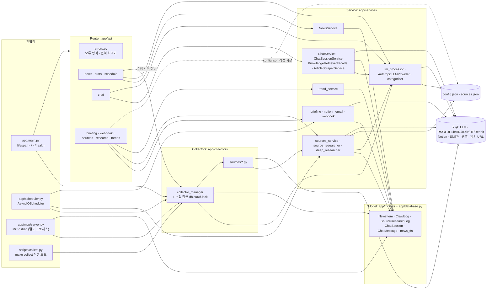
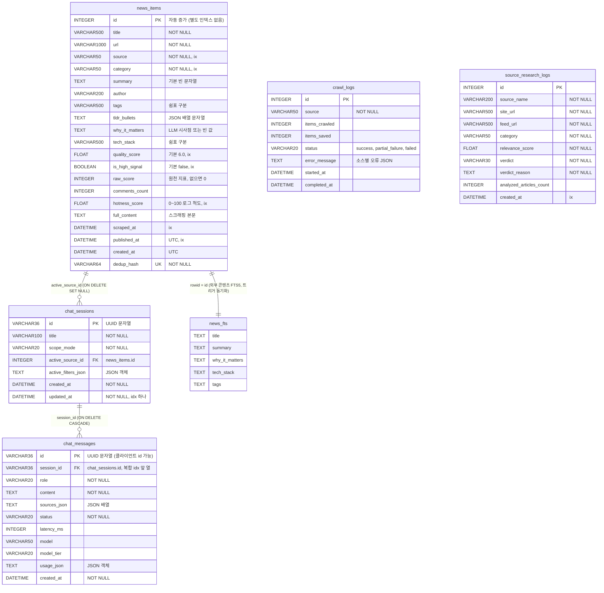
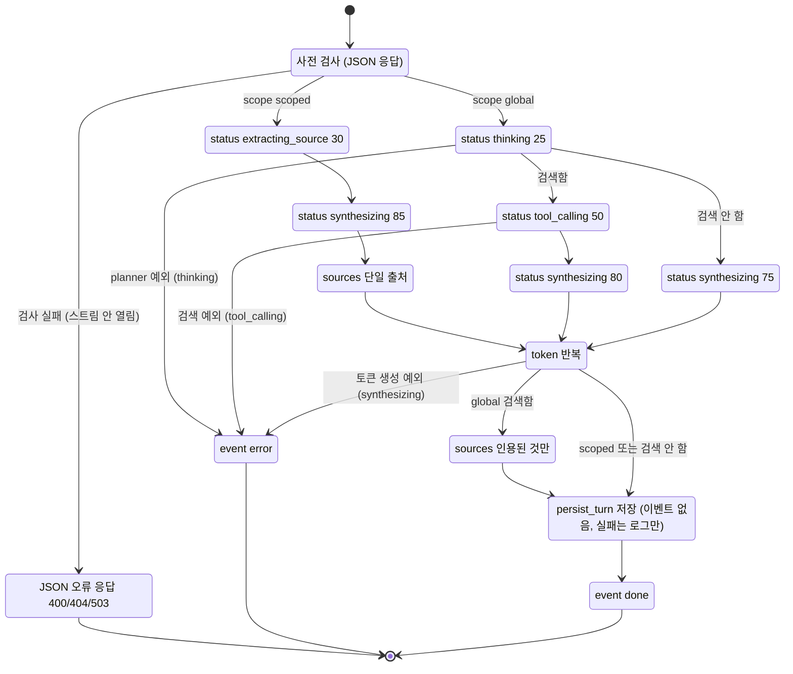

# AgentLens 백엔드 시스템 및 데이터베이스 설계서 (System Design & ERD)

- **작성일자**: 2026-11-09
- **Updated**: 2026-11-10
- **기준**: v0.4.2 (main)
- **작성자**: 백엔드 시스템 디자이너 (`system-designer`)
- **문서 버전**: v1.3 (v1.0 = v0.4.1 as-built, v1.1 = v0.4.2 구현 반영, v1.2 = 2차 수정, v1.3 = M003-01·4차 수정 반영)
- **상태**: Draft
- **성격**: as-built. 지금 코드(`backend/app/`, v0.4.2 작업 트리)를 그대로 적는다. 새 설계는 없다. v0.4.2 에서 바뀐 계약(2차 수정 포함)은 14절 '이번 변경' 표에 변경 전/후로 모았다. 다음 기능 작업은 이 문서를 고쳐 쓴다.
- **선행 산출물 (읽기 전용)**: `docs/fullstack-architect/01_ARCHITECTURE_ADR.md` (머리 기준 v0.4.2), `docs/spec-writer/fsd/01_NEWS_FEED_SPECIFICATION.md` ~ `07_UI_COMMON_SPECIFICATION.md`, `docs/contract-integrator/01_CONTRACT_AND_MSW_SPEC.md` v1.4
- **짝 산출물**: [`02_OPENAPI_SPEC.yaml`](./02_OPENAPI_SPEC.yaml) (FastAPI `app.openapi()` 자동 생성 + 보충, 생성 스크립트 `.claude/skills/contract-specification/scripts/gen_openapi.py`)
- **근거 규칙**: 코드 사실은 `path:line`. 서버를 띄워 확인하지 않은 동작은 '코드상 판단' 으로 적는다. 2026-11-10 에 실행한 것: `VERSION=0.4.2` 를 붙여 `gen_openapi.py`(2차 반영 뒤 경로 30, operation 33, 스키마 54), FastAPI 라우트 나열(`/api` 아래 28 경로·31 operation + `/`·`/health`), 빈 DB 에 `ensure_db_schema()` 두 번(backend·MCP·`make collect` 진입점 import 각각, 2차 반영 뒤 다시), 로컬 `backend/agentlens.db` 를 읽기 전용(`mode=ro`)으로 열어 `user_version`·미래 시각·인기 점수 확인 (원본은 쓰지 않았다).
- **설치본 버전 (`.venv`, 2026-11-10 확인)**: fastapi 0.162.2, starlette 1.10.0, pydantic 2.14.3, sqlalchemy 2.1.8, SQLite 3.51.0 (CLI). `backend/requirements.txt` 는 운영 의존성만 두고 주 버전 상한(`<다음 주 버전`, 0.x 는 `<1`)을 건다. 테스트 의존성은 `backend/requirements-dev.txt` 에 있다.

---

## 1. 백엔드 모듈 아키텍처 및 계층도 (Layered Architecture)

### 1.1 디렉터리 (지금 코드)

```
backend/
├── app/
│   ├── main.py            # FastAPI 앱, lifespan(스키마·스케줄러·빈 DB 첫 수집), CORS, 오류 처리기 설치, GET / · /health
│   ├── config.py          # pydantic-settings Settings, config.json 탐색·캐시·저장(save_json_config), DB 경로 고정(resolve_database_url)
│   ├── time_utils.py      # iso_utc(): 응답 시각을 UTC 오프셋 ISO 문자열로 (v0.4.2 2차)
│   ├── database.py        # async 엔진(sqlite+aiosqlite), PRAGMA, get_db(), 버전 붙은 마이그레이션(PRAGMA user_version), FTS DDL
│   ├── scheduler.py       # APScheduler AsyncIOScheduler, 잡 3개 (설정 시각·시간대)
│   ├── api/               # Router 계층: APIRouter 9개 + router.py(prefix=/api) + errors.py(오류 형식·전역 처리기)
│   │   ├── news.py  chat.py  briefing.py  schedule.py  sources.py
│   │   ├── research.py  trends.py  webhook.py  stats.py
│   │   ├── errors.py  router.py
│   ├── schemas/           # Pydantic 요청·응답 모델 (chat.py, news.py). 라우터 안 요청 모델 3개(WebhookTestRequest, AddRssRequest, InspectUrlRequest)
│   ├── services/          # Service 계층
│   │   ├── news_service.py  chat_service.py  chat_session_service.py  retriever.py  scraper.py
│   │   ├── llm_processor.py  llm_providers/{base.py, anthropic_provider.py}  categorizer.py
│   │   ├── briefing_service.py  notion_service.py  email_service.py  webhook_service.py
│   │   ├── sources_service.py  source_researcher.py  deep_researcher.py  trend_service.py
│   ├── models/            # SQLAlchemy ORM (news.py: NewsItem·CrawlLog·SourceResearchLog, chat_session.py: ChatSession·ChatMessage)
│   ├── collectors/        # 수집기: manager.py(CollectorManager, 프로세스 사이 수집 잠금), sources/{rss, hackernews, github, arxiv, huggingface, reddit}.py
│   ├── mcp/server.py      # MCP stdio 서버 (별도 프로세스, python -m app.mcp.server)
│   └── config/sources.json  # sources.json 거울 사본
└── tests/                 # pytest (conftest.py: 실행마다 임시 DB, 설정 파일 사본, 흉내 LLM, 외부 요청 차단)
```

새 파일 (2차): `backend/app/time_utils.py`. v0.4.2 에서 지운 파일: `backend/app/api/mcp.py`(`GET /api/mcp/info`), `backend/app/services/agentic_search.py`(쓰지 않던 `AgenticSearchService`). 옮긴 파일: `backend/app/collectors/categorizer.py` → `backend/app/services/categorizer.py`. 새 파일: `backend/app/api/errors.py`, `backend/app/services/news_service.py`.

repository 계층은 없다. 서비스가 `AsyncSession` 으로 SQLAlchemy 쿼리를 직접 쓴다.

### 1.2 계층 의존 그래프 (import 기준)



점선은 1.3 의 '목표 규약과 다른 곳' 이다. 모든 라우터의 오류는 `R_ERR` 이 설치한 처리기를 거친다 (`backend/app/main.py:60`).

### 1.3 목표 규약(Router → Service → Model 단방향)과 지금 코드

| 규약 | 지금 코드 | 근거 |
|---|---|---|
| Router 는 Service 만 부른다 | 지킨다 (v0.4.2, ARCH-01). `api/` 의 어떤 파일도 `app.models` 를 import 하지 않는다. 뉴스 목록·RSS·통계·수집 로그·전체 삭제는 `NewsService` 가, 챗 스트림의 scoped 기사 사전 확인은 `ChatService.get_source_detail` 이 맡는다 | `backend/app/api/news.py:13`, `backend/app/api/stats.py:5`, `backend/app/api/schedule.py:9`, `backend/app/api/chat.py:114`, `grep "from app.models" backend/app/api` 결과 없음 |
| Router → 수집기 진입점 | `schedule` 라우터만 `collector_manager`·`acquire_crawl_lock`·`release_crawl_lock` 을 부른다 (수집 시작, 리셋 중 잠금). 진행 카운터 초기화는 `collector_manager.reset_progress()` 로 한다 | `backend/app/api/schedule.py:8`, `:43`, `:75-86`, `backend/app/collectors/manager.py:108-114` |
| 예외: 설정 저장 | `POST /api/briefing/settings` 는 서비스 없이 라우터가 `settings.raw_json_config` 깊은 사본을 고쳐 `save_json_config` 를 부른다 | `backend/app/api/briefing.py:136-187` |
| Service 는 Router 를 모른다 | 지킨다 | `grep "from app.api" backend/app/services` 결과 없음 |
| Service 와 수집기는 한 방향 | 지킨다 (v0.4.2). 수집기 → 서비스만 있다: `collectors/manager.py` → `services/categorizer`·`services/llm_processor`, `collectors/sources/*` → `services/sources_service`. 서비스가 `app.collectors` 를 import 하는 곳은 없다 (categorizer 를 `services/` 로 옮겼다) | `backend/app/collectors/manager.py:14-15`, `backend/app/collectors/sources/rss.py:10`, `grep "app.collectors" backend/app/services` 결과 없음 |
| Model 은 상위 계층을 모른다 | `models/*.py` 는 지킨다 (`app.database.Base` 만 import). 예외: `database.py` 의 마이그레이션 m003 이 인기 점수 재계산에 `services/categorizer.calculate_hotness`(순수 함수)를, GitHub 폴백 판정에 `services/sources_service`(감시 저장소 목록 읽기)를 import 한다 | `backend/app/models/news.py:3`, `backend/app/models/chat_session.py:5`, `backend/app/database.py:47`, `:126-127`, `:148` |
| 스키마(DTO) 위치 | `app/schemas/chat.py`·`news.py`. 라우터 파일 안 요청 모델 3개 | `backend/app/api/webhook.py:8`, `backend/app/api/sources.py:9`, `backend/app/api/research.py:7` |
| 오류 형식 한 곳 | `backend/app/api/errors.py` 가 형식·상태별 기본 코드·처리기 3개를 정한다. chat 라우터는 `error_response()` 로 구체 코드를 직접 만들고, sources 라우터는 `ApiError` 를 던진다 | `backend/app/api/errors.py:21-125`, `backend/app/api/chat.py:11`, `backend/app/api/sources.py:4`, `:24` |
| 트랜잭션 경계는 Service 단위 | 대부분 지킨다. 세션 업서트·리셋 삭제는 서비스가 한 번 커밋한다. 챗 스트림 저장은 요청 세션으로 두 번 커밋한다 (4.2) | `backend/app/services/chat_session_service.py:304`, `backend/app/services/news_service.py:144` |

서비스 인스턴스 생명주기

| 종류 | 객체 | 근거 |
|---|---|---|
| 모듈 싱글턴 (프로세스 메모리 상태) | `collector_manager`, `llm_processor`(`_qa_cache`·`_eval_cache`·`_ollama_cache`, 모두 TTL·크기 제한), `deep_researcher`(`is_running`, `last_run_summary`), `sources_service`(파일 캐시), `briefing_service`, `trend_service`, `notion_service`, `email_service`, `webhook_service`, `source_researcher` | `backend/app/collectors/manager.py:343`, `backend/app/services/llm_processor.py:172-174`, `backend/app/services/deep_researcher.py:140-143`, `backend/app/services/sources_service.py:48` |
| 요청마다 `AsyncSession` 을 받아 만든다 | `NewsService`, `ChatService`, `ChatSessionService`, `KnowledgeRetrieverFacade`/`SqliteFtsRetriever`, `ArticleScraperService` (L1 캐시·URL 잠금은 클래스 변수라 프로세스 공유) | `backend/app/services/news_service.py:54-56`, `backend/app/services/chat_service.py:72-76`, `backend/app/services/scraper.py:74-77` |

v0.4.2 에서 `llm_processor.last_usage` 싱글턴을 없앴다. 토큰 사용량은 호출마다 `usage_out` dict 로 받는다 (`backend/app/services/llm_processor.py:395-399`, `:467-471`).

### 1.4 수집기·스케줄러·MCP·시작 경계

**수집기 (`backend/app/collectors`)**

- 진입점은 `collector_manager.collect_all()` 하나다 (`backend/app/collectors/manager.py:245`). 부르는 곳:

| 호출자 | 위치 | 프로세스 |
|---|---|---|
| 스케줄 잡 `daily_crawl` (`scheduler.crawl_hours` 시 0분, `scheduler.timezone`) | `backend/app/scheduler.py:18-20`, `:50-56` | backend |
| `POST /api/schedule/trigger` (BackgroundTasks) | `backend/app/api/schedule.py:55` | backend |
| `POST /api/schedule/reset-and-collect` (BackgroundTasks, 삭제 뒤) | `backend/app/api/schedule.py:89` | backend |
| lifespan, `news_items` 가 0건일 때 `asyncio.create_task` | `backend/app/main.py:29-37` | backend |
| MCP 도구 `trigger_agentlens_crawl` (끝날 때까지 await) | `backend/app/mcp/server.py:61-66` | MCP 프로세스 |
| `make collect` 직접 모드 (`ensure_db_schema()` 후 `collect_all()`). backend 가 떠 있으면 같은 DB 는 수집 잠금으로 하나만 수집한다고 경고하고, 잠금을 못 쥐어 `already_running` 이면 stderr `수집 실패: status=already_running …` 후 종료 코드 1 (4차) | `scripts/collect.py:128-160` | 스크립트 프로세스 |
| `make collect` API 모드 (`/api/schedule/trigger` 후 `/progress` 폴링). 응답이 `already_running` + `other_process: true`(다른 프로세스 수집)면 기다리지 않고 stderr 안내 후 종료 코드 1 | `scripts/collect.py:61-90`, `:73-76` | backend |

- 흐름 (`backend/app/collectors/manager.py:245-341`):
  1. 이 프로세스가 수집 중이면 `already_running`. 아니면 프로세스 사이 수집 잠금 `<db 파일>.crawl.lock` 을 비차단 `flock` 으로 쥔다. 못 쥐면(다른 프로세스가 같은 DB 에 수집 중) `already_running` (`:246-251`, `:54-91`).
  2. 소스 6종(`fetch_rss`, `fetch_hackernews`, `fetch_github`, `fetch_arxiv`, `fetch_huggingface`, `fetch_reddit`)을 `asyncio.gather` 로 동시에 돈다 (`:264-290`).
  3. 소스마다 `_process_and_save_batch`: 항목별 LLM 평가·분류·요약(`_prepare_row`)을 **DB 잠금 밖에서** 끝낸 뒤, `asyncio.Lock`(`_db_lock`) 안에서 한 세션·한 트랜잭션으로 `dedup_hash` 조회 → INSERT/UPDATE → 커밋. 실패하면 롤백하고 예외를 올려 그 소스를 실패로 남긴다 (`:139-243`). 분류기와 LLM 평가가 모두 분야를 정하지 못한(`unrelated`) 항목은 피드의 `category_hint`(RSS 항목에 실린다)를 기본 분야로 쓴다. 평가(`is_worthwhile`)를 통과한 항목에만 적용되므로 AI 관련성 검사는 그대로다 (4차, `:163-165`, `backend/app/collectors/sources/rss.py:80`).
  4. 평가한 항목이 0건이면 시드 2건을 같은 경로로 저장한다 (`:293-297`).
  5. `crawl_logs` 1행: 실패한 소스가 없으면 `success`, 모두 실패면 `failed`, 일부면 `partial_failure`. `error_message` 는 `{소스 이름: 오류}` JSON (`:299-317`).
  6. `finally` 에서 `is_running=False`, 잠금 해제 (`:339-341`).
- 수집기는 `services/llm_processor`(평가), `services/categorizer`(분류·dedup·화제성), `services/sources_service`(활성 소스 목록)를 쓴다. 수집 대상 목록은 DB 가 아니라 `sources.json` 이다.
- 진행 상태는 메모리 필드(`is_running`, `current_source`, `step_message`, `items_*`, `completed_sources`, `last_crawl_time`)로만 남는다 (`backend/app/collectors/manager.py:94-137`). 문구에 이모지가 없다.
- 원천 지표: RSS·arXiv 는 `raw_score`·`comments_count` 0 (`backend/app/collectors/sources/rss.py:79-81`, `arxiv.py:48-49`), Hugging Face 는 실제 `upvotes`·`numComments` (`huggingface.py:33-34`), GitHub 감시 저장소는 GitHub API 의 실제 별·포크·`pushed_at`, 못 받으면 건너뛴다 (`github.py:51-78`). 시각은 오프셋을 반영해 UTC 로 바꿔 저장한다 (`manager.py:171-175`, `rss.py:27-35`). 날짜가 없는 RSS 항목은 수집 시각을 쓴다 (`rss.py:66-67`).

**스케줄러 (`backend/app/scheduler.py`)**

| 잡 id | 트리거 | 호출 | 근거 |
|---|---|---|---|
| `daily_crawl` | `CronTrigger(hour=settings.CRAWL_SCHEDULE_HOURS, minute="0", timezone=settings.CRAWL_TIMEZONE)` — config.json `scheduler.crawl_hours`(기본 `[0,6,12,18]`), `scheduler.timezone`(기본 `UTC`) | `collector_manager.collect_all()` | `backend/app/scheduler.py:49-56` |
| `deep_research` | `CronTrigger(hour="3,15", minute="0", timezone="UTC")` (설정 없음, 고정) | `deep_researcher.run_deep_research()` (기본 `max_candidates=8`) | `backend/app/scheduler.py:10-11`, `:57-63`, `backend/app/services/deep_researcher.py:380` |
| `daily_briefing_dispatch` | `CronTrigger(hour=settings.BRIEFING_AUTO_DISPATCH_HOUR, minute="15", timezone=settings.CRAWL_TIMEZONE)` — config.json `briefing.auto_dispatch_hour`(기본 0) | `briefing_service.auto_dispatch_all()` | `backend/app/scheduler.py:64-70` |

- `scheduler.enabled` 가 false 면 스케줄러를 띄우지 않는다 (`backend/app/scheduler.py:72-75`, `backend/app/config.py:70`).
- `GET /api/schedule/status` 의 `schedule_hours` 는 import 때 계산한 `SCHEDULED_HOURS`, `next_run` 은 `daily_crawl` 잡의 `next_run_time`(잡이 없으면 설정 시각으로 계산) (`backend/app/scheduler.py:9`, `:32-45`). 잡과 이 값은 프로세스 시작 때 한 번 정해진다. 설정 파일을 고친 뒤 반영하려면 재시작해야 한다 (설정 재적용 누락: 수용된 위험, 사실로만 적는다).
- 잡은 backend 의 이벤트 루프에서 돈다. 수집 잡이 다른 수집과 겹치면 `collect_all()` 이 `already_running` dict 를 돌려주고 잡은 그 값을 버린다 (`backend/app/scheduler.py:18-20`).
- `auto_dispatch_all` 은 `NOTION_AUTO_EXPORT and NOTION_API_KEY` 일 때 Notion, `EMAIL_AUTO_SEND and SMTP_HOST and SMTP_TO` 일 때 이메일, `webhooks.auto_dispatch_daily_briefing`(기본 true)이 참이고 URL 이 있으면 Slack·Discord 웹훅을 보낸다 (`backend/app/services/briefing_service.py:224-273`).

**MCP (`backend/app/mcp/server.py`)**

- `mcp` 2.x 의 `MCPServer` 를 먼저 import 하고, 없으면(1.x) `FastMCP` 를 쓴다 (`backend/app/mcp/server.py:7-12`). backend 와 다른 프로세스(stdio)로 뜬다. HTTP 로 노출하지 않는다 (v0.4.2 에서 `GET /api/mcp/info` 를 지웠다. 프론트 MCP 모달은 설정 예시를 하드코딩하고 `cwd`·`command` 를 바꾸라고 안내한다).
- DB 경로는 `settings.DATABASE_URL` 이고 상대 SQLite 경로는 `backend/` 기준이라 backend 와 같은 파일을 쓴다 (12.1). 도구를 처음 부를 때 `ensure_db_schema()` 를 한 번 부른다 (`:16-23`).

| 도구 | 동작 | 근거 |
|---|---|---|
| `get_latest_harness_methods(limit=10)` | `category == "harness"`, `hotness_score` 내림차순 | `backend/app/mcp/server.py:25-33` |
| `get_mcp_and_skills_ecosystem(limit=10)` | `category == "mcp_plugins_skills"` | `backend/app/mcp/server.py:35-43` |
| `search_agent_news(query, category="all", limit=10)` | `title`·`summary` ILIKE | `backend/app/mcp/server.py:45-59` |
| `trigger_agentlens_crawl()` | MCP 프로세스 안에서 `collect_all()` 을 끝까지 실행. backend 나 `make collect` 가 수집 중이면 잠금 때문에 `already_running` | `backend/app/mcp/server.py:61-66` |

- MCP 프로세스의 `collector_manager` 는 backend 와 별개 인스턴스다. 수집 중복은 파일 잠금이 막지만, backend 의 `GET /api/schedule/progress`·`/status` 의 `is_running` 에는 MCP 수집이 보이지 않는다.

**시작·종료 (lifespan, `backend/app/main.py:24-48`)**

1. `ensure_db_schema()` (3.2). 실패하면 예외가 올라가 앱이 뜨지 않는다.
2. `start_scheduler()` (`scheduler.enabled` 가 false 면 건너뜀).
3. `news_items` 건수가 0 이면 `collect_all()` 을 백그라운드 태스크로 띄우고 바로 요청을 받는다. 그동안 `GET /health` 의 `running` 은 `true` 다. 태스크 예외는 콜백이 출력한다 (`:16-21`).
4. 종료 때 끝나지 않은 첫 수집 태스크를 취소하고, 스케줄러를 내리고, 엔진을 dispose 한다.

**외부 의존 경계**

| 대상 | 클라이언트 | 타임아웃 | 근거 |
|---|---|---|---|
| Anthropic | httpx `AsyncClient` (SDK 아님) | 45초(일괄), 120초(스트림) | `backend/app/services/llm_providers/anthropic_provider.py:230`, `:284` |
| OpenAI | httpx(일괄), `openai.AsyncOpenAI`(스트림) | 60초(일괄) | `backend/app/services/llm_processor.py:325`, `:514-523` |
| Ollama | httpx `AsyncClient` 90초(일괄)/120초(스트림). 가용 판정도 비동기 `AsyncClient` 1초, 결과 30초 캐시 | — | `backend/app/services/llm_processor.py:342`, `:545`, `:225-257` |
| Gemini | httpx `AsyncClient` REST 20초 (모델 이름에 `gemini` 가 있을 때만). v0.4.2 2차에서 쓰지 않던 `google-genai` 의존성을 지웠다 (`backend/requirements.txt`) | 20초 | `backend/app/services/llm_processor.py:286` |
| 수집 소스 | httpx `AsyncClient` (RSS 피드당 6초·세마포어 6, 그 밖 10~12초) | 6~12초 | `backend/app/collectors/sources/rss.py:46-52`, `arxiv.py:18`, `github.py:21` |
| 기사 스크래핑 | httpx + trafilatura → readability-lxml (추출은 `asyncio.to_thread`) | `settings.SCRAPER_TIMEOUT_SECONDS` (기본 5초) | `backend/app/services/scraper.py:116`, `:134` |
| Notion | httpx `AsyncClient` | 10~15초 | `backend/app/services/notion_service.py:43`, `:241`, `:264` |
| SMTP | `smtplib` 을 `asyncio.to_thread` 로 | 12초 | `backend/app/services/email_service.py:164-169`, `:229`, `:269` |
| 웹훅 | httpx `AsyncClient` | 8초 | `backend/app/services/webhook_service.py:22` |
| 임의 URL (inspect-url, 딥 리서치) | httpx `AsyncClient`, 리다이렉트 따라감 | 3~10초 | `backend/app/services/source_researcher.py:57`, `:105`, `:126`, `backend/app/services/deep_researcher.py:225`, `:257`, `:272` |

LLM 우선순위는 Anthropic → OpenAI → Ollama 이고 Gemini 는 모델을 명시했을 때만 쓴다. Ollama 는 `GET {주소}/api/tags`(1초)가 200 이고 설정 모델(태그 생략 시 `:latest`)이 설치돼 있어야 쓸 수 있다 (`backend/app/services/llm_processor.py:236-257`, `:351-375`). Anthropic 일괄 호출도 `stop_reason == "max_tokens"` 면 실패로 보고 다음 공급자로 넘어간다 (`backend/app/services/llm_providers/anthropic_provider.py:236-238`).

### 1.5 공통 HTTP 규약

- **베이스 URL**: `uvicorn app.main:app`, :8000 (`docker-compose.yml:15` 의 `BACKEND_PORT` 기본 8000). 업무 API 는 `APIRouter(prefix="/api")` 아래 라우터 9개(news, schedule, stats, briefing, trends, webhook, sources, research, chat) (`backend/app/api/router.py:12-21`). 접두사 밖은 `GET /`, `GET /health` (`backend/app/main.py:64`, `:68`). `/docs`, `/redoc`, `/openapi.json` 이 열린다 (`backend/app/main.py:50`). 런타임 `/openapi.json` 은 FastAPI 기본 422 검증 응답을 실제 응답인 400 `ErrorResponse` 로 바꿔 싣고 `HTTPValidationError`·`ValidationError` 컴포넌트를 뺀다 (`backend/app/api/errors.py:81-119`, v0.4.2 2차 Q13).
- **프록시**: 브라우저는 상대 경로 `/api/...` 를 부르고 Next rewrite 가 `/api/:path*` 를 `${INTERNAL_API_URL}/api/:path*`(기본 `http://127.0.0.1:8000`)로 넘긴다 (`frontend/next.config.ts:23-31`). 서버 측 렌더링은 `INTERNAL_API_URL` → `NEXT_PUBLIC_API_URL` → `http://127.0.0.1:8000` 순 (`frontend/src/lib/api.ts:52-59`).
- **기사 Ask AI 스트림**: `NEXT_PUBLIC_API_URL` 이 있으면 그 backend 에 직접 붙고, 없으면(기본 빈 값) 같은 출처 rewrite 를 쓴다. 브라우저가 `:8000` 을 짐작하지 않는다. 직접 연결이 실패하면(AbortError 제외) 같은 출처로 한 번 더 시도한다 (`frontend/src/lib/api.ts:66-68`, `:130-160`). 챗 스트림·세션은 `frontend/src/lib/chatApi.ts` 가 상대 경로로 부른다 (`chatApi.ts:53-90`).
- **인증**: 없다 (수용된 위험, 사실로만 적는다).
- **CORS**: `CORSMiddleware(allow_origins=["*"], allow_credentials=True, allow_methods=["*"], allow_headers=["*"])` (`backend/app/main.py:51-57`). v0.4.2 에서 쓰이지 않던 `CORS_ORIGINS` 설정을 지웠다. 동작은 그대로 전체 허용이다 (수용된 위험).
- **Content-Type**: 요청은 JSON. chat 의 `POST /stream`, `POST /sessions` 는 본문 바인딩 대신 `await request.json()` 으로 직접 읽어 자동 생성 OpenAPI 에 요청 본문 스키마가 없다 (`backend/app/api/chat.py:74`, `:163`). `02_OPENAPI_SPEC.yaml` 은 둘에 `requestBody` 를 보충했다. 응답은 대부분 `application/json`, 예외는 `GET /api/news/feed/rss.xml`(`application/xml`), `POST /api/news/{id}/ask/stream`(`text/event-stream`), `POST /api/chat/stream`(`text/event-stream; charset=utf-8`).
- **오류 형식**: 모든 오류는 `{"error_code", "message", "details"}` 다 (8절).
- **로깅**: `print` 와 `logging.getLogger("agentlens.*")` 가 섞여 있고 로깅 설정은 없다. 처리하지 않은 예외는 `agentlens.api` 로거가 스택을 남긴다 (`backend/app/api/errors.py:75-78`).

---

## 2. 데이터베이스 엔티티 관계도 (Mermaid ERD)

### 2.1 저장소 개요

| 저장소 | 종류 | 정의 위치 | 소유 |
|---|---|---|---|
| SQLite DB (`backend/agentlens.db`, Docker `/app/data/agentlens.db`) | 테이블 5개 + FTS5 가상 테이블 1개 + 트리거 3개, `PRAGMA user_version` = 3 | `backend/app/models/news.py`, `backend/app/models/chat_session.py`, `backend/app/database.py:49-210` | backend (MCP·`make collect` 도 같은 파일) |
| 수집 잠금 파일 `<db>.crawl.lock` | 빈 파일 + `flock` | `backend/app/collectors/manager.py:54-91` | backend·MCP·`make collect` 공유 |
| `config.json` (저장소 루트) | 앱 설정 JSON | `backend/app/config.py:15-47` | backend (읽기, `POST /api/briefing/settings` 로 쓰기) |
| `sources.json` (루트, `backend/app/config/sources.json`) | 수집 소스 목록 JSON | `backend/app/services/sources_service.py` | backend (읽기·쓰기) |
| 브라우저 localStorage | 키 4종 | 11.3 | frontend |
| 프로세스 메모리 | 수집 진행 상태, LLM 캐시 3종(TTL), 스크래핑 L1 캐시, 딥 리서치 상태, 설정 파일 캐시, 스케줄러 job | `backend/app/collectors/manager.py:94-106`, `backend/app/services/llm_processor.py:172-174`, `backend/app/services/scraper.py:74-77`, `backend/app/services/deep_researcher.py:140-143`, `backend/app/config.py:29`, `backend/app/services/sources_service.py:48` | backend (재시작하면 사라진다) |

### 2.2 ERD



`crawl_logs`, `source_research_logs` 는 다른 테이블과 관계가 없다. v0.4.2 에서 테이블·열은 바뀌지 않았고 인덱스 5개를 지웠다 (3.1, 3.2).

### 2.3 공통 규칙

- 기본값은 모두 Python 쪽 `default=` 다. `server_default` 가 없어 DDL 에 DEFAULT 절이 없고, ORM 을 거치지 않은 INSERT 에는 기본값이 들어가지 않는다.
- `nullable` 을 쓰지 않은 열은 SQLAlchemy 기본값대로 NULL 을 허용한다(PK 제외).
- `DateTime` 열은 모두 `timezone=True` 없이 선언됐다. 코드는 UTC 로 넣는다: 수집은 오프셋 있는 값을 `astimezone(utc)` 로 바꿔 저장하고 (`backend/app/collectors/manager.py:171-175`), 모델 기본값은 `datetime.now(timezone.utc)`. 읽은 값이 naive 면 UTC 로 간주한다 (`backend/app/services/categorizer.py:143-144`, `backend/app/schemas/news.py:32-36`). API 로 내보낼 때는 `iso_utc()` 가 UTC 오프셋을 붙인다 (`backend/app/time_utils.py:6-21`, 8.4).
- 문자열 길이(`String(n)`)는 SQLite 가 강제하지 않는다.
- 인덱스 이름은 SQLAlchemy 명명 규칙(`ix_<테이블>_<열>`)과 모델의 명시 이름(`idx_*`)이다. 2026-11-10 빈 DB 에 `ensure_db_schema()` 를 돌려 `sqlite_master` 로 확인했다 (3.1).

### 2.4 news_items — 수집·선별된 소식

모델: `backend/app/models/news.py:5-39`

| 열 | 타입 | NULL | 기본값 | 인덱스/제약 | 의미 |
|---|---|---|---|---|---|
| id | INTEGER | 아니오 | 자동 증가 | PK (rowid) | 소식 ID |
| title | VARCHAR(500) | 아니오 | — | — | 제목. RSS 는 `[피드명] 제목` (`backend/app/collectors/sources/rss.py:73`) |
| url | VARCHAR(1000) | 아니오 | — | — | 원문 URL |
| source | VARCHAR(50) | 아니오 | — | `ix_news_items_source` | 수집처 값 (2.9) |
| category | VARCHAR(50) | 아니오 | — | `ix_news_items_category` | 카테고리 4종. 분류기·LLM 평가가 정하지 못하면 피드의 `category_hint` (4차, `backend/app/collectors/manager.py:163-165`) |
| summary | TEXT | 예 | `""` | — | 요약. RSS 는 320자에서 자르고 `...` (`rss.py:76`) |
| author | VARCHAR(200) | 예 | NULL | — | 작성자 |
| tags | VARCHAR(500) | 예 | `""` | — | 쉼표 구분 키워드 (`backend/app/collectors/manager.py:193`) |
| tldr_bullets | TEXT | 예 | `"[]"` | — | JSON 문자열 배열, 최대 3개, 규칙 기반 (`backend/app/services/llm_processor.py:776-818`) |
| why_it_matters | TEXT | 예 | `""` | — | LLM 평가가 준 시사점(10자 초과)만. 없으면 빈 값 (v0.4.2, 카테고리 고정 문장 제거, `llm_processor.py:811-813`) |
| tech_stack | VARCHAR(500) | 예 | `""` | — | 쉼표 구분 기술·모델 이름 (`manager.py:196`) |
| quality_score | FLOAT | 예 | 6.0 | `ix_news_items_quality_score` | 품질 점수 1.0~10.0 |
| is_high_signal | BOOLEAN | 예 | False | `ix_news_items_is_high_signal` | 고신호 여부 (`HIGH_SIGNAL_THRESHOLD` 이상, 기본 7.0) |
| raw_score | INTEGER | 예 | 0 | — | 원천 인기 지표(별, 업보트, 포인트). RSS·arXiv 는 0 (1.4) |
| comments_count | INTEGER | 예 | 0 | — | 댓글·포크 수 |
| hotness_score | FLOAT | 예 | 0.0 | `ix_news_items_hotness_score` | 화제성 0~100: `min(100, 20·log10(1 + (raw + comments·2.5 + 5) / (hours+2)^1.3))` (`backend/app/services/categorizer.py:140-150`) |
| full_content | TEXT | 예 | NULL | — | 스크래핑한 본문 (`backend/app/services/scraper.py:171-184`) |
| scraped_at | DATETIME | 예 | NULL | `ix_news_items_scraped_at` | 스크래핑 시각 |
| published_at | DATETIME | 예 | 현재 UTC | `ix_news_items_published_at` | 원문 발행 시각 (UTC) |
| created_at | DATETIME | 예 | 현재 UTC | — | 행 생성 시각 |
| dedup_hash | VARCHAR(64) | 아니오 | — | UNIQUE `ix_news_items_dedup_hash` | `sha256(영숫자·한글만 남긴 소문자 제목 + "::" + utm 파라미터·끝 / 를 뗀 URL)` (`categorizer.py:84-88`) |

복합 인덱스: `idx_category_published(category, published_at)`, `idx_category_hotness(category, hotness_score)`, `idx_high_signal(is_high_signal, hotness_score)` (`backend/app/models/news.py:35-39`).

| 쓰는 동작 | 위치 |
|---|---|
| INSERT (신규), UPDATE (같은 `dedup_hash` 면 raw_score·comments_count 는 큰 값, hotness·quality·is_high_signal 은 덮어쓰기, why_it_matters 가 비어 있으면 요약 필드 채움) | `backend/app/collectors/manager.py:216-237` |
| UPDATE full_content, scraped_at (스크래퍼 자기 세션) | `backend/app/services/scraper.py:171-184` |
| DELETE 전체 (`reset-and-collect`) | `backend/app/services/news_service.py:137-145` |
| 테스트 시드 | `backend/tests/conftest.py` |

읽는 코드: `services/news_service.py`(목록·RSS·통계·단건), `services/chat_service.py`, `services/chat_session_service.py`, `services/retriever.py`, `services/briefing_service.py:62-94`, `services/trend_service.py:40-44`, `services/deep_researcher.py:185`, `mcp/server.py`, `main.py:29-30`(시작 시 건수).

v0.4.2 이전에 저장된 행은 마이그레이션 m003 이 한 번 보정한다 (3.2): 미래 시각이 있는 국내 RSS 피드 9시간 당김, 옛 합성 지표 0 (GitHub 은 `stars_hint` 로 만든 감시 저장소 폴백 행만), 인기 점수 재계산. 가려낼 수 없는 행(날짜 없는 피드, 9시간보다 오래된 글만 있는 KST 피드)과 카테고리 고정 시사점은 그대로라 바꾸려면 `make reset` 으로 재수집한다.

### 2.5 news_fts — 전문 검색 인덱스 (FTS5 가상 테이블)

- ORM 모델이 없다. DDL 은 `backend/app/database.py:155-174` 한 곳(`FTS_DDL`)이고 `ensure_db_schema()` 만 실행한다. 검색 경로(`retriever.py`)는 테이블을 만들거나 커밋하지 않는다 (v0.4.2, CC-03).
- 정의: `fts5(title, summary, why_it_matters, tech_stack, tags, content='news_items', content_rowid='id')` (외부 콘텐츠 테이블).
- 동기화 트리거: `news_items_ai`(AFTER INSERT), `news_items_ad`(AFTER DELETE), `news_items_au`(AFTER UPDATE).
- 재구축: `ensure_db_schema()` 가 `news_fts_docsize` 행 수와 `news_items` 행 수가 다르면 `INSERT INTO news_fts(news_fts) VALUES('rebuild')` (`backend/app/database.py:177-185`). 외부 콘텐츠 FTS 의 `count(*)` 는 `news_items` 를 세기 때문에 `_docsize` 로 센다.
- FTS 질의가 결과 없음이거나 오류면 `LIKE` 로 대체한다 (`backend/app/services/retriever.py:257-263`).

### 2.6 crawl_logs — 수집 실행 기록

모델: `backend/app/models/news.py:41-51`

| 열 | 타입 | NULL | 기본값 | 인덱스 | 의미 |
|---|---|---|---|---|---|
| id | INTEGER | 아니오 | 자동 증가 | PK | |
| source | VARCHAR(50) | 아니오 | — | — | 코드가 쓰는 값은 `all_sources_stream_ingestion` 하나 (`manager.py:309`) |
| items_crawled | INTEGER | 예 | 0 | — | 평가한 항목 수 |
| items_saved | INTEGER | 예 | 0 | — | 신규 저장 수 |
| status | VARCHAR(20) | 예 | `"success"` | — | `success`, `partial_failure`, `failed` (`manager.py:300-306`) |
| error_message | TEXT | 예 | NULL | — | 실패한 소스가 있으면 `{"소스 이름": "오류"}` JSON (`manager.py:313`) |
| started_at | DATETIME | 예 | 현재 UTC | — | |
| completed_at | DATETIME | 예 | 현재 UTC | — | |

- 쓰기: `collect_all()` 이 끝날 때 한 행 (`manager.py:307-317`). 그 밖의 전역 예외면 행을 남기지 않는다 (`manager.py:335-338`).
- 읽기: `GET /api/schedule/status` 가 `id` 내림차순 최근 5행 (`backend/app/services/news_service.py:125-135`).
- 삭제: `POST /api/schedule/reset-and-collect` (`news_service.py:143`).

### 2.7 source_research_logs — 딥 리서치 소스 판정 기록

모델: `backend/app/models/news.py:53-65`

| 열 | 타입 | NULL | 기본값 | 인덱스 | 의미 |
|---|---|---|---|---|---|
| id | INTEGER | 아니오 | 자동 증가 | PK | |
| source_name | VARCHAR(200) | 아니오 | — | — | 후보 소스 이름 |
| site_url | VARCHAR(500) | 아니오 | — | — | 탐색 대상 URL |
| feed_url | VARCHAR(500) | 아니오 | — | — | 발견한 피드 URL (실패 시 대상 URL) |
| category | VARCHAR(50) | 아니오 | `"ai_news"` | — | 추정 카테고리 |
| relevance_score | FLOAT | 아니오 | 0.0 | — | 키워드 규칙 점수 (탐지 실패 시 2.0) |
| verdict | VARCHAR(30) | 아니오 | — | — | 판정 (2.9) |
| verdict_reason | TEXT | 아니오 | — | — | 한국어 판정 이유 |
| analyzed_articles_count | INTEGER | 예 | 0 | — | 분석한 피드 항목 수 |
| created_at | DATETIME | 예 | 현재 UTC | `ix_source_research_logs_created_at` | |

- 쓰기: `_run_cycle()` 이 후보마다 한 행을 `session.add` 하고 사이클 끝에 한 번 커밋 (`backend/app/services/deep_researcher.py:441-509`).
- 읽기: `GET /api/research/audit-logs` → `get_audit_logs()` (`deep_researcher.py:158-183`).
- 삭제하는 코드가 없다. 리셋도 지우지 않는다.

### 2.8 chat_sessions · chat_messages — AI 챗 세션

`chat_sessions` 모델: `backend/app/models/chat_session.py:7-32`

| 열 | 타입 | NULL | 기본값 | 인덱스/제약 | 의미 |
|---|---|---|---|---|---|
| id | VARCHAR(36) | 아니오 | `uuid4()` 문자열 | PK | 세션 UUID. `POST /api/chat/sessions` 가 보낸 값이면 UUID 형식을 검사한다 (`backend/app/services/chat_session_service.py:233-237`). 챗 스트림의 `session_id` 도 UUID 여야 한다 (v0.4.2 2차, `backend/app/api/chat.py:101-106`) |
| title | VARCHAR(100) | 아니오 | `"새 대화"` | — | 첫 사용자 질문으로 자동 생성 (`chat_session_service.py:62-73`, `:368-369`) |
| scope_mode | VARCHAR(20) | 아니오 | `"global"` | — | `global` 또는 `scoped` |
| active_source_id | INTEGER | 예 | NULL | FK → `news_items.id` ON DELETE SET NULL | scoped 챗의 대상 소식 |
| active_filters_json | TEXT | 예 | NULL | — | 포커스 필터 JSON (2.10) |
| created_at | DATETIME | 아니오 | 현재 UTC | — | |
| updated_at | DATETIME | 아니오 | 현재 UTC, 갱신 시 현재 UTC | `idx_chat_sessions_updated_at` (하나) | 정렬·FIFO 기준 |

- 관계: `messages` (cascade `all, delete-orphan`, `created_at` 오름차순) (`chat_session.py:23-28`).
- 쓰기: `POST /api/chat/sessions` (`chat_session_service.py:231-305`), `POST /api/chat/stream` 토큰 생성이 끝난 뒤 `done` 앞에서 자동 저장 (`backend/app/services/chat_service.py:670-688` → `persist_turn`).
- 삭제: `DELETE /api/chat/sessions/{id}` (`chat_session_service.py:307-324`), FIFO 보존 (12.3).
- 읽기: `GET /api/chat/sessions`(limit 1~50, 기본 30, `backend/app/api/chat.py:141-154`), `GET /api/chat/sessions/{id}`.

`chat_messages` 모델: `backend/app/models/chat_session.py:34-57`

| 열 | 타입 | NULL | 기본값 | 인덱스/제약 | 의미 |
|---|---|---|---|---|---|
| id | VARCHAR(36) | 아니오 | `uuid4()` 문자열 | PK | 클라이언트가 만든 id 를 받는다 |
| session_id | VARCHAR(36) | 아니오 | — | FK → `chat_sessions.id` ON DELETE CASCADE. 단일 인덱스 없음 (복합 인덱스 앞 열) | |
| role | VARCHAR(20) | 아니오 | — | — | `user`, `assistant`, `system` |
| content | TEXT | 아니오 | — | — | 본문 |
| sources_json | TEXT | 예 | NULL | — | 인용 출처 JSON 배열 |
| status | VARCHAR(20) | 아니오 | `"completed"` | — | 메시지 상태 |
| latency_ms | INTEGER | 예 | NULL | — | 응답 지연 |
| model | VARCHAR(50) | 예 | NULL | — | 응답 모델 식별자 |
| model_tier | VARCHAR(20) | 예 | NULL | — | `haiku`, `sonnet`, `opus` |
| usage_json | TEXT | 예 | NULL | — | 토큰 사용량 JSON 객체 |
| created_at | DATETIME | 아니오 | 현재 UTC | — | |

복합 인덱스: `idx_chat_messages_session_created(session_id, created_at)` (`chat_session.py:55-57`).

- 쓰기: `append_messages_batch()` (`chat_session_service.py:326-411`). 이 세션에 이미 있는 id 와 같은 배치 안 중복 id 는 건너뛴다. **다른 세션**에 있는 id 가 섞이면 `MessageIdConflictException` 으로 아무것도 쓰지 않는다 (`:413-423`). `created_at` 은 받은 ISO 값, 없으면 서버 시각에 메시지 순서대로 1µs 씩 더한 값 (`:398`). `model_tier`·`usage`·`latency_ms`·`sources` 를 받은 그대로 저장한다 (v0.4.2, CT-004).
- `persist_turn` 은 `ChatStreamRequest.user_message_id`·`assistant_message_id` 가 있으면 그 id 로, 없으면 uuid4 로 저장한다. 건너뛴 자리는 `None` 으로 돌려준다 (`chat_session_service.py:425-466`).

### 2.9 열거형·고정 값

| 값 | 정의 위치 | 비고 |
|---|---|---|
| 카테고리: `harness`, `mcp_plugins_skills`, `agent_tech`, `ai_news` | `backend/app/services/categorizer.py:7-12`, `manager.py:160`, 챗 필터 `backend/app/schemas/chat.py:23`(+`all`), `AddRssRequest.category_hint` `backend/app/api/sources.py:14` | 분류 결과 `unrelated` 는 저장하지 않는다 (`manager.py:166-169`). LLM 평가 응답의 `irrelevant` 도 저장 대상이 아니다 (`llm_processor.py:728`) |
| 브리핑 분야 이름 | `backend/app/services/briefing_service.py:16-45` | `하네스 & 벤치마크`, `MCP & 생태계`, `에이전트 아키텍처`, `최신 AI 동향` (프론트 긴 라벨과 같다). `icon` 은 분야 id |
| `news_items.source`: `rss`, `rss_kr`, `hackernews`, `github`, `arxiv`, `huggingface`, `reddit` (기본 `web`) | `collectors/sources/rss.py:69`, `hackernews.py:35`, `github.py:40`, `:72`, `arxiv.py:44`, `huggingface.py:29`, `reddit.py:32`, 기본값 `manager.py:144` | `rss_kr` 은 피드의 `country == "KR"` |
| `chat_messages.role`: `user`, `assistant`, `system` | `schemas/chat.py:19`, `:166` | |
| `chat_messages.status`: `pending`, `streaming`, `completed`, `error`, `aborted` | `schemas/chat.py:170` | 서버 스트림이 저장하는 값은 `completed` 뿐 (`chat_session_service.py:447-458`) |
| `chat_messages.model_tier`: `haiku`, `sonnet`, `opus` | `schemas/chat.py:9` | |
| `chat_sessions.scope_mode`: `global`, `scoped` | `schemas/chat.py:183`, `:196`, `:207` | |
| 챗 필터 `time_range`: `all`, `24h`, `7d`, `30d` / `sort`: `hot`, `latest`, `quality` | `schemas/chat.py:24-25` | |
| `source_research_logs.verdict`: `AUTO_ADOPTED`, `WATCHLIST`, `REJECTED`, `ALREADY_MONITORED` | `models/news.py:62`, `services/deep_researcher.py:351-360` | 임계값: 8.2 이상 채택, 6.5 이상 워치리스트 |
| `crawl_logs.status`: `success`, `partial_failure`, `failed` | `manager.py:300-306` | 모델 기본값은 `success` (`models/news.py:48`) |
| 피드 `country`: `KR`, `GLOBAL` | `api/sources.py:15` | POST 가 검증한다 |
| 품질 임계: `QUALITY_CUTOFF_SCORE`(기본 5.0), `HIGH_SIGNAL_THRESHOLD`(기본 7.0, 루트 config.json 도 7.0) | `backend/app/config.py:87-88`, `config.json:23-24` | 사용 `llm_processor.py:633-634`, `:725-726`. v0.4.2 에서 기본값을 7.0 하나로 맞췄다 |

### 2.10 JSON 으로 저장되는 열

| 열 | 구조 | 쓰기 / 읽기 |
|---|---|---|
| `news_items.tldr_bullets` | `string[]` (최대 3개, `"핵심 주제: …"`, `"관련 기술/모델: …"`, `"주요 내용: …"`) | 쓰기 `manager.py:194` / 읽기 `news_service.py:19-25` (목록이 아니면 한 항목, 깨졌으면 `[]`) |
| `news_items.tags`, `tech_stack` | JSON 아님. 쉼표로 이은 문자열 | 읽을 때 `split_csv` (`news_service.py:15-16`) |
| `chat_sessions.active_filters_json` | `ChatFocusFilter`: `{category, time_range, sort, high_signal_only}` (`schemas/chat.py:22-26`) | 쓰기 `model_dump_json()` (`chat_session_service.py:240`) / 읽기 실패 시 None (`chat_session_service.py:97-101`) |
| `chat_messages.sources_json` | `ChatSourceItem[]`: `{index, type, id?, title, url, source, category?, quality_score?, score?, snippet?, full_content?, domain?, relevance_score?, published_at?, publisher?}` (`schemas/chat.py:72-87`) | 쓰기 `chat_session_service.py:371-377` |
| `chat_messages.usage_json` | `TokenUsageMeta`: `{input_tokens, output_tokens, cache_read_input_tokens?, cache_creation_input_tokens?}` (`schemas/chat.py:12-16`) | 쓰기 `chat_session_service.py:379-385` |

---

## 3. 인덱싱 및 쿼리 최적화 전략 (Indexing Strategy)

### 3.1 인덱스와 대상 쿼리

빈 DB 에 `ensure_db_schema()` 를 돌려 `sqlite_master` 로 확인한 목록 (2026-11-10, 실행 확인). `sqlite_autoindex_chat_*_1` 은 VARCHAR PK 의 자동 인덱스다.

| 테이블명 | 인덱스 컬럼 | 인덱스 유형 | 생성 목적 및 대상 쿼리 |
| :--- | :--- | :--- | :--- |
| `news_items` | `id` | PK (rowid) | 단건 조회 `session.get(NewsItem, id)`. v0.4.2 에서 중복 `ix_news_items_id` 를 지웠다 |
| `news_items` | `dedup_hash` | UNIQUE B-Tree | 수집 배치의 기존 행 조회 `WHERE dedup_hash = ?` (`collectors/manager.py:221-223`), 중복 INSERT 차단 |
| `news_items` | `category`, `source` | B-Tree | `GET /api/news` 필터, MCP `category ==`, `GET /api/stats` GROUP BY (`services/news_service.py:69-72`, `:114-117`) |
| `news_items` | `(category, published_at)` | Composite B-Tree | 카테고리 + 최신순 (`sort=latest`, RSS `category` 필터 + `published_at desc`) |
| `news_items` | `(category, hotness_score)` | Composite B-Tree | 카테고리 + 화제순 (`sort=hot` 기본, 브리핑 분야 상위, MCP 도구) |
| `news_items` | `(is_high_signal, hotness_score)` | Composite B-Tree | `high_signal_only=true` + 화제순 |
| `news_items` | `quality_score`, `hotness_score`, `is_high_signal`, `published_at`, `scraped_at` | 단일 B-Tree | 정렬·필터 (`sort=quality`, 검색 후보 `quality_score >= min_quality`, RSS·레이더 최신순) |
| `news_fts` | `title, summary, why_it_matters, tech_stack, tags` | FTS5 (BM25) | 챗 global 검색 (`services/retriever.py:184-263`) |
| `crawl_logs` | `id` | PK | `/api/schedule/status` 최근 5행 `ORDER BY id DESC`. v0.4.2 에서 `ix_crawl_logs_id` 를 지웠다 |
| `source_research_logs` | `created_at` | B-Tree | `/api/research/audit-logs` `ORDER BY created_at DESC LIMIT n`. v0.4.2 에서 `ix_source_research_logs_id` 를 지웠다 |
| `chat_sessions` | `updated_at` (`idx_chat_sessions_updated_at`) | B-Tree | 세션 목록 `ORDER BY updated_at DESC`, FIFO `ORDER BY updated_at ASC LIMIT excess` (`chat_session_service.py:84-90`, `:498-512`). v0.4.2 에서 같은 열의 `ix_chat_sessions_updated_at` 을 지웠다 |
| `chat_messages` | `(session_id, created_at)` | Composite B-Tree | `selectinload` 의 `WHERE session_id IN (...)`, 세션 내 시간순, FK cascade. v0.4.2 에서 앞 열이 같은 `ix_chat_messages_session_id` 를 지웠다 |

인덱스로 해결되지 않는 쿼리 (코드상 판단, 측정 안 함):

- `GET /api/news?search=` 는 `ILIKE '%term%'` 를 열 5개에 OR 로 건다 (`services/news_service.py:75-85`). 앞 와일드카드라 전체 스캔이다. 같은 질의를 `count` 와 본문에 두 번 실행한다 (`:87`, `:98`).
- `GET /api/chat/sessions` 는 `selectinload(messages)` 로 목록 세션의 메시지 전체를 읽어 `len()` 과 마지막 메시지만 쓴다 (`chat_session_service.py:82-122`).
- `GET /api/trends/radar` 는 최근 500건을 읽어 파이썬에서 센다 (`services/trend_service.py:40-44`).

### 3.2 스키마 생성·변경 (마이그레이션 영향, SQLite)

마이그레이션 도구(Alembic 등)는 없다. `ensure_db_schema()` (`backend/app/database.py:202-210`) 가 앱 시작(`main.py:26`), MCP 도구 첫 호출(`mcp/server.py:19-23`), `make collect` 직접 모드(`scripts/collect.py:143`), 테스트 fixture(`backend/tests/conftest.py:16-17`)에서 돈다.

| 순서 | 동작 | 트랜잭션 | 위치 |
|---|---|---|---|
| 1 | `Base.metadata.create_all` — 없는 테이블·인덱스만 만든다. 있는 테이블의 열은 바꾸지 않는다 | `engine.begin()` ① | `database.py:207-208` |
| 2 | `PRAGMA user_version` 을 읽고, `MIGRATIONS` 목록 중 그보다 번호가 큰 단계만 차례로 실행하고 단계마다 `PRAGMA user_version = n` | `engine.begin()` ② | `database.py:188-198` |
| 2-1 | `_m001_add_v24_columns`: `news_items.full_content`·`scraped_at`, `chat_messages.model_tier`·`usage_json` 이 없으면 ALTER ADD, `ix_news_items_scraped_at` 생성 | ② | `database.py:56-68` |
| 2-2 | `_m002_drop_duplicate_indexes`: `ix_news_items_id`, `ix_crawl_logs_id`, `ix_source_research_logs_id`, `ix_chat_sessions_updated_at`, `ix_chat_messages_session_id` 를 `DROP INDEX IF EXISTS` | ② | `database.py:71-75` |
| 2-3 | `_m003_fix_legacy_news_rows` (2차, N-11): ① `source='rss_kr'` 행 가운데 `published_at > created_at` 인 행이 하나라도 있는 피드(제목 머리 `[피드명]`)는 +09:00 시각을 벽시계로 저장한 피드로 보고 그 피드 행을 모두 9시간 당긴다 ② 옛 합성 지표를 0 으로: RSS 180·150, arXiv 120, HF `댓글 + 40`, GitHub 감시 저장소 폴백 행만(M003-01: URL 이 `sources.json` 감시 저장소이고 별 = `stars_hint`(없으면 5000), 포크 = int(별 × 0.12) 인 행), 시드 2건 ③ 모든 행의 `hotness_score` 를 새 식으로 다시 계산 (기준 시각은 `created_at`). 다시 돌려도 결과가 같다 | ② | `database.py:94-150` (GitHub 규칙 `:124-137`) |
| 3 | `_ensure_fts`: FTS 테이블·트리거 `IF NOT EXISTS`, `news_fts_docsize` 행 수가 `news_items` 와 다르면 `rebuild` | ② | `database.py:177-185` |

- 실패는 `logger.exception` 으로 남기고 예외를 올린다. 예전처럼 삼키지 않는다 (`database.py:193-197`). 그래서 마이그레이션이 실패하면 backend 가 뜨지 않는다.
- 단계는 멱등이어야 한다. `user_version` 이 없던 옛 DB 는 0 에서 시작해 세 단계를 다시 돌고, `IF EXISTS`·열 존재 검사 덕에 안전하다 (`database.py:78-79` 주석).
- 확인 (2026-11-10): 빈 DB 에 두 번 → `user_version` 3, 위 3.1 인덱스 목록(16개, 자동 인덱스 포함). backend·MCP·`make collect` 진입점 import 각각에서 빈 DB 생성 성공 (1차). 로컬 `backend/agentlens.db` (읽기 전용으로 열어 확인): `user_version` 3, `published_at > created_at` 0행, `hotness_score >= 100` 3행. m003 은 사용자 `make dev`(--reload) 가 이미 적용했다. 2차 변경 요약 기록: 9시간 당긴 행 429(AI타임스 241, GeekNews 188), 미래 시각 395 → 0, 지표 0 처리 rss_kr 475·rss 316·HF 612·GitHub 감시 저장소 폴백 8, 재계산 4874행, 100점 1222 → 3, 가려내지 못한 KST 피드 토스 테크 5·네이버 D2 5 (이 숫자는 이 문서가 재현하지 않았다). M003-01: 처음 규칙(포크 비율·발행 ≈ 수집 1시간)이 실제 GitHub 행 448개의 지표도 0 으로 지웠다. 규칙을 감시 저장소 폴백만으로 좁혔고, 사용자 DB 의 그 448행은 m003 전 사본 값으로 되돌렸다. 진짜 폴백 8행은 0 으로 남는다.
- **새 스키마 변경 절차**: 모델을 고치고 `MIGRATIONS` 끝에 멱등 함수를 하나 더한다. 열 추가 외 변경(타입·제약·삭제·이름 변경)은 SQLite `ALTER TABLE` 이 직접 지원하지 않아 테이블 재생성 단계를 따로 써야 한다. 영향 대상: `backend/agentlens.db`, Docker volume `agentlens-data` 의 `/app/data/agentlens.db`. 테스트 DB 는 실행마다 새로 만든다 (12.1).

---

## 4. 트랜잭션 및 동시성 제어 정책 (Concurrency & Transactions)

### 4.1 연결·세션 설정 (`backend/app/database.py:6-40`)

| 항목 | 값 |
|---|---|
| 드라이버 | `sqlite+aiosqlite` (async), `create_async_engine(echo=False, future=True)` |
| connect_args | `timeout=30.0`, `check_same_thread=False` |
| PRAGMA (연결마다) | `journal_mode=WAL`, `synchronous=NORMAL`, `cache_size=-64000`(약 64MB), `busy_timeout=30000`, `foreign_keys=ON` |
| 세션 | `async_sessionmaker(expire_on_commit=False)` |
| 요청 세션 `get_db()` | `yield session` → 정상 종료 시 `commit()`, 예외 시 `rollback()` 후 다시 던짐, 마지막에 `close()` |
| 격리 수준 | 따로 지정하지 않는다. SQLite 는 쓰기 트랜잭션을 한 번에 하나만 허용하고(WAL 에서 읽기는 동시 가능), 다른 쓰기는 `busy_timeout` 30초까지 기다린다 |
| 낙관적 락·버전 열 | 없다 |

- `get_db` 의 종료 코드는 응답을 다 보낸 뒤에 돈다 (설치본 FastAPI 0.162.2, 2026-11-09 확인: `.venv/lib/python3.11/site-packages/fastapi/routing.py:148-154`). 그래서 SSE 응답은 스트림이 끝날 때까지 요청 세션을 붙잡는다.

### 4.2 트랜잭션 경계 (흐름별)

| 흐름 | 커밋 지점 | 원자성 | 근거 |
|---|---|---|---|
| `POST /api/schedule/reset-and-collect` | 수집 잠금을 쥔 채 `NewsService.delete_all_news_and_logs()` 가 `delete(NewsItem)`·`delete(CrawlLog)` 후 한 번 커밋 → 잠금 해제 → BackgroundTasks 로 수집 | 삭제 둘은 한 트랜잭션. 수집은 별개 | `backend/app/api/schedule.py:75-89`, `backend/app/services/news_service.py:137-145` |
| 수집 소스 배치 `_process_and_save_batch` | 평가는 트랜잭션 밖. 저장은 `_db_lock` 안에서 소스 하나 = 세션 하나 = 커밋 하나. 예외면 롤백하고 올린다 | 소스 단위 | `backend/app/collectors/manager.py:206-243` |
| 수집 종료 `crawl_logs` | 별도 세션에서 1행 커밋 | 배치들과 별개 | `manager.py:307-317` |
| `POST /api/chat/sessions` | 다른 세션 id 검사(읽기) → 세션 행 INSERT/UPDATE `flush` → 메시지 배치 `flush`(`commit=False`) → FIFO 삭제 `flush` → **한 번 커밋** → `populate_existing` 으로 다시 읽은 상세 | 한 트랜잭션 (v0.4.2, ARCH-03). 메시지 id 충돌이면 아무것도 바꾸기 전에 400. 오류 분기(400·500)는 응답 전에 라우터가 요청 세션을 롤백한다 — 오류 응답을 정상 반환하면 `get_db` 가 커밋하기 때문이다 (2차, ARCH-03R) | `backend/app/services/chat_session_service.py:231-305`, `:413-423`, `backend/app/api/chat.py:179-189` |
| `POST /api/chat/stream` 저장 | 토큰·(global 검색 시) `sources` 를 보낸 뒤, `done` 을 보내기 **전에** `persist_turn` → `append_messages_batch`(커밋) → FIFO(커밋). 실패는 로그만 남기고 `done` 을 보낸다. `error` 이벤트로 끝난 턴은 저장하지 않는다 | 요청 세션으로 두 번 커밋. `done` 을 받은 시점에는 저장이 끝나 있다 | `backend/app/services/chat_service.py:670-690`, `chat_session_service.py:405-411` |
| scoped 챗 스크래핑 | 본문을 받으면 **스크래퍼 자기 세션**(`AsyncSessionLocal`)으로 `UPDATE news_items` 후 커밋. 요청 세션은 중간에 커밋하지 않는다 | 스크래핑 단위 | `backend/app/services/scraper.py:169-184` |
| 코퍼스 검색 | 읽기만 한다. FTS 생성·`rebuild`·커밋을 하지 않는다 (v0.4.2) | — | `backend/app/services/retriever.py:184-263` |
| `DELETE /api/chat/sessions/{id}` | `session.delete` + 커밋, 실패 시 서비스가 롤백 후 `SessionDeleteFailedException`, 라우터가 500 전에 한 번 더 롤백 (2차, ARCH-03R) | 한 트랜잭션 (ORM cascade 로 메시지 포함) | `chat_session_service.py:307-324`, `backend/app/api/chat.py:219-222` |
| 딥 리서치 사이클 | 채택한 후보는 그때 바로 `sources.json` 에 쓰고(파일), 감사 로그는 사이클 끝에 한 번 커밋. 채택 저장이 `SourcesWriteError` 로 실패하면 그 후보를 `WATCHLIST`(사유: 저장 실패)로 기록하고 다음 후보를 계속 본다 (4차) | 파일과 DB 가 따로. 사이클이 그 밖의 예외로 끝나면 채택된 소스만 남고 로그는 없다 | `backend/app/services/deep_researcher.py:441-509` |
| `ensure_db_schema` | `create_all` 한 트랜잭션, 마이그레이션+FTS 한 트랜잭션 | 단계 실패 시 두 번째 트랜잭션 전체 롤백 후 예외 | `backend/app/database.py:202-210` |
| `POST /api/briefing/settings` | DB 없음. 깊은 사본을 고쳐 `config.json.tmp` 에 쓰고 `replace`(OSError 면 제자리 쓰기) → `settings.reload()` | 쓰기 도중 실패해도 원본 파일과 메모리 설정이 그대로다 | `backend/app/api/briefing.py:139`, `backend/app/config.py:178-199` |
| sources.json 저장 | `.tmp` 쓰기 → `replace()`, `OSError` 면 제자리 쓰기 → 거울 사본 쓰기. 실패하면 `SourcesWriteError` → 500 | 정본과 거울이 따로 쓰인다 | `backend/app/services/sources_service.py:125-156`, `backend/app/api/sources.py:19-24` |

### 4.3 동시 실행 방지

| 대상 | 장치 | 범위 | 빈틈 | 근거 |
|---|---|---|---|---|
| 수집 `collect_all` | 메모리 플래그 `is_running` + 프로세스 사이 파일 잠금 `<db>.crawl.lock` (비차단 `fcntl.flock(LOCK_EX \| LOCK_NB)`). 프로세스가 죽으면 OS 가 잠금을 푼다. `fcntl` 이 없으면(Windows) `threading.Lock` 비차단 잠금으로 대체한다 (2차, ADR Q12) | 같은 DB 파일을 쓰는 backend·MCP·`make collect` (Windows 대체 잠금은 한 프로세스 안만) | `flock` 은 같은 호스트·파일시스템에서만 유효하다 (Docker backend 와 호스트의 MCP 는 DB 파일 자체가 다르다). Windows 에서는 프로세스 사이 중복 수집을 막지 못한다 | `backend/app/collectors/manager.py:54-91`, `:245-251`, `:339-341` |
| 수동 수집 API | `collector_manager.is_busy()`: 이 프로세스 플래그를 보고, 아니면 잠금을 잠깐 쥐었다 놓아 다른 프로세스 수집을 확인. 다른 프로세스면 응답에 `other_process: true` | 같은 DB | 확인과 BackgroundTasks 시작 사이에 다른 프로세스가 잠금을 쥐면 응답은 `started` 지만 `collect_all` 이 `already_running` 을 내고 끝난다 | `backend/app/collectors/manager.py:116-124`, `backend/app/api/schedule.py:43-55` |
| `reset-and-collect` | 이 프로세스가 수집 중이면 지우지 않는다. 아니면 잠금을 쥔 채로 지우고, 못 쥐면 지우지 않는다 | 같은 DB | 잠금을 놓고 BackgroundTasks 가 수집을 시작하기 전 틈에 다른 프로세스가 수집을 시작할 수 있다. 그때 재수집은 `already_running` 으로 건너뛴다 | `backend/app/api/schedule.py:64-89` |
| 수집 배치 저장 | `asyncio.Lock` (`_db_lock`) 으로 소스 배치 저장을 직렬화. LLM 평가는 잠금 밖 | 프로세스 하나 | 쓰기 트랜잭션은 저장 루프 동안만 열린다 (v0.4.2, PERF-02) | `manager.py:106`, `:206-243` |
| 딥 리서치 | 메모리 플래그 `is_running`, `try/except/finally`. 실패하면 `last_run_summary = {status: "error", error, completed_at}`. `run-deep` 은 태스크 참조를 모듈 집합에 보관 | 프로세스 하나 | 스케줄 잡과 API 가 같은 플래그를 본다 | `backend/app/services/deep_researcher.py:380-407`, `backend/app/api/research.py:24`, `:47-53` |
| 기사 스크래핑 | URL 마다 `asyncio.Lock` (single-flight), L1 재확인. 잠금 표는 `WeakValueDictionary` 라 쓰지 않는 잠금은 사라진다 | 프로세스 하나 | — | `backend/app/services/scraper.py:77-91`, `:159-164` |
| sources.json 읽기-수정-쓰기 | 장치 없음. 서비스 메서드가 동기 함수라 한 프로세스 안에서는 끼어들 await 가 없다 | backend 프로세스 하나 | 파일을 쓰는 것은 backend 뿐이다 (소스 API, 딥 리서치). MCP·`make collect` 수집은 읽기만 한다. 손으로 파일을 고치면 (mtime, size) 가 바뀌어 다시 읽힌다 | `backend/app/services/sources_service.py:55-68`, `:193-265` |
| config.json 쓰기 | 장치 없음 | — | 동시 저장 시 마지막 쓰기가 이긴다 | `backend/app/config.py:178-199` |
| 스케줄 잡 겹침 | APScheduler 기본값. 수집 잡은 `collect_all` 의 플래그·잠금으로 막힌다 | 프로세스 하나 | 브리핑 발송 잡은 중복 방지 없음 (하루 한 번 cron) | `backend/app/scheduler.py:47-70` |

### 4.4 비동기 경로의 블로킹 호출

| 호출 | 위치 | 영향 (코드상 판단, 측정 안 함) |
|---|---|---|
| `BeautifulSoup(text, "html.parser")` HTML 파싱 (CPU) | `backend/app/services/source_researcher.py:84`, `backend/app/services/deep_researcher.py:243` | inspect-url·딥 리서치에서 큰 HTML 이면 이벤트 루프를 잠깐 멈춘다 |
| `ET.fromstring` arXiv XML 파싱 | `backend/app/collectors/sources/arxiv.py:24` | 응답 하나, 작다 |
| 설정·소스 파일 쓰기 (동기 파일 I/O) | `backend/app/config.py:178-199`, `backend/app/services/sources_service.py:125-156` | 저장할 때만, 작은 파일 |
| `acquire_crawl_lock()` (`open` + 비차단 `flock`) | `backend/app/collectors/manager.py:67-82` | 기다리지 않는다 |
| 해소됨 (v0.4.2) | Ollama 판정 비동기 + 30초 캐시 (`llm_processor.py:225-257`), 본문 추출 `asyncio.to_thread` (`scraper.py:134`), `feedparser.parse` `asyncio.to_thread` (`rss.py:56`, `source_researcher.py:136`, `deep_researcher.py:282`), config.json·sources.json 은 (mtime, size) 가 같으면 다시 읽지 않음 (`config.py:29-47`, `sources_service.py:55-68`), `smtplib` 은 `asyncio.to_thread` (`email_service.py:229`, `:269`) | — |

### 4.5 공유 메모리 상태

| 상태 | 위치 | 비고 |
|---|---|---|
| 토큰 사용량 | 호출마다 `usage_out` dict (`llm_processor.py:395-429`, `:467-494`) | 공유 상태 없음 (v0.4.2, BUG-09) |
| `_eval_cache` (5000개, 24시간), `_qa_cache` (1000개, 6시간), `_ollama_cache` (8개, 30초) | `backend/app/services/llm_processor.py:93-134`, `:172-174` | `TTLCache`. 휴리스틱 폴백 평가는 캐시하지 않는다 (`:773-774`). 기사 Ask AI 의 휴리스틱 폴백 답도 `_qa_cache` 에 넣지 않는다 (2차, N-08, `:1004-1007`). `reset-and-collect` 가 셋 다 비운다 (`clear_caches`, `:177-181`) |
| 스크래핑 L1 캐시 | `backend/app/services/scraper.py:74-75` | `OrderedDict` 500개 LRU |
| 설정 파일 캐시 | `backend/app/config.py:29`, `backend/app/services/sources_service.py:48` | (mtime_ns, size) 가 같으면 깊은 사본을 준다 |
| 수집 진행 카운터 | `backend/app/collectors/manager.py:94-114` | `reset-and-collect` 는 `reset_progress()` 로 초기화한다 |

---

## 5. RESTful API 엔드포인트 명세 목록 (Endpoint Catalog)

상세 YAML 스펙은 [`02_OPENAPI_SPEC.yaml`](./02_OPENAPI_SPEC.yaml) 을 참조한다. 총 **33개** (News 3, Chat 6, Briefing 7, Schedule 4, Sources 4, Research 4, Trends 1, Webhook 1, Stats 1, 기타 2). 2026-11-10 `app.openapi()` 결과와 같다 (경로 30개, operation 33개). Auth 는 전부 없음(Public). v0.4.2 에서 호출처가 없던 11개를 지웠다 (14절).

| Method | Endpoint Path | Summary | Auth | Request Body | Response Body | 라우터 | 프론트 사용처 |
| :---: | :--- | :--- | :---: | :--- | :--- | :--- | :--- |
| `GET` | `/` | 서비스 이름·버전 | Public | - | `RootResponse` (dict) | `main.py` | 없음 |
| `GET` | `/health` | 헬스체크 | Public | - | `HealthResponse` (dict) | `main.py` | 없음 (docker-compose healthcheck) |
| `GET` | `/api/news` | 뉴스 목록 (필터·정렬·페이지) | Public | - | `NewsListResponse` | `news.py` | `fetchNewsFeed` |
| `POST` | `/api/news/{news_id}/ask/stream` | 기사 Ask AI (SSE) | Public | `AskQuestionRequest` | SSE `NewsAskStreamEvent` | `news.py` | `askQuestionAboutNewsStream` |
| `GET` | `/api/news/feed/rss.xml` | RSS 2.0 피드 | Public | - | `application/xml` | `news.py` | 없음 (`Header.tsx:36` `RSS_FEED_URL` 링크) |
| `GET` | `/api/chat/sources/{source_id}` | 챗 핸드오버용 기사 상세 | Public | - | `ChatSourceDetailResponse` | `chat.py` | `fetchChatSourceDetail` (`chatApi.ts`) |
| `POST` | `/api/chat/stream` | 챗 질의 (SSE) | Public | `ChatStreamRequest` (직접 파싱) | SSE status/sources/token/done/error | `chat.py` | `openChatStream` (`chatApi.ts`) |
| `GET` | `/api/chat/sessions` | 대화 세션 목록 | Public | - | `List[ChatSessionSummary]` | `chat.py` | `fetchChatSessions` (`chatApi.ts`) |
| `POST` | `/api/chat/sessions` | 대화 세션 생성/업서트 | Public | `ChatSessionCreateRequest` (직접 파싱) | `ChatSessionDetail` (201) | `chat.py` | `saveChatSession` (`chatApi.ts`) |
| `GET` | `/api/chat/sessions/{session_id}` | 대화 세션 상세 | Public | - | `ChatSessionDetail` | `chat.py` | `fetchChatSessionDetail` (`chatApi.ts`) |
| `DELETE` | `/api/chat/sessions/{session_id}` | 대화 세션 삭제 | Public | - | `GenericSuccessResponse` | `chat.py` | `deleteChatSession` (`chatApi.ts`) |
| `GET` | `/api/briefing/today` | 오늘의 브리핑 | Public | - | `DailyBriefingResponse` | `briefing.py` | `fetchDailyBriefing` |
| `POST` | `/api/briefing/export/notion` | 브리핑을 Notion 페이지로 | Public | `NotionExportRequest` (생략 가능) | `NotionExportResponse` | `briefing.py` | `exportBriefingToNotion` |
| `POST` | `/api/briefing/send/email` | 브리핑 이메일 발송 | Public | `EmailSendRequest` (생략 가능) | `EmailSendResponse` | `briefing.py` | `sendBriefingByEmail` |
| `POST` | `/api/briefing/test/notion` | Notion 연결 테스트 | Public | `TestNotionRequest` | `SuccessMessageResponse` (dict) | `briefing.py` | `testNotionConnection` |
| `POST` | `/api/briefing/test/email` | SMTP 연결 테스트 (테스트 메일 발송) | Public | `TestEmailRequest` | `SuccessMessageResponse` (dict) | `briefing.py` | `testEmailConnection` |
| `GET` | `/api/briefing/settings` | 브리핑·발송 설정 조회 | Public | - | `BriefingSettingsResponse` (dict) | `briefing.py` | `fetchBriefingSettings` |
| `POST` | `/api/briefing/settings` | 브리핑·발송 설정 저장 (config.json) | Public | `BriefingSettingsUpdate` | `SuccessMessageResponse` (dict) | `briefing.py` | `updateBriefingSettings` |
| `GET` | `/api/schedule/status` | 수집 스케줄·최근 로그 | Public | - | `ScheduleStatusResponse` | `schedule.py` | `fetchScheduleStatus` |
| `GET` | `/api/schedule/progress` | 수집 진행 상황 | Public | - | `CrawlProgressResponse` (dict) | `schedule.py` | `fetchCrawlProgress` |
| `POST` | `/api/schedule/trigger` | 수동 수집 시작 | Public | - | `ManualCollectResponse` | `schedule.py` | `triggerManualCollect` (`make collect` API 모드) |
| `POST` | `/api/schedule/reset-and-collect` | 뉴스·로그 전체 삭제 후 재수집 | Public | - | `ResetAndCollectResponse` (dict) | `schedule.py` | `resetAndRecollect` (`make reset`) |
| `GET` | `/api/sources` | 수집 소스 목록·통계 | Public | - | `SourcesListResponse` (dict) | `sources.py` | `fetchSources` |
| `POST` | `/api/sources/rss` | RSS 소스 추가 | Public | `AddRssRequest` | `AddRssResponse` (dict) | `sources.py` | `addRssSource` |
| `PATCH` | `/api/sources/{source_type}/{item_id}/toggle` | 소스 활성 토글 | Public | - | `StatusMessageResponse` (dict) | `sources.py` | `toggleSource` |
| `DELETE` | `/api/sources/{source_type}/{item_id}` | 소스 삭제 | Public | - | `StatusMessageResponse` (dict) | `sources.py` | `deleteSource` |
| `POST` | `/api/research/inspect-url` | URL 의 피드 탐지·평가 | Public | `InspectUrlRequest` | `InspectUrlResponse` (dict) | `research.py` | `inspectUrl` |
| `GET` | `/api/research/status` | 딥 리서치 상태 | Public | - | `DeepResearchStatusResponse` (dict) | `research.py` | `fetchDeepResearchStatus` |
| `GET` | `/api/research/audit-logs` | 딥 리서치 판정 기록 | Public | - (쿼리 `limit`) | `ResearchAuditLogsResponse` (dict) | `research.py` | `fetchResearchAuditLogs` |
| `POST` | `/api/research/run-deep` | 딥 리서치 즉시 실행 | Public | - (쿼리 `max_candidates`) | `RunDeepResponse` (dict) | `research.py` | `triggerDeepResearch` |
| `GET` | `/api/trends/radar` | 기술 레이더 집계 | Public | - | `TechRadarResponse` (dict) | `trends.py` | `fetchTechRadar` |
| `POST` | `/api/webhook/test` | 웹훅 테스트 메시지 발송 | Public | `WebhookTestRequest` | `SuccessMessageResponse` (dict) | `webhook.py` | `testWebhook` |
| `GET` | `/api/stats` | 뉴스 개수 통계 | Public | - | `StatsResponse` | `stats.py` | `fetchStats` |

`(dict)` 는 `response_model` 이 없어 자동 생성 OpenAPI 의 응답 스키마가 빈 `{}` 인 곳이다. 이름은 `02_OPENAPI_SPEC.yaml` 이 보충한 문서용 스키마다 (코드에 같은 이름의 클래스는 없다). 함수 이름이 `chatApi.ts` 라고 적힌 것 밖은 `frontend/src/lib/api.ts` 에 있다.

---

## 6. 엔드포인트 상세

각 항목: 파라미터·본문, 응답, 오류, 부수 효과, 관련 코드. 오류 본문 형식은 8절이고, 아래 '오류' 는 `error_code` 만 적는다. 쿼리·경로·본문 모델의 검증 실패는 모든 엔드포인트에서 400 `ERR_INVALID_PAYLOAD`(details `[{loc, msg}]`)다. 처리하지 않은 예외는 모든 엔드포인트에서 500 `ERR_SERVER_INTERNAL` 이다.

### 6.1 News

**GET /api/news** — 뉴스 목록을 필터·검색·정렬해 페이지 단위로 돌려준다 (`backend/app/api/news.py:17`, `backend/app/services/news_service.py:58-101`).

| 쿼리 | 타입 | 필수 | 기본값 | 제약 |
|---|---|---|---|---|
| `category` | string | 아니오 | 없음 | 소문자로 바꿔 일치 비교. `all` 이면 필터 없음 |
| `source` | string | 아니오 | 없음 | 소문자로 바꿔 일치 비교. `all` 이면 필터 없음 |
| `search` | string | 아니오 | 없음 | 앞뒤 공백 제거 후 `title`, `summary`, `tags`, `tech_stack`, `why_it_matters` 에 `ILIKE %search%` (OR) |
| `high_signal_only` | bool | 아니오 | `false` | `true` 면 `is_high_signal = true` 만 |
| `sort` | string | 아니오 | `hot` | `latest`(published_at desc), `top`(raw_score desc), `quality`(quality_score desc, hotness_score desc). 그 밖의 값은 모두 `hot`(hotness_score desc, published_at desc) |
| `page` | int | 아니오 | 1 | ≥ 1 |
| `size` | int | 아니오 | 20 | 1 ~ 100 |

- 응답 200 `NewsListResponse` 예:

```json
{
  "items": [ { "id": 1, "title": "...", "url": "https://...", "source": "hackernews", "category": "agent_tech",
    "summary": "", "author": null, "tags": ["agent"], "tldr_bullets": ["..."], "why_it_matters": "",
    "tech_stack": ["MCP"], "quality_score": 6.0, "is_high_signal": false, "raw_score": 0,
    "comments_count": 0, "hotness_score": 0.0, "published_at": "2026-11-06T01:02:03Z",
    "created_at": "2026-11-06T01:02:03Z", "dedup_hash": "..." } ],
  "total": 120, "page": 1, "size": 20, "total_pages": 6
}
```

- 변환: `tags`, `tech_stack` 쉼표 문자열 → 배열. `tldr_bullets` JSON 파싱(목록이 아니면 한 항목, 실패 시 `[]`). `quality_score` 가 0 이나 NULL 이면 6.0 (`news_service.py:28-51`). `published_at`·`created_at` 은 UTC 오프셋을 붙여 직렬화한다 (Pydantic 이 `Z` 로 쓴다, `backend/app/schemas/news.py:32-36`).
- 오류: 400 `ERR_INVALID_PAYLOAD` (`page` < 1, `size` 범위 밖 등). 부수 효과: 없음.

**POST /api/news/{news_id}/ask/stream** — 기사 제목·요약·카테고리·기술 스택을 넣은 프롬프트로 답을 SSE 로 보낸다 (`news.py:33-64`, `backend/app/services/llm_processor.py:881-1008`). 이벤트는 7.1.

- 경로 `news_id` (int). 본문 `AskQuestionRequest`: `question` (string, 필수, 1~2000자) (`backend/app/schemas/news.py:45-47`).
- 응답 200 `text/event-stream`, 헤더 `Cache-Control: no-cache, no-transform`, `Connection: keep-alive`, `X-Accel-Buffering: no` (`news.py:55-64`).
- 오류 (스트림을 열기 전): 404 `ERR_NOT_FOUND` "기사를 찾을 수 없습니다.", 400 `ERR_INVALID_PAYLOAD` (질문 길이·`news_id` 형식).
- 부수 효과: 외부 LLM 스트리밍(Anthropic → OpenAI SDK, 둘 다 토큰 전에 실패하면 휴리스틱 답). 끝까지 받은 LLM 답만 `_qa_cache`(1000개, 6시간)에 저장한다. 휴리스틱 폴백 답은 저장하지 않는다 (2차, N-08).

**GET /api/news/feed/rss.xml** — 최신 50건 RSS 2.0 (`news.py:66-93`, `news_service.py:106-110`).

- 쿼리 `category` (string, 선택): `all` 이 아니면 일치 비교. `GET /api/news` 와 달리 소문자로 바꾸지 않는다.
- 응답 200 `application/xml`. `<channel><link>` 는 `settings.PUBLIC_WEB_URL` (config.json `app.public_web_url`, 환경 변수 `PUBLIC_WEB_URL`, 기본 `http://localhost:3000`, compose 는 `http://localhost:${FRONTEND_PORT:-3001}`) (`backend/app/config.py:67`, `docker-compose.yml:22`). 항목마다 `title`, `link`, `description`(summary, NULL 이면 빈 값), `category`, `pubDate`(`"%a, %d %b %Y %H:%M:%S GMT"`, `published_at` 이 NULL 이면 `created_at`, 그것도 없으면 지금), `guid`(url). 문자열은 모두 XML 이스케이프한다.
- 오류: 명시 분기 없음 (v0.4.2 에서 NULL 행 500 을 고쳤다).

### 6.2 Chat

**GET /api/chat/sources/{source_id}** — 컨텍스트 칩·인용 팝오버용 기사 상세 (`backend/app/api/chat.py:60-68`, `backend/app/services/chat_service.py:78`).

- 응답 200 `ChatSourceDetailResponse` (`full_content`, `scraped_at` 포함, 날짜는 `iso_utc()` 로 UTC 오프셋이 붙은 ISO, `backend/app/services/chat_service.py:88-90`).
- 오류: 404 `ERR_HANDOVER_SOURCE_NOT_FOUND` (message `기사 ID {id}를 데이터베이스에서 찾을 수 없습니다.`), 400 `ERR_INVALID_PAYLOAD` (정수 아님).

**POST /api/chat/stream** — 챗 질문 SSE (`chat.py:70-135`, `chat_service.py:441-690`). 이벤트는 7.2.

- 본문 `ChatStreamRequest` (`request.json()` 으로 읽은 뒤 `ChatStreamRequest(**body)`, `backend/app/schemas/chat.py:28-47`):

| 필드 | 타입 | 필수 | 기본값 | 제약 |
|---|---|---|---|---|
| `question` | string | 예 | — | 1 ~ 2000자, 공백만이면 안 됨 |
| `model` | string | 아니오 | null | 값 검증 없음. 고르는 순서: 명시 `model` > `model_tier` > `settings.ANTHROPIC_DEFAULT_CHAT_MODEL` (v0.4.2, BUG-14). `gemini` 가 들어가면 Gemini, `gpt`/`openai` 가 들어가면 OpenAI |
| `model_tier` | `haiku` \| `sonnet` \| `opus` | 아니오 | null | — |
| `scope` | `scoped` \| `global` | 아니오 | `global` | — |
| `source_id` | int | scoped 일 때 예 | null | — |
| `session_id` | string | 아니오 | null | 있으면 UUID 여야 함 (2차). 생략·null 이면 서버가 새 UUID |
| `history` | `ChatMessageHistory[]` | 아니오 | null | — |
| `top_k` | int | 아니오 | 5 | 1 ~ 10 |
| `filters` | `ChatFocusFilter` | 아니오 | null | — |
| `user_message_id`, `assistant_message_id` | string | 아니오 | null | 각 1~36자, 둘 다 있으면 서로 달라야 함. 서버가 이 id 로 턴을 저장한다 |

- 응답 200 `text/event-stream; charset=utf-8`, 헤더 `Cache-Control: no-cache, no-transform`, `Connection: keep-alive`, `X-Accel-Buffering: no`.
- 스트림을 열기 전 검사 (모두 JSON 응답, 순서대로):

| 상태 | error_code | 조건 |
|---|---|---|
| 400 | `ERR_INVALID_PAYLOAD` | 본문이 JSON 이 아님, 또는 객체가 아님 (`chat.py:73-79`) |
| 400 | `ERR_CHAT_PAYLOAD_EMPTY` | `question` 이 문자열이 아니거나 비어 있음 |
| 400 | `ERR_CHAT_PAYLOAD_TOO_LARGE` | 2000자 초과 |
| 400 | `ERR_INVALID_SCOPE_PARAM` | `scope` 값 오류 |
| 400 | `ERR_INVALID_MODEL_TIER` | 요청 모델 검증 오류 중 `model_tier` 가 있음. message `유효하지 않은 모델 티어입니다: <값>` (`chat.py:92-99`) |
| 400 | `ERR_INVALID_PAYLOAD` | 그 밖의 필드 검증 실패. message `요청 필드 형식이 올바르지 않습니다.`, `details: null` |
| 400 | `ERR_SESSION_INVALID_UUID` | `session_id` 가 있는데 UUID 가 아님. message `유효하지 않은 세션 UUID 형식입니다.` (입력값 echo 없음, `chat.py:101-106`, 2차) |
| 404 | `ERR_HANDOVER_SOURCE_NOT_FOUND` | scoped 인데 `source_id` 가 없거나 기사가 없음 (`chat.py:108-116`) |
| 503 | `ERR_LLM_PROVIDER_UNAVAILABLE` | `check_provider_available()` 실패 (Anthropic·OpenAI 키 없음, Ollama 연결 안 됨·모델 미설치). 원인은 서버 로그 WARNING 에만 (`chat.py:118-123`, `llm_processor.py:377-387`) |
| 401/429/529/502 | `ERR_CLAUDE_API_KEY_MISSING` 등 | `LLM_ERROR_MAP` 분기는 있으나 `check_provider_available()` 은 `LLMProviderUnavailableException` 만 던진다 (`chat.py:51-58`) |
| 500 | `ERR_SERVER_INTERNAL` | 그 밖의 처리하지 않은 예외 (전역 처리기) |

- 스트림 도중 오류: 모든 단계가 `event: error` 로 끝난다 (v0.4.2). 질문 분석(planner) 예외 → `ERR_LLM_UPSTREAM_FAILED` 502 step `thinking`, 기사 검색 예외 → `ERR_RETRIEVER_INDEX_ERROR` 500 step `tool_calling`, 토큰 생성 예외 → `ERR_LLM_STREAM_FAILED` 502 step `synthesizing` (`chat_service.py:550-557`, `:571-582`, `:618-634`). scoped 의 스크래핑 실패는 오류가 아니라 본문 없이 계속한다 (`:487-494`).
- 부수 효과: 외부 LLM 호출(global 은 planner 1회 + 답변 스트림. planner 는 라이브 공급자가 있으면 haiku 모델로 부른다, 테스트 여부 분기 없음, `chat_service.py:333-392`), scoped 에서 스크래핑과 `news_items` 본문 저장(스크래퍼 자기 세션). 토큰 생성이 끝나면 `done` 을 보내기 **전에** `persist_turn` 으로 질문·답변 두 메시지를 저장한다 (2.8, 4.2). 세션이 없으면 만들고, 제목이 `새 대화` 면 질문으로 자동 제목, 세션 수가 `CHAT_SESSION_MAX_LIMIT`(기본 30)을 넘으면 FIFO. 저장 실패(다른 세션의 메시지 id 포함)는 로그만 남기고 `done` 을 보낸다. `error` 로 끝난 턴과, 클라이언트가 저장 전에 연결을 끊은 턴은 저장되지 않는다고 코드상 판단한다.

**GET /api/chat/sessions** — 세션 목록, `updated_at` 내림차순 (`chat.py:141-154`, `chat_session_service.py:82-122`).

- 쿼리: `limit` (1~50, 기본 30), `offset` (≥0, 기본 0).
- 응답 200 `ChatSessionSummary[]` (배열). `last_message_preview` 는 마지막 메시지 앞 100자.
- 오류: 500 `ERR_SERVER_INTERNAL` "대화 목록을 불러오지 못했습니다." (예외 문자열은 로그에만), 400.

**POST /api/chat/sessions** — 생성 또는 `id` 가 있으면 갱신(업서트), `messages` 가 오면 이어 붙인다 (`chat.py:156-189`, `chat_session_service.py:231-305`).

| 필드 | 타입 | 필수 | 기본값 | 제약 |
|---|---|---|---|---|
| `id` | string | 아니오 | null (새 UUID) | 주어지면 `uuid.UUID()` 로 파싱 가능해야 함 |
| `title` | string | 아니오 | `새 대화` | 길이 검증 없음 (DB 컬럼 `String(100)` 은 강제되지 않는다) |
| `scope_mode` | `scoped` \| `global` | 아니오 | `global` | — |
| `active_source_id` | int | 아니오 | null | 존재 여부 검사 없음 |
| `active_filters` | `ChatFocusFilter` | 아니오 | null | — |
| `messages` | `ChatMessageItem[]` | 아니오 | null | 항목마다 `id`, `session_id`, `role`, `content`, `created_at` 필수. `model_tier`·`usage`·`latency_ms`·`sources` 저장 |

- 응답 201 `ChatSessionDetail` (갱신이어도 201). 한 트랜잭션으로 커밋한 뒤 `populate_existing` 으로 다시 읽은 상태다.
- 업서트에서 `title`·`scope_mode` 는 null 이 아니면 덮어쓴다. 두 필드는 Pydantic 기본값이 있어 본문에서 빼면 `새 대화`·`global` 로 덮인다 (`chat_session_service.py:253-257`, `schemas/chat.py:206-207`).
- 오류: 400 `ERR_INVALID_PAYLOAD` (JSON 오류·객체 아님·필드 오류는 details `[{loc, msg}]`, 다른 세션에 있는 메시지 id 는 details `{"message_ids": [...]}`), 400 `ERR_SESSION_INVALID_UUID` (`id` 형식만), 500 `ERR_SESSION_CREATE_FAILED` "대화 세션을 저장하지 못했습니다." (예외 문자열은 로그에만). 서비스 단계 오류(400·500)는 응답 전에 요청 세션을 롤백해 부분 변경을 남기지 않는다 (2차, ARCH-03R).
- 응답 시각(`created_at`, `updated_at`, `messages[].created_at`, `active_source.*`)은 UTC 오프셋이 붙은 ISO (2차, N-09). 세션 목록·상세도 같다.
- 부수 효과: `chat_sessions` INSERT/UPDATE, `chat_messages` INSERT(이미 있는 id 건너뜀), FIFO 삭제.

**GET /api/chat/sessions/{session_id}** — 세션·메시지 전체·`active_source` 상세 (`chat.py:191-205`, `chat_session_service.py:124`).

- 경로 `session_id` 형식 검증 없음 (없는 id 는 404). 메시지는 `created_at` 오름차순. `sources_json`, `usage_json`, `active_filters_json` 은 파싱하고 실패하면 null.
- 오류: 404 `ERR_SESSION_NOT_FOUND`, 500 `ERR_SERVER_INTERNAL` "대화 내용을 불러오지 못했습니다.".

**DELETE /api/chat/sessions/{session_id}** — 세션과 하위 메시지 삭제 (`chat.py:207-222`, `chat_session_service.py:307-324`).

- 응답 200 `GenericSuccessResponse` `{"status": "success", "message": "대화 세션 및 하위 메시지가 원자적으로 영구 삭제되었습니다.", "deleted_count": 1}`.
- 오류: 404 `ERR_SESSION_NOT_FOUND`, 500 `ERR_SESSION_DELETE_FAILED` "대화를 삭제하지 못했습니다." (응답 전 롤백, 2차).

### 6.3 Briefing

**GET /api/briefing/today** — 분야 4개별 상위 기사 최대 3건으로 브리핑을 만든다. 저장·캐시 없이 부를 때마다 만든다. LLM 은 부르지 않는다 (`backend/app/api/briefing.py:26-29`, `backend/app/services/briefing_service.py:120`).

```json
{
  "title": "오늘의 AI 브리핑",
  "date": "2026년 11월 10일",
  "headline": "...",
  "overview": "...",
  "categories": [ { "id": "harness", "name": "하네스 & 벤치마크", "icon": "harness", "summary": "...",
    "items": [ { "id": 1, "title": "...", "url": "...", "source": "...", "why_it_matters": "", "summary": "",
      "tags": [], "category": "harness", "category_name": "하네스 & 벤치마크", "hotness_score": 0.0 } ] } ],
  "action_items": ["...", "...", "..."],
  "markdown_report": "# 오늘의 AI 브리핑\n...\n## 오늘의 핵심 테이크어웨이 (Overview)\n...",
  "featured_items_count": 12,
  "generated_at": "2026-11-10T00:00:00+00:00"
}
```

- `categories[].icon` 은 분야 id (프론트가 아이콘을 그린다). 마크다운·Notion·메일·웹훅 본문에 이모지가 없다. 헤드라인 40자, 분야 요약 안의 기사 제목 45자, 요약 90자 한도를 넘으면 공백 경계에서 자르고 `…` (`briefing_service.py:47-58`, `:96-118`).
- 오류: 명시 분기 없음. 부수 효과: 없음 (DB 읽기).

**POST /api/briefing/export/notion** — 브리핑을 만들어 Notion 부모 페이지 아래 새 페이지로 (`briefing.py:31-49`, `backend/app/services/notion_service.py:210`).

- 본문 `NotionExportRequest` (생략 가능): `api_key` (null → `settings.NOTION_API_KEY`), `page_id` (null → `settings.NOTION_PAGE_ID`, URL·하이픈 섞인 ID 를 `clean_id` 로 정리).
- 응답 200 `NotionExportResponse` `{"success": true, "message": "...", "url": "<page url>"}`.
- 오류: 400 `ERR_INVALID_PAYLOAD` (message 에 서비스 메시지 — 키 없음, 부모 페이지 없음, Notion API 오류, 네트워크 오류).
- 부수 효과: Notion API(`POST /pages`) 호출, 워크스페이스에 페이지 생성.

**POST /api/briefing/send/email** — 브리핑을 HTML 메일로 (`briefing.py:51-69`, `backend/app/services/email_service.py:233`). SMTP 설정은 항상 `settings`(config.json).

- 본문 `EmailSendRequest` (생략 가능): `to_email` (null → `settings.SMTP_TO`, 쉼표 등으로 여러 명), `subject` (null → `[AgentLens] 오늘의 AI 브리핑 - <date>`).
- HTML 본문은 값을 이스케이프하고, 링크는 `http(s)` 만 건다(그 밖은 `#`) (`email_service.py:12-15`, `:27-46`). '대시보드 바로가기' 링크는 `settings.PUBLIC_WEB_URL` (2차, N-10, `email_service.py:144`).
- 오류: 400 `ERR_INVALID_PAYLOAD` (SMTP 호스트 미설정, 수신자 없음, 인증·연결·발송 실패). 부수 효과: 외부 SMTP 발송 (`asyncio.to_thread`).

**POST /api/briefing/test/notion** — 토큰 인증과 (주어지면) 페이지 접근 권한 확인 (`briefing.py:71-76`, `notion_service.py:35`). 본문 `TestNotionRequest` `{"api_key"?, "page_id"?}`. 응답 200 `{"success": true, "message": "Notion 연동 성공! (연결된 통합: <bot>)"}`. 오류: 400 `ERR_INVALID_PAYLOAD`.

**POST /api/briefing/test/email** — 주어진 SMTP 설정으로 접속·인증하고 테스트 메일 발송 (`briefing.py:78-90`, `email_service.py:187`).

| 필드 | 타입 | 필수 | 기본값 |
|---|---|---|---|
| `smtp_host` | string | 아니오 | null → `settings.SMTP_HOST` |
| `smtp_port` | int | 아니오 | 587 |
| `smtp_user` | string | 아니오 | null → `settings.SMTP_USER` |
| `smtp_password` | string | 아니오 | null → `settings.SMTP_PASSWORD` |
| `use_tls` | bool | 아니오 | true |
| `to_email` | string | 아니오 | null → `settings.SMTP_TO`, 그것도 없으면 `smtp_user` 가 이메일 형식일 때 그 주소 |

- 응답 200 `{"success": true, "message": "..."}`. 오류: 400 `ERR_INVALID_PAYLOAD`. 부수 효과: 요청자가 지정한 호스트·포트로 SMTP 접속, 실제 메일 발송.

**GET /api/briefing/settings** — config.json 의 `briefing`, `webhooks` 섹션 (`briefing.py:92-134`).

```json
{
  "title": "오늘의 AI 브리핑",
  "auto_dispatch_hour": 0,
  "notion": { "enabled": false, "has_api_key": true, "masked_api_key": "secr...abcd", "page_id": "", "auto_export": false },
  "email": { "enabled": false, "smtp_host": "", "smtp_port": 587, "smtp_user": "", "has_password": false,
             "smtp_from": "", "smtp_to": "", "use_tls": true, "auto_send": false },
  "webhooks": { "slack_webhook_url": "", "discord_webhook_url": "", "auto_dispatch_daily_briefing": true }
}
```

- 마스킹: Notion 키는 9자 이상이면 앞 4자 + `...` + 뒤 4자, 아니면 `***`. SMTP 비밀번호는 내보내지 않고 `has_password` 만. Slack/Discord 웹훅 URL 은 마스킹 없이 그대로 (설정 조회로 비밀값 노출: 수용된 위험, 사실로만 적는다). v0.4.2 에서 `webhooks.auto_alert_high_signal` 을 뺐다.

**POST /api/briefing/settings** — 브리핑·SMTP·웹훅 설정을 config.json 에 쓴다 (`briefing.py:136-187`). 본문 `BriefingSettingsUpdate` (모든 필드 선택, null 이면 건드리지 않음):

| 필드 | 타입 | 저장 위치 | 비고 |
|---|---|---|---|
| `notion_api_key` | string | `briefing.notion.api_key` | 값이 `***` 이면 무시 |
| `notion_page_id` | string | `briefing.notion.page_id` | — |
| `notion_auto_export` | bool | `briefing.notion.auto_export` | `enabled` 를 `auto_export or api_key 있음` 으로 함께 바꾼다 |
| `smtp_host`, `smtp_port`, `smtp_user`, `smtp_from`, `smtp_to` | string/int | `briefing.email.*` | — |
| `smtp_password` | string | `briefing.email.smtp_password` | 값이 `***` 이면 무시 |
| `smtp_use_tls` | bool | `briefing.email.use_tls` | — |
| `email_auto_send` | bool | `briefing.email.auto_send` | `enabled` 를 `auto_send or smtp_host 있음` 으로 함께 바꾼다 |
| `slack_webhook_url`, `discord_webhook_url` | string | `webhooks.*` | URL 검증 없음 |

- 응답 200 `{"success": true, "message": "설정이 성공적으로 저장되었습니다."}`.
- 오류: 500 `ERR_SERVER_INTERNAL` "설정 파일(config.json) 저장에 실패했습니다.". Docker 는 `./config.json:/app/config.json:rw` 로 마운트하고 `replace` 가 실패하면 제자리로 쓴다 (`docker-compose.yml:39`, `backend/app/config.py:188-192`). Docker 에서 저장하면 git 이 추적하는 루트 `config.json` 이 바뀐다.
- 부수 효과: config.json 전체를 다시 쓰고(`indent=2`) `settings.reload()`. 저장 전 깊은 사본을 고쳐 실패해도 메모리 설정이 바뀌지 않는다 (v0.4.2, BUG-21). 반영 범위는 11.1.

### 6.4 Schedule

**GET /api/schedule/status** — 다음 수집 시각, 실행 여부, 최근 수집 로그 5건 (`backend/app/api/schedule.py:14-32`).

```json
{
  "current_time": "2026-11-10T03:00:00+00:00",
  "schedule_hours": [0, 6, 12, 18],
  "timezone": "UTC",
  "next_run": "2026-11-10T06:00:00+00:00",
  "minutes_until_next_run": 180.0,
  "is_running": false,
  "last_crawl_time": "2026-11-10T00:05:00+00:00",
  "last_crawl_status": "idle",
  "recent_logs": [ { "id": 10, "source": "all_sources_stream_ingestion", "items_crawled": 30, "items_saved": 5,
                     "status": "partial_failure", "started_at": "...", "completed_at": "..." } ]
}
```

- `schedule_hours`·`timezone` 은 실제 cron 과 같은 설정 값이다 (v0.4.2). 프론트 스케줄 대화상자는 이 두 값으로 그린다 (UTC 면 KST 로 환산해 보인다).
- `is_running`·`last_crawl_status` 는 이 프로세스의 메모리 플래그다. MCP·`make collect` 직접 모드 수집은 보이지 않는다.

**GET /api/schedule/progress** — 수집기 메모리 상태 그대로 (`schedule.py:34-37`, `backend/app/collectors/manager.py:126-137`): `{"is_running", "current_source", "step_message", "items_collected", "items_saved", "items_filtered", "total_sources", "completed_sources", "last_crawl_time": str | null}`. 이 프로세스의 수집만 보인다.

**POST /api/schedule/trigger** — 전체 수집을 백그라운드로 시작하고 바로 응답 (`schedule.py:39-62`).

- 응답 200 `ManualCollectResponse` (`response_model_exclude_unset=True`, 2차): 시작 `{"status": "started", "message": "...", "total_collected": 0, "total_saved": 0, "source_results": {}}` (`other_process` 키 없음) / 이미 실행 중 `{"status": "already_running", "message": "...", "other_process": <bool>, "total_collected": <int>, "total_saved": <int>, "source_results": {}}`.
- `already_running` 조건: 이 프로세스가 수집 중이거나(`other_process: false`, message "이미 수집이 진행 중입니다."), 다른 프로세스(MCP 서버·`make collect`)가 같은 DB 의 수집 잠금을 쥐고 있음(`other_process: true`, message "다른 프로세스(MCP 서버·make collect)가 같은 DB 에 수집 중입니다.") (`collector_manager.is_busy()`, `schedule.py:43-53`, D-40·N-12). 다른 프로세스 수집은 이 backend 의 `/progress` 로 끝을 알 수 없다.
- 부수 효과: `BackgroundTasks` 로 `collect_all()` (1.4).

**POST /api/schedule/reset-and-collect** — 뉴스와 수집 로그를 모두 지우고 재수집 (`schedule.py:64-95`).

- 응답 200: 시작 `{"status": "started", "message": "기존 데이터 N건이 삭제되었으며, ...", "deleted_count": N}` / 이미 실행 중 `{"status": "already_running", "message": "현재 수집이 진행 중이므로 초기화할 수 없습니다. ...", "deleted_count": 0}`.
- 동작: 이 프로세스가 수집 중이면 `already_running`. 아니면 수집 잠금을 쥐고(못 쥐면 `already_running`, 아무것도 지우지 않음) → LLM 캐시 3종 비우기 → `NewsService.delete_all_news_and_logs()`(한 트랜잭션 커밋) → `reset_progress()` → 잠금 해제 → 백그라운드 `collect_all()`. 확인 절차·인증 없음.

### 6.5 Sources

소스 목록은 DB 가 아니라 `sources.json` 파일이다 (11.2). 저장 실패는 모든 쓰기 엔드포인트에서 500 `ERR_SERVER_INTERNAL` "소스 파일(sources.json)을 저장하지 못했습니다. 파일 권한과 디스크를 확인해주세요." (`backend/app/api/sources.py:19-24`, v0.4.2 BUG-20).

**GET /api/sources** — 등록된 소스 전체와 요약 통계 (`sources.py:26-51`).

```json
{
  "status": "success",
  "sources_file": "sources.json",
  "updated_at": "2026-11-10T00:00:00+00:00",
  "stats": { "total_rss": 20, "active_rss": 18, "total_github_repos": 8, "active_github_repos": 8,
             "github_search_enabled": true, "reddit_enabled": true, "hackernews_enabled": true,
             "arxiv_enabled": true, "huggingface_enabled": true },
  "data": { "version": "...", "updated_at": "...", "rss_feeds": [ ... ],
            "github_sources": { "enabled": true, "search_queries": [], "monitored_repos": [] },
            "reddit_sources": { ... }, "hackernews_sources": { ... }, "arxiv_sources": { ... },
            "huggingface_sources": { "enabled": true } }
}
```

- `sources_file` 은 파일 이름만 준다 (v0.4.2, 서버 경로를 내보내지 않는다). 파일을 못 읽으면 내장 기본 소스.

**POST /api/sources/rss** — RSS/Atom 피드 등록 (`sources.py:53-67`, `backend/app/services/sources_service.py:220-244`).

| 필드 | 타입 | 필수 | 기본값 | 제약 (`AddRssRequest`, `sources.py:9-16`) |
|---|---|---|---|---|
| `name` | string | 예 | — | 1~200자 |
| `url` | string | 예 | — | `^https?://\S+$`, 1000자 이하 |
| `site_url` | string | 아니오 | `""` → `url` | — |
| `category_hint` | `harness` \| `mcp_plugins_skills` \| `agent_tech` \| `ai_news` | 아니오 | `ai_news` | — |
| `country` | `KR` \| `GLOBAL` | 아니오 | `GLOBAL` | — |
| `description` | string | 아니오 | `""` | — |

- 같은 URL(끝 `/` 무시)이 있으면 새로 만들지 않고 그 항목을 `enabled=true` 로, 이름·카테고리를 덮어쓴다.
- 새 `id` 는 이름 슬러그(`[^a-z0-9_]` → `_`). 기존 id 와 겹치거나 영숫자가 없으면 `<슬러그>_<sha1(url)[:8]>` (`sources_service.py:35-41`, v0.4.2).
- 응답 200 `{"status": "success", "message": "'<name>' 등록 완료", "source": {id, name, url, site_url, category_hint, country, enabled, description, added_at}}`.
- 오류: 400 `ERR_INVALID_PAYLOAD` (필드 검증), 500 (저장 실패).

**PATCH /api/sources/{source_type}/{item_id}/toggle** — 소스 하나 또는 유형 전체의 `enabled` 를 뒤집는다. 경로 선언은 `/{source_type}/{item_id:path}/toggle` (`sources.py:69-75`, `sources_service.py:193-218`).

| 경로 | 값 |
|---|---|
| `source_type` | `rss`(item_id 는 피드 `id` 또는 `url`), `github_repo`(item_id 는 `repo`), `github`·`reddit`·`hackernews`·`arxiv`·`huggingface`(유형 전체 토글, **item_id 는 `all` 만**, 그 밖 값은 404, v0.4.2 D-53) |
| `item_id` | `{item_id:path}` 라 `/` 를 담을 수 있다 (`owner/repo`, URL 로 된 RSS id). 프론트가 `%2F` 로 보내도 디코딩한 경로로 매칭된다 |

- 응답 200 `{"status": "success", "message": "소스 상태가 변경되었습니다 (<type> / <id>)"}`. 오류: 404 `ERR_NOT_FOUND` "해당 소스를 찾을 수 없습니다.", 500 (저장 실패).

**DELETE /api/sources/{source_type}/{item_id}** — `rss`(id 또는 url 일치 항목 모두), `github_repo`(repo 일치)만 지원 (`sources.py:77-83`, `sources_service.py:246-265`).

- 응답 200 `{"status": "success", "message": "소스가 삭제되었습니다 (<type> / <id>)"}`. 오류: 404 `ERR_NOT_FOUND` (그 밖의 유형 포함), 500 (저장 실패).

### 6.6 Research

**POST /api/research/inspect-url** — 임의 URL(블로그, 웹사이트, GitHub 저장소)에서 RSS/Atom 피드를 찾아 최근 글 4건과 신호 점수 (`backend/app/api/research.py:10-19`, `backend/app/services/source_researcher.py:31`).

- 본문 `InspectUrlRequest` `{"url": str}` (필수). `http(s)://` 가 없으면 `https://` 를 붙인다.
- 동작: GitHub 저장소 URL 이면 `releases.atom` 먼저. 아니면 URL 을 받아 XML 이면 피드로, HTML 이면 `<link rel="alternate">` 탐지. 점수는 동기 휴리스틱 `evaluate_quality_and_signal` (LLM 없음, `source_researcher.py:166`).
- 응답 200 (결과와 상관없이 200):

| `status` | 필드 |
|---|---|
| `found` | `name`, `feed_url`, `site_url`, `description`, `category_hint`, `relevance_score`, `is_high_signal`, `recent_posts[{title, link, published, snippet}]`, `already_registered`, `why_recommended`. GitHub 이면 `type: "atom"`, `source_kind: "github_releases"` 추가 |
| `error` | `message`, `input_url` 또는 `feed_url`. 접속·다운로드 예외 원문은 로그에만 남기고 message 는 고정 문장("URL 에 접속하지 못했습니다. 주소와 네트워크를 확인해주세요.", "피드를 내려받지 못했습니다.") (4차, `source_researcher.py:58-68`, `:128-131`) |
| `not_found` | `message`, `input_url` |
| `empty` | `message`, `feed_url` |

- 오류: 400 `ERR_INVALID_PAYLOAD` ("조사할 URL 을 입력해주세요."). 부수 효과: 서버가 요청자 URL 로 외부 HTTP GET (리다이렉트 따라감, 타임아웃 10초/8초). 딥 리서치 탐침도 예외 원문을 응답·감사 기록에 싣지 않는다 (`deep_researcher.py:228-230`, `:275-277`).

**GET /api/research/status** — 딥 리서치 메모리 상태 (`research.py:26-29`, `backend/app/services/deep_researcher.py:149-156`): `{"is_running", "last_run_time": str | null, "auto_adopted_count", "last_run_summary", "cadence": "Every 12 hours (03:00, 15:00 UTC) + On-demand"}`. `last_run_summary` 는 성공 `{evaluated_total, auto_adopted, adopt_failed, completed_at, results[]}` (`adopt_failed` 는 채택 기준을 넘었으나 `sources.json` 저장에 실패한 후보 수, 4차, `deep_researcher.py:512-518`), 실패 `{status: "error", error: <예외 클래스 이름>, completed_at}`, 실행 전 `{}`.

**GET /api/research/audit-logs** — `source_research_logs` 최신순 (`research.py:31-39`, `deep_researcher.py:158-183`).

- 쿼리 `limit` (int, 1~200, 기본 30).
- 응답 200 `{"status": "success", "total": <돌려준 개수>, "logs": [{id, source_name, site_url, feed_url, category, relevance_score, verdict, verdict_reason, analyzed_articles_count, created_at}]}`. DB 오류는 로그만 남기고 빈 배열.
- 오류: 400 `ERR_INVALID_PAYLOAD` (`limit` 범위 밖·정수 아님).

**POST /api/research/run-deep** — 딥 리서치 한 사이클을 `asyncio.create_task` 로 시작 (`research.py:41-58`, `deep_researcher.py:380-521`).

- 쿼리 `max_candidates` (int, 1~20, 기본 6). 본문이 아니라 쿼리다.
- 응답 200: 시작 `{"status": "started", "message": "자율 딥 리서치 사이클이 백그라운드에서 기동되었습니다.", "max_candidates": N}` / 이미 실행 중 `{"status": "already_running", "message": "Deep Research is already executing"}`.
- 부수 효과: `sources.json` 에 이미 있는 피드 `url`·`site_url` 을 후보에서 빼고, 최근 80건 기사에서 뽑은 외부 도메인과 시드 사이트를 번갈아 채운 뒤 앞에서 `max_candidates` 개만 평가한다 (`deep_researcher.py:412-436`, v0.4.2 N-04). 후보마다 피드 탐지 HTTP 요청, 키워드 규칙 점수(LLM 없음, `:308-378`), `AUTO_ADOPTED` 면 `sources.json` 에 RSS 소스 자동 추가, `source_research_logs` INSERT. 태스크 참조는 모듈 집합 `_background_tasks` 에 끝날 때까지 보관한다.

### 6.7 Trends · Webhook · Stats · 기타

**GET /api/trends/radar** — 최근 500건의 `tech_stack` 을 세어 기술 레이더 (`backend/app/api/trends.py:6-9`, `backend/app/services/trend_service.py:40`).

```json
{
  "updated_at": "2026-11-10T00:00:00+00:00",
  "total_analyzed": 500,
  "surging_tags": [ { "name": "MCP", "count": 40, "category": "Protocols & Tooling", "recent_count": 5,
                      "velocity": "+100%", "sample_news_id": 12 } ],
  "categories": [ { "name": "Harness & Benchmark", "count": 30, "percentage": 25.0 } ],
  "tags": [ ... 최대 25개, surging_tags 와 같은 모양 ... ]
}
```

- `velocity`: 24시간 내 등장 수 `recent_count` 가 3 이상이면 `+{recent_count*20}%`, 1~2 면 `+25%`, 0 이고 전체 8 이상이면 `HOT`, 아니면 `STEADY`. `surging_tags` 는 `recent_count > 0` 또는 `count >= 5` 인 태그 중 상위 6개. 뉴스가 없으면 숫자 0 과 빈 배열.

**POST /api/webhook/test** — 지정 URL 로 테스트 메시지 POST (`backend/app/api/webhook.py:12-19`, `backend/app/services/webhook_service.py:154`).

| 필드 | 타입 | 필수 | 기본값 | 제약 |
|---|---|---|---|---|
| `webhook_url` | string | 예 | — | `http` 로 시작해야 함 (그 밖의 검증 없음) |
| `provider` | string | 아니오 | `auto` | `auto` 면 URL 로 판별(`slack.com` → slack, `discord.com`/`discordapp.com` → discord, 그 밖 generic) |

- 응답 200 `{"success": true, "message": "테스트 웹훅 메시지가 성공적으로 전송되었습니다."}`.
- 보내는 메시지: Slack 테스트 문구는 이 웹훅을 설정에 저장하고 `auto_dispatch_daily_briefing` 이 켜져 있으면 매일 일일 브리핑이 전달된다고 안내한다 (4차, 없는 기능 안내 제거, `webhook_service.py:34-70`). Discord·generic 문구는 그대로다.
- 오류: 400 `ERR_INVALID_PAYLOAD` ("유효한 HTTP/HTTPS 웹훅 URL을 입력해주세요." 또는 전송 실패 메시지, 대상 응답 본문 앞 100자 포함).
- 부수 효과: 서버가 요청자 URL 로 외부 HTTP POST (타임아웃 8초). 프론트는 웹훅 URL 을 localStorage 에 두지 않는다 (v0.4.2, `WebhookSettingsModal` 삭제).

**GET /api/stats** — 뉴스 전체 개수와 카테고리별·소스별 개수 (`backend/app/api/stats.py:9-11`, `backend/app/services/news_service.py:112-123`): `StatsResponse` `{"total_news", "category_counts", "source_counts", "last_updated"}`. `last_updated` 는 응답 시각.

**GET /** — `{"service": "AgentLens API", "version": "<settings.VERSION>", "docs": "/docs"}` (`backend/app/main.py:64-66`).

**GET /health** — `{"status": "healthy", "version": "<settings.VERSION>", "running": <collector_manager.is_running>}`. DB 연결은 확인하지 않는다. docker-compose 의 backend healthcheck 가 `curl -f http://127.0.0.1:8000/health` 로 부른다 (`backend/app/main.py:68-70`, `docker-compose.yml:43-44`).

---

## 7. SSE 스트림

### 7.1 POST /api/news/{news_id}/ask/stream

- 프레임: `event:` 줄 없이 `data: <JSON>\n\n` 만 보낸다. 종류는 JSON 의 `event` 필드 (`backend/app/api/news.py:45-53`).

| `event` | 필드 | 설명 |
|---|---|---|
| `meta` | `model: str` | 쓰는 모델 이름. 캐시 적중이면 `"<model> (캐시됨)"`. 공급자를 바꿔 다시 시도하면 두 번 이상 올 수 있다 |
| `token` | `text: str` | 답변 조각 |
| `done` | `total_text: str` | 전체 답변. 종료 신호 |
| `error` | `error_code: "ERR_LLM_STREAM_FAILED"`, `message: "답변 생성이 중간에 끊겼습니다. 다시 시도해 주세요."`, `retryable: true` | 토큰을 보낸 뒤 Anthropic·OpenAI 가 실패하거나 Anthropic 이 `max_tokens` 로 잘렸을 때. 뒤에 `done` 없이 끝나고 캐시하지 않는다 (v0.4.2, `backend/app/services/llm_processor.py:136`, `:941-946`, `:975-979`) |

- 순서: `meta` → `token`* → `done` (또는 `error`). 토큰을 보내기 전에 Anthropic 이 실패하면 OpenAI, 그다음 휴리스틱 답(이모지 없음)으로 넘어간다 (`llm_processor.py:924-1008`).
- 캐시 적중이면 저장된 답을 4단어씩 `token` 으로 나눠 보낸다 (`llm_processor.py:890-903`). 휴리스틱 폴백 답은 캐시하지 않는다 (2차).
- 프론트는 `error` 를 받으면 받은 글자까지 보이고 오류 알림과 `답변 다시 시도` 를 띄운다 (복사 막음).

### 7.2 POST /api/chat/stream

- 프레임: `event: <종류>\ndata: <JSON>\n\n` (`backend/app/services/chat_service.py:441-690`). data 는 dict 를 `json.dumps` 한 것이다. `ChatStatusPayload`·`ChatSourcesPayload`·`StreamErrorPayload`·`DonePayload` 는 모양 정의다.

| 이벤트 | data 필드 | 설명 |
|---|---|---|
| `status` | `step`, `label`, `progress`, `timestamp`, (`query`) | 진행 단계. backend 가 보내는 `step` 은 `extracting_source`(30), `synthesizing`(85/80/75), `thinking`(25), `tool_calling`(50, `query` 포함) 넷뿐. `label` 에 이모지가 없다 |
| `sources` | `sources: ChatSourceItem[]`, `applied_filters`, `is_relaxed`, `primary_count`, `supplementary_count` | 출처. `supplementary_count` 는 항상 0, 모든 출처의 `type` 은 `primary` |
| `token` | `token: str` | 답변 조각 |
| `done` | `done: true`, `session_id`, `model`, `model_tier`, `sources_count`, `primary_count`, `supplementary_count`, `latency_ms`, `usage` | 종료 신호. `usage` 는 이 스트림에서 잰 값(Anthropic 만, 없으면 null) |
| `error` | `error_code`, `message`, `status_code`, `step`, `retryable: true` | 아래 표. 뒤에 `done` 없이 끝나고 턴을 저장하지 않는다. 예외 문자열은 싣지 않는다 (`chat_service.py:430-439`) |

| 단계 | error_code | status_code | step | message |
|---|---|---|---|---|
| 질문 분석 (planner) 예외 | `ERR_LLM_UPSTREAM_FAILED` | 502 | `thinking` | 질문 분석 중 오류가 발생했습니다. 다시 시도해 주세요. |
| 기사 검색 예외 | `ERR_RETRIEVER_INDEX_ERROR` | 500 | `tool_calling` | 기사 검색 중 오류가 발생했습니다. 다시 시도해 주세요. |
| 토큰 생성 예외 (Anthropic 스트림 `error`·`max_tokens` 잘림 포함) | `ERR_LLM_STREAM_FAILED` | 502 | `synthesizing` | LLM 스트리밍 도중 외부 프로바이더 오류가 발생했습니다. |



- scoped 순서: `status(extracting_source, 30)` → `status(synthesizing, 85)` → `sources`(단일 출처, `full_content` 포함, `applied_filters: null`) → `token`* → `done`.
- global, 검색함: `status(thinking, 25)` → `status(tool_calling, 50)` → `status(synthesizing, 80)` → `token`* → `sources`(답변에 `[N]` 으로 인용됐거나 제목 토큰이 나온 출처만, 없으면 첫 후보 하나, `chat_service.py:398-428`) → `done`. 출처가 토큰 뒤에 오므로 스트리밍 도중 `[1]` 은 아직 누를 수 없다 (의도한 동작).
- global, 검색 안 함: `status(thinking, 25)` → `status(synthesizing, 75)` → `token`* → `done` (`sources` 없음).
- 서버는 `done` 을 보내기 **직전에** 대화 턴을 DB 에 저장한다 (`chat_service.py:670-690`). `done` 이 마지막 이벤트다.
- Anthropic 스트림 오류 (`backend/app/services/llm_providers/anthropic_provider.py:246-334`): SSE `error` 이벤트가 `overloaded_error` 면 `AnthropicOverloadedException`, 그 밖이면 `AnthropicStreamError` (`:321-327`). `stop_reason == "max_tokens"` 면 스트림을 다 받은 뒤 `AnthropicStreamError` (`:333-334`). `stream_tokens` 에서 토큰을 보낸 뒤의 실패는 `LLMStreamFailedException` 이 되어 `error` 이벤트가 되고, 토큰 전이면 OpenAI → Ollama 로 넘어간다 (`llm_processor.py:487-503`).

---

## 8. 오류 응답 형식, 페이지네이션, 날짜 형식

### 8.1 오류 응답 형식 (모든 API 공통, v0.4.2)

정의: `backend/app/api/errors.py`. 처리기는 `install_error_handlers(app)` 가 건다 (`backend/app/main.py:60`).

```json
{ "error_code": "ERR_...", "message": "<한국어 문장>", "details": null }
```

| 출처 | 상태 | `error_code` | `details` | 근거 |
|---|---|---|---|---|
| 요청 검증 실패 (`RequestValidationError`: 쿼리·경로·본문 모델) | 400 (422 를 쓰지 않는다) | `ERR_INVALID_PAYLOAD`, message "요청 형식이 올바르지 않습니다." | `[{"loc": [...], "msg": "..."}]` (입력값 echo 없음) | `errors.py:69-72` |
| `HTTPException` / `ApiError` | 그 상태 그대로 | `ApiError` 면 그 코드, 아니면 상태별 기본 코드 (아래 표). message 는 라우터가 준 문장, 없으면 기본 문장 | `ApiError.details` 또는 null | `errors.py:42-66` |
| 라우터가 직접 만든 응답 (chat) | 라우터가 정함 | 구체 코드 (8.2) | null, `[{loc,msg}]`, `{"message_ids": [...]}` | `errors.py:38-39`, `backend/app/api/chat.py` |
| 처리하지 않은 예외 | 500 | `ERR_SERVER_INTERNAL`, message "서버 내부 처리 중 오류가 발생했습니다." | null. 예외 문자열·경로를 싣지 않는다 (로그에만) | `errors.py:75-78` |

상태별 기본 코드 (`errors.py:21-35`. 표에 없는 상태는 5xx 면 500 의 것, 아니면 400 의 것):

| 상태 | 기본 `error_code` | 기본 message |
|---|---|---|
| 400 | `ERR_INVALID_PAYLOAD` | 요청 형식이 올바르지 않습니다. |
| 404 | `ERR_NOT_FOUND` | 요청한 대상을 찾을 수 없습니다. |
| 405 | `ERR_METHOD_NOT_ALLOWED` | 허용되지 않는 요청 방식입니다. |
| 409 | `ERR_CONFLICT` | 현재 상태에서 처리할 수 없는 요청입니다. |
| 500 | `ERR_SERVER_INTERNAL` | 서버 내부 처리 중 오류가 발생했습니다. |
| 502 | `ERR_UPSTREAM_FAILED` | 외부 서비스 호출에 실패했습니다. |
| 503 | `ERR_SERVICE_UNAVAILABLE` | 지금은 이 기능을 사용할 수 없습니다. |

- 없는 경로·메서드도 같은 형식이다 (Starlette `HTTPException` 처리기, 404 `ERR_NOT_FOUND`, 405 `ERR_METHOD_NOT_ALLOWED`).
- 런타임 OpenAPI(`/docs`, `/openapi.json`)도 검증 응답을 400 `ErrorResponse` 로 보인다 (`errors.py:81-119`). `02_OPENAPI_SPEC.yaml` 은 그 위에 코드 사실을 보충한다.
- 실패를 200 으로 돌려주는 곳: `POST /api/research/inspect-url` (접속 실패도 200 + `"status": "error"`), `POST /api/schedule/trigger`·`/reset-and-collect`·`POST /api/research/run-deep` (이미 실행 중이면 200 + `"status": "already_running"`).

### 8.2 구체 오류 코드 전체

| error_code | HTTP | 내는 곳 |
|---|---|---|
| `ERR_INVALID_PAYLOAD` | 400 | 모든 요청 검증 실패. `/chat/stream`·`POST /chat/sessions` 본문 JSON 오류·객체 아님·필드 오류, 세션 POST 의 다른 세션 메시지 id. briefing·webhook·research 의 서비스 실패(HTTPException 400) |
| `ERR_CHAT_PAYLOAD_EMPTY` | 400 | `/chat/stream` |
| `ERR_CHAT_PAYLOAD_TOO_LARGE` | 400 | `/chat/stream` |
| `ERR_INVALID_SCOPE_PARAM` | 400 | `/chat/stream` |
| `ERR_INVALID_MODEL_TIER` | 400 | `/chat/stream` 의 `model_tier` 검증 실패 (`chat.py:95-96`) |
| `ERR_SESSION_INVALID_UUID` | 400 | `POST /chat/sessions` 의 `id` 형식, `/chat/stream` 의 `session_id` 형식 (2차) |
| `ERR_NOT_FOUND` | 404 | 기사 Ask AI 스트림 기사 없음, 소스 토글·삭제 대상 없음, 없는 경로 |
| `ERR_HANDOVER_SOURCE_NOT_FOUND` | 404 | `/chat/sources/{id}`, `/chat/stream` scoped |
| `ERR_SESSION_NOT_FOUND` | 404 | `GET`·`DELETE /chat/sessions/{id}` |
| `ERR_METHOD_NOT_ALLOWED` | 405 | 없는 메서드 (예: `GET /api/chat/stream`) |
| `ERR_CLAUDE_API_KEY_MISSING` | 401 | `/chat/stream` (분기만) |
| `ERR_CLAUDE_QUOTA_EXCEEDED`, `ERR_LLM_QUOTA_EXCEEDED` | 429 | `/chat/stream` (분기만) |
| `ERR_CLAUDE_OVERLOADED` | 529 | `/chat/stream` (분기만) |
| `ERR_LLM_UPSTREAM_FAILED` | 502 | `/chat/stream` (분기만), SSE `error` step `thinking` |
| `ERR_LLM_PROVIDER_UNAVAILABLE` | 503 | `/chat/stream` |
| `ERR_SERVER_INTERNAL` | 500 | 처리하지 않은 예외 전부, `GET /chat/sessions`, `GET /chat/sessions/{id}`, 설정·소스 파일 저장 실패 |
| `ERR_SESSION_CREATE_FAILED` | 500 | `POST /chat/sessions` |
| `ERR_SESSION_DELETE_FAILED` | 500 | `DELETE /chat/sessions/{id}` |
| `ERR_RETRIEVER_INDEX_ERROR` | (SSE `error`, `status_code: 500`) | `/chat/stream` step `tool_calling` |
| `ERR_LLM_STREAM_FAILED` | (SSE `error`, 챗 `status_code: 502`) | `/chat/stream` step `synthesizing`, 기사 Ask AI 스트림 |

v0.4.2 에서 내는 곳이 사라진 코드: `ERR_SEARCH_QUERY_TOO_SHORT`(`GET /api/chat/search` 삭제). frontend zod 의 코드 카탈로그는 계약 문서 1.3절이 위 표와 맞춘다.

### 8.3 페이지네이션 (엔드포인트마다 다르다)

| 엔드포인트 | 파라미터 | 규칙 |
|---|---|---|
| `GET /api/news` | `page`(≥1, 기본 1), `size`(1~100, 기본 20) | offset = `(page-1)*size`. 응답에 `total`, `page`, `size`, `total_pages`(`ceil(total/size)`, total 0 이면 1) |
| `GET /api/chat/sessions` | `limit`(1~50, 기본 30), `offset`(≥0, 기본 0) | `updated_at` 내림차순. 배열만 주고 전체 개수는 주지 않는다 |
| `GET /api/research/audit-logs` | `limit`(1~200, 기본 30) | `created_at` 내림차순. 응답 `total` 은 이번에 돌려준 개수 |
| `GET /api/news/feed/rss.xml` | 없음 | `published_at` 내림차순 최대 50개 고정 |

### 8.4 날짜 형식

- `NewsItemResponse.published_at`·`created_at` 은 UTC 오프셋이 붙은 ISO 8601 (`2026-11-06T01:02:03Z`) (`backend/app/schemas/news.py:32-36`, v0.4.2 BUG-18).
- 그 밖에 DB `DateTime` 을 내보내는 곳도 모두 `iso_utc()` 로 `+00:00` 오프셋을 붙인다 (2차, N-09, `backend/app/time_utils.py:6-21`): 챗 세션 목록·상세·POST(`created_at`, `updated_at`, `messages[].created_at`, `active_source.*`), `GET /api/chat/sources/{id}`, SSE `sources[].published_at`(전역 모드 원시 SQL 의 공백 형식 포함, `backend/app/services/retriever.py:442`), `GET /api/schedule/status` 의 `last_crawl_time`·`recent_logs[].started_at`/`completed_at` (`backend/app/services/news_service.py:131-132`), `GET /api/research/audit-logs` 의 `logs[].created_at` (`backend/app/services/deep_researcher.py:177`). 오프셋 없는 응답 시각은 없다. 해석할 수 없는 문자열은 그대로 둔다.
- 서버가 그 자리에서 만드는 시각(`datetime.now(timezone.utc).isoformat()`)은 `+00:00` 이 붙는다 (예: `stats.last_updated`, `schedule.current_time`, `briefing.generated_at`, SSE `status.timestamp`, `progress.last_crawl_time`).
- 일일 브리핑 `date` 는 `"%Y년 %m월 %d일"` (UTC 기준 날짜, `backend/app/services/briefing_service.py:128`).
- RSS `pubDate` 는 `"%a, %d %b %Y %H:%M:%S GMT"` (`backend/app/api/news.py:80`).

---

## 9. 스키마 사전

필드별 타입·기본값·제약의 정본은 `02_OPENAPI_SPEC.yaml` 의 `components.schemas` 다 (코드에서 자동 생성). 여기에는 줄여 적고 사용 여부를 함께 적는다. 표기: `필드: 타입 (기본값)`, `*` 는 필수.

### 9.1 `backend/app/schemas/news.py`

| 모델 | 필드 | 비고 |
|---|---|---|
| `NewsItemBase` (`:5`) / `NewsItemResponse` (`:26`) | `title*`, `url*`, `source*`, `category*`: str; `summary`: str\|null (`""`); `author`: str\|null; `tags`, `tldr_bullets`, `tech_stack`: str[] (`[]`); `why_it_matters`: str\|null (`""`); `quality_score`: float (6.0); `is_high_signal`: bool (false); `raw_score`, `comments_count`: int (0); `hotness_score`: float (0.0); `published_at*`: datetime. Response 는 + `id*`, `created_at*`: datetime, `dedup_hash*` | 날짜는 UTC 오프셋 붙여 직렬화 (`:32-36`). `full_content`·`scraped_at` 은 내보내지 않는다 |
| `NewsListResponse` (`:38`) | `items*`, `total*`, `page*`, `size*`, `total_pages*` | |
| `AskQuestionRequest` (`:45`) | `question*`: str (1~2000자) | v0.4.2 길이 제한 |
| `BriefingCategoryItem` (`:49`) | `id`: int\|null, `title*`, `url*`, `source`, `why_it_matters`, `summary`, `category`, `category_name`: str\|null (`""`), `tags`: str[]\|null (문자열이면 쉼표로 쪼갠다), `hotness_score`: float\|null (0.0) | |
| `BriefingCategorySection` (`:70`) | `id*`, `name*`, `icon*`, `summary*`: str, `items` | `icon` 은 분야 id |
| `DailyBriefingResponse` (`:77`) | `title` (`오늘의 AI 브리핑`), `date*`, `headline*`, `overview`, `categories`, `action_items`, `markdown_report*`, `featured_items_count*`, `generated_at*` | |
| `NotionExportRequest` (`:88`) / `NotionExportResponse` (`:92`) | `api_key`, `page_id` / `success*`, `message*`, `url` | |
| `EmailSendRequest` (`:97`) / `EmailSendResponse` (`:101`) | `to_email`, `subject` / `success*`, `message*` | |
| `TestNotionRequest` (`:105`), `TestEmailRequest` (`:109`) | 6.3 | |
| `BriefingSettingsUpdate` (`:117`) | 6.3 표. 모두 기본 null | |
| `ScheduleStatusResponse` (`:132`) | `current_time*`, `schedule_hours*`: int[], `timezone*`, `next_run*`, `minutes_until_next_run*`: float, `is_running*`, `last_crawl_time`, `last_crawl_status` (`idle`), `recent_logs`: dict[] | |
| `StatsResponse` (`:143`) | `total_news*`, `category_counts*`, `source_counts*`, `last_updated` | |
| `ManualCollectResponse` (`:149`) | `status*`: `started`\|`already_running`, `message*`, `other_process`: bool\|null (already_running 일 때만), `total_collected*`, `total_saved*`, `source_results*` | `POST /api/schedule/trigger` 의 response_model (`response_model_exclude_unset=True`, `api/schedule.py:39`, v0.4.2 2차) |

v0.4.2 에서 지운 모델: `AskQuestionResponse` (`POST /api/news/{id}/ask` 삭제).

### 9.2 `backend/app/schemas/chat.py`

| 모델 | 필드 | 비고 |
|---|---|---|
| `TokenUsageMeta` (`:12`) | `input_tokens`, `output_tokens`: int (0), `cache_read_input_tokens`, `cache_creation_input_tokens`: int\|null | |
| `ChatMessageHistory` (`:18`) | `role*`, `content*` | 길이 제약 없음 |
| `ChatFocusFilter` (`:22`) | `category` (`all`), `time_range` (`all`), `sort` (`hot`), `high_signal_only` (false) | |
| `ChatStreamRequest` (`:28`) | 6.2 표. `model` 기본 null (v0.4.2) | 라우터가 직접 파싱 |
| `ChatStatusPayload` (`:61`) | `step*`: `ChatStatusStep`(4값: `thinking`, `tool_calling`, `extracting_source`, `synthesizing`, `:53-59`), `label*`, `timestamp*`, `progress`, `query`, `queries`, `sources_found` | 모양 정의. v0.4.2 2차에서 보내지 않던 3값(`observing`, `evaluating_sufficiency`, `agentic_searching`)을 지웠다 |
| `ChatSourceItem` (`:72`, 별칭 `ChatSourceMeta`) | 2.10 | |
| `ChatSourcesPayload` (`:92`), `StreamErrorPayload` (`:99`), `DonePayload` (`:106`) | 7.2 | 모양 정의 |
| `ChatSourceDetailResponse` (`:117`) | `id*`, `title*`, `url*`, `source*`, `category*`, `author`, `summary`, `tldr_bullets`, `why_it_matters`, `tech_stack`, `tags`, `quality_score*`, `is_high_signal`, `hotness_score`, `published_at*`: str, `created_at`, `full_content`, `scraped_at` | |
| `ChatSearchChunk` (`:139`) | `index*`, `id*`, `title*`, `url*`, `source*`, `category*`, `snippet*`, `quality_score*`, `published_at*`, `bm25_score*`, `rag_score*` | API 응답이 아니라 retriever 내부 결과 타입 (`services/retriever.py:12`) |
| `ErrorResponse` (`:152`) | `error_code*`, `message*`, `details`: dict\|list\|null | 8.1 |
| `GenericSuccessResponse` (`:158`) | `status` (`success`), `message`, `deleted_count` | |
| `ChatMessageItem` (`:163`) | `id*`, `session_id*`, `role*`, `content*`, `created_at*`: str, `sources`, `status` (`completed`), `model`, `model_tier`, `latency_ms`, `usage` | |
| `ChatSessionSummary` (`:178`), `ChatSessionDetail` (`:191`), `ChatSessionCreateRequest` (`:204`) | 6.2 | |

v0.4.2 에서 지운 모델: `ChatQueryRequest`, `ChatQueryResponse`, `ChatSearchResponse`.

### 9.3 라우터 파일 안의 요청 모델

| 모델 | 필드 |
|---|---|
| `WebhookTestRequest` (`backend/app/api/webhook.py:8`) | `webhook_url*`: str, `provider`: str\|null (`auto`) |
| `AddRssRequest` (`backend/app/api/sources.py:9`) | 6.5 표 |
| `InspectUrlRequest` (`backend/app/api/research.py:7`) | `url*`: str |

---

## 10. 계약 대조 (backend Pydantic ↔ frontend `src/types` ↔ MSW)

정본은 `docs/contract-integrator/01_CONTRACT_AND_MSW_SPEC.md` v1.4 다 (불일치 CT-001~CT-034 정리, 열린 항목 0건). 이 절에는 backend 쪽에서 본 요점만 적는다.

- 계약 위치: backend `backend/app/schemas/chat.py`, `news.py`, dict 응답 라우터, `backend/app/api/errors.py` / frontend `frontend/src/types/chat.ts`, `news.ts`, `trends.ts`, 호출 `frontend/src/lib/api.ts`, `chatApi.ts`, 런타임 검증 `frontend/src/lib/contract.ts` / 목 `frontend/src/mocks/handlers.ts`, `handlers/chat.ts`, `fixtures/chat.ts` / 계약 테스트 `frontend/src/tests/chat/ContractAndMsw.test.ts`.
- 프론트 런타임 검증: 응답을 zod 로 검사하되 던지지 않는다. 실패하면 개발 모드에서 경고하고 원본을 쓴다 (`frontend/src/lib/contract.ts`, 계약 문서 2.0절).
- MSW 는 backend 동작(모양·순서·오류 코드·문구)을 흉내 낸다. backend 에서 재현하기 어려운 분기(LLM 401·429·529·502·503, 스트림 단계 실패, DB 500)만 트리거 문자열로 낸다 (계약 문서 4.1·4.3절).
- 지운 11개 경로는 MSW 핸들러·zod·계약 테스트·`gen_openapi.py` 에서도 지웠다.
- backend 쪽에 남은 관찰 (계약 결함 아님):

| 대상 | 관찰 |
|---|---|
| `ChatSourceItem.type` | Literal 2값이지만 backend 는 `primary` 만 만든다 |
| `MonitoredRepo.stars_hint` | `sources.json` 두 벌에 8건 남아 있다. 수집기는 쓰지 않고, m003 이 옛 GitHub 폴백 행을 가려내는 데만 쓴다 (`backend/app/database.py:131`) |

---

## 11. 설정 파일 구조

### 11.1 config.json (저장소 루트)

찾는 순서 (첫 번째로 존재하는 파일, `backend/app/config.py:15-26`): `cwd/config.json` → `cwd/../config.json` → `<저장소 루트>/config.json` → `backend/app/config/config.json`. 없으면 `{}` 로 보고 코드 기본값. 파싱 오류도 `{}`. 파일 (mtime_ns, size) 가 같으면 다시 읽지 않고 깊은 사본을 준다 (`config.py:29-47`). 쓸 때는 찾은 파일, 없으면 `cwd/config.json` (`config.py:178-199`). `.env` 는 import 때 `cwd/.env`, `cwd/backend/.env`, `cwd/../.env`, `backend/.env` 를 `override=False` 로 먼저 읽는다 (`config.py:9-11`), `Settings.model_config.env_file` 도 `(".env", "backend/.env", "../.env")` (`config.py:122-126`).

config.json 은 git 에 커밋되어 있다. 값은 `Settings` 필드의 **기본값**이 되고, 같은 이름의 환경 변수가 있으면 환경 변수가 이긴다.

| 키 | 타입 | 코드 기본값 | 매핑 Settings 필드 | 읽는 코드 |
|---|---|---|---|---|
| `app.project_name` | string | `"AgentLens"` | PROJECT_NAME | `main.py:50` (FastAPI title) |
| `app.version` | string | `"0.4.2"` (루트 config.json·`.env`·`backend/.env` 도 0.4.2) | VERSION | `main.py:50`, `:66`, `:70` |
| `app.database_url` | string | `sqlite+aiosqlite:///<backend>/agentlens.db` (루트 config.json `sqlite+aiosqlite:///./agentlens.db` → `backend/` 기준으로 풀림) | DATABASE_URL | `config.py:50-58`, `:156`, `database.py:7-17`, `collectors/manager.py:56` |
| `app.public_web_url` (**v0.4.2 새 키**, 루트 config.json 에는 없다) | string | `"http://localhost:3000"` | PUBLIC_WEB_URL | `api/news.py:88` (RSS channel link), `services/email_service.py:144` (메일 대시보드 링크, 2차). compose 는 환경 변수 `PUBLIC_WEB_URL=${PUBLIC_WEB_URL:-http://localhost:${FRONTEND_PORT:-3001}}` (`docker-compose.yml:22`) |
| `app.host`, `app.port`, `app.frontend_port` | string/int | — | 없음 | 읽는 코드 없음 |
| `llm.anthropic_api_key` | string | `""` | ANTHROPIC_API_KEY | `anthropic_provider.py:153` |
| `llm.anthropic_model` | string | `"claude-sonnet-5-5"` | ANTHROPIC_MODEL | 모델 해석 폴백 (`anthropic_provider.py:44`, `:50`, `llm_processor.py:152`) |
| `llm.anthropic_default_chat_model` | string | `"claude-sonnet-5-5"` | ANTHROPIC_DEFAULT_CHAT_MODEL | `anthropic_provider.py:43`, `:48`, `:90`, `schemas/chat.py:7`, `llm_processor.py:152` |
| `llm.anthropic_haiku_model` / `sonnet` / `opus` | string | `claude-haiku-5-5` / `claude-sonnet-5-5` / `claude-opus-5-5` | ANTHROPIC_HAIKU_MODEL 등 | `anthropic_provider.py:36-42`, planner `chat_service.py:350` |
| `llm.gemini_api_key`, `llm.gemini_model` | string | `""`, `"gemini-3.5-flash-lite"` | GEMINI_API_KEY, GEMINI_MODEL | `llm_processor.py:259-286`, `:351-360` |
| `llm.openai_api_key`, `llm.openai_model` | string | `""`, `"gpt-4o-mini"` | OPENAI_API_KEY, OPENAI_MODEL | `llm_processor.py:183-202` |
| `llm.ollama_base_url`, `llm.ollama_model` | string | `"http://localhost:11434"`, `"llama3.2:latest"` | OLLAMA_BASE_URL, OLLAMA_MODEL | `llm_processor.py:204-224` |
| `llm.quality_cutoff_score` | float | 5.0 | QUALITY_CUTOFF_SCORE | `llm_processor.py:633`, `:725` |
| `llm.high_signal_threshold` | float | 7.0 | HIGH_SIGNAL_THRESHOLD | `llm_processor.py:634`, `:726` |
| `scheduler.enabled` (**v0.4.2 연결**) | bool | true | SCHEDULER_ENABLED | `scheduler.py:73` (false 면 스케줄러를 띄우지 않는다) |
| `scheduler.crawl_hours` (**v0.4.2 연결**) | int[] | `[0,6,12,18]` | CRAWL_SCHEDULE_HOURS (쉼표 문자열) | `scheduler.py:9`, `:52` (실제 cron) |
| `scheduler.timezone` (**v0.4.2 연결**) | string | `"UTC"` | CRAWL_TIMEZONE | `scheduler.py:49`, `:52`, `:66`, `api/schedule.py:25` |
| `briefing.title` | string | `"오늘의 AI 브리핑"` | BRIEFING_TITLE | Settings 필드는 쓰는 곳 없음. 설정 API 가 원시 값 반환 (`api/briefing.py:109`) |
| `briefing.auto_dispatch_hour` (**v0.4.2 연결**) | int | 0 | BRIEFING_AUTO_DISPATCH_HOUR | `scheduler.py:66` (그 시 15분, `scheduler.timezone`) |
| `briefing.notion.enabled` | bool | — | 없음 | 설정 API 읽기·쓰기만 |
| `briefing.notion.api_key`, `page_id`, `auto_export` | string/bool | `""`, `""`, False | NOTION_API_KEY, NOTION_PAGE_ID, NOTION_AUTO_EXPORT | `notion_service.py:37`, `:53`, `:220-221`, `briefing_service.py:230` |
| `briefing.email.enabled` | bool | — | 없음 | 설정 API 읽기·쓰기만 |
| `briefing.email.smtp_host`·`smtp_port`·`smtp_user`·`smtp_password`·`smtp_from`·`smtp_to`·`use_tls` | — | `""`, 587, `""`, `""`, `""`, `""`, True | SMTP_* | `email_service.py:197-211`, `:240-247` |
| `briefing.email.auto_send` | bool | False | EMAIL_AUTO_SEND | `briefing_service.py:242` |
| `webhooks.slack_webhook_url`, `discord_webhook_url` | string | `""` | SLACK_WEBHOOK_URL, DISCORD_WEBHOOK_URL | `briefing_service.py:268-271` |
| `webhooks.auto_dispatch_daily_briefing` (**v0.4.2 연결**) | bool | true | 없음 (`get_custom_json_value`) | `briefing_service.py:267` (false 면 자동 웹훅 발송을 끈다) |
| `security.secret_key` | string | 기본 문자열(32자 이상) | SECRET_KEY | 루트 config.json 에 없다. `ENVIRONMENT == "production"` 일 때 길이만 검사 (`config.py:157-158`) |
| `chat.max_session_limit` (**v0.4.2 연결**) | int | 30 | CHAT_SESSION_MAX_LIMIT | 루트 config.json 에 없다. FIFO 한도 (`chat_session_service.py:303`, `:410`) |
| `scraper.timeout_seconds` (**v0.4.2 연결**) | float | 5.0 | SCRAPER_TIMEOUT_SECONDS | 루트 config.json 에 없다. 스크래퍼 httpx 타임아웃 (`scraper.py:116`) |

v0.4.2 에서 지운 설정 (코드·`.env.example`·config.json 에서 제거): `CORS_ORIGINS`(CORS 는 그대로 전체 허용), `USER_AGENT`·`crawler.*`(수집기는 User-Agent 를 코드에 둔다), `LLM_PROVIDER`(`llm.provider`), `ANTHROPIC_COLLECTION_MODEL`(`llm.anthropic_collection_model`), `CHAT_HISTORY_MAX_TURNS`, `CHAT_HISTORY_MAX_TOKENS`, `AGENTIC_SEARCH_MAX_QUERIES`(`search.max_queries`), `scheduler.auto_briefing_hour`, `webhooks.auto_alert_high_signal`. 2차에서 `TESTING`(테스트 여부 분기용, 쓰는 곳이 없어짐)도 지웠다.

`POST /api/briefing/settings` 가 쓰는 키 (`backend/app/api/briefing.py:136-187`): `briefing.notion.{api_key, page_id, auto_export, enabled}`, `briefing.email.{smtp_host, smtp_port, smtp_user, smtp_password, smtp_from, smtp_to, use_tls, auto_send, enabled}`, `webhooks.{slack_webhook_url, discord_webhook_url}`. 값 `"***"` 은 비밀번호·API 키를 바꾸지 않는다는 뜻이다.

설정 저장 후 반영 범위: `settings.reload()` 는 `_json_data` 를 다시 읽고 `__init__()` 을 부르지만(`config.py:170-174`), 필드 기본값은 클래스 정의 시점에 읽은 config.json 값으로 정해진다(`config.py:62-120`). `merge_json_and_env` 가 다시 채우는 필드(LLM 키·모델, 웹훅 URL 이 비어 있을 때 등, `config.py:128-159`) 밖의 Notion·SMTP 필드와 스케줄러 잡은 재시작해야 바뀐다고 코드상 판단한다 (설정 재적용 누락: 수용된 위험, 사실로만 적는다). `GET /api/briefing/settings` 와 `webhooks.auto_dispatch_daily_briefing` 판단은 `_json_data` 를 읽어 저장 직후 값이 보인다.

frontend 설정 (참고, backend 밖): `NEXT_PUBLIC_API_URL` 기본 빈 값(비우면 같은 출처 rewrite), `INTERNAL_API_URL`(rewrite 대상), `ALLOWED_DEV_ORIGINS`(쉼표 구분, `next dev` 허용 출처, `frontend/.env.local`, `frontend/next.config.ts:15-22`).

### 11.2 sources.json

찾는 순서 (`backend/app/services/sources_service.py:13-26`): `cwd/sources.json` → `cwd/../sources.json` → `<저장소 루트>/sources.json` → `backend/app/config/sources.json`. 모두 없으면 `backend/app/config/sources.json` 경로를 쓰고(상위 디렉터리 `mkdir`), 파일이 없으면 내장 기본값(`_default_sources`, `:102-123`). 파일 (mtime_ns, size) 가 같으면 다시 읽지 않고 깊은 사본을 준다 (`:55-68`).

| 키 | 타입 | 내용 |
|---|---|---|
| `version` | string | `"1.0.0"` |
| `updated_at` | ISO 8601 string | 저장할 때마다 갱신 (`sources_service.py:127`) |
| `rss_feeds[]` | object[] | `{id, name, url, site_url, category_hint, country: "KR"\|"GLOBAL", enabled: bool, description, added_at?}`. 새 `id` 는 이름 슬러그, 겹치면 `_<sha1(url)[:8]>` (`:35-41`) |
| `github_sources` | object | `{enabled, search_queries: string[], monitored_repos: [{repo: "owner/name", category, enabled, description, stars_hint?, added_at?}]}` (`stars_hint` 는 수집기가 쓰지 않고 m003 폴백 판정에만 쓴다) |
| `reddit_sources` | object | `{enabled, subreddits: string[], keywords: string[]}` |
| `hackernews_sources` | object | `{enabled, queries: string[]}` |
| `arxiv_sources` | object | `{enabled, queries: string[]}` |
| `huggingface_sources` | object | `{enabled}` |

- 하위 호환: `rss_feeds` 가 없으면 옛 키를 `rss_feeds` 로 바꾸고 빠진 섹션은 기본값으로 채운다 (`_normalize_sources`, `sources_service.py:70-100`).
- 저장: 4.2 표. 거울 경로는 `backend/app/config/sources.json` (`:47`, `:145-152`).
- 쓰는 곳: `/api/sources` 의 RSS 추가·토글·삭제 (`api/sources.py:53-83`), 딥 리서치 자동 채택 (`deep_researcher.py:466-484`).
- 두 벌: 루트 `sources.json`(로컬 cwd 가 `backend/` 면 `cwd/../sources.json` 으로 찾혀 정본, Docker 는 `./sources.json:/app/sources.json:rw` 로 마운트, `docker-compose.yml:40`)과 `backend/app/config/sources.json`(저장 시 동기화 사본). 둘 다 git 이 추적한다. 한쪽을 손으로 고치면 어긋날 수 있다.

### 11.3 프론트 localStorage

| 키 | 값 | 정의 위치 |
|---|---|---|
| `agentlens_theme` | `"light"` \| `"dark"` \| `"system"` | `frontend/src/context/ThemeContext.tsx:47`, 첫 그리기 전 스크립트 `frontend/src/app/layout.tsx:23` |
| `agentlens_bookmarks` | `NewsItem[]` JSON (읽을 때 검증) | `frontend/src/hooks/useBookmarks.ts:6` |
| `agentlens_chat_sessions_index` | 세션 목록 캐시 (읽을 때 검증) | `frontend/src/components/chat/useChatSessions.ts:17` |
| `agentlens_chat_session_<세션 UUID>` | `ChatSessionDetail` JSON (세션 상세 캐시. 밀려난·초기화 세션은 지운다) | `useChatSessions.ts:18`, `:59-63` |

v0.4.2 에서 `agentlens_webhook_url` 을 없앴다 (`WebhookSettingsModal` 삭제). 북마크는 서버에 저장하지 않는다.

---

## 12. DB 파일 위치, 파괴 작업, 데이터 생명주기

### 12.1 DB 파일 위치

`DATABASE_URL` 의 SQLite 상대 경로는 프로세스 cwd 가 아니라 `backend/` 기준으로 푼다 (`backend/app/config.py:49-58`, `:156`, v0.4.2 ARCH-04). 기본값은 `<backend>/agentlens.db`.

| 실행 방식 | DB 파일 | 잠금 파일 |
|---|---|---|
| backend 로컬 실행·`make dev` | `backend/agentlens.db` | `backend/agentlens.db.crawl.lock` |
| `make collect` 직접 모드 (backend 가 없을 때) | `backend/agentlens.db` (첫 줄에 경로를 낸다, `scripts/collect.py:118-125`) | 같은 파일 |
| `make collect` API 모드 (backend 가 떠 있을 때) | 그 backend 의 DB | — (수집은 backend 가 한다) |
| MCP 서버 (`python -m app.mcp.server`, cwd 상관없음) | `backend/agentlens.db` | 같은 파일 |
| Docker backend | `DATABASE_URL=sqlite+aiosqlite:///./data/agentlens.db` → `/app/data/agentlens.db`, named volume `agentlens-data` (`docker-compose.yml:21`, `:38`, `:78-79`) | `/app/data/agentlens.db.crawl.lock` |
| 테스트 | `tempfile.mkdtemp(prefix="agentlens-test-")/test_agentlens.db`, 실행마다 새로 (`backend/tests/conftest.py:8-9`) | 그 옆 |

- 저장소 루트의 `agentlens.db` 는 v0.4.2 에서 어떤 실행 방식도 쓰지 않는다 (옛 파일이 남아 있을 수 있다, git 제외).
- WAL 모드라 DB 파일 옆에 `-wal`, `-shm` 파일이 생긴다. `.gitignore` 가 `*.db`, `*.db-journal`, `*.db-shm`, `*.db-wal`, `*.crawl.lock` 등을 제외한다 (`.gitignore:12-22`).
- 테스트 격리: 실행마다 임시 DB, 설정 파일은 세션 임시 사본(`conftest.py:165-186`), 흉내 LLM, autouse `fake_smtp`·`cancel_leftover_tasks`(`:264`, `:276`). 루프백 밖 외부 요청은 테스트 실패로 막고 필요한 것은 `register_web` 으로 흉내 낸다 (`backend/tests/test_network_guard.py`). pytest 세션이 끝나면 임시 DB 폴더를 지운다 (2차, TEST-08).

### 12.2 파괴 작업과 리셋 범위

| 작업 | news_items | crawl_logs | source_research_logs | chat_* | 파일·메모리 |
|---|---|---|---|---|---|
| `POST /api/schedule/reset-and-collect` (`api/schedule.py:64-95`) | 전부 삭제 | 전부 삭제 | 유지 | 유지 (`active_source_id` NULL) | LLM 캐시 3종 비움, 진행 카운터 초기화. 이어서 백그라운드 재수집 |
| `make reset` (`Makefile:58-73`) | `reset-and-collect` 를 `AGENTLENS_API_URL`(기본 `http://localhost:8000`)의 backend 에 호출. backend 가 없거나 응답이 `started` 가 아니면 실패로 끝난다 | | | | |
| `DELETE /api/sources/{type}/{id}`, `PATCH .../toggle` | — | — | — | — | `sources.json` 수정 |
| `DELETE /api/chat/sessions/{id}`, FIFO | — | — | — | 세션·메시지 삭제 | — |
| `POST /api/briefing/settings` | — | — | — | — | config.json 전체 재작성 |

v0.4.2 에서 `DELETE /api/news/all`(수집 중 검사 없이 전부 삭제)을 지웠다. 뉴스 전체 삭제는 `reset-and-collect` 하나다.

### 12.3 데이터 생명주기

| 데이터 | 생성 | 갱신 | 삭제 | 보존 |
|---|---|---|---|---|
| news_items | 수집(`collect_all`) — 스케줄, `POST /api/schedule/trigger`, `make collect`, MCP `trigger_agentlens_crawl`, 시작 시 DB 가 비었을 때 백그라운드. 평가 0건이면 시드 2건 | 같은 `dedup_hash` 재수집 시 점수 갱신, 스크래핑 시 본문 저장 | `reset-and-collect` | 기간 제한 없음 |
| news_fts | 트리거로 자동 | 트리거로 자동 | 트리거로 자동 | news_items 와 같다 |
| crawl_logs | `collect_all` 종료 시 1행 | 없음 | `reset-and-collect` | 기간 제한 없음 |
| source_research_logs | 딥 리서치(03·15시 UTC, `POST /api/research/run-deep`) | 없음 | 없음 | 무기한 누적 |
| chat_sessions | `POST /api/chat/sessions`, `POST /api/chat/stream` 완료 | 업서트, 메시지 추가 시 `updated_at` | `DELETE /api/chat/sessions/{id}`, FIFO | 최대 `CHAT_SESSION_MAX_LIMIT`(기본 30). 초과분은 `updated_at` 이 오래된 것부터 삭제 (`chat_session_service.py:498-524`) |
| chat_messages | 세션과 함께 | 없음 | 세션 삭제 시 CASCADE | 세션을 따른다 |
| config.json | 저장소에 포함 | `POST /api/briefing/settings` | 없음 | — |
| sources.json | 저장소에 포함 | `/api/sources/*`, 딥 리서치 자동 채택 | `DELETE /api/sources/{type}/{id}` 로 항목 삭제 | — |
| 프로세스 메모리 상태 | 프로세스 시작 | 수집·질의 중 | 재시작·TTL 만료 시 | — |

---

## 13. 알려진 불일치·위험

`CLAUDE.md` 최우선 규칙 6 의 범위 밖 항목(인증 없음과 CORS 전체 허용, SSRF, 비밀값 평문 저장, 설정 조회로 비밀값 노출, 설정 재적용 누락)은 판정 근거로 쓰지 않고 사실로만 적는다 (13.2).

### 13.1 파괴적 엔드포인트 (인증·확인 없음)

- `POST /api/schedule/reset-and-collect`: 뉴스와 수집 로그 전부 삭제 후 외부 수집·LLM 평가 시작. 수집 중(다른 프로세스 포함)이면 지우지 않는다.
- `DELETE /api/sources/{type}/{id}`, `PATCH .../toggle`: `sources.json` 수정.
- `DELETE /api/chat/sessions/{id}`: 세션 삭제. 세션 저장은 한도를 넘으면 가장 오래된 세션을 자동으로 지운다.
- `POST /api/briefing/settings`: config.json 전체를 다시 쓴다.

### 13.2 수용된 위험 (사실 기록)

- 인증 없음, CORS 전체 허용(`allow_credentials=True`).
- 서버가 요청자 지정 주소로 요청을 보낸다: `POST /api/webhook/test`(임의 http URL POST, 응답 본문 일부 반환), `POST /api/research/inspect-url`(임의 URL GET, 리다이렉트 따라감), `POST /api/briefing/test/email`(임의 SMTP 호스트·포트), `POST /api/briefing/test/notion`·`/export/notion`.
- 비밀값 평문 저장: LLM 키, Notion 토큰, SMTP 비밀번호, 웹훅 URL 을 git 추적 대상 config.json 에 평문으로 저장할 수 있다.
- 설정 조회 노출: `GET /api/briefing/settings` 가 웹훅 URL 을 마스킹 없이 준다.
- 설정 재적용 누락: Notion·SMTP 필드, 스케줄러 잡·`SCHEDULED_HOURS` 는 재시작해야 바뀐다 (11.1).
- 비용이 드는 호출에 속도 제한이 없다: `/api/chat/stream`, `/api/news/{id}/ask/stream`, `/api/schedule/trigger`.

### 13.3 입력 검증

- v0.4.2 로 채운 것: 기사 질문 1~2000자, `audit-logs?limit` 1~200, `run-deep?max_candidates` 1~20, `POST /api/sources/rss` 필드(이름·URL·카테고리·국가), 유형 토글 `item_id=all`, 세션 POST 오류 코드 분리.
- 2차로 채운 것: 챗 스트림 `session_id` UUID 검증.
- 남은 것: `POST /api/briefing/settings` 의 웹훅 URL·SMTP 값 검증 없음. `POST /api/webhook/test` 는 `http` 접두사만 본다. 세션 `title` 길이 검증 없음.

### 13.4 동작·데이터 관찰

- **기존 DB 데이터 보정 범위**: m003 이 미래 시각 KST 피드·옛 합성 지표(GitHub 은 감시 저장소 폴백 행만)·인기 점수를 보정한다 (3.2). 날짜 없는 피드, 9시간보다 오래된 글만 있는 KST 피드(토스 테크, 네이버 D2), 카테고리 고정 시사점은 그대로다. `make reset` 으로 재수집해야 바뀐다.
- **날짜 없는 피드**: 수집 시각을 발행 시각으로 받는다 (`rss.py:66-67`).
- **수집 진행 표시 범위**: `/api/schedule/status`·`/progress` 의 `is_running` 은 이 프로세스 수집만 보인다. 다른 프로세스 수집 중에 `trigger` 는 `already_running` + `other_process: true` 를 주고 진행 화면은 비어 있다. `make collect` API 모드는 이때 종료 코드 1 로 끝난다.
- **global 챗 출처 시점**: 출처가 토큰 뒤에 와서 스트리밍 중 `[1]` 을 누를 수 없다 (인용된 출처만 보이려는 의도).
- **딥 리서치 파일·DB 분리**: 사이클 도중 예외면 채택된 소스는 `sources.json` 에 남고 감사 로그는 남지 않는다 (4.2).
- **다중 프로세스 수집 잠금 범위**: `flock` 은 같은 호스트에서만 유효하고, Windows 대체 잠금은 한 프로세스 안만 막는다 (4.3).
- **블로킹 남은 곳**: `BeautifulSoup` HTML 파싱 (4.4).
- **RSS `category` 필터 대소문자**: `GET /api/news` 는 소문자로 바꾸고 RSS 는 바꾸지 않는다.

### 13.5 스키마·데이터 모델

- **마이그레이션**: `PRAGMA user_version`(지금 3)으로 단계를 기록하고 실패하면 올린다 (v0.4.2). m003 은 데이터 보정이라 판정 규칙(3.2)에 맞지 않는 행은 남는다. 열 추가 외 변경은 테이블 재생성 단계를 따로 써야 한다 (3.2).
- **보존 정책 없음**: `news_items`, `crawl_logs`, `source_research_logs` 는 자동 삭제가 없다. `source_research_logs` 는 어떤 경로로도 지워지지 않는다.
- **sources.json 두 벌**: 정본이 cwd 에 따라 다르다. Docker 에서는 동기화 사본이 컨테이너 레이어에만 남는다 (`sources_service.py:145-152`).
- **쓰이지 않는 정의**: `append_message_and_update_session`(`chat_session_service.py:468`, 호출처 없음), `BRIEFING_TITLE` Settings 필드, config.json `app.host`·`port`·`frontend_port`.

---

## 14. 이번 변경 (v0.4.2)

이 문서는 as-built 정리라 따로 설계하는 변경이 없다. v0.4.2 구현(작업 트리, 2026-11-10)으로 아래 계약이 바뀌었고 1~13절에 반영했다.

### 14.1 엔드포인트

| 대상 | 변경 전 (v0.4.1) | 변경 후 (v0.4.2) | 근거 |
|---|---|---|---|
| 지운 엔드포인트 11개 | `GET /api/chat/search`, `POST /api/chat/query`, `GET /api/news/{id}`, `POST /api/news/{id}/ask`, `DELETE /api/news/all`, `POST /api/research/discover`, `POST /api/research/register-candidate`, `POST /api/sources/github`, `GET /api/mcp/info`, `POST /api/briefing/generate`, `POST /api/webhook/send-briefing` | 없음 (호출처 없음). 44 → 33 operation, 41 → 30 경로 | `backend/app/api/router.py:12-21`, `gen_openapi.py` 실행 `ok 30 33 55` |
| 오류 형식 | 4가지 혼재 (`{detail}`, 422 `{detail:[...]}`, chat `{error_code,...}`, 전역 500 `{detail, error}` 예외 문자열 포함) | 모두 `{error_code, message, details}`. 검증 실패 400 `ERR_INVALID_PAYLOAD`, 처리 못 한 예외 500 `ERR_SERVER_INTERNAL` (예외 문자열 없음), 상태별 기본 코드 | `backend/app/api/errors.py` |
| `POST /api/chat/stream` | `model` 기본값 = 기본 챗 모델, 앞 단계 예외는 오류 이벤트 없이 끊김, 라벨 이모지 | `model` 기본 null(model > model_tier > 기본), planner·검색 예외도 SSE `error`, 이모지 없음, `usage` 는 스트림마다 | `backend/app/schemas/chat.py:31`, `backend/app/services/chat_service.py:550-582` |
| `POST /api/chat/sessions` | 오류 코드 `ERR_SESSION_INVALID_UUID` 하나, `model_tier`·`usage` 미저장, 같은 `created_at`, 3 트랜잭션 | JSON·필드 `ERR_INVALID_PAYLOAD`, UUID 만 `ERR_SESSION_INVALID_UUID`, 다른 세션 id 400 `details.message_ids`, 메시지 메타 저장, 1µs 순서, 한 트랜잭션 | `backend/app/api/chat.py:156-189`, `backend/app/services/chat_session_service.py:231-305` |
| `GET /api/chat/sessions*` 500 | 예외 문자열을 `message` 에 | 고정 문장 | `backend/app/api/chat.py:152-154`, `:203-205` |
| `POST /api/news/{id}/ask/stream` | 질문 길이 제한 없음, 토큰 뒤 실패는 `done` 없이 조용히 끝, `Cache-Control: no-cache` | 1~2000자, SSE `error` 이벤트(`ERR_LLM_STREAM_FAILED`), `no-cache, no-transform`, 404 `ERR_NOT_FOUND` | `backend/app/schemas/news.py:45-47`, `backend/app/services/llm_processor.py:136`, `backend/app/api/news.py:55-64` |
| `GET /api/news` 날짜 | 오프셋 없는 ISO | UTC 오프셋 (`Z`) | `backend/app/schemas/news.py:32-36` |
| `GET /api/news/feed/rss.xml` | NULL 행이면 500, category 미이스케이프, link `http://localhost:3000` 고정 | NULL 처리, 이스케이프, link `PUBLIC_WEB_URL` | `backend/app/api/news.py:66-93` |
| `POST /api/sources/rss` | 검증 없음, 저장 실패도 성공, id 중복 가능 | 필드 검증 400, 저장 실패 500, id 슬러그 + sha1 접미사 | `backend/app/api/sources.py:9-24`, `backend/app/services/sources_service.py:35-41` |
| `PATCH /api/sources/{유형}/{item_id}/toggle` | 유형 전체 토글은 `item_id` 무시 | `item_id=all` 만, 그 밖 404 | `backend/app/services/sources_service.py:209-210` |
| `GET /api/sources` `sources_file` | 서버 절대 경로 | 파일 이름 | `backend/app/api/sources.py:37` |
| `GET /api/research/audit-logs`, `POST /api/research/run-deep` | 범위 제약 없음, 태스크 참조 미보관, 실패 기록 없음, 발굴 먼저·등록된 소스 포함 | `limit` 1~200, `max_candidates` 1~20, 참조 보관, `last_run_summary` 에 error, 등록된 url·site_url 제외, 발굴·시드 번갈아 | `backend/app/api/research.py:24-58`, `backend/app/services/deep_researcher.py:380-436` |
| `POST /api/schedule/trigger` | 이 프로세스 플래그만 | 프로세스 사이 수집 잠금도 본다 | `backend/app/collectors/manager.py:116-124` |
| `POST /api/schedule/reset-and-collect` | 이 프로세스 플래그만, 라우터가 모델 직접 삭제·카운터 직접 초기화 | 잠금을 쥐고 삭제, LLM 캐시 비움, `NewsService`·`reset_progress()` | `backend/app/api/schedule.py:64-95` |
| `GET /api/briefing/settings` | `webhooks.auto_alert_high_signal` 포함 | 제거 | `backend/app/api/briefing.py:129-133` |
| `GET /api/briefing/today` 등 | 분야 이름 짧은 라벨, `icon` 이모지, 마크다운·메일·Notion·웹훅 이모지 | 긴 라벨, `icon` = 분야 id, 이모지 없음, 공백 경계 `…` 자르기, 메일 HTML 이스케이프 | `backend/app/services/briefing_service.py:14-58`, `backend/app/services/email_service.py:12-46` |
| `POST /api/briefing/settings` | 얕은 사본·제자리 쓰기 | 깊은 사본·임시 파일 replace | `backend/app/api/briefing.py:139`, `backend/app/config.py:178-199` |
| 응답 시각 (2차, N-09) | 챗 세션·기사 상세·SSE 출처·스케줄 로그·감사 로그는 오프셋 없는 ISO | 모두 `iso_utc()` 로 `+00:00` | `backend/app/time_utils.py:6-21` |
| `POST /api/chat/stream` `session_id` (2차) | 형식 검증 없음 | UUID 아니면 400 `ERR_SESSION_INVALID_UUID`, 생략·null 은 서버 생성 | `backend/app/api/chat.py:101-106` |
| `ChatStatusStep` (2차) | Literal 7값 (보내는 것은 4값) | 4값 `thinking`, `tool_calling`, `extracting_source`, `synthesizing` | `backend/app/schemas/chat.py:53-59` |
| `POST /api/schedule/trigger` 응답 (2차, N-12) | dict, response_model 없음 | `ManualCollectResponse` (`status`, 선택 `other_process`), 다른 프로세스 수집이면 `other_process: true`·다른 문장. `make collect` API 모드는 종료 코드 1 | `backend/app/api/schedule.py:39-62`, `backend/app/schemas/news.py:149-156`, `scripts/collect.py:73-76` |
| 세션 POST·DELETE 오류 분기 (2차, ARCH-03R) | 오류 응답 뒤 `get_db` 가 부분 변경을 커밋할 수 있음 | 응답 전 롤백 | `backend/app/api/chat.py:179-189`, `:219-222` |
| 기사 Ask AI 캐시 (2차, N-08) | 휴리스틱 폴백 답도 캐시 | LLM 답만 캐시 | `backend/app/services/llm_processor.py:1004-1007` |
| 메일 대시보드 링크 (2차, N-10) | 고정 주소 | `PUBLIC_WEB_URL` | `backend/app/services/email_service.py:144` |
| 런타임 `/openapi.json` (2차, Q13) | 422 `HTTPValidationError` | 400 `ErrorResponse` | `backend/app/api/errors.py:81-119` |
| 수집 잠금 (2차, Q12) | `fcntl` 필수 | 없으면 `threading.Lock` 대체 (한 프로세스 안만) | `backend/app/collectors/manager.py:23-26`, `:63-91` |
| `make collect` 직접 모드 (4차) | 잠금 실패 처리 불명확, 경고 '동시에 수집할 수 있다' | 잠금 실패 시 종료 코드 1, 경고는 '수집 잠금으로 하나만 수집' | `scripts/collect.py:128-160` |
| 분류 실패 항목 (4차) | `unrelated` 로 버림 | 피드 `category_hint` 를 기본 분야로 | `backend/app/collectors/manager.py:163-165`, `backend/app/collectors/sources/rss.py:80` |
| `inspect-url`·딥 리서치 탐침 오류 문장 (4차) | 접속 예외 원문을 응답·감사 기록에 | 고정 문장, 원문은 로그만 | `backend/app/services/source_researcher.py:58-68`, `backend/app/services/deep_researcher.py:228-230` |
| 딥 리서치 채택 저장 실패 (4차) | `SourcesWriteError` 로 사이클 중단 | 그 후보 `WATCHLIST`, `last_run_summary.adopt_failed` 증가, 다음 후보 계속 | `backend/app/services/deep_researcher.py:466-484`, `:512-518` |
| Slack 테스트 문구 (4차) | 없는 기능 안내 | 일일 브리핑 자동 발송 안내 | `backend/app/services/webhook_service.py:34-70` |
| 설정·의존성 (2차) | `TESTING` 설정, `google-genai` | 삭제 (Gemini 는 httpx REST) | `backend/app/config.py`, `backend/requirements.txt` |

### 14.2 테이블·인덱스·마이그레이션

| 대상 | 변경 전 | 변경 후 | 마이그레이션 영향 (SQLite) |
|---|---|---|---|
| 인덱스 | `ix_news_items_id`, `ix_crawl_logs_id`, `ix_source_research_logs_id`(PK 와 중복), `ix_chat_sessions_updated_at`(`idx_` 와 중복), `ix_chat_messages_session_id`(복합 인덱스 앞 열과 중복) | 5개 제거 (모델 `index=True` 제거 + `_m002_drop_duplicate_indexes`) | 시작 때 `DROP INDEX IF EXISTS`. 데이터 변경 없음. 쿼리 계획은 PK·복합 인덱스로 같은 일을 한다 (코드상 판단) |
| 스키마 버전 | 없음. 단계 예외를 삼킴 | `PRAGMA user_version` (지금 3), 실패 시 로그 후 raise | 옛 DB 는 0 에서 세 단계를 다시 돈다 (멱등) |
| 기존 `news_items` 행 (2차, m003) | KST 피드 미래 시각, 합성 원천 지표, 옛 식 인기 점수 | 판정 가능한 피드 9시간 당김, 합성 지표 0 (GitHub 은 감시 저장소 폴백 행만, M003-01), 새 식으로 재계산 | 데이터 UPDATE 만 (열·인덱스 그대로). 이미 `user_version` 3 인 DB 는 다시 돌지 않는다 |
| FTS DDL | `database.py` 와 `retriever.py` 두 곳, 검색이 테이블 생성·`rebuild`·커밋, 행 수 비교가 `count(*)` | `database.py` 한 곳, 검색은 읽기만, `news_fts_docsize` 로 비교 | 없음 |
| 테이블·열 | — | 바뀌지 않음 | 없음 |
| `crawl_logs.status`·`error_message` | `success` 만, 오류 미기록 | `success`·`partial_failure`·`failed`, 소스별 오류 JSON | 열 그대로, 값만 늘었다 |

### 14.3 설정·운영

- 설정 키 삭제·연결·추가는 11.1, DB 경로·잠금 파일은 12.1, 스케줄은 1.4.

### 14.4 `contract-integrator` 에 넘길 것

계약 문서 v1.4 가 2차 수정(응답 시각 오프셋, 스트림 `session_id` UUID, 단계 4값, trigger `other_process`)까지 v0.4.2 코드와 맞춰져 있다 (열린 불일치 0건). 이 문서 작성 중 새로 찾은 계약 불일치는 없다. OpenAPI 에서 문서용 `TriggerCollectResponse` 를 지우고 자동 생성 `ManualCollectResponse` 에 설명을 붙였다 (스키마 55 → 54).

---

## 15. 변경 이력

| 날짜 | 문서 버전 | 기준 | 내용 |
|---|---|---|---|
| 2026-11-09 | v1.0 | v0.4.1 (main) | 옛 `docs/api.md`·`docs/data-model.md`·`docs/tech-spec.md` backend 부분을 코드와 대조해 이관 (as-built). v0.4.1 리뷰 수정(BUG-02·02R·03~08) 반영 |
| 2026-11-10 | v1.1 | v0.4.2 (main) | v0.4.2 구현 반영: 엔드포인트 11개 삭제(44 → 33), 오류 형식 통일(`api/errors.py`), 라우터 → `NewsService`, categorizer 를 `services/` 로, 챗·기사 Ask AI SSE `error`, 세션 업서트 한 트랜잭션, 수집 평가를 DB 잠금 밖으로, 프로세스 사이 수집 잠금, 설정 기반 스케줄, 지운·연결·새 설정 키, DB 경로 `backend/` 고정, 중복 인덱스 5개 제거·`user_version` 마이그레이션·FTS 한 곳, MCP `MCPServer`/`FastMCP` 와 첫 호출 스키마 보정, 입력 제한. 모든 `path:line` 을 v0.4.2 작업 트리로 다시 확인. `02_OPENAPI_SPEC.yaml` 재생성 (경로 30, operation 33, 스키마 55) |
| 2026-11-10 | v1.2 | v0.4.2 (main) | 2차 수정 반영: 응답 시각 `iso_utc`, m003 데이터 보정(`user_version` 3), 스트림 `session_id` UUID 검증, `ChatStatusStep` 4값, trigger `ManualCollectResponse`·`other_process`·`make collect` 종료 코드, 세션 POST·DELETE 롤백, Windows 대체 잠금, 런타임 OpenAPI 400 치환, `TESTING`·`google-genai` 삭제, 메일 링크 `PUBLIC_WEB_URL`, 휴리스틱 답 미캐시. 줄 번호를 다시 확인. `02_OPENAPI_SPEC.yaml` 재생성 (경로 30, operation 33, 스키마 54) |
| 2026-11-10 | v1.3 | v0.4.2 (main) | M003-01(GitHub 폴백 판정 좁힘)과 4차 수정 반영: Slack 테스트 문구, `make collect` 직접 모드 잠금 실패 종료 코드 1, 분류 실패 항목에 `category_hint`, `inspect-url`·탐침 예외 원문 숨김, 딥 리서치 채택 저장 실패 시 `WATCHLIST`·`adopt_failed`. 줄 번호 재확인, OpenAPI 재생성 |

옛 문서 → 이 문서 절 대응 (v1.0 에서 이관):

| 옛 문서 절 | 이 문서 |
|---|---|
| `docs/api.md` 공통 (베이스 URL, 프록시, 인증, CORS, Content-Type), 시작 시 동작 | 1.4, 1.5 |
| `docs/api.md` 오류 응답 형식, 페이지네이션, 날짜 형식 | 8 |
| `docs/api.md` 엔드포인트 요약·엔드포인트별 | 5, 6 |
| `docs/api.md` SSE 스트림 | 7 |
| `docs/api.md` 스키마 사전, 계약 대조 | 9, 10 |
| `docs/api.md` 알려진 불일치·위험 | 13 |
| `docs/data-model.md` 개요, ERD, 테이블, 열거형, JSON 열 | 2 |
| `docs/data-model.md` 스키마 생성·변경, 연결 설정 | 3.2, 4.1 |
| `docs/data-model.md` DB 파일 위치, 파일 저장소, 데이터 생명주기 | 12, 11, 12.3 |
| `docs/tech-spec.md` 앱 사이 인터페이스·데이터·공통 규칙 중 backend 부분 | 1.4, 1.5, 2, 4 (기술 선택·시스템 구성은 `docs/fullstack-architect/01_ARCHITECTURE_ADR.md`) |
