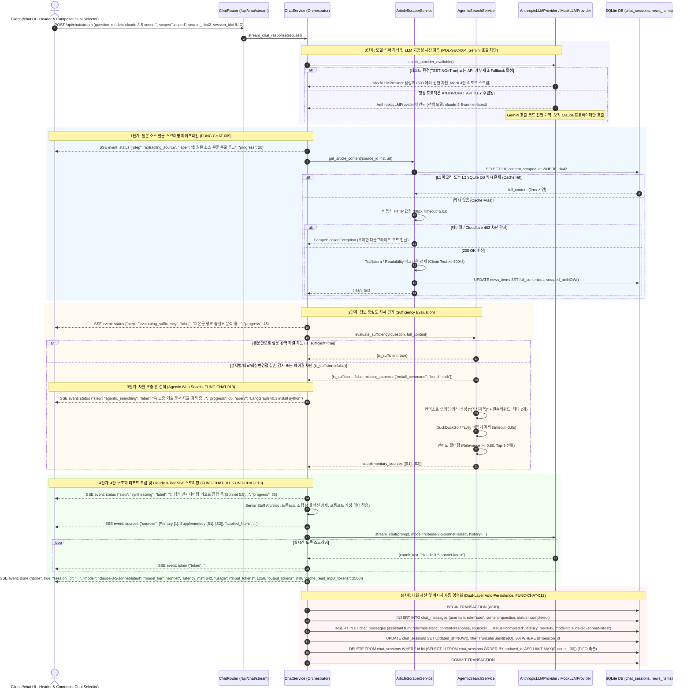
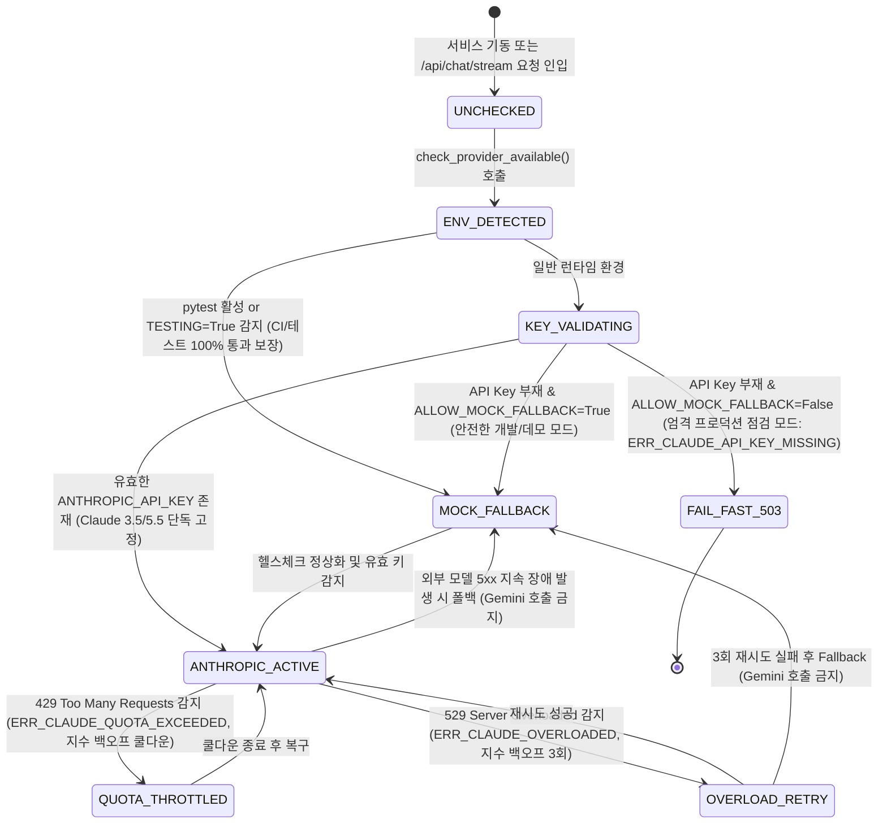
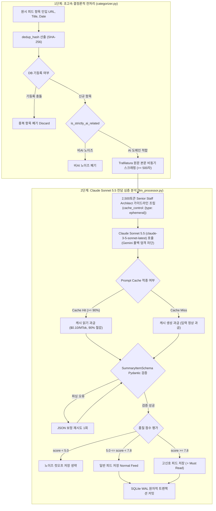
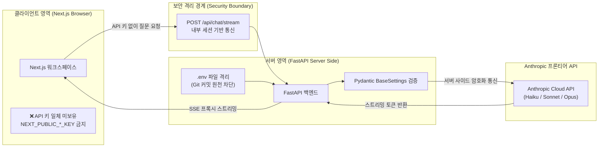

# AgentLens 백엔드 시스템 및 데이터베이스 설계서 (System Design & ERD)

- **작성일자**: 2026-10-19
- **작성자**: 백엔드 시스템 디자이너 (`system-designer`)
- **문서 버전**: 0.2.0 (Gemini 호출 경로 전면 퇴역 및 AnthropicLLMProvider 단독 고정, Google gemini-* 메타데이터 생성 원천 금지, AI 챗 상단 헤더 & 입력창 듀얼 모델 셀렉터 [FUNC-CHAT-013], Claude Sonnet 5.5 전담 수집 파이프라인 및 프롬프트 캐싱 설계 [FUNC-COLL-005], Zero-Leak API 키 보안 거버넌스 [POL-SEC-004], BaseLLMProvider ➔ AnthropicLLMProvider 상속 구조, LLM 장애 복원력 Mock Fallback 체인 [FUNC-SYS-005], 듀얼 티어 세션 영속화 & 10턴 슬라이딩 윈도우 [FUNC-CHAT-012], 실시간 전문 스크래핑 [FUNC-CHAT-009], 에이전틱 보충 검색 [FUNC-CHAT-010], Local FastMCP 브리지 [FUNC-SYS-004])
- **상태**: Approved
- **선행 산출물**: [`report.md`](../../report.md), [`01_PRD.md`](../spec-writer/01_PRD.md) (v0.2.0), [`02_FUNCTIONAL_SPECIFICATION.md`](../spec-writer/02_FUNCTIONAL_SPECIFICATION.md) (v0.2.0), [`07_CLAUDE_INTEGRATION_AND_MODEL_SELECTOR_SPECIFICATION.md`](../spec-writer/fsd/07_CLAUDE_INTEGRATION_AND_MODEL_SELECTOR_SPECIFICATION.md) (v0.2.0), [`03_POLICIES_AND_EDGES.md`](../spec-writer/03_POLICIES_AND_EDGES.md) (v0.2.0)
- **기반 규격**: [시스템 디자인 템플릿](../templates/06_SYSTEM_DESIGN_TEMPLATE.md), [OpenAPI 3.1 스펙](./02_OPENAPI_SPEC.yaml)

---

## 1. 백엔드 모듈 아키텍처 및 계층도 (Layered Architecture)

AgentLens 백엔드는 관심사 분리(Separation of Concerns)와 단일 책임 원칙(Single Responsibility Principle)을 엄격하게 준수하는 **단방향 3계층 아키텍처 (Router ➔ Service ➔ Repository / Model)**로 구성됩니다. 상위 계층은 하위 계층에 의존하지만, 하위 계층은 상위 계층을 결코 역참조하지 않는 엄격한 단방향 호출 규약을 보장합니다.

특히 **AgentLens 0.2.0**에서는 사용자 피드백("왜 Gemini가 나오냐?", "AI 챗 화면에서 모델 선택은 어떻게 하느냐?")에서 제기된 핵심 결함과 인지 장벽을 근본적으로 해결하기 위해 다음과 같은 5대 핵심 아키텍처 규약을 확립하였습니다:

1. **Gemini 호출 경로 전면 퇴역 및 `AnthropicLLMProvider` 단독 고정 명세**:
   - 백엔드 내부의 레거시 `_call_gemini` 로직 및 `auto` 폴백 체인을 전면 퇴역(Decommission) 처리합니다.
   - 모든 비즈니스 서비스(`ChatService`, `llm_processor`, `BriefingService`, 인라인 Ask AI)의 주 LLM 공급자를 **`AnthropicLLMProvider`로 단독 고정**합니다.
   - Claude API 장애나 타임아웃 발생 시에도 사용자 동의 없이 `gemini-3.5-flash-lite` 등 타사 모델로 사일런트 다운그레이드되는 동작을 아키텍처 레벨에서 영구 차단합니다.
2. **API 응답 모델 메타데이터(`model_used`, `model`)의 `Google gemini-*` 생성 원천 금지**:
   - `/api/chat/stream`, `/api/chat/query`, `/api/news/{id}/ask`를 포함한 모든 API 응답 필드(`model`, `model_used`, `model_tier`)에 `Google gemini-*`, `gemini-*` 문자열이 단 1회라도 출력되는 것을 엄격히 금지합니다.
   - 정상 프로덕션 응답에는 오직 공인 Claude 식별자(`claude-3-5-sonnet-latest`, `claude-3-5-haiku-latest`, `claude-3-5-opus-latest`)만 반환되며, 테스트/개발 환경에서는 `mock-provider`만 반환됩니다.
3. **AI 챗 상단 헤더 & 입력창 듀얼 모델 셀렉터 및 무손실 동적 전환 (`FUNC-CHAT-013`)**:
   - 상단 글로벌 헤더(`ChatHeader`) 우측과 하단 프롬프트 입력창(`ChatPromptInput`) 좌하단 양측에 3-Tier(`⚡ Haiku 5.5`, `🎯 Sonnet 5.5 (기본값)`, `🧠 Opus 5.5`) 모델 셀렉터를 듀얼 배치하고, 양방향 0ms 실시간 동기화를 지원합니다.
   - 대화 스레드 도중 모델을 교체하더라도 기존 세션 ID와 멀티턴 대화 이력(최대 10턴, 3,000토큰)을 100% 무손실 인계(Zero Context Erasure)하며, 타임라인에 `[🔄 Claude {Tier} 5.5로 모델 변경됨]` 시스템 디바이더를 삽입합니다.
4. **Claude Sonnet 5.5 전담 수집 파이프라인 및 프롬프트 캐싱 (`FUNC-COLL-005`)**:
   - 뉴스 수집·정제·요약·태깅 전담 엔진을 `claude-3-5-sonnet-latest`로 단독 고정하고, 2,500토큰 Senior Staff Architect 가이드라인에 `cache_control: {"type": "ephemeral"}`을 선언하여 캐시 적중률 90% 이상, 입력 비용 90% 절감을 강제합니다.
   - Pydantic v2 `SummaryItemSchema` 검증을 강제하고 Why It Matters($\ge 150$자) 시사점 및 공인 기술 사전을 추출합니다.
5. **Zero-Leak API 키 보안 거버넌스 및 서버 프록시 스트리밍 (`POL-SEC-004`)**:
   - 브라우저 클라이언트에는 API 키를 절대 노출하지 않으며, 백엔드 단독 `.env` 파일과 `pydantic-settings` 격리 로드, 그리고 FastAPI SSE 프록시 스트리밍으로 비밀키 유출을 원천 방어합니다.

```
backend/
├── app/
│   ├── api/             # 1. Router Layer (FastAPI Routers & SSE Streaming Adapters)
│   │   ├── chat.py      # /api/chat/stream, /api/chat/query, /api/chat/sessions, /api/chat/search
│   │   ├── news.py      # /api/news, /api/news/{id}, /api/news/{id}/ask, /api/news/all
│   │   ├── briefing.py  # /api/briefing/today, /generate, /export/notion, /send/email, /settings
│   │   ├── sources.py   # /api/sources, /rss, /github, /{type}/{id}/toggle, /{type}/{id}
│   │   ├── research.py  # /api/research/inspect-url, /discover, /register-candidate, /run-deep
│   │   ├── schedule.py  # /api/schedule/status, /progress, /trigger, /reset-and-collect
│   │   ├── trends.py    # /api/trends/radar
│   │   ├── webhook.py   # /api/webhook/test, /send-briefing
│   │   ├── stats.py     # /api/stats
│   │   ├── mcp.py       # /api/mcp/info, FastMCP Server Metadata
│   │   └── router.py    # FastAPI APIRouter 중앙 집선 등록
│   ├── core/            # 전역 설정, 보안, 이벤트 라이프사이클 및 의존성 주입
│   │   ├── config.py    # Pydantic-settings 기반 AppSettings (Zero-Leak ANTHROPIC_API_KEY 격리)
│   │   └── security.py  # CORS, XSS 살균, API 헤더 필터, Secret 마스킹 유틸
│   ├── services/        # 2. Service Layer (Pure Business Logic & Orchestration)
│   │   ├── chat_service.py         # 에이전틱 워크플로우 총괄 오케스트레이터 & 4단 리포트 합성
│   │   ├── chat_session_service.py # 세션 라이프사이클, FIFO 30개 축출, 10턴 슬라이딩 윈도우
│   │   ├── llm_processor.py        # Sonnet 5.5 전담 수집 파이프라인 (Gemini 호출 전면 제거)
│   │   ├── llm_providers/          # 객체 지향 LLM 공급자 모듈
│   │   │   ├── base.py             # BaseLLMProvider (추상 기본 클래스)
│   │   │   ├── anthropic_provider.py # AnthropicLLMProvider (단독 고정 공급자, Haiku/Sonnet/Opus)
│   │   │   └── mock_provider.py    # MockLLMProvider (테스트/개발 무중단 Mock 스트리밍)
│   │   ├── article_scraper.py      # ArticleScraperService (Trafilatura/Readability 비동기 스크래핑)
│   │   ├── agentic_searcher.py     # AgenticSearchService (충실도 평가, 앵커링 웹 검색, 관련도 필터링)
│   │   ├── retriever.py            # KnowledgeRetrieverFacade (SQLite FTS5 BM25 + Quality 하이브리드)
│   │   ├── briefing_service.py     # 일일 4섹션 종합 브리핑 마크다운 합성
│   │   ├── deep_researcher.py      # AI Deep Researcher 소스 인용 자율 마이닝 및 적합도 채택
│   │   ├── sources_service.py      # sources.json 단일 진실 소스 CRUD
│   │   ├── trend_service.py        # Tech Radar 4대 영역 급상승(Velocity) 계산
│   │   ├── notion_service.py       # Notion REST API 블록 생성 및 브리핑 발행
│   │   ├── email_service.py        # SMTP TLS 반응형 HTML 브리핑 이메일 전송
│   │   └── webhook_service.py      # Slack Block Kit & Discord Rich Embeds 디스패처
│   ├── repositories/    # 3. Repository Layer (Data Access & SQL Mapping)
│   │   ├── chat_repository.py      # ChatSession, ChatMessage CRUD, CASCADE 삭제, 원자적 턴 커밋
│   │   ├── news_repository.py      # NewsItem CRUD, full_content 캐시 업서트, 다차원 필터링
│   │   └── fts_repository.py       # SQLite FTS5 news_fts BM25 전문 색인 매치 쿼리
│   ├── models/          # SQLAlchemy 2.0 비동기 엔티티 & Pydantic DTO Schemas
│   │   ├── chat.py      # ChatSession, ChatMessage ORM 모델
│   │   ├── news.py      # NewsItem, CrawlLog, SourceResearchLog ORM 모델
│   │   └── schemas/     # Pydantic v2 Request/Response DTOs (chat.py, news.py, curation.py)
│   ├── collectors/      # 소스별 병렬 비동기 크롤러 엔진
│   │   ├── manager.py   # CollectorManager (세마포어 제어, 소스별 배치 커밋, 실시간 진행률)
│   │   ├── categorizer.py # 고속 정규식 사전 분류, dedup_hash(URL+Title SHA-256) 중복 판정
│   │   └── sources/     # rss.py, github.py, arxiv.py, reddit.py, hackernews.py, huggingface.py
│   └── database.py      # aiosqlite 비동기 풀, WAL 모드, PRAGMA foreign_keys=ON, 자동 마이그레이션
└── tests/               # pytest 비동기 단위 및 통합 테스트 스위트 (116개 테스트 전수 Green)
    ├── test_chat.py
    ├── test_chat_sessions.py
    ├── test_llm_processor.py
    └── test_config_and_live_llm.py
```

---

### 1.1 계층별 단방향 데이터 흐름도

```
┌──────────────────────────────────────────────────────────────────────────────────────────────────┐
│                             1. Router Layer (FastAPI Routers)                                    │
│  [app/api/] chat.py, news.py, briefing.py, sources.py, research.py, schedule.py, trends.py,     │
│             webhook.py, stats.py, mcp.py, router.py (통합 엔드포인트 라우팅)                       │
│  - 책임: HTTP 요청 수신, Pydantic v2 스키마 검증, Zero-Leak API 키 격리 검증, SSE 다중 채널 개방   │
│  - 주요 엔드포인트:                                                                              │
│    - POST   /api/chat/stream        : Claude 3-Tier SSE 실시간 스트림 (model, status/token/done)  │
│    - GET    /api/chat/sessions      : 최근 대화 세션 목록 조회 (order by updated_at DESC, limit=30)│
│    - GET    /api/chat/sessions/{id} : 세션 상세 메타데이터 및 정렬된 전체 대화 메시지 이력 조회     │
│    - POST   /api/chat/sessions      : 신규 세션 생성 또는 오프라인 배치 업서트 (FIFO 30개 축출)   │
│    - DELETE /api/chat/sessions/{id} : 세션 및 하위 메시지 원자적 CASCADE 영구 삭제               │
│    - POST   /api/chat/query         : Claude 3-Tier 동기식 단건 질의응답 (Mock Fallback 지원)     │
│    - GET    /api/news               : 피드 목록 조회 (다차원 카테고리/소스/정렬/검색 페이징)      │
│    - GET    /api/news/{id}          : 기사 단건 상세 (Sonnet 5.5 시사점 및 full_content 전문)     │
│    - POST   /api/news/{id}/ask      : 인라인 Ask AI 질의 (오직 Claude 모델 claude-3-5-sonnet만 반환)│
└──────────────────────────────────────────────┬───────────────────────────────────────────────────┘
                                               │ DTOs (ChatStreamRequest, ChatQueryRequest 등)
                                               ▼
┌──────────────────────────────────────────────────────────────────────────────────────────────────┐
│                            2. Service Layer (Pure Business Logic)                                │
│  [app/services/]                                                                                 │
│    ├── chat_service.py           : [에이전틱 워크플로우 & 세션 영속화 총괄 오케스트레이터]            │
│    │                               Scoped/Global 스코핑, 온디맨드 전문 스크래핑 ➔ 충실도 평가 ➔   │
│    │                               자율 웹 검색 ➔ 3-Tier 모델 라우팅 ➔ SSE 토큰 스트리밍 ➔         │
│    │                               스트리밍 완료 시 유저/어시스턴트 메시지 원자적 DB 커밋,         │
│    │                               첫 질문 앞 30자 자동 타이틀링, FIFO 30개 세션 축출 제어        │
│    ├── llm_processor.py          : [Claude Sonnet 5.5 전담 수집 파이프라인 & Provider Failover]   │
│    │                               Gemini 호출 경로 완전 제거, 2,500토큰 시스템 프롬프트 캐싱    │
│    │                               SummaryItemSchema 엄격 검증, 품질 컷오프(5.0/7.8) 평가         │
│    ├── llm_providers/                                                                            │
│    │    ├── base.py              : BaseLLMProvider (추상 기본 인터페이스)                         │
│    │    ├── anthropic_provider.py: AnthropicLLMProvider (단독 고정 공급자, Prompt Caching 지원)   │
│    │    └── mock_provider.py     : MockLLMProvider (pytest 및 키 미등록 시 Zero 503 Mock 스트림) │
│    ├── article_scraper.py        : [ArticleScraperService (FUNC-CHAT-009)] Trafilatura 전문 스크래핑 │
│    ├── agentic_searcher.py       : [AgenticSearchService (FUNC-CHAT-010)] 충실도 평가 & 앵커링 검색│
│    ├── chat_session_service.py   : 세션 라이프사이클 관리, 10턴 슬라이딩 윈도우 압축 (FUNC-CHAT-012)│
│    └── retriever.py              : KnowledgeRetrieverFacade (SQLite FTS5 BM25 + Quality 하이브리드)│
└──────────────────────────────────────────────┬───────────────────────────────────────────────────┘
                                               │ AsyncSession / ORM Methods / SQL Execution
                                               ▼
┌──────────────────────────────────────────────────────────────────────────────────────────────────┐
│                     3. Repository & Model Layer (Persistence & Data Access)                      │
│  [app/repositories/]                                                                             │
│    ├── chat_repository.py        : ChatSession, ChatMessage CRUD, CASCADE 삭제, 원자적 턴 커밋   │
│    ├── news_repository.py        : NewsItem CRUD, full_content 캐시 업서트, 다차원 필터링 페이징 │
│    └── fts_repository.py         : SQLite FTS5 가상 테이블(news_fts) BM25 매치 쿼리              │
│  [app/models/] SQLAlchemy 2.0 비동기 모델                                                        │
│    ├── ChatSession               : id (UUID PK), title, scope_mode, active_source_id, updated_at  │
│    ├── ChatMessage               : id (UUID PK), session_id (FK CASCADE), role, model, latency_ms │
│    ├── NewsItem                  : id (INT PK), title, why_it_matters, quality_score, is_high_... │
│    └── CrawlLog / SourceResearchLog: 배치 수집 감사 및 딥 리서치 판정 로그                        │
│  [app/database.py] aiosqlite 비동기 풀, WAL 모드, PRAGMA foreign_keys = ON, 자동 마이그레이션      │
└──────────────────────────────────────────────────────────────────────────────────────────────────┘
```

---

### 1.2 에이전틱 워크플로우 & Anthropic Claude / Mock Fallback 오케스트레이션 시퀀스

사용자가 질문을 전송했을 때, `ChatService`는 단순 단발성 호출이 아닌 **[1. 질문 수신 및 모델 티어 해석 ➔ 2. Anthropic LLM 가용성/Mock 검증 (Gemini 폴백 차단) ➔ 3. 원본 소스 전문 스크래핑 ➔ 4. 충실도 평가 ➔ 5. 자율 보충 검색 ➔ 6. 4단 리포트 조립 및 Claude SSE 스트리밍 ➔ 7. 원자적 세션 영속화]**의 엔지니어링 에이전틱 루프를 실행합니다.



---

### 1.3 LLM 프로바이더 가용성 사전 검증 및 Mock Provider Fallback 전이 머신

백엔드 LLM 엔진은 `ANTHROPIC_API_KEY`의 등록 상태, 네트워크 연결성, 그리고 pytest 자동화 테스트 환경 플래그에 따라 서비스 다운타임(HTTP 503)을 원천 차단하고 결함 허용성을 보장합니다. **Google Gemini 등 외부 타사 모델로의 사일런트 다운그레이드는 전면 차단**됩니다.



---

### 1.4 서비스 계층 클래스 다이어그램 및 객체 지향 설계

`BaseLLMProvider` 추상 인터페이스를 중심으로 `AnthropicLLMProvider`가 단독 고정 라이브 공급자로 바인딩되고, `MockLLMProvider`가 Liskov 치환 원칙을 완벽하게 만족하며 테스트/데모 환경을 방어합니다. 레거시 Gemini/OpenAI 다중 호출 코드는 완전히 퇴역되었습니다.

```mermaid
classDiagram
    class BaseLLMProvider {
        <<interface>>
        +provider_name: str*
        +is_available() bool*
        +generate_text(prompt: str, **kwargs) Tuple~str, str~*
        +stream_chat(prompt: str, **kwargs) AsyncGenerator~Tuple~str, str~, None~*
    }

    class AnthropicLLMProvider {
        -api_key: str
        -client: AsyncAnthropic
        -default_model: str = "claude-3-5-sonnet-latest"
        -model_mapping: Dict~str, str~
        +provider_name: str = "anthropic"
        +is_available() bool
        +resolve_model(model_tier: Optional~str~) str
        +generate_text(prompt: str, system_prompt: Optional~str~, model: Optional~str~, enable_caching: bool) Tuple~str, str~
        +stream_chat(prompt: str, system_prompt: Optional~str~, model: Optional~str~, history: Optional~List~ChatMessageHistory~~) AsyncGenerator~Tuple~str, str~, None~
        +generate_structured_summary(clean_text: str, cached_system_prompt: str) SummaryItemSchema
    }

    class MockLLMProvider {
        +provider_name: str = "mock"
        +is_available() bool = True
        +generate_text(prompt: str, **kwargs) Tuple~str, str~
        +stream_chat(prompt: str, **kwargs) AsyncGenerator~Tuple~str, str~, None~
    }

    class LLMProcessor {
        -anthropic_provider: AnthropicLLMProvider
        -mock_provider: MockLLMProvider
        +check_provider_available() bool
        +resolve_active_provider() BaseLLMProvider
        +stream_chat_response(prompt: str, system_prompt: str, model_tier: str, history: list) AsyncGenerator~Tuple~str, str~, None~
        +ingest_and_summarize_article(clean_text: str) SummaryItemSchema
        +evaluate_sufficiency_decision(prompt: str) dict
    }

    class ChatService {
        -scraper_service: ArticleScraperService
        -search_service: AgenticSearchService
        -llm_processor: LLMProcessor
        -retriever_facade: KnowledgeRetrieverFacade
        -chat_session_service: ChatSessionService
        -chat_repo: ChatRepository
        +stream_chat_response(request: ChatStreamRequest) AsyncGenerator~SSEEvent~
        +execute_sync_query(request: ChatQueryRequest) ChatQueryResponse
        +persist_completed_turn(session_id: str, question: str, answer: str, sources: list, model: str, latency_ms: int)
        -_assemble_scoped_prompt(article: NewsItem, full_text: str, web_snippets: List~SupplementarySource~, question: str) str
        -_assemble_global_prompt(chunks: List~RetrievedChunk~, question: str, history: List~ChatMessageHistory~) str
    }

    class ChatSessionService {
        -chat_repo: ChatRepository
        +list_sessions(limit: int, offset: int) List~ChatSessionSummary~
        +get_session_detail(session_id: str) ChatSessionDetail
        +create_or_upsert_session(request: ChatSessionCreateRequest) ChatSessionDetail
        +delete_session(session_id: str) bool
        +build_sliding_history(history: List~ChatMessageHistory~, max_turns: int) List~ChatMessageHistory~
        +generate_auto_title(first_question: str) str
    }

    class ArticleScraperService {
        -http_client: httpx.AsyncClient
        -memory_cache: LRUCache
        -single_flight_locks: Dict~str, asyncio.Lock~
        +get_article_content(source_id: int, url: str) ScrapedArticleResult
        -_scrape_from_web(url: str) Tuple~str, str~
        -_clean_html_trafilatura(html: str) Optional~str~
        -_clean_html_readability(html: str) Optional~str~
    }

    class AgenticSearchService {
        -llm_processor: LLMProcessor
        -http_client: httpx.AsyncClient
        +evaluate_sufficiency(question: str, article: NewsItem, full_text: Optional~str~) SufficiencyResult
        +generate_anchored_queries(question: str, article: NewsItem, missing_aspects: List~str~) List~str~
        +search_supplementary(queries: List~str~) List~SupplementarySource~
        -_filter_relevance(snippets: List~WebSnippet~, context: str) List~SupplementarySource~
    }

    class ChatRepository {
        -session: AsyncSession
        +get_sessions_list(limit: int, offset: int) List~ChatSession~
        +get_session_by_id(session_id: str) Optional~ChatSession~
        +get_ordered_messages(session_id: str) List~ChatMessage~
        +upsert_session(session_data: dict) ChatSession
        +delete_session_cascade(session_id: str) bool
        +persist_turn_atomic(session_id: str, user_msg: dict, assistant_msg: dict) Tuple~ChatMessage, ChatMessage~
        +evict_excess_sessions(max_limit: int) int
    }

    BaseLLMProvider <|-- AnthropicLLMProvider
    BaseLLMProvider <|-- MockLLMProvider
    LLMProcessor o-- BaseLLMProvider
    ChatService o-- ArticleScraperService
    ChatService o-- AgenticSearchService
    ChatService o-- LLMProcessor
    ChatService o-- ChatSessionService
    ChatService o-- ChatRepository
    ChatSessionService o-- ChatRepository
```



---

### 1.5 Claude Sonnet 5.5 전담 수집/정제/요약/태깅 파이프라인 및 프롬프트 캐싱 설계

데이터 수집 파이프라인은 속도와 정밀도를 동시에 달성하기 위해 **2단계 분할 아키텍처 (Fast Categorizer ➔ Claude Sonnet 5.5 Ingestion)**를 채택합니다.



#### 1) `categorizer.py` 전처리 및 $O(1)$ 중복 배제 규약
- **`compute_dedup_hash(title: str, url: str) -> str`**:
  - URL 정규화(UTM 파라미터 및 후행 슬래시 제거) 및 제목 공백/특수문자 정제 후 `sha256(clean_title + "::" + clean_url)` 산출.
  - 데이터베이스 `news_items.dedup_hash` UNIQUE 인덱스를 통해 $O(1)$로 기수집 기사를 배제합니다.
- **`is_strictly_ai_related(title: str, summary: str) -> bool`**:
  - `_AI_REGEX`를 컴파일하여 Agent, Harness, MCP, LLM, Reasoning Model 등 핵심 키워드 포함 여부를 0.1ms 이내로 판정하여 비AI 잡음을 사전 차단합니다.

#### 2) `SummaryItemSchema` Pydantic v2 스키마 정의
Anthropic의 도구 호출 및 구조화 출력 규약을 통해 아래 Pydantic 모델 검증을 100% 통과하도록 강제합니다:

```python
from pydantic import BaseModel, Field
from typing import List, Literal

class SummaryItemSchema(BaseModel):
    summary: List[str] = Field(
        ..., min_length=3, max_length=3, 
        description="3줄 핵심 요약 불릿 (TL;DR Bullets, 각 10~150자)"
    )
    why_it_matters: str = Field(
        ..., min_length=150, max_length=600,
        description="실무 엔지니어링 도입 관점의 심층 시사점 (최소 150자 필수)"
    )
    tech_stack: List[str] = Field(
        ..., min_length=1, max_length=5,
        description="공인 기술 레지스트리 기반 정밀 태깅 (Known Tech Registry 일치)"
    )
    tags: List[str] = Field(
        ..., min_length=2, max_length=6,
        description="세부 도메인 토픽 분류 태그"
    )
    quality_score: float = Field(
        ..., ge=1.0, le=10.0,
        description="엔지니어링 신호 품질 평가 점수 (1.0 ~ 10.0, 소수점 첫째 자리)"
    )
    category: Literal["harness", "mcp_plugins_skills", "agent_tech", "ai_news"] = Field(
        ..., description="4대 핵심 도메인 카테고리 분류 코드"
    )
```

#### 3) Anthropic 프롬프트 캐싱(Prompt Caching) 스키마 및 경제성 강제
- **캐싱 블록 구성**: 2,500토큰 분량의 Senior Staff Architect 평가 루브릭, 퓨샷(Few-shot) 예시, 공인 기술 스택 사전을 `system` 프롬프트로 고정 선언하고 `cache_control: {"type": "ephemeral"}` 메타데이터를 부여합니다.
- **캐시 생명주기 및 적중률**: Anthropic 서버는 5분간 캐시를 유지하며, 연속된 기사 배치 수집 시 캐시 적중률(Cache Hit Ratio)을 **90% 이상** 유지합니다.
- **비용 절감 효과**:
  - 일반 입력 토큰: $3.00 / MTok
  - 캐시 적중 입력 토큰 (`cache_read_input_tokens`): $0.30 / MTok (90% 절감)
- **품질 점수 컷오프 정책**:
  - `quality_score < 5.0`: 광고성/단순 마케팅 기사로 판정하여 DB 삽입을 원천 배제.
  - `5.0 <= quality_score < 7.8`: 일반 피드 기사로 영속화.
  - `quality_score >= 7.8`: `is_high_signal = True` 플래그 활성화 및 `⭐️ Must Read` 뱃지 부여, 일일 브리핑 후보군 등록.

---

### 1.6 Zero-Leak API 키 보안 거버넌스 및 프록시 스트리밍 규약 (`POL-SEC-004`)

AgentLens의 모든 AI 기능은 엔터프라이즈급 보안 무결성을 최우선 원칙으로 합니다. Git 리포지토리 시크릿 커밋 및 브라우저 클라이언트 네트워크 노출을 아키텍처적으로 원천 봉쇄(Zero-Leak Architecture)합니다.



1. **Rule 1: Client-Side Zero Exposure (클라이언트 절대 무노출)**:
   - 프론트엔드 코드베이스(Next.js) 내에 `NEXT_PUBLIC_ANTHROPIC_API_KEY`와 같은 공개 환경변수 선언을 영구 금지합니다.
   - 브라우저는 오직 내부 백엔드 라우트(`/api/chat/stream`, `/api/chat/query`)와만 통신하며, HTTP 요청 헤더에 Anthropic API 키를 절대 담아 보내지 않습니다.
2. **Rule 2: Server-Side Strict Isolation (서버 사이드 격리)**:
   - `ANTHROPIC_API_KEY`는 오직 백엔드 실행 환경의 OS 환경변수 또는 로컬 `.env` 파일에만 존재합니다.
   - 백엔드는 Python `pydantic-settings`의 `BaseSettings`를 통해 기동 시 환경변수 유효성을 엄격하게 단 1회 로드하고 메모리 외부로 노출하지 않습니다.
3. **Rule 3: Git Tracking Prevention (.gitignore & Pre-commit Guard)**:
   - 프로젝트 루트의 `.gitignore`에 `.env`, `*.env`, `.env.local`, `.env.production`이 필수 등록되어 있습니다.
   - Git Pre-commit 훅에서 정규식 `sk-ant-[a-zA-Z0-9_-]{30,}` 패턴 감지 시 커밋 및 푸시를 원천 거부(Reject)합니다.
4. **Rule 4: Admin UI Masking & Boolean Exposure (관리자 UI 마스킹)**:
   - 관리자 설정 화면(`SCR-SETT-001`)에서 API 키 등록 상태를 조회할 때 백엔드는 실제 키 전체를 반환하지 않고, 불리언 플래그(`is_configured: true`)와 마스킹된 앞뒤 4자리 문자열(`sk-ant-***-Ab3d`)만 제공합니다.

---

### 1.7 Local FastMCP 서버 브리지 아키텍처 (`FUNC-SYS-004`)

AgentLens 0.2.0은 Cursor, Windsurf, Claude Desktop 등 개발자 IDE 내부에서 브라우저 이동 없이 AgentLens 지식을 직접 호출할 수 있는 **FastMCP 표준 서버 인터페이스 (`mcpServers.agentlens`)**를 제공합니다.

- **프로토콜**: Model Context Protocol (MCP) 표준 JSON-RPC 2.0 (stdio 및 HTTP SSE 지원)
- **제공 표준 도구 3종**:
  1. `get_latest_harness_news(limit: int = 5)`: 최신 에이전트 평가 하네스 및 SWE-bench 벤치마크 소식 인출
  2. `get_mcp_skills(limit: int = 5)`: 신규 FastMCP 도구 및 MCP 프로토콜 릴리즈 소식 인출
  3. `search_agent_news(query: str, top_k: int = 5)`: 특정 기술 키워드 기반 코퍼스 지식 검색

---

## 2. 데이터베이스 엔티티 관계도 (Mermaid ERD)

AgentLens는 SQLite WAL 모드와 SQLAlchemy 2.0 비동기 모델(`aiosqlite`), 초고속 텍스트 검색을 위한 SQLite FTS5 가상 테이블, 그리고 설정 JSON 파일(`sources.json`, `config.json`)의 유기적 결합으로 데이터 계층을 운영합니다.

### 2.1 통합 엔티티 관계 다이어그램 (Mermaid ERD)

```mermaid
erDiagram
    NEWS_ITEMS ||--|| NEWS_FTS : content_sync_triggers
    NEWS_ITEMS |o--o{ CHAT_SESSIONS : active_source_context
    CHAT_SESSIONS ||--o{ CHAT_MESSAGES : contains_cascade_delete
    NEWS_ITEMS ||..o{ CHAT_MESSAGES : cited_in_sources
    SOURCES_CONFIG ||--o{ NEWS_ITEMS : defines_ingestion_target
    SOURCES_CONFIG ||--o{ SOURCE_RESEARCH_LOGS : auto_adopted_into
    NEWS_ITEMS ||..o{ CRAWL_LOGS : logged_per_batch
    NEWS_ITEMS ||..o{ SOURCE_RESEARCH_LOGS : citation_mined_from

    NEWS_ITEMS {
        int id PK "고유 아티클 ID (Auto Increment)"
        string title "기사/논문 제목 (VARCHAR 500)"
        string url "원문 링크 URL (VARCHAR 1000)"
        string source "수집 출처 코드 (VARCHAR 50, indexed)"
        string category "카테고리 코드 (VARCHAR 50, indexed)"
        text summary "본문 발췌 요약문 (TEXT)"
        string author "작성자/연구기관 (VARCHAR 200, nullable)"
        string tags "태그 목록 (VARCHAR 500, 쉼표 구분)"
        text tldr_bullets "JSON 직렬화된 3줄 요약 불릿 (TEXT)"
        text why_it_matters "Sonnet 5.5 시사점 및 아키텍처 인사이트 (TEXT)"
        string tech_stack "추출된 기술/모델 엔티티 (VARCHAR 500)"
        float quality_score "품질 점수 1.0~10.0 (FLOAT, indexed)"
        boolean is_high_signal "고신호 Must-Read 여부 (BOOLEAN, indexed)"
        int raw_score "외부 추천/스타수 (INTEGER)"
        int comments_count "외부 댓글 수 (INTEGER)"
        float hotness_score "시간 감쇠 화제성 점수 (FLOAT, indexed)"
        text full_content "실시간 추출된 원문 아티클 전문 (TEXT, nullable, 온디맨드 캐싱)"
        datetime scraped_at "전문 스크래핑 완료 일시 (DATETIME UTC, nullable, indexed)"
        datetime published_at "원문 발행 일시 (DATETIME UTC, indexed)"
        datetime created_at "DB 최초 수집 일시 (DATETIME UTC)"
        string dedup_hash UK "정규화 URL+제목 SHA-256 해시 (VARCHAR 64)"
    }

    NEWS_FTS {
        int id UNINDEXED "news_items rowid 참조"
        text title "제목 전문 색인"
        text summary "요약 전문 색인"
        text why_it_matters "개발자 시사점 전문 색인"
        text tech_stack "추출 기술 스택 전문 색인"
        text tags "태그 키워드 전문 색인"
    }

    CHAT_SESSIONS {
        string id PK "세션 고유 ID (VARCHAR 36 UUID v4)"
        string title "세션 제목 (VARCHAR 100, 기본값 '새 대화')"
        datetime created_at "세션 생성 일시 (DATETIME UTC)"
        datetime updated_at "마지막 질의/수정 일시 (DATETIME UTC, indexed)"
        string scope_mode "검색 스코프 모드 ('scoped', 'global', VARCHAR 20)"
        int active_source_id FK "선택 기사 ID (INTEGER, nullable, FK news_items.id ON DELETE SET NULL)"
        text active_filters "타깃 포커스 필터 직렬화 JSON (JSON/TEXT, nullable)"
    }

    CHAT_MESSAGES {
        string id PK "메시지 고유 ID (VARCHAR 36 UUID v4)"
        string session_id FK "소속 세션 UUID (VARCHAR 36, indexed, ON DELETE CASCADE)"
        string role "화자 역할 ('user', 'assistant', 'system', VARCHAR 20)"
        text content "메시지 본문 내용 (TEXT)"
        datetime created_at "메시지 발송/생성 일시 (DATETIME UTC, indexed)"
        text sources "인용된 원본/보충 출처 목록 JSON (JSON/TEXT, nullable)"
        string status "메시지 상태 ('pending', 'streaming', 'completed', 'error', 'aborted', VARCHAR 20)"
        string model "답변 생성에 사용된 Claude 모델 식별자 (VARCHAR 50, nullable, Gemini 생성 금지)"
        int latency_ms "응답 생성 소요 시간 밀리초 (INTEGER, nullable)"
    }

    CRAWL_LOGS {
        int id PK "로그 ID (Auto Increment)"
        string source "수집 출처 식별자 (VARCHAR 50)"
        int items_crawled "탐색된 총 아이템 수 (INTEGER)"
        int items_saved "신규 저장된 아이템 수 (INTEGER)"
        string status "수집 상태 (success, error, partial)"
        text error_message "수집 실패 시 에러 스택 (TEXT, nullable)"
        datetime started_at "수집 시작 일시 (DATETIME UTC)"
        datetime completed_at "수집 완료 일시 (DATETIME UTC)"
    }

    SOURCE_RESEARCH_LOGS {
        int id PK "연구 감사 일지 ID (Auto Increment)"
        string source_name "발굴된 소스 표시명 (VARCHAR 200)"
        string site_url "웹사이트 홈 URL (VARCHAR 500)"
        string feed_url "RSS/Atom 피드 URL (VARCHAR 500)"
        string category "분류된 카테고리 (VARCHAR 50)"
        float relevance_score "도메인 적합도 점수 0.0~10.0 (FLOAT)"
        string verdict "판정 결과 (AUTO_ADOPTED, WATCHLIST, REJECTED)"
        text verdict_reason "AI 판정 근거 상세 의견서 (TEXT)"
        int analyzed_articles_count "샘플링 분석 기사 수 (INTEGER)"
        datetime created_at "연구 일시 (DATETIME UTC, indexed)"
    }

    SOURCES_CONFIG {
        json rss_feeds "RSS/Atom 피드 목록 및 활성 플래그"
        json github_sources "모니터링 대상 GitHub 저장소 목록"
        json reddit_sources "서브레딧 및 검색어 설정"
        json hackernews_sources "Algolia 검색 키워드 설정"
        json arxiv_sources "arXiv 쿼리 및 카테고리 설정"
        json huggingface_sources "HuggingFace 모델/스페이스 쿼리"
    }

    SYSTEM_CONFIG {
        json app "서버 호스트, 포트, DB URL 설정"
        json llm "Anthropic API 키, 모델, allow_mock_fallback 설정 (Gemini 설정 전면 배제)"
        json scheduler "크론 실행 시간 및 타임존"
        json briefing "Notion 및 SMTP 이메일 연동 설정"
        json webhooks "Slack 및 Discord 웹훅 URL 및 자동 발송 플래그"
        json crawler "수집 타임아웃 및 동시성 세마포어 옵션"
    }
```

---

### 2.2 상세 엔티티 스키마 정의 (Table Data Dictionaries)

#### 1) `chat_sessions` 테이블 (대화 세션 영속화 엔티티)
| 컬럼명 | 데이터 타입 | Nullable | 기본값 | 제약조건 / 인덱스 | 설명 |
| :--- | :--- | :---: | :---: | :--- | :--- |
| `id` | `VARCHAR(36)` | NO | - | PRIMARY KEY | UUID v4 세션 고유 식별자 |
| `title` | `VARCHAR(100)` | NO | `'새 대화'` | - | 세션 제목 (첫 질문 앞 30자 자동 타이틀링) |
| `created_at` | `DATETIME` | NO | `CURRENT_TIMESTAMP` | - | 세션 최초 생성 일시 (UTC) |
| `updated_at` | `DATETIME` | NO | `CURRENT_TIMESTAMP` | `ix_chat_sessions_updated_at` (DESC) | 마지막 질의 일시 (사이드바 최신순 정렬용) |
| `scope_mode` | `VARCHAR(20)` | NO | `'global'` | CHECK (`scope_mode IN ('scoped', 'global')`) | 검색 스코프 모드 |
| `active_source_id` | `INTEGER` | YES | `NULL` | FK `news_items(id)` ON DELETE SET NULL | Scoped 모드 대상 기사 ID |
| `active_filters` | `TEXT` | YES | `NULL` | JSON 직렬화 문자열 | Global 모드 타깃 포커스 필터 (`ChatFocusFilter`) |

#### 2) `chat_messages` 테이블 (대화 턴 히스토리 및 시스템 알림 엔티티)
| 컬럼명 | 데이터 타입 | Nullable | 기본값 | 제약조건 / 인덱스 | 설명 |
| :--- | :--- | :---: | :---: | :--- | :--- |
| `id` | `VARCHAR(36)` | NO | - | PRIMARY KEY | UUID v4 메시지 고유 식별자 |
| `session_id` | `VARCHAR(36)` | NO | - | FK `chat_sessions(id)` ON DELETE CASCADE | 소속 세션 ID (CASCADE 외래키) |
| `role` | `VARCHAR(20)` | NO | - | CHECK (`role IN ('user', 'assistant', 'system')`) | 메시지 발화자 역할 (`system`은 모델 전환 알림용) |
| `content` | `TEXT` | NO | - | - | 마크다운 메시지 본문 또는 모델 변경 시스템 알림 텍스트 |
| `created_at` | `DATETIME` | NO | `CURRENT_TIMESTAMP` | `idx_chat_messages_session_time` (ASC) | 메시지 발송/생성 일시 (UTC) |
| `sources` | `TEXT` | YES | `NULL` | JSON 직렬화 문자열 | 답변에 인용된 소스 목록 (`ChatSourceItem[]`) |
| `status` | `VARCHAR(20)` | NO | `'completed'` | CHECK (`status IN ('pending', 'streaming', 'completed', 'error', 'aborted')`) | 메시지 생성 완료 상태 |
| `model` | `VARCHAR(50)` | YES | `NULL` | - | 답변 생성에 사용된 Claude 모델명 (`claude-3-5-sonnet-latest` 등, **Gemini 생성 금지**) |
| `latency_ms` | `INTEGER` | YES | `NULL` | - | 답변 생성 소요 시간 (밀리초) |

#### 3) `news_items` 테이블 (큐레이션 뉴스 엔티티)
| 컬럼명 | 데이터 타입 | Nullable | 기본값 | 제약조건 / 인덱스 | 설명 |
| :--- | :--- | :---: | :---: | :--- | :--- |
| `id` | `INTEGER` | NO | AUTOINCREMENT | PRIMARY KEY | 기사 고유 식별자 |
| `title` | `VARCHAR(500)` | NO | - | - | 기사 제목 |
| `url` | `VARCHAR(1000)`| NO | - | - | 원문 URL |
| `source` | `VARCHAR(50)` | NO | - | `ix_news_items_source` | 수집 출처 코드 |
| `category` | `VARCHAR(50)` | NO | - | `idx_category_published`, `idx_category_hotness` | 카테고리 코드 |
| `summary` | `TEXT` | YES | `''` | - | 수집 시점의 발췌 요약문 |
| `author` | `VARCHAR(200)`| YES | `NULL` | - | 작성자 또는 연구 기관 |
| `tags` | `VARCHAR(500)`| YES | `''` | - | 태그 목록 (쉼표 구분) |
| `tldr_bullets` | `TEXT` | YES | `''` | - | Claude Sonnet 5.5 생성 3-Bullet TL;DR |
| `why_it_matters`| `TEXT` | YES | `''` | - | Claude Sonnet 5.5 생성 시사점 ($\ge 150$자) |
| `tech_stack` | `VARCHAR(500)`| YES | `''` | - | 추출된 기술 엔티티 목록 |
| `quality_score`| `FLOAT` | NO | `6.0` | `ix_news_items_quality_score` | AI 평가 품질 점수 (1.0~10.0) |
| `is_high_signal`| `BOOLEAN` | NO | `0` | `idx_high_signal` | 고신호 Must-Read 여부 ($\ge 7.8$) |
| `raw_score` | `INTEGER` | NO | `0` | - | 추천수 또는 스타수 |
| `comments_count`| `INTEGER` | NO | `0` | - | 외부 댓글 수 |
| `hotness_score`| `FLOAT` | NO | `0.0` | - | 시간 감쇠 트렌딩 점수 |
| `full_content` | `TEXT` | YES | `NULL` | - | Trafilatura 실시간 비동기 스크래핑 전문 |
| `scraped_at` | `DATETIME` | YES | `NULL` | `ix_news_items_scraped_at` (DESC) | 전문 스크래핑 완료 일시 (UTC) |
| `published_at` | `DATETIME` | NO | - | `ix_news_items_published_at` (DESC) | 원문 발행 일시 (UTC) |
| `created_at` | `DATETIME` | NO | `CURRENT_TIMESTAMP` | - | DB 최초 수집 일시 (UTC) |
| `dedup_hash` | `VARCHAR(64)` | NO | - | `ix_news_items_dedup_hash` (UNIQUE) | 정규화 URL+제목 SHA-256 해시 |

---

### 2.3 SQLite 스키마 마이그레이션 DDL 스펙 (`migration_v0_2_0_claude_schema.sql`)

```sql
-- migration_v0_2_0_claude_schema.sql

-- 1. 대화 세션 테이블 및 인덱스 생성
CREATE TABLE IF NOT EXISTS chat_sessions (
    id VARCHAR(36) PRIMARY KEY,
    title VARCHAR(100) NOT NULL DEFAULT '새 대화',
    created_at DATETIME NOT NULL DEFAULT CURRENT_TIMESTAMP,
    updated_at DATETIME NOT NULL DEFAULT CURRENT_TIMESTAMP,
    scope_mode VARCHAR(20) NOT NULL DEFAULT 'global',
    active_source_id INTEGER NULLABLE REFERENCES news_items(id) ON DELETE SET NULL,
    active_filters TEXT NULLABLE
);

CREATE INDEX IF NOT EXISTS ix_chat_sessions_updated_at ON chat_sessions (updated_at DESC);
CREATE INDEX IF NOT EXISTS ix_chat_sessions_active_source_id ON chat_sessions (active_source_id);

-- 2. 대화 메시지 테이블 및 CASCADE 인덱스 생성 (role='system' 허용)
CREATE TABLE IF NOT EXISTS chat_messages (
    id VARCHAR(36) PRIMARY KEY,
    session_id VARCHAR(36) NOT NULL REFERENCES chat_sessions(id) ON DELETE CASCADE,
    role VARCHAR(20) NOT NULL,
    content TEXT NOT NULL,
    created_at DATETIME NOT NULL DEFAULT CURRENT_TIMESTAMP,
    sources TEXT NULLABLE,
    status VARCHAR(20) NOT NULL DEFAULT 'completed',
    model VARCHAR(50) NULLABLE,
    latency_ms INTEGER NULLABLE
);

CREATE INDEX IF NOT EXISTS ix_chat_messages_session_id ON chat_messages (session_id);
CREATE INDEX IF NOT EXISTS idx_chat_messages_session_time ON chat_messages (session_id, created_at ASC);

-- 3. news_items 전문 스크래핑 컬럼 및 인덱스
CREATE INDEX IF NOT EXISTS ix_news_items_scraped_at ON news_items (scraped_at DESC);
CREATE INDEX IF NOT EXISTS ix_news_items_dedup_hash ON news_items (dedup_hash);
CREATE INDEX IF NOT EXISTS idx_high_signal ON news_items (is_high_signal, hotness_score DESC);
```

---

## 3. 인덱싱 및 쿼리 최적화 전략 (Indexing Strategy)

AgentLens는 대량의 기술 소식을 실시간 수집하면서도 프론트엔드의 다차원 필터링 및 전용 챗의 하이브리드 RAG 질의에 **서브 밀리초(sub-millisecond) ~ 50ms 미만**으로 응답할 수 있도록 최적화된 복합 인덱스를 운용합니다.

### 3.1 인덱스 카탈로그 및 대상 쿼리

| 테이블명 | 인덱스 식별자 | 인덱스 컬럼 | 인덱스 유형 | 생성 목적 및 대상 쿼리 |
| :--- | :--- | :--- | :--- | :--- |
| `news_items` | `sqlite_autoindex_news_items_1` | `id` | PRIMARY KEY B-Tree | 단건 상세 조회 (`GET /api/news/{id}`), Scoped 기사 메타데이터 조회 |
| `news_items` | `ix_news_items_dedup_hash` | `dedup_hash` | UNIQUE B-Tree | 수집 시 기수집 아티클 $O(1)$ 중복 감지 및 INSERT 충돌 방지 |
| `news_items` | `idx_category_published` | `(category, published_at DESC)` | Composite B-Tree | 카테고리 탭 선택 시 최신순 피드 정렬 페이징 가속화 |
| `news_items` | `idx_category_hotness` | `(category, hotness_score DESC)`| Composite B-Tree | 카테고리 탭 내 트렌딩(Hot) 정렬 피드 페이징 가속화 |
| `news_items` | `idx_high_signal` | `(is_high_signal, hotness_score DESC)` | Composite B-Tree | ⭐️ `Must Read` 고신호 전용 피드 조회 최적화 |
| `news_items` | `ix_news_items_source` | `source` | B-Tree | 출처별 필터링 (`source=github`, `source=arxiv` 등) |
| `news_items` | `ix_news_items_quality_score`| `quality_score` | B-Tree | 품질 점수 정렬 및 RAG 최소 품질 컷오프(5.0) 필터링 |
| `news_items` | `ix_news_items_published_at` | `published_at DESC` | B-Tree | 전역 최신순 정렬 및 브리핑 24시간 타임윈도우 스캔 |
| `news_items` | `ix_news_items_scraped_at` | `scraped_at DESC` | B-Tree | 전문 스크래핑 완료 기사 역순 조회 및 캐시 수명주기 관리 |
| `news_fts` | `(가상 역색인)` | `title, summary, why_it_matters, tech_stack, tags` | FTS5 Inverted Index | 코퍼스 지식 검색 프리뷰 및 Global RAG 키워드 매칭 |
| `chat_sessions` | `sqlite_autoindex_chat_sessions_1` | `id` | PRIMARY KEY B-Tree | 세션 식별자(UUID v4) 단건 조회 및 존재 검증 |
| `chat_sessions` | `ix_chat_sessions_updated_at` | `updated_at DESC` | B-Tree | 최근 대화 세션 목록 최신 활동순 정렬 조회 (`limit=30`) |
| `chat_sessions` | `ix_chat_sessions_active_source_id` | `active_source_id` | B-Tree | Scoped 기사 역추적 조회 및 기사 삭제 시 SET NULL 처리 |
| `chat_messages` | `sqlite_autoindex_chat_messages_1`| `id` | PRIMARY KEY B-Tree | 메시지 식별자(UUID v4) 단건 조회 |
| `chat_messages` | `ix_chat_messages_session_id` | `session_id` | B-Tree | 세션 삭제 시 외래키 `ON DELETE CASCADE` 전파 가속화 |
| `chat_messages` | `idx_chat_messages_session_time` | `(session_id, created_at ASC)` | Composite B-Tree | 세션 내 전체 대화 이력 시간순 복원 및 멀티턴 슬라이딩 인출 |

---

### 3.2 수집 소식 타깃팅 포커스 필터(`ChatFocusFilter`) 및 동적 SQL 바인딩

포커스 바텀 시트(`FUNC-CHAT-006`)에서 사용자가 지정한 타깃 조건은 백엔드 `SQLiteFtsRetriever`에 의해 동적 SQL WHERE 절 및 최신성 지수 감쇠 반감기($\tau$)로 실시간 바인딩됩니다:

| 필터 파라미터 | 허용 값 (Enum / Type) | 기본값 | SQL WHERE 절 동적 바인딩 | 비고 |
| :--- | :--- | :---: | :--- | :--- |
| `category` | `all`, `harness`, `mcp_plugins_skills`, `agent_tech`, `ai_news` | `all` | `category != 'all'` 시 `AND n.category = :category` | 카테고리 복합 인덱스 활용 |
| `time_range` | `all`, `24h`, `7d`, `30d` | `all` | `24h`: `AND n.published_at >= datetime('now', '-24 hours')`<br>`7d`: `AND n.published_at >= datetime('now', '-7 days')`<br>`30d`: `AND n.published_at >= datetime('now', '-30 days')`<br>`all`: 시간 제약 배제 | 기간별 지수 감쇠 반감기($\tau$) 동적 보정 |
| `sort` | `hot`, `latest`, `quality` | `hot` | `hot`: 하이브리드 $S_{rag}$ 내림차순 정렬<br>`latest`: `ORDER BY n.published_at DESC`<br>`quality`: `ORDER BY n.quality_score DESC` | 최종 후보 청크 정렬 우선순위 |
| `high_signal_only` | `true`, `false` | `false` | `high_signal_only = true` 시 `AND n.is_high_signal = 1` | `idx_high_signal` 복합 인덱스 가속화 |

---

### 3.3 통합 하이브리드 RAG 랭킹 공식 및 동적 감쇠 반감기($\tau$)

SQLite에서 FTS5 매치로 인출한 상위 30건에 대해 다음 정량 공식을 적용하여 최종 점수 $S_{rag}(i)$를 산출한 후 상위 Top-K(5개)를 확정합니다:

$$S_{rag}(i) = 0.50 \cdot \text{Norm}(S_{bm25}(i)) + 0.30 \cdot \left(\frac{S_{quality}(i)}{10.0}\right) + 0.20 \cdot \exp\left(-\frac{\Delta t_i}{\tau}\right)$$

- **기간별 반감기 ($\tau$) 동적 보정**:
  - `time_range === '24h'`: $\tau = 86,400\text{초} (1\text{일})$ — 초단기 최신 소식에 최고 가중치
  - `time_range === '7d'`: $\tau = 259,200\text{초} (3\text{일})$ — 주간 트렌드 반영
  - `time_range === '30d'`: $\tau = 604,800\text{초} (7\text{일})$ — 월간 핵심 아티클 반영
  - `time_range === 'all'`: $\tau = 1,209,600\text{초} (14\text{일})$ — 역사적 고품질 아카이브 포함
- **0건 매칭 시 지능적 자동 완화 (Auto-Relaxation)**:
  과도하게 좁은 조건으로 인해 1차 FTS 매칭 건수가 0건인 경우, 에러를 반환하지 않고 1차로 `time_range`를 `'all'`로 자동 완화하여 재검색합니다. 이 경우 SSE `event: sources` 페이로드에 `is_relaxed: true`를 전달하여 UI에 검색 범위 확장 피드백 뱃지를 표시합니다.

---

### 3.4 대화 도중 모델 인라인 전환 시 무손실 컨텍스트 인계 알고리즘 (`FUNC-CHAT-013`)

사용자가 상단 헤더 또는 하단 입력창에서 모델을 교체하더라도 대화 세션을 초기화하지 않고 다음 원칙에 따라 무손실 인계(Zero Context Erasure)를 수행합니다:

1. **상단 헤더 & 하단 입력창 듀얼 동기화**:
   - `header_model_selector`와 `composer_model_selector` 중 어디서 모델을 변경하더라도 양측의 UI 칩 라벨 및 아이콘이 즉시 동기화됩니다.
2. **대화 이력 슬라이딩 윈도우 보존**:
   - 세션 내 대화 이력(`history`)은 최근 **최대 10턴(20개 메시지)**으로 슬라이딩 윈도우를 제한하여 새 모델의 컨텍스트 윈도우로 전달합니다.
   - **토큰 버짓 분배 (총 16,000 토큰)**:
     - 시스템 프롬프트 (Senior Staff Architect 페르소나 및 4단 구조 제약): 최대 **2,000 토큰** (프롬프트 캐싱 적용)
     - 뉴스 기사 전문(`full_content`) 또는 자율 보충 검색 스니펫: 최대 **10,000 토큰**
     - 멀티턴 대화 이력(`history`): 최대 **3,000 토큰** (10턴 초과 또는 3,000 토큰 초과 시 오래된 턴부터 순차 축소)
     - 사용자 질문 및 응답 생성 여유분: 최소 **1,000 토큰**
3. **시스템 알림 디바이더 기록**:
   - 모델 변경 직후 백엔드 또는 프론트엔드는 `role='system'`, `content='[🔄 Claude {Tier} 5.5로 모델 변경됨]'` 메시지를 생성하여 타임라인에 삽입합니다.
   - 이 시스템 디바이더는 실제 LLM 추론 프롬프트 조립 시에는 제외되어 불필요한 토큰 낭비를 방지합니다.
4. **세션 자동 타이틀링 정규화**:
   신규 세션의 초기 제목은 `'새 대화'`이며, 사용자의 최초 질문 $Q_1$이 제출되는 순간 다음 수식에 의해 확정됩니다:
   $$\text{Title} = \begin{cases}
   \text{Truncate}(\text{Sanitize}(Q_1), 30) + "\dots" & (\text{length}(\text{Sanitize}(Q_1)) > 30) \\
   \text{Sanitize}(Q_1) & (1 \le \text{length}(\text{Sanitize}(Q_1)) \le 30) \\
   \text{"새 대화"} & (\text{length}(\text{Sanitize}(Q_1)) = 0)
   \end{cases}$$

---

## 4. 트랜잭션 및 동시성 제어 정책 (Concurrency & Transactions)

### 4.1 SQLite WAL 모드 및 커넥션 풀 정책
- `PRAGMA journal_mode = WAL;`, `PRAGMA synchronous = NORMAL;`, `PRAGMA busy_timeout = 30000;`을 기본 적용합니다.
- 백그라운드 수집기나 스크래퍼가 기사를 커밋(Write)하는 중에도, 프론트엔드의 피드 조회, FTS5 검색, AI 챗 스트리밍(Read)이 락 경합 없이 동시 수행됩니다.

### 4.2 SQLite CASCADE 무결성 및 외래키 강제 (`PRAGMA foreign_keys = ON;`)
- SQLite 커넥션 수립 즉시 `PRAGMA foreign_keys = ON;`을 실행합니다.
- `DELETE FROM chat_sessions WHERE id = :id` 단일 SQL 실행만으로 하위의 모든 `chat_messages` 레코드가 외래키 제약조건에 의해 데이터베이스 엔진 레벨에서 100% 원자적으로 동시 삭제(ON DELETE CASCADE)되어 고아 메시지(Orphan Message) 발생을 원천 차단합니다.

### 4.3 대화 세션 영속화 원자적 트랜잭션 및 FIFO 30개 세션 자동 축출 (Auto-Eviction)
`POST /api/chat/stream` 완료 시점(`event: done`)에 백엔드는 `aiosqlite`의 단일 트랜잭션(`async with db.transaction():`) 내에서 다음 4대 작업을 원자적으로 일괄 커밋합니다:
1. 세션 존재 확인 및 생성/수정: 신규 생성 시 앞 30자 자동 타이틀링 확정, `updated_at = CURRENT_TIMESTAMP` 갱신.
2. 사용자 질문 메시지 INSERT (`role='user', content=question, status='completed'`).
3. 어시스턴트 완료 메시지 INSERT (`role='assistant', content=answer, sources=..., status='completed', latency_ms, model`).
4. 세션 총합이 30개를 초과할 경우, `updated_at`이 가장 오래된 세션을 선별하여 CASCADE 자동 영구 삭제:
   ```sql
   DELETE FROM chat_sessions 
   WHERE id IN (
       SELECT id FROM chat_sessions 
       ORDER BY updated_at ASC 
       LIMIT MAX(0, (SELECT COUNT(*) FROM chat_sessions) - 30)
   );
   ```

### 4.4 Single-Flight 패턴 및 비동기 분산 락
동일 기사에 대해 복수의 사용자가 동시에 Scoped 모드로 진입하여 질문할 때 중복 스크래핑이 발생하는 것을 방지하기 위해 URL별 `asyncio.Lock`을 관리합니다. 첫 번째 요청만 네트워크 I/O를 수행하고 나머지는 대기 후 캐시 결과를 안전하게 공유합니다.

---

### 4.5 SSE 다중 이벤트 스트림 프로토콜 규약 (SSE Multi-Event Protocol)

`POST /api/chat/stream` 엔드포인트는 `text/event-stream` 프로토콜로 다음 5가지 표준 이벤트를 순서대로 스트리밍합니다:

| 이벤트명 (`event`) | 발송 시점 | 데이터 페이로드 스키마 (`data`) | 클라이언트 UI 인터랙션 |
| :--- | :--- | :--- | :--- |
| **`status`** | 워크플로우 각 단계 진입 시 (100ms~3초) | `ChatStatusPayload`: `step`, `label`, `timestamp`, `progress`, `query`, `queries`, `sources_found` | 상단 실시간 스텝 트래커 바 업데이트 및 애니메이션 |
| **`sources`** | 리포트 생성 직전 (출처 확정 시) | `ChatSourcesPayload`: `sources` (원본 `[1]` 및 보충 `[S1]`, `[S2]` 분리), `applied_filters`, `is_relaxed` | 하단 출처 바 렌더링 및 인라인 인용 뱃지 준비 |
| **`token`** | LLM 토큰 생성 시 (실시간) | `TokenPayload`: `token` (마크다운 텍스트 조각) | 마크다운 실시간 렌더링 및 타자기 효과 (0px 가로 스크롤) |
| **`done`** | 스트리밍 완료 시 | `DonePayload`: `done: true`, `session_id`, `model`, `model_tier`, `sources_count`, `latency_ms`, `usage` | 스텝 트래커 접이식 완료 아코디언 전환, 모델 배지(`🎯 Sonnet 5.5`) 및 레이턴시 표기 (**Gemini 표기 불가**) |
| **`error`** | 스트림 진행 도중 오류 발생 시 | `StreamErrorPayload`: `error_code`, `message`, `status_code`, `step`, `retryable` | 오류 말풍선 및 수신된 텍스트 보존, 타 모델 전환 제안 CTA 노출 |

#### SSE 이벤트 스트림 실제 전송 예시 (Claude 3.5 Sonnet)
```http
HTTP/1.1 200 OK
Content-Type: text/event-stream
Cache-Control: no-cache
Connection: keep-alive

event: status
data: {"step":"extracting_source","label":"🌐 원본 소스 본문 추출 중 (Trafilatura)...","timestamp":"2026-10-19T09:40:01Z","progress":20}

event: status
data: {"step":"agentic_searching","label":"🔍 보충 기술 문서 자율 검색 중...","timestamp":"2026-10-19T09:40:02Z","progress":65,"query":"LangGraph v0.3 install python","sources_found":2}

event: status
data: {"step":"synthesizing","label":"📝 심층 엔지니어링 리포트 종합 중 (Sonnet 5.5)...","timestamp":"2026-10-19T09:40:04Z","progress":85}

event: sources
data: {"sources":[{"index":1,"type":"primary","id":42,"title":"LangGraph v0.3 Release Notes","url":"https://github.com/langchain-ai/langgraph","source":"github","category":"agent_tech","quality_score":9.2,"domain":"github.com"},{"index":"S1","type":"supplementary","id":null,"title":"LangGraph Installation & Quickstart Guide","url":"https://langchain-ai.github.io/langgraph/how-tos/installation/","source":"web_search","category":"documentation","quality_score":null,"domain":"langchain-ai.github.io"}],"applied_filters":null,"is_relaxed":false,"primary_count":1,"supplementary_count":1}

event: token
data: {"token":"## 1. 핵심 아키텍처 및 동작 원리\n\n"}

event: token
data: {"token":"LangGraph v0.3은 분산 상태 머신(State Machine) 그래프를 기반으로..."}

event: done
data: {"done":true,"session_id":"7b6a48f2-2973-45f6-8c46-9562725b821a","model":"claude-3-5-sonnet-latest","model_tier":"sonnet","sources_count":2,"primary_count":1,"supplementary_count":1,"latency_ms":642,"usage":{"input_tokens":1250,"output_tokens":840,"cache_read_input_tokens":2500,"cache_creation_input_tokens":0}}
```

---

### 4.6 정직한 실패 처리 및 전역 비즈니스 에러 코드 매핑 매트릭스 (Honest Failure Handling Matrix)

| 실패 상황 | 감지 시점 | 발생 원인 | 반환 규격 (HTTP / SSE) | 비즈니스 에러 코드 | 클라이언트 UI 대응 |
| :--- | :---: | :--- | :--- | :--- | :--- |
| **Anthropic API 키 미설정** | 스트림 개시 전 | `ANTHROPIC_API_KEY` 환경변수 미설정 및 `ALLOW_MOCK_FALLBACK=False` | **HTTP 503 Service Unavailable** | `ERR_CLAUDE_API_KEY_MISSING`<br>(`ERR_ANTHROPIC_KEY_MISSING`) | 상단 서비스 점검 안내 배너 노출 및 Mock 체인 가동 안내 |
| **테스트/개발 LLM 미설정** | 스트림 개시 전 | `TESTING=True` 또는 `ALLOW_MOCK_FALLBACK=True` | **HTTP 200 OK (Mock Stream)** | - (정상 응답 공급) | Mock 4단 리포트 공급으로 테스트 100% 통과 (Gemini 호출 차단) |
| **허용되지 않은 모델 티어** | 요청 유효성 검증 | 허용된 3-Tier 외 미지원 모델 요청 | **HTTP 400 Bad Request** | `ERR_INVALID_MODEL_TIER` | 토스트 알림 및 기본 모델(`🎯 Sonnet 5.5`)로 자동 복원 |
| **Claude 할당량/분당 요청 초과** | 스트림 개시 전 | Anthropic TPM/RPM 한도 초과 (HTTP 429) | **HTTP 429 Too Many Requests** | `ERR_CLAUDE_QUOTA_EXCEEDED`<br>(`ERR_ANTHROPIC_RATE_LIMIT`) | "Anthropic API 호출 한도에 도달했습니다. 인접 티어(Haiku/Sonnet)로 전환하시겠습니까?" 모달 |
| **Anthropic 서버 과부하** | 스트림 개시 전/도중 | Anthropic 서버 529 Overloaded | **HTTP 503 Service Unavailable** | `ERR_CLAUDE_OVERLOADED`<br>(`ERR_ANTHROPIC_OVERLOADED`) | 최대 3회 지수 백오프 자동 재시도 및 다운그레이드 CTA (Gemini 폴백 차단) |
| **사용자 임의 스트림 취소** | 스트림 진행 도중 | 브라우저 이탈 또는 모델 전환 클릭 | **HTTP 499 Client Closed Request** | `ERR_STREAM_ABORTED_BY_USER` | 중단 시점까지 수신된 토큰 세션에 안전 보존 |
| **Sonnet 5.5 Pydantic 스키마 실패** | 수집 파이프라인 | LLM 응답 JSON 스키마 유효성 실패 | **내부 처리 (로그 기록)** | `ERR_SONNET_SCHEMA_VALIDATION` | JSON 보정 1회 재시도 후 로컬 Fallback 파서로 처리 |
| **원문 웹페이지 스크래핑 실패** | 스크래핑 도중 | 404/403 페이월 또는 본문 파싱 실패 | **정상 진행 (우아한 다운그레이드)** | `ERR_ARTICLE_EXTRACTION_FAIL` | 피드 스니펫 기반 우아한 다운그레이드 및 웹 검색 보충 |
| **업스트림 API 일반 장애** | 스트림 개시 전 | 외부 LLM 서버 5xx, 네트워크 단절 | **HTTP 502 Bad Gateway** | `ERR_LLM_UPSTREAM_FAILED` | "외부 AI 모델 서버와의 통신에 실패했습니다." 토스트 |
| **스트림 생성 중 단절**| 스트림 진행 도중 | 외부 LLM 스트림 중간 타임아웃/끊김 | **`event: error` (SSE)**<br>`status: 502` | `ERR_LLM_STREAM_FAILED` | 이미 수신된 텍스트 보존, 말풍선 하단 "재시도" 버튼 |
| **Scoped 기사 미존재** | 요청 유효성 검증 | 전달된 `source_id` 레코드 없음 | **HTTP 404 Not Found** | `ERR_HANDOVER_SOURCE_NOT_FOUND`| 토스트 알림 후 Global 모드로 자동 안전 전환 |
| **질문 본문 공백** | 요청 유효성 검증 | 빈 문자열 또는 공백 문자 | **HTTP 400 Bad Request** | `ERR_CHAT_PAYLOAD_EMPTY` | 입력창 테두리 적색 하이라이트 및 안내 |
| **질문 길이 초과** | 요청 유효성 검증 | 질문 본문 > 2,000자 | **HTTP 400 Bad Request** | `ERR_CHAT_PAYLOAD_TOO_LARGE` | "질문은 최대 2,000자까지 입력 가능합니다." 토스트 |
| **유효하지 않은 스코프**| 요청 유효성 검증 | scoped/global 외 값 | **HTTP 400 Bad Request** | `ERR_INVALID_SCOPE_PARAM` | 기본값(global)으로 안전 폴백 |
| **검색어 2자 미만** | 검색 요청 검증 | `len(q.strip()) < 2` | **HTTP 400 Bad Request** | `ERR_SEARCH_QUERY_TOO_SHORT` | "검색어는 최소 2글자 이상이어야 합니다." |
| **요청 세션 미존재** | 세션 조회/삭제 시 | DB 및 스토리지에 session_id 없음 | **HTTP 404 Not Found** | `ERR_SESSION_NOT_FOUND` | 경고 토스트 노출 후 새 대화 자동 시작 |
| **세션 삭제 트랜잭션 실패**| 세션 삭제 실행 시 | SQLite 락 타임아웃/I/O 실패 | **HTTP 500 Internal Error** | `ERR_SESSION_DELETE_FAILED` | "대화 삭제에 실패했습니다. 다시 시도해주세요." |
| **세션 UUID 포맷 오류**| 세션 요청 검증 | UUID v4 정규식 불일치 | **HTTP 400 Bad Request** | `ERR_SESSION_INVALID_UUID` | 신규 세션 ID 자동 재발급 |
| **페이월/Anti-bot 차단**| 스크래핑 도중 | 원본 호스트 403/Cloudflare 차단 | **정상 진행 (우아한 다운그레이드)**| `ERR_SCRAPE_BLOCKED` (내부) | `event: status` 차단 알림 ➔ 웹 검색 보충 모드 전환 |
| **본문 500자 미만 빈 페이지**| 스크래핑 정제 후 | Trafilatura 정제 결과 < 500자 | **정상 진행 (우아한 다운그레이드)**| `ERR_SCRAPE_EMPTY_CONTENT` (내부)| 요약 메타데이터 + 자율 웹 검색으로 리포트 합성 |
| **스크래핑 5초 초과** | 스크래핑 도중 | 원본 호스트 응답 지연 | **정상 진행 (우아한 다운그레이드)**| `ERR_SCRAPE_TIMEOUT` (내부) | 스크래핑 취소 ➔ 요약 및 웹 보충 검색으로 대체 |
| **수집 작업 중복 충돌** | 수동 수집 호출 시 | `is_collecting === true` | **HTTP 409 Conflict** | `ERR_COLLECTION_IN_PROGRESS` | "수집 작업이 이미 진행 중입니다." 토스트 |
| **수집 파이프라인 에러**| 수집 크롤러 실행 시 | 외부 연결 전면 단절 | **HTTP 500 Internal Error** | `ERR_COLLECTION_FAILED` | "수집 작업을 완료하지 못했습니다." |
| **수집 중 리셋 충돌** | 리셋 호출 시 | 수집 실행 중 리셋 시도 | **HTTP 409 Conflict** | `ERR_RESET_CONFLICT` | "수집 작업이 완료된 후 초기화할 수 있습니다." |
| **FastMCP 도구 인자 오류**| MCP JSON-RPC 호출 시| 필수 파라미터 누락 | **HTTP 400 Bad Request** | `ERR_MCP_INVALID_TOOL_ARG` | MCP JSON-RPC 에러 응답 반환 |
| **FastMCP 도구 실행 실패**| MCP 도구 처리 중 | 내부 쿼리 실패 | **HTTP 500 Internal Error** | `ERR_MCP_TOOL_EXECUTION_FAILED` | MCP JSON-RPC 에러 응답 반환 |
| **서버 내부 처리 예외** | 전역 핸들러 | 핸들링되지 않은 런타임 예외 | **HTTP 500 Internal Error** | `ERR_SERVER_INTERNAL` | 에러 스택 마스킹 후 일반 오류 토스트 |

---

### 4.7 우아한 다운그레이드 (Graceful Degradation) 정책

1. **Cloudflare Anti-Bot 및 페이월 차단 (HTTP 403) 대응**:
   - HTTP 500 에러를 반환하지 않고 연결 스트림을 유지합니다.
   - SSE `event: status`로 `"⚠️ 원본 페이지 보안 정책으로 직접 추출 제한: 기사 요약 및 웹 검색 보충 모드로 전환"`을 통보합니다.
   - 피드 수집 시점의 요약 메타데이터를 기반으로 `AgenticSearchService`를 즉시 가동하여 공식 GitHub 저장소와 기술 블로그를 자율 검색하고 4단 리포트를 완성합니다.
2. **스크래핑 5.0초 타임아웃 대응**:
   - 타임아웃 발생 즉시 스크래핑을 강제 중단(`Cancel`)하고 피드 요약 + 자율 웹 검색으로 전환하여 **6초 이내 최초 토큰 방출**을 보장합니다.
3. **자율 검색 쿼리 드리프트 차단 (Relevance < 0.60)**:
   - 외부 웹 검색 스니펫 중 기사 주제와의 관련도가 0.60 미만인 저품질 스니펫은 프롬프트 주입 대상에서 영구 폐기하여 환각을 원천 차단합니다.
4. **외부 보충 검색 0건 대응**:
   - 검색 결과가 없을 경우 거짓 지식을 지어내지 않고 "보충 웹 문서를 찾지 못해 기사 원본을 토대로 분석합니다"를 명시한 후 정직하게 답변을 합성합니다.

---

## 5. RESTful API 엔드포인트 명세 목록 (Endpoint Catalog)

상세 OpenAPI 3.1 YAML 스펙은 [`02_OPENAPI_SPEC.yaml`](./02_OPENAPI_SPEC.yaml)을 참조합니다.

| 도메인 | Method | Endpoint Path | Summary & Description | Auth | Request Body / Query Params | Response Body | 에러 상태 코드 |
| :--- | :---: | :--- | :--- | :---: | :--- | :--- | :--- |
| **Chat** | `POST` | `/api/chat/stream` | 전용 AI 챗 Claude 3-Tier SSE 다중 이벤트 실시간 스트리밍 (Haiku/Sonnet/Opus 모델 선택, 프롬프트 캐싱, Mock Fallback 체인, Gemini 호출 전면 차단, 세션/메시지 자동 영속화, FIFO 30개 축출) | Public | `ChatStreamRequest` (question, model, scope, source_id, session_id, history, top_k, filters) | `text/event-stream` (status, sources, token, done, error) | 400, 404, 429, 499, 502, 503, 504 |
| | `GET` | `/api/chat/sessions` | 최근 대화 세션 목록 조회 (`updated_at DESC`, limit=30 FIFO) | Public | Query: `limit`, `offset` | `List[ChatSessionSummary]` | 500 |
| | `GET` | `/api/chat/sessions/{session_id}` | 특정 세션 전체 메타데이터 및 시간순 대화 메시지 이력 조회 (100% 완전 복원) | Public | Path: `session_id` (UUID v4) | `ChatSessionDetail` | 404, 500 |
| | `POST` | `/api/chat/sessions` | 신규 대화 세션 생성 또는 오프라인 배치 업서트 (FIFO 30개 자동 축출) | Public | `ChatSessionCreateRequest` | `ChatSessionDetail` | 400, 500 |
| | `DELETE`| `/api/chat/sessions/{session_id}` | 대화 세션 및 연관 메시지 원자적 CASCADE 영구 삭제 | Public | Path: `session_id` (UUID v4) | `GenericSuccessResponse` | 404, 500 |
| | `POST` | `/api/chat/query` | 전용 AI 챗 Claude 3-Tier 동기식 단건 질의응답 (Non-streaming, model 선택, Mock Fallback 지원, Gemini 생성 금지) | Public | `ChatQueryRequest` (question, model, scope, source_id, session_id, history, top_k, filters) | `ChatQueryResponse` (answer, sources, session_id, model, model_tier, usage, latency_ms) | 400, 404, 429, 502, 503, 500 |
| | `GET` | `/api/chat/sources/{source_id}` | Scoped 컨텍스트 핸드오버 및 인용 팝오버용 기사 메타데이터 조회 (전문 포함) | Public | Path: `source_id` (int) | `ChatSourceDetailResponse` | 404 |
| | `GET` | `/api/chat/search` | 코퍼스 지식 검색 프리뷰 (FTS5 + Quality 하이브리드 RAG) | Public | Query: `q`, `top_k`, `min_quality`, `category`, `time_range`, `sort`, `high_signal_only`, `source` | `ChatSearchResponse` | 400, 500 |
| **News** | `GET` | `/api/news` | 피드 목록 조회 (다차원 필터링, 정렬, 검색, 페이징, Claude Sonnet 5.5 시사점) | Public | Query: `category`, `source`, `sort`, `search`, `high_signal_only`, `page`, `page_size` | `NewsListResponse` | 400, 500 |
| | `GET` | `/api/news/{id}` | 특정 소식 단건 상세 조회 (full_content 전문 및 스크래핑 일시 포함) | Public | Path: `id` (int) | `NewsItemResponse` | 404 |
| | `POST` | `/api/news/{id}/ask` | 특정 소식 대상 AI 대화형 심층 질의응답 (인라인 Ask AI, Claude 전용 고정, Gemini 생성 엄격 금지) | Public | Path: `id`, Body: `AskQuestionRequest` | `AskQuestionResponse` (`model_used`: Claude 모델 한정) | 400, 404, 502, 503 |
| | `POST` | `/api/news/{id}/ask/stream` | 인라인 Ask AI 실시간 답변 스트리밍 (SSE, Claude 전용) | Public | Path: `id`, Body: `AskQuestionRequest` | `text/event-stream` | 400, 404, 502, 503 |
| | `DELETE`| `/api/news/all` | 데이터베이스 내 모든 소식 데이터 일괄 영구 삭제 | Public | - | `GenericSuccessResponse` | 409, 500 |
| | `GET` | `/api/news/feed/rss.xml` | 에이전트 뉴스 RSS 2.0 XML 피드 내보내기 | Public | - | `application/xml` | 500 |
| **Briefing** | `GET` | `/api/briefing/today` | 오늘의 AI 종합 인텔리전스 브리핑 조회 (자동 합성, Claude 엔진 전담) | Public | - | `DailyBriefingResponse` | 500 |
| | `POST` | `/api/briefing/generate` | 오늘의 AI 종합 브리핑 강제 재생성 트리거 | Public | - | `DailyBriefingResponse` | 500 |
| | `POST` | `/api/briefing/export/notion` | Notion 워크스페이스에 브리핑 페이지 생성/내보내기 | Public | `NotionExportRequest` | `NotionExportResponse` | 400, 401, 500 |
| | `POST` | `/api/briefing/send/email` | 지정된 수신자에게 반응형 HTML 브리핑 이메일 전송 | Public | `EmailSendRequest` | `EmailSendResponse` | 400, 500 |
| | `POST` | `/api/briefing/test/notion` | Notion API 키 및 부모 페이지 ID 연동 테스트 | Public | `TestNotionRequest` | `GenericSuccessResponse` | 400, 401, 500 |
| | `POST` | `/api/briefing/test/email` | SMTP 호스트 및 메일 발송 연결 테스트 | Public | `TestEmailRequest` | `GenericSuccessResponse` | 400, 500 |
| | `GET` | `/api/briefing/settings` | Notion, Email, Webhook 연동 설정값 조회 (마스킹) | Public | - | `BriefingSettingsResponse` | 500 |
| | `POST` | `/api/briefing/settings` | 연동 설정값 갱신 및 `config.json` 영속 저장 | Public | `BriefingSettingsUpdate` | `GenericSuccessResponse` | 400, 500 |
| **Sources** | `GET` | `/api/sources` | 등록된 모든 수집 대상 소스 목록 및 활성 통계 반환 | Public | - | `SourcesResponse` | 500 |
| | `POST` | `/api/sources/rss` | 신규 RSS/Atom 피드를 `sources.json`에 등록 | Public | `AddRssRequest` | `GenericSuccessResponse` | 400, 500 |
| | `POST` | `/api/sources/github` | 신규 GitHub 모니터링 저장소를 `sources.json`에 등록 | Public | `AddGitHubRepoRequest` | `GenericSuccessResponse` | 400, 500 |
| | `PATCH`| `/api/sources/{source_type}/{item_id}/toggle` | 특정 소스 또는 소스 유형 수집 활성화/비활성화 토글 | Public | Path: `source_type`, `item_id` | `GenericSuccessResponse` | 400, 404 |
| | `DELETE`| `/api/sources/{source_type}/{item_id}` | 등록된 소스를 `sources.json`에서 영구 제거 | Public | Path: `source_type`, `item_id` | `GenericSuccessResponse` | 400, 404 |
| **Research**| `POST` | `/api/research/inspect-url` | 임의 URL에서 피드 자동 감지 및 최신 글 프리뷰/채점 | Public | `InspectUrlRequest` | `InspectUrlResponse` | 400, 500 |
| | `POST` | `/api/research/discover` | 키워드 기반 신규 고품질 소스 후보 AI 발굴 추천 | Public | `DiscoverRequest` | `DiscoverResponse` | 400, 500 |
| | `POST` | `/api/research/register-candidate`| 발굴된 추천 소스를 `sources.json`에 원클릭 등록 | Public | `RegisterCandidateRequest` | `GenericSuccessResponse` | 400, 500 |
| | `GET` | `/api/research/status` | 자율 딥 리서치 엔진 현재 실행 상태 및 통계 조회 | Public | - | `ResearchStatusResponse` | 500 |
| | `GET` | `/api/research/audit-logs` | 자율 딥 리서치 소스 평가/판정 감사 이력 목록 조회 | Public | Query: `limit`, `offset` | `ResearchAuditLogsResponse` | 500 |
| | `POST` | `/api/research/run-deep` | 백엔드 자율 딥 리서치 파이프라인 즉시 가동 트리거 | Public | - | `DeepResearchTriggerResponse` | 409, 500 |
| **Schedule**| `GET` | `/api/schedule/status` | 정기 수집 크론 현황, 다음 실행 시간, 최근 로그 | Public | - | `ScheduleStatusResponse` | 500 |
| | `GET` | `/api/schedule/progress` | 점진적 실시간 수집 진행률 및 단계별 상태 조회 | Public | - | `CrawlProgressResponse` | 500 |
| | `POST` | `/api/schedule/trigger` | 백그라운드 실시간 점진적 수집 즉시 기동 (Claude Sonnet 5.5 파이프라인) | Public | - | `ScheduleTriggerResponse` | 409, 500 |
| | `POST` | `/api/schedule/reset-and-collect`| 데이터 일괄 삭제 후 클린 재수집 즉시 기동 | Public | - | `ResetAndCollectResponse` | 409, 500 |
| **Trends** | `GET` | `/api/trends/radar` | 4대 영역 기술 스택 랭킹 및 급상승(Surging) 지표 | Public | - | `TechRadarResponse` | 500 |
| **Webhook** | `POST` | `/api/webhook/test` | Slack / Discord 웹훅 테스트 메시지 전송 | Public | `WebhookTestRequest` | `GenericSuccessResponse` | 400, 500 |
| | `POST` | `/api/webhook/send-briefing` | 오늘의 브리핑을 서식화하여 지정 웹훅으로 즉시 전송 | Public | `WebhookBriefingRequest`| `GenericSuccessResponse` | 400, 500 |
| **Stats** | `GET` | `/api/stats` | 전체 소식 수, 카테고리별/출처별 누적 통계 | Public | - | `StatsResponse` | 500 |
| **MCP** | `GET` | `/api/mcp/info` | FastMCP 도구 설명 및 Claude Desktop / Cursor 연동 가이드 | Public | - | `McpInfoResponse` | 500 |
| **System** | `GET` | `/` | 루트 서비스 정보 및 문서 링크 | Public | - | `RootResponse` | 200 |
| | `GET` | `/health` | 서버 헬스체크 및 크롤러 실행 여부 | Public | - | `HealthResponse` | 200 |
