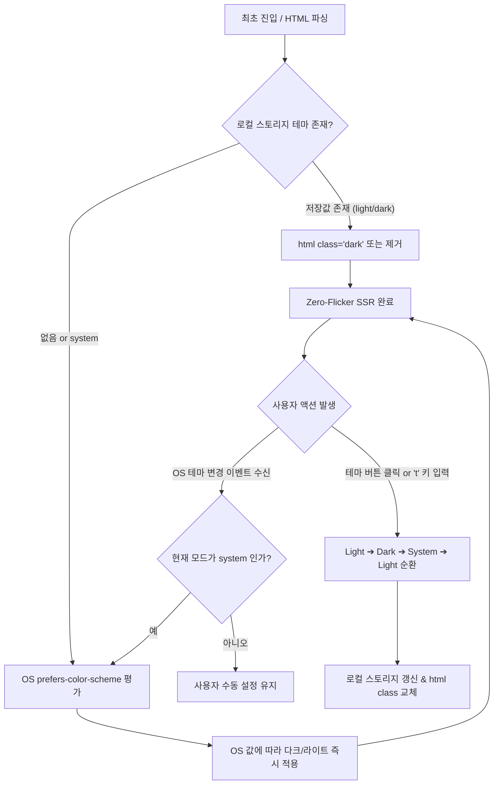
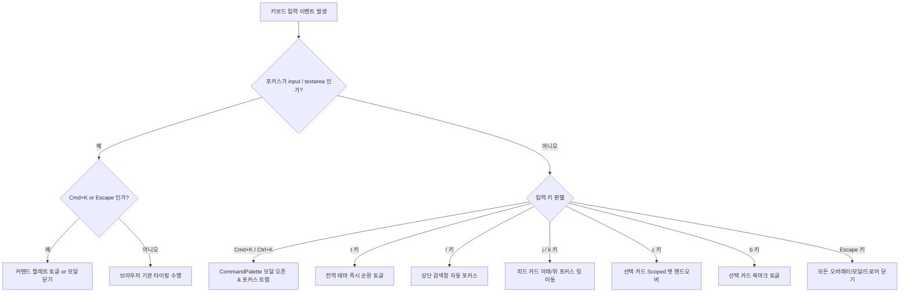
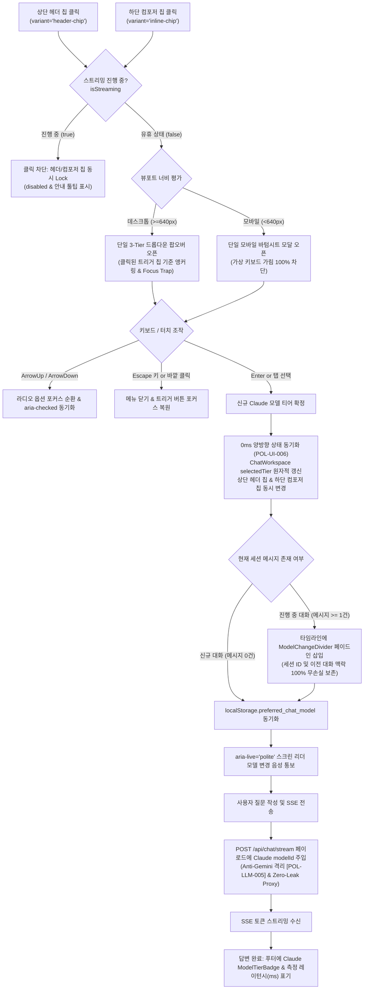

# AgentLens UI 컴포넌트 계층 및 디자인 명세서 (Component & Design Spec)

- **작성일자**: 2026-10-19
- **작성자**: UI 시스템 디자이너 (`ui-system-designer`)
- **문서 버전**: 0.2.0 (Stage 2c 확정판: Gemini 무단 폴백 차단, Claude 전용 파이프라인 확정 & AI 챗 상단 헤더 및 입력창 듀얼 모델 셀렉터 시각적 인지성 완성 [REQ-UI-008, POL-UI-006], 3-Tier 선택기, 타임라인 디바이더, Zero-Leak 보안 거버넌스 [POL-SEC-004], WAI-ARIA radiogroup & 키보드 Arrow 내비게이션, 0px 가로스크롤 방어 통합 명세)
- **상태**: Approved
- **적용 프레임워크**: Next.js 16 (App Router), React 19, Tailwind CSS v4, Lucide React, `next-themes`
- **선행 산출물**: [report.md](../../report.md), [01_PRD.md](../spec-writer/01_PRD.md) (0.2.0: `REQ-UI-008`, `REQ-LLM-002`, `REQ-COLL-005`, `REQ-CHAT-013`, `REQ-SEC-004`, `REQ-THEME-001`, `REQ-SHORTCUT-001`, `REQ-EXPORT-001`, `REQ-CHAT-011`, `REQ-CHAT-012`), [07_CLAUDE_INTEGRATION_AND_MODEL_SELECTOR_SPECIFICATION.md](../spec-writer/fsd/07_CLAUDE_INTEGRATION_AND_MODEL_SELECTOR_SPECIFICATION.md) (0.2.0), [03_POLICIES_AND_EDGES.md](../spec-writer/03_POLICIES_AND_EDGES.md) (0.2.0: `POL-UI-006`, `POL-LLM-005`, `POL-SEC-004`), [06_UI_THEME_AND_HOTKEYS_SPECIFICATION.md](../spec-writer/fsd/06_UI_THEME_AND_HOTKEYS_SPECIFICATION.md), [01_NEWS_FEED_SPECIFICATION.md](../spec-writer/fsd/01_NEWS_FEED_SPECIFICATION.md), [05_AI_CHAT_SPECIFICATION.md](../spec-writer/fsd/05_AI_CHAT_SPECIFICATION.md), [01_ARCHITECTURE_ADR.md](../fullstack-architect/01_ARCHITECTURE_ADR.md)

---

## 1. 컴포넌트 계층 트리 구조도 (Component Hierarchy Tree)

Next.js 16 App Router 아키텍처에 기반한 전체 프론트엔드 컴포넌트 계층 구조입니다.  
최상위 루트 레이아웃(`RootLayout`)에서 **Zero-Flicker SSR 다크모드 프로바이더(`ThemeProvider`)**, **전역 키보드 단축키 오케스트레이터(`HotkeyListener`)**, **커맨드 팔레트 모달(`CommandPalette`)**을 통합 마운트합니다.

메인 대시보드(`/`)와 독립 전용 AI 챗 워크스페이스(`/chat`)는 각각 독립된 라우트로 분리되며, 피드 카드(`NewsCard`) 및 상세 모달(`NewsDetailModal`)에서 **Sonnet 5.5 전담 수집 파이프라인 배지(`ModelTierBadge: Sonnet 5.5 Dedicated`)**와 원클릭 기사 컨텍스트 장착 후 `/chat`으로 전이되는 **Seamless Read-to-Chat Handover** 구조, 모바일 가상 키보드 팝업 시 뷰포트 붕괴를 원천 차단하는 **Visual Viewport Controller**, 화면을 어지럽히지 않고 RAG 검색 범위를 1-터치로 압축하는 **Focus Capsule & Bottom Sheet Drawer** 시스템, **실시간 에이전틱 스텝 트래커 및 28px 접이식 완료 아코디언(`WorkflowStepTracker`)**, **이원화 인라인 인용 뱃지(`CitationBadge`) 및 프리뷰 팝오버(`CitationPopover`)**, **4단 엔지니어링 리포트 원클릭 익스포트 툴바(`ExportToolbar`)**,  
**상단 글로벌 헤더(`ChatHeader`) 및 하단 입력창(`ChatPromptInput`) 듀얼 배치 모델 셀렉터(`ChatModelSelector`, `[🎯 Sonnet 5.5 ▾]`) 및 0ms 양방향 실시간 동기화(Zero-Latency Bidirectional State Sync [REQ-UI-008, POL-UI-006])**,  
**Fitts의 법칙 기반 3-Tier 선택지(`⚡ Haiku 5.5 / 🎯 Sonnet 5.5 (기본) / 🧠 Opus 5.5`)**, **상대 토큰 비용(`$`, `$$`, `$$$`) 및 레이턴시 배지(`ModelTierBadge`)**,  
**Google Gemini 무단 폴백 차단 및 Claude 전용 파이프라인 엄격 격리(Anti-Gemini & Claude-Only Policy [POL-LLM-005, REQ-LLM-002])**,  
**대화 스레드 중간 모델 교체 시 타임라인 시스템 구분선(`ModelChangeDivider`) 및 무손실 맥락 인계(Zero Context Erasure)**,  
**Flexbox 자식 너비 팽창 원천 차단(`min-w-0`), 전방위 텍스트 자동 줄바꿈(`[overflow-wrap:anywhere]`), 코드/테이블 국소 스크롤 격리(`table-wrapper`, `code-block-wrapper`)를 통한 가로 스크롤바 0px 박멸 아키텍처**, 그리고  
**데스크톱 접이식 사이드바(`ChatSidebar`, w-72 / w-80) 및 모바일 슬라이드오버 드로어(`ChatHistoryDrawer`, < 1024px, 딤 백드롭, 제스처 감지, 포커스 트랩) 기반의 대화 세션 히스토리 관리 체계**, `+ 새 대화` 생성, 세션 실시간 검색 필터, 인라인 삭제 확인 팝오버(`DeleteConfirmPopover`), 그리고 과거 세션 선택 시 대화 메시지·선택 모델·스코프 모드·활성 기사 칩·포커스 필터를 100% 완전 복원하여 대화를 이어가는 **멀티턴 하이드레이션(Multi-turn Hydration & Continuity [FUNC-CHAT-012, FUNC-CHAT-013])** UI 아키텍처를 규정합니다.

### 1.1 Mermaid 컴포넌트 계층 다이어그램

```mermaid
graph TD
    subgraph "Next.js App Router (RSC Root & Layout Layer)"
        RootLayout["src/app/layout.tsx (RSC)<br/>전역 레이아웃 & HTML 골격 & viewport 메타데이터<br/>overflow-x: hidden 강제 & suppressHydrationWarning"]
        ThemeProviderComp["src/context/ThemeContext.tsx (RCC)<br/>next-themes 기반 Zero-Flicker SSR 테마 공급기"]
        HotkeyListenerComp["src/components/HotkeyListener.tsx (RCC)<br/>전역 키보드 단축키 오케스트레이터 (j/k, /, b, c, t, Cmd+K, Esc)"]
        CommandPaletteModal["src/components/CommandPalette.tsx (RCC)<br/>전역 커맨드 팔레트 다이얼로그 (Cmd+K / Ctrl+K)"]
    end

    RootLayout --> ThemeProviderComp
    ThemeProviderComp --> HotkeyListenerComp
    ThemeProviderComp --> CommandPaletteModal

    subgraph "Route Pages (Page Level)"
        FeedPage["src/app/page.tsx (RCC)<br/>메인 피드 대시보드 오케스트레이터"]
        ChatPageRoute["src/app/chat/page.tsx (RSC)<br/>전용 AI 챗 라우트 & Suspense 경계"]
    end

    ThemeProviderComp --> FeedPage
    ThemeProviderComp --> ChatPageRoute

    subgraph "메인 피드 & 큐레이션 서브트리 (/)"
        FeedPage --> HeaderComp["src/components/Header.tsx (RCC)<br/>글로벌 내비게이션 & 수집/리셋 트리거"]
        HeaderComp --> ThemeToggleComp["src/components/ThemeToggle.tsx (RCC)<br/>라이트/다크/시스템 테마 전환 토글"]
        HeaderComp --> PaletteTriggerBtn["CommandPalette Trigger Button (RCC)<br/>⌘K 단축키 배지 & 검색 트리거"]

        FeedPage --> BriefingBanner["src/components/DailyBriefingBanner.tsx (RCC)<br/>일일 종합 브리핑 배너"]
        FeedPage --> TechRadarComp["src/components/TechRadar.tsx (RCC)<br/>24h 급상승 기술 레이더 드로어 & 태그 클라우드"]
        FeedPage --> CategoryFilterComp["src/components/CategoryFilter.tsx (RCC)<br/>5대 카테고리 탭 필터 (harness/mcp/agent/ai/all)"]
        FeedPage --> SourceFilterComp["src/components/SourceFilter.tsx (RCC)<br/>출처 칩 & Must-Read 토글 & 북마크"]
        
        FeedPage --> NewsGrid["News Grid Container (RCC)<br/>1/2/3열 반응형 그리드"]
        NewsGrid --> NewsCardComp["src/components/NewsCard.tsx (RCC)<br/>뉴스 카드 & 3줄 요약/인사이트 (j/k 포커스 링)"]
        NewsCardComp --> SonnetPipelineBadge["ModelTierBadge: Sonnet 5.5 Dedicated (RCC)<br/>전담 수집 파이프라인 신뢰도 배지 (Gemini 사용 배제)"]
        NewsCardComp --> CardHandoverCTA["HandoverCtaButton (RCC)<br/>'Ask AI' 챗 핸드오버 버튼 ('c' 단축키 매핑)"]

        FeedPage --> NewsDetailModalComp["src/components/NewsDetailModal.tsx (RCC)<br/>상세 모달 & 인라인 탭 (Enter/Space 오픈)"]
        NewsDetailModalComp --> ModalPipelineBadge["ModelTierBadge: Sonnet 5.5 Analysis (RCC)"]
        NewsDetailModalComp --> ModalHandoverCTA["HandoverCtaButton (RCC)<br/>'전용 AI 챗에서 분석' CTA 버튼"]
        NewsDetailModalComp --> AskAiPanelComp["src/components/news-detail/AskAiPanel.tsx (RCC)<br/>모달 내 간이 질의 패널"]

        FeedPage --> ShortcutHintFooter["src/components/ShortcutHintFooter.tsx (RCC)<br/>데스크톱 하단 단축키 힌트 바 (j/k · Enter · c · b · / · ⌘K)"]
    end

    subgraph "독립 전용 AI 챗 워크스페이스 서브트리 (/chat)"
        ChatPageRoute --> ChatSuspense["React.Suspense Boundary<br/>Fallback: ChatWorkspaceSkeleton"]
        ChatSuspense --> ChatWorkspaceComp["src/components/chat/ChatWorkspace.tsx (RCC)<br/>100dvh 컨테이너, useVisualViewport, Dual-Layer 영속화<br/>듀얼 모델 셀렉터 상태 중앙 오케스트레이터 (selectedTier, setSelectedTier)"]
        
        %% 히스토리 사이드바 서브트리 (데스크톱)
        ChatWorkspaceComp --> ChatSidebarComp["src/components/chat/ChatSidebar.tsx (RCC)<br/>데스크톱 좌측 패널 (Collapsible w-72 / w-80)<br/>role='navigation', aria-label='대화 기록 목록'"]
        ChatSidebarComp --> ChatSidebarHeaderComp["src/components/chat/ChatSidebarHeader.tsx (RCC)<br/>'+ 새 대화' 버튼, 실시간 세션 검색창, 사이드바 접기 토글"]
        ChatSidebarComp --> SessionListComp["src/components/chat/SessionList.tsx (RCC)<br/>스크롤 목록 (overscroll-contain) & 5대 UI 상태"]
        SessionListComp --> SessionItemCardComp["src/components/chat/SessionItemCard.tsx (RCC)<br/>활성 하이라이트(인디고 보더), 제목 말줄임, 상대시간, 모델 뱃지, 스코프 뱃지"]
        SessionItemCardComp --> SessionModelBadge["ModelTierBadge: Session Default (RCC)"]
        SessionItemCardComp --> DeleteConfirmPopoverComp["src/components/chat/DeleteConfirmPopover.tsx (RCC)<br/>삭제 확인 팝오버 (Focus Trap, 삭제/취소)"]
        SessionListComp --> SessionEmptyStateComp["src/components/chat/SessionEmptyState.tsx (RCC)<br/>0건 세션 안내 & 새 대화 시작 CTA"]

        %% 모바일 슬라이드 드로어 서브트리
        ChatWorkspaceComp --> ChatHistoryDrawerComp["src/components/chat/ChatHistoryDrawer.tsx (RCC)<br/>모바일 슬라이드오버 드로어 (< 1024px)<br/>딤 백드롭, 스와이프 제스처 닫힘, 포커스 트랩"]
        ChatHistoryDrawerComp -.-> ChatSidebarComp

        %% 메인 챗 뷰포트 서브트리
        ChatWorkspaceComp --> ChatMainArea["Chat Main Area Container (RCC)<br/>flex-1 flex flex-col h-full min-w-0 overflow-x-hidden"]
        
        ChatMainArea --> ChatHeaderComp["src/components/chat/ChatHeader.tsx (RCC)<br/>히스토리 토글, 피드 복귀, 스코프 토글, 듀얼 셀렉터 #1, ThemeToggle, 새 대화"]
        ChatHeaderComp --> ActiveSourceChipComp["src/components/chat/ActiveSourceChip.tsx (RCC)<br/>핸드오버된 기사 포커스 칩 & 컨텍스트 해제"]
        
        %% 듀얼 모델 셀렉터 #1 (상단 헤더 우측 상시 노출)
        ChatHeaderComp --> HeaderModelSelectorComp["ChatModelSelector (variant='header-chip') (RCC)<br/>상단 헤더 우측 상시 노출 [🎯 Sonnet 5.5 ▾]<br/>0초 모델 시각적 인지성 확보 (REQ-UI-008)"]
        ChatHeaderComp --> ChatHeaderThemeToggle["ThemeToggle (RCC)"]

        ChatMainArea --> ChatMessageListComp["src/components/chat/ChatMessageList.tsx (RCC)<br/>flex-1 overflow-y-auto overflow-x-hidden w-full max-w-full<br/>Hydration 상태 처리 & 멀티턴 메시지 버블 & 모델 변경 디바이더"]
        ChatMessageListComp --> WelcomeEmptyView["ChatWelcomeView (RCC)<br/>초기 웰컴 안내 & 추천 프롬프트 칩 그룹"]
        
        %% 타임라인 모델 교체 디바이더
        ChatMessageListComp --> ModelChangeDividerComp["src/components/chat/ModelChangeDivider.tsx (RCC)<br/>타임라인 모델 교체 시스템 디바이더 & 무손실 맥락 인계 안내<br/>role='separator', aria-label"]
        
        ChatMessageListComp --> ChatMessageItemComp["src/components/chat/ChatMessageItem.tsx (RCC)<br/>flex-1 min-w-0 max-w-full 버블 래퍼"]
        
        ChatMessageItemComp --> WorkflowStepTrackerComp["src/components/chat/WorkflowStepTracker.tsx (RCC)<br/>실시간 SSE 스텝 트래커 & 28px 슬림 접이식 완료 아코디언"]
        WorkflowStepTrackerComp --> StepProgressBar["StepProgressBar (RCC)<br/>0~100% 진행률 게이지 & 펄스 애니메이션"]
        WorkflowStepTrackerComp --> CollapsedSummaryBar["CollapsedSummaryBar (RCC)<br/>높이 28px 슬림 아코디언 헤더 & 토글"]
        WorkflowStepTrackerComp --> AccordionDetailDrawer["AccordionDetailDrawer (RCC)<br/>단계별 소요 시간 & 자율 검색 쿼리 칩 목록"]

        ChatMessageItemComp --> MarkdownViewerComp["src/components/MarkdownViewer.tsx (RCC)<br/>w-full max-w-full min-w-0 break-words<br/>overflow-wrap:anywhere word-break:break-word"]
        
        MarkdownViewerComp --> TypographyElements["Paragraph/Heading/List (RCC)<br/>break-words overflow-wrap:anywhere"]
        MarkdownViewerComp --> InlineCodeElement["Inline Code Tag (RCC)<br/>break-all font-mono text-[12px]"]
        MarkdownViewerComp --> CodeBlockWrapper["div.code-block-wrapper (RCC)<br/>w-full max-w-full min-w-0 overflow-hidden<br/>pre: p-3 overflow-x-auto (국소 스크롤 격리)"]
        MarkdownViewerComp --> TableWrapper["div.table-wrapper (RCC)<br/>w-full max-w-full min-w-0 overflow-x-auto<br/>table: border-collapse (국소 스크롤 격리)"]

        MarkdownViewerComp --> PrimaryCitationBadgeComp["CitationBadge: Primary (RCC)<br/>기사 원본 인용 [1], [2] (인디고 뱃지)"]
        MarkdownViewerComp --> SuppCitationBadgeComp["CitationBadge: Supplementary (RCC)<br/>자율 보충 검색 인용 [S1], [S2] (에메랄드 뱃지)"]
        
        PrimaryCitationBadgeComp --> CitationPopoverComp["src/components/chat/CitationPopover.tsx (RCC)<br/>원문 기사 프리뷰 & 상세 모달/새탭 원문 링크"]
        SuppCitationBadgeComp --> CitationPopoverComp
        CitationPopoverComp --> WebSnippetPreview["WebSnippetPreview (RCC)<br/>웹 도메인 파비콘 & 자율 발굴 스니펫"]

        ChatMessageItemComp --> ExportToolbarComp["src/components/chat/ExportToolbar.tsx (RCC)<br/>4단 리포트 원클릭 익스포트 툴바 (마크다운 복사, .md 다운로드, Notion 동기화)"]
        ChatMessageItemComp --> MessageFooterMeta["Message Footer Meta Bar (RCC)<br/>답변 복사/재시도 액션 & 모델 배지"]
        MessageFooterMeta --> FooterModelBadge["ModelTierBadge: Used Model & Latency ms (RCC)<br/>실제 사용 모델 & 응답시간 (Gemini 표기 원천 차단)"]

        ChatMainArea --> FocusCapsuleComp["src/components/chat/FocusCapsule.tsx (RCC)<br/>30px 미니멀 포커스 캡슐 버튼"]
        FocusCapsuleComp --> FocusBottomSheetComp["src/components/chat/FocusBottomSheet.tsx (RCC)<br/>모바일 원터치 Drawer & 실시간 타깃 예측 배지"]

        ChatMainArea --> ChatPromptInputComp["src/components/chat/ChatPromptInput.tsx (RCC)<br/>16px 모바일 폰트, 자동 확장 텍스트에어리어 & 전송/중단 제어<br/>좌하단 듀얼 셀렉터 #2 인라인 임베딩"]
        
        %% 듀얼 모델 셀렉터 #2 (하단 입력창 좌하단 밀착)
        ChatPromptInputComp --> ComposerModelSelectorComp["ChatModelSelector (variant='inline-chip') (RCC)<br/>입력창 좌하단 Fitts의 법칙 엄지/커서 밀착 [🎯 Sonnet 5.5 ▾]"]
        
        %% 듀얼 셀렉터 공유 팝오버 및 0ms 양방향 상태 동기화 (POL-UI-006)
        HeaderModelSelectorComp & ComposerModelSelectorComp -.-> DualSyncRel["0ms 양방향 상태 동기화 (POL-UI-006)<br/>selectedTier / onSelectTier in ChatWorkspace"]
        DualSyncRel --> SharedModelPopover["단일 공유 ModelSelectorPopover / BottomSheet (RCC)<br/>role='radiogroup', aria-checked, Arrow Nav, Focus Trap"]
        SharedModelPopover --> HaikuTierItem["Haiku Tier Option (RCC)<br/>⚡ Haiku 5.5 | 초고속 질의응답 (비용 $, 속도 ~0.3s)"]
        SharedModelPopover --> SonnetTierItem["Sonnet Tier Option (RCC)<br/>🎯 Sonnet 5.5 (기본) | 심층 분석 & 코드 (비용 $$, 속도 ~0.6s) [추천]"]
        SharedModelPopover --> OpusTierItem["Opus Tier Option (RCC)<br/>🧠 Opus 5.5 | 복합 추론 & 감사 (비용 $$$, 속도 ~1.8s)"]
        SharedModelPopover --> ModelTierBadgeCommon["ModelTierBadge (RCC)<br/>상대 비용($) 및 지연시간 배지 렌더러"]
    end

    subgraph "글로벌 모달 시스템 (조건부 렌더링 & 포털)"
        FeedPage --> DailyBriefingModalComp["DailyBriefingModal.tsx (RCC)"]
        FeedPage --> SourcesModalComp["SourcesModal.tsx (RCC)"]
        FeedPage --> SettingsModalComp["BriefingSettingsModal.tsx (RCC)"]
        FeedPage --> ScheduleModalComp["ScheduleModal.tsx (RCC)"]
        FeedPage --> McpModalComp["McpModal.tsx (RCC)"]
    end
```



### 1.2 아스키 컴포넌트 계층 트리

```text
src/app/layout.tsx (RSC: 전역 레이아웃, 메타데이터, interactiveWidget: 'resizes-content', overflow-x: hidden)
└── src/context/ThemeContext.tsx (RCC: next-themes 기반 Zero-Flicker SSR 테마 공급기)
      ├── src/components/HotkeyListener.tsx (RCC: 전역 단축키 j/k, /, b, c, t, Cmd+K, Esc 오케스트레이터)
      ├── src/components/CommandPalette.tsx (RCC: Cmd+K 전역 커맨드 팔레트 다이얼로그)
      │
      ├── src/app/page.tsx (RCC: 메인 피드 오케스트레이터)
      │     ├── [Global Nav] src/components/Header.tsx (RCC)
      │     │     ├── [Theme Switcher] src/components/ThemeToggle.tsx (RCC: Sun / Moon / Laptop)
      │     │     ├── [Command Trigger] CommandPaletteTriggerButton (RCC: ⌘K 배지 버튼)
      │     │     └── [Actions] TriggerCollectButton, ResetModalTrigger
      │     ├── [Intelligence Banner] src/components/DailyBriefingBanner.tsx (RCC)
      │     ├── [Tech Radar Drawer] src/components/TechRadar.tsx (RCC)
      │     ├── [Category Tabs] src/components/CategoryFilter.tsx (RCC)
      │     ├── [Filter & Search Toolbar] src/components/SourceFilter.tsx (RCC: '/' 키 포커스 타깃)
      │     ├── [News Grid] (RCC: 1/2/3열 반응형 그리드)
      │     │     └── src/components/NewsCard.tsx (RCC: j/k 포커스 링, 'b' 북마크, 'Enter' 상세)
      │     │           ├── [Pipeline Badge] src/components/chat/ModelTierBadge.tsx (RCC: Sonnet 5.5 전담 수집 표기)
      │     │           └── [Handover Action] src/components/chat/HandoverCtaButton.tsx (RCC: 'c' 단축키)
      │     ├── [Detail Modal] src/components/NewsDetailModal.tsx (RCC: ESC 닫기, Focus Trap)
      │     │     ├── [Pipeline Badge] src/components/chat/ModelTierBadge.tsx (RCC: Sonnet 5.5 분석 보증)
      │     │     ├── [Modal Handover CTA] src/components/chat/HandoverCtaButton.tsx (RCC)
      │     │     ├── [AI Summary & Markdown] src/components/MarkdownViewer.tsx (RCC)
      │     │     └── [Inline Tab] src/components/news-detail/AskAiPanel.tsx (RCC)
      │     ├── [Global Modals] (DailyBriefingModal, SourcesModal, BriefingSettingsModal, ScheduleModal, McpModal)
      │     └── [Shortcut Guide Footer] src/components/ShortcutHintFooter.tsx (RCC: 데스크톱 하단 힌트 바)
      │
      └── src/app/chat/page.tsx (RSC: 정적 메타데이터, SEO, Suspense 경계 제공)
            └── <Suspense fallback={<ChatWorkspaceSkeleton />}>
                  └── src/components/chat/ChatWorkspace.tsx (RCC: 100dvh, useVisualViewport, overflow-x-hidden, 듀얼 셀렉터 상태 관리)
                        │
                        ├── [Desktop Left Panel] src/components/chat/ChatSidebar.tsx (RCC: Collapsible w-72 / w-80, role='navigation')
                        │     ├── src/components/chat/ChatSidebarHeader.tsx (RCC: '+ 새 대화', 검색 인풋, 접기 토글)
                        │     │     ├── NewChatButton (Action Button: '+ 새 대화', w-full py-2 px-3 bg-blue-600)
                        │     │     ├── SessionSearchInput (Text Input: 실시간 제목 필터링, 검색어 삭제)
                        │     │     └── SidebarCollapseButton (Icon Button: <PanelLeftClose /> 사이드바 접기)
                        │     │
                        │     ├── src/components/chat/SessionList.tsx (RCC: 세션 스크롤 목록, overscroll-contain, 5대 상태 처리)
                        │     │     ├── [Skeleton List] SessionListSkeleton (RCC: 로딩 펄스 카드 5개)
                        │     │     ├── [Item Card] src/components/chat/SessionItemCard.tsx (RCC: role='button', active highlight)
                        │     │     │     ├── SessionTitleText (말줄임 텍스트: 첫 질문 앞 30자 자동 타이틀링)
                        │     │     │     ├── [Model Badge] src/components/chat/ModelTierBadge.tsx (RCC: 세션 기본 모델 표시)
                        │     │     │     ├── SessionScopeBadge (Badge: '[Scoped]' 인디고 vs '[Global]' 블루)
                        │     │     │     ├── SessionUpdatedTime (상대시간: '방금 전', '3시간 전', '어제')
                        │     │     │     ├── SessionDeleteButton (Icon Button: <Trash2 /> 호버/탭 시 노출)
                        │     │     │     └── src/components/chat/DeleteConfirmPopover.tsx (RCC: 삭제 확인 팝오버, Focus Trap)
                        │     │     └── [Empty State] src/components/chat/SessionEmptyState.tsx (RCC: 0건 세션 안내 & 새 대화 시작 CTA)
                        │     │
                        │     └── SidebarFooter (하단 저장소 사용량 및 동기화 상태 인디케이터)
                        │
                        ├── [Mobile Slide Drawer] src/components/chat/ChatHistoryDrawer.tsx (RCC: < 1024px 슬라이드 드로어, 딤 백드롭)
                        │     ├── DrawerBackdrop (Fixed Overlay: bg-slate-900/50 backdrop-blur-xs, 클릭 시 닫힘)
                        │     ├── DrawerPanel (Slide-over Panel: w-72 max-w-[85vw], touch gesture pan-y, Focus Trap)
                        │     └── (ChatSidebarHeader + SessionList 내부 임베딩)
                        │
                        └── [Chat Main Area] (flex-1 flex flex-col h-full min-w-0 overflow-x-hidden relative)
                              ├── src/components/chat/ChatHeader.tsx (RCC: 상단 툴바)
                              │     ├── HistoryToggleButton (Icon Button: <History /> 드로어/사이드바 토글, aria-expanded)
                              │     ├── NavBackLink (피드 바로가기 링크)
                              │     ├── ScopeSegmentedControl (Scoped Focus vs Global Corpus)
                              │     ├── src/components/chat/ActiveSourceChip.tsx (RCC: 핸드오버 기사 칩)
                              │     │
                              │     ├── [Dual Model Selector #1: Header] src/components/chat/ChatModelSelector.tsx (RCC: variant='header-chip')
                              │     │     └── TriggerChip: [🎯 Sonnet 5.5 ▾] (상단 우측 상시 노출로 0초 모델 인지성 보장 [REQ-UI-008])
                              │     │
                              │     ├── src/components/ThemeToggle.tsx (RCC: 다크/라이트 테마 토글 버튼)
                              │     └── SessionActions (새 대화 시작 버튼)
                              │
                              ├── src/components/chat/ChatMessageList.tsx (RCC: flex-1 overflow-y-auto overflow-x-hidden w-full max-w-full)
                              │     ├── [Hydration Loading] HydrationSkeletonView (세션 복원 중 부드러운 스켈레톤 애니메이션)
                              │     ├── [Empty State] WelcomeView & SuggestedPromptChips (추천 질문 칩)
                              │     │
                              │     ├── [Timeline Model Switch] src/components/chat/ModelChangeDivider.tsx (RCC)
                              │     │     ├── DividerLine (점선/실선 구분선: border-slate-200 dark:border-slate-800)
                              │     │     └── ModelChangePill (중앙 캡슐: [🔄 Claude Opus 5.5로 모델 변경됨 · 맥락 100% 보존])
                              │     │
                              │     ├── [Message Items] src/components/chat/ChatMessageItem.tsx (RCC: flex-1 min-w-0 max-w-full 래퍼)
                              │     │     ├── UserMessageBubble (질문 말풍선, max-w-[85%] break-words)
                              │     │     └── AssistantMessageBubble (답변 말풍선: flex-1 min-w-0 max-w-full)
                              │     │           ├── [Agentic Status] src/components/chat/WorkflowStepTracker.tsx (RCC)
                              │     │           │     ├── RealtimeTrackerBar (진행 중 펄스 게이지 & 단계별 안내 라벨)
                              │     │           │     ├── CollapsedAccordion (스트리밍 완료 시 높이 28px 슬림 아코디언)
                              │     │           │     └── StepDetailDrawer (토글 시 자율 생성 쿼리 칩 & 단계별 소요 시간)
                              │     │           ├── src/components/MarkdownViewer.tsx (RCC: w-full max-w-full min-w-0 break-words)
                              │     │           │     ├── Typography: p, h1~h4, li, blockquote (break-words [overflow-wrap:anywhere] [word-break:break-word])
                              │     │           │     ├── InlineCode: code (break-all font-mono text-[12px] bg-slate-100 dark:bg-slate-800 px-1 py-0.5 rounded)
                              │     │           │     ├── CodeBlockWrapper: div.code-block-wrapper (w-full max-w-full min-w-0 overflow-hidden rounded-lg my-3)
                              │     │           │     │     ├── CodeHeaderBar (언어 라벨, 원클릭 복사 버튼)
                              │     │           │     │     └── CodePre: pre (p-3 overflow-x-auto font-mono text-[12px] overscroll-x-contain)
                              │     │           │     ├── TableWrapper: div.table-wrapper (w-full max-w-full min-w-0 overflow-x-auto my-3 border rounded-lg)
                              │     │           │     │     └── TableElement: table (w-full text-xs text-left border-collapse)
                              │     │           │     ├── [Primary Citation] src/components/chat/CitationBadge.tsx (RCC: [1], [2] 인디고 뱃지)
                              │     │           │     ├── [Supplementary Citation] src/components/chat/CitationBadge.tsx (RCC: [S1], [S2] 에메랄드 뱃지)
                              │     │           │     └── src/components/chat/CitationPopover.tsx (RCC: 출처 뉴스 및 웹 검색 프리뷰 팝오버)
                              │     │           ├── src/components/chat/ExportToolbar.tsx (RCC: 4단 리포트 익스포트 액션 툴바)
                              │     │           │     ├── CopyMarkdownButton (마크다운 클립보드 무손실 복사)
                              │     │           │     ├── DownloadMdButton (.md 파일 로컬 다운로드)
                              │     │           │     └── SyncNotionButton (Notion 1-클릭 동기화)
                              │     │           └── MessageFooterMetaBar (RCC: 답변 하단 메타 바)
                              │     │                 ├── MessageActions (답변 복사, 재생성, 재시도)
                              │     │                 └── [Footer Model Badge] src/components/chat/ModelTierBadge.tsx (RCC: 실제 사용 모델 & 측정 레이턴시 ms, Gemini 표기 차단)
                              │     └── ChatEndAnchor (DOM ref: scrollIntoView 스크롤 타깃)
                              │
                              ├── [Focus Bar] src/components/chat/FocusCapsule.tsx (RCC: 30px 미니멀 캡슐)
                              │     └── src/components/chat/FocusBottomSheet.tsx (RCC: 모바일 바텀 시트 Drawer)
                              │           ├── SheetHandle (스와이프 다운 제스처 감지 100px)
                              │           ├── CategoryFilterChips (5대 카테고리 칩)
                              │           ├── TimeRangeSegmentedControl (24h / 7d / 30d / all)
                              │           ├── SortOrderSegmentedControl (hot / latest / quality)
                              │           ├── HighSignalSwitchToggle (Must-Read 전용)
                              │           ├── TargetCountBadge (실시간 N건 매칭 예측 배지)
                              │           └── ApplyAndResetFooter (필터 적용 / 초기화 버튼)
                              │
                              └── [Sticky Composer] src/components/chat/ChatPromptInput.tsx (RCC: 16px 폰트 & 가상키보드 흡착)
                                    ├── ComposerTopRow (입력 텍스트에어리어 영역)
                                    │     ├── AutoExpandingTextarea (text-base sm:text-sm, 1~2,000자, IME 가드)
                                    │     └── CharCounter (글자 수 카운터, 2,000자 초과 시 레드 경고)
                                    └── ComposerBottomBar (하단 제어 바: Fitts의 법칙 엄지/커서 밀착 레이아웃)
                                          │
                                          ├── [Dual Model Selector #2: Composer] src/components/chat/ChatModelSelector.tsx (RCC: variant='inline-chip')
                                          │     └── ModelTriggerChip: [🎯 Sonnet 5.5 ▾] (스트리밍 중 disabled, Fitts의 법칙 만족)
                                          │
                                          └── ActionButtons (중단 Abort 버튼 / 전송 Submit 버튼)
                                                
                                          [Shared 3-Tier Popover / BottomSheet Modal (공유 컴포넌트)]
                                          ├── PopoverHeader ("Claude AI 모델 선택")
                                          ├── ModelRadioGroup (role='radiogroup', aria-label='AI 모델 선택')
                                          │     ├── HaikuOption (role='radio': ⚡ Haiku 5.5 · 초고속 $ · ~0.3s)
                                          │     ├── SonnetOption (role='radio': 🎯 Sonnet 5.5 · 심층 $$ · ~0.6s · 추천)
                                          │     └── OpusOption (role='radio': 🧠 Opus 5.5 · 복합 추론 $$$ · ~1.8s)
                                          └── PopoverFooter (무손실 전환 정책 안내 & 닫기 가이드)
```
```

---

## 2. Server Component (RSC) vs Client Component (RCC) 분격 정의

Next.js 16 App Router 원칙에 입각하여 번들 크기를 최소화하고 불필요한 하이드레이션 오버헤드를 방지하기 위해 서버 컴포넌트(RSC)와 클라이언트 컴포넌트(RCC)의 경계를 엄격히 분리합니다.

### 2.1 컴포넌트별 분격 및 역할 매트릭스

| 컴포넌트명 | 파일 경로 | 구분 | 선정 사유 및 담당 책임 |
| :--- | :--- | :---: | :--- |
| `RootLayout` | `src/app/layout.tsx` | **RSC** | • 전역 메타데이터 및 Geist 폰트 최적화 주입<br>• `viewport` 메타데이터(`interactiveWidget: 'resizes-content'`, `width: 'device-width'`) 선언<br>• 최상위 `html`, `body` 태그에 `overflow-x: hidden; width: 100%; max-width: 100%;` 강제 선언 (Zero JS Bundle)<br>• 하이드레이션 불일치 방지를 위한 `suppressHydrationWarning` 적용 |
| `ChatPageRoute` | `src/app/chat/page.tsx` | **RSC** | • `/chat` 경로 메타데이터(`title`, `description`, `openGraph`) 서버 생성<br>• `useSearchParams` 소비에 필수적인 `React.Suspense` 경계 및 스켈레톤 Fallback 래핑 |
| `ThemeProvider` | `src/context/ThemeContext.tsx` | **RCC**<br>(`'use client'`) | • `next-themes` 기반 라이트/다크/시스템 테마 상태 브로드캐스팅 (`attribute="class"`, `defaultTheme="system"`)<br>• 브라우저 `localStorage` 영속화 및 `window.matchMedia` OS 테마 변경 실시간 동기화<br>• 클라이언트 하이드레이션 이전 DOM `<html class="dark">` 인라인 스크립트 주입으로 FOUC 깜빡임 0건 보장 |
| `ThemeToggle` | `src/components/ThemeToggle.tsx` | **RCC**<br>(`'use client'`) | • 헤더 우측 상시 노출 테마 토글 버튼 (`Sun` / `Moon` / `Laptop` 아이콘)<br>• 마우스 클릭 및 't' 단축키 입력 시 Light $\rightarrow$ Dark $\rightarrow$ System 3단 순환 전이<br>• 16ms(1 프레임) 이내 부드러운 전역 팔레트 전환 |
| `HotkeyListener` | `src/components/HotkeyListener.tsx` | **RCC**<br>(`'use client'`) | • 전역 `keydown` 이벤트 단일 창구 오케스트레이션 (`j`/`k` 탐색, `/` 검색창 포커스, `b` 북마크, `c` 전용 챗 핸드오버, `t` 테마 토글, `Cmd+K` 커맨드 팔레트, `Escape` 모달 닫기)<br>• **Input Isolation Rule**: `<input>`, `<textarea>`, `contenteditable` 포커스 시 단일 키 단축키 무시 및 `isComposing`(한글 조합) 보호 |
| `CommandPalette` | `src/components/CommandPalette.tsx` | **RCC**<br>(`'use client'`) | • `Cmd+K` (macOS) / `Ctrl+K` (Win/Linux) 단축키로 토글되는 전역 커맨드 다이얼로그<br>• 실시간 명령어 필터링, 상/하 방향키 순환 선택, Enter 액션 실행, Focus Trap 적용, ESC 닫기 |
| `FeedPage` | `src/app/page.tsx` | **RCC**<br>(`'use client'`) | • 메인 피드 오케스트레이터 (`useNewsFeed`, `useBookmarks` 훅 바인딩)<br>• 피드 카드 포커스 인덱스(`focused_card_index`) 관리 및 `j`/`k` 키보드 내비게이션 상태 동기화<br>• 전역 모달(Briefing, Sources, Settings, Schedule, Mcp) 가시성 제어 |
| `Header` | `src/components/Header.tsx` | **RCC** | • 글로벌 상단 내비게이션 바: 로고, 카테고리 링크, 테마 토글 버튼(`ThemeToggle`), 커맨드 팔레트 트리거 배지(⌘K), 수집 진행률 바, 설정 모달 트리거 |
| `NewsCard` | `src/components/NewsCard.tsx` | **RCC** | • 개별 기사 카드: 카테고리 뱃지, 제목 링크, 3줄 요약, Why It Matters 시사점 박스<br>• **Sonnet 5.5 전담 수집 파이프라인 배지(`ModelTierBadge`)** 마운트로 큐레이션 신뢰도 표출<br>• 키보드 포커스 링(`ring-2 ring-blue-500 dark:ring-blue-400`), 'b' 북마크 토글, 'c' Scoped 챗 핸드오버 액션 제공 |
| `NewsDetailModal` | `src/components/NewsDetailModal.tsx` | **RCC** | • 기사 상세 모달: Focus Trap, ESC 닫기, 3-Bullet TL;DR 파싱, 원문 링크, 모달 내 Ask AI 탭, Sonnet 5.5 파이프라인 분석 배지(`ModelTierBadge`), '전용 AI 챗에서 분석' CTA 버튼 |
| `ChatWorkspace` | `src/components/chat/ChatWorkspace.tsx` | **RCC**<br>(`'use client'`) | • 세션 히스토리 상태(`activeSessionId`, `sessions`, `isSidebarOpen`, `isDrawerOpen`, `hydrationState`) 중앙 오케스트레이터<br>• **듀얼 모델 셀렉터 단일 진실 공급원(SSOT)**: `selectedTier` 및 `setSelectedTier` 상태를 단일 관리하여 상단 헤더와 하단 컴포저에 동시 공급 (0ms 양방향 실시간 동기화 [POL-UI-006])<br>• Dual-Layer 영속화(백엔드 API + 브라우저 `localStorage`) 양방향 동기화 및 FIFO 용량(최대 30개) 제어<br>• `useVisualViewport` 훅을 통한 가상 키보드 높이 실시간 계산 및 패딩 인셋 제어<br>• 최상위 레이아웃 `w-full max-w-full overflow-x-hidden` 유지 및 SSE 스트리밍 오케스트레이션 |
| `ChatSidebar` | `src/components/chat/ChatSidebar.tsx` | **RCC**<br>(`'use client'`) | • **데스크톱 좌측 패널 (Collapsible w-72 / w-80)**: lg 이상 뷰포트에서 고정 또는 접이식 토글 제공<br>• `role="navigation"`, `aria-label="대화 기록 목록"` 준수<br>• 세션 검색 쿼리 상태 관리 및 필터링된 세션 목록을 `SessionList`로 위임<br>• 부드러운 축소/확장 애니메이션(`transition-all duration-300 ease-in-out`) 적용 |
| `ChatSidebarHeader` | `src/components/chat/ChatSidebarHeader.tsx` | **RCC** | • `+ 새 대화` 생성 액션 버튼(신규 UUID 발급 및 웰컴 뷰 리셋 트리거)<br>• 실시간 세션 제목 검색 인풋(`session_search_input`, 디바운스 필터링 및 검색어 ✕ 클리어)<br>• 사이드바 접기/펼치기 토글 아이콘 버튼(`SidebarCollapseButton`) |
| `SessionList` | `src/components/chat/SessionList.tsx` | **RCC** | • 세션 목록 독립 스크롤 뷰포트 (`overflow-y-auto overscroll-contain`)<br>• **5대 UI 상태 완벽 처리**: Idle(정상 목록), Loading(스켈레톤 5개), Empty(0건 안내), Active(선택 하이라이트), Error(에러 배너 & 재시도)<br>• 활성 세션 변경 시 해당 카드 영역으로의 부드러운 자동 스크롤(`scrollIntoView({ block: 'nearest' })`) |
| `SessionItemCard` | `src/components/chat/SessionItemCard.tsx` | **RCC** | • 개별 세션 카드: `role="button"`, `aria-current={isActive ? "true" : undefined}`<br>• **Active 하이라이트**: 좌측 3px 인디고 보더(`border-l-indigo-600 dark:border-l-indigo-400`) 및 틴트 배경(`bg-indigo-50/70 dark:bg-indigo-950/40`)<br>• 제목 30자 말줄임(`truncate`), 모델 배지(`ModelTierBadge`), 스코프 뱃지(`[Scoped]` 인디고 vs `[Global]` 블루), 상대 시간 포맷<br>• 마우스 호버 및 모바일 탭 시 휴지통 삭제 아이콘(`SessionDeleteButton`) 노출 및 삭제 팝오버 트리거 |
| `DeleteConfirmPopover` | `src/components/chat/DeleteConfirmPopover.tsx` | **RCC** | • 세션 삭제 인라인 확인 모달/팝오버: `role="dialog"`, `aria-modal="true"`, Focus Trap 적용<br>• "이 대화를 삭제하시겠습니까?" 경고 문구 및 [취소], [삭제 확정] 버튼 제공<br>• `Escape` 키 및 바깥 영역 클릭(Click Outside) 시 팝오버 즉시 닫힘 |
| `SessionEmptyState` | `src/components/chat/SessionEmptyState.tsx` | **RCC** | • 저장된 대화가 0건일 때 또는 검색 필터 결과가 0건일 때의 전용 Empty State 안내 컴포넌트<br>• `MessageSquareDashed` 아이콘, 맞춤형 피드백 안내 문구, `+ 새 대화 시작` 또는 [검색어 초기화] 액션 버튼 노출 |
| `ChatHistoryDrawer` | `src/components/chat/ChatHistoryDrawer.tsx` | **RCC**<br>(`'use client'`) | • **모바일/태블릿 슬라이드오버 드로어 (< 1024px)**: 헤더 히스토리 토글 버튼 탭 시 좌측에서 슬라이드 인<br>• 반투명 딤 백드롭(`bg-slate-900/50 backdrop-blur-xs`) 및 바깥 클릭 닫기<br>• 터치 스와이프 제스처: 좌측으로 80px 이상 드래그 시 부드러운 드로어 닫힘 지원<br>• 드로어 오픈 시 배경 스크롤 잠금(Scroll Lock) 및 포커스 트랩(Focus Trap), ESC 키 닫기 |
| `ChatMessageList` | `src/components/chat/ChatMessageList.tsx` | **RCC** | • **멀티턴 복원(Hydration) 상태 관리**: `'idle' | 'hydrating' | 'ready' | 'error'` 분기 처리<br>• 세션 전환 시 메시지 피드 스켈레톤 펄스 노출 후 복원 완료 시 최하단 자동 스크롤<br>• **타임라인 모델 교체 구분선(`ModelChangeDivider`)** 메시지 순서에 따른 동적 인라인 렌더링<br>• 스크롤 컨테이너 제약: `flex-1 overflow-y-auto overflow-x-hidden w-full max-w-full`<br>• `overscroll-behavior-y: contain` 적용으로 모바일 바디 고무줄 바운스 방어 |
| `ModelChangeDivider` | `src/components/chat/ModelChangeDivider.tsx` | **RCC** | • **타임라인 모델 변경 시스템 구분선**: 대화 중간 모델 교체 시 타임라인에 삽입 (`[ ── 🔄 Claude Opus 5.5로 모델 변경됨 · 맥락 100% 보존 ── ]`)<br>• 세션 무손실 유지 및 이전 맥락(최대 10턴, 3,000토큰) 온전 인계 시각적 안내<br>• WAI-ARIA `role="separator"`, `aria-label="Claude {modelName}로 모델 전환됨"` 준수 |
| `ChatMessageItem` | `src/components/chat/ChatMessageItem.tsx` | **RCC** | • **Flex 자식 팽창 차단**: 어시스턴트 및 사용자 메시지 버블 Flex 자식 컨테이너에 `flex-1 min-w-0 max-w-full` 필수 강제 (W3C Flexbox의 `min-width: auto`로 인한 가로 너비 폭발 100% 원천 차단)<br>• `WorkflowStepTracker` 상단 임베딩 및 마크다운 스트리밍 연결<br>• 하단 `ExportToolbar` 및 메시지 푸터 바(`MessageFooterMetaBar`) 마운트<br>• **메시지 푸터 모델 배지(`ModelTierBadge`)**: 실제 답변에 사용된 Claude 모델(Haiku/Sonnet/Opus) 및 측정 레이턴시(ms) 렌더링<br>• **Anti-Gemini 격리 검증**: 백엔드 수신 모델 식별자 살균(`sanitizeModelTier`)을 통해 Gemini 등 비인가 모델 표기를 원천 차단하고 UI 메타데이터 내 Gemini 문자열 0건 보장 (`POL-LLM-005`) |
| `ModelTierBadge` | `src/components/chat/ModelTierBadge.tsx` | **RCC** | • **Claude 3-Tier 공용 프레젠테이션 배지**: 티어별 아이콘(⚡ Zap, 🎯 Target, 🧠 Brain), 브랜드 라벨, 상대 비용(`$`, `$$`, `$$$`) 및 레이턴시 배지 일관 표출<br>• **5대 위치 재사용**: ① 상단 헤더 듀얼 셀렉터 #1(`ChatHeader`), ② 하단 입력창 듀얼 셀렉터 #2(`ChatPromptInput`), ③ 공유 팝오버/바텀시트 메뉴 옵션, ④ 어시스턴트 메시지 푸터(`ModelTierBadge`), ⑤ 뉴스 피드 카드/모달(Sonnet 5.5 전담 파이프라인 메타)<br>• **Gemini 무단 표기 원천 차단**: Google Gemini 식별자 및 로고 배제, 순수 Claude 3-Tier 체계 엄격 준수 (`POL-LLM-005`) |
| `ChatModelSelector` | `src/components/chat/ChatModelSelector.tsx` | **RCC**<br>(`'use client'`) | • **듀얼 배치 및 0ms 실시간 양방향 동기화 모델 셀렉터 (`REQ-UI-008`, `POL-UI-006`)**:<br>  - **상단 헤더 상시 노출 (`variant="header-chip"`)**: `/chat` 진입 즉시 0초 시각적 인지성 확보 (`[🎯 Sonnet 5.5 ▾]`)<br>  - **하단 컴포저 밀착 (`variant="inline-chip"`)**: 프롬프트 작성 시 커서/엄지 조작 동선 최소화 (Fitts의 법칙 준수)<br>  - **단일 공유 팝오버/바텀시트 바인딩**: 어느 위치의 칩을 클릭하든 `ChatWorkspace`의 단일 `selectedTier` 상태를 트리거하고 선택 즉시 두 칩이 0ms 지연 없이 동시 갱신<br>  - **Anti-Gemini & Claude 전용 체계 (`POL-LLM-005`, `REQ-LLM-002`)**: Google Gemini 무단 폴백 차단, Claude 3-Tier(`haiku`, `sonnet`, `opus`) 전용 동작<br>  - 데스크톱 드롭다운 팝오버 vs 모바일 바텀 시트 반응형 지능 전환 (가상 키보드 가림 100% 차단)<br>  - WAI-ARIA `role="radiogroup"`, `role="radio"`, `aria-checked`, 방향키(`ArrowUp`/`ArrowDown`/`ArrowLeft`/`ArrowRight`) 순환 내비게이션, Focus Trap<br>  - 답변 스트리밍 중(`isStreaming === true`) 클릭 비활성화 Lock(두 칩 동시 잠금) 및 안내 툴팁 |
| `MarkdownViewer` | `src/components/MarkdownViewer.tsx` | **RCC** | • **마크다운 본문 루트 제약**: `w-full max-w-full min-w-0 break-words [overflow-wrap:anywhere] [word-break:break-word]`<br>• **문단/헤딩/목록 줄바꿈**: `p`, `h1`~`h4`, `li`, `blockquote`에 `break-words [overflow-wrap:anywhere] [word-break:break-word]` 적용<br>• **인라인 코드 줄바꿈**: `code(inline)`에 `break-all font-mono text-[12px] bg-slate-100 dark:bg-slate-800 px-1 py-0.5 rounded` 적용<br>• **코드 블록 국소 스크롤 격리**: `div.code-block-wrapper` (`w-full max-w-full min-w-0 overflow-hidden rounded-lg my-3`) 내부에서만 `<pre>` 요소가 `overflow-x-auto`로 스크롤되도록 격리<br>• **테이블 국소 스크롤 격리**: `div.table-wrapper` (`w-full max-w-full min-w-0 overflow-x-auto my-3 border border-slate-200 dark:border-slate-800 rounded-lg`) 내부에서만 `<table>`이 독립 스크롤되도록 격리 |
| `ExportToolbar` | `src/components/chat/ExportToolbar.tsx` | **RCC**<br>(`'use client'`) | • **4단 리포트 원클릭 익스포트**: 답변 완료 시 페이드인되는 액션 툴바<br>• 원클릭 마크다운 복사(`navigator.clipboard`), `.md` 파일 다운로드(Blob 생성), Notion 1-클릭 연동 API 트리거 |
| `WorkflowStepTracker` | `src/components/chat/WorkflowStepTracker.tsx` | **RCC**<br>(`'use client'`) | • **실시간 진행 상태 표출**: SSE `event: status` 수신 시 단계별 애니메이션 및 프로그레스 바(0~100%) 렌더링<br>• **높이 28px 슬림 아코디언 자동 축소**: 답변 스트리밍 완료(`event: done`) 시 300ms 페이드아웃 후 `[✓] 심층 분석 과정 N단계 완료 [펼치기 ▾]` 아코디언으로 자동 축소 전환하여 본문 가독 공간 확보<br>• **상세 이력 토글**: 아코디언 탭 시 단계별 소요 시간, 자율 생성된 앵커링 검색 쿼리 칩 목록, 보충 소스 통계 드로어 확장/축소 |
| `CitationBadge` | `src/components/chat/CitationBadge.tsx` | **RCC** | • **출처 이원화 시각적 분리 렌더링**: 원본 기사 인용(`[1]`, **인디고 뱃지**)과 자율 보충 웹 검색 인용(`[S1]`, **에메랄드 뱃지**)의 색상, 아이콘, 스타일 명확한 차별화<br>• 호버(데스크톱 150ms) 및 탭(모바일 원터치) 시 프리뷰 팝오버 열림 제어 |
| `CitationPopover` | `src/components/chat/CitationPopover.tsx` | **RCC** | • **이원화 출처 맞춤형 프리뷰 카드 렌더링**:<br>  - 원본 소스(`primary`): 기사 제목, 출처 매체 배지, 발행 시각, 인앱 상세 모달 열기 버튼, 외부 원문 새 탭 링크<br>  - 보충 소스(`supplementary`): 웹 문서 제목, 도메인/파비콘, 자율 검색 발췌문(Snippet), 외부 링크<br>• 뷰포트 경계 자동 감지(Flip Positioning), 바깥 클릭 및 ESC 닫기 |
| `FocusCapsule` | `src/components/chat/FocusCapsule.tsx` | **RCC** | • 30px 높이의 단일 컴팩트 캡슐 버튼 (`[🎯 Focus: 전체 소식 ▾]` / `[🎯 Focus: MCP · 최근 7일 ✕]`)<br>• 탭 시 바텀 시트 열림 제어, ✕ 클릭 시 필터 즉시 초기화 |
| `FocusBottomSheet`| `src/components/chat/FocusBottomSheet.tsx`| **RCC** | • 모바일 바텀 시트 드로어(뷰포트 50% 높이, 백드롭 딤, 100px 스와이프 다운 닫기)<br>• 카테고리/기간/정렬/고신호 옵션 변경 시 100ms 디바운스 실시간 타깃 기사 수 예측 연산 |
| `ChatPromptInput` | `src/components/chat/ChatPromptInput.tsx` | **RCC** | • **모바일 16px(`text-base`) 폰트 강제**로 iOS Safari 자동 줌인 100% 원천 방지<br>• **Fitts의 법칙 하단 바**: 좌하단 `ChatModelSelector (variant="inline-chip")` 인라인 칩 마운트 및 전송/중단 버튼 밀착 배치<br>• 가상 키보드 팝업 시 `scrollIntoView` 2회 보정 실행으로 최신 메시지 시야 확보<br>• 한글 조합 중복 전송 방지 (`e.nativeEvent.isComposing`), 스트리밍 중단 트리거 |
| `ChatHeader` | `src/components/chat/ChatHeader.tsx` | **RCC** | • **상단 듀얼 모델 셀렉터 #1(`ChatModelSelector variant="header-chip"`) 상시 마운트**: `/chat` 진입 시 0초 모델 인지성 보장 (`[🎯 Sonnet 5.5 ▾]`, `REQ-UI-008`)<br>• 상단 툴바 인터랙션: 히스토리 서랍 토글 버튼(`HistoryToggleButton`), 피드 복귀 내비, 스코프 모드 전환(`ScopeSegmentedControl`), 활성 기사 칩(`ActiveSourceChip`), 테마 토글(`ThemeToggle`), 새 대화 액션 |
| `ActiveSourceChip` | `src/components/chat/ActiveSourceChip.tsx` | **RCC** | • 기사 ID 기반 메타데이터 비동기 프리페치 및 제목 말줄임 표기<br>• 닫기(`✕`) 클릭 시 기사 바인딩 해제 및 `Global` 스코프로 전이 애니메이션 |
| `HandoverCtaButton`| `src/components/chat/HandoverCtaButton.tsx` | **RCC** | • 뉴스 카드/모달 내 클릭 시 이벤트 버블링 차단(`e.stopPropagation`)<br>• `router.push('/chat?sourceId=...')` 핸드오버 라우팅 트리거 |

### 2.2 Next.js 16 루트 레이아웃 및 Viewport 선언 규격 (`src/app/layout.tsx`)

Next.js 16 규격에 맞춰 `layout.tsx`에 `viewport` 객체와 `suppressHydrationWarning`을 선언하여 테마 하이드레이션 깜빡임을 차단하고 모바일 가상 키보드 인셋을 안전하게 처리합니다:

```tsx
// src/app/layout.tsx (RSC)
import type { Metadata, Viewport } from 'next';
import { Geist, Geist_Mono } from 'next/font/google';
import { ThemeProvider } from '@/context/ThemeContext';
import HotkeyListener from '@/components/HotkeyListener';
import CommandPalette from '@/components/CommandPalette';
import './globals.css';

const geistSans = Geist({ variable: '--font-geist-sans', subsets: ['latin'] });
const geistMono = Geist_Mono({ variable: '--font-geist-mono', subsets: ['latin'] });

export const viewport: Viewport = {
  width: 'device-width',
  initialScale: 1,
  maximumScale: 1,
  userScalable: false,
  interactiveWidget: 'resizes-content', // 가상 키보드 높이 실시간 반영
  viewportFit: 'cover',
};

export const metadata: Metadata = {
  title: 'AgentLens | AI Agent, Harness & MCP Global News',
  description: '전세계 AI 뉴스, 최신 Agent 기술, 하네스(Harness) 방법론 및 벤치마크, MCP(Model Context Protocol) 큐레이션 및 에이전틱 리서치 워크스페이스',
};

export default function RootLayout({ children }: { children: React.ReactNode }) {
  return (
    <html lang="ko" suppressHydrationWarning className={`${geistSans.variable} ${geistMono.variable} h-full antialiased`}>
      <body className="min-h-full flex flex-col bg-slate-50 dark:bg-[#0d1117] text-slate-900 dark:text-[#f0f6fc] overflow-x-hidden w-full max-w-full">
        <ThemeProvider>
          <HotkeyListener />
          <CommandPalette />
          {children}
        </ThemeProvider>
      </body>
    </html>
  );
}
```

---

## 3. 핵심 컴포넌트 Props 인터페이스 명세 (Props Contracts)

### 3.1 전역 테마 및 단축키/커맨드 컴포넌트

#### 1) `ThemeProvider` & `ThemeContextType`
```typescript
export type ThemeMode = 'light' | 'dark' | 'system';

export interface ThemeContextType {
  /** 현재 활성화된 테마 모드 ('light' | 'dark' | 'system') */
  theme: ThemeMode;
  /** 실제로 브라우저 DOM에 적용된 테마 ('light' | 'dark') */
  resolvedTheme: 'light' | 'dark';
  /** 다음 테마로 순환 토글 (Light -> Dark -> System -> Light) */
  toggleTheme: () => void;
  /** 특정 테마 모드로 명시적 설정 */
  setTheme: (theme: ThemeMode) => void;
}

export interface ThemeProviderProps {
  children: React.ReactNode;
  /** 기본 테마 (기본값: 'system') */
  defaultTheme?: ThemeMode;
  /** 로컬 스토리지 저장 키 (기본값: 'agentlens_theme') */
  storageKey?: string;
  /** 최상위 HTML 태그에 주입할 클래스 속성 (기본값: 'class') */
  attribute?: string;
}
```

#### 2) `ThemeToggle`
```typescript
export interface ThemeToggleProps {
  /** 추가 Tailwind 커스텀 클래스 */
  className?: string;
  /** 버튼 크기 변형 ('sm': 28px, 'md': 32px, 'lg': 40px) */
  size?: 'sm' | 'md' | 'lg';
  /** 드롭다운 메뉴 사용 여부 (false일 경우 단일 버튼 순환 토글) */
  showDropdown?: boolean;
}
```

#### 3) `CommandPalette`
```typescript
export interface CommandActionItem {
  /** 고유 액션 식별자 */
  id: string;
  /** 액션 메인 타이틀 (예: 'AI 챗 워크스페이스 이동') */
  title: string;
  /** 액션 상세 설명 (예: '기술 소식 기반 심층 질의응답') */
  subtitle: string;
  /** 카테고리 그룹 ('navigation' | 'theme' | 'data' | 'system') */
  category: 'navigation' | 'theme' | 'data' | 'system';
  /** 아이콘 React 노드 */
  icon: React.ReactNode;
  /** 실행할 액션 핸들러 */
  perform: () => void;
  /** 키보드 단축키 힌트 배지 (예: '⌘K', 'T') */
  shortcut?: string;
}

export interface CommandPaletteProps {
  /** 팔레트 강제 제어용 불리언 (옵셔널, 생략 시 전역 이벤트 관리) */
  isOpen?: boolean;
  /** 팔레트 닫힘 콜백 */
  onClose?: () => void;
  /** 소스 관리 모달 열기 콜백 */
  onOpenSources?: () => void;
  /** MCP 설정 모달 열기 콜백 */
  onOpenMcp?: () => void;
  /** 최신 소식 수집 트리거 콜백 */
  onTriggerCollect?: () => void;
}
```

#### 4) `HotkeyListener`
```typescript
export interface HotkeyMapping {
  /** 대상 키 (소문자 표기: 'j', 'k', '/', 'b', 'c', 't', 'escape') */
  key: string;
  /** 조합키 요구사항 */
  modifiers?: {
    metaOrCtrl?: boolean;
    shift?: boolean;
    alt?: boolean;
  };
  /** 입력 필드 내부에서도 실행을 허용할지 여부 (기본값: false, Cmd+K/Escape는 true) */
  allowInInputs?: boolean;
  /** 단축키 발동 시 실행할 콜백 */
  handler: (e: KeyboardEvent) => void;
  /** 단축키 설명 */
  description: string;
}

export interface HotkeyListenerProps {
  /** 메인 피드 포커스 카드 이동 콜백 (j: +1, k: -1) */
  onNavigateFeed?: (delta: 1 | -1) => void;
  /** 포커스된 카드 상세 모달 열기 (Enter/Space) */
  onOpenDetailModal?: () => void;
  /** 포커스된 카드 Scoped 챗 핸드오버 (c) */
  onHandoverChat?: () => void;
  /** 포커스된 카드 북마크 토글 (b) */
  onToggleBookmark?: () => void;
  /** 상단 검색바 포커스 (/) */
  onFocusSearch?: () => void;
  /** 테마 순환 토글 (t) */
  onToggleTheme?: () => void;
  /** 열린 모달/팔레트 닫기 (Escape) */
  onCloseOverlays?: () => void;
}
```

---

### 3.2 4단 구조화 리포트 및 익스포트 툴바 (`ExportToolbar`)

```typescript
export interface ExportToolbarProps {
  /** 어시스턴트 메시지 고유 식별자 */
  messageId: string;
  /** 4단 구조화 리포트 마크다운 전문 */
  markdownContent: string;
  /** 분석 대상 기사 제목 (파일명 생성용) */
  sourceTitle?: string;
  /** 스트리밍 진행 중 여부 (진행 중일 때는 툴바 비활성화) */
  isStreaming?: boolean;
  /** 원클릭 마크다운 복사 완료 콜백 */
  onCopySuccess?: () => void;
  /** Notion 연동 성공 콜백 (생성된 페이지 URL 반환) */
  onNotionSuccess?: (pageUrl: string) => void;
  /** 추가 클래스 */
  className?: string;
}
```

---

### 3.3 대화 세션 히스토리 및 사이드바 컴포넌트 (`ChatSidebar`, `ChatHistoryDrawer`)

#### 1) `ChatSidebarProps`
```typescript
import { ChatSessionMeta } from '@/types/chat';

export interface ChatSidebarProps {
  /** 데스크톱 패널 접힘/펼침 상태 */
  isOpen: boolean;
  /** 사이드바 토글 핸들러 */
  onToggle: () => void;
  /** 현재 활성화된 세션 ID */
  activeSessionId: string | null;
  /** 세션 목록 배열 */
  sessions: ChatSessionMeta[];
  /** 세션 로딩 상태 ('idle' | 'loading' | 'error') */
  loadingStatus: 'idle' | 'loading' | 'error';
  /** 새 대화 시작 클릭 핸들러 */
  onNewChat: () => void;
  /** 과거 세션 선택 핸들러 */
  onSelectSession: (sessionId: string) => void;
  /** 세션 삭제 확정 핸들러 */
  onDeleteSession: (sessionId: string) => Promise<void>;
  /** 에러 재시도 콜백 */
  onRetryFetch?: () => void;
}
```

#### 2) `ChatHistoryDrawerProps`
```typescript
export interface ChatHistoryDrawerProps {
  /** 모바일 드로어 오픈 여부 (< 1024px 전용) */
  isOpen: boolean;
  /** 드로어 닫기 핸들러 */
  onClose: () => void;
  /** 현재 활성화된 세션 ID */
  activeSessionId: string | null;
  /** 세션 메타데이터 목록 */
  sessions: ChatSessionMeta[];
  /** 세션 로딩 상태 */
  loadingStatus: 'idle' | 'loading' | 'error';
  /** 새 대화 시작 핸들러 */
  onNewChat: () => void;
  /** 과거 세션 선택 핸들러 */
  onSelectSession: (sessionId: string) => void;
  /** 세션 삭제 확정 핸들러 */
  onDeleteSession: (sessionId: string) => Promise<void>;
}
```

#### 3) `SessionItemCardProps`
```typescript
export interface SessionItemCardProps {
  session: ChatSessionMeta;
  isActive: boolean;
  onSelect: (sessionId: string) => void;
  onDelete: (sessionId: string) => Promise<void>;
}
```

#### 4) `DeleteConfirmPopoverProps`
```typescript
export interface DeleteConfirmPopoverProps {
  isOpen: boolean;
  targetTitle: string;
  isDeleting: boolean;
  onConfirm: () => void;
  onCancel: () => void;
}
```

---

### 3.4 마크다운 렌더러 및 레이아웃 타이포그라피 컴포넌트 (`MarkdownViewer`)

```typescript
import { PrimaryArticleCitation, SupplementaryWebCitation } from '@/types/chat';

export interface MarkdownViewerProps {
  /** 스트리밍 중이거나 렌더링할 마크다운 원문 텍스트 */
  content: string;
  /** 현재 스트리밍 진행 중 여부 (블루 블링킹 펄스 커서 표출) */
  isStreaming?: boolean;
  /** 주입된 기사 원본 출처 목록 (Primary Citation 매핑용) */
  primarySources?: PrimaryArticleCitation[];
  /** 자율 검색으로 발굴된 웹 출처 목록 (Supplementary Citation 매핑용) */
  supplementarySources?: SupplementaryWebCitation[];
  /** 기사 상세 모달 열기 콜백 (Primary 한정) */
  onOpenSourceDetail?: (sourceId: number) => void;
  /** 외곽 컨테이너 추가 클래스 */
  className?: string;
}
```

#### `MarkdownViewer` 내부 엘리먼트별 표준 CSS 클래스 계약
```typescript
export const MARKDOWN_RENDERER_COMPONENTS = {
  // 1. 본문 문단: 무공백 초장문/URL 강제 분할 줄바꿈 (다크모드 완비)
  p: ({ children }: React.HTMLAttributes<HTMLParagraphElement>) => (
    <p className="my-2 leading-relaxed break-words [overflow-wrap:anywhere] [word-break:break-word] text-slate-800 dark:text-slate-200">
      {children}
    </p>
  ),

  // 2. 4단 리포트 H2 헤딩 계층
  h2: ({ children }: React.HTMLAttributes<HTMLHeadingElement>) => (
    <h2 className="text-base font-bold mt-4 mb-2 break-words [overflow-wrap:anywhere] [word-break:break-word] text-slate-900 dark:text-slate-100 border-l-4 border-blue-600 pl-2">
      {children}
    </h2>
  ),

  // 3. 인라인 코드: 글자 단위 강제 래핑
  code: ({ children, className }: React.HTMLAttributes<HTMLElement>) => (
    <code className="break-all font-mono text-[12px] bg-slate-100 dark:bg-slate-800 text-slate-800 dark:text-slate-200 px-1.5 py-0.5 rounded border border-slate-200 dark:border-slate-700">
      {children}
    </code>
  ),

  // 4. 코드 블록: 국소 스크롤 격리
  pre: ({ children }: React.HTMLAttributes<HTMLPreElement>) => (
    <div className="w-full max-w-full min-w-0 overflow-hidden my-3 rounded-lg border border-slate-200 dark:border-slate-800 bg-slate-900">
      <pre className="p-3 overflow-x-auto font-mono text-[12px] text-slate-100 overscroll-x-contain">
        {children}
      </pre>
    </div>
  ),

  // 5. 마크다운 테이블: 국소 스크롤 격리
  table: ({ children }: React.HTMLAttributes<HTMLTableElement>) => (
    <div className="table-wrapper w-full max-w-full min-w-0 overflow-x-auto my-3 border border-slate-200 dark:border-slate-800 rounded-lg overscroll-x-contain">
      <table className="w-full text-xs text-left border-collapse min-w-[500px]">
        {children}
      </table>
    </div>
  ),
};
```

---

### 3.5 에이전틱 워크플로우 진행 상태 트래커 (`WorkflowStepTracker`)

```typescript
export interface StatusStep {
  step: 'extracting_source' | 'evaluating_sufficiency' | 'agentic_searching' | 'synthesizing' | 'completed' | 'failed';
  label: string;
  progress: number;
  query?: string;
  elapsedMs?: number;
}

export interface WorkflowStepTrackerProps {
  currentStep: StatusStep;
  isStreaming: boolean;
  autonomousQueries?: string[];
  totalStepsCount?: number;
  onToggleExpand?: (isExpanded: boolean) => void;
  className?: string;
}
```

---

### 3.6 이원화 인라인 인용 뱃지 및 프리뷰 팝오버 (`CitationBadge`, `CitationPopover`)

```typescript
export interface CitationBadgeProps {
  type: 'primary' | 'supplementary';
  index: number | string; // 1, 2 또는 "S1", "S2"
  title: string;
  url: string;
  domain?: string;
  snippet?: string;
  sourceId?: number;
  onOpenDetailModal?: (sourceId: number) => void;
  className?: string;
}

export interface CitationPopoverProps {
  isOpen: boolean;
  type: 'primary' | 'supplementary';
  index: number | string;
  title: string;
  url: string;
  domain?: string;
  snippet?: string;
  sourceId?: number;
  targetRect: DOMRect | null;
  onClose: () => void;
  onOpenDetailModal?: (sourceId: number) => void;
}
```

---

### 3.7 포커스 캡슐 & 바텀 시트 및 프롬프트 인풋 (`FocusCapsule`, `ChatPromptInput`)

```typescript
export interface TargetFilterOptions {
  categories: string[];
  timeRange: '24h' | '7d' | '30d' | 'all';
  sort: 'hot' | 'latest' | 'quality';
  highSignalOnly: boolean;
}

export interface FocusCapsuleProps {
  currentFilter: TargetFilterOptions;
  onOpenSheet: () => void;
  onResetFilter: () => void;
  isSheetOpen: boolean;
}

export interface ChatPromptInputProps {
  inputPrompt: string;
  onChangePrompt: (value: string) => void;
  onSubmit: (prompt: string) => void;
  onAbort: () => void;
  isStreaming: boolean;
  /** 듀얼 모델 셀렉터 #2 바인딩 (POL-UI-006) */
  selectedModelTier: ModelTier;
  onSelectModelTier: (tier: ModelTier) => void;
  placeholder?: string;
  disabled?: boolean;
}

export interface ChatHeaderProps {
  /** 현재 활성 세션 ID */
  activeSessionId: string | null;
  /** 스코프 모드 ('global' 전체 코퍼스 | 'scoped' 기사 집중) */
  scopeMode: 'global' | 'scoped';
  /** 스코프 모드 전환 핸들러 */
  onToggleScope: (mode: 'global' | 'scoped') => void;
  /** 핸드오버된 활성 기사 출처 메타 (Scoped 모드 한정) */
  activeSource?: PrimaryArticleCitation | null;
  /** 기사 컨텍스트 해제 핸들러 */
  onClearSource?: () => void;
  /** 히스토리 사이드바/드로어 열림 토글 핸들러 */
  onToggleHistory: () => void;
  /** 히스토리 사이드바/드로어 현재 열림 상태 */
  isHistoryOpen: boolean;
  /** + 새 대화 시작 핸들러 */
  onNewChat: () => void;
  /** 듀얼 모델 셀렉터 #1 바인딩: 현재 선택된 모델 티어 (REQ-UI-008, POL-UI-006) */
  selectedTier: ModelTier;
  /** 듀얼 모델 셀렉터 #1 바인딩: 모델 선택 핸들러 */
  onSelectTier: (tier: ModelTier) => void;
  /** 답변 스트리밍 진행 여부 (스트리밍 중 모델 변경 차단 Lock) */
  isStreaming: boolean;
  /** 추가 클래스 */
  className?: string;
}
```

---

### 3.8 멀티 모델 셀렉터 및 타임라인 디바이더 (`ChatModelSelector`, `ModelTierBadge`, `ModelChangeDivider`)

#### 1) 모델 티어 타입 및 메타데이터 레지스트리 (`ModelTier`, `ModelMetadata`)
```typescript
export type ModelTier = 'haiku' | 'sonnet' | 'opus';

export interface ModelMetadata {
  /** 3대 표준 모델 티어 식별자 */
  tier: ModelTier;
  /** 백엔드 내부 Anthropic 공식 모델 식별자 (클라이언트 Network 요청에만 캡슐화) */
  modelId: 'claude-3-5-haiku-latest' | 'claude-3-5-sonnet-latest' | 'claude-3-5-opus-latest';
  /** 화면 표출용 브랜드 친화적 명칭 (원시 릴리즈 해시 배제) */
  displayName: 'Haiku 5.5' | 'Sonnet 5.5' | 'Opus 5.5';
  /** 티어 대표 아이콘 이름 ('Zap' | 'Target' | 'Brain') */
  iconName: 'Zap' | 'Target' | 'Brain';
  /** 핵심 슬로건 및 요약 설명 */
  tagline: string;
  /** 권장 도입 유즈케이스 */
  useCase: string;
  /** 상대 토큰 과금 인디케이터 ('$' | '$$' | '$$$') */
  costIndicator: '$' | '$$' | '$$$';
  /** 상대 비용 배수 ('1x' | '20x' | '40x') */
  costMultiplier: '1x' | '20x' | '40x';
  /** 예상 TTFT / 레이턴시 표기 ('~0.3s' | '~0.6s' | '~1.8s') */
  typicalLatency: '~0.3s' | '~0.6s' | '~1.8s';
  /** 기본 추천 모델 플래그 (Sonnet 5.5 = true) */
  isRecommended?: boolean;
  /** 테마별 시각 스타일 토큰 매핑 */
  themeTokens: {
    accentColor: string;
    bgSubtle: string;
    borderActive: string;
  };
}

export const CLAUDE_MODEL_REGISTRY: Record<ModelTier, ModelMetadata> = {
  haiku: {
    tier: 'haiku',
    modelId: 'claude-3-5-haiku-latest',
    displayName: 'Haiku 5.5',
    iconName: 'Zap',
    tagline: '초고속 질의응답 및 경량 팩트 체크',
    useCase: '빠른 용어 해설, 단순 팩트 검증, 피드 요약 인과 확인',
    costIndicator: '$',
    costMultiplier: '1x',
    typicalLatency: '~0.3s',
    themeTokens: {
      accentColor: 'text-amber-600 dark:text-amber-400',
      bgSubtle: 'bg-amber-50 dark:bg-amber-950/40',
      borderActive: 'border-amber-500 dark:border-amber-400',
    },
  },
  sonnet: {
    tier: 'sonnet',
    modelId: 'claude-3-5-sonnet-latest',
    displayName: 'Sonnet 5.5',
    iconName: 'Target',
    tagline: '심층 엔지니어링 분석 & 고난도 코드 합성',
    useCase: '아키텍처 트레이드오프 분석, FastMCP/하네스 구현 코드 추출, 4단 리포트 (기본 권장)',
    costIndicator: '$$',
    costMultiplier: '20x',
    typicalLatency: '~0.6s',
    isRecommended: true,
    themeTokens: {
      accentColor: 'text-blue-600 dark:text-blue-400',
      bgSubtle: 'bg-blue-50 dark:bg-blue-950/40',
      borderActive: 'border-blue-600 dark:border-blue-400',
    },
  },
  opus: {
    tier: 'opus',
    modelId: 'claude-3-5-opus-latest',
    displayName: 'Opus 5.5',
    iconName: 'Brain',
    tagline: '최고 난도 복합 추론 & 자율 에이전트 감사',
    useCase: '다중 에이전트 시스템 데드락 검증, 대규모 SWE-bench 벤치마크 평가, 심층 보안 감사',
    costIndicator: '$$$',
    costMultiplier: '40x',
    typicalLatency: '~1.8s',
    themeTokens: {
      accentColor: 'text-purple-600 dark:text-purple-400',
      bgSubtle: 'bg-purple-50 dark:bg-purple-950/40',
      borderActive: 'border-purple-600 dark:border-purple-400',
    },
  },
};
```

#### 2) `ChatModelSelectorProps` & 공유 팝오버/메뉴 인터페이스
```typescript
export interface ChatModelSelectorProps {
  /** 현재 활성화된 모델 티어 (Haiku / Sonnet / Opus) */
  selectedTier: ModelTier;
  /** 사용자 모델 선택 콜백 (0ms 양방향 상태 동기화) */
  onSelectTier: (tier: ModelTier) => void;
  /** 답변 스트리밍 진행 여부 (true 시 상호작용 비활성화 및 안내 툴팁) */
  isStreaming: boolean;
  /** 듀얼 셀렉터 마운트 위치 변형:
   * - 'header-chip': 상단 헤더 우측 상시 노출 칩 ([🎯 Sonnet 5.5 ▾], REQ-UI-008)
   * - 'inline-chip': 프롬프트 입력창 좌하단 밀착 칩 (Fitts의 법칙 엄지/커서 접근성)
   */
  variant?: 'header-chip' | 'inline-chip';
  /** 시각적 어포던스 힌트 애니메이션 노출 여부 (최초 진입 시 은은한 펄스) */
  showAffordanceHint?: boolean;
  /** 키보드 포커스 트랩 및 드롭다운 강제 제어 옵션 */
  forceOpen?: boolean;
  /** 추가 Tailwind 클래스 */
  className?: string;
}

/** 헤더 및 컴포저 듀얼 셀렉터가 공유하는 단일 팝오버/바텀시트 메뉴 계약 (POL-UI-006) */
export interface SharedModelSelectorMenuProps {
  /** 팝오버/바텀시트 열림 여부 */
  isOpen: boolean;
  /** 팝오버/바텀시트 닫기 콜백 */
  onClose: () => void;
  /** 현재 선택된 모델 티어 */
  selectedTier: ModelTier;
  /** 모델 선택 핸들러 */
  onSelectTier: (tier: ModelTier) => void;
  /** 메뉴 앵커링 타깃 DOMRect (데스크톱 팝오버 위치 계산용) */
  triggerRect: DOMRect | null;
  /** 모바일 뷰포트 여부 (< 640px일 경우 바텀시트로 자동 전환) */
  isMobile: boolean;
}

/** Anti-Gemini 격리 및 비인가 모델 식별자 자동 살균 규격 (POL-LLM-005, REQ-LLM-002) */
export function sanitizeModelTier(rawModel: string | undefined | null): ModelTier {
  if (!rawModel) return 'sonnet';
  const normalized = rawModel.toLowerCase().trim();
  // Google Gemini 모델 식별자 원천 배제 및 살균
  if (normalized.includes('gemini') || normalized.includes('google')) {
    console.warn('[Anti-Gemini Policy Enforced] Unauthorized model rejected:', rawModel);
    return 'sonnet';
  }
  if (normalized === 'haiku' || normalized.includes('haiku')) return 'haiku';
  if (normalized === 'opus' || normalized.includes('opus')) return 'opus';
  return 'sonnet'; // 기본 안전 폴백
}
```

#### 3) `ModelTierBadgeProps`
```typescript
export interface ModelTierBadgeProps {
  /** 렌더링 대상 모델 티어 */
  tier: ModelTier;
  /** 뱃지 렌더링 스타일 변형:
   * - 'header-chip': 상단 헤더 듀얼 셀렉터 #1 내부 컴팩트 뱃지 ([🎯 Sonnet 5.5 ▾])
   * - 'inline-chip': 입력창 듀얼 셀렉터 #2 내부 컴팩트 뱃지 ([🎯 Sonnet 5.5 ▾])
   * - 'footer': 메시지 말풍선 우하단 [🎯 Sonnet 5.5 · 642ms] 푸터 뱃지
   * - 'pill': 팝오버 메뉴 내부 또는 타임라인 디바이더 중앙 알약형 뱃지
   * - 'pipeline': 뉴스 피드/모달 전담 수집 파이프라인 신뢰도 보증 뱃지
   */
  variant?: 'header-chip' | 'inline-chip' | 'footer' | 'pill' | 'pipeline';
  /** 실제 SSE 스트리밍 측정 소요 시간 (ms 단위, footer 변형 시 표기) */
  latencyMs?: number;
  /** 상대 토큰 비용($, $$, $$$) 표시 여부 */
  showCost?: boolean;
  /** 티어 아이콘(⚡, 🎯, 🧠) 노출 여부 (기본값: true) */
  showIcon?: boolean;
  /** 권장 라벨('[추천]') 노출 여부 */
  showRecommended?: boolean;
  /** 추가 Tailwind 클래스 */
  className?: string;
}
```

#### 4) `ModelChangeDividerProps` & 타임라인 이벤트
```typescript
import { ChatMessage } from '@/types/chat';

export interface ModelSwitchEvent {
  id: string;
  type: 'model_switch';
  previousTier?: ModelTier;
  newTier: ModelTier;
  timestamp: string; // ISO 8601
}

export interface ModelChangeDividerProps {
  /** 변경 전 모델 티어 (옵셔널) */
  previousTier?: ModelTier;
  /** 새롭게 활성화된 모델 티어 */
  newTier: ModelTier;
  /** 모델 전환 발생 시각 */
  timestamp?: string;
  /** 무손실 컨텍스트 보존 안내 문구 커스텀 (생략 시 기본 가이드) */
  contextNotice?: string;
  /** 추가 클래스 */
  className?: string;
}

/** 타임라인 복합 렌더링 아이템 타입 (메시지 + 시스템 모델 전환 디바이더) */
export type ChatTimelineItem =
  | { type: 'message'; data: ChatMessage }
  | { type: 'model_switch'; data: ModelSwitchEvent };
```

---

## 4. UI 5대 상태 Variants (State Handling Specification)

### 4.1 UI 5대 상태 총괄 매트릭스

| 상태 (State) | 시각적 표현 및 컴포넌트 동작 | 사용자 안내 문구 / 액션 |
| :--- | :--- | :--- |
| **Idle (기본)** | • 정상 피드 카드 3열 그리드 노출 (Sonnet 5.5 전담 수집 파이프라인 배지 표출)<br>• 다크/라이트 테마 안정화 및 하단 단축키 힌트 바 상시 노출<br>• **듀얼 모델 셀렉터 상시 상주 (`REQ-UI-008`, `POL-UI-006`)**:<br>  - ① 상단 헤더 우측 `[🎯 Sonnet 5.5 ▾]` (`variant="header-chip"`): 0초 즉시 인지성 제공<br>  - ② 하단 입력창 좌하단 `[🎯 Sonnet 5.5 ▾]` (`variant="inline-chip"`): Fitts의 법칙 엄지/커서 밀착 레이아웃<br>• 어느 쪽 칩이든 호버 시 외곽선 하이라이트 및 클릭 시 단일 공유 3-Tier 팝오버/바텀시트 오픈 | "소식을 탐색하거나, 기술 키워드로 질문하세요." / "🎯 Sonnet 5.5 (심층 분석 · 기본 권장)" |
| **Loading / Pending** | • 피드 카드 18개 스켈레톤 펄스 노출<br>• SSE 스트리밍 중 실시간 프로그레스 바(0~100%) 및 펄스 뱃지 노출<br>• **스트리밍 중 듀얼 모델 셀렉터 동시 비활성화 Lock** (상단 헤더 칩 및 하단 컴포저 칩 동시 `disabled`, `opacity-50`, 커서 `not-allowed`, `pointer-events-none`)<br>• **Opus 선택 시 고난도 추론 대기 펄스 인디케이터** 표출 (`[🧠 심층 추론 모드 가동 중...]`)<br>• 세션 복원 중 `HydrationSkeletonView` 렌더링, 전송 버튼 $\rightarrow$ 중단(Abort) 버튼으로 전환 | "실시간 소식 수집 중..." / "🧠 Opus 모델이 고난도 복합 추론을 수행 중입니다. 잠시만 기다려주세요." |
| **Error (오류)** | • 네트워크 단절 또는 500 에러 시 인라인 Alert 카드 및 재시도 버튼 노출<br>• **Anthropic API Rate Limit (429) 감지 시 인접 티어 즉시 전환 모달 팝업** (예: Opus $\rightarrow$ Sonnet 원클릭 전환)<br>• Anthropic 529 Overloaded 시 자동 지수 백오프 스피너 및 다운그레이드 CTA (Sonnet $\rightarrow$ Haiku)<br>• **Anti-Gemini & Claude 전용 격리 (`POL-LLM-005`)**: 외부 비인가 모델(Google Gemini)로의 폴백은 원천 차단되며 순수 Claude 제품군 내부에서만 안전 전환<br>• 클립보드 복사 실패 시 경고 토스트 노출, 세션 삭제 실패 시 인라인 에러 팝업 노출 | "Opus 모델 호출 한도에 도달했습니다. Sonnet 5.5로 즉시 전환하여 답변을 받으시겠습니까? [원클릭 전환]" |
| **Empty (데이터 없음)**| • 검색 필터 결과 0건 시 일러스트 및 검색어 초기화 칩 노출<br>• 세션 히스토리 0건 시 `SessionEmptyState` 렌더링<br>• 챗 신규 진입 시 웰컴 뷰 및 4개 추천 질문 칩 노출<br>• 비인가/미지원 모델(Gemini 등) 요청 페이로드 인입 시 `sanitizeModelTier`를 거쳐 기본 **Sonnet 5.5 자동 복원** | "일치하는 소식이 없습니다." / "유효하지 않은 모델이 요청되어 기본 Sonnet 5.5로 자동 전환되었습니다." |
| **Success (완료)** | • 수집 완료 시 `+N건 신규 반영` 토스트 노출<br>• **대화 중간 모델 전환 시 0ms 양방향 동기화 및 타임라인에 `ModelChangeDivider` 페이드인 삽입 (세션 ID 및 이전 대화 100% 무손실 보존)**<br>• 상단 헤더 칩과 하단 컴포저 칩이 동시 갱신되어 일관된 상태 유지<br>• 브라우저 `localStorage.preferred_chat_model` 선호 모델 원자적 동기화<br>• 답변 완료 시 **메시지 푸터에 실제 생성 모델 및 지연시간 배지 (`[🎯 Sonnet 5.5 · 642ms]`)** 렌더링 (Gemini 표기 원천 차단)<br>• 스텝 트래커 28px 슬림 아코디언 자동 축소 및 4단 리포트 익스포트 툴바 페이드인 | "클립보드에 복사되었습니다." / "🔄 Claude Opus 5.5로 모델 변경됨 (이전 대화 맥락 100% 유지)" |

---

### 4.2 주요 모듈/컴포넌트별 5대 상태 상세 정의

#### 1) 메인 뉴스 피드 (`NewsGrid` / `FeedPage`)
- **Idle**: 18개 뉴스 카드 반응형 그리드 노출, 카드 우상단 `Sonnet 5.5 Dedicated` 신뢰도 배지 마운트, `j`/`k` 키 입력 시 파란색 포커스 링 이동, 호버 시 'Ask AI' 및 북마크 버튼 활성화.
- **Loading**: 카테고리/출처 필터 변경 시 18개 카드 크기의 스켈레톤 로더 노출 (`animate-pulse bg-slate-200 dark:bg-slate-800`).
- **Error**: API 호출 실패 시 피드 중앙에 에러 배너와 "새로고침 재시도" 버튼 노출.
- **Empty**: 조건에 부합하는 소식이 0건인 경우 "선택한 조건의 소식이 없습니다" 안내 및 [필터 초기화] 버튼 제공.
- **Success**: 수집 완료 후 상단에 `+N건 반영 완료` 알림 4초간 표시 후 부드러운 페이드아웃.

#### 2) 전역 커맨드 팔레트 (`CommandPalette`)
- **Idle**: `Cmd+K` 입력 시 5개 핵심 명령어 기본 목록 노출 (`AI 챗 이동`, `테마 전환`, `소스 관리`, `MCP 설정`, `즉시 수집`).
- **Loading**: 검색어 입력 시 300ms 디바운스 대기.
- **Empty**: 검색어와 일치하는 액션 또는 소식이 없을 때 "일치하는 명령어가 없습니다" 안내 노출.
- **Success**: 항목 선택 후 `Enter` 입력 시 해당 액션 즉각 실행 후 팔레트 모달 자동 닫힘.

#### 3) 전역 테마 및 핫키 시스템 (`ThemeToggle`, `HotkeyListener`)
- **Idle**: 현재 활성 테마(Sun/Moon/Laptop) 아이콘 표출, 입력창 외부 키보드 이벤트 청취.
- **Success**: 't' 키 입력 또는 버튼 클릭 시 16ms 이내에 `<html>` 태그 클래스가 교체되며 화면 전반 색상 전환.
- **Error**: 스토리지 차단 환경인 경우 인메모리 상태로 안전 폴백하여 현재 세션 유지.

#### 4) AI 챗 워크스페이스 & 대화 세션 히스토리 (`ChatWorkspace`, `SessionList`)
- **Idle**: 기존 대화 메시지 목록 열람 가능, 하단 컴포저 활성화.
- **Loading (Hydrating)**: 과거 세션 카드 클릭 시 메시지 뷰포트에 스켈레톤 펄스 노출 후 100% 완전 복원.
- **Empty**: 신규 진입 시 `ChatWelcomeView` 안내문 및 4대 추천 질문 칩 제공.
- **Success**: 멀티턴 복원 완료 시 최하단으로 부드러운 자동 스크롤(`scrollIntoView({ behavior: 'smooth' })`).

#### 5) 4단 리포트 익스포트 툴바 (`ExportToolbar`)
- **Idle**: 답변 생성 진행 중에는 툴바 비활성화 (`opacity-50 pointer-events-none`).
- **Success**: SSE `event: done` 수신 시 페이드인 활성화, "마크다운 복사" 클릭 시 2초간 초록색 체크 아이콘(`Check`) 및 토스트 표시.
- **Error**: 클립보드 API 거부 시 임시 `<textarea>` 폴백 실행 또는 "직접 복사해주세요" 안내.

#### 6) 듀얼 모델 셀렉터 및 타임라인 디바이더 (`ChatModelSelector`, `ModelTierBadge`, `ModelChangeDivider`)
- **Idle (듀얼 상주 및 0초 인지성)**:
  - **상단 헤더 칩 (`variant="header-chip"`)**: 상단 헤더 우측에 `[🎯 Sonnet 5.5 ▾]` 상시 노출로 `/chat` 진입 0초 만에 현재 활성 모델을 인지 (`REQ-UI-008`).
  - **하단 컴포저 칩 (`variant="inline-chip"`)**: 입력창 좌하단에 `[🎯 Sonnet 5.5 ▾]` 밀착 배치되어 프롬프트 입력 직전 엄지/마우스 이동 거리 최소화 (Fitts의 법칙 준수).
  - 두 칩 모두 마우스 호버 시 은은한 배경 변화(`bg-blue-100/90 dark:bg-blue-900/50`) 및 포커스 링(`focus-visible:ring-2 ring-blue-500`) 제공.
  - 클릭된 칩의 위치에 맞춰 데스크톱에서는 앵커 팝오버, 모바일에서는 하단 바텀 시트 슬라이드가 오픈되며 두 위치가 공유 메뉴를 구동.
- **Loading (Dual Streaming Lock & TTFT)**:
  - 답변 토큰 스트리밍 중(`isStreaming === true`): **상단 헤더 칩과 하단 컴포저 칩이 동시 원자적 잠금 처리** (`disabled`, `opacity-50 cursor-not-allowed pointer-events-none`).
  - 비활성 상태 칩 호버 시 툴팁 안내: "답변 생성이 완료된 후 모델을 변경할 수 있습니다."
  - **Opus 초기 추론 지연(TTFT ~1.8s)**: 질문 전송 즉시 입력창 상단에 `[🧠 심층 추론 모드 가동 중...]` 안내 뱃지 표출 및 부드러운 펄스 애니메이션 적용.
- **Error (Anti-Gemini Failover & Claude-Only Fallback)**:
  - Anthropic 분당 요청 한도(429 TPM/RPM) 초과 시: 단순 에러 배너 대신 **원클릭 인접 티어 다운그레이드 모달** 즉시 노출 ("Opus 모델 호출 한도에 도달했습니다. 대기 없이 Sonnet 5.5로 즉시 전환하여 분석을 계속하시겠습니까? [Sonnet으로 계속]").
  - Anthropic 과부하(529 Overloaded): 최대 3회 지수 백오프 큐 재시도 후 실패 시 "현재 트래픽이 집중되고 있습니다. 빠른 Haiku 5.5로 시도해보세요 [Haiku로 전환]" CTA 제공.
  - **Gemini 무단 폴백 원천 차단 (`POL-LLM-005`, `REQ-LLM-002`)**: Google Gemini 등 비인가 모델 호출이 전면 봉쇄되며, 장애 시 오직 Claude 제품군 내부에서만 회복.
- **Empty / Fallback**:
  - 잘못된 URL 쿼리 파라미터(`?model=unknown`) 또는 레거시 Gemini 세션 데이터 파싱 시, `sanitizeModelTier`가 이를 안전하게 가로채 기본 모델인 `sonnet`으로 자동 복원.
- **Success (0ms Dual Sync, Zero-Erasure Switch & Latency Badge)**:
  - **대화 스레드 중간 모델 교체 시**: 대화 세션 ID(`session_id`)와 이전 멀티턴 대화 이력을 100% 온전히 유지한 채, 타임라인에 `[ ── 🔄 Claude Opus 5.5로 모델 변경됨 · 이전 맥락 100% 보존 ── ]` 시스템 디바이더(`ModelChangeDivider`)를 250ms 페이드인 삽입.
  - **0ms 양방향 상태 동기화 (`POL-UI-006`)**: 상단 헤더 칩과 하단 컴포저 칩이 지연 없이 즉각 새로운 모델 라벨과 아이콘으로 동시 전환.
  - 새 모델로 생성 완료된 어시스턴트 메시지 버블 우하단에 **실제 모델 배지 및 측정 레이턴시(`[🧠 Opus 5.5 · 1,842ms]`)** 자동 마운트 (Gemini 표기 0건 보장).
  - 사용자가 선택한 모델은 즉시 `localStorage.setItem('preferred_chat_model', tier)`로 동기화되어 다음 대화 시작 시 기본값으로 복원.

---

### 4.3 상태 전이 머신 다이어그램 (Mermaid)

#### 4.3.1 전역 테마 토글 및 OS 감지 상태 머신


#### 4.3.2 전역 단축키 판별 및 커맨드 팔레트 머신


#### 4.3.3 듀얼 모델 전환 및 무손실 맥락 인계 상태 머신 (Dual Triggers & 0ms Sync)


---

## 5. 반응형 브레이크포인트 및 접근성 (Responsive & a11y)

### 5.1 전역 디자인 토큰 시스템 (Tailwind CSS v4 CSS 변수: Light vs Dark 완비)

AgentLens는 개발자의 시각적 피로도를 최소화하고 눈이 편안한 환경을 제공하기 위해 완벽한 다크/라이트 양방향 CSS 변수 토큰 시스템을 완비합니다:

```css
/* 전역 CSS 테마 토큰 매핑 */
:root {
  /* [라이트 모드 기본값] */
  --bg-page: #f8fafc;                    /* bg-slate-50 */
  --bg-surface: #ffffff;                 /* bg-white */
  --bg-subtle: #f1f5f9;                  /* bg-slate-100 */
  --border-default: #e2e8f0;             /* border-slate-200 */
  --border-focus: #2563eb;               /* border-blue-600 */
  
  --text-primary: #0f172a;               /* text-slate-900 */
  --text-secondary: #334155;             /* text-slate-700 */
  --text-muted: #64748b;                 /* text-slate-500 */
  
  --accent-blue: #2563eb;                /* bg-blue-600 */
  --accent-blue-hover: #1d4ed8;          /* bg-blue-700 */
  
  /* 사이드바 & 드로어 */
  --sidebar-width-desktop: 300px;        /* w-72 ~ w-80 */
  --sidebar-bg: #ffffff;
  --sidebar-border: #e2e8f0;
  --session-active-bg: #eef2ff;          /* bg-indigo-50 */
  --session-active-border: #4f46e5;      /* border-indigo-600 */
  --session-active-text: #312e81;        /* text-indigo-900 */
  --drawer-backdrop: rgba(15, 23, 42, 0.45);

  /* 코드 블록 & 테이블 */
  --code-inline-bg: #f1f5f9;
  --code-inline-text: #0f172a;
  --code-block-bg: #0f172a;
  --code-block-text: #f8fafc;
  --table-border: #e2e8f0;
  --table-header-bg: #f8fafc;

  /* 인용 뱃지 */
  --citation-primary-bg: #eef2ff;        /* bg-indigo-50 */
  --citation-primary-text: #4338ca;      /* text-indigo-700 */
  --citation-primary-border: #c7d2fe;    /* border-indigo-200 */
  --citation-supp-bg: #ecfdf5;           /* bg-emerald-50 */
  --citation-supp-text: #047857;         /* text-emerald-700 */
  --citation-supp-border: #a7f3d0;       /* border-emerald-200 */

  /* Claude 3-Tier 모델 토큰 (라이트 모드) */
  --model-haiku-accent: #d97706;          /* amber-600 */
  --model-haiku-bg: #fffbeb;              /* amber-50 */
  --model-haiku-border: #fde68a;          /* amber-200 */
  --model-haiku-text: #92400e;            /* amber-800 */

  --model-sonnet-accent: #2563eb;         /* blue-600 (기본) */
  --model-sonnet-bg: #eff6ff;             /* blue-50 */
  --model-sonnet-border: #bfdbfe;         /* blue-200 */
  --model-sonnet-text: #1d4ed8;           /* blue-700 */

  --model-opus-accent: #9333ea;           /* purple-600 */
  --model-opus-bg: #faf5ff;               /* purple-50 */
  --model-opus-border: #e9d5ff;           /* purple-200 */
  --model-opus-text: #6b21a8;             /* purple-800 */

  /* 타임라인 모델 교체 구분선 */
  --timeline-divider-line: #e2e8f0;      /* slate-200 */
  --timeline-divider-badge-bg: #ffffff;   /* white */
  --timeline-divider-badge-border: #cbd5e1;/* slate-300 */
}

.dark {
  /* [다크 모드 값] */
  --bg-page: #0d1117;                    /* dark github canvas */
  --bg-surface: #161b22;                 /* dark github surface */
  --bg-subtle: #21262d;                  /* dark github border/hover */
  --border-default: #30363d;             /* dark border */
  --border-focus: #58a6ff;               /* dark blue focus */

  --text-primary: #f0f6fc;               /* dark high-contrast text */
  --text-secondary: #c9d1d9;             /* dark normal text */
  --text-muted: #8b949e;                 /* dark secondary text */

  --accent-blue: #1f6feb;                /* dark button blue */
  --accent-blue-hover: #388bfd;

  /* 사이드바 & 드로어 */
  --sidebar-bg: #161b22;
  --sidebar-border: #30363d;
  --session-active-bg: #1e1e38;          /* dark indigo tint */
  --session-active-border: #6366f1;      /* dark indigo border */
  --session-active-text: #e0e7ff;        /* dark indigo text */
  --drawer-backdrop: rgba(1, 4, 9, 0.75);

  /* 코드 블록 & 테이블 */
  --code-inline-bg: #21262d;
  --code-inline-text: #f0f6fc;
  --code-block-bg: #0d1117;
  --code-block-text: #f0f6fc;
  --table-border: #30363d;
  --table-header-bg: #161b22;

  /* 인용 뱃지 */
  --citation-primary-bg: #1e1e38;
  --citation-primary-text: #a5b4fc;
  --citation-primary-border: #4338ca;
  --citation-supp-bg: #064e3b;
  --citation-supp-text: #6ee7b7;
  --citation-supp-border: #047857;

  /* Claude 3-Tier 모델 토큰 (다크 모드) */
  --model-haiku-accent: #fbbf24;          /* amber-400 */
  --model-haiku-bg: #451a03;              /* amber-950/60 */
  --model-haiku-border: #78350f;          /* amber-900 */
  --model-haiku-text: #fef3c7;            /* amber-100 */

  --model-sonnet-accent: #60a5fa;         /* blue-400 (기본) */
  --model-sonnet-bg: #172554;             /* blue-950/60 */
  --model-sonnet-border: #1e40af;         /* blue-800 */
  --model-sonnet-text: #dbeafe;           /* blue-100 */

  --model-opus-accent: #c084fc;           /* purple-400 */
  --model-opus-bg: #3b0764;               /* purple-950/60 */
  --model-opus-border: #6b21a8;           /* purple-800 */
  --model-opus-text: #f3e8ff;             /* purple-100 */

  /* 타임라인 모델 교체 구분선 */
  --timeline-divider-line: #30363d;      /* dark border */
  --timeline-divider-badge-bg: #161b22;   /* dark github surface */
  --timeline-divider-badge-border: #484f58;/* dark subtle border */
}
```

---

### 5.2 반응형 브레이크포인트 규격

| 디바이스 구분 | 너비 기준 (Breakpoint) | 메인 피드 대시보드 (`/`) 레이아웃 | 전용 AI 챗 워크스페이스 (`/chat`) 레이아웃 |
| :--- | :--- | :--- | :--- |
| **모바일 (Mobile)** | `< 640px`<br>(Tailwind `< sm`) | • **1열 카드 피드** (`grid-cols-1`)<br>• 상단 헤더 컴팩트 뷰 (로고 + ⌘K 배지 + 테마 토글)<br>• 하단 키보드 단축키 힌트 바 숨김<br>• 피드 카드 내 Sonnet 5.5 파이프라인 배지 축소 표기 (`🎯 Sonnet 5.5`)<br>• 필터 바 가로 스크롤 허용 (`overflow-x-auto` 터치 제스처) | • **단일 컬럼 풀스크린** (`w-full h-[100dvh]` 가상키보드 대응)<br>• **상단 헤더 듀얼 셀렉터 #1 (`variant="header-chip"`)**: 상단 헤더 우측 `[🎯 Sonnet 5.5 ▾]` 컴팩트 칩 노출 (0초 인지성 [REQ-UI-008]), 터치 타깃 최소 44x44px 준수<br>• **하단 컴포저 듀얼 셀렉터 #2 (`variant="inline-chip"`)**: 컴포저 좌하단 `[🎯 Sonnet 5.5 ▾]` 터치 타깃 최소 44x44px 준수 (Fitts의 법칙)<br>• **모바일 바텀 시트 자동 전환**: 어느 쪽 칩을 탭하든 화면 하단 슬라이드 `Bottom Sheet` 모달로 전환되어 가상 키보드 가림 및 화면 밖 짤림 100% 원천 방어<br>• 사이드바 숨김 $\rightarrow$ 상단 `<History />` 버튼 탭 시 **모바일 슬라이드 드로어(`ChatHistoryDrawer`)** 오픈 (`w-72`, 최대 85vw, 딤 백드롭, 80px 스와이프 닫힘)<br>• 하단 컴포저 16px 폰트 강제(iOS Safari 줌인 차단) |
| **태블릿 (Tablet)** | `640px ~ 1024px`<br>(Tailwind `sm ~ lg`) | • **2열 카드 피드** (`grid-cols-2`)<br>• 상단 내비게이션 바 전체 메뉴 노출<br>• 상세 모달 뷰포트 80% 너비 중앙 팝업 (Sonnet 5.5 분석 보증 배지 노출) | • 중앙 정렬 워크스페이스 (`max-w-3xl mx-auto`)<br>• 상단 헤더 듀얼 셀렉터 #1과 하단 컴포저 듀얼 셀렉터 #2의 0ms 양방향 실시간 동기화 (`POL-UI-006`)<br>• 헤더 히스토리 토글을 통한 슬라이드오버 드로어 제어<br>• 28px 슬림 아코디언 우측에 소요 시간(ms) 인라인 표기 |
| **데스크톱 (Desktop)**| `≥ 1024px`<br>(Tailwind `≥ lg`) | • **3열 카드 피드** (`grid-cols-3 xl:grid-cols-3`)<br>• 화면 하단 고정 키보드 단축키 가이드 바 노출 (`j/k` · `Enter` · `c` · `b` · `/` · `⌘K`)<br>• 카드 호버 시 액션 툴바 부드러운 페이드인 | • **고정 2컬럼 레이아웃**: 좌측 세션 사이드바(`w-72` / `w-80`) + 우측 유동 메인 챗 영역<br>• 사이드바 상단 접기 토글(`<PanelLeftClose />`) 지원 (`w-0` 축소 전환)<br>• **듀얼 셀렉터 드롭다운 팝오버**: 상단 헤더 우측 또는 하단 컴포저 좌하단 칩 클릭 시 해당 트리거 위치에 정확히 앵커링되는 3-Tier 드롭다운 팝오버 노출, 방향키(`ArrowUp`/`ArrowDown`) 및 Focus Trap 완비<br>• 인용 뱃지 호버 시 150ms 딜레이 프리뷰 팝오버 렌더링 |

---

### 5.3 가로 스크롤(overflow-x) 0px 박멸 및 레이아웃 안정성 규칙 (Universal Zero-Overflow Standard)

1. **최상위 컨테이너 가로 오버플로우 원천 봉쇄**:
   - `html`, `body`, `#root`에 `overflow-x: hidden; width: 100%; max-width: 100%;`를 적용하여 어떠한 상황에서도 브라우저 윈도우 수준의 가로 스크롤바 생성을 물리적으로 차단합니다.
2. **Flexbox 자식 너비 팽창 차단 (`min-w-0` 하드 강제)**:
   - W3C CSS Flexbox 규격에 따라 Flex 아이템의 기본 `min-width`는 `auto`입니다. 이로 인해 긴 텍스트나 표가 들어가면 자식의 최소 고유 너비(`min-content`)까지 부모를 무제한 밀어냅니다.
   - 이를 해결하기 위해 모든 메시지 버블, 입력 컴포저 행, 타임라인 디바이더 Flex 자식에 **`flex-1 min-w-0 max-w-full`**을 반드시 선언합니다.
3. **전방위 3단 타이포그라피 래핑 규칙 (Universal Word Wrapping)**:
   - 모든 문단(`p`), 헤딩(`h1`~`h4`), 리스트(`li`), 링크(`a`) 요소에 다음 3단 래핑 속성을 복합 적용합니다:
     ```css
     overflow-wrap: anywhere; /* W3C 표준: 공백 없는 긴 문자열도 경계에서 강제 분할 */
     word-break: break-word;  /* 웹킷 브라우저 호환성 */
     break-words: true;       /* Tailwind 클래스 */
     ```
   - 1,000자 이상의 무공백 Base64, 해시값, 긴 URL이 인입되더라도 가로 폭을 밀지 않고 글자 단위 강제 줄바꿈을 수행합니다.
4. **인라인 코드 글자 단위 래핑**:
   - 인라인 코드(`code`)에 `break-all font-mono text-[12px]`를 적용하여 긴 파일 경로도 컨테이너 너비 안에서 자연스럽게 줄바꿈됩니다.
5. **코드 블록(`<pre>`) 및 마크다운 테이블(`<table>`) 국소 스크롤 격리 (Local Scroll Isolation)**:
   - 코드 블록: `<div className="w-full max-w-full min-w-0 overflow-hidden my-3 rounded-lg ...">` 내부에서만 `<pre className="p-3 overflow-x-auto ... overscroll-x-contain">`가 가로 스크롤되도록 격리합니다.
   - 테이블: `<div className="table-wrapper w-full max-w-full min-w-0 overflow-x-auto my-3 ... overscroll-x-contain">` 내부에서만 `<table>`이 독립 스크롤되도록 격리합니다.
   - 이를 통해 코드 블록이나 표의 내용이 아무리 길어도 **오직 해당 블록 내부에서만 부드러운 가로 스크롤바가 활성화**되며, 화면 전체 뷰포트의 가로 스크롤바는 정확히 **0px**를 유지합니다.
6. **타임라인 모델 변경 구분선(`ModelChangeDivider`) 및 셀렉터 너비 제약**:
   - 구분선 컨테이너: `w-full max-w-full overflow-hidden px-4 my-4 flex items-center` 선언으로 화면 너비를 벗어나는 수평 확장 원천 방지.
   - 중앙 캡슐 배지: `max-w-[90%] truncate`를 적용하여 좁은 모바일 뷰포트에서도 텍스트가 부모 컨테이너를 밀어내지 않도록 보호.
   - 모델 셀렉터 팝오버 및 바텀시트: 데스크톱 `w-72 max-w-[calc(100vw-32px)]`, 모바일 바텀시트 `w-full max-w-full` 선언으로 가로 스크롤 0px 유지.
7. **터치 제스처 체이닝 방어**:
   - 국소 스크롤 영역에 `overscroll-behavior-x: contain`을 부여하여 모바일 스와이프 끝에서 iOS Safari 뒤로가기 제스처나 상위 뷰포트 흔들림을 차단합니다.
8. **수학적 검증 공식**:
   - 뷰포트 내 모든 컨테이너 노드 $C$는 다음 부등식을 100% 충족해야 합니다:
     $$\forall C \in \{\text{Window}, \text{ChatWorkspace}, \text{ChatMessageList}, \text{ChatMessageItem}, \text{ModelChangeDivider}, \text{NewsGrid}\}, \quad \text{scrollWidth}(C) \le \text{clientWidth}(C)$$

---

### 5.4 웹 접근성 (a11y - WCAG 2.1 AA) 및 파워 유저 키보드 조작 규격

1. **WAI-ARIA Radio Group 패턴 규격 (`ChatModelSelector`)**:
   - **듀얼 트리거 칩 컨트롤 규격 (`variant="header-chip"` & `variant="inline-chip"`)**:
     - 상단 헤더 칩과 하단 컴포저 칩 모두: `role="button"`, `aria-haspopup="dialog"`, `aria-expanded={isOpen}`, `aria-controls="claude-model-selector-menu"`, `aria-label="Claude AI 모델 선택기 (현재 활성: {displayName})"` 필수 선언.
     - 스트리밍 중 비활성화 시: `aria-disabled="true"`.
   - **공유 팝오버 및 바텀 시트 컨테이너**:
     - 컨테이너 요소: `id="claude-model-selector-menu"`, `role="radiogroup"`, `aria-label="Claude AI 모델 선택"` 필수 선언.
     - 개별 모델 옵션: `role="radio"`, `aria-checked={selectedTier === tier}`, `tabIndex={selectedTier === tier ? 0 : -1}`.
     - 라벨링: `aria-labelledby="model-tier-name-{tier}"`, `aria-describedby="model-tier-desc-{tier}"`.
   - **키보드 탐색 인터랙션 (Radio Group Navigation)**:
     - `ArrowDown` / `ArrowRight`: 다음 모델로 포커스 이동 및 선택 상태 자동 동기화 (`Haiku` $\rightarrow$ `Sonnet` $\rightarrow$ `Opus` $\rightarrow$ `Haiku` 순환).
     - `ArrowUp` / `ArrowLeft`: 이전 모델로 포커스 이동 및 선택 상태 자동 동기화.
     - `Home`: 목록의 첫 번째 모델(`Haiku 5.5`)로 즉시 이동.
     - `End`: 목록의 마지막 모델(`Opus 5.5`)로 즉시 이동.
     - `Enter` / `Space`: 선택된 모델을 확정하고 팝오버/바텀시트 모달 닫기 (0ms 양방향 칩 동시 갱신).
     - `Escape`: 모델 변경 없이 메뉴를 닫고, **메뉴를 트리거했던 원래의 트리거 칩(헤더 칩 또는 컴포저 칩)으로 포커스 100% 복원** (`activeTriggerRef.current?.focus()`).

2. **포커스 트랩 (Focus Trap)**:
   - 전역 커맨드 팔레트(`CommandPalette`), 모바일 드로어(`ChatHistoryDrawer`), 상세 모달(`NewsDetailModal`), 세션 삭제 확인 팝오버(`DeleteConfirmPopover`), 그리고 **모델 셀렉터 팝오버/바텀시트(`ChatModelSelector`)** 오픈 시 `Tab` 키 포커스가 내부에서만 순환하도록 Focus Trap을 강제 적용합니다.
   - `Escape` 키 입력 시 즉각 닫히며 모달을 열기 직전의 원래 DOM 요소로 포커스를 완벽히 복원합니다.

3. **스크린 리더 실시간 안내 (Live Regions)**:
   - **모델 변경 실시간 통보**: 모델 전환 확정 시 `<div className="sr-only" aria-live="polite">Claude {newModelName} 모델로 변경되었습니다. 이전 대화 기록이 온전히 유지됩니다.</div>` 음성 안내 송출.
   - 에이전틱 스텝 트래커: `role="status"`, `aria-live="polite"`, `aria-label="에이전틱 심층 분석 작업 진행 중: {현재단계라벨}"`
   - 세션 검색 필터링 건수: `<div className="sr-only" aria-live="polite">{count}개의 대화가 검색되었습니다.</div>`
   - 스트리밍 텍스트 생성: `aria-live="polite"`

4. **WAI-ARIA 랜드마크 및 컨트롤 규격**:
   - `ChatSidebar` / `ChatHistoryDrawer`: `<aside role="navigation" aria-label="대화 기록 목록">`
   - `ModelChangeDivider`: `<div role="separator" aria-label="Claude {modelName}로 모델 변경됨">`
   - 히스토리 토글 버튼: `aria-expanded={isOpen}`, `aria-controls="chat-history-sidebar"`
   - 세션 아이템 카드: `role="button"`, `aria-current={isActive ? "true" : undefined}`, `tabIndex={0}`
   - 테마 토글 버튼: `role="button"`, `aria-label="테마 전환 (현재: {theme})"`
   - 커맨드 팔레트 다이얼로그: `role="dialog"`, `aria-modal="true"`, `aria-label="전역 커맨드 팔레트"`

5. **한글 등 IME(입력기) 조합 보호 및 단축키 격리**:
   - 한글 입력 중 `Enter` 입력 시 중복 전송 버그를 차단하기 위해 `!e.nativeEvent.isComposing` 조건을 필수로 검증합니다.
   - 사용자가 텍스트 입력 엘리먼트(`input`, `textarea`, `[contenteditable]`)에 포커스하고 있을 때 전역 단일 키(`j`, `k`, `/`, `b`, `c`, `t`)는 동작을 멈추고 타이핑을 보호합니다.

6. **명도 대비율 (Color Contrast - WCAG 2.1 AA 검증 완료)**:
   - 라이트 모드 본문 텍스트(`text-slate-900` on `bg-white`): **12.6:1** (AA 기준 4.5:1 대폭 상회)
   - 다크 모드 본문 텍스트(`text-[#f0f6fc]` on `bg-[#0d1117]`): **15.2:1** (AA 기준 충족)
   - Primary 원본 인용 뱃지 (라이트: **6.1:1**, 다크: **7.4:1**)
   - Supplementary 보충 검색 뱃지 (라이트: **4.8:1**, 다크: **6.2:1**)
   - 인라인 코드 텍스트 (라이트: **10.5:1**, 다크: **11.8:1**)
   - **Haiku 5.5 모델 배지**: 라이트 `amber-800` on `amber-50`: **7.8:1**, 다크 `amber-100` on `amber-950`: **9.2:1**
   - **Sonnet 5.5 모델 배지**: 라이트 `blue-700` on `blue-50`: **8.5:1**, 다크 `blue-100` on `blue-950`: **10.1:1**
   - **Opus 5.5 모델 배지**: 라이트 `purple-800` on `purple-50`: **8.1:1**, 다크 `purple-100` on `purple-950`: **9.8:1**

7. **모션 감소 지원 (Reduced Motion)**:
   - `prefers-reduced-motion: reduce` 미디어 쿼리를 감지하여 드로어 슬라이드, 프로그레스 바 펄스, 아코디언 높이 애니메이션, 모델 전환 디바이더 페이드인을 즉시 정적 전환하여 전정 신경계 장애 사용자를 보호합니다.
