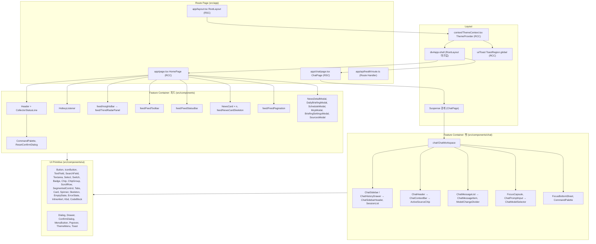

# AgentLens UI 컴포넌트 계층 및 디자인 명세서 (Component & Design Spec)

- **작성일자**: 2026-11-09
- **작성자**: UI 시스템 디자이너 (`ui-system-designer`)
- **문서 버전**: v1.0 (as-built, 지금 코드를 그대로 설명한다)
- **상태**: Draft
- Updated: 2026-11-09
- 기준: v0.4.1 (main)
- **적용 프레임워크**: Next.js 16 App Router, React 19, Tailwind CSS 4, `lucide-react`, `react-markdown` + `remark-gfm` (`frontend/package.json`)
- **선행 산출물**: 기능 명세 `docs/spec-writer/fsd/01_NEWS_FEED_SPECIFICATION.md` ~ `docs/spec-writer/fsd/07_UI_COMMON_SPECIFICATION.md`, 아키텍처 `docs/fullstack-architect/01_ARCHITECTURE_ADR.md`
- **함께 읽는 문서**: 디자인 토큰·공통 부품 API·오버레이 규칙·검사(`TokenGuard`·`IconGuard`·`ui-audit`)는 같은 폴더의 [`02_DESIGN_SYSTEM.md`](02_DESIGN_SYSTEM.md) 에 나눠 적었다. 이 문서의 5절(반응형·접근성)과 이어진다.

이 문서는 frontend(`frontend/`)의 라우트, 화면 배치, 컴포넌트 계층, RSC/RCC 경계, Props, UI 5대 상태, 반응형·접근성, 상태 관리, 단축키, 프론트가 부르는 API, 알려진 불일치를 적는다. 근거는 `path:line` 이고 경로는 `frontend/` 를 뺀 `src/...` 로 줄여 쓴 곳이 있다. 화면 기능의 상세 규칙(처리 순서·문구·예외)은 FSD 가 기준이고, 여기서는 컴포넌트 단위로만 적는다.

---

## 1. 컴포넌트 계층 트리 구조도 (Component Hierarchy Tree)

### 1.1 라우트

화면 라우트는 뉴스 피드 `/` 와 AI 챗 `/chat` 두 개이고, 프론트 자체 API 라우트는 헬스체크 `/api/health` 하나다. 그 밖의 `/api/*` 요청은 `next.config.ts` rewrite 로 backend 에 넘긴다 (8.1절). 앱은 `output: "standalone"` 으로 빌드하고 컨테이너 포트는 3001 이다 (`frontend/next.config.ts:9`, `frontend/Dockerfile`).

| 경로 | 종류 | 파일 | 제목(`<title>`) | 설명 |
|---|---|---|---|---|
| `/` | 페이지 (RCC, `'use client'`) | `frontend/src/app/page.tsx` | `AgentLens \| AI Agent, Harness & MCP Global News` (루트 레이아웃 메타데이터, `layout.tsx:17-20`) | 뉴스 피드, 일일 브리핑, 트렌드 레이더, 대화상자 6종 |
| `/chat` | 페이지 (RSC 껍데기 + RCC `ChatWorkspace`) | `frontend/src/app/chat/page.tsx` | `AI 챗 워크스페이스 \| AgentLens` (`chat/page.tsx:5-8`) | AI 챗 워크스페이스 |
| `/api/health` | Route Handler (`GET`, `dynamic = 'force-dynamic'`) | `frontend/src/app/api/health/route.ts` | — | 프론트 헬스체크 |

- 루트 레이아웃 (`src/app/layout.tsx:28-44`): `<html lang="ko" suppressHydrationWarning>`. `<head>` 의 인라인 스크립트(`THEME_INIT_SCRIPT`, `layout.tsx:22-26`, `:32`)가 첫 그리기 전에 `localStorage['agentlens_theme']` 와 OS 설정으로 `<html>` 의 `dark`/`light` 클래스, `data-theme`, `style.colorScheme` 을 정한다. `<body className="min-h-dvh bg-canvas text-fg overflow-x-hidden">` 안에 `ThemeProvider` → `<div id="app-shell" className="flex min-h-dvh flex-col">{children}</div>` 와 전역 알림 영역 `ToastRegion` 을 둔다 (`layout.tsx:34-40`). 웹 글꼴은 읽지 않는다 (시스템 글꼴, `02_DESIGN_SYSTEM.md` 4.1절). 메타 설명은 `전세계 AI 뉴스, 최신 Agent 기술, 하네스(Harness) 방법론 및 벤치마크, MCP(Model Context Protocol) 및 스킬 플러그인 큐레이션 플랫폼` 이다 (`layout.tsx:19`).
- viewport (`layout.tsx:6-15`): `width=device-width`, `initialScale: 1`, `interactiveWidget: 'resizes-content'`, `colorScheme: 'light dark'`, `themeColor` 는 미디어 쿼리별 라이트 `#f8fafc` / 다크 `#0e1013` (토큰 `canvas` 값과 같다). `maximumScale`·`userScalable` 이 없어 확대를 막지 않는다.
- `/chat` 페이지 (`chat/page.tsx:10-24`): `<main className="w-full max-w-full h-[100dvh] … overflow-hidden overflow-x-hidden">` 안에 `Suspense`(fallback 문구 `워크스페이스 환경을 초기화하는 중...`) → `ChatWorkspace`. 메타 설명 `AI 에이전트·하네스·MCP 기술 심층 질의 및 개인 지식 RAG 워크스페이스`. `ChatWorkspace` 가 `useSearchParams()` 를 쓰므로 Suspense 경계가 필요하다.
- `/chat` 쿼리 파라미터 (`components/chat/ChatWorkspace.tsx:473-540`):

  | 파라미터 | 동작 |
  |---|---|
  | `session_id` | 저장된 대화를 불러온다. 있으면 다른 파라미터는 보지 않는다 |
  | `sourceId` | 정수 기사 id. `GET /api/chat/sources/{id}` 로 기사를 읽어 `단일 기사` 범위(`scoped`)로 시작한다. 못 찾으면 경고 알림 `요청하신 기사를 찾을 수 없어 전체 소식 모드로 시작합니다.`(`ChatWorkspace.tsx:42`, `:506`, `:519`) 뒤 `전체 소식` 범위(`global`) |
  | `q` | 시작하자마자 이 질문을 보낸다 (`sourceId` 와 함께면 그 기사 범위로) |

- `/api/health` 응답: `{"status":"healthy","service":"agentlens-frontend","version":"0.4.1","timestamp":<ISO>}` (`app/api/health/route.ts:5-12`). Docker `HEALTHCHECK` 와 compose healthcheck 가 `http://127.0.0.1:3001/api/health` 를 부른다 (`frontend/Dockerfile`, `docker-compose.yml`). rewrite 규칙 `/api/:path*` 와 경로가 겹치지만 Route Handler 가 응답한다는 전제로 healthcheck 가 짜여 있다 (실제 우선순위는 실행해서 확인하지 못함, 10절 8번).
- 이 밖의 페이지(커스텀 404, `loading.tsx`, `error.tsx`)는 없다.

### 1.2 계층 다이어그램 (Route → Layout → Feature Container → UI Primitive)



### 1.3 아스키 컴포넌트 트리 (지금 코드)

`(RSC)` 는 지시어 없는 서버 컴포넌트, `(RCC)` 는 `'use client'` 파일, `(공유)` 는 지시어가 없지만 클라이언트 경계 안에서만 import 되는 모듈이다 (2절).

```
RootLayout (app/layout.tsx, RSC)  ── <head> 테마 인라인 스크립트
└─ ThemeProvider (context/ThemeContext.tsx → lib/theme-store.ts, RCC)
   ├─ div#app-shell
   │  ├─ HomePage "/" (app/page.tsx, RCC)  ── 훅: useBookmarks, useNewsFeed, useTheme, useRouter, useOverlayOpen, useToast
   │  │  ├─ HotkeyListener (blockSingleKeys)        ── 아무것도 그리지 않는다 (return null)
   │  │  ├─ Header                                  ── useCollector, useHotkey('mod+k'), useMediaQuery, useTheme
   │  │  │  ├─ ui/Badge (버전), ui/Button, ui/IconButton, ui/Kbd, ui/Spinner
   │  │  │  ├─ ui/ThemeMenu → ui/Menu               (768px 이상, useMediaQuery 판정)
   │  │  │  ├─ ui/Menu "더보기"
   │  │  │  ├─ CommandPalette → ui/Dialog
   │  │  │  └─ ResetConfirmDialog → ui/ConfirmDialog
   │  │  ├─ CollectorStatusLine (Header.tsx 의 named export)  ── useCollector
   │  │  ├─ main#main
   │  │  │  ├─ InsightsBar → ui/Card, ui/ScrollRow, ui/Chip, ui/Skeleton, TrendRadarPanel
   │  │  │  ├─ FeedToolbar → ui/SearchField(검색 영역), ui/ChipGroup(→ ui/ScrollRow)·ui/Chip(필터 영역)
   │  │  │  │                 ── 트리 하나, 폭별 배치는 CSS (ScrollRow 가 useMediaQuery 로 스크롤 버튼·표시를 고른다)
   │  │  │  ├─ FeedStatusBar (공유) → ui/Badge, ui/Select(정렬)   ── 목록 머리줄
   │  │  │  ├─ NewsCardSkeleton (공유) × 6 | ui/ErrorState | ui/EmptyState
   │  │  │  ├─ NewsCard × n → ui/Card, ui/Badge, ui/IconButton   ── preferSummary (lib/feed-insights)
   │  │  │  │  └─ chat/HandoverCtaButton (card-compact, 글자 `AI 챗에서 분석` 모든 폭)
   │  │  │  └─ FeedPagination → ui/Button
   │  │  ├─ footer
   │  │  ├─ NewsDetailModal → ui/Dialog, ui/Tabs·TabPanel, ui/ConfirmDialog
   │  │  │  ├─ chat/HandoverCtaButton (modal-banner)
   │  │  │  ├─ MarkdownViewer → ui/CodeBlock
   │  │  │  └─ news-detail/AskAiPanel → ui/ChipGroup(빠른 질문), MarkdownViewer
   │  │  ├─ DailyBriefingModal → ui/Dialog, ui/Tabs, ui/Menu, ui/InlineAlert, ui/TextField, MarkdownViewer
   │  │  ├─ ScheduleModal → ui/Dialog, ResetConfirmDialog   ── useCollector
   │  │  ├─ McpModal → ui/Dialog, ui/CodeBlock
   │  │  ├─ BriefingSettingsModal → ui/Dialog, ui/Tabs, ui/TextField, ui/InlineAlert
   │  │  └─ SourcesModal → ui/Dialog, ui/Tabs, ui/ConfirmDialog
   │  │     ├─ sources/DeepResearcherTab
   │  │     └─ sources/SourcesListTab → ui/Switch, ui/IconButton, ui/TextField
   │  └─ ChatPage "/chat" (app/chat/page.tsx, RSC)
   │     └─ Suspense (fallback: "워크스페이스 환경을 초기화하는 중...")
   │        └─ ChatWorkspace (RCC)  ── 훅: useChatSessions, useSearchParams, useRouter, useMediaQuery, useToast, useTheme
   │           ├─ ChatSidebar (className "hidden lg:flex")
   │           │  ├─ ChatSidebarHeader
   │           │  └─ SessionList
   │           │     ├─ SessionListSkeleton | ui/ErrorState | SessionEmptyState(→ ui/EmptyState)
   │           │     └─ SessionItemCard × n
   │           │        └─ DeleteConfirmPopover → ui/Popover
   │           ├─ ChatHeader                      ── useHotkey('mod+k'), useMediaQuery
   │           │  ├─ ui/Menu "더보기"
   │           │  └─ ChatContextBar → ui/ScrollRow, ui/SegmentedControl, ActiveSourceChip
   │           ├─ ChatMessageList                 ── useMediaQuery('(prefers-reduced-motion: reduce)')
   │           │  ├─ ChatMessageItem × n
   │           │  │  ├─ ui/Button "답변 복사"            (오류가 아니고 본문이 있을 때)
   │           │  │  ├─ WorkflowStepTracker
   │           │  │  ├─ ui/InlineAlert warning           (is_relaxed 일 때)
   │           │  │  ├─ 본문: ReactMarkdown + MarkdownCode → ui/CodeBlock (MarkdownViewer.tsx 에서 가져옴)
   │           │  │  │       오류가 아니거나, 오류여도 받은 부분 답이 있으면 그린다
   │           │  │  │  ├─ CitationBadge → CitationPopover → ui/Popover
   │           │  │  │  └─ 바닥 줄 (오류가 아니고 본문이 있을 때만): ModelTierBadge + ExportToolbar
   │           │  │  └─ 오류 블록 (status='error' 일 때, 본문 아래): TriangleAlert + 오류 문구 + ui/Button "다시 시도"(답변 다시 시도)
   │           │  └─ ModelChangeDivider × n
   │           ├─ div.relative (입력 영역 감싸개)
   │           │  ├─ ui/ToastRegion placement="composer" (입력 영역 바로 위, 모달이 없을 때 이 영역이 그린다)
   │           │  ├─ FocusCapsule
   │           │  └─ ChatPromptInput → ui/Textarea, ChatModelSelector (inline-chip) → ui/Popover
   │           ├─ ChatHistoryDrawer → ui/Drawer
   │           │  ├─ ChatSidebarHeader
   │           │  └─ SessionList (위와 같음)
   │           ├─ FocusBottomSheet → ui/Dialog, ui/ChipGroup·Chip, ui/Switch
   │           └─ CommandPalette (commands) → ui/Dialog
   └─ ui/ToastRegion (global)   ── 포털로 body 에 그린다 (#app-shell 밖). 모달이 열렸거나 composer 영역이 없을 때 그린다
```

- 대화상자·드로어·확인 창은 `createPortal(…, document.body)` 로 `#app-shell` 밖에 그린다. 팝오버·메뉴는 포털 없이 트리거 옆 `absolute` 로 그린다 (`02_DESIGN_SYSTEM.md` 6절).
- `Header` 는 `CommandPalette` 와 `ResetConfirmDialog` 를 `<header>` 요소 안에서 렌더하지만 둘 다 포털이라 화면 위치는 `body` 다 (`Header.tsx:209-221`).
- 어디서도 렌더하지 않는 컴포넌트: `WebhookSettingsModal`(웹훅 URL 하나를 localStorage 에 저장하고 테스트·브리핑 전송, import 하는 곳 없음), `ThemeToggle`(헤더가 `ThemeMenu` 로 바뀌어 렌더하는 곳 없음). `src/components` 밖에서 import 하는 곳을 `grep` 으로 확인했다.

### 1.4 화면 배치: 뉴스 피드 (`/`)

기능 상세: `docs/spec-writer/fsd/01_NEWS_FEED_SPECIFICATION.md`(피드), `04_BRIEFING_AND_SHARING_SPECIFICATION.md`(브리핑·공유), `05_SOURCES_AND_RESEARCH_SPECIFICATION.md`(소스·리서치), `06_MCP_SERVER_SPECIFICATION.md`(MCP), `07_UI_COMMON_SPECIFICATION.md`(헤더·단축키·팔레트·테마). 와이어프레임의 `[이름]` 은 `lucide-react` 아이콘 이름이다 (화면에 그림 이모지는 없다).

#### 와이어프레임: 데스크톱 (1024px 이상)
```
┌─ Header (sticky top-0, z-30, h-14, 한 줄) ──────────────────────────────────────────────────────────────┐
│ [Terminal] AgentLens [v0.4.1]  [피드] [Bot AI 챗]   [Clock 다음 수집 5h 14m 후] [RefreshCw 즉시 수집]       │
│                                                     [Command 검색·명령 ⌘K] [테마 ▾] [Ellipsis]             │
└─────────────────────────────────────────────────────────────────────────────────────────────────────────┘
 수집 진행 줄 (메시지 있을 때만, h-9): [Spinner] 실시간 소식 수집 중...                 피드 실시간 반영 중
 main#main (max-w-7xl, 가운데)
 ┌─ InsightsBar (h-12) ──────────────────────────────────────────────────────────────────────┐
 │ [Sparkles] 오늘의 브리핑 · 날짜 · 헤드라인…        급상승 [태그] [태그] [태그]  [Activity 트렌드 ▾] │
 └───────────────────────────────────────────────────────────────────────────────────────────┘
   (트렌드를 펼치면 12px 아래 TrendRadarPanel: 급상승 6, 카테고리 분포(한국어 라벨, 4열), 전체 기술 태그, 필터 초기화)
 [Search 키워드 검색                                                                         ]   ← 검색 영역: 콘텐츠 전체 폭 입력 36px, 고정하지 않음
 ┌─ 필터 영역 (sticky top-14, z-10) — 1280px 이상 ──────────────────────────────────────────┐
 │ [전체 소식 n][하네스 & 벤치마크 n][MCP & 생태계 n][에이전트 아키텍처 n][최신 AI 동향 n] (칩 아이콘 있음) │
 │ [전체 n][국내 테크 n][GitHub n][HackerNews n]…[Global Blogs n][Bookmark 북마크 n]     [Star Must-Read] │
 └───────────────────────────────────────────────────────────────────────────────────────────┘
   1024~1279px 도 같은 두 줄(카테고리 칩 아이콘 숨김). 줄이 넘치면 넘친 쪽 24px 흐림 + 줄 밖 [‹]·[›] 스크롤 버튼
   [Star Must-Read] 는 소스 줄 밖, 소스 줄 오른쪽 끝의 고정 토글이라 소스 줄을 밀어도 늘 보인다
 총 N건 (전체 M건) [북마크 보기] [Must-Read]                         페이지 p / T  [인기순 ▾]   ← 목록 머리줄: 상태 + 정렬(w-32)
   검색 입력·카테고리 줄·소스 줄 + 토글·목록 머리줄의 왼쪽·오른쪽 끝이 콘텐츠 상자 끝과 같다
 ┌ NewsCard ─────────────────────────────┐ ┌ NewsCard ┐ ┌ NewsCard ┐   ← 3열, 간격 20px, 같은 줄은 같은 높이
 │ 하네스 · 국내 테크 · 18일 전   [Bookmark] │ │          │ │          │   ← ① 머리줄 (배지 없음, 넘치면 말줄임)
 │ 제목 1줄째                              │ │          │ │          │   ← ② 제목 2줄 고정
 │ 제목 2줄째…                             │      또는 같은 틀의 스켈레톤 6장 / 오류 / 빈 상태
 │ ▎시사점 … (2줄 고정, 반복이면 요약)      │                                 ← ③ 본문 2줄 고정
 │ [Must-Read] [기술] [기술] [기술…]        │                                 ← ④ 배지 줄 (있을 때만, 최대 4, 한 줄. 기술 배지는 자리가 모자라면 48~128px 사이로 줄고 말줄임)
 │ ─────────────────────────────────────── │
 │ [Star] n [GitFork] n [Flame] n           │                              ← ⑤ 바닥 (원천 지표·인기 점수는 지표 소스만, 영역 구성 6)
 │      [Sparkles AI 챗에서 분석] [원문 ArrowUpRight] │                    ← 한 줄에 다 들지 않으면 버튼 묶음이 다음 줄 오른쪽 끝. 글자는 모든 폭에서 보인다
 └───────────────────────────────────────┘
                     [← 이전]  p / T  [다음 →]          ← 전체 페이지 2 이상일 때
 footer: AgentLens © 2026 · AI 에이전트 · 하네스 · MCP 생태계 소식
```

#### 와이어프레임: 태블릿 (768~1023px)
```
┌─ Header (h-14) ─────────────────────────────────────────────────────────────┐
│ [Terminal] AgentLens  [피드] [Bot AI 챗]     [Clock 5h 14m] [RefreshCw] [Command] [테마 ▾] [Ellipsis] │
└─────────────────────────────────────────────────────────────────────────────┘
 ┌─ InsightsBar ──────────────────────────────────────────────────────┐
 │ [Sparkles] 오늘의 브리핑 · 날짜 · 헤드라인…            [Activity 트렌드 ▾] │   ← 급상승 칩은 1024px 이상
 └────────────────────────────────────────────────────────────────────┘
 [Search 키워드 검색                                                 ]   ← 검색 영역: 전체 폭
 ┌─ 필터 영역 (sticky top-14) ────────────────────────────────────────┐
 │ [전체 소식 n][하네스 & 벤치마크 n][MCP & 생태계 n][에이전트 …   [›] │   ← 칩 아이콘 숨김
 │ [전체 n][국내 테크 n][GitHub n] …               [›] [Star Must-Read] │   ← Must-Read 토글(별 + 글자)
 └────────────────────────────────────────────────────────────────────┘
 총 N건                                       페이지 p / T  [인기순 ▾]   ← 목록 머리줄, 정렬 w-28
 ┌ NewsCard ┐ ┌ NewsCard ┐       ← 2열, 간격 16px
```

#### 와이어프레임: 모바일 (768px 미만, 390×844 기준)
```
┌─ Header (h-14) ──────────────────────────────┐
│ [Terminal] AgentLens   [Bot] [Command] [Ellipsis] │   ← 더보기: 소스 & 리서처, 공유 & 알림, MCP 연동, RSS 피드,
└──────────────────────────────────────────────┘     수집 스케줄, 즉시 수집, 테마(라디오 3), 초기화 & 재수집…
 ┌──────────────────────────────────────┐
 │ [Sparkles] 오늘의 브리핑 · 헤드라인… [트렌드 ▾] │   ← 날짜 숨김
 └──────────────────────────────────────┘
 [Search 키워드 검색                    ]   ← 검색 영역: 전체 폭 입력 44px
[전체 소식 n][하네스 & 벤치마크 n][MCP …  ›]  ← 필터 줄 1: 카테고리, 화면 좌우 끝까지. 필터 영역은 고정하지 않는다
[전체 n][국내 테크 n][Git… ›]       [Star]  ← 필터 줄 2: 소스 줄은 왼쪽만 화면 끝까지, 오른쪽 끝에 Must-Read 토글.
                                           넘친 쪽마다 ‹·› 표시(오른쪽 › 는 토글 앞). 처음에는 첫 칩 [전체] 부터 보인다 (스크롤 0).
                                           [Star] 는 Must-Read 토글: 별 아이콘만, 44×44, 접근 이름 Must-Read
 총 N건         페이지 p / T  [인기순 ▾]   ← 목록 머리줄: 상태 + 정렬(w-28, 44px). 상태가 길어 줄바꿈해도 정렬은 첫 줄 오른쪽
 ┌ NewsCard ────────────────────────────┐   ← 1열
 └──────────────────────────────────────┘
 [←   이전   ]  p / T  [   다음   →]        ← 두 버튼이 반씩 차지 (44px)
```

#### 영역 구성

| 순서 | 영역 | 컴포넌트 | 내용 | 기능 상세 (FSD) |
|---|---|---|---|---|
| 0 | 전역 단축키 | `HotkeyListener` | 화면에 그리지 않음. window keydown. 오버레이가 열려 있으면 단일 키를 막는다 (`blockSingleKeys`) | 07 |
| 1 | 헤더 | `Header` | 건너뛰기 링크, 브랜드(`/` 링크, lg 이상 버전 배지), 주 내비(`피드`·`AI 챗`), 수집 상태, 즉시 수집, 커맨드 팔레트, 테마 메뉴, 더보기 메뉴. 커맨드 팔레트와 초기화 확인 창을 가진다 | 07 |
| 2 | 수집 진행 줄 | `CollectorStatusLine` (`Header.tsx:230-251`) | 헤더 바로 아래, 메시지가 있을 때만 보인다. `role="status"` 영역은 늘 DOM 에 있다. 수집 중에 화면을 떠났다 오면 다시 붙는다 | 07, 03 |
| 3 | 요약 바 | `InsightsBar` → `TrendRadarPanel` | `오늘의 브리핑 · 날짜 · 헤드라인` 버튼(→ 일일 브리핑, 768px 미만 날짜 숨김, 남는 폭을 모두 쓰는 한 줄 말줄임), 1024px 이상 급상승 태그 칩 3개(가로 스크롤 줄), `트렌드` 펼침 버튼. 첫 읽기가 끝나기 전이고 보여 줄 것이 없을 때만 48px 스켈레톤이고, 다시 읽는 동안에는 이전 내용을 그린다. 브리핑·레이더 둘 다 없으면 그리지 않는다 (`InsightsBar.tsx:47`, `:52`). 펼친 패널의 카테고리 분포 라벨은 한국어(`하네스 & 벤치마크` 등), 640px 미만 1열·이상 2열·1024px 이상 4열 | 01, 04 |
| 4 | 검색 영역·필터 영역 | `FeedToolbar` | 형제 두 영역을 그린다 (`FeedToolbar.tsx:210-229`). ① 검색 영역(`data-feed-search`, `scroll-mt-20`): 키워드 검색 입력 하나(자리표시 `키워드 검색`, `/` 로 포커스), 모든 폭에서 콘텐츠 전체 폭, 높이 768px 미만 44px·이상 36px, 고정하지 않는다. ② 필터 영역(`data-feed-toolbar`, 768px 이상 `md:sticky md:top-14 md:z-10`): 줄 1 카테고리 칩 5개(건수, 1280px 이상 아이콘), 줄 2 소스 칩(`전체`, 건수가 있는 소스, `북마크 n`)과 그 오른쪽 끝 `Must-Read` 토글(소스 줄 밖 고정, `aria-pressed`, 768px 미만 별 아이콘만·44×44, 이상 별 + 글자, 접근 이름은 늘 `Must-Read`). 두 줄은 각각 독립된 가로 배치(`data-toolbar-row`)이고 줄 사이 8px. 필터 영역 안에는 입력·선택 상자가 없다 (검색은 검색 영역, 정렬은 목록 머리줄). 768px 미만은 카테고리 줄이 화면 좌우 끝까지, 소스 줄이 왼쪽 화면 끝까지 늘어나고 토글은 같은 줄 오른쪽 끝에 남는다. 모든 폭에서 같은 DOM 트리 하나를 그리고 폭별 배치는 CSS 클래스로만 바꾼다. DOM 순서 = 화면 순서 = Tab 순서 `검색 → 카테고리 → 소스 → Must-Read` 이고, 폭이 바뀌어도 검색 입력·칩 줄·토글이 다시 마운트되지 않아 포커스·입력값이 남는다. 칩 줄 스크롤 위치는 사용자가 직접 민 줄만 남고, 그렇지 않은 줄은 줄 폭이 바뀌면 선택 칩이 보이게 다시 맞춘다. 칩 줄은 가로 스크롤 줄(넘친 쪽 흐림, 768px 이상 스크롤 버튼, 768px 미만 넘친 쪽마다 `‹`·`›` 표시). 소스 줄은 선택된 소스 칩이 보이게 민다 (`Must-Read` 를 켜고 꺼도 소스 줄은 움직이지 않는다). 필터를 바꾸면 1페이지로, 카테고리를 바꾸면 소스 `all` | 01, 07 |
| 5 | 목록 머리줄 | `FeedStatusBar` | `data-feed-list-header`. 왼쪽 상태(`총 N건`, 필터가 걸려 있으면 `(전체 M건)`, `북마크 보기`·`Must-Read` 배지, 오른쪽 끝 `페이지 p / T`, `role="status"`)와 그 뒤 형제 정렬 `Select`(인기순·품질순·최신순·추천순, 숨긴 라벨 `정렬`, 폭 `w-28`, 1280px 이상 `w-32`, 높이 768px 미만 44px·이상 36px). 정렬은 상태 live 영역 밖이라 값을 바꿔도 상태 문장으로 읽히지 않는다. 정렬을 바꾸면 1페이지로. 머리줄은 위쪽 맞춤이고 상태의 최소 높이가 정렬 높이와 같아, 한 줄일 때 상태 글자와 정렬의 세로 가운데가 같고 상태가 줄바꿈되어도 정렬은 첫 줄 오른쪽에 남는다 | 01 |
| 6 | 카드 그리드 | `NewsCard` × n | 고정 틀: 머리줄(짧은 카테고리 라벨 · 소스 · 시간, 북마크) / 제목 2줄 / 시사점 또는 요약 2줄(목록에서 반복되는 시사점이면 요약) / 배지 줄(Must-Read + 기술 스택 3, 있을 때만, 한 줄. 기술 배지는 자리가 모자라면 각 48~128px 사이로 줄고 글자는 말줄임, `title` 에 전체 이름. Must-Read 는 줄지 않음) / 바닥(원천 지표·개수·인기 점수, `AI 챗에서 분석`, `원문`. 한 줄에 다 들지 않으면 버튼 묶음이 다음 줄 오른쪽 끝으로 내려가고, 이관 버튼 글자는 모든 폭에서 보인다). 머리줄의 짧은 카테고리 라벨은 `title` 에 긴 라벨(예: `에이전트` → `에이전트 아키텍처`). 원천 지표(`raw_score`)는 실제 지표를 주는 소스만 그린다: `github` 스타(`Star`, `title` `GitHub 스타`), `hackernews` 포인트·`reddit` 추천(`ArrowBigUp`). 그 밖 소스(국내 테크·RSS·arXiv·HuggingFace, 모르는 소스)는 `raw_score` 가 0 보다 커도 그리지 않는다. 개수(`comments_count`, 0 이면 숨김)는 `github` 포크(`GitFork`, `title` `GitHub 포크`), 그 밖 댓글(`MessageSquare`). 인기 점수(`Flame`)는 원천 지표가 있는 소스(`github`·`hackernews`·`reddit`)이고 25 초과일 때만 그린다 (인기 점수는 `raw_score` 에서 계산되므로 그 밖 소스에서는 합성 값이다). 지표 종류와 라벨은 `lib/labels.ts` 의 `scoreMetric`·`countMetric` 에서 나오고, `scoreMetric` 이 원천 지표와 인기 점수 둘 다의 표시 조건이다. DOM 속성: 카드 `data-source`, 통계마다 `data-card-stat`(`score`·`count`·`hotness`)과 `data-metric`(인기 제외). 같은 줄 카드는 같은 높이(`items-stretch`, 카드 `h-full`, `page.tsx:237`). 카드(또는 제목 버튼) 클릭 → 뉴스 상세. 북마크(`보관하기`), `AI 챗에서 분석`(접근 이름 = 보이는 글자, → `/chat?sourceId=`), `원문`. j/k 포커스 링 | 01, 02 |
| 7 | 로딩·오류·빈 상태 | `NewsCardSkeleton` × 6 / `ErrorState` / `EmptyState` | 4절 피드 목록 행 | 07 |
| 8 | 페이지 이동 | `FeedPagination` | 이전·다음, `p / T`. 바꾸면 목록 머리줄의 상태로 스크롤·포커스. 한 페이지 18건 (`hooks/useNewsFeed.ts:118`). 전체 페이지 1 이하면 그리지 않는다 (`FeedPagination.tsx:17`) | 01 |
| 9 | 푸터 | `page.tsx:271-273` | 저작권 한 줄 `AgentLens © 2026 · AI 에이전트 · 하네스 · MCP 생태계 소식` | — |
| 10 | 대화상자 6종 | 1.6절 | — | — |

- 본문(`main`) 영역 사이 세로 간격은 768px 미만 12px, 이상 16px 하나다 (`gap-3 md:gap-4`, `page.tsx:170`): 요약 바 → 검색 영역 → 필터 영역 → 목록 머리줄 → 카드 그리드가 모두 이 간격이다. 필터 영역의 sticky 배경용 위아래 여백(`py-2`)은 음수 마진(`-my-2`)으로 상쇄한다 (`feed/FeedToolbar.tsx:216-219`).
- `main` 은 `id="main" tabIndex={-1}`(건너뛰기 링크 대상)이고 안에 `sr-only` `h1` `AI 에이전트 소식` 이 있다 (`page.tsx:167-172`).

### 1.5 화면 배치: AI 챗 (`/chat`)

기능 상세: `docs/spec-writer/fsd/02_AI_CHAT_SPECIFICATION.md`, 반응형·모바일 규칙은 `07_UI_COMMON_SPECIFICATION.md`.

`/chat` 에는 피드의 헤더(`Header`)와 단일 키 단축키(`HotkeyListener`)가 없다. 챗 헤더(`ChatHeader`)가 ⌘K 커맨드 팔레트와 더보기 메뉴(테마 라디오 3개)를 가진다.

#### 와이어프레임: 데스크톱 (1024px 이상)
```
┌─ ChatSidebar (w-72, 열림 기본, z-20) ─┬─ ChatHeader (sticky, z-30, h-14) ─────────────────────────────────┐
│ [Plus 새 대화]       [PanelLeftClose] │ [ArrowLeft 피드] [History] AI 챗              [Plus]* [Command] [MoreHorizontal] │ ← 56px
│                                       ├─ ChatContextBar (h-11, 가로 스크롤 줄) ───────────────────────────┤
│ [Search 대화 검색...           X]      │     [Target 단일 기사 | Globe 전체 소식] [기사 칩 X]               │ ← 44px
├───────────────────────────────────────┼───────────────────────────────────────────────────────────────────┤ ← 두 쪽 아래 경계 100px
│ SessionList                           │ ChatMessageList (role=log)                                        │
│  ┌ SessionItemCard ───────[Trash2]┐   │   메시지 없으면: 웰컴 + 추천 질문 4개 (2열, 아이콘 + 글자 왼쪽 정렬)  │
│  │ 제목 · [단일 기사/전체 소식] · 날짜 │   │   있으면: ChatMessageItem / ModelChangeDivider 시간순               │
│  └──────────────────────────────┘     │     답변: 답변 복사, WorkflowStepTracker, 마크다운(인용 배지),       │
│  ...                                  │           바닥 줄 ModelTierBadge + ExportToolbar(오류 아닐 때만)    │
│                                       │     오류 답변: 받은 부분 답 본문 → 그 아래 오류 문구 + 다시 시도      │
│  (로딩: 스켈레톤 5줄)                  │     ┌ 알림 (입력 영역 바로 위 8px, 메시지 열 폭) ──────────┐        │
│  (오류: ErrorState + 다시 시도)        │     └──────────────────────────────────────────────────┘        │
│  (빈 상태)                             ├─ 하단 입력 영역 (bg-surface, border-t) ───────────────────────────┤
│                                       │ [Target 포커스: 전체 소식 ▾] [X]                                  │
│                                       │ ┌ textarea (최대 180px, 2000자) ────────────────────────────────┐ │
│                                       │ └──────────────────────────────────────────────────────────────┘ │
│                                       │ [모델 칩 ▾] Enter: 전송, Shift+Enter: 줄바꿈        n / 2000 [ArrowUp] │
└───────────────────────────────────────┴───────────────────────────────────────────────────────────────────┘
 * 모델 칩은 모든 폭에서 입력창 아래 한 곳에만 있다 (헤더에는 없다).
 * 새 대화 버튼은 사이드바를 접었을 때만 보인다. 더보기: 테마(라이트·다크·시스템), 뉴스 피드로 이동.
 * 열 맞춤: 맥락 줄 스크롤 영역, 메시지 열, 입력 영역은 모두 바깥 `px-4 md:px-6`, 안쪽 `mx-auto w-full max-w-3xl` 이라 왼쪽 끝이 맞는다.
 * 사이드바 머리 영역은 두 줄이다: 1줄 56px(`+ 새 대화`, 접기) = 챗 헤더 높이, 2줄 44px(`대화 검색`) = 맥락 줄 높이.
```

#### 와이어프레임: 태블릿 (768~1023px)
```
┌─ ChatHeader (h-14) ──────────────────────────────────────────┐
│ [ArrowLeft 피드] [History] AI 챗          [Plus] [Command] [MoreHorizontal] │   ← History 는 왼쪽 드로어(ChatHistoryDrawer)를 연다
├─ ChatContextBar ─────────────────────────────────────────────┤
│ [Target 단일 기사 | Globe 전체 소식] [기사 칩 X]               │
├──────────────────────────────────────────────────────────────┤
│ 메시지 열 (max-w-3xl)                                         │
├─ 입력 영역 ──────────────────────────────────────────────────┤
│ [포커스: …] / textarea / [모델 칩 ▾]           n / 2000 [ArrowUp] │   ← Enter 안내 숨김
└──────────────────────────────────────────────────────────────┘
```

#### 와이어프레임: 모바일 (768px 미만, 390×844 기준)
```
┌─ ChatHeader (h-14) ────────────────────────┐
│ [ArrowLeft] [History] AI 챗   [Plus] [MoreHorizontal] │   ← 커맨드 팔레트는 더보기 안
├─ ChatContextBar (min-h-11) ────────────────┤
│ [Target 단일 기사 | Globe 전체 소식]        │   ← 기사 칩이 없으면 넘치지 않는다. 넘치면 넘친 쪽마다 ‹·› 표시
├────────────────────────────────────────────┤
│ 웰컴 + 추천 질문 4개 (1열)                   │
├─ 입력 영역 (safe-area 여백) ────────────────┤
│ [포커스: 전체 소식 ▾]                       │
│ [textarea (16px 글자)                    ]  │
│ [모델 칩 ▾]          0 / 2000 [ArrowUp]     │
└────────────────────────────────────────────┘
```

#### 영역 구성

| 영역 | 컴포넌트 | 내용 |
|---|---|---|
| 대화 기록 사이드바 (1024px 이상) | `ChatSidebar` (`id="chat-history-sidebar"`, `className="hidden lg:flex"`, `ChatWorkspace.tsx:608-623`) → `ChatSidebarHeader`, `SessionList` | 머리 영역 두 줄(1줄 56px `+ 새 대화`·접기, 2줄 44px 제목 검색), 세션 카드 목록(제목, 범위 배지 `단일 기사`·`전체 소식`, 시간. 접근 이름 `대화: <제목>, <시간>, 단일 기사 모드`/`… 전체 소식 모드`. 삭제 확인 팝오버). 접으면 그리지 않는다 |
| 챗 헤더 | `ChatHeader` → `MenuButton` | 왼쪽부터 피드로 돌아가기(`/`, 모든 폭에서 맨 왼쪽), 기록 버튼(1024px 이상은 사이드바 접기·펴기, 미만은 드로어. 기록이 열렸을 때만 `aria-controls`, `ChatHeader.tsx:118`), 제목 `AI 챗`, 새 대화(`showNewChatButton && (!isDesktop \|\| !isSidebarOpen)`, `ChatHeader.tsx:77`), 커맨드 팔레트(md 이상), 더보기(테마 라디오, `뉴스 피드로 이동`, md 미만 `커맨드 팔레트`) |
| 맥락 줄 | `ChatContextBar` → `ui/ScrollRow`, `SegmentedControl`, `ActiveSourceChip` | 검색 스코프 전환(그룹 이름 `검색 스코프 모드`, 버튼 `단일 기사`(scoped)·`전체 소식`(global), 라벨은 `lib/labels.ts` 의 `SCOPE_LABELS`), 선택 기사 칩(짧은 카테고리 라벨, 해제). 가로 스크롤 줄이고 안쪽 폭은 메시지 열과 같다 |
| 메시지 목록 | `ChatMessageList` → `ChatMessageItem`(`CitationBadge`→`CitationPopover`, `WorkflowStepTracker`, `ExportToolbar`, `ModelTierBadge`, `ui/CodeBlock`), `ModelChangeDivider` | 웰컴/추천 질문(카드마다 앞에 lucide 아이콘 `Server`·`GitBranch`·`ChartColumn`·`TrendingUp`, 글자 왼쪽 정렬, 누르면 아이콘 없는 글자 그대로 보냄, `ChatMessageList.tsx:22-27`), 메시지·모델 변경 구분선 시간순, 답변의 모델 배지(`ModelTierBadge`)는 티어 lucide 아이콘(haiku `Zap`, sonnet `Target`, opus `Brain`, Claude 밖 gemini `Sparkles`·gpt `Bot`·그 밖 `Target`) + 이름, 새 항목마다 맨 아래로 스크롤(줄인 모션이면 `auto`, `ChatMessageList.tsx:41-45`) |
| 포커스 캡슐 | `FocusCapsule` | 현재 필터 요약 버튼(앞말 `포커스:`, 필터가 없으면 `포커스: 전체 소식`, → 포커스 필터), 필터가 걸려 있으면 초기화 버튼 |
| 입력창 | `ChatPromptInput` → `ui/Textarea`, `ChatModelSelector`(inline-chip) | 질문 입력(Enter 전송, Shift+Enter 줄바꿈), 모델 칩(모든 폭에서 화면의 유일한 모델 선택, 앞에 티어 lucide 아이콘, 팝오버는 위로 열림, 생성 중 비활성), 글자 수 `n / 2000`, `질문 전송` / 생성 중 `답변 생성 중단` |
| 기록 드로어 (1024px 미만) | `ChatHistoryDrawer` (`ui/Drawer`, `id="chat-history-drawer"`) → `ChatSidebarHeader`, `SessionList` | 사이드바와 같은 내용, 세션 선택·새 대화 때 닫힘. `isOpen={isDrawerOpen && !isDesktop}` (`ChatWorkspace.tsx:702`) |
| 포커스 필터 | `FocusBottomSheet` (`ui/Dialog size="sm" mobile="sheet"`) | 카테고리(그룹 `도메인 카테고리`: `전체 소식`, `하네스 & 벤치마크`, `MCP & 생태계`, `에이전트 아키텍처`, `최신 AI 동향` — 피드 카테고리 칩과 같은 긴 라벨), 기간, 정렬, Must-Read 스위치, 대상 건수, `초기화`·`적용하기` |
| 커맨드 팔레트 | `CommandPalette commands=…` (`ChatWorkspace.tsx:727-731`) | `뉴스 피드로 이동`, 테마 순환, `새 대화 시작`, `대화 기록 열기` (`ChatWorkspace.tsx:542-583`) |
| 알림 영역 (입력 영역 위) | `ui/ToastRegion placement="composer"` (`ChatWorkspace.tsx:665`) | 입력 영역을 감싼 `relative` 감싸개 안에서 입력 영역 바로 위(8px 띄움)에 그린다. 안쪽 폭은 메시지 열과 같은 `max-w-3xl`. 대화상자가 열려 있으면 전역 알림 영역이 대신 그린다. 영역이 바뀌어 다시 그려진 알림은 화면 읽기 프로그램에 다시 알리지 않는다 (처음 그려진 한 번만 `role`·`aria-live`). 예: `sourceId` 기사를 못 찾았을 때 `warning` `요청하신 기사를 찾을 수 없어 전체 소식 모드로 시작합니다.` |

- 챗 루트는 `style={{ height: viewportHeight }}` 와 `overflow-hidden overflow-x-hidden` 이다 (`ChatWorkspace.tsx:603-606`). 처음 높이는 `100dvh` 이고 `visualViewport` 의 `resize`·`scroll` 마다 `{visualViewport.height}px` 로 바꾼다 (`ChatWorkspace.tsx:97`, `:114-132`).
- 입력 영역 안쪽 열은 `data-composer` 이고 아래 여백 `pb-[max(0.75rem,env(safe-area-inset-bottom))]` 다 (`ChatWorkspace.tsx:669-672`).

### 1.6 대화상자·드로어·시트·팝오버 목록

공통 규칙(포털, 오버레이 스택, 포커스, 배경 `inert`, 스크롤 잠금, 폭별 배치, 닫기 수단)은 `02_DESIGN_SYSTEM.md` 6절과 `docs/spec-writer/fsd/07_UI_COMMON_SPECIFICATION.md` 에 있다. 대화상자 크기 `sm` 420px · `md` 560px · `lg` 720px · `xl` 896px 는 768px 이상의 너비다. 768px 미만에서 `전체 화면` 은 화면 전체(`h-dvh`), `바텀시트` 는 아래에서 올라오는 시트(최대 `90dvh`)다.

| 이름 | 종류·크기 (768px 미만) | 여는 곳 | 담는 내용 | 닫기 | 컴포넌트 파일 | FSD |
|---|---|---|---|---|---|---|
| 뉴스 상세 | `Dialog xl` (전체 화면) | 카드·제목 버튼 클릭, 포커스 카드 Enter/Space | 머리줄(카테고리 긴 라벨·Must-Read 배지, 기사 제목 2줄, 북마크, 닫기, 탭 `AI 요약 & 시사점` / `AI 질의응답`+대화 수), 요약 탭(`개발자 시사점`, `AI 챗에서 분석` 배너(보조 문구 `이 기사를 단일 기사 모드로 열어 질의응답`, → `/chat?sourceId=`, 입력 중 질문이 있으면 `&q=`), 핵심 요약, 기술 스택, `상세 본문 요약` 마크다운), 질의응답 탭(빠른 질문 4개 가로 스크롤 줄, 버튼마다 lucide 아이콘 + 글자, 스트리밍 답변, 복사(실패하면 2초 `복사 실패`), 대화 초기화 → 확인 창, 질문 입력 자리표시 `이 기사에 대해 질문하세요`), 바닥(출처, 작성자, `원문 링크 방문`) | Escape(질의응답 탭 질문 입력창 안에서는 닫지 않고 탭 패널로 포커스), 배경막, 머리줄 X. 닫으면 스트림 중단·상태 초기화 | `components/NewsDetailModal.tsx`, `components/news-detail/AskAiPanel.tsx` | 01, 02 |
| 일일 브리핑 | `Dialog xl` (전체 화면) | 요약 바의 `오늘의 브리핑` | 제목 `오늘의 AI 브리핑` + 날짜, 설명 = 헤드라인 (헤드라인은 여기 한 번만 보인다), 도구줄(`Notion 내보내기`/`Notion에서 열기`, `이메일 발송`→주소 입력 줄, 복사, `.md 다운로드`. 768px 미만은 주 버튼 + `브리핑 작업` 메뉴(이메일 발송·복사·`.md 다운로드`)), 결과 `InlineAlert`(실패하면 `Notion 설정 열기`·`이메일 설정 열기`), 탭 `카테고리별 요약` / `마크다운 전문`. 요약 탭: `오늘의 핵심 요약` 칸(개요가 있을 때만, 개요 줄의 분야 이름은 긴 라벨로), 분야별 칸(머리글 = 피드 카테고리 칩과 같은 lucide 아이콘 + 긴 라벨, 표에 없는 분야는 아이콘 없이 backend 이름, 기사마다 `Lightbulb` 아이콘 + `시사점:`). 바닥 `연동 설정`(설정 진입은 이 한 곳)·`닫기` | Escape, 배경막, X, `닫기` | `components/DailyBriefingModal.tsx` | 04 |
| 공유 & 알림 설정 | `Dialog md` (전체 화면) | 더보기 `공유 & 알림`, 팔레트, 일일 브리핑 바닥 `연동 설정`·실패 알림의 `Notion 설정 열기`·`이메일 설정 열기` (브리핑 위에 쌓인다) | 탭 `Notion 연동` / `이메일 (SMTP)` / `웹훅 (Slack/Discord)`, 입력 필드(비밀 값은 보기 토글 `SecretField`), 결과 `InlineAlert`, 바닥 `닫기`·`연결 테스트`(현재 탭)·`저장` | Escape, X, `닫기` (배경막으로 닫히지 않음) | `components/BriefingSettingsModal.tsx` | 04 |
| 자동 수집 스케줄 | `Dialog md` (전체 화면) | 헤더 수집 상태 버튼(md 이상), 더보기 `수집 스케줄`(md 미만), 팔레트 | 설명 `매일 4회(0, 6, 12, 18시 UTC) 전세계 소식을 자동 수집합니다.`, 수집 주기(UTC·KST), 다음 예정(분, 시각), '위험 영역' `초기화 & 재수집…`, 바닥 `즉시 수집` | Escape, 배경막, X | `components/ScheduleModal.tsx` | 03 |
| AgentLens MCP 연동 | `Dialog lg` (전체 화면) | 더보기 `MCP 연동`, 팔레트 | MCP 도구 4개(정의 목록), `claude_desktop_config.json` 예시 `CodeBlock`(복사), 바닥 `닫기` | Escape, 배경막, X, `닫기` | `components/McpModal.tsx` | 06 |
| 소스 & 리서처 | `Dialog xl` (전체 화면) | 더보기 `소스 & 리서처`, 팔레트 | 탭 `AI 딥 리서처`(기본, 지표 카드 4개 2열·768px 이상 4열, 값은 말줄임 없이 줄을 바꿔 전부 보인다) / `등록된 수집원`, 결과 안내(`aria-live`), 바닥 `sources.json` 표시·`닫기`. 수집원 삭제는 확인 창 | Escape, X, `닫기` (배경막으로 닫히지 않음) | `components/SourcesModal.tsx`, `components/sources/DeepResearcherTab.tsx`, `components/sources/SourcesListTab.tsx` | 05 |
| 수집 데이터 전체 삭제 및 재수집 | `ConfirmDialog` (`alertdialog`, `sm`, 바텀시트) | 더보기 `초기화 & 재수집…`, 스케줄 대화상자 '위험 영역', 팔레트 | 영구 삭제 경고, `취소`(처음 포커스) / `전체 삭제 후 다시 수집`(진행 중 `초기화 중...`), 실패 시 창 안 오류 | Escape, 배경막, `취소`, 머리줄 X (진행 중에는 모두 무시) | `components/ResetConfirmDialog.tsx` | 07, 03 |
| 확인 창 (대화 초기화, 소스 삭제) | `ConfirmDialog` (`sm`, 바텀시트) | 뉴스 상세 질의응답 탭 `대화 초기화`, 수집원 삭제 버튼 | `AI 대화 내역을 모두 초기화하시겠습니까?` / `이 소스를 목록에서 삭제하시겠습니까?` | Escape, 배경막, `취소`, 머리줄 X | `NewsDetailModal.tsx:402-411`, `SourcesModal.tsx:236-246` | 02, 05 |
| 커맨드 팔레트 | `Dialog md placement="top"` (전체 화면, 768px 이상은 위에서 `12dvh`, 560px) | ⌘K / Ctrl+K, 헤더 팔레트 버튼, 챗 더보기 `커맨드 팔레트` | 검색 입력(combobox), 명령 목록(listbox), 키 안내(640px 이상) | Escape, 배경막, X, ⌘K | `components/CommandPalette.tsx` | 07 |
| 대화 기록 드로어 | `Drawer side="left"` (`min(320px, 85vw)`, 높이 전체) | 챗 헤더 기록 버튼 (1024px 미만), 챗 팔레트 `대화 기록 열기` | 제목 `대화 기록`, 새 대화, 검색, 세션 목록 | Escape, 배경막, `대화 기록 드로어 닫기`, 세션 선택·새 대화 | `components/chat/ChatHistoryDrawer.tsx` | 02 |
| 수집 소식 타깃팅 포커스 필터 | `Dialog sm mobile="sheet"` (바텀시트, 768px 이상 가운데 420px) | 포커스 캡슐 | 카테고리, 기간, 정렬, Must-Read, 대상 건수, `초기화`·`적용하기` | Escape, 배경막, `필터 닫기`, 아래로 100px 스와이프, `적용하기` | `components/chat/FocusBottomSheet.tsx` | 02 |
| 모델 선택 | `Popover role="radiogroup"` (`w-80`) | 입력창 모델 칩(위로) | haiku / sonnet / opus 3단계 | Escape, 바깥 pointerdown, 선택 | `components/chat/ChatModelSelector.tsx` | 02 |
| 인용 출처 프리뷰 | `Popover role="dialog"` | 답변 안 인용 배지 클릭 | 출처 기사 요약, `원문 보기`/`웹 문서 보기` 링크 | Escape, 바깥 pointerdown, `팝오버 닫기` | `components/chat/CitationPopover.tsx` (`CitationBadge.tsx` 가 연다) | 02 |
| 세션 삭제 확인 | `Popover role="dialog"` (`min(18rem, 100vw-2rem)`) | 세션 카드 삭제 버튼 | `이 대화를 삭제하시겠습니까?`, `취소`(처음 포커스)·`삭제` | Escape, 바깥 pointerdown, `취소` | `components/chat/DeleteConfirmPopover.tsx` | 02 |
| 메뉴 | `MenuButton` (`min(280px, 100vw-32px)`) | 피드 헤더 `더보기`·`테마 선택`, 챗 헤더 `더보기`, 브리핑 `브리핑 작업` | 메뉴 항목·라디오·구분선·그룹 제목 | Escape(트리거로 포커스), 바깥 pointerdown, Tab, 항목 실행 | `components/ui/Menu.tsx`, `components/ui/ThemeMenu.tsx` | 07 |

- 브라우저 기본 대화상자(`window.confirm`, `alert`)는 쓰지 않는다.
- 홈 화면 대화상자 열림 상태는 `page.tsx:94-100` 의 `useState` 6개(`detailModalOpen`, `briefingModalOpen`, `schedOpen`, `mcpOpen`, `webhookModalOpen`, `sourcesModalOpen`)다. `webhookModalOpen` 은 이름과 달리 `BriefingSettingsModal` 을 연다 (`page.tsx:292`).
- `NewsDetailModal` 은 `key={selectedItem ? \`news-modal-${id}\` : 'news-modal-empty'}` 로 기사마다 다시 마운트된다 (`page.tsx:276-277`). `item` 이 없으면 그리지 않는다 (`NewsDetailModal.tsx:120`). `DailyBriefingModal` 도 `briefing` 이 없으면 열림과 상관없이 그리지 않는다 (`DailyBriefingModal.tsx:77`).

---

## 2. Server Component (RSC) vs Client Component (RCC) 경계 정의

지금 앱은 서버 컴포넌트에서 데이터를 읽는 곳이 없다. 모든 데이터는 클라이언트 컴포넌트가 브라우저에서 `fetch` 로 읽는다 (상대 경로 `/api/*` → Next rewrite → backend, 8.1절). 서버 컴포넌트는 레이아웃 마크업, 메타데이터, Suspense 경계만 맡는다.

### 2.1 RSC (지시어 없음, 서버에서 실행)

| 파일 | 구분 | 담당 책임 |
|---|---|---|
| `src/app/layout.tsx` | **RSC** | `metadata`·`viewport` 내보내기, `<html>`·`<body>` 골격, 테마 인라인 스크립트(`dangerouslySetInnerHTML`), `ThemeProvider`·`ToastRegion`(둘 다 RCC) 배치 |
| `src/app/chat/page.tsx` | **RSC** | `/chat` 메타데이터, `h-[100dvh]` `<main>`, `useSearchParams` 를 쓰는 `ChatWorkspace` 를 감싸는 `Suspense` 경계와 fallback 문구 |
| `src/app/api/health/route.ts` | **Route Handler** | `GET` 헬스 응답 (`force-dynamic`) |

### 2.2 RCC (`'use client'` 파일, 지금 코드 전체 목록)

| 범위 | 파일 | 선정 사유 |
|---|---|---|
| 페이지 | `src/app/page.tsx` | 필터·목록·모달 열림 상태(`useState`), `useRouter`, 단축키 콜백, `document.querySelectorAll` 로 카드 포커스 이동 |
| 컨텍스트 | `src/context/ThemeContext.tsx` | `useSyncExternalStore`(localStorage·`matchMedia`), `useLayoutEffect` 로 `<html>` 클래스 적용 |
| 피드 | `components/Header.tsx`, `HotkeyListener.tsx`, `NewsCard.tsx`, `CommandPalette.tsx`, `ResetConfirmDialog.tsx`, `MarkdownViewer.tsx`, `feed/FeedToolbar.tsx`, `feed/InsightsBar.tsx`, `feed/TrendRadarPanel.tsx`, `feed/FeedPagination.tsx` | 이벤트·상태·`window` keydown·`matchMedia`·라우터·클립보드 |
| 대화상자 | `NewsDetailModal.tsx`, `news-detail/AskAiPanel.tsx`, `DailyBriefingModal.tsx`, `ScheduleModal.tsx`, `McpModal.tsx`, `BriefingSettingsModal.tsx`, `SourcesModal.tsx`, `sources/DeepResearcherTab.tsx`, `sources/SourcesListTab.tsx`, `WebhookSettingsModal.tsx`(미사용), `ThemeToggle.tsx`(미사용) | 포털·포커스·SSE 스트림·폼 상태·API 호출 |
| 챗 | `chat/` 의 `.tsx` 전부(`ActiveSourceChip`, `ChatContextBar`, `ChatHeader`, `ChatHistoryDrawer`, `ChatMessageItem`, `ChatMessageList`, `ChatModelSelector`, `ChatPromptInput`, `ChatSidebar`, `ChatSidebarHeader`, `ChatWorkspace`, `CitationBadge`, `CitationPopover`, `DeleteConfirmPopover`, `ExportToolbar`, `FocusBottomSheet`, `FocusCapsule`, `HandoverCtaButton`, `ModelChangeDivider`, `ModelTierBadge`, `SessionEmptyState`, `SessionItemCard`, `SessionList`, `SessionListSkeleton`, `WorkflowStepTracker`)와 `chat/useChatSessions.ts` | SSE 스트림, `visualViewport`, `useSearchParams`, localStorage 이중 저장 |
| UI 부품 | `ui/CodeBlock`, `ui/ConfirmDialog`, `ui/Dialog`, `ui/Drawer`, `ui/Menu`, `ui/Popover`, `ui/ScrollRow`, `ui/Tabs`, `ui/ThemeMenu`, `ui/Toast` | 오버레이 스택·포털·포커스 가두기·`ResizeObserver`·모듈 저장소 |
| 훅·모듈 | `hooks/useBookmarks`, `useCollector`, `useFocusTrap`, `useHotkey`, `useNewsFeed`, `useScrollLock`, `lib/overlay-stack` | React 훅·모듈 단위 외부 저장소 |

### 2.3 지시어 없는 공유 모듈 (클라이언트 경계 안에서만 쓰인다)

지시어가 없지만 지금은 RCC 파일에서만 import 되어 클라이언트 번들에 들어간다.

| 파일 | 비고 |
|---|---|
| `ui/Badge`, `ui/Button`, `ui/Card`, `ui/Chip`(`Chip`·`ChipGroup`), `ui/EmptyState`, `ui/IconButton`, `ui/InlineAlert`, `ui/Kbd`, `ui/Select`, `ui/Skeleton`, `ui/Spinner`, `feed/NewsCardSkeleton` | 훅을 쓰지 않는다. RSC 에서 정적 마크업으로도 쓸 수 있다 (이벤트 prop 을 넘기지 않는 한) |
| `ui/TextField`(`useId`), `ui/Switch`(`useId`, `onClick`), `ui/SearchField`(`useRef`, `onClick`), `ui/Textarea`(`useLayoutEffect`·`useRef`·`useCallback`), `ui/SegmentedControl`(`onClick`), `ui/ErrorState`(`onClick`), `feed/FeedStatusBar`(`onChange`) | 이벤트 핸들러나 클라이언트 훅이 있다. RSC 에서 직접 import 하면 빌드가 실패하거나 핸들러를 넘길 수 없다. 지금은 RCC 에서만 쓰므로 문제없다 (10절 11번) |
| `hooks/useMediaQuery`, `hooks/useScrollOverflow`, `hooks/useCopyToClipboard`, `lib/theme-store`, `lib/labels`, `lib/cn`, `lib/feed-insights`, `lib/api`, `lib/env` | 훅·순수 함수 모듈. `lib/api` 는 브라우저에서 상대 경로를 쓰도록 `typeof window` 로 갈린다 |

### 2.4 경계 규칙 (지금 코드가 따르는 것)

1. 데이터 페칭은 모두 클라이언트 훅·컴포넌트에서 한다 (`useNewsFeed`, `useCollector`, `useChatSessions`, 각 모달의 `useEffect`). 서버 렌더 결과에는 데이터가 없고, 첫 그림은 스켈레톤(피드)이나 빈 웰컴 화면(챗)이다.
2. `useMediaQuery` 는 서버·하이드레이션 첫 렌더에서 `false` 다. 그래서 피드 헤더는 첫 렌더에 데스크톱 기준(테마 메뉴 있음)으로 그린 뒤 바뀌고, 챗은 첫 렌더에서 데스크톱이 아닌 것으로 본다. 피드 검색·필터·목록 머리줄은 JS 판정 없이 CSS 로만 배치를 바꿔 첫 렌더와 이후 DOM 이 같다.
3. 대화상자(`ModalFrame`)는 서버 렌더·하이드레이션 첫 렌더에서 그리지 않는다 (`02_DESIGN_SYSTEM.md` 6.2절).
4. 새 라우트나 부품을 더할 때 이 경계를 바꾸려면 ADR(`docs/fullstack-architect/01_ARCHITECTURE_ADR.md`)의 결정을 먼저 바꾼다. 이 문서는 지금 경계만 적는다.

---

## 3. 핵심 컴포넌트 Props 인터페이스 명세 (Props Contracts)

지금 코드의 Props 를 옮긴다. UI Primitive(`components/ui/*`)의 Props 는 `02_DESIGN_SYSTEM.md` 5.1절에 있다. 주석은 원문을 줄였다.

### 3.1 피드 (`/`)

```typescript
// components/Header.tsx:37-43
interface HeaderProps {
  onRefresh: () => void;          // 수집 진행 중 새 소식 저장·완료 때 피드·통계·브리핑 다시 읽기
  onOpenSchedule: () => void;
  onOpenMcp: () => void;
  onOpenWebhook?: () => void;     // 있으면 더보기 `공유 & 알림`, 팔레트 `공유 & 알림 설정 열기`
  onOpenSources?: () => void;     // 있으면 더보기 `소스 & 리서처`, 팔레트 `소스 관리 & AI 리서처 열기`
}

// components/HotkeyListener.tsx:22-45
export interface HotkeyListenerProps {
  onNavigateFeed?: (delta: 1 | -1) => void;   // j: +1, k: -1
  onOpenDetailModal?: () => void;             // Enter/Space, 대상이 document.body 일 때만
  onHandoverChat?: () => void;                // c
  onToggleBookmark?: () => void;              // b
  onFocusSearch?: () => void;                 // /
  onToggleTheme?: () => void;                 // t
  onCloseOverlays?: () => void;               // Escape. 홈은 넘기지 않는다 (오버레이 스택이 처리)
  onToggleCommandPalette?: () => void;        // ⌘K. 홈은 넘기지 않는다 (Header 가 처리)
  customHotkeys?: HotkeyMapping[];            // 기본 []
  enabled?: boolean;                          // 기본 true
  blockSingleKeys?: boolean;                  // 오버레이가 열려 있으면 true
}

// components/feed/InsightsBar.tsx:14-21
export interface InsightsBarProps {
  briefing: DailyBriefing | null;
  onOpenBriefing: () => void;
  radar: TechRadarData | null;
  loadingRadar?: boolean;
  activeTag: string | null;
  onSelectTag: (tag: string) => void;
}

// components/feed/TrendRadarPanel.tsx:10-16
export interface TrendRadarPanelProps {
  id?: string;
  data: TechRadarData;
  activeTag: string | null;
  onSelectTag: (tag: string) => void;   // 같은 태그를 다시 고르거나 초기화하면 ''
}

// components/feed/FeedToolbar.tsx:31-48
export interface FeedToolbarProps {
  category: CategoryType;
  source: string;
  search: string;
  highSignalOnly: boolean;
  categoryCounts?: Record<string, number>;
  sourceCounts?: Record<string, number>;
  bookmarkCount: number;
  onCategoryChange: (category: CategoryType) => void;
  onSourceChange: (source: string) => void;
  onHighSignalChange: (value: boolean) => void;
  onSearchChange: (value: string) => void;  // 홈은 useNewsFeed.setSearch: 입력값은 바로, 요청은 300ms 디바운스
  onSearchSubmit: () => void;               // Enter. 1페이지로 돌린 뒤 부른다 (홈은 loadNews: 기다리던 검색어를 바로 반영)
  onPageChange: (page: number) => void;
  searchInputRef?: Ref<HTMLInputElement>;   // `/` 단축키 포커스 대상
}

// components/feed/FeedStatusBar.tsx:12-27
export interface FeedStatusBarProps {
  total: number;
  totalNews?: number;          // stats.total_news. 필터가 걸려 있을 때만 `(전체 M건)`
  filtered: boolean;
  isBookmarks: boolean;
  highSignalOnly: boolean;
  page: number;
  totalPages: number;
  ref?: Ref<HTMLDivElement>;   // 페이지 이동 뒤 포커스를 받는 상태 영역
  sort: string;
  onSortChange: (sort: string) => void;
  onPageChange: (page: number) => void;   // 정렬을 바꾸면 1페이지로
}

// components/NewsCard.tsx:21-30
interface NewsCardProps {
  item: NewsItem;
  onSelect: (item: NewsItem) => void;
  isBookmarked: boolean;
  onToggleBookmark: (item: NewsItem, e: React.MouseEvent) => void;
  onHandoverToChat?: (item: NewsItem, e?: React.MouseEvent) => void;  // 홈은 넘기지 않는다
  isFocused?: boolean;          // j/k 포커스 링 + data-focused="true"
  preferSummary?: boolean;      // 반복 시사점이면 요약을 대신 보인다
}

// components/feed/FeedPagination.tsx:7-13
export interface FeedPaginationProps {
  page: number;
  totalPages: number;
  onPageChange: (page: number) => void;
  statusRef?: RefObject<HTMLElement | null>;   // 바꾸면 이 요소로 스크롤·포커스
}

// components/chat/HandoverCtaButton.tsx:10-16
export interface HandoverCtaButtonProps {
  item: NewsItem;
  variant?: 'card-compact' | 'modal-banner' | 'modal-icon';   // 기본 'card-compact'. 'modal-icon' 은 분기가 없어 card-compact 로 그린다
  draftQuestion?: string;       // 있으면 `&q=` 로 붙인다
  className?: string;
  onHandoverComplete?: () => void;
}
```

### 3.2 대화상자

```typescript
// components/NewsDetailModal.tsx:26-33
interface NewsDetailModalProps {
  item: NewsItem | null;
  isOpen: boolean;
  onClose: () => void;
  isBookmarked: boolean;
  onToggleBookmark: (item: NewsItem) => void;
  onHandoverToChat?: (item: NewsItem, draftQuestion?: string) => void;  // 홈은 넘기지 않는다
}

// components/news-detail/AskAiPanel.tsx:35-47 (상태는 NewsDetailModal 이 가진다)
interface AskAiPanelProps {
  item: NewsItem;
  question: string;
  setQuestion: (q: string) => void;
  asking: boolean;
  chatHistory: ChatMessage[];        // 이 파일 안 로컬 타입 (AskAiPanel.tsx:27-33) {q, a, model?, time, isStreaming?}. types/chat.ts 의 ChatMessage 와 이름만 같다
  copiedIndex: number | null;
  copyFailedIndex?: number | null;
  onAsk: (queryToAsk?: string) => void;
  onCopy: (text: string, index: number) => void;
  onClearChat: () => void;
}

// components/DailyBriefingModal.tsx:33-38
interface DailyBriefingModalProps {
  briefing: DailyBriefing | null;   // null 이면 열려도 그리지 않는다
  isOpen: boolean;
  onClose: () => void;
  onOpenSettings?: () => void;      // 바닥 `연동 설정`, 실패 알림의 설정 열기
}

// components/BriefingSettingsModal.tsx:88-92
interface BriefingSettingsModalProps {
  isOpen: boolean;
  onClose: () => void;
  initialTab?: 'notion' | 'email' | 'webhook';
}

// components/ScheduleModal.tsx:14, components/McpModal.tsx:25 (인라인 타입)
{ isOpen: boolean; onClose: () => void }

// components/SourcesModal.tsx:23-27
interface SourcesModalProps {
  isOpen: boolean;
  onClose: () => void;
  onSourcesUpdated?: () => void;   // 홈은 피드·통계·브리핑을 다시 읽는다
}

// components/sources/DeepResearcherTab.tsx:18-25
interface DeepResearcherTabProps {
  researchStatus: ResearchStatus | null;
  auditLogs: ResearchAuditLog[];
  loading: boolean;
  onRefresh: () => void;
  showToast: (type: 'success' | 'error', text: string) => void;   // 모달 안 aria-live 안내
  onSourcesUpdated?: () => void;
}

// components/sources/SourcesListTab.tsx:14-21
interface SourcesListTabProps {
  sourcesData: SourcesResponse | null;
  onRefresh: () => void;
  onToggle: (sourceType: string, id: string) => Promise<void>;
  onDelete: (sourceType: string, id: string) => Promise<void>;
  showToast: (type: 'success' | 'error', text: string) => void;
  onSourcesUpdated?: () => void;
}

// components/ResetConfirmDialog.tsx:7-12
export interface ResetConfirmDialogProps {
  open: boolean;
  onClose: () => void;
  onDone?: () => void;   // 초기화 요청 성공 뒤 (창은 스스로 닫힌다). Header·ScheduleModal 은 넘기지 않는다
}

// components/CommandPalette.tsx:30-48
export interface CommandPaletteProps {
  isOpen?: boolean;
  onClose?: () => void;
  onOpenSources?: () => void;
  onOpenMcp?: () => void;
  onTriggerCollect?: () => void;
  onOpenSchedule?: () => void;     // 있으면 `수집 스케줄 보기`
  onOpenSettings?: () => void;     // 있으면 `공유 & 알림 설정 열기`
  rssUrl?: string;                 // 있으면 `RSS 피드 열기` (새 탭)
  onRequestReset?: () => void;     // 있으면 `수집 데이터 초기화 & 재수집`
  resetDisabled?: boolean;         // 수집 중이면 초기화 명령 aria-disabled
  commands?: PaletteCommand[];     // 주면 목록을 통째로 바꾼다 (챗)
}

// components/MarkdownViewer.tsx:9-22
interface MarkdownViewerProps { content: string; className?: string }
interface MarkdownCodeProps extends React.HTMLAttributes<HTMLElement> {
  className?: string;
  children?: React.ReactNode;
  inlineClassName?: string;   // 인라인 코드 클래스 (챗 답변이 따로 넘긴다)
}
```

### 3.3 챗 (`/chat`)

```typescript
// components/chat/ChatWorkspace.tsx:36-40
export interface ChatWorkspaceProps {
  initialSourceId?: number;   // ChatPage 는 넘기지 않는다 (URL 쿼리만 쓰인다)
  initialQuestion?: string;   // 같음
  className?: string;
}

// components/chat/ChatSidebar.tsx:8-24
export interface ChatSidebarProps {
  sessions: ChatSessionMeta[];
  activeSessionId: string | null;
  isOpen: boolean;              // false 면 그리지 않는다
  isLoading?: boolean;
  error?: string | null;
  searchQuery: string;
  onSearchChange: (query: string) => void;
  onSelectSession: (sessionId: string) => void;
  onNewChat: () => void;
  onDeleteSession: (sessionId: string) => Promise<void>;
  onToggleCollapse: () => void;
  onRetryLoad?: () => void;
  isStreaming?: boolean;
  className?: string;           // display 포함. 기본 'flex', 챗은 'hidden lg:flex'
}

// components/chat/ChatHistoryDrawer.tsx:11-25 — ChatSidebarProps 에서 isOpen/onClose 로 바뀌고 onToggleCollapse·className 이 없다
export interface ChatHistoryDrawerProps {
  isOpen: boolean; onClose: () => void;
  sessions: ChatSessionMeta[]; activeSessionId: string | null;
  isLoading?: boolean; error?: string | null;
  searchQuery: string; onSearchChange: (query: string) => void;
  onSelectSession: (sessionId: string) => void; onNewChat: () => void;
  onDeleteSession: (sessionId: string) => Promise<void>;
  onRetryLoad?: () => void; isStreaming?: boolean;
}

// components/chat/ChatSidebarHeader.tsx:8-16
export interface ChatSidebarHeaderProps {
  searchQuery: string;
  onSearchChange: (query: string) => void;
  onNewChat: () => void;
  onToggleCollapse?: () => void;
  isCollapsed?: boolean;
  totalSessionsCount?: number;
  isStreaming?: boolean;
}

// components/chat/SessionList.tsx:10-21
export interface SessionListProps {
  sessions: ChatSessionMeta[];
  activeSessionId: string | null;
  isLoading?: boolean;
  error?: string | null;
  searchQuery?: string;
  onSelectSession: (sessionId: string) => void;
  onDeleteSession: (sessionId: string) => Promise<void>;
  onRetryLoad?: () => void;
  onNewChat?: () => void;
  onClearSearch?: () => void;
}

// components/chat/SessionItemCard.tsx:12-17
export interface SessionItemCardProps {
  session: ChatSessionMeta;
  isActive: boolean;
  onSelect: (sessionId: string) => void;
  onDelete: (sessionId: string) => Promise<void>;
}

// components/chat/SessionEmptyState.tsx:8-13, SessionListSkeleton.tsx:7-10
export interface SessionEmptyStateProps {
  isSearchResultEmpty?: boolean; searchQuery?: string;
  onNewChat?: () => void; onClearSearch?: () => void;
}
export interface SessionListSkeletonProps { count?: number; className?: string }

// components/chat/DeleteConfirmPopover.tsx:8-16
export interface DeleteConfirmPopoverProps {
  isOpen: boolean;
  onConfirm: () => void;
  onCancel: () => void;
  isDeleting?: boolean;
  anchorRect?: DOMRect | null;   // 선언만 있다
  anchorRef?: RefObject<HTMLElement | null>;
}

// components/chat/ChatHeader.tsx:17-34 (컴포넌트 파일의 정의가 쓰인다. types/chat.ts:942 의 같은 이름 인터페이스는 쓰이지 않는다, 10절 13번)
export interface ChatHeaderProps {
  scopeMode: ScopeMode;
  onScopeChange: (nextScope: ScopeMode) => void;
  activeSource: NewsItem | ChatSourceDetailResponse | null;
  onRemoveSource: () => void;
  onNewChat: () => void;
  onToggleHistoryDrawer?: () => void;
  isHistoryOpen?: boolean;
  isStreaming: boolean;
  showNewChatButton?: boolean;      // 기본 true
  isSidebarOpen?: boolean;          // 1024px 이상에서 열려 있으면 새 대화 버튼 숨김
  isCommandPaletteOpen?: boolean;   // ⌘K 닫기 판정
  onToggleCommandPalette?: () => void;   // 주면 팔레트 버튼·메뉴 항목·⌘K 를 단다
}

// components/chat/ChatContextBar.tsx:12-18
export interface ChatContextBarProps {
  scopeMode: ScopeMode;
  onScopeChange: (nextScope: ScopeMode) => void;
  activeSource: NewsItem | ChatSourceDetailResponse | null;
  onRemoveSource: () => void;
  isStreaming: boolean;
}

// components/chat/ActiveSourceChip.tsx:10-15
export interface ActiveSourceChipProps {
  source: NewsItem | ChatSourceDetailResponse;
  onRemove: () => void;
  disabled?: boolean;
  onPreviewClick?: (source: NewsItem | ChatSourceDetailResponse) => void;
}

// components/chat/ChatMessageList.tsx:10-19
export interface ChatMessageListProps {
  messages: ChatMessage[];
  isStreaming: boolean;
  streamingMessageId?: string;
  onSelectPromptSuggestion: (promptText: string) => void;
  onRetryMessage: (messageId: string) => void;
  onCopyMessage: (content: string) => void;      // 워크스페이스는 빈 함수를 넘긴다
  onOpenSourceDetail?: (sourceId: number) => void;   // 워크스페이스는 넘기지 않는다
  timelineItems?: ChatTimelineItem[];
}

// components/chat/ChatMessageItem.tsx:19-25
export interface ChatMessageItemProps {
  message: ChatMessage;     // types/chat.ts:611-632 ChatMessageSchema
  isStreaming?: boolean;
  onRetry?: (messageId: string) => void;
  onCopy?: (content: string) => void;
  onOpenSourceDetail?: (sourceId: number) => void;
}

// components/chat/WorkflowStepTracker.tsx:19-28
export interface WorkflowStepTrackerProps {
  currentStatus: ChatStatusPayload | null;
  stepHistory?: ChatStatusPayload[];
  isStreaming: boolean;
  isDone: boolean;
  isExpanded?: boolean;
  onToggleExpand?: () => void;
  fallbackNotice?: string | null;
  className?: string;
}

// components/chat/CitationBadge.tsx:8-14, CitationPopover.tsx:10-18
export interface CitationBadgeProps {
  index: number | string; type?: ChatSourceType; source?: SourceReference;
  onOpenSourceDetail?: (sourceId: number) => void; className?: string;
}
export interface CitationPopoverProps {
  source: SourceReference; isOpen: boolean; onClose: () => void;
  anchorRef?: RefObject<HTMLElement | null>;   // 바깥 클릭 판정에서 빼고 Escape 때 포커스 복귀
  anchorRect?: DOMRect | null;                  // 선언만 있다
  onOpenSourceDetail?: (sourceId: number) => void;   // 있고 주 출처면 상세 버튼
}

// components/chat/ExportToolbar.tsx:9-20 — 버튼은 `마크다운 복사`, `.md 다운로드` 둘뿐이다.
// 서버 API 가 없던 `Notion 동기화` 버튼과 `messageId`·`onNotionSuccess` prop 은 v0.4.1 에서 지웠다 (ExportToolbar.tsx:22-27 주석).
export interface ExportToolbarProps {
  markdownContent: string;
  sourceTitle?: string;          // 파일 이름. 기본 'AgentLens_Engineering_Report'
  isStreaming?: boolean;         // 진행 중이면 비활성
  onCopySuccess?: () => void;
  className?: string;
}

// components/chat/FocusCapsule.tsx:10-18
export interface FocusCapsuleProps {
  filters: FocusFilters;
  scopedSource?: NewsItem | ChatSourceDetailResponse | null;
  onClick: () => void;
  onReset: () => void;
  isOpen: boolean;
  matchedCount?: number;
  className?: string;
}

// components/chat/FocusBottomSheet.tsx:20-28
export interface FocusBottomSheetProps {
  isOpen: boolean;
  onClose: () => void;
  filters: FocusFilters;          // types/chat.ts:270-275 {category, timeRange, sort, highSignalOnly}
  onApplyFilters: (nextFilters: FocusFilters) => void;
  onResetFilters: () => void;
  targetCount?: number;
  totalCount?: number;
}

// components/chat/ChatPromptInput.tsx:12-24
export interface ChatPromptInputProps {
  value: string;
  onChange: (value: string) => void;
  onSubmit: (prompt: string) => void;
  onStopGenerating: () => void;
  isStreaming: boolean;
  scopeMode: ScopeMode;            // 기본 자리표시를 고른다
  disabled?: boolean;
  maxLength?: number;              // 기본 2000
  placeholder?: string;
  selectedTier?: ModelTier;
  onSelectTier?: (tier: ModelTier) => void;
}

// types/chat.ts:881-894 (ChatModelSelector 가 쓴다)
export interface ChatModelSelectorProps {
  selectedTier: ModelTier;
  onSelectTier: (tier: ModelTier) => void;
  isStreaming: boolean;   // true 면 열리지 않는다
  variant?: 'inline-chip' | 'header-compact' | 'header-chip';   // 기본 'inline-chip'. 화면은 inline-chip 하나만 쓴다
  forceOpen?: boolean;
  className?: string;
}

// types/chat.ts:896-911 (ModelTierBadge), :921-932 (ModelChangeDivider)
export interface ModelTierBadgeProps {
  tier: ModelTier | string;
  variant?: 'chip' | 'footer' | 'pill' | 'pipeline';
  latencyMs?: number | null; showCost?: boolean; showIcon?: boolean;
  showRecommended?: boolean; className?: string;
}
export interface ModelChangeDividerProps {
  previousTier?: ModelTier; newTier: ModelTier;
  timestamp?: string; contextNotice?: string; className?: string;
}
```

---

## 4. UI 5대 상태 Variants (State Handling Specification)

화면이 실제로 그리는 상태만 적는다. '해당 없음' 은 그 영역에 그 상태를 그리는 코드가 없다는 뜻이다. 문구는 코드 원문이다.

### 4.1 피드 (`/`)

| 영역 | Idle (기본) | Loading / Pending | Error | Empty | Success |
|---|---|---|---|---|---|
| 카드 목록 (`page.tsx:214-268`) | 카드 그리드 (1/2/3열) | 지금 목록 키(카테고리·소스·검색어·정렬·Must-Read·페이지)의 응답이 아직 없을 때만 `NewsCardSkeleton` 6장(`aria-hidden`, 카드와 같은 틀·높이) + `sr-only` `소식을 불러오는 중...`. 첫 렌더부터 보인다. 같은 목록 키를 다시 읽는 동안(수집 중 새 소식 저장, 수집 끝, 같은 검색어 다시 제출)에는 이전 카드·건수·페이지 이동을 그대로 둔다 (`hooks/useNewsFeed.ts`). 검색어를 입력하는 동안에는 목록 키가 바뀌지 않는다: 입력이 300ms(`SEARCH_DEBOUNCE_MS`, `useNewsFeed.ts:9`) 멈추면 그때 요청 검색어(`appliedSearch`)와 1페이지가 함께 바뀌어 요청이 한 번 나가고, 그 응답 전까지 스켈레톤이다. 빈 값(지우기)·Enter·태그 선택·필터 초기화는 기다리지 않고 바로 반영한다 | 목록 키가 바뀐 요청이 실패하면 `ErrorState`(`role="alert"`): 제목 = 오류 메시지(`API 오류 ({status}): {statusText}` 또는 `데이터를 불러오지 못했습니다.` 등), 안내 `백엔드 서버(포트 8000) 연결 상태를 확인해주세요.`, `다시 시도`(오류를 지우고 다시 읽음). 같은 키 다시 읽기 실패는 목록을 지우지 않고 `danger` 알림(실패마다 한 번, `page.tsx:74-81`) | `EmptyState`(`Search` 아이콘): `조건에 일치하는 소식이 없습니다`, `다른 카테고리를 선택하거나 검색어 및 필터를 초기화해 보세요.`, 주 버튼 `필터 전체 초기화`(카테고리·소스·검색어·Must-Read 초기화, 1페이지. 정렬은 그대로) | 카드 그리드 + 목록 머리줄 `총 N건` + 페이지 이동(2쪽 이상). 북마크 보기는 서버를 부르지 않아 로딩·오류가 없다 |
| 요약 바 (`InsightsBar.tsx`) | 브리핑 버튼 + 급상승 칩(1024 이상) + `트렌드` | 첫 읽기 전이고 보여 줄 브리핑·레이더가 없으면 바 전체 48px `Skeleton`(`:47`). 다시 읽는 동안에는 이전 내용 | 통계·브리핑·레이더를 `Promise.allSettled` 로 읽어 실패를 화면에 표시하지 않는다 (통계 실패만 콘솔) | 브리핑도 레이더 태그도 없으면 그리지 않는다(`:52`). 레이더 태그가 없으면 `트렌드` 버튼·급상승 칩이 빠진다 | 펼친 `TrendRadarPanel` |
| 헤더 수집 상태 (`Header`, `CollectorStatusLine`) | `다음 수집 {h}h {m}m 후` | 상태를 모르면 `다음 수집 확인 중`(태블릿 `…`, 모바일 메뉴 `수집 스케줄`). 수집 중이면 `Spinner` + `수집 중`, 즉시 수집 비활성, 진행 줄에 `step_message` | 즉시 수집 요청 실패 → 진행 줄 `수집 요청 실패` 3,000ms. 진행 폴링 실패 → 메시지를 바로 지움. 스케줄 상태 실패는 조용히 무시 | 진행 줄은 메시지가 없으면 빈 `role="status"` 만 | `수집 완료 (+{items_saved}건 신규 반영)` + `CircleCheck`, 4,000ms 뒤 지움 |
| 버튼 진행 표시 (공통) | — | `Button loading`: 비활성 + `aria-busy="true"` + 아이콘 자리 `Spinner` | — | — | — |

### 4.2 대화상자

| 대화상자 | Idle | Loading / Pending | Error | Empty | Success |
|---|---|---|---|---|---|
| 뉴스 상세 · 질의응답 탭 (`NewsDetailModal`, `AskAiPanel`) | 빠른 질문 4개 + 입력 | 답변 자리 `Spinner`(`AskAiPanel.tsx:215`), 전송 버튼 `loading`, 빠른 질문 비활성 | 답변 자리에 `AI 응답 생성 실패: {메시지 \| 네트워크 상태를 확인해주세요.}` (`NewsDetailModal.tsx:200`). 복사 실패는 그 답변 버튼에 2초 `복사 실패` + `sr-only aria-live` | `Bot` 아이콘 + `이 소식에 대해 무엇이든 질문해보세요` + 설명 (`AskAiPanel.tsx:136-152`) | 스트리밍 답변(마크다운), 복사 2초 `복사됨`, 탭 배지 = 대화 수 |
| 일일 브리핑 (`DailyBriefingModal`) | 탭 2개 | `Notion 내보내기`·`이메일 발송`·전송 버튼 `loading` | 결과 `InlineAlert tone="danger"` + `Notion 설정 열기`/`이메일 설정 열기` | `briefing` 이 `null` 이면 대화상자를 그리지 않는다 (`:77`). `오늘의 핵심 요약` 칸은 개요가 있을 때만 | `InlineAlert tone="success"`, Notion 성공이면 `Notion에서 열기`, 복사 `복사됨` |
| 공유 & 알림 설정 (`BriefingSettingsModal`) | 탭 3개 + 입력 필드 | 본문 `Spinner` + `설정을 불러오는 중...`(`:341-344`), `저장`은 로딩 중 비활성, `연결 테스트`·`저장` `loading` | `InlineAlert tone="danger"`(예: `설정을 불러오지 못했습니다.`) | 해당 없음 (빈 필드로 그린다) | `InlineAlert tone="success"` |
| 소스 & 리서처 (`SourcesModal`) | 탭 `AI 딥 리서처` | 열릴 때 `loading` → 딥 리서처 새로고침 아이콘 회전·`aria-busy`, 실행·검사 버튼 `loading` | 대화상자 안 `aria-live` 안내 `데이터를 불러오지 못했습니다.`(읽기 실패는 자동으로 지우지 않는다, `SourcesModal.tsx:73-74`), URL 검사 실패 `InlineAlert danger` `RSS 피드를 찾을 수 없습니다.` | 딥 리서치 기록 없음: `아직 기록된 딥 리서치 이력이 없습니다. 위의 [자율 딥 리서치 지금 실행] 버튼을 눌러보세요.` 수집원 목록이 비면 빈 목록(따로 안내 없음) | 안내 3,500ms 뒤 사라짐(`:100-102`), URL 검사 성공 `InlineAlert success` |
| 스케줄 (`ScheduleModal`) | 수집 주기·다음 예정 | 상태 전 `계산 중...`(`:55`), `즉시 수집` `loading`(수집 중) | 해당 없음 (상태 실패는 무시) | 해당 없음 | 다음 예정 시각 |
| MCP (`McpModal`) | 도구 4개 + 설정 예시 | 해당 없음 (정적) | 복사 실패 `복사 실패` | 해당 없음 | 복사 `복사됨` 2초 |
| 초기화 확인 창 (`ResetConfirmDialog`) | 경고 + `취소`/`전체 삭제 후 다시 수집` | `busy`: 확인 버튼 `초기화 중...`(스피너), 두 버튼 비활성, Escape·배경막 무시 | 창 안 `InlineAlert danger`(메시지 없으면 `초기화 실패`, `already_running` 이면 `현재 수집이 진행 중이므로 초기화할 수 없습니다.`) | 해당 없음 | 창을 닫고 진행 줄 `기존 {deleted_count}건 삭제 완료. 신규 수집 중...` |
| 커맨드 팔레트 (`CommandPalette`) | 전체 명령 | 해당 없음 | 해당 없음 | `검색된 명령어가 없습니다.` | 실행 뒤 닫힘 |

### 4.3 챗 (`/chat`)

| 영역 | Idle | Loading / Pending | Error | Empty | Success |
|---|---|---|---|---|---|
| 페이지 | — | Suspense fallback `워크스페이스 환경을 초기화하는 중...` | — | — | `ChatWorkspace` |
| 대화 기록 (`SessionList.tsx:35-60`) | 세션 카드 목록 | `SessionListSkeleton` 5줄(`role="status" aria-label="대화 기록을 불러오는 중..."`) | `ErrorState` `대화 기록을 불러오지 못했습니다` + 오류 문구 + `다시 시도`. 목록 조회가 실패해도 localStorage 캐시가 있으면 오류 없이 캐시를 그린다 (`useChatSessions.ts:83-97`) | `SessionEmptyState`: 검색 결과 없음 `검색 결과가 없습니다` + `'{검색어}'에 해당하는 대화가 없습니다.` / 대화 없음 `저장된 대화 기록이 없습니다` | 활성 카드 `aria-current="true"` |
| 메시지 목록 (`ChatMessageList`) | 메시지·모델 변경 구분선 시간순 | — | — | 웰컴(`AgentLens AI 챗 워크스페이스` + 설명) + 추천 질문 4개 | 새 항목마다 맨 아래로 스크롤 |
| 답변 (`ChatMessageItem`) | 완료 답변 + 바닥 줄(모델 배지 + `ExportToolbar`: `마크다운 복사`·`.md 다운로드`) | 스트리밍: `WorkflowStepTracker`(진행 단계·`progressbar`), 본문 끝 깜박 커서(`motion-safe:animate-pulse`), 전송 버튼이 `답변 생성 중단` 으로 바뀜, 모델 칩·도구줄 비활성 | `status='error'` 면 받은 부분 답 본문을 그대로 그리고(본문이 없으면 생략) **그 아래** `TriangleAlert` + `errorMessage`(없으면 `네트워크 지연으로 응답이 중단되었습니다.`) + `다시 시도`(접근 이름 `답변 다시 시도`)를 둔다 (`ChatMessageItem.tsx:260-317`). 오류 답변에는 `답변 복사`·모델 배지·`ExportToolbar` 가 없다 (`:224`, `:276`). 오류 문구: `done` 없이 끊긴 스트림 `응답이 중간에 끊겼습니다. 다시 시도해 주세요.`(`ChatWorkspace.tsx:43`, `:443-448`), 스트림 `error` 이벤트는 그 `message`(없으면 `스트리밍 에러가 발생했습니다.`), 서버 오류 응답은 응답 `message` 또는 `서버 에러 ({status})`, 본문 없음 `응답 스트림을 찾을 수 없습니다.`. 오류 턴은 세션에 저장하지 않는다 | 검색 조건이 완화되면 `InlineAlert warning` `[안내: 선택 조건에 부합하는 소식이 없어 전체 기간으로 확장 검색했습니다]` | `done` 을 받으면 `completed`: 복사 `복사됨`(2초), `.md 다운로드`, 모델 배지(지연 ms), 턴을 세션에 한 번 저장(`saveTurn`, `ChatWorkspace.tsx:308-317`). 사용자가 중단하면(`aborted`, 본문이 그 뒤 정상 종료돼도 `controller.signal.aborted` 로 판정) 받은 부분까지 그리고 따로 표시하지 않으며 한 번 저장한다 |
| 기사 진입 (`?sourceId=`) | — | 기사 조회 중에는 따로 표시 없음 | 못 찾으면 `warning` 알림 `요청하신 기사를 찾을 수 없어 전체 소식 모드로 시작합니다.`(3,500ms, `알림 닫기`) 후 전체 소식 범위 | — | 맥락 줄 기사 칩 + `단일 기사` 범위 |
| 포커스 필터 (`FocusBottomSheet`) | 카테고리·기간·정렬·Must-Read | — | — | 대상 0건이면 `InlineAlert warning` `선택 조건의 소식이 없습니다. 기간을 [최근 30일] 또는 [전체 기간]으로 넓혀보세요.` (`:168-170`) | `적용하기` 뒤 닫힘, 캡슐 요약 갱신 |
| 세션 삭제 확인 (`DeleteConfirmPopover`) | `취소`/`삭제` | `isDeleting` | — | — | 목록에서 빠짐. 지금 대화를 지우면 새 대화 |

---

## 5. 반응형 브레이크포인트 및 접근성 (Responsive & a11y)

### 5.1 반응형 레이아웃 규칙

- 브레이크포인트는 Tailwind 4 기본값 `sm` 640, `md` 768, `lg` 1024, `xl` 1280px 만 쓴다. 장치 구분은 **모바일 `<768px`**, **태블릿 `768~1023px`**, **PC `≥1024px`** 다. 토큰·간격 값은 `02_DESIGN_SYSTEM.md` 4절.
- JS 너비 판정은 `hooks/useMediaQuery.ts` 만 쓴다: 피드 헤더 `(max-width: 767px)`(`Header.tsx:62`), 챗 `(min-width: 1024px)`(`ChatWorkspace.tsx:64`, `ChatHeader.tsx:58`)·`(min-width: 768px)`(`ChatHeader.tsx:59`), 가로 스크롤 줄 `(min-width: 768px)`(`ui/ScrollRow.tsx:217`). 피드 툴바 배치는 CSS 클래스로만 바꾼다.

| 영역 | 모바일 `<768px` | 태블릿 `768~1023px` | PC `≥1024px` |
|---|---|---|---|
| 피드 본문 여백·최대 너비 | 16px(`px-4`), `max-w-7xl`, 위 12px | 24px(`md:px-6`), 위 24px | 32px(`lg:px-8`) |
| 피드 헤더 | 브랜드 + AI 챗·팔레트·더보기 아이콘 (나머지는 더보기 메뉴) | + `피드`·`AI 챗` 글자, 수집 상태(남은 시간), 즉시 수집 아이콘, 테마 메뉴 | + 버전 배지, `다음 수집 … 후`, `즉시 수집` 글자, `검색·명령 ⌘K` |
| 요약 바 | 브리핑 버튼(날짜 숨김) + `트렌드` | + 날짜 | + 급상승 태그 칩 3개 |
| 검색 영역 | 전체 폭, 44px, 고정 안 함 | 전체 폭, 36px | 같음 |
| 필터 영역 | 카테고리 줄 좌우 화면 끝까지, 소스 줄 왼쪽 화면 끝까지 + 별 아이콘 토글 44×44, 고정 안 함 | 별 + 글자 토글, `sticky top-14 z-10` | 1280px 이상 카테고리 칩 아이콘 |
| 목록 머리줄 정렬 | `w-28`, 44px | `w-28`, 36px | 1280px 이상 `w-32` |
| 칩 줄 | 넘친 쪽 흐림 + 넘친 쪽마다 `‹`·`›` 표시 | 넘친 쪽 흐림 + 스크롤 버튼 | 같음 |
| 카드 그리드 | 1열, 간격 16px | 2열 | 3열, 간격 20px |
| 페이지 이동 | 이전·다음이 반씩 | 가운데 | 같음 |
| 대화상자 | 전체 화면(`h-dvh`) 또는 바텀시트(`90dvh`) | 가운데 `size` 너비, 최대 `85dvh` | 같음 |
| 챗 대화 기록 | 헤더 기록 버튼 → 왼쪽 드로어 `min(320px, 85vw)` | 같음 | 고정 사이드바 `w-72`, 기록 버튼은 접기/펴기 |
| 챗 헤더 | `←`(아이콘만), 기록, `AI 챗`, 새 대화, 더보기(+`커맨드 팔레트`) | `← 피드`, 기록, `AI 챗`, 새 대화, 팔레트, 더보기 | 새 대화는 사이드바를 접었을 때만 |
| 챗 맥락 줄 | `min-h-11 py-1` | `h-11` | 같음, 아래 경계가 사이드바 머리와 100px 로 맞음 |
| 챗 열 맞춤 | 바깥 `px-4`, 안쪽 `mx-auto w-full max-w-3xl` | 바깥 `px-6` | 같음 |
| 추천 질문 | 1열 (640px 이상 2열) | 2열 | 2열 |
| 챗 입력 | 글자 16px(640px 미만, iOS 자동 확대 방지), 안내 숨김 | 14px, 안내 숨김 | `Enter: 전송, Shift+Enter: 줄바꿈` 보임 (`ChatPromptInput.tsx:110`) |
| 포커스 필터 | 바텀시트 | 가운데 420px | 같음 |
| `ExportToolbar`·답변 복사 | 글자 숨긴 44px 아이콘 버튼(`max-md:sr-only`) | 아이콘 + 글자 | 같음 |

- 가로 스크롤 방지: `<body>` 와 챗 루트·`<main>` 에 `overflow-x-hidden` (`layout.tsx:34`, `chat/page.tsx:12`, `ChatWorkspace.tsx:605`). 칩·탭·맥락 줄은 `ScrollRow` 가 자체 가로 스크롤을 갖고, 마크다운은 긴 토큰을 끊고 코드 블록·표만 자체 가로 스크롤을 갖는다.
- 상세 규칙(사용자 스크롤 판정, 스크롤 버튼 포커스 유지, `bleed`)은 `02_DESIGN_SYSTEM.md` 5.1절 `ScrollRow` 와 FSD 07 에 있다.

### 5.2 접근성 (WCAG 2.2 AA)

| 항목 | 지금 코드의 규칙 | 검사 |
|---|---|---|
| 대비 | 글자 4.5:1, UI 경계(`border-strong`)·포커스 링(`accent`) 3:1 을 canvas·surface·surface-muted 에서 만족하는 토큰 조합만 쓴다 | `tests/design/TokenContrast.test.ts` |
| 색 | 토큰 유틸리티만 쓰고 hex·Tailwind 팔레트 색을 쓰지 않는다 | `tests/design/TokenGuard.test.ts` |
| 터치 영역 | 모바일 주요 조작 요소 44×44 (`h-11 md:h-9`, `size-11 md:size-9`) | `ui-audit` R6 |
| 키보드 | 모든 조작을 키보드로. 탭(←/→·Home·End), 메뉴(↑↓·Home·End·Enter·Space·Escape·Tab), 모델 선택(화살표 4방향·Home·End), 팔레트(↑↓·Enter), 세션 카드(Enter/Space) | `tests/ui/*`, `tests/chat/*` |
| 포커스 트랩 | 모든 모달·드로어·확인 창이 `useFocusTrap`(Tab 순환, 처음 포커스, 닫을 때 복귀), 배경 `#app-shell` `inert`, 스크롤 잠금 | `tests/ui/Dialog.test.tsx`, `OverlayStack.test.tsx` |
| 포커스 표시 | 전역 `:focus-visible` `accent` 2px 외곽선(간격 2px), 피드 j/k 포커스 카드 `ring-2 ring-accent ring-offset-2 ring-offset-canvas` | — |
| ARIA | 대화상자 `role="dialog"`/`alertdialog` + `aria-modal` + `aria-labelledby`/`aria-label`, 메뉴 버튼 패턴, 탭 패턴, combobox+listbox(팔레트), radiogroup(모델 선택), `role="switch"`, `role="log" aria-live="polite"`(메시지 목록), `role="status"`(진행 줄·목록 상태·알림), `role="alert"`(오류). `aria-controls` 는 대상이 DOM 에 있을 때만 | `ui-audit` `ariaControls`, 부품 테스트 |
| 접근 이름 | 토글은 고정 이름 + `aria-pressed`/`aria-checked`/`aria-expanded`. 폭별로 같은 이름 요소를 둘 두지 않는다. 보이는 글자가 접근 이름에 포함된다 (2.5.3) | `ui-audit` `terms`·`modelPicker` |
| 건너뛰기 | `본문으로 건너뛰기` → `#main`(`tabIndex={-1}`), 포커스 때만 보임 (`Header.tsx:123-128`) | — |
| 모션 | 들어오는 애니메이션은 `motion-safe:` 만, JS 부드러운 스크롤은 줄인 모션이면 `auto` | `TokenGuard`(옛 애니메이션 클래스) |
| 확대 | viewport 확대 허용 | `ui-audit` R8 |
| 아이콘 | `lucide-react` 만, 장식은 `aria-hidden`. UI 글자에 그림 이모지 없음 | `tests/ui/IconGuard.test.ts`, `ui-audit` `pictograph` |
| 언어 | `<html lang="ko">`, UI 문구 한국어, 한국어 어절 단위 줄바꿈(`word-break: keep-all`) | `ui-audit` `keepAll` |

컴포넌트별 ARIA 속성 전체 목록은 `docs/spec-writer/fsd/07_UI_COMMON_SPECIFICATION.md` 의 접근성 단위 기능에 있다. 속성이 맞지 않는 곳은 10절 3·4번.

---

## 6. 상태 관리

전역 상태 라이브러리(Redux, Zustand 등)나 데이터 패칭 라이브러리(SWR, React Query)는 없다 (`frontend/package.json`). React `useState`/`useEffect`, Context 하나(`ThemeContext`), 커스텀 훅, 그리고 `useSyncExternalStore` 로 읽는 모듈 단위 외부 저장소로 관리한다.

| 범위 | 위치 | 가진 상태 |
|---|---|---|
| 앱 전체 테마 | `ThemeContext` (`context/ThemeContext.tsx`) + `lib/theme-store.ts` | `theme`, `resolvedTheme`, `toggleTheme`, `setTheme`. 값의 원천은 `localStorage` 와 `matchMedia` 이고 스냅샷마다 새로 읽는다. 같은 탭은 `agentlens:theme-change` 이벤트, 다른 탭은 `storage` 이벤트로 동기화한다 |
| 오버레이 스택 | `lib/overlay-stack.ts` (모듈 저장소) | 열린 대화상자·드로어·메뉴·팝오버 레이어 목록. 레이어는 열릴 때 받은 순서 번호(`order`) 오름차순이라 같은 렌더에서 부모·자식이 함께 열려도 자식이 맨 위다. Escape 처리(기본 동작이 막힌 Escape 는 무시), `#app-shell`·아래 모달의 `inert`, `useOverlayOpen()`(하나라도 열려 있는지), `useModalOpen()`, `useTopOverlayId()` |
| 수집 상태 | `useCollector` (`hooks/useCollector.ts`, 모듈 저장소) | 스케줄 상태, `isCollecting`, 진행 줄 `message`. 헤더·진행 줄·스케줄 대화상자·초기화 확인 창이 같은 값을 본다. 구독자가 하나 이상일 때만 30초 재조회·1.2초 진행 폴링을 돌리고, 마지막 구독자가 빠지면 모두 정리하고 처음 상태로 되돌린다. 스케줄 상태가 수집 중(`is_running`)이면 진행 폴링을 다시 붙이고, 즉시 수집 응답이 `already_running` 이면 새로 요청하지 않고 폴링을 붙인다 |
| 알림 | `components/ui/Toast.tsx` (모듈 저장소) | 알림 목록과 등록된 `ToastRegion` 목록. 그리는 영역은 하나다: 모달이 없고 `composer` 영역(챗 입력 영역 위)이 있으면 가장 나중에 등록된 `composer`, 아니면 처음 등록된 `global`. 알림마다 처음 알린 영역을 `announcedBy` 에 기록해, 다른 영역이 그린 뒤에는 live 속성 없이 그린다 (알림이 닫히면 기록을 지운다) |
| 화면 너비 | `useMediaQuery` (`hooks/useMediaQuery.ts`) | `matchMedia` 구독. 서버·하이드레이션 첫 렌더는 false |
| 홈 피드 데이터·필터 | `useNewsFeed` (`hooks/useNewsFeed.ts`) | `category`(기본 `all`), `source`(`all`), `search`(''; 입력창 값, 바로 바뀜), `appliedSearch`(''; 목록 요청에 쓰는 값, 반환하지 않는 내부 상태), `sort`(`hot`), `highSignalOnly`(false), `page`(1), `selectedTag`, `news`, `total`, `totalPages`, `loading`, `error`, `reloadError`, `stats`, `briefing`, `techRadar`, `loadingRadar`. 필터가 바뀌면 자동 재조회한다. 목록 키는 `[category, source, appliedSearch, sort, highSignalOnly, page]` 다 (`useNewsFeed.ts:64`). 검색 입력(`setSearch`, `:38-51`)은 `search` 만 바로 바꾸고 300ms(`SEARCH_DEBOUNCE_MS`, `:9`) 뒤 `commitSearch`(`:29-36`)가 `appliedSearch` 와 `page=1` 을 같은 렌더에서 바꿔 요청을 한 번만 보낸다. 빈 값은 바로 반영한다. `loadNews`(Enter, `:185-188`)는 기다리던 검색어가 있으면 먼저 반영하고 다시 읽는다. `handleSelectTag`·`resetFilters` 도 `commitSearch` 로 바로 반영한다. 응답은 목록 키와 함께 두고, `loading` 은 지금 목록 키의 응답이 없을 때만 true 다 (같은 키 다시 읽기 중에는 이전 목록 유지, 그 실패는 `reloadError` → `danger` 알림). 통계·브리핑·레이더는 마운트 때 한 번(그리고 새로고침 때) `Promise.allSettled` 로 읽고, `loadingRadar` 는 첫 읽기가 끝나기 전에만 true 다 |
| 반복 시사점 | `HomePage` (`app/page.tsx:72`) | `findRepeatedInsights(news)` 로 고른 기사 id 집합. 카드 `preferSummary` 로 넘긴다 |
| 북마크 | `useBookmarks` (`hooks/useBookmarks.ts`) | `bookmarkedIds`, `bookmarkedItems`, `toggleBookmark`. `localStorage` 를 외부 저장소로 읽는다 (`useSyncExternalStore`). 쓰기 실패 때는 이 탭에서만 쓰는 대체값 |
| 홈 대화상자·포커스 | `HomePage` (`app/page.tsx:36`, `:83-89`, `:94-100`) | `focusedIndex`(목록 키가 바뀌면 -1, 렌더 중 이전 값 비교), `selectedItem`, 대화상자 열림 6개 |
| 헤더 | `Header` (`Header.tsx:63-64`) | 팔레트 열림(`showPalette`), 초기화 확인 창 열림(`showReset`) |
| 챗 세션 목록 | `useChatSessions` (`components/chat/useChatSessions.ts`) | `sessions`, `isLoading`, `error`, `searchQuery`. 서버와 localStorage 이중 저장, 최대 30개 |
| 챗 작업 상태 | `ChatWorkspace` (`ChatWorkspace.tsx:81-97`) | `sessionId`(UUID, `crypto.randomUUID` 없으면 직접 생성), `messages`, `inputPrompt`, `scopeMode`(`global`), `activeSource`, `focusFilters`(`DEFAULT_FOCUS_FILTERS`), `selectedTier`(`sonnet`), `modelSwitchEvents`, `isSidebarOpen`(true), `isDrawerOpen`, `isBottomSheetOpen`, `isPaletteOpen`, `isStreaming`, `streamingMessageId`, `viewportHeight`(`100dvh`) |
| URL | `/chat?session_id=&sourceId=&q=` | 챗 초기 진입 상태 (1.1절) |

### 6.1 localStorage 키 (전체)

| 키 | 값 | 쓰는 곳 | 비고 |
|---|---|---|---|
| `agentlens_theme` | `light` \| `dark` \| `system` | `lib/theme-store.ts:72`, `:87`, `app/layout.tsx:23` (첫 그리기 전 읽기) | 테마 선택·순환 때 저장. 기본 키는 `ThemeContext.tsx:47` |
| `agentlens_bookmarks` | `NewsItem[]` JSON (최근 추가가 앞) | `hooks/useBookmarks.ts:6`, `:34`, `:58` | 북마크 보기는 서버 대신 이 목록을 거른다 |
| `agentlens_chat_sessions_index` | `ChatSessionMeta[]` JSON, 최대 30개 | `components/chat/useChatSessions.ts:19` (읽기 `:48`, `:87`, 쓰기 `:79`, `:210`, `:257`, 지우기 `:281`) | 서버 목록 조회 성공 때 덮어쓰고, 실패 때 대체로 쓴다 |
| `agentlens_chat_session_{sessionId}` | `ChatSessionDetail` JSON | `components/chat/useChatSessions.ts:20` (읽기 `:129`, 쓰기 `:140`, `:223`, 지우기 `:258`) | 세션 상세 L1 캐시. 서버가 404 이거나 네트워크 오류면 이것을 쓴다 |
| `agentlens_webhook_url` | 웹훅 URL 문자열 | `components/WebhookSettingsModal.tsx:30`, `:40` | 렌더되지 않는 컴포넌트라 지금은 쓰이지 않는다 |

- `sessionStorage`, 쿠키, IndexedDB 는 쓰지 않는다.

---

## 7. 단축키

| 키 | 화면 | 동작 | 처리 주체·조건 |
|---|---|---|---|
| ⌘K / Ctrl+K | `/`, `/chat` | 팔레트 열기 / 닫기 | `Header`·`ChatHeader` 의 `useHotkey('mod+k', …, { allowInInputs: true })` (화면마다 하나, `Header.tsx:69-81`, `ChatHeader.tsx:62-75`). 팔레트가 열려 있고 스택 깊이가 1 이하면 닫고, 다른 레이어가 열려 있으면 무시, 아니면 연다. 입력창 안에서도 동작 |
| Escape | 모든 화면 | 맨 위 레이어 하나 닫기 | 오버레이 스택 (`02_DESIGN_SYSTEM.md` 6.1절). IME 조합 중 무시. 확인 창은 진행 중이면 무시 |
| Escape (예외) | 뉴스 상세 `AI 질의응답` 탭의 질문 입력 | 대화상자를 닫지 않고 포커스를 그 탭 패널(`role="tabpanel"`)로 옮긴다. 입력한 글자와 대화 기록은 남는다 | `AskAiPanel` 질문 입력의 `onKeyDown`: IME 조합 중이 아니면 `preventDefault` 하고 패널로 포커스를 옮긴다. 스택은 `defaultPrevented` 인 Escape 를 넘긴다. 패널(입력창 밖)에서 누른 다음 Escape 는 맨 위 레이어(뉴스 상세)를 닫는다 |
| j / k | `/` | 다음/이전 카드로 포커스 | 공통 조건. 실제 DOM 포커스를 카드 제목 버튼(`[data-feed-card] h3 button`)으로 옮기고(`preventScroll`) `scrollIntoView({ block: 'nearest' })` (`page.tsx:108-118`) |
| / | `/` | 검색창 포커스 | 공통 조건. 스크롤 없이 `focus()` 한 뒤 검색 영역을 `scrollIntoView({ block: 'nearest' })` (`page.tsx:145-151`) |
| b | `/` | 포커스 카드 북마크 | 공통 조건 + 포커스 카드 있음 |
| c | `/` | 포커스 카드로 `/chat?sourceId=` | 같음 |
| t | `/` | 테마 순환 (light → dark → system) | 공통 조건 |
| Enter / Space | `/` | 포커스 카드 열기 | 이벤트 대상이 `document.body` 일 때만. 버튼·링크·입력 등에서는 가로채지 않는다. 카드 제목 버튼은 브라우저 기본 click 으로 상세를 연다 |
| ↑ / ↓, Enter | 팔레트 | 항목 이동(순환), 실행 | 팔레트 검색 입력, IME 조합 아님 |
| ↑ / ↓, Home / End, Enter / Space, Tab | 메뉴 | 이동(순환)·처음/끝·실행·닫기 | 메뉴가 열려 있을 때 (`ui/Menu.tsx`) |
| ← / →, Home / End | 탭 | 이동(순환, 자동 활성화) | 탭 목록 포커스 (`ui/Tabs.tsx`) |
| Tab / Shift+Tab | 대화상자 | 포커스 순환 | `hooks/useFocusTrap.ts` |
| Enter / Shift+Enter | 챗 입력 | 전송 / 줄바꿈 | Shift 없음·IME 조합 아님일 때 전송 (`ChatPromptInput.tsx`) |
| ↑ ↓ ← →, Home / End, Enter / Space | 모델 선택 | 이동(순환)·처음/끝·선택 | radiogroup 안 포커스 (`ChatModelSelector.tsx`) |
| Enter / Space | 세션 카드 | 세션 선택 | `SessionItemCard.tsx` |

공통 조건 (단일 키, `HotkeyListener.tsx:87-172`):
- IME 조합 중이 아니다 (`isComposing`, `keyCode 229`).
- 대상이 입력 요소(`INPUT`, `TEXTAREA`, `SELECT`, `contentEditable`, `role="combobox"`)가 아니다.
- ⌘·Ctrl·Alt 가 눌려 있지 않다 (Shift 는 검사하지 않는다).
- 오버레이 스택이 비어 있다. 홈 화면은 `HotkeyListener` 에 `blockSingleKeys={useOverlayOpen()}` 을 넘긴다. 이 값이 true 면 j/k, /, b, c, t, Enter/Space 와 `customHotkeys` 를 모두 무시한다.
- 글자 키는 `e.key` 소문자 또는 `e.code`(`KeyJ`, `KeyK`, `KeyB`, `KeyC`, `KeyT`, `Slash`)로 판정한다. 한글 입력 상태에서도 동작한다.
- 목록(페이지·필터·정렬·검색어)이 바뀌면 포커스 카드 번호를 -1 로 되돌린다.

구현 위치:

| 모듈 | 쓰는 곳 | 규칙 |
|---|---|---|
| `frontend/src/components/HotkeyListener.tsx` | `/` 의 단일 키 | props 는 3.1절. 홈 화면은 `onCloseOverlays`, `onToggleCommandPalette`, `customHotkeys` 를 넘기지 않는다 (Escape 는 스택, ⌘K 는 `Header`) |
| `frontend/src/hooks/useHotkey.ts` | 조합키 (⌘K) | 표기 `mod+k`, `ctrl+shift+p`, `alt+/`. `mod` 는 ⌘ 또는 Ctrl. `meta`·`ctrl`·`alt` 는 적은 것만 눌려 있어야 하고, `shift` 는 적었을 때만 확인한다. `e.key` 또는 `e.code` 로 맞춘다. IME 조합 중 무시, 기본으로 입력창 안에서는 무시(`allowInInputs`), 맞으면 `preventDefault` |

새 단축키를 더할 때: 단일 키는 위 공통 조건을 지키고, 조합키는 `useHotkey` 로 화면마다 처리 주체를 하나만 둔다. 오버레이가 열려 있을 때 동작해야 하는 키는 Escape 뿐이다.

---

## 8. 프론트가 부르는 API와 환경 변수

계약(요청·응답 스키마)은 `docs/system-designer/` 와 `docs/contract-integrator/` 산출물이 기준이다. 여기서는 어느 컴포넌트가 어떤 경로를 어떤 방식으로 부르는지만 적는다.

### 8.1 호출 경로 두 가지

1. **rewrite 프록시 (기본)**: `src/lib/api.ts` 의 `getApiBase()` 는 브라우저에서 `''` 를 돌려줘 상대 경로 `/api/...` 로 부른다. Next 서버가 `next.config.ts` rewrites 로 `${INTERNAL_API_URL || 'http://127.0.0.1:8000'}/api/:path*` 에 넘긴다 (`lib/api.ts:3-10`, `next.config.ts:23-31`). 브라우저가 아닌 곳에서는 `INTERNAL_API_URL || NEXT_PUBLIC_API_URL || 'http://127.0.0.1:8000'` 를 쓰지만, 모든 호출자가 클라이언트 컴포넌트라 실제로는 브라우저 경로만 쓰인다.
2. **backend 직접 연결**: `getDirectApiBase()` 는 `NEXT_PUBLIC_API_URL` 이 있으면 그 값, 없으면 브라우저의 `{protocol}//{hostname}:8000` 을 돌려준다 (`lib/api.ts:12-23`). 이 경로를 쓰는 곳은 `askQuestionAboutNewsStream` 하나다. 직접 연결이 네트워크 오류로 실패하면(중단 제외) 상대 경로로 한 번 더 시도한다 (`lib/api.ts:88-170`).

- `fetchWithTimeout` 은 `AbortController` 로 기본 8,000ms 뒤 요청을 끊는다 (`lib/api.ts:25-37`). 아래 표의 '시간 제한' 열이 비어 있으면 8,000ms 다.
- 인증 헤더는 보내지 않는다.
- 응답을 zod 스키마로 검증하지 않는다. `types/*.ts` 의 스키마와 `parseChatSseEvent`(`types/chat.ts:575`)는 테스트(`tests/chat/ContractAndMsw.test.ts`)에서만 쓰이고, 앱은 `JSON.parse` 결과를 타입 단언으로 쓴다 (`lib/api.ts:151`, `ChatWorkspace.tsx:406`).

### 8.2 `src/lib/api.ts` 함수

| 함수 | 메서드·경로 | 경로 종류 | 시간 제한 | 쓰는 곳 |
|---|---|---|---|---|
| `fetchNewsFeed` | `GET /api/news?category&source&search&sort&high_signal_only&page&size` (`all` 이면 category/source 생략, `high_signal_only` 는 true 일 때만) | 프록시 | | `useNewsFeed` |
| `fetchDailyBriefing` | `GET /api/briefing/today` | 프록시 | | `useNewsFeed` |
| `askQuestionAboutNews` | `POST /api/news/{id}/ask` `{question}` | 프록시 | 30,000ms | 쓰는 곳 없음 |
| `askQuestionAboutNewsStream` | `POST /api/news/{id}/ask/stream` `{question}` (SSE, `meta`/`token`/`done`) | 직접 → 실패 시 프록시 | 없음 (중단 신호만) | `NewsDetailModal` |
| `fetchScheduleStatus` | `GET /api/schedule/status` | 프록시 | | `useCollector`(구독 중 30초 주기. 헤더·스케줄 대화상자가 함께 본다) |
| `fetchCrawlProgress` | `GET /api/schedule/progress` | 프록시 | | `useCollector`(수집 중 1.2초 폴링) |
| `triggerManualCollect` | `POST /api/schedule/trigger` | 프록시 | | `useCollector` (헤더, 더보기 메뉴, 스케줄 대화상자, 커맨드 팔레트) |
| `resetAndRecollect` | `POST /api/schedule/reset-and-collect` | 프록시 | | `useCollector` (`ResetConfirmDialog`) |
| `fetchStats` | `GET /api/stats` | 프록시 | | `useNewsFeed` |
| `fetchTechRadar` | `GET /api/trends/radar` | 프록시 | | `useNewsFeed` |
| `deleteAllNews` | `DELETE /api/news/all` | 프록시 | | 쓰는 곳 없음 |
| `testWebhook` | `POST /api/webhook/test` `{webhook_url}` | 프록시 | | `BriefingSettingsModal`, `WebhookSettingsModal`(미사용) |
| `sendBriefingToWebhook` | `POST /api/webhook/send-briefing` `{webhook_url}` | 프록시 | | `WebhookSettingsModal`(미사용) |
| `fetchSources` | `GET /api/sources` | 프록시 | | `SourcesModal` |
| `toggleSource` | `PATCH /api/sources/{type}/{id}/toggle` | 프록시 | | `SourcesModal` |
| `addRssSource` | `POST /api/sources/rss` | 프록시 | | `SourcesListTab` |
| `deleteSource` | `DELETE /api/sources/{type}/{id}` | 프록시 | | `SourcesModal` |
| `inspectUrl` | `POST /api/research/inspect-url` `{url}` | 프록시 | 12,000ms | `DeepResearcherTab` |
| `discoverSources` | `POST /api/research/discover` `{query, category, limit}` | 프록시 | 12,000ms | 쓰는 곳 없음 |
| `registerCandidate` | `POST /api/research/register-candidate` | 프록시 | | 쓰는 곳 없음 |
| `fetchDeepResearchStatus` | `GET /api/research/status` | 프록시 | | `SourcesModal` |
| `fetchResearchAuditLogs` | `GET /api/research/audit-logs?limit={n}` (모달은 30) | 프록시 | | `SourcesModal` |
| `triggerDeepResearch` | `POST /api/research/run-deep?max_candidates={n}` (기본 6) | 프록시 | | `DeepResearcherTab` |
| `exportBriefingToNotion` | `POST /api/briefing/export/notion` `{api_key?, page_id?}` | 프록시 | 20,000ms | `DailyBriefingModal` |
| `sendBriefingByEmail` | `POST /api/briefing/send/email` `{to_email?, subject?}` | 프록시 | 20,000ms | `DailyBriefingModal` |
| `testNotionConnection` | `POST /api/briefing/test/notion` | 프록시 | 12,000ms | `BriefingSettingsModal` |
| `testEmailConnection` | `POST /api/briefing/test/email` | 프록시 | 15,000ms | `BriefingSettingsModal` |
| `fetchBriefingSettings` | `GET /api/briefing/settings` | 프록시 | | `BriefingSettingsModal` |
| `updateBriefingSettings` | `POST /api/briefing/settings` | 프록시 | 10,000ms | `BriefingSettingsModal` |

### 8.3 `api.ts` 밖에서 직접 부르는 API

| 위치 | 메서드·경로 | 경로 종류 | 시간 제한 |
|---|---|---|---|
| `components/chat/useChatSessions.ts:67` | `GET /api/chat/sessions?limit=30` | 프록시 (상대 경로 `fetch`) | 없음 |
| `components/chat/useChatSessions.ts:136` | `GET /api/chat/sessions/{id}` | 프록시 | 없음 |
| `components/chat/useChatSessions.ts:234` | `POST /api/chat/sessions` (세션 저장, 실패 무시. 챗 턴마다 완료·중단일 때 한 번 `saveTurn` 으로 부른다. 오류·끊김 턴은 저장하지 않는다) | 프록시 | 없음 |
| `components/chat/useChatSessions.ts:265` | `DELETE /api/chat/sessions/{id}` | 프록시 | 없음 |
| `components/chat/ChatWorkspace.tsx:338` | `POST /api/chat/stream` (SSE, `status`/`sources`/`token`/`done`/`error`). 본문에 `question`, `scope`, `source_id`, `session_id`, `history`, `filters`, `model`, `model_tier`(보낼 때의 `selectedTier`), 클라이언트 id `user_message_id`·`assistant_message_id`(턴·재시도마다 새 UUID, 서버도 같은 id 로 저장, `ChatWorkspace.tsx:350-353`) | 프록시 (상대 경로) | 없음 (중단 버튼) |
| `components/chat/ChatWorkspace.tsx:492` | `GET /api/chat/sources/{id}` | 프록시 | 없음 |
| `components/Header.tsx:35` `RSS_FEED_URL` (더보기 `RSS 피드`, 팔레트 `RSS 피드 열기`) | `/api/news/feed/rss.xml` (링크, 새 탭) | 프록시 | — |

### 8.4 환경 변수

| 변수 | 쓰는 곳 | 기본값 | 설명 |
|---|---|---|---|
| `INTERNAL_API_URL` | `next.config.ts:24` (rewrite 대상), `lib/api.ts:9`, `:22` (브라우저 밖 기본 주소) | `http://127.0.0.1:8000` | Next 서버가 backend 에 붙는 주소. Dockerfile 의 빌드·실행 단계와 compose 모두 `http://backend:8000` |
| `NEXT_PUBLIC_API_URL` | `lib/api.ts:13-14` (직접 연결 주소), `:9` | 없음 → 브라우저 호스트의 `:8000` | 브라우저가 SSE 를 backend 에 직접 붙일 주소. compose 는 `${NEXT_PUBLIC_API_URL:-}` 를 실행 환경으로 넘긴다 |
| `NEXT_PUBLIC_APP_VERSION` | `next.config.ts:6`, `:13-15` (빌드 때 `package.json` 의 `version`), `Header.tsx:66` | `package.json` 값 (지금 `0.4.1`) | 헤더 버전 배지. 값이 없으면 배지를 숨긴다. 클라이언트 번들에 `package.json` 을 넣지 않으려고 설정 파일에서만 읽는다 |
| `NODE_ENV` | Next.js | Dockerfile `production` | |
| `PORT` | Next standalone 서버 | Dockerfile·compose `3001` | |
| `HOSTNAME` | Next standalone 서버 | Dockerfile `0.0.0.0` | |
| `NEXT_TELEMETRY_DISABLED` | Next.js | Dockerfile `1` | |

- `src/lib/env.ts` 는 zod 스키마 두 개를 정의한다. `clientEnvSchema`: `NEXT_PUBLIC_API_URL`(URL 또는 '', 선택). `serverEnvSchema`: 여기에 `NODE_ENV`(`development`·`test`·`production`, 기본 `development`), `PORT`(선택 문자열), `INTERNAL_API_URL`(URL 또는 '', 선택). 모듈을 읽을 때 `serverEnvSchema.parse(process.env…)` 를 실행해 `env` 로 내보낸다. 그러나 이 모듈을 import 하는 파일이 없어 검증은 실행되지 않는다.
- `next.config.ts` 의 그 밖의 설정: `output: "standalone"`, `productionBrowserSourceMaps: false`, `agentRules: false`(`next dev` 가 `frontend/AGENTS.md`·`frontend/CLAUDE.md` 를 만들지 않게 함), `allowedDevOrigins: ["macbookpro.tail304081.ts.net", "*.ts.net", "localhost", "127.0.0.1", "192.168.1.109"]`.

---

## 9. 테스트·목 (참고)

- 테스트 러너는 Vitest(jsdom) + Testing Library, 설정 `frontend/vitest.config.ts`, 준비 파일 `frontend/src/tests/setup.ts`.
- MSW 목 서버(`frontend/src/mocks/server.ts`, `msw/node`)는 테스트에서만 켠다 (`onUnhandledRequest: 'bypass'`). 브라우저용 MSW 워커는 없고 실행 중인 앱은 목을 쓰지 않는다.
- 컴포넌트 테스트 위치: `src/tests/`(`Header`, `NewsCard`, `CommandPalette`, `HotkeyListener`, `HotkeyGating`, `ResponsiveLayout`, `ThemeSystem`, `AskAiPanel`), `src/tests/feed/`, `src/tests/chat/`, `src/tests/modals/`, `src/tests/hooks/`, `src/tests/ui/`, `src/tests/design/`. 부품·디자인 검사는 `02_DESIGN_SYSTEM.md` 8절.
- jsdom 은 레이아웃을 계산하지 않으므로 크기·위치·넘침·가림은 `frontend/scripts/ui-audit.mjs` 로 잰다 (`02_DESIGN_SYSTEM.md` 8.1절, 결과 기본 폴더 `docs/qa-engineer/ui-audit`).

---

## 10. 알려진 불일치·위험

1. **`/api/chat/stream` 은 rewrite 프록시를 거친다.** `ChatWorkspace` 는 상대 경로 `fetch('/api/chat/stream')` 로 부른다 (`ChatWorkspace.tsx:338`). backend 직접 연결(`getDirectApiBase`)을 쓰는 SSE 는 뉴스 Ask AI 스트림(`/api/news/{id}/ask/stream`) 하나뿐이다. `getDirectApiBase` 의 주석은 직접 연결 이유를 'Next.js rewrites 의 청크 버퍼링 회피' 로 적고 있어(`lib/api.ts:17`), 챗 스트림은 그 버퍼링 영향을 받을 수 있다 (실행해서 확인하지 못함).
2. **`NEXT_PUBLIC_API_URL` 을 compose 실행 환경으로만 넘긴다.** Next.js 는 `NEXT_PUBLIC_` 변수를 빌드 때 클라이언트 번들에 넣는다. Dockerfile 빌드 단계는 이 값을 설정하지 않으므로, compose 의 `NEXT_PUBLIC_API_URL` 은 브라우저 코드의 `getDirectApiBase` 에 반영되지 않고 `{hostname}:8000` 으로 붙을 가능성이 높다 (빌드 산출물로 확인하지 못함). backend 8000 포트가 브라우저에서 닿지 않는 배포에서는 Ask AI 스트림이 프록시 경로로 다시 시도한다.
3. **세션 카드 안에 버튼이 중첩된다.** `role="button"` 카드 안에 삭제 `IconButton` 이 있다 (`SessionItemCard.tsx:79-126`).
4. **인용 팝오버가 포털을 쓰지 않는다.** 답변 문단 `<p>` 안에 `div` 로 그려져 HTML 중첩 규칙에 어긋나고, 부모의 `overflow`·쌓임 맥락에 잘릴 수 있다.
5. **`src/lib/env.ts` 를 아무도 import 하지 않는다.** 환경 변수 검증 스키마가 실행되지 않는다.
6. **쓰지 않는 코드가 있다.** `WebhookSettingsModal`(렌더되지 않음, `agentlens_webhook_url` 키 포함), `ThemeToggle`(렌더하는 곳 없음), `askQuestionAboutNews`, `deleteAllNews`, `discoverSources`, `registerCandidate`, `sendBriefingToWebhook`(미사용 모달에서만 사용). `HotkeyMapping.modifiers`·`allowInInputs` 는 타입에만 있고 동작에 쓰이지 않는다.
7. **챗 API 호출에 시간 제한이 없다.** `api.ts` 밖의 챗 호출 6곳은 `fetchWithTimeout` 을 쓰지 않는다. 세션 목록·상세 조회가 멈추면 로딩 상태가 계속될 수 있다.
8. **`/api/health` 와 rewrite 경로가 겹치고, 버전이 고정 문자열이다.** rewrites 는 배열로 반환되어 파일 시스템 라우트 뒤에 적용되는 방식이라 Route Handler 가 먼저 응답하는 것으로 보이지만 실행해서 확인하지 못했다. 이 순서가 바뀌면 프론트 healthcheck 가 backend 로 넘어간다. 또 헤더 배지는 빌드 때 `package.json` 의 `version` 을 그리지만 (`next.config.ts:6`, `:14`, `Header.tsx:66`), `/api/health` 의 `0.4.0` 은 `package.json` 을 읽지 않는 고정 문자열이다 (`app/api/health/route.ts:9`). 버전을 올릴 때 따로 고쳐야 한다.
9. **챗 세션 상세 캐시가 쌓인다.** 세션 목록을 30개로 자를 때 밀려난 세션의 `agentlens_chat_session_{id}` 키는 지우지 않는다. `resetSessions` 도 목록 키만 지운다 (`useChatSessions.ts:281`). localStorage 용량이 계속 늘 수 있다.
10. **고정 문자열 화면 값.** 스케줄 대화상자 문구에 `매일 4회(0, 6, 12, 18시 UTC)` 와 KST 시각(`09:00, 15:00, 21:00, 03:00`)을 박아 두어 backend 스케줄이 바뀌면 화면이 따라가지 않는다 (`ScheduleModal.tsx:30`, `:45`, `:48`). MCP 대화상자의 설정 예시는 `"cwd": "/path/to/agentlens/backend"` 자리표시를 그대로 복사하게 한다 (`McpModal.tsx:15-23`).
11. **훅을 쓰는 공유 부품에 `'use client'` 가 없다.** `ui/Textarea`(`useLayoutEffect`), `ui/SearchField`(`useRef`), `ui/TextField`·`ui/Switch`(`useId`), 이벤트 prop 을 받는 `ui/SegmentedControl`·`ui/ErrorState`·`feed/FeedStatusBar` 는 지금 RCC 에서만 import 되어 동작한다. RSC 에서 직접 쓰면 빌드 오류가 난다 (2.3절).
12. **연결되지 않은 콜백·변형.** `ChatWorkspace` 는 `ChatMessageList` 에 `onOpenSourceDetail` 을 넘기지 않아 인용 팝오버의 기사 상세 버튼(`CitationPopover.tsx:87`)이 나타나지 않고, `onCopyMessage` 는 빈 함수다 (`ChatWorkspace.tsx:659`). `ChatPage` 는 `ChatWorkspace` 의 `initialSourceId`·`initialQuestion` 을 넘기지 않는다. 홈은 `NewsCard`·`NewsDetailModal` 의 `onHandoverToChat` 을 넘기지 않는다 (이관은 `HandoverCtaButton` 이 `router.push` 로 직접 한다). `HandoverCtaButton` 의 `variant='modal-icon'` 과 `ChatModelSelector` 의 `header-compact`·`header-chip`(화면은 `ChatPromptInput.tsx:103-107` 의 `inline-chip` 하나), `ModelTierBadge` 의 `chip`·`pill`·`pipeline`(화면은 `ChatMessageItem.tsx:279-281` 의 `footer` 하나)은 화면에서 쓰이지 않는다. `DeleteConfirmPopover`·`CitationPopover` 의 `anchorRect` 는 선언만 있다.
13. **타입 정의가 중복된다.** `types/chat.ts:942-970` 에 듀얼 모델 셀렉터 시절의 `ChatHeaderProps`(`selectedTier`·`onSelectTier` 포함)가 남아 있지만, 컴포넌트는 `ChatHeader.tsx:17-34` 의 같은 이름 인터페이스를 쓴다. `SourceItem`·`MonitoredRepo`·`SourcesResponse` 는 `types/news.ts`(zod)와 `lib/api.ts:270-329`(interface) 두 곳에 있고, `CrawlProgress`·`InspectUrlResponse`·`ResearchStatus`·`ResearchAuditLog` 는 `types/` 가 아니라 `lib/api.ts` 에만 있다. `ModelTierBadgeProps.showIcon` 주석은 옛 그림 이모지 아이콘을 적고 있다 (`types/chat.ts:906`, 지금은 lucide 아이콘).
14. **화면 문구와 실제 동작이 다른 곳.** 모델 티어의 지연 표기(`~0.3s`·`~0.6s`·`~1.8s`)와 비용(`$`·`$$`·`$$$`)은 `TIER_META` 의 고정 문자열이고 측정값이 아니다 (`ModelTierBadge.tsx:8-51`).
15. **가로 스크롤 줄의 사용자 스크롤 판정이 시간 값에 기댄다.** 150ms·1,000ms 는 측정 근거가 없는 파일 상단 상수다 (`ui/ScrollRow.tsx`). `scrollend` 가 없는 브라우저에서 관성 스크롤이 150ms 넘게 멈췄다 다시 움직이면 그 뒤 `scroll` 을 사용자 스크롤로 보지 않아, 폭이 바뀔 때 선택 항목으로 줄을 끌어올 수 있다.
16. **클립보드 대체 경로가 폐기 예정 API 다.** `navigator.clipboard` 가 실패하면 `execCommand('copy')` 로 다시 시도한다. `allowedDevOrigins` 에 LAN IP 가 있어 HTTP(비보안 출처)로 접속하면 대체 경로에 기댄다.
17. **재시도 history 가 겹칠 수 있다 (리뷰 FE-04, 남은 지적).** `답변 다시 시도` 는 실패한 쌍을 지운 직후 `handleSendMessage` 를 부르는데, 요청 `history` 는 콜백이 잡은 `messages`(지우기 전 목록)에서 `completed`·`sent` 메시지로 만든다 (`ChatWorkspace.tsx:325-332`, `:590-600`). 실패한 턴의 사용자 질문(`sent`)이 history 에 남은 채 같은 질문을 다시 보내 겹칠 수 있다 (실행해서 확인하지 못함).
18. **localStorage 값이 배열이 아니면 렌더 오류가 날 수 있다 (리뷰 FE-17·18, 남은 지적).** `agentlens_bookmarks`, `agentlens_chat_sessions_index` 를 `JSON.parse` 결과 그대로 배열로 쓴다 (`hooks/useBookmarks.ts:47`, `components/chat/useChatSessions.ts:50`, `:89`). 손으로 고친 값 등 배열이 아닌 JSON 이면 `.map` 등에서 오류가 날 수 있다.
19. **검색 디바운스 중 화면 값과 요청 값이 잠시 다르다 (리뷰 FE-35, 남은 지적).** 입력창 `search` 는 바로 바뀌고 요청 검색어 `appliedSearch` 는 300ms 뒤 바뀐다. 그 사이 페이지 이동을 누르면 이전 검색어 목록의 다른 페이지를 읽고, 300ms 뒤 검색어가 반영되며 1페이지로 돌아간다. 또 `HomePage` 의 필터 표시(`isFiltered`, `(전체 M건)`)와 j/k 포커스 초기화 키는 입력창 `search` 를 보므로(`app/page.tsx:84`, `:91`) 요청보다 먼저 바뀐다.
20. **기사 Ask AI 스트림이 도중에 끊겨도 오류 표시가 없다 (리뷰 N-01, 남은 지적).** backend 는 토큰을 보낸 뒤 LLM 이 실패하면 `done` 없이 스트림을 끝내고 `error` 이벤트를 보내지 않는다. 뉴스 상세 질의응답 탭은 그때까지 받은 글자를 답으로 그린다 (`NewsDetailModal`, `AskAiPanel`). 챗 화면(`/chat`)은 같은 상황을 `응답이 중간에 끊겼습니다. 다시 시도해 주세요.` 로 보인다 (4.3절).

---

## 11. 옛 문서 대응표

이 문서와 `02_DESIGN_SYSTEM.md` 가 옛 화면 문서를 대신한다.

| 옛 문서·절 | 새 위치 |
|---|---|
| `docs/ui-spec.md` 개요·라우트 | 이 문서 1.1절, 2절 |
| `docs/ui-spec.md` 화면: 뉴스 피드 (와이어프레임 3종, 영역 구성) | 1.4절 |
| `docs/ui-spec.md` 화면: AI 챗 (와이어프레임 3종, 영역 구성) | 1.5절 |
| `docs/ui-spec.md` 대화상자·드로어·시트·팝오버 | 1.6절 |
| `docs/ui-spec.md` 컴포넌트 트리 | 1.3절 |
| `docs/ui-spec.md` 상태 관리, localStorage 키 | 6절, 6.1절 |
| `docs/ui-spec.md` 프론트가 부르는 API, 환경 변수 | 8절 |
| `docs/ui-spec.md` 스타일 체계 | `02_DESIGN_SYSTEM.md` 1~4절 |
| `docs/ui-spec.md` 테스트·목 | 9절 |
| `docs/ui-spec.md` 알려진 불일치·위험 1~10 | 10절 1, 2, 5, 6, 7, 9, 8, 8, 10, 10번 (11~16번은 코드에서 새로 확인, 17~20번은 v0.4.1 리뷰의 남은 지적) |
| `docs/design-system.md` 1~6절 | `02_DESIGN_SYSTEM.md` 1~6절 |
| `docs/design-system.md` 7절 단축키 규칙 | 이 문서 7절 |
| `docs/design-system.md` 8절 하지 말 것 | `02_DESIGN_SYSTEM.md` 7절 |
| `docs/design-system.md` 9절 검사 방법·`ui-audit` | `02_DESIGN_SYSTEM.md` 8절 |
| `docs/design-system.md` 10절 알려진 제약 | `02_DESIGN_SYSTEM.md` 9절 |
| `docs/functional-spec/07-ui-common.md` | 기능 규칙은 `docs/spec-writer/fsd/07_UI_COMMON_SPECIFICATION.md`. 컴포넌트·반응형·접근성·상태 요약은 이 문서 4·5절 |
