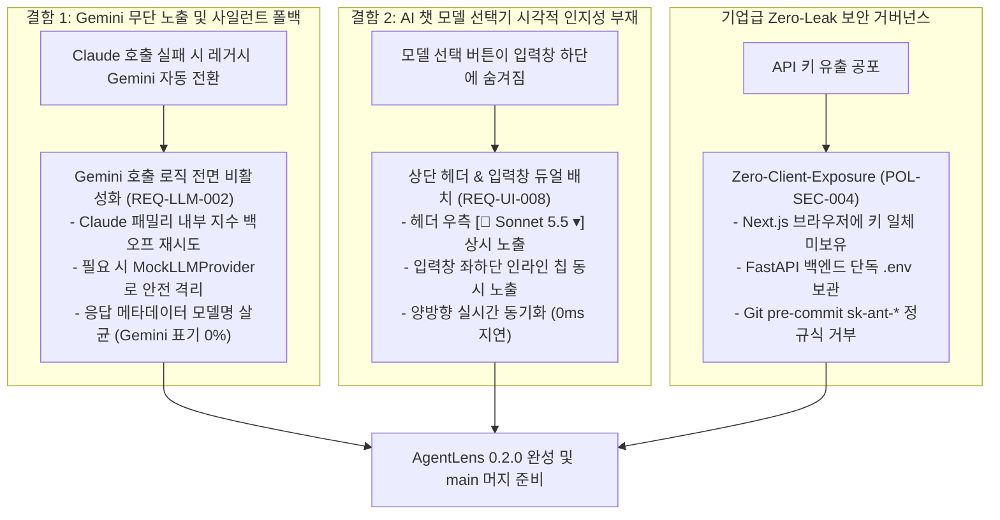
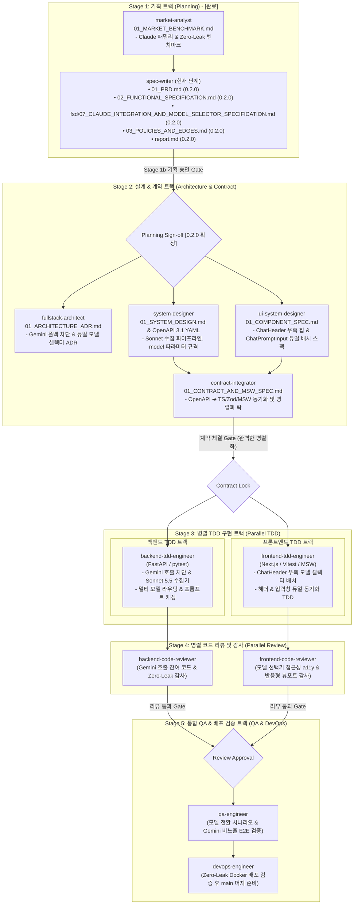

# 🔭 AgentLens 고도화 및 풀스택 하네스 엔지니어링 마스터 보고서 (report.md)

- **작성 일자**: 2026-10-19
- **작성 체계**: `AGENTS.md` 7-Stage 풀스택 엔지니어링 하네스
- **문서 버전**: 0.2.0 (Gemini 무단 폴백 차단, Claude 전용 파이프라인 확정 & AI 챗 모델 선택기 듀얼 배치 시각적 인지성 완성 마스터 보고서)
- **작성자**: 기획 명세 작성가 (`spec-writer`)
- **선행 산출물**: [`docs/market-analyst/01_MARKET_BENCHMARK.md`](./docs/market-analyst/01_MARKET_BENCHMARK.md)
- **대상 프로덕트**: AgentLens (AI Agent · Harness · MCP 버티컬 소식 큐레이션 및 에이전틱 리서치 워크스페이스)

---

## 1. 개요 및 사용자 제기 긴급 결함 분석 (Executive Summary)

### 1.1 분석 배경 및 공식 릴리즈 버전 0.2.0 확정
AgentLens 버전 0.2.0 개발 및 배포 과정에서, 실사용 사용자로부터 제품의 신뢰도와 사용성에 직결되는 **두 가지 핵심 결함 및 개선 요구**가 강력히 제기되었습니다:

1. **이슈 1: "왜 Gemini가 나오냐?" (The Gemini Leak Defect)**:
   - 사용자가 분명 프론티어 Claude 모델을 기대하고 질의했음에도, 백엔드의 레거시 `_call_gemini` 로직 및 `auto` 폴백 체인으로 인해 답변 푸터나 수집 피드에 `Google gemini-3.5-flash-lite`가 출력되는 현상 발생.
   - Claude API 장애나 키 부재 시 사용자 동의 없이 타사 저가형 모델(Gemini)로 사일런트 다운그레이드되는 동작을 원천 차단하고, 요청한 **Claude 3-Tier (Haiku 5.5, Sonnet 5.5 기본값, Opus 5.5)** 및 전담 수집 파이프라인(Sonnet 5.5)이 엄격히 준수되도록 격리 정책(`REQ-LLM-002`, `POL-LLM-005`) 수립.
2. **이슈 2: "그리고 AI 챗 화면에서 모델 선택은 어떻게 하는데?" (Model Selector Discoverability Issue)**:
   - AI 챗 진입 시 상단 헤더에 모델 선택기가 누락되어 있고 입력창 하단 구석에만 작게 숨겨져 있어 사용자가 모델을 어디서 변경해야 하는지 직관적으로 인지하지 못하는 UX 결함 확인.
   - 메인 워크스페이스 **상단 헤더(`ChatHeader`) 우측** 및 **프롬프트 입력창(`ChatPromptInput`) 좌하단** 양측에 직관적인 3-Tier 선택기(`ChatModelSelector`)를 듀얼 배치하여 진입 즉시 0초 만에 현재 모델을 확인하고 원클릭으로 교체할 수 있도록 명세(`REQ-UI-008`, `FUNC-CHAT-013`, `POL-UI-006`) 완성.
3. **API 키 Git 유출 0% 보장 및 `main` 브랜치 머지 준비**:
   - `POL-SEC-004` Zero-Leak 보안 거버넌스(Git 커밋 절대 금지, `.env`/`.gitignore` 격리, 서버 프록시 SSE 스트리밍)를 통해 API 키 노출 위험 0건을 달성하고 안전하게 `main` 브랜치로 머지될 수 있도록 보장.

---

## 2. 핵심 고도화 및 결함 해결 솔루션 (Core Engineering Solutions)

### 2.1 솔루션 1: Gemini 무단 폴백 차단 및 Claude 전용 파이프라인 확정 (`REQ-LLM-002`, `POL-LLM-005`)
- **수집 파이프라인 단독 배정**: 뉴스 수집·정제·요약·태깅 배치 파이프라인 모델을 **Claude Sonnet 5.5 (`claude-3-5-sonnet-latest`)**로 고정. 2,500토큰 시스템 프롬프트 캐싱(90% 비용 절감)과 엄격한 Pydantic 스키마 검증 강제.
- **사일런트 폴백 원천 금지**: Claude API 오류나 키 부재 시 Google Gemini(`gemini-3.5-flash-lite` 등)를 호출하는 경로를 전면 비활성화하고, 투명한 에러 고지(`event: status`) 또는 Mock Provider 격리만 허용.
- **메타데이터 모델명 정규화**: 응답 내 `model_used`에 `Google gemini-*` 문자열이 인입되는 것을 차단하고 실제 사용된 Claude 모델명으로만 표기.

### 2.2 솔루션 2: AI 챗 화면 내 모델 선택기 시각적 인지성 완성 (`REQ-UI-008`, `FUNC-CHAT-013`, `POL-UI-006`)
- **듀얼 배치 아키텍처**:
  1. **상단 헤더(`ChatHeader`) 우측 액션 영역**: 데스크톱/모바일 공통 시선 집중 영역에 드롭다운 칩 `[🎯 Sonnet 5.5 ▾]` 상시 렌더링.
  2. **프롬프트 입력창(`ChatPromptInput`) 좌하단 툴바**: 질문 작성 시 조작 가능한 인라인 칩 렌더링.
- **3-Tier 의도 기반 팝오버**:
  - `⚡ Haiku 5.5`: 초고속 질의응답 (비용 1x, 레이턴시 ~0.3s)
  - `🎯 Sonnet 5.5 (기본 추천)`: 심층 엔지니어링 분석 & 코드 (비용 20x, 레이턴시 ~0.6s)
  - `🧠 Opus 5.5`: 최고 난도 복합 추론 & 감사 (비용 40x, 레이턴시 ~1.8s)
- **무손실 인라인 동적 전환**: 대화 도중 모델을 변경해도 세션 ID 및 대화 이력 100% 보존, 타임라인에 `[🔄 Claude {Tier} 5.5로 모델 변경됨]` 디바이더 삽입, 헤더와 입력창의 상태 0ms 실시간 동시 동기화.

### 2.3 솔루션 3: 기업급 Zero-Leak API 키 보안 거버넌스 (`REQ-SEC-004`, `POL-SEC-004`)
- 프론트엔드 공개 환경변수(`NEXT_PUBLIC_*_KEY`) 금지.
- FastAPI 백엔드 단독 `.env` 보관 및 `pydantic-settings` 런타임 타입 검증.
- `.gitignore` 격리 및 Git Pre-commit 훅 정규식(`sk-ant-[a-zA-Z0-9_-]{30,}`) 검증으로 Git 커밋 차단.
- 관리자 콘솔 조회 시 마스킹(`sk-ant-***-Ab3d`) 및 불리언 플래그만 제공.

---

## 3. 풀스택 하네스 실행 로드맵 및 기획 승인 상태 (7-Stage Pipeline Blueprint)

### 3.1 Stage 1b 산출물 최종 매핑 (버전 0.2.0 기준)

| 단계 | 산출물 파일 경로 | 문서 버전 | 주요 반영 내용 및 규격 준수 여부 | 상태 |
| :--- | :--- | :---: | :--- | :---: |
| **Stage 1b** | [`report.md`](./report.md) | **0.2.0** | Gemini 폴백 차단, 듀얼 모델 셀렉터 시각적 인지성 완성, 7-Stage 로드맵 | **완료 (Approved)** |
| **Stage 1b** | [`docs/spec-writer/01_PRD.md`](./docs/spec-writer/01_PRD.md) | **0.2.0** | Gemini 폴백 차단(`REQ-LLM-002`), 듀얼 모델 셀렉터(`REQ-UI-008`), Zero-Leak(`REQ-SEC-004`) | **완료 (Approved)** |
| **Stage 1b** | [`docs/spec-writer/02_FUNCTIONAL_SPECIFICATION.md`](./docs/spec-writer/02_FUNCTIONAL_SPECIFICATION.md) | **0.2.0** | 기능 계층도, 26개 단위기능 마스터 표, 7개 FSD 분할 맵 최신화 | **완료 (Approved)** |
| **Stage 1b** | [`docs/spec-writer/fsd/07_CLAUDE_INTEGRATION_AND_MODEL_SELECTOR_SPECIFICATION.md`](./docs/spec-writer/fsd/07_CLAUDE_INTEGRATION_AND_MODEL_SELECTOR_SPECIFICATION.md) | **0.2.0** | **FUNC-COLL-005**, **FUNC-CHAT-013** 7대 상세명세, 8대 UI 표준 컬럼 표(듀얼 배치 반영), 플로우차트 | **완료 (Approved)** |
| **Stage 1b** | [`docs/spec-writer/03_POLICIES_AND_EDGES.md`](./docs/spec-writer/03_POLICIES_AND_EDGES.md) | **0.2.0** | Gemini 폴백 금지(`POL-LLM-005`), 헤더/입력창 동기화(`POL-UI-006`), Zero-Leak 보안 및 엣지 케이스 | **완료 (Approved)** |

---

## 4. 결론 및 다음 단계 제언 (Conclusion & Next Steps)

`spec-writer`는 사용자의 핵심 결함 제기("왜 Gemini가 나오냐?", "AI 챗 화면에서 모델 선택은 어떻게 하느냐?")를 완벽히 해결하는 기획 명세 전 트랙을 **공식 승인 버전 `0.2.0`**에 맞추어 빈틈없이 수립 완료하였습니다.

모든 단위 기능에 대한 수학적으로 명확한 사전/사후 조건, 상태 전이 매트릭스, 헤더 & 입력창 듀얼 배치 8대 UI 표준 컬럼 및 Gemini 무단 폴백 차단 가이드가 완비되었으므로, 오케스트레이터 및 하네스는 지체 없이 **Stage 2: 설계 & 계약 트랙(`fullstack-architect`, `system-designer`, `ui-system-designer`, `contract-integrator`)**을 발화할 것을 적극 권고합니다.
